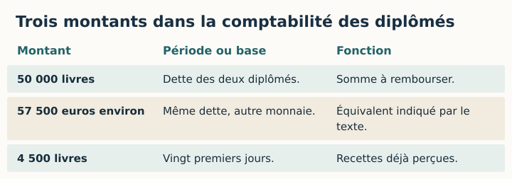

# ENS Rennes · D1 · Allemand 2012 — Corrigé brut

*Corrigé rédigé par IA, non officiel. Signalez toute erreur.*

**Rédaction** · GPT-6.2 Astra Ultra · vitesse non renseignée

Le feuillet de l’École normale supérieure de Cachan est conservé dans les archives du concours D1 de Rennes. Markus Böhm · Der Spiegel · 26 octobre 2011.

## Version française

Moyennant rémunération, bien des étudiants ont déjà transformé leur voiture en colonne publicitaire roulante. Quant aux tee-shirts portant des logos d’entreprises, la plupart en portent volontiers. On a même déjà vu des tatouages sponsorisés arborant des noms de marques. Deux diplômés du Selwyn College de Cambridge veulent désormais occuper l’un des derniers créneaux encore libres. Ils louent leur visage comme espace publicitaire. Les deux jeunes diplômés maquillés s’appellent Ross Harper, 21 ans, et Ed Moyse, 22 ans. L’un a obtenu cet été son diplôme de neurosciences, l’autre de sciences économiques. Depuis le début du mois d’octobre, les deux Britanniques proposent leurs services de panneaux publicitaires vivants sur le site Buymyface.com. […]

Ross et Ed entendent louer leur figure pendant un an. Avec les recettes de l’opération, ils veulent rembourser leurs dettes d’études, qui s’élèvent à eux deux à 50 000 livres, soit environ 57 500 euros. Ross se réjouit du succès de leur entreprise. « Au cours des vingt premiers jours, nous avons gagné 4 500 livres. » Se peindre le visage est actuellement leur seul emploi à tous les deux, précise le diplômé. « La situation sur le marché du travail est difficile. Presque aucun de nos amis n’a trouvé de poste dès la fin de ses études. » […]

Chaque matin, ils peignent l’un sur le visage de l’autre la publicité du jour. Dans la journée, ils se photographient pour en apporter la preuve et mettent les clichés en ligne. Un calendrier sur leur site indique quelle entreprise les rémunère à quelle date. C’est aux entreprises de décider si Ross et Ed porteront le même motif ou deux motifs différents. À l’exception de ce qui serait choquant ou insultant, les deux amis sont disposés, disent-ils, à se laisser peindre n’importe quoi sur le front, la bouche et le nez.

## Expression en allemand

Prendre position sur l’endettement des étudiants pour financer leurs études · environ 100 mots.

Ein Studienkredit kann jemandem den Zugang zur Universität ermöglichen, dessen Familie die Ausbildung nicht bezahlen kann. Trotzdem finde ich es bedenklich, wenn Schulden zur Voraussetzung für ein Studium werden. Zwei gleich begabte junge Menschen gehen ein unterschiedliches Risiko ein, wenn nur einer bei Arbeitslosigkeit auf familiäre Hilfe zählen kann. Außerdem könnte die Aussicht auf hohe Raten die Wahl des Berufs beeinflussen. Eine Absolventin würde vielleicht gern an einer Schule arbeiten, nimmt aber zunächst eine besser bezahlte Stelle an. Deshalb sollten Stipendien den Grundbedarf decken. Für ergänzende Kredite wäre eine Rückzahlung sinnvoll, die sich nach dem späteren Einkommen richtet.

*98 mots, comptés par espaces.*

[Feuillet original, p. 2](https://www.ens-rennes.fr/medias/fichier/se1a_12d1_lv_1336729294135.pdf#page=2) · [Rapport du jury, partie écrite](https://www.ens-rennes.fr/medias/fichier/re1a-12d1-allemand_1421750435471-pdf#page=1)
