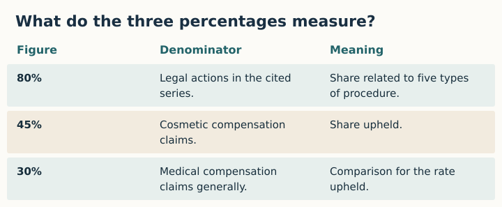

# ENS Rennes · D1 · Anglais 2012 — Corrigé guidé

*Corrigé rédigé par IA, non officiel. Signalez toute erreur.*

**Rédaction** · GPT-6.2 Astra Ultra · vitesse non renseignée

Le feuillet de l’École normale supérieure de Cachan est conservé dans les archives du concours D1 de Rennes. Adapté de The Guardian · 8 janvier 2012.

## Version française

**De plus en plus de patients poursuivent des chirurgiens plasticiens à la suite d’interventions esthétiques ratées**

Un nombre croissant de patients engagent des poursuites contre des chirurgiens plasticiens à la suite d’erreurs commises lors d’interventions destinées à améliorer leur apparence. C’est ce qu’indique la Medical Defence Union, organisme qui représente plus de la moitié des médecins et chirurgiens britanniques lorsqu’ils sont mis en cause pour faute professionnelle ou négligence.

Selon ses données, la chirurgie mammaire, les liftings, les opérations des paupières, les réductions du nez et les interventions destinées à faire perdre du poids représentent 80 % de ces actions en justice, de plus en plus nombreuses. Des erreurs ont donné lieu au versement de plus de 500 000 livres de dommages et intérêts. Les demandes d’indemnisation faisant suite à une intervention de chirurgie esthétique aboutissent dans 45 % des cas, contre 30 % pour l’ensemble des demandes d’indemnisation dans le domaine médical.

Selon la MDU, cette hausse tenait à « la très forte augmentation du nombre d’interventions comme des attentes des patients, qui espèrent un résultat parfait ». Elle s’expliquait aussi par le fait que certains chirurgiens ne recueillaient pas le consentement de leurs patients dans les conditions requises ou effectuaient des interventions de qualité insuffisante.

Vendredi, le gouvernement a déclaré que les femmes inquiètes au sujet de leurs implants mammaires fabriqués par PIP, la société française au cœur du scandale, devraient pouvoir les faire retirer sans frais, soit par le service national de santé, le NHS, en cas de reconstruction après un cancer du sein, soit par leur clinique de chirurgie esthétique.

La docteure Clare Gerada, présidente du Royal College of General Practitioners, organisation professionnelle des médecins généralistes, a estimé que le scandale des implants mammaires PIP, dont on découvrait l’ampleur, montrait la nécessité d’une réglementation obligeant les cliniques à offrir réparation aux patientes et patients auxquels elles avaient causé un préjudice.

## Expression en anglais

Discuter du risque et de la responsabilité dans la société contemporaine à partir de cet exemple · environ 100 mots.

Accepting a risk does not mean accepting negligence. A patient can agree to an operation after discussing possible complications and still have a justified claim if the clinic fails to meet professional standards. Conversely, an unwanted result alone does not establish that a surgeon acted carelessly. The example also raises a collective question. Patients usually know less about a device than its manufacturer or the authority that regulates it. Clear information, independent checks and an accessible way to obtain redress help allocate responsibility fairly. They also preserve the trust on which a genuinely informed decision depends.

*96 mots, comptés par espaces.*

## Comment construire la réponse

Dans le titre, *sue* signifie « poursuivre en justice ». Dans le premier paragraphe, la relative en *which* a pour antécédent la Medical Defence Union. Le rapport souligne les erreurs commises sur *over*, qui signifie ici « au sujet de », et sur le lexique de l’indemnisation. Le terme *damages* au pluriel correspond aux dommages et intérêts. Il se distingue de *damage*, le dommage subi. Le rapport insiste également sur la progression qui va du constat initial à la demande de réglementation de la profession.

Les 80 % et les 45 % ont des dénominateurs différents. Les premiers concernent la répartition des actions entre catégories d’interventions. Les seconds portent sur l’issue des demandes d’indemnisation en chirurgie esthétique. Les 30 % servent à comparer ce taux à celui de l’ensemble des demandes d’indemnisation médicale. Dans votre expression personnelle, distinguez un risque dûment expliqué, une faute professionnelle et les responsabilités de contrôle du fabricant ou des autorités.

[Feuillet original, p. 3](https://www.ens-rennes.fr/medias/fichier/se1a_12d1_lv_1336729294135.pdf#page=3) · [Rapport du jury, partie écrite](https://www.ens-rennes.fr/medias/fichier/re1a-12d1-anglais_1421750441295-pdf#page=1)
