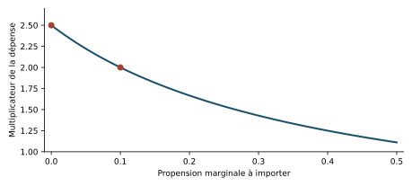
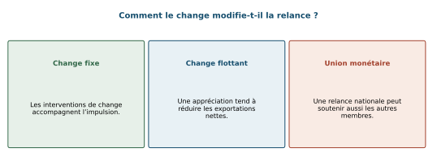

# ENS de Cachan D1 — Composition d’ordre économique 2012 · Corrigé brut

*Corrigé rédigé par IA, non officiel. Signalez toute erreur.*

**Lecture du rapport du jury** · GPT-6.2 Astra Ultra · vitesse non renseignée

**Rédaction** · GPT-6.2 Astra Ultra · vitesse non renseignée

## La politique budgétaire a-t-elle encore un rôle ?

### Introduction

Une récession réduit spontanément les recettes fiscales et augmente les dépenses d’indemnisation. Le déficit peut donc s’aggraver sans décision nouvelle. À l’inverse, un gouvernement peut voter de grands travaux et constater, en fin d’année, que le surcroît de production ne correspond pas au coût du programme. Pour juger du rôle du budget, il faut distinguer la réaction automatique des comptes publics, la décision discrétionnaire et le résultat rapporté à ce qui se serait passé sans elle.

La politique budgétaire utilise les achats, les transferts et les prélèvements des administrations pour agir sur l’économie. Elle assure durablement des fonctions d’allocation et de redistribution. Le mot « encore » interroge surtout sa capacité de stabilisation après l’ouverture des économies, l’entrée en union monétaire et la crise financière. Un État très endetté dispose-t-il encore d’un levier d’activité quand il ne maîtrise pas toutes les réactions à sa décision ? Le budget agit par des mécanismes identifiables, dont l’intensité dépend du cycle et du régime monétaire. La contrainte intertemporelle et les interdépendances nationales invitent à choisir la composition et le moment de l’impulsion.

### I. Le budget conserve une puissance stabilisatrice conditionnelle

#### A. La demande publique et les stabilisateurs soutiennent le revenu en récession

Dans un modèle keynésien à prix rigides et avec capacités disponibles, une commande publique supplémentaire accroît directement la demande. Le revenu distribué engendre une consommation supplémentaire, puis d’autres revenus. Avec une propension marginale à consommer $c$, un taux marginal de prélèvement $t$ et une propension marginale à importer $m$, l’équilibre simplifié donne $\Delta Y/\Delta G=1/[1-c(1-t)+m]$ à taux d’intérêt fixé. Si $c=0{,}8$, $t=0{,}25$ et $m=0{,}10$, le multiplicateur est 2. Une commande de 10 accroît la production nationale de 20 dans cette expérience. Sans importer, le multiplicateur serait 2,5. Ces valeurs décrivent des hypothèses, non un engagement sur le résultat effectif.

Un transfert agit d’abord sur le revenu disponible. Son effet immédiat dépend de la part dépensée. Des ménages contraints de liquidité consommeront probablement une plus grande fraction d’une aide temporaire que des ménages capables de lisser leur consommation. Le système fiscal et les prestations amortissent spontanément une baisse des revenus. Leur rapidité évite une partie des délais de décision, mais le soutien risque d’être insuffisant si la récession est profonde. Il faut distinguer ce déficit conjoncturel d’un déficit structurel qui persisterait à production potentielle.

#### B. Les taux d’intérêt et le régime de change modifient la transmission

Dans IS-LM, l’expansion budgétaire déplace IS vers la droite. Si la quantité réelle de monnaie ne change pas, la hausse du revenu accroît la demande de monnaie et le taux d’intérêt, ce qui déprime l’investissement privé. Cette éviction interne réduit le multiplicateur. Elle est plus faible si le taux réagit peu ou si des capacités sont inutilisées et que l’investissement répond surtout aux débouchés. À proximité de la pleine utilisation, une commande publique peut évincer physiquement un projet privé en mobilisant les mêmes machines et salariés. L’éviction passe alors aussi par les prix.

Dans le modèle de Mundell-Fleming d’une petite économie à capitaux parfaitement mobiles, une relance sous taux de change flottant engendre des pressions à l’appréciation. La perte d’exportations nettes peut, dans le cas limite, neutraliser l’effet sur la production. Sous change fixe, les interventions monétaires nécessaires au maintien de la parité accompagnent la relance et renforcent son effet. Ces conclusions supposent prix rigides, anticipations de change simples et mobilité des capitaux. Dans la zone euro, un pays ne possède ni taux de change interne ajustable ni banque centrale nationale fixant seule l’orientation monétaire. Le membre importateur transmet une partie de sa demande à ses partenaires. Une action simultanée à l’échelle de l’union peut récupérer une partie de cette fuite.

### II. Une capacité durable dépend des anticipations, du financement et de la coordination

#### A. Le financement intertemporel limite les impulsions et renseigne sur leur calendrier

Le déficit primaire accroît l’endettement, auquel s’ajoutent les intérêts. Si $b$ désigne la dette rapportée au PIB, $r$ le taux d’intérêt réel, $g$ le taux de croissance réel et $s$ le solde primaire excédentaire rapporté au PIB courant, on a approximativement $\Delta b=(r-g)b-s$. Pour une dette de 80 % du PIB et un écart $r-g$ de deux points, il faut environ 1,6 % de PIB d’excédent primaire pour stabiliser le ratio, hors ajustements patrimoniaux. Une charge élevée et un coût de financement sensible à la confiance restreignent les choix futurs. Mais une consolidation immédiate qui comprime fortement le PIB peut ralentir à court terme la baisse du ratio en réduisant son dénominateur.

L’équivalence ricardienne met en évidence une autre limite. Sous des hypothèses exigeantes, dont marchés du crédit parfaits, prélèvements forfaitaires, prévoyance et horizon intergénérationnel approprié, remplacer l’impôt présent par la dette ne change pas la richesse perçue à dépense publique donnée. Les ménages épargnent la baisse d’impôt en anticipation des prélèvements futurs. Elle n’annule pas pour autant l’effet de toute dépense publique. Les ménages contraints, l’incertitude sur la répartition des impôts ou les différences d’horizon écartent le résultat d’équivalence. L’infrastructure financée peut elle-même accroître l’offre future, tandis qu’une dépense rapidement engagée mais sans utilité durable peut dégrader le patrimoine public net.

#### B. Dans l’union monétaire, les choix nationaux produisent des effets collectifs

En 2012, la politique monétaire de la zone euro est commune, alors que les budgets nationaux demeurent le principal instrument national de stabilisation. Une récession propre à une seule économie peut nécessiter une réaction que la banque centrale, attentive à l’ensemble de la zone, ne fournirait pas. Les transferts sociaux et les stabilisateurs nationaux gardent ici une fonction. Une dette excessive peut cependant accroître la prime de risque et fragiliser les partenaires financiers. Le cadre européen de surveillance des déficits et des dettes, notamment l’article 126 du TFUE, cherche à encadrer cette interdépendance. La contrainte juridique ne détermine pas à elle seule l’ampleur du multiplicateur.

À l’inverse, des consolidations simultanées réduisent les importations de chaque État au moment même où ses partenaires comptent sur leurs exportations. Une coordination doit prendre en compte à la fois les marges de financement nationales et cet effet de débouché. Des stabilisateurs préservés pendant une chute de l’activité et une trajectoire de moyen terme crédible peuvent mieux concilier les deux objectifs qu’un ajustement identique dans toutes les conjonctures. Il faut enfin évaluer la composition de l’ajustement, sa réversibilité et la valeur des services rendus, par exemple une dépense d’entretien qui évite une réparation future plus coûteuse.

### Conclusion

Le budget conserve une fonction d’assurance collective, d’investissement et de stabilisation. Pour en juger, il faut demander quelle dépense ou quel prélèvement change, dans quel état du cycle, avec quel financement et quelles réactions des partenaires. Une décision budgétaire a encore un rôle lorsque son effet sur l’activité présente et la capacité productive future justifie son coût, et lorsqu’une trajectoire crédible permet de maintenir le service de la dette.

[Sujet de la session](https://www.ens-rennes.fr/medias/fichier/se1a_12d1_dis_1336740697530.pdf) · [Rapport du jury](https://www.ens-rennes.fr/medias/fichier/re1a-12d1-economie_1421750452045-pdf) · [Traité sur le fonctionnement de l’Union, article 126](https://eur-lex.europa.eu/legal-content/FR/TXT/?uri=CELEX:12008E126)
