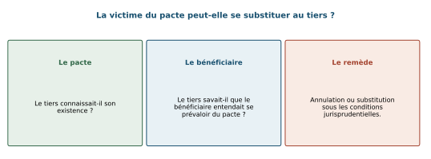
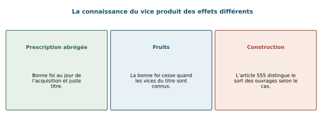

# ENS de Cachan D1 — Droit civil 2012 · Corrigé brut

*Corrigé rédigé par IA, non officiel. Signalez toute erreur.*

**Lecture du rapport du jury** · GPT-6.2 Astra Ultra · vitesse non renseignée

**Rédaction** · GPT-6.2 Astra Ultra · vitesse non renseignée

## La sanction de la mauvaise foi

### Introduction

Le vendeur d’un immeuble tait sciemment un défaut décisif. Un occupant perçoit des loyers tout en sachant que le titre qui lui a été remis est vicié. Le premier a pu provoquer un consentement trompé, le second a pu conserver des fruits auxquels il n’avait pas droit. La qualification commune de mauvaise foi n’explique encore ni qui doit la prouver, ni ce que la victime peut obtenir.

La mauvaise foi peut désigner la connaissance d’un vice ou l’exercice déloyal d’une prérogative. La sanction civile peut retirer un avantage, paralyser une clause, anéantir un acte ou réparer un dommage. En 2012, l’article 1134, alinéa 3, du Code civil impose la bonne foi dans l’exécution des conventions. L’article 2274, en matière de prescription acquisitive, présume la bonne foi et place la preuve contraire à la charge de celui qui l’allègue. L’un et l’autre texte n’instaurent pas une peine générale pour déloyauté. Comment le droit rend-il la mauvaise foi juridiquement opérante sans substituer un jugement moral aux conditions de chaque action ? Il faut identifier l’état d’esprit ou l’abus que la règle exige, puis relier la sanction à la fonction de l’institution atteinte.

### I. L’état d’esprit ne devient sanctionnable que dans une situation légalement qualifiée

#### A. Former un contrat et l’exécuter ne posent pas le même problème

Lors des pourparlers, chaque partie conserve la liberté de ne pas conclure. Rompre après avoir entretenu trompeusement une négociation très avancée peut toutefois constituer une faute délictuelle sur le fondement de l’ancien article 1382. Les frais exposés en pure perte peuvent constituer un dommage réparable. Dans l’arrêt Manoukian du 26 novembre 2003, la Cour de cassation refuse d’indemniser, comme conséquence de la faute dans la rupture, la perte d’une chance de réaliser les gains qu’aurait permis le contrat non conclu. Qualifier la rupture de déloyale n’équivaut donc ni à contraindre à conclure ni à garantir le profit espéré.

Une fois le contrat conclu, c’est la qualité du consentement qui peut être en jeu. L’ancien article 1116 permet à la victime de demander la nullité relative pour dol lorsque les manœuvres du cocontractant ont déterminé son consentement. Une dissimulation intentionnelle peut constituer une réticence dolosive dans les conditions admises par la jurisprudence. L’intention, la tromperie et son caractère déterminant doivent être établis. Une erreur spontanée de l’acquéreur ne démontre aucun dol du vendeur. Dans l’exemple de l’immeuble, il faut comparer les informations effectivement connues et dissimulées à la décision que l’acquéreur aurait prise en les connaissant.

#### B. La connaissance exigée se prouve à la date et au degré pertinents

La seule violation d’une obligation suffit parfois à établir l’inexécution mais ne prouve pas que le débiteur a voulu tromper ou connaissait le vice. Lettres, avertissements reçus, contradiction entre engagements pris et actes accomplis ou qualité de professionnel peuvent servir à la démonstration, selon la règle applicable. Le dol de formation ne se présume pas. De même, en matière de prescription, celui qui soutient la mauvaise foi doit renverser la présomption de l’article 2274. L’article 2275 précise que la bonne foi au moment de l’acquisition suffit pour la prescription abrégée. Une connaissance ultérieure peut en revanche modifier le droit aux fruits.

Le pacte de préférence illustre la précision du contrôle. Selon la chambre mixte du 26 mai 2006, le bénéficiaire peut obtenir l’annulation de la vente à un tiers et sa substitution si le tiers connaissait, au moment de contracter, l’existence du pacte et l’intention du bénéficiaire de s’en prévaloir. Prouver seulement que l’acquéreur connaissait le pacte laisse manquer le second élément. La seule impression de collusion ne remplace aucune des deux connaissances. Entre les parties au pacte, la méconnaissance de l’engagement peut néanmoins engager la responsabilité du promettant, sur un fondement distinct.

### II. La sanction répond à la fonction de la règle méconnue

#### A. Protéger la confiance et faire obstacle à un usage déloyal du contrat

Le dol déterminant affecte la formation et peut conduire à l’annulation, avec restitutions, tandis qu’une faute ayant causé un dommage peut ouvrir droit à réparation dans les conditions correspondantes. Lors de l’exécution, l’ancien article 1134 commande une exécution loyale. Un bailleur qui, par sa propre manœuvre, empêche le règlement puis invoque une clause résolutoire s’expose à ce que son exercice de mauvaise foi soit privé d’effet. Le contrat peut ainsi se poursuivre. Paralyser cet usage particulier diffère de déclarer la clause illicite en elle-même. La jurisprudence du 10 juillet 2007 rappelle que sanctionner l’usage déloyal d’une prérogative contractuelle ne permet pas d’atteindre la substance même des droits et obligations convenus.

La mauvaise foi peut également aggraver les conséquences pécuniaires. Sous l’ancien article 1150, en l’absence de dol du débiteur, les dommages-intérêts sont en principe limités aux dommages prévisibles au jour du contrat. Une inexécution dolosive peut lever cette limite, tandis que l’article 1151 conserve l’exigence d’un préjudice direct et immédiat. Il faut donc prouver le dommage et son lien avec l’inexécution. Pour le vendeur qui connaissait le vice caché, l’article 1645 ajoute des dommages-intérêts à la restitution du prix selon le régime de garantie. L’aggravation s’explique par la connaissance du défaut dans un contrat dont le texte règle spécialement les suites.

#### B. Retirer à un possesseur les avantages que justifiait sa croyance légitime

Dans les rapports de propriété, le droit tire d’abord les conséquences de la revendication. Les articles 549 et 550 permettent au possesseur de bonne foi de faire les fruits siens. Il doit se croire propriétaire en vertu d’un titre translatif dont il ignore les vices. Dès qu’il les connaît, il cesse d’être de bonne foi. Si l’occupant qui perçoit les loyers est informé d’un vice par des éléments probants, il faut déterminer la date de cette connaissance et distinguer les fruits perçus avant et après. La restitution remet les utilités au propriétaire dans les conditions légales. Elle ne suppose pas de fixer un montant arbitraire proportionnel à une indignité morale.

En matière immobilière, l’article 2272 ouvre le délai abrégé de dix ans à l’acquéreur de bonne foi muni d’un juste titre. Celui dont la mauvaise foi est démontrée perd cette voie, mais peut encore invoquer le délai de trente ans s’il justifie d’une possession utile. La privation d’un privilège de délai diffère de l’impossibilité de prescrire. Enfin, l’article 555 distingue le sort des constructions élevées sur le terrain d’autrui. Le propriétaire du sol peut, dans les conditions du texte, en exiger la suppression aux frais du tiers constructeur de mauvaise foi. Si le tiers évincé était de bonne foi au sens du régime des fruits, le propriétaire ne peut exiger la suppression et doit indemniser selon les modalités prévues. Le titre, la connaissance et la nature des travaux importent davantage qu’une appréciation abstraite des personnes.

### Conclusion

La mauvaise foi ne commande pas une sanction unique. Le droit civil de 2012 en recherche les indices et en mesure les effets à l’intérieur d’institutions précises. La formation du contrat protège un consentement libre, l’exécution protège la confiance légitime et le droit des biens attribue les utilités de la chose en tenant compte d’une croyance justifiée. La victime obtient le remède attaché à la règle dont elle établit les conditions.

[Sujet de la session](https://www.ens-rennes.fr/medias/fichier/se1a_12d1_dt_civil_1336729319746.pdf) · [Rapport du jury](https://www.ens-rennes.fr/medias/fichier/re1a-12d1-droitcivil_1421750446710-pdf) · [Code civil en avril 2012](https://www.legifrance.gouv.fr/codes/texte_lc/LEGITEXT000006070721/2012-04-01/)
