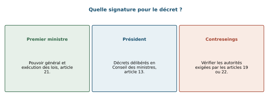
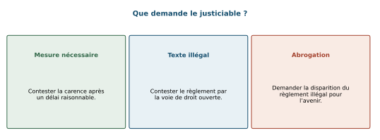

# ENS de Cachan D1 — Droit public 2012 · Corrigé brut

*Corrigé rédigé par IA, non officiel. Signalez toute erreur.*

**Lecture du rapport du jury** · GPT-6.2 Astra Ultra · vitesse non renseignée

**Rédaction** · GPT-6.2 Astra Ultra · vitesse non renseignée

## L’exercice du pouvoir réglementaire en France

### Introduction

Une loi prévoit une prestation mais renvoie à un décret la fixation du dossier nécessaire pour l’obtenir. Tant que le décret manque, une disposition votée peut rester inopérante. Une fois le texte publié, les usagers peuvent encore soutenir qu’il a été pris par la mauvaise autorité ou qu’il ajoute une condition que la loi ne prévoyait pas. L’exercice du pouvoir réglementaire comprend ainsi l’attribution d’une compétence, son emploi concret et la possibilité d’en contrôler aussi bien l’usage que l’abstention.

Le règlement est un acte administratif de portée générale et impersonnelle. Un décret peut porter une décision individuelle et un arrêté municipal peut contenir un règlement. La forme de l’acte ne suffit pas à le définir. La Ve République mérite une attention particulière, car la Constitution de 1958 distingue un domaine législatif et un domaine réglementaire, tout en confiant normalement l’exécution des lois au Premier ministre. Ce cadre prolonge des pouvoirs administratifs plus anciens, comme la compétence du chef de service. Comment exercer une compétence générale nécessaire à l’action publique tout en la distribuant entre autorités et en assurant le contrôle de son exercice ?

### I. La Constitution ordonne une compétence générale dont l’exercice est distribué

#### A. Le Premier ministre et le président interviennent suivant une répartition juridique précise

L’article 21 prévoit que le Premier ministre assure l’exécution des lois et, sous réserve de l’article 13, exerce le pouvoir réglementaire. Un règlement d’application précise une disposition législative dans le respect de sa portée. En parallèle, l’article 37 attribue un caractère réglementaire aux matières autres que celles du domaine de la loi. Ce pouvoir autonome n’est donc pas subordonné à l’existence d’une loi d’habilitation particulière, mais il demeure soumis aux normes supérieures. Une disposition législative entrée dans cette matière ne devient pas inexistante. L’article 37, alinéa 2, organise la procédure qui permet de modifier par décret certains textes de forme législative, avec des conditions distinctes selon leur date et, pour les textes postérieurs à 1958, une déclaration préalable du Conseil constitutionnel.

Le président signe les décrets délibérés en Conseil des ministres en vertu de l’article 13. Dans Meyet du 10 septembre 1992, le Conseil d’État tire cette compétence du fait de la délibération en Conseil des ministres, même lorsque aucun texte ne l’imposait. Les décrets ordinaires relèvent du Premier ministre. Les règles de contreseing doivent être vérifiées selon l’auteur de l’acte et les articles 19 et 22. En période de cohabitation, le président et le gouvernement peuvent appartenir à des majorités différentes. La maîtrise de la délibération en Conseil des ministres et la nécessité de certaines signatures prennent alors un poids politique accru. La divergence politique ne transfère pas juridiquement au président tout le pouvoir réglementaire ordinaire.

#### B. Les autres autorités n’exercent que des compétences circonscrites

Un ministre ne possède pas, du seul fait de sa fonction, le pouvoir réglementaire général à l’échelle nationale. Il peut recevoir une habilitation textuelle ou une délégation du Premier ministre dans les conditions prévues. Comme chef de service, il peut aussi prendre les mesures nécessaires à l’organisation des services placés sous son autorité, selon Jamart du 7 février 1936. Une note générale aménageant les conditions d’accès au service relève d’un fondement différent d’une règle de police imposée à l’ensemble des citoyens. La qualité d’auteur ne dispense jamais de rechercher le titre et la portée de sa compétence.

La décentralisation distribue elle aussi des compétences. L’article 72 reconnaît aux collectivités territoriales, dans les conditions prévues par la loi, un pouvoir réglementaire pour l’exercice de leurs compétences. Le maire dispose notamment de pouvoirs de police municipale. Les préfets agissent pour l’État dans les limites de leurs attributions. Enfin certaines autorités administratives indépendantes ou autorités publiques indépendantes peuvent édicter des prescriptions techniques sur habilitation législative. Dans sa décision du 17 janvier 1989 sur la liberté de communication, le Conseil constitutionnel admet qu’une autre autorité de l’État fixe des normes de portée limitée tant par leur champ que par leur contenu. L’expertise spécialisée justifie une compétence circonscrite, sans déposséder le Premier ministre de son pouvoir général.

### II. L’exercice est une activité juridiquement encadrée, parfois obligatoire

#### A. L’autorité compétente doit suivre la procédure et respecter les normes supérieures

La préparation du texte peut requérir l’avis d’un organisme, la consultation du Conseil d’État ou une délibération particulière. Les consultations obligatoires doivent être distinguées des consultations facultatives. La décision Danthony du 23 décembre 2011 précise qu’un vice affectant le déroulement d’une procédure administrative préalable entraîne l’illégalité de l’acte s’il a été susceptible d’influencer le sens de la décision ou a privé les intéressés d’une garantie, sous réserve des règles de compétence. L’appréciation requiert donc un examen de la garantie et de la procédure concrète.

L’auteur doit ensuite respecter la Constitution, les engagements internationaux applicables, la loi et les normes réglementaires supérieures. Un règlement de police publique doit notamment concilier la prévention du trouble avec les libertés affectées. Le juge peut annuler une interdiction dont la portée est excessive dans les circonstances. La publicité conditionne l’opposabilité et l’entrée en vigueur des normes dans les conditions prévues. Le principe de non-rétroactivité des actes administratifs, illustré par Société du journal L’Aurore du 25 juin 1948, interdit en principe de modifier pour le passé les effets juridiques déjà produits. L’ordre du calendrier juridique peut ainsi invalider une mesure que son auteur aurait eu compétence pour prendre pour l’avenir.

#### B. Le contrôle juridictionnel répond au mauvais exercice et au non-exercice

Le recours pour excès de pouvoir permet de demander l’annulation d’un règlement illégal. Un acte individuel d’application peut aussi donner lieu, dans les conditions du contentieux, à la discussion de la légalité du règlement sur lequel il repose. Le juge contrôle compétence, procédure, respect des normes, qualification des faits et finalité. Il n’écrit pas lui-même le règlement à la place de son auteur. Il peut assortir sa décision d’une injonction lorsque l’exécution l’exige.

La faculté d’édicter une règle devient parfois une obligation. Si l’application d’une loi exige des mesures réglementaires, le gouvernement doit les prendre dans un délai raisonnable, comme l’illustre l’arrêt Veuve Renard du 27 novembre 1964. Une carence fautive peut ouvrir droit à indemnisation si elle cause un préjudice réparable. Le refus de prendre les mesures nécessaires peut aussi être contesté. De même, Compagnie Alitalia du 3 février 1989 consacre l’obligation de faire droit à une demande d’abrogation d’un règlement illégal, que l’illégalité soit initiale ou résulte d’un changement ultérieur de droit ou de fait. Abroger fait cesser les effets pour l’avenir. La possibilité de réglementer s’accompagne ainsi du devoir de maintenir la réglementation compatible avec le droit applicable.

### Conclusion

L’exercice du pouvoir réglementaire associe la direction du gouvernement, la mise en œuvre de la loi et des compétences techniques ou territoriales limitées. Son unité ne vient pas d’une signature unique, mais de la soumission de chaque norme à une habilitation et à un contrôle. Le citoyen peut ainsi contester un règlement excessif et, lorsque la loi le requiert, demander que le pouvoir réglementaire soit effectivement exercé.

[Sujet de la session](https://www.ens-rennes.fr/medias/fichier/se1a_12d1_option_1336729336925.pdf#page=3) · [Rapport du jury](https://www.ens-rennes.fr/medias/fichier/re1a-12d1-option-droitpub_1421750482735-pdf) · [Constitution en avril 2012](https://www.legifrance.gouv.fr/loda/id/JORFTEXT000000571356/2012-04-01/) · [CE, Meyet, 10 septembre 1992](https://www.conseil-etat.fr/fr/arianeweb/CE/decision/1992-09-10/140376) · [CE, Danthony, 23 décembre 2011](https://www.conseil-etat.fr/fr/arianeweb/CE/decision/2011-12-23/335033) · [CE, Compagnie Alitalia, 3 février 1989](https://www.conseil-etat.fr/fr/arianeweb/CE/decision/1989-02-03/74052) · [Conseil constitutionnel, 17 janvier 1989](https://www.conseil-constitutionnel.fr/decision/1989/88248DC.htm)
