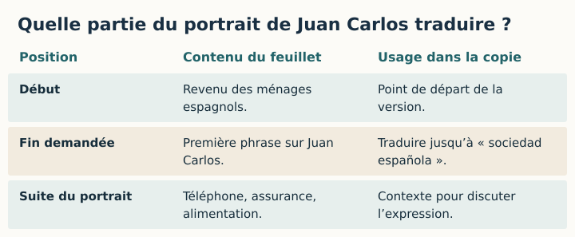

# ENS Rennes · D1 · Espagnol 2012 — Corrigé guidé

*Corrigé rédigé par IA, non officiel. Signalez toute erreur.*

**Rédaction** · GPT-6.2 Astra Ultra · vitesse non renseignée

Le feuillet de l’École normale supérieure de Cachan est conservé dans les archives du concours D1 de Rennes. D’après El País · 5 janvier 2012.

## Version française du passage délimité

En Espagne, 17,1 millions de personnes gagnent environ 1 000 euros brut par mois. Cela représente 63 % de la population. Avec une telle somme en poche, boucler les fins de mois relève de l’exploit herculéen. Bien des familles font moins leurs courses qu’elles ne les passent au crible. Pour des milliers d’Espagnols, acheter un produit aujourd’hui, c’est donc renoncer à autre chose.

Dans ce paysage difficile, le phénomène du bas prix, le *low cost* en anglais, croît, se reproduit et ne semble pas près de mourir. Bien au contraire. Il occupe une place de plus en plus grande dans la société et dans l’économie. Restauration, voyages, voitures, assurances, électronique, immobilier, loisirs, habillement, alimentation. Rien ne semble échapper à l’attrait du bas prix. Peu importe que le prix soit réellement bas ou non, l’important est que la musique soit à peu près la même. Reste à savoir si le bas prix survivra à la fin de la crise, car un jour elle prendra fin. Comment le consommateur aura-t-il changé d’ici là ? Sera-t-il plus rationnel et moins impulsif ? Peut-on donc supposer que la recherche du prix le plus bas est devenue un nouveau mode de vie ?

Ce qui ne fait pas de doute non plus, c’est que le consommateur qui émergera de l’après-*low cost* sera différent de celui d’aujourd’hui. D’abord en raison des nouvelles leçons qu’il aura à tirer. « Avec le bas prix, l’acheteur découvre qu’il peut se procurer des produits similaires à des prix plus bas », observe Javier Vello, responsable de la distribution et de la consommation.

Juan Carlos Esteban, jeune dessinateur technique, marié et père de deux enfants, illustre la manière dont le mode de vie à bas prix s’est peu à peu imposé à une bonne partie de la société espagnole.

## Expression en espagnol

Analyser l’image du bas prix et discuter son efficacité pour les bas salaires · au moins 100 mots.

La expresión « bajo coste » sugiere que una persona inteligente sabe descubrir una oportunidad. Sin embargo, también describe la necesidad de quienes comparan cada precio porque su sueldo apenas cubre los gastos del mes. Para una familia, cambiar de compañía telefónica puede liberar dinero sin reducir mucho la calidad del servicio. En cambio, comprar un billete barato que luego exige pagar por cada prestación puede resultar decepcionante. Por eso conviene comparar el coste total. A mi juicio, estas ofertas son una ayuda concreta, pero no resuelven por sí solas el problema de los salarios bajos. El alquiler, por ejemplo, no siempre admite una alternativa barata. Mejorar los ingresos y hacer accesibles los servicios esenciales sigue siendo necesario incluso para el consumidor más atento.

*124 mots, comptés par espaces.*

## Comment construire la réponse

Le titre qui précède le premier paragraphe reste en dehors des bornes. La version commence avec les 17,1 millions et s’achève après la présentation de Juan Carlos Esteban, au premier point du paragraphe dans lequel il apparaît. La suite consacrée à sa facture téléphonique et à son assurance peut nourrir l’expression. Le chiffre de 63 % est une donnée du texte, dont il faut reproduire la formulation sans lui attribuer un dénominateur inventé.

*Más que hacer la compra, … la escrutan* oppose une opération banale à l’examen minutieux qu’elle exige désormais. La gradation *crece, se reproduce… morir* donne au phénomène la trajectoire d’un être vivant. Repérez enfin le futur antérieur dans *habrá cambiado*, puis la série d’interrogations. L’expression doit traiter à la fois l’image du bas prix et son efficacité face aux faibles salaires. Un exemple de dépense compressible et un de dépense contrainte permettent de répondre aux deux questions.

[Feuillet original, p. 4](https://www.ens-rennes.fr/medias/fichier/se1a_12d1_lv_1336729294135.pdf#page=4)
