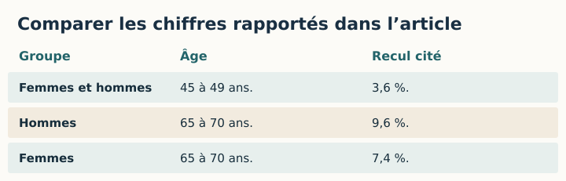

# ENS Rennes · D1 · Italien 2012 — Corrigé guidé

*Corrigé rédigé par IA, non officiel. Signalez toute erreur.*

**Rédaction** · GPT-6.2 Astra Ultra · vitesse non renseignée

Le feuillet de l’École normale supérieure de Cachan est conservé dans les archives du concours D1 de Rennes. La Repubblica · 6 janvier 2012.

## Version française

Nous perdons de notre vivacité plus tôt que prévu. Notre cerveau amorce son lent déclin dès 45 ans et non à 60 ans comme l’avaient soutenu jusqu’ici de nombreuses études scientifiques. Cette avance spectaculaire de quinze ans dans la diminution de la capacité à mémoriser des objets et des mots ou des aptitudes au raisonnement ressort d’une étude clinique publiée dans le très respecté *British Medical Journal*. Son interprétation ne laisse place à aucun doute selon l’article. Les performances en matière de raisonnement et de mémoire diminuent de 3,6 % chez les hommes et les femmes âgés de 45 à 49 ans. La situation s’aggrave au fil des années et le recul atteint 9,6 % chez les hommes de 65 à 70 ans, tandis qu’il se limite à 7,4 % chez les femmes du même âge.

Pendant dix ans, les chercheurs de l’University College de Londres ont soumis plus de sept mille personnes, 5 198 hommes et 2 192 femmes, à des tests. Les volontaires ont passé des épreuves de mémoire, de maîtrise du vocabulaire et de raisonnement. Il en ressort que l’âge à partir duquel on commence à « perdre de sa vivacité » est bien moins éloigné qu’on ne le pensait.

À la lumière des résultats de l’étude, les spécialistes britanniques estiment que l’on peut, pour le moment, agir uniquement sur la prévention. Pour cela, d’autres études seront nécessaires afin de « déterminer les facteurs de risque […] et les fonctions cognitives qui déclinent précocement, pour enrayer ce processus ».

## Expression en italien

Décrire ses propres conditions de travail pour se sentir intellectuellement efficace · 100 mots.

Mi sento più efficace quando conosco bene la domanda alla quale devo rispondere. Prima di aprire un libro scrivo su un foglio ciò che vorrei capire. Poi scelgo un luogo tranquillo, lascio il telefono in un’altra stanza e lavoro su un problema alla volta. Se un passaggio mi sembra oscuro, provo a spiegarlo con parole mie. A volte mi accorgo così che ho soltanto memorizzato una formula. Una breve discussione con un compagno mi aiuta a verificarne il significato. Infine mi concedo una pausa. Tornando al lavoro con maggiore calma, riconosco più facilmente un errore che prima continuavo a ripetere.

*100 mots, comptés par espaces.*

## Comment construire la réponse

L’article emploie deux fois *perdere colpi*. La même expression française rend perceptible le rappel du premier paragraphe dans le deuxième. *Anticipo* désigne l’écart de quinze ans entre deux âges avancés par les études. Dans le groupe des 65 à 70 ans, les deux valeurs exprimées en pourcentage se rapportent respectivement aux hommes et aux femmes. Les effectifs du second paragraphe, eux, comptent les personnes suivies pendant dix ans. Restituez les affirmations de l’article de 2012 en gardant l’attribution finale aux experts.

La question se déplace de l’étude scientifique vers l’expérience personnelle. *Nelle quali ti senti* demande de décrire les conditions dans lesquelles vous vous sentez efficace. Une réponse concrète peut suivre l’ordre réel d’une séance, du choix d’une question à la vérification du résultat. Le présent à la première personne garde l’unité du récit.

[Feuillet original, p. 5](https://www.ens-rennes.fr/medias/fichier/se1a_12d1_lv_1336729294135.pdf#page=5)
