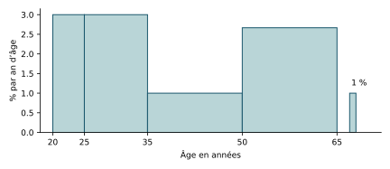
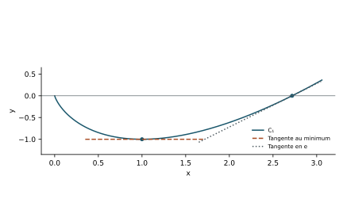
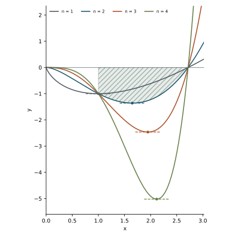

# ENS de Cachan D1 — Mathématiques appliquées et statistiques 2012 · Corrigé guidé

*Corrigé rédigé par IA, non officiel. Signalez toute erreur.*

**Rédaction** · GPT-6.2 Astra Ultra · vitesse non renseignée

**Révision** · GPT-6.2 Astra Ultra · vitesse non renseignée

Les quatre exercices portent sur le dénombrement des conseils, les lois de retard, les salaires et la famille de fonctions $x^n(\ln x-1)$. Les valeurs demandées sous forme irréductible et les arrondis annuels sont distingués.

## Exercice 1. Conseils de quatre pays

### Question 1.1

> [!INDICATION]
> Un conseil est un sous-ensemble, sans ordre ni répétition.

#### Solution

L’ensemble des conseils équiprobables a pour cardinal $\binom{17}{4}=17\cdot16\cdot15\cdot14/24=2380$.

### Question 1.2

> [!INDICATION]
> Fixer les deux pays imposés avant de compléter.

#### Solution

Il reste deux sièges à pourvoir parmi quinze pays, soit $\binom{15}{2}=105$ conseils. La probabilité vaut $105/2380=3/68$.

### Question 1.3

> [!INDICATION]
> Recompter l’univers conditionnel.

#### Solution

Avec Chypre et Malte absentes, on choisit quatre pays parmi quinze. France et Allemagne présentes, les deux autres sont pris parmi treize. La probabilité conditionnelle est $\binom{13}{2}/\binom{15}{4}=78/1365=2/35$.

### Question 1.4.a

> [!INDICATION]
> Écarter les conseils où les deux pays incompatibles sont simultanément présents.

#### Solution

Sur les 2380 conseils de départ, $\binom{15}{2}=105$ font siéger ensemble les Pays-Bas et le Luxembourg. La probabilité de satisfaire la condition est $1-105/2380=65/68$.

### Question 1.4.b

> [!INDICATION]
> Traduire chaque condition par son événement interdit et corriger le double comptage.

#### Solution

Le premier interdit concerne les 105 conseils précédents. Le second est « Slovaquie présente, Autriche absente », soit $\binom{15}{3}=455$ conseils. À leur intersection, trois pays sont imposés et l’Autriche exclue : le dernier siège a treize possibilités. Le nombre admissible est $2380-105-455+13=1833$, d’où $1833/2380$, fraction irréductible.

### Question 1.5.a

> [!INDICATION]
> Calculer la probabilité pour une année puis renouveler les choix.

#### Solution

Une année, éviter les quatre pays cités donne $\binom{13}{4}/\binom{17}{4}$. Pour cinq renouvellements indépendants, la probabilité qu’aucun des quatre n’apparaisse est $(715/2380)^5\simeq0{,}0024$.

### Question 1.5.b

> [!INDICATION]
> Passer par les deux cas contraires pour le nombre de participations.

#### Solution

Chaque année, la Belgique siège avec probabilité $4/17$ par symétrie des pays. Sur cinq années indépendantes, le nombre de participations suit $\mathcal B(5,4/17)$. La probabilité d’au moins deux participations est $1-(13/17)^5-5(4/17)(13/17)^4\simeq0{,}3362$.

## Exercice 2. Livraisons et retards

### Question 2.1.a

> [!INDICATION]
> Associer une épreuve de Bernoulli à une semaine.

#### Solution

Sur une année de 52 semaines, les 52 indicatrices de retard sont indépendantes et de même paramètre $1/3$. Leur somme $R$ suit $\mathcal B(52,1/3)$.

### Question 2.1.b

> [!INDICATION]
> Utiliser les moments de la somme des indicatrices.

#### Solution

$\mathbb ER=52/3$ et $V(R)=52(1/3)(2/3)=104/9$.

### Question 2.2.a

> [!INDICATION]
> Compter les livraisons payées au tarif normal ou à moitié prix.

#### Solution

Le coût annuel est $C=x(52-R)+(x/2)R=x(52-R/2)$.

### Question 2.2.b

> [!INDICATION]
> Prendre l’espérance de la relation affine.

#### Solution

Le prix moyen annuel est $\mathbb EC=x(52-26/3)=130x/3$.

### Question 2.3.a

> [!INDICATION]
> Le nouveau transporteur intervient la semaine qui suit le premier retard.

#### Solution

Si le premier retard survient la semaine $j\ge1$, la première livraison par DND a lieu la semaine $j+1$. Chaque $j$ a probabilité positive et la probabilité de ne jamais avoir de retard vaut $\lim_{m\to\infty}(2/3)^m=0$. Le support de $D$ est donc $\{2,3,\ldots\}$.

### Question 2.3.b

> [!INDICATION]
> Écrire la suite d’événements nécessaire pour changer en semaine k.

#### Solution

Pour $k\ge2$, les $k-2$ premières livraisons arrivent à l’heure puis la semaine $k-1$ connaît un retard. Par indépendance, $P(D=k)=(2/3)^{k-2}(1/3)=2^{k-2}/3^{k-1}$.

### Question 2.4.a

> [!INDICATION]
> Identifier le sens du paramètre de Poisson.

#### Solution

DND compte en moyenne $\mathbb ER'=4$ retards par an. Ce nombre est inférieur aux $52/3\simeq17{,}33$ de Norbert : DND est plus fiable au sens du nombre moyen de retards annuels.

### Question 2.4.b

> [!INDICATION]
> Évaluer la masse de la loi de Poisson en zéro.

#### Solution

$P(R'=0)=e^{-4}4^0/0!=e^{-4}\simeq0{,}0183$.

### Question 2.5

> [!INDICATION]
> Lister les trois décompositions de deux retards. Avant de multiplier les masses de Poisson et de la binomiale, expliciter la relation supposée entre les deux prestataires.

#### Solution

Pour les deux périodes, écrivons $J\sim\mathcal P(1)$ pour DND et $K\sim\mathcal B(4,1/3)$ pour Norbert, indépendantes. Les couples $(J,K)=(0,2),(1,1),(2,0)$ donnent le total deux. Ainsi
$$P(J+K=2)=e^{-1}\left(\frac{24}{81}+\frac{32}{81}+\frac12\frac{16}{81}\right)=\frac{64}{81e}\simeq0{,}2907.$$
Les trois termes entre parenthèses proviennent successivement des probabilités binomiales en 2, 1 et 0 et des coefficients de Poisson en 0, 1 et 2.

Ici, le produit des probabilités suppose l’indépendance des retards des deux transporteurs entre les deux périodes. L’indépendance des livraisons successives de Norbert est écrite dans le sujet. Le lien avec les retards de DND est une hypothèse supplémentaire du modèle de calcul. Sans loi conjointe ou hypothèse d’indépendance, les deux seules lois marginales ne déterminent pas ce total.

## Exercice 3. Âge et salaires

### Question 3.1.a

> [!INDICATION]
> Distinguer la nature de l’âge du regroupement du tableau.

#### Solution

La série décrit une variable quantitative continue, l’âge d’un salarié, par des classes d’amplitudes différentes et leurs fréquences en pourcentage.

### Question 3.1.b

> [!INDICATION]
> Diviser un pourcentage par la largeur de sa classe.

#### Solution

Les hauteurs successives, en points de pourcentage par an d’âge, valent $15/5=3$, $30/10=3$, $15/15=1$ et $40/15=8/3$. Les aires représentent 15 %, 30 %, 15 % et 40 %.

### Question 3.1.c

> [!INDICATION]
> Comparer les densités de fréquence.

#### Solution

Deux classes sont modales, $[20,25[$ et $[25,35[$. Elles ont la même hauteur maximale, égale à 3.

### Question 3.2.a

> [!INDICATION]
> Standardiser le seuil de revenu.

#### Solution

Pour un revenu $S\sim\mathcal N(15000,4000^2)$, $Z=(S-15000)/4000$ suit la normale standard. Ainsi $P(S>20000)=1-\Phi(1{,}25)\simeq0{,}1056$ (0,1056 avec la table fournie).

### Question 3.2.b

> [!INDICATION]
> Réduire les deux seuils et soustraire les probabilités cumulées.

#### Solution

Les seuils standardisés sont $-1{,}25$ et $0{,}25$. La proportion est $\Phi(0{,}25)-\Phi(-1{,}25)\simeq0{,}4931$, soit $49{,}31\,\%$ des salariés.

### Question 3.2.c

> [!INDICATION]
> Identifier précisément les populations au dénominateur.

#### Solution

Le seuil est franchi par 5 % des femmes et environ 10,56 % de l’ensemble des salariés. Le taux d’ensemble est une moyenne pondérée des taux féminins et masculins. Dès lors que les deux catégories sont représentées, le taux masculin est supérieur à 10,56 %. Les distributions salariales des deux groupes diffèrent donc pour ce seuil. Une conclusion sur l’égalité de salaire à poste et ancienneté comparables demanderait des données sur ces caractéristiques.

## Exercice 4. Étude de la famille de fonctions

### Question 4.I.1

> [!INDICATION]
> Séparer le produit logarithmique et le terme linéaire.

#### Solution

Pour $x\downarrow0$, $x\ln x\to0$ et $-x\to0$, d’où $f_1(x)\to0$. Pour $x\to+\infty$, les facteurs $x$ et $\ln x-1$ tendent vers $+\infty$, de même que leur produit.

### Question 4.I.2

> [!INDICATION]
> Appliquer la dérivation du produit sur les réels strictement positifs.

#### Solution

Les deux facteurs y sont dérivables. On obtient $f_1'(x)=\ln x-1+x(1/x)=\ln x$.

### Question 4.I.3

> [!INDICATION]
> Comparer x à 1 pour obtenir le signe de la dérivée.

#### Solution

La fonction décroît strictement sur $]0,1]$, de sa limite 0 à $f_1(1)=-1$, puis croît strictement sur $[1,+\infty[$ vers $+\infty$. La dérivée s’annule en 1.

| Abscisse | $0^+$ | $1$ | $+\infty$ |
|---|:---:|:---:|:---:|
| Signe de $f_1'$ | $-$ sur $]0,1[$ | $0$ | $+$ sur $]1,+\infty[$ |
| Valeur de $f_1$ | $0$ (limite) | $-1$ (minimum) | $+\infty$ (limite) |

### Question 4.I.4

> [!INDICATION]
> Utiliser la stricte positivité du premier facteur.

#### Solution

L’unique antécédent de 0 est $e$, car $\ln x-1=0$ équivaut à $x=e$. La fonction est négative sur $]0,e[$ et positive sur $]e,+\infty[$.

### Question 4.I.5

> [!INDICATION]
> Placer le minimum et le zéro, puis calculer les deux pentes.

#### Solution

Au point $(1,-1)$ la tangente est $y=-1$. Au point $(e,0)$, $f'_1(e)=1$ donne $y=x-e$. La courbe approche l’origine par valeurs négatives sans l’atteindre. Respecter sur la copie les unités de 4 cm en abscisse et 2 cm en ordonnée.

### Question 4.II.1

> [!INDICATION]
> Utiliser la limite rappelée dans le sujet.

#### Solution

Pour $n>1$, $x^n\ln x-x^n\to0$ en $0^+$. En $+\infty$, $x^n$ et $\ln x-1$ tendent tous deux vers $+\infty$, donc $f_n(x)\to+\infty$.

### Question 4.II.2

> [!INDICATION]
> Dériver puis mettre la plus petite puissance de x en facteur.

#### Solution

Sur $]0,+\infty[$, le produit de facteurs dérivables donne $f'_n(x)=nx^{n-1}(\ln x-1)+x^{n-1}=x^{n-1}(n\ln x-n+1)$.

### Question 4.II.3.a

> [!INDICATION]
> Isoler le logarithme avant d’appliquer l’exponentielle.

#### Solution

$n\ln x-n+1>0$ équivaut à $\ln x>(n-1)/n$, puis à $x>a_n$ avec $a_n=\exp((n-1)/n)$.

### Question 4.II.3.b

> [!INDICATION]
> Utiliser le signe du facteur restant.

#### Solution

Comme $x^{n-1}>0$, la dérivée est négative sur $]0,a_n[$, nulle en $a_n$ et positive au-delà.

### Question 4.II.4

> [!INDICATION]
> Lire les deux variations et leurs valeurs limites.

#### Solution

La fonction décroît strictement de sa limite 0 jusqu’à $f_n(a_n)$ sur $]0,a_n]$. Elle croît ensuite strictement vers $+\infty$ sur $[a_n,+\infty[$.

### Question 4.II.5

> [!INDICATION]
> Évaluer séparément la puissance et le logarithme au point critique.

#### Solution

On a $a_n^n=e^{n-1}$ et $\ln(a_n)-1=-1/n$. Le minimum vaut donc $-e^{n-1}/n$, atteint uniquement en $a_n$.

### Question 4.II.6.a

> [!INDICATION]
> Évaluer les expressions en 1 et en e.

#### Solution

Pour tout $n$, $f_n(1)=-1$ et $f_n(e)=0$. Les courbes ont donc les deux points $(1,-1)$ et $(e,0)$ en commun.

### Question 4.II.6.b

> [!INDICATION]
> Ordonner les racines des deux facteurs de signe variable.

#### Solution

Le facteur $x^n$ est positif. Le produit $(x-1)(\ln x-1)$ est positif sur $]0,1[$, négatif sur $]1,e[$, positif sur $]e,+\infty[$ et nul en $1,e$.

### Question 4.II.6.c

> [!INDICATION]
> Reconnaître la différence de deux fonctions consécutives.

#### Solution

$f_{n+1}(x)-f_n(x)=x^n(x-1)(\ln x-1)$. Par conséquent $C_{n+1}$ est au-dessus de $C_n$ sur $]0,1[$ et $]e,+\infty[$, en dessous sur $]1,e[$, et coïncide avec elle aux deux intersections.

### Question 4.II.7

> [!INDICATION]
> Placer les points communs et les minima en respectant les croisements.

#### Solution

Pour $n=2,3,4$, les sommets inférieurs ont pour abscisses $e^{1/2},e^{2/3},e^{3/4}$ et pour ordonnées $-e/2,-e^2/3,-e^3/4$. Les tangentes y sont horizontales. Les quatre courbes se rejoignent en $(1,-1)$ et $(e,0)$.

### Question 4.III.1

> [!INDICATION]
> Dériver le produit et observer l’annulation de deux puissances.

#### Solution

Pour $t>0$, $F_n'(t)=t^n(\ln t-1/(n+1))+t^n/(n+1)=t^n\ln t$.

### Question 4.III.2

> [!INDICATION]
> Soustraire une primitive de la puissance à celle du produit logarithmique.

#### Solution

Une primitive de $f_n$ est $G_n(t)=F_n(t)-t^{n+1}/(n+1)$. On a $G_n(e)=-e^{n+1}/(n+1)^2$ et $G_n(1)=-(n+2)/(n+1)^2$. Ainsi
$$\int_1^e f_n(t)\,dt=\frac{n+2-e^{n+1}}{(n+1)^2}.$$

### Question 4.III.3

> [!INDICATION]
> Vérifier le signe de la deuxième fonction sur l’intervalle hachuré.

#### Solution

Sur $[1,e]$, $f_2\le0$. L’aire hachurée sur la figure de 4.II.7 vaut donc $-\int_1^e f_2(t)\,dt=(e^3-4)/9\simeq1{,}7873$ unité d’aire. Sur le papier millimétré, une unité d’aire représente $4\times2=8$ cm².

La surface sur le papier vaut donc $8(e^3-4)/9\simeq14{,}30$ cm². Les deux valeurs répondent à des unités différentes : l’intégrale mesure d’abord une aire dans le repère de la fonction.
