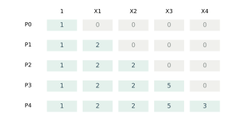
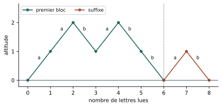
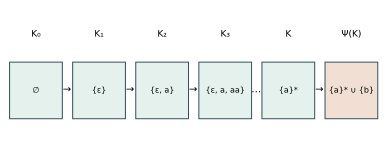

# ENS MP · Informatique-mathématiques 2012 · Corrigé brut

*Corrigé rédigé par IA, non officiel. Signalez toute erreur.*

**Rédaction** · GPT-6.2 Astra Ultra · vitesse non renseignée · 25 novembre 2026

**Autour des séries formelles.** Le cahier ULC contient 34 questions. On écrit $X$ pour la variable formelle après l’identification de 1.2. Les questions 1.3, 2.8, 3.8 et 3.12 précisent les hypothèses nécessaires aux affirmations imprimées.

## I. Algèbre des séries formelles

### Question 1.1 · Puissances de la variable formelle

La suite de $X_F^n$ vaut 1 au rang $n$ et 0 à tous les autres rangs. Pour $n=0$ on retrouve $1_F$. L’hérédité vient de $(X_FS)_0=0$ et $(X_FS)_k=s_{k-1}$ pour $k\ge1$.

### Question 1.2 · Injection des polynômes

L’application imposée est $f(\sum_{k=0}^d a_kX^k)=\sum_{k=0}^d a_k X_F^k$. La formule donne une application linéaire et elle est unique par la propriété de base. Puisque $X_F^iX_F^j=X_F^{i+j}$ et $f(1)=1_F$, elle conserve les produits et l’unité par bilinéarité. Si son image est nulle, chaque coefficient $a_k$ est nul. Elle est donc injective.

### Question 1.3 · Distance de la valuation

**(a)** La formule imprimée $d(S,T)=1/\nu(S-T)$ pour $S\ne T$ ne définit pas de distance sur tout l’espace. Pour $S=1_F,T=0_F$, $\nu(S-T)=0$. Dans la suite, prenons la correction $d_*(S,T)=1/(1+\nu(S-T))$ pour $S\ne T$ et $d_*(S,S)=0$. Elle respecte la même notion de proximité par accord des coefficients. Avec $\nu(0_F)=+\infty$, on a $\nu(U+V)\ge\min(\nu(U),\nu(V))$, car tous les coefficients avant ce minimum sont nuls. On en déduit $d_*(S,U)\le\max(d_*(S,T),d_*(T,U))$. Symétrie et séparation sont immédiates.
**(b)** Cette distance ne provient pas d’une norme réelle. Pour $S\ne0_F$, $d_*(2S,0_F)=d_*(S,0_F)>0$, alors qu’une norme exigerait le double.

### Question 1.4 · Intégrité de l’anneau

Si $S,T$ sont non nulles, posons $p=\nu(S)$ et $q=\nu(T)$. Au rang $p+q$, le coefficient de $ST$ est $s_pt_q\ne0$, tous les autres termes ayant un indice trop petit. Avant $p+q$, tous les produits sont nuls. Ainsi $\nu(ST)=p+q$. Le produit est nul si et seulement si l’un des facteurs est nul.

### Question 1.5 · Convergence par stabilisation

**(a)** Le coefficient de $X$ dans $1+X/n$, $n\ge1$, ne se stabilise pas. La suite ne converge pas formellement. Pour la norme $\|\sum a_iX^i\|_1=\sum|a_i|$ sur les polynômes, elle converge vers 1 car $\|X/n\|_1=1/n$.
**(b)** Si $U^{(n)}\to U$, pour tout $k$, à partir d’un rang les coefficients de degré au plus $k$ coïncident avec ceux de $U$. Réciproquement, prendre le maximum des seuils de stabilisation des $k+1$ premiers coefficients donne cet accord simultané. Ainsi la distance tend vers zéro.
**(c)** Si la suite converge, chaque différence consécutive finit par avoir ses $k+1$ premiers coefficients nuls, pour tout $k$. Réciproquement, si ces différences tendent vers zéro, alors pour chaque degré $k$ les coefficients consécutifs de rang assez grand sont égaux. Ils restent constants ensuite. La suite de ces valeurs finales définit la limite par (b).

### Question 1.6 · Somme des monômes d’une série

Dans $\sum_{k=0}^N u_kX_F^k$, le coefficient au rang $j$ vaut $u_j$ dès que $N\ge j$. La suite des sommes partielles converge donc vers la série $U$ par le critère de stabilisation. Cette égalité de séries formelles ne fait intervenir aucune valeur numérique de $X$.

### Question 1.7 · Ordre coefficient par coefficient

Chaque coefficient vérifie $u_n\le u_n$, donc la relation est réflexive. Si $U\le_F V$ et $V\le_F U$, tous les coefficients sont égaux, d’où l’antisymétrie. La transitivité résulte de celle des inégalités réelles à chaque rang. L’ordre est partiel. Par exemple $1$ et $X$ sont incomparables.

## II. Équations de séries formelles

### Question 2.1 · Divisibilité par une puissance de $X$

Si $S=X^kT$, ses $k$ premiers coefficients sont nuls. Puisque $S\ne0$, $\nu(S)\ge k$. Réciproquement, sous cette condition, poser $t_j=s_{j+k}$ pour $j\ge0$ donne $X^kT=S$. Cela comprend $k=0$.

### Question 2.2 · Inversion et premiers coefficients

**(a)** Il faut $s_0t_0=1$ et $\sum_{j=0}^n s_jt_{n-j}=0$ pour $n\ge1$.
**(b)** L’équation constante impose $s_0\ne0$. Réciproquement, on définit successivement $t_0=1/s_0$ et $t_n=-s_0^{-1}\sum_{j=1}^n s_jt_{n-j}$. Chaque terme existe et est unique. Ces équations vérifient le produit à tous les degrés.
**(c)** Pour $s_n=n!$, on trouve $t_0=1$, $t_1=-1$, $t_2=-1$, $t_3=-3$. Au rang 3 le coefficient est $-3-1-2+6=0$.

### Question 2.3 · Division d’un polynôme par une série polynomiale

**(a)** Si $QS=QT$ et $Q\ne0$, l’intégrité implique $S=T$. **(b)** Si $Q(0)\ne0$, $S=PQ^{-1}$ convient. **(c)** Écrivons $Q=X^rQ_0$, $Q_0(0)\ne0$. Le produit $QS$ est nécessairement divisible par $X^r$. La condition est suffisante aussi. Pour $P=X^rP_0$ on prend $S=P_0Q_0^{-1}$. En incluant $\nu(0)=+\infty$, la condition est $\nu(P)\ge\nu(Q)$ et elle couvre $P=0$.

### Question 2.4 · Une suite récurrente d’ordre deux

Pour $n\ge2$, le coefficient de $(1-X-X^2)S$ est $s_n-s_{n-1}-s_{n-2}=0$. Les deux premiers coefficients donnent $(1-X-X^2)S=s_0+(s_1-s_0)X$. Le dénominateur a pour terme constant 1, ce qui donne une série rationnelle.

### Question 2.5 · Fraction réduite à numérateur unitaire

Partons d’une relation $P=QS$ avec $S\ne0$. Alors $P,Q$ sont non nuls. On divise les deux polynômes par leur PGCD, ce qui préserve la relation par intégrité. On divise ensuite les deux par le coefficient dominant du numérateur. Le numérateur devient unitaire et les deux polynômes sont premiers entre eux. Pour deux tels couples, le produit en croix $P_1Q_2=P_2Q_1$ et le lemme de Gauss impliquent la divisibilité mutuelle des numérateurs. Comme ils sont unitaires, ils sont égaux. Les dénominateurs le sont ensuite. Le dénominateur réduit a un terme constant non nul, sinon $X$ diviserait aussi le numérateur.

### Question 2.6 · Récurrence éventuelle d’une série rationnelle

Pour $S=0$, choisir $k=0$ et $n_0=0$. Sinon, écrire $QS=P$ avec $q_0\ne0$ et $k=\deg Q$. Dès $n\ge n_0=\max(k,\deg P+1)$, on a $q_0s_n+\sum_{i=1}^k q_i s_{n-i}=0$. Il suffit de prendre $a_i=-q_i/q_0$. Pour un dénominateur constant, $k=0$ exprime que le polynôme est finalement nul en coefficients.

### Question 2.7 · Une récurrence éventuelle donne une fraction

Posons $Q=1-\sum_{i=1}^ka_iX^i$. Pour $n\ge\max(n_0,k)$, le coefficient de $QS$ est nul par la récurrence. Le produit est donc un polynôme $P$. Comme $Q(0)=1$, $S=P/Q$ est une série rationnelle, quels que soient les premiers coefficients.

### Question 2.8 · Calcul successif jusqu’au coefficient demandé

Prolonger $p_m$ par zéro au-delà de $\deg P$. Puis, pour $m=0,\ldots,n$, poser

$$
s_m=p_m-\sum_{j=1}^{\min(m,d_Q)}q_j s_{m-j}.
$$

Cette expression provient de $q_0=1$. Il y a au plus $d_Q$ multiplications et autant d’additions à chaque rang, soit $O(n+1)$ opérations arithmétiques, avec une mémoire glissante de $O(d_Q+1)$ valeurs. Le cahier demande des opérations « sur des nombres entiers », mais ses coefficients sont réels quelconques. Avec $P=\pi$, $Q=1$, le résultat n’est même pas entier. Le compte porte sur le corps des coefficients. Il porte effectivement sur des entiers si les données sont entières, sans prétention de complexité binaire constante par opération.

### Question 2.9 · Point fixe d’une contraction formelle

**(a)** Pour deux points fixes distincts on aurait $d_*(S,T)=d_*(\Phi(S),\Phi(T))<d_*(S,T)$, impossible.
**(b)** Si deux termes consécutifs diffèrent, les précédents diffèrent aussi. La contraction stricte donne $\nu(S^{(n+1)}-S^{(n)})>\nu(S^{(n)}-S^{(n-1)})$, donc l’accroissement entier est au moins 1.
**(c)** Soit l’itération devient stationnaire en un point fixe, soit les valuations des différences tendent vers l’infini. Par 1.5(c), la suite converge alors vers une série $S$. La contraction est continue, puisque $d_*(\Phi(U),\Phi(V))\le d_*(U,V)$. Passer à la limite dans l’itération donne $\Phi(S)=S$. L’unicité suit de (a).

### Question 2.10 · Équation algébrique à terme linéaire inversible

Comme $P_1(0)\ne0$, on ramène l’équation à $S=F(S)$ avec $F(S)=-P_1^{-1}(P_0+\sum_{i=2}^kP_iS^i)$. La différence $U^i-V^i$ est divisible par $U-V$. Chaque $P_i$ pour $i\ge2$ est divisible par $X$. Il s’ensuit que $F(U)-F(V)$ est divisible par $X(U-V)$, l’inverse de $P_1$ étant une unité. Si les images diffèrent, leur différence a une valuation supérieure d’au moins 1. Le point fixe existe et est unique par 2.9. Si la somme est vide, $F$ est constante et la même conclusion vaut.

### Question 2.11 · Deux racines carrées formelles

**(a)** Le terme constant impose $s_0^2=p_0$, d’où $E=\{-\sqrt{p_0},+\sqrt{p_0}\}$. **(b)** Poser $p_n=0$ pour $n>\deg P$. Pour chacune des deux valeurs non nulles de $s_0$, le rang $n\ge1$ impose $2s_0s_n=p_n-\sum_{j=1}^{n-1}s_js_{n-j}$. On construit une unique série pour chaque valeur initiale. Elles vérifient l’équation degré par degré et sont distinctes, parce que leurs termes constants diffèrent.

## III. Séries génératrices de langages

### Question 3.1 · Inclusion et coefficients

L’inclusion $L\subseteq L'$ implique $L\cap A^n\subseteq L'\cap A^n$. Les cardinaux donnent $S_L\le_F S_{L'}$. Si les deux séries sont égales, ces inclusions finies sont des égalités à tout degré. La réunion sur tous les degrés donne $L=L'$.

### Question 3.2 · Série de la réunion

À chaque degré, la formule d’inclusion-exclusion donne $S_{L\cup L'}=S_L+S_{L'}-S_{L\cap L'}$. Les coefficients de la dernière série sont positifs ou nuls. L’inégalité en résulte, et l’égalité équivaut à l’absence de tout mot dans $L\cap L'$.

### Question 3.3 · Préfixes et factorisation unique

Si $uv=u'v'$ avec $u,u'\in L$, le plus court de $u,u'$ est préfixe du plus long. Le caractère préfixe de $L$ force $u=u'$. La simplification du préfixe commun donne $v=v'$. Toute factorisation possible est donc unique, que le suffixe soit vide ou non.

### Question 3.4 · Inégalité du produit de langages

À longueur totale $n$ le nombre de couples $(u,v)\in L\times L'$ est $\sum_{i=0}^n \ell_i\ell'_{n-i}$. La concaténation est surjective sur les mots de longueur $n$ du produit. Le coefficient de $S_{LL'}$ est donc au plus ce nombre. L’égalité à tout degré équivaut à l’injectivité de chacune de ces surjections finies, donc exactement à la non-ambiguïté de la factorisation.

### Question 3.5 · Mots sans deux $b$ consécutifs

**(a)** Les mots $\varepsilon$ et $b$ sont admis. Tout autre mot valide débute par $a$, ou par $ba$ si sa première lettre est $b$. Le suffixe reste dans $F$. Réciproquement ces préfixes, terminés par $a$, peuvent précéder tout mot de $F$. La réunion $F=\{\varepsilon,b\}\cup\{a,ba\}F$ est disjointe et le préfixe se lit sans ambiguïté.
**(b)** On a $S_F=1+X+(X+X^2)S_F$, d’où $S_F=(1+X)/(1-X-X^2)$. Le numérateur est unitaire et le dénominateur vaut 1 en $-1$, donc ils sont premiers entre eux. Ils sont respectivement $\mathrm{Num}(S_F)$ et $\mathrm{Den}(S_F)$. **(c)** $f_0=1$, $f_1=2$ puis $f_n=f_{n-1}+f_{n-2}$ pour $n\ge2$.

### Question 3.6 · Décomposition au premier retour à zéro

**(a)** Dans $aw_1bw_2$, l’altitude passe à 1, conserve une altitude au moins égale à 1 pendant $w_1$, revient à 0 en lisant $b$, puis suit le chemin de $w_2$. Elle ne devient jamais négative et finit à 0.
**(b)** Tout mot non vide de $D$ commence par $a$. Prendre le premier instant strictement positif où l’altitude revient à 0. La lettre de retour est $b$. Entre les deux, le chemin décalé d’une unité est celui d’un mot $w_1\in D$. Le suffixe est un mot $w_2\in D$. Tout découpage de la forme demandée impose ce premier retour, d’où l’unicité.
**(c)** Il en résulte $D=\{\varepsilon\}\cup aDbD$, réunion disjointe. **(d)** Grâce à l’unicité de découpage, les séries du produit se multiplient et donnent $S_D=1+X^2 S_D^2$.

### Question 3.7 · Limite d’une réunion croissante

Pour un degré $j$, les ensembles $L_n\cap A^j$ sont croissants dans le fini $A^j$. Ils se stabilisent donc sur leur réunion $L\cap A^j$. Le coefficient de degré $j$ est finalement celui de $S_L$. Le critère de 1.5(b) donne alors la convergence formelle.

### Question 3.8 · Itérations croissante et décroissante

**(a)** On part de $K_0=\varnothing\subseteq K_1$, $M_1\subseteq M_0=A^*$ et $K_0\subseteq M_0$. L’application répétée de la monotonie donne $K_n\subseteq K_{n+1}\subseteq M_{n+1}\subseteq M_n$. Il en résulte aussi $K\subseteq M$.
**(b)** La monotonie donne $K\subseteq\Psi(K)\subseteq\Psi(M)\subseteq M$, mais l’égalité de gauche demandée dans le cahier est fausse sous la seule hypothèse énoncée. En effet $\Psi(K)$ contient tous les $K_{n+1}$ et $\Psi(M)$ est contenu dans tous les $M_{n+1}$. Pour réfuter l’égalité, sur $\{a,b\}$, poser

$$
\Psi(L)=\{\varepsilon\}\cup a(L\cap\{a\}^*)\cup B(L),\qquad
B(L)=\begin{cases}\{b\}&\text{si }\{a\}^*\subseteq L,\\\varnothing&\text{sinon.}\end{cases}
$$

L’application est monotone. Pour $n\ge1$, $K_n=\{\varepsilon,a,\ldots,a^{n-1}\}$. Leur réunion est $\{a\}^*$, mais son image contient aussi $b$. L’égalité devient vraie pour la forme finitaire introduite ensuite, comme en 3.11.
**(c)** Le symbole $\Phi$ imprimé est ici compris comme $\Psi$, seule application de langages définie dans cette question. Pour un point fixe $L$, l’encadrement $K_n\subseteq L\subseteq M_n$ résulte par induction de l’encadrement initial. Ainsi $K\subseteq L\subseteq M$ et $L=\Psi(L)\subseteq\Psi(M)$, ce qui donne le résultat.

### Question 3.9 · Écriture par opérations finitaires

Prendre $k=2$, $\psi_0=L_1$, $\psi_1(w)=L_2\{w\}$ et $\psi_2(u,v)=L_3\{u\}\{v\}$. L’union sur $w\in L$ et sur $(u,v)\in L^2$ donne exactement $\Psi(L)=L_1\cup L_2L\cup L_3LL$.

### Question 3.10 · Monotonie de la forme finitaire

Pour $L\subseteq L'$, tout tuple de $L^\ell$ est un tuple de $(L')^\ell$. Chaque terme contribuant à la réunion de $\Psi(L)$ figure donc dans celle de $\Psi(L')$, tandis que $\psi_0$ est commun. Il en résulte $\Psi(L)\subseteq\Psi(L')$.

### Question 3.11 · Existence et unicité du langage construit

La forme finitaire donne d’abord $\Psi(K)\subseteq K$. Si $w\in\psi_0$, il est dans $K_1$. Sinon il provient d’un tuple fini de mots de $K$. Tous appartiennent ensemble à un même $K_N$, en prenant le maximum de leurs rangs d’apparition. Donc $w\in K_{N+1}$. L’inclusion inverse vient de 3.8(b), et $K$ est un point fixe.
Pour l’unicité, tout point fixe $L$ contient $K$ par 3.8(c). Montrons $L\subseteq K$ par récurrence forte sur la longueur. Un mot de $L=\Psi(L)$ vient de $\psi_0$ ou d’un tuple. Dans le second cas tous les mots du tuple ont une longueur strictement inférieure à celle du mot produit. Par récurrence ils appartiennent à $K$, et la sortie appartient à $\Psi(K)=K$. À longueur zéro, seul $\psi_0$ peut contribuer. Ceci termine la preuve.

### Question 3.12 · Équation de langage et rôle du mot vide

**(a)** Si $\varepsilon\notin L_2$, les mots préfixés par $u\in L_2$ ont une longueur strictement accrue. La question 3.11 donne l’unique solution $L=L_2^*L_1$. La réunion $L_1\cup L_2L$ est disjointe par hypothèse. Le produit est non ambigu par 3.3, donc $S_L=S_{L_1}+S_{L_2}S_L$. Ce raisonnement couvre $L_2=\varnothing$.
Le cahier permet cependant $\varepsilon\in L_2$. Le caractère préfixe force alors $L_2=\{\varepsilon\}$, et l’absence de préfixe dans $L_2$ impose $L_1=\varnothing$. L’équation devient $L=L$. Tout langage est solution et il n’y a plus unicité. L’équation des séries se réduit bien à une identité.
**(b)** Dans le cas non dégénéré, $S_L=S_{L_1}/(1-S_{L_2})$ et le dénominateur a pour terme constant 1. Les opérations sur fractions donnent une série rationnelle lorsque les deux données le sont. Dans le cas dégénéré, les données sont rationnelles mais toute solution n’est pas rationnelle. Par exemple sur une lettre prendre $L=\{a^{m^2}:m\ge0\}$. Sa suite caractéristique contient des blocs de zéros arbitrairement longs suivis d’un 1, impossible pour une récurrence linéaire homogène éventuelle d’ordre fixe par 2.6.

## IV. Séries formelles et séries entières

### Question 4.1 · Rayon de convergence d’une série de langage

Soit $q=|A|\ge1$. On a $0\le\ell_n\le q^n$. Pour $|t|<1/q$, la série $\sum\ell_n|t|^n$ est majorée par la série géométrique $\sum(q|t|)^n$. Le rayon de convergence est donc au moins $1/q>0$.

### Question 4.2 · Évaluation de la somme et du produit

Pour $|t|<\rho=\min(R_T,R_U)$, les séries associées à $T,U$ convergent absolument. On peut additionner terme à terme. Pour le produit, la série double des valeurs absolues vaut le produit des deux sommes absolues. Regrouper selon $i+j=n$ donne exactement le coefficient de Cauchy de $TU$. Ainsi les deux nouvelles séries ont un rayon au moins $\rho$ et leurs fonctions sommes vérifient $\widetilde{T+U}=\widetilde T+\widetilde U$, $\widetilde{TU}=\widetilde T\,\widetilde U$ sur cet intervalle. Si les deux rayons sont infinis, tout $\rho>0$ fini convient aussi.

### Question 4.3 · Branche analytique de la fonction génératrice de Dyck

**(a)** La question 4.1 autorise par exemple $|t|<1/2$. L’identité de 3.6(d) et 4.2 imposent $F(t)=1+t^2F(t)^2$ pour $F=\widetilde S_D$. **(b)** Pour $0<|t|<1/2$, les racines sont $(1\pm\sqrt{1-4t^2})/(2t^2)$. La racine avec le signe plus diverge à l’origine. La branche continue égale à 1 en zéro est

$$
\widetilde S_D(t)=\frac{2}{1+\sqrt{1-4t^2}}.
$$

Cette écriture rationalisée est également définie directement en $t=0$.

### Question 4.4 · Coefficients de Catalan

La fonction est paire, donc $d_{2k+1}=0$. Développons $(1-4t^2)^{1/2}$ par la formule du binôme pour $|t|<1/2$. Le coefficient de $t^{2k}$ dans $(1-\sqrt{1-4t^2})/(2t^2)$ vaut

$$
-\tfrac12\binom{1/2}{k+1}(-4)^{k+1}
=\frac{2^k(1\cdot3\cdots(2k-1))}{(k+1)!}
=\frac{(2k)!}{k!(k+1)!}
=\frac{1}{k+1}\binom{2k}{k}.
$$

Le produit vide vaut 1 au rang zéro. On obtient bien pour $n$ pair $d_n=n!/[(n/2)!(n/2+1)!]$. Par exemple $d_0,d_2,d_4,d_6,d_8=1,1,2,5,14$.
