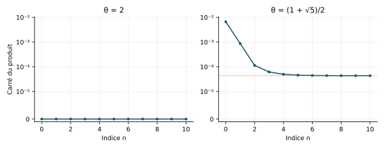

# ENS MP — Mathématiques C 2012 · Corrigé brut

*Corrigé rédigé par IA, non officiel. Signalez toute erreur.*

**Rédaction** · GPT-6.2 Astra Ultra · vitesse non renseignée

**Révision** · GPT-6.2 Astra Ultra · vitesse non renseignée · 26 novembre 2026

**Nombres de Pisot.** Les déterminants de Hankel détectent les séries rationnelles. Appliqués aux entiers les plus proches de puissances géométriques, ils relient l’arithmétique de ces puissances aux produits de cosinus.

## I. Entiers algébriques et nombres de Pisot

### Question I.1

L’évaluation $P\mapsto P(\theta)$ est un morphisme d’anneaux de $\mathbb Q[X]$ vers $\mathbb C$. Son noyau $I_\theta$ est un idéal non nul puisque $\theta$ est algébrique. Choisissons un élément non nul de degré minimal et divisons-le par son coefficient dominant pour obtenir un polynôme unitaire $\Pi_\theta$. Dans la division de tout élément de l’idéal par $\Pi_\theta$, le reste appartient encore à l’idéal et a degré inférieur, donc vaut zéro. Ainsi $I_\theta=(\Pi_\theta)$ et le générateur unitaire est unique. Il est irréductible car, dans une factorisation non triviale, l’un des facteurs s’annulerait en $\theta$.

### Question I.2

Pour chaque nombre premier $p$, les réductions de $P$ et $Q$ modulo $p$ sont non nulles par primitivité. L’anneau $\mathbb F_p[X]$ est intègre, donc leur produit y est non nul. Ainsi aucun nombre premier ne divise tous les coefficients de $PQ$, ce qui est la primitivité.

### Question I.3

Il existe un polynôme unitaire $T\in\mathbb Z[X]$ annulant $\theta$. Par I.1, $T=\Pi_\theta S$ avec $S\in\mathbb Q[X]$ unitaire. On peut écrire $\Pi_\theta=A/a$, $S=B/b$ avec $A,B$ entiers primitifs de coefficients dominants $a,b\in\mathbb N^*$ (chasser les dénominateurs puis simplifier le contenu). Alors $AB=abT$. Par I.2 le contenu de $AB$ est 1. Celui de $abT$ vaut $ab$ car $T$ est unitaire. Ainsi $a=b=1$ et $\Pi_\theta\in\mathbb Z[X]$.

### Question I.4

Les coefficients de $\Pi_\theta$ sont réels, donc $\overline\theta$ est aussi racine. Son module vaut $|\theta|\ge1$. L’unicité de la racine de module au moins 1 impose $\overline\theta=\theta$. Ainsi tout nombre de Pisot au sens de l’énoncé est réel.

### Question I.5

Soit $N_n=\theta^n+\sum_{i=0}^k\alpha_i^n\in\mathbb Z$. Pour $\rho=\max_i|\alpha_i|<1$ et $n\ge1$, $|\theta^n-N_n|\le(k+1)\rho^n$. Comme $\theta$ est réel, $|\sin(\pi\theta^n)|=|\sin(\pi(\theta^n-N_n))|\le\pi(k+1)\rho^n$. Le carré est majoré par un terme géométrique sommable. La série demandée converge.

Pour le nombre d’or $\theta=(1+\sqrt5)/2$, son conjugué est $\theta^{\prime}=-1/\theta$. La trace $N_n=\theta^n+(\theta^{\prime})^n$ suit la récurrence $N_{n+2}=N_{n+1}+N_n$ avec $N_0=2$ et $N_1=1$. Ainsi $\sin^2(\pi\theta^n)\le\pi^2\theta^{-2n}$. Cet exemple fournit aussi le paramètre utilisé dans la figure de la partie IV.

## II. Fractions rationnelles et déterminants de Hankel

### Question II.1

Écrivons $Q(z)=\sum_{j=0}^p q_jz^j\ne0$. Dans $Qf=P$, le coefficient de $z^{n+p}$ vaut $\sum_{j=0}^p q_{p-j}c_{n+j}$. L’unicité des coefficients sur un disque ouvert impose que cette somme soit nulle dès que $n+p>\deg P$. Ainsi on peut prendre $\beta_j=q_{p-j}$, non tous nuls.

### Question II.2

Après suppression des derniers coefficients nuls de la récurrence, supposons $\beta_p\ne0$. Pour $Q(z)=\sum_{j=0}^p\beta_jz^{p-j}$, le coefficient de degré $n+p$ de $Qf$ est nul pour $n\ge n_0$. Ainsi $Qf=P$ sur le disque, où $P$ est un polynôme. À toute racine de $Q$ dans ce disque, l’égalité et l’analyticité de $f$ imposent que $P$ ait un zéro de multiplicité au moins égale. Après simplification (ou $f=0$ si $P=0$), le dénominateur n’a plus de zéro sur le disque et $f$ est une fraction rationnelle.

### Question II.3

Pour $m\ge n_0+p$, considérons les colonnes d’indices $n_0,\ldots,n_0+p$ du déterminant $\Delta_m$ (indices commençant à 0). Leur combinaison de coefficients $\beta_0,\ldots,\beta_p$ est nulle à la ligne $i$ par la récurrence appliquée en $n=i+n_0$. La combinaison est non triviale, donc $\Delta_m=0$.

### Question II.4.a

Par minimalité de $p\ge1$, $\Delta_{p-1}\ne0$ et $\Delta_p=0$. Les $p$ premières colonnes de la matrice de taille $p+1$ sont indépendantes puisque leur restriction aux $p$ premières lignes l’est. La dernière colonne est donc combinaison des précédentes. En ramenant tout d’un côté, avec coefficient 1 pour cette dernière colonne, on obtient les $\beta_0,\ldots,\beta_{p-1}$ qui annulent $C_{j+p}$ pour $0\le j\le p$.

### Question II.4.b

Dans la matrice de $\Delta_{p+1}$, pour $i=p+1$ puis $i=p$, remplaçons la ligne $L_i$ par $L_i+\sum_{t=0}^{p-1}\beta_t L_{i-p+t}$. L’ordre décroissant garantit que les lignes ajoutées ont encore leurs valeurs initiales. Les deux dernières lignes ont alors pour coefficients $C_{i+j}$. Ceux d’indice entre $p$ et $2p$ sont nuls. Le bloc inférieur gauche est donc nul et le dernier bloc diagonal vaut
$$\begin{pmatrix}0&C_{2p+1}\\ C_{2p+1}&C_{2p+2}\end{pmatrix}.$$
Le premier bloc diagonal a pour déterminant $\Delta_{p-1}$. Le produit des deux déterminants donne $\Delta_{p+1}=-\Delta_{p-1}C_{2p+1}^2$.

### Question II.4.c

Supposons $C_p,\ldots,C_{p+m-1}$ nuls, où $m>p$. Dans $\Delta_m$, effectuons les opérations de II.4.b successivement pour $i=m,m-1,\ldots,p$. Le bloc inférieur gauche est nul car $i+j\le m+p-1$ si $j<p$. Dans le dernier bloc carré, de taille $d=m-p+1$, les coefficients $C_{i+j}$ sont nuls avant l’antidiagonale $i+j=p+m$. Cette antidiagonale est constante et égale à $C_{p+m}$. Après inversion de l’ordre de ses colonnes, le bloc est triangulaire. Le renversement de $d$ colonnes a $d(d-1)/2$ inversions, donc
$$\Delta_m=(-1)^{d(d-1)/2}\Delta_{p-1}(C_{p+m})^d.$$
Le signe général fourni dans l’indication imprimée, $(-1)^{m+p}$, ne donne pas toujours la signature du renversement (pour $m=p+2$, le bloc est de taille 3 et le signe vaut $-1$). Dans l’application présente $\Delta_m=0$ et $\Delta_{p-1}\ne0$, donc $C_{p+m}=0$ indépendamment du signe. Le point de départ $C_p,\ldots,C_{2p}=0$ vient de 4.a. La récurrence donne tous les coefficients annoncés.

### Question II.4.d

Les égalités $C_{j+p}=0$ pour $j\ge0$ fournissent la récurrence de II.2 avec coefficient final 1. Ainsi $f$ est rationnelle. Si $p=0$, tous les déterminants sont nuls. Un premier coefficient non nul $c_m$ donnerait dans $\Delta_m$ une antidiagonale constante $c_m$ précédée de zéros, d’où $\Delta_m=\pm c_m^{m+1}\ne0$. Donc dans ce cas $f=0$.

### Question II.5.a

Si un premier divisait tous les $q_j$, il diviserait tous les coefficients de $Qf=P$ puisque les $c_n$ sont entiers. Cela contredirait la primitivité de la famille réunie des $p_i$ et des $q_j$. Ainsi les $q_j$ sont premiers entre eux dans leur ensemble.

### Question II.5.b

Comme $P,Q$ sont premiers entre eux dans $\mathbb C[X]$, ils le sont dans $\mathbb Q[X]$. L’identité de Bézout fournit $U_0P+V_0Q=1$ avec $U_0,V_0\in\mathbb Q[X]$. Un multiple commun non nul $r$ des dénominateurs donne $U=rU_0,V=rV_0\in\mathbb Z[X]$ et $r=UP+VQ=Q(Uf+V)$.

### Question II.5.c

Posons $S=Uf+V\in\mathbb Z[[X]]$. Si $p\mid r$, l’identité $QS=r$ donne $\overline Q\,\overline S=0$ dans $\mathbb F_p[[X]]$, anneau intègre car les plus petits indices non nuls s’ajoutent dans un produit. Par 5.a, $\overline Q\ne0$, donc tous les coefficients de $S$ sont divisibles par $p$. On peut écrire $Q(S/p)=r/p$ et recommencer. Pour chaque $p^v\mid r$, on obtient $p^v\mid S_n$ pour tout coefficient. Ainsi $r$ divise chacun des coefficients de $S$.

### Question II.5.d

Par 5.c, le terme constant de $S=Uf+V$ est $rh$ pour un entier $h$. À l’indice zéro, $r=q_0rh$. Comme $r\ne0$, on a $1=q_0h$ dans $\mathbb Z$. Ainsi $q_0=\pm1$.

## III. Caractérisation par une série trigonométrique

### Question III.1.a

Sur $[-1/2,1/2]$ on a $|\sin(\pi t)|\ge2|t|$, par concavité du sinus sur $[0,\pi/2]$ et symétrie. Comme $\sin^2(\lambda\pi\theta^n)=\sin^2(\pi\varepsilon_n)$, la convergence supposée entraîne $\sum\varepsilon_n^2<\infty$. Or $\eta_n=\theta\varepsilon_{n-1}-\varepsilon_n$, donc $\eta_n^2\le2\theta^2\varepsilon_{n-1}^2+2\varepsilon_n^2$. La seconde série converge également.

### Question III.1.b

Dans $\Delta_n$, effectuons $L'_j=L_j-\theta L_{j-1}$ sur les **colonnes** $L_j$ pour $j=n,n-1,\ldots,1$. Le déterminant ne change pas. La colonne 0 a pour composantes $a_0,\ldots,a_n$ et la colonne $j\ge1$ a pour composantes $\eta_j,\ldots,\eta_{j+n}$. Hadamard, élevé au carré, donne
$$\Delta_n^2\le\left(\sum_{m=0}^n a_m^2\right)\prod_{j=1}^n\left(\sum_{m=j}^{j+n}\eta_m^2\right).$$

### Question III.1.c

Comme $|a_m|\le\lambda\theta^m+1/2$ et $\theta>1$, $\sum_{m\le n}a_m^2\le C\theta^{2n}$ pour une constante $C$. Posons $u_j=\sum_{m\ge j}\eta_m^2\to0$ par 1.a. Choisissons $0<r<\theta^{-2}$ puis $J$ tel que $u_j\le r$ pour $j\ge J$. Alors, pour $n\ge J$,
$$\Delta_n^2\le C\theta^{2n}\Big(\prod_{j=1}^{J-1}u_j\Big) r^{n-J+1}\longrightarrow0.$$
Ainsi $\Delta_n\to0$.

### Question III.2

Les $\Delta_n$ sont entiers et tendent vers 0, donc sont nuls à partir d’un certain rang. La série des $a_n$ converge sur $|z|<\theta^{-1}$ car $a_n=\lambda\theta^n+O(1)$. Les questions II.4 et II.5 donnent une fraction rationnelle irréductible $P/Q$ à coefficients entiers et $Q(0)=\pm1$. En changeant simultanément les deux signes, on impose $Q(0)=1$. L’égalité vaut sur le disque annoncé.

### Question III.3

Les $\varepsilon_n$ sont bornés par $1/2$ en module. Leur série entière $f$ a donc un rayon au moins égal à 1. Pour $|z|<\theta^{-1}$, la série géométrique de $\lambda\theta^n$ et celle des $a_n$ convergent, d’où
$$f(z)=\frac{\lambda}{1-\theta z}-\frac{P(z)}{Q(z)}.$$

### Question III.4

Par III.3, $(1-\theta z)Q(z)f(z)=\lambda Q(z)-(1-\theta z)P(z)$ sur le petit disque. L’identité se prolonge au disque unité par unicité analytique. En $z=\theta^{-1}$ elle impose $\lambda Q(\theta^{-1})=0$, donc $Q(\theta^{-1})=0$. Tout autre zéro de $Q$ dans ce disque annulerait aussi $P$, ce qui contredit l’irréductibilité de la fraction. Le zéro intérieur est donc unique.

### Question III.5

Par Cauchy-Schwarz, $|f(z)|\le(\sum\varepsilon_n^2)^{1/2}(1-|z|^2)^{-1/2}$ pour $|z|<1$. Ainsi $(1-|z|)f(z)\to0$ uniformément en argument. Si $Q$ s’annulait en $\zeta$ de module 1, $P(\zeta)\ne0$ et $P/Q$ y aurait un pôle d’ordre $k\ge1$. Près de $\zeta$ et dans le disque, III.4 rend valable la formule de III.3, dont le premier terme est régulier près de $\zeta$. Alors $|f(r\zeta)|$ serait équivalent à $c(1-r)^{-k}$ avec $c>0$, contrairement à la limite précédente. Il n’y a donc aucun zéro de $Q$ sur le cercle unité.

### Question III.6

Soit $d=\deg Q$. Le polynôme $T(X)=X^dQ(1/X)$ est entier et unitaire car $Q(0)=1$. Il annule $\theta$ par III.4. Toute racine de $T$ autre que $\theta$ est l’inverse d’une racine de $Q$ autre que $\theta^{-1}$, donc est de module strictement inférieur à 1 par III.5 (le terme constant de $T$ est non nul). Le polynôme minimal de $\theta$ divise $T$, donc ses autres racines ont aussi cette propriété. Comme $\theta>1$, c’est un nombre de Pisot.

## IV. Produit infini de cosinus

### Question IV.1

Fixons $u>0$. Si l’un des facteurs est nul, le produit partiel est finalement nul. Sinon, comme $u\theta^{-k}\to0$, tous les facteurs sont strictement positifs à partir d’un certain rang. On a $\log(\cos t)=-t^2/2+O(t^4)$ en 0. La série des valeurs absolues des logarithmes sur la queue converge donc par comparaison avec $\sum\theta^{-2k}$. L’exponentielle de cette somme, multipliée par le produit initial fini qui porte le signe, donne une limite réelle non nulle.

### Question IV.2

Pour tout $n$, $\sin(2u)=2^{n+1}\sin(u2^{-n})\prod_{k=0}^n\cos(u2^{-k})$. Pour $n$ assez grand, $u2^{-n}\in]0,\pi[$ et le sinus au dénominateur est non nul. Comme $2^{n+1}\sin(u2^{-n})\to 2u$, il vient $\Gamma(u)=\sin(2u)/(2u)$, y compris lorsque le numérateur vaut zéro.

### Question IV.3.a

La négation de la limite nulle donne $\delta>0$ et $u_s\to+\infty$ tels que $|\Gamma(u_s)|\ge\delta$. Après suppression des premiers termes, $u_s\ge\pi$. Posons $m_s=\lfloor\log_\theta(u_s/\pi)\rfloor$ et $\lambda_s=u_s/(\pi\theta^{m_s})$. Alors $1\le\lambda_s<\theta$ et $m_s\to+\infty$. Extrayons d’abord une sous-suite de $m_s$ strictement croissante, puis une sous-suite pour laquelle $\lambda_s\to\lambda\in[1,\theta]$ par compacité. Les trois propriétés sont préservées.

### Question IV.3.b

Les facteurs $k=0,\ldots,m_s$ donnent, à l’ordre près, $\cos(\pi\lambda_s\theta^j)$ pour $0\le j\le m_s$. Les autres ont module au plus 1, d’où
$$\delta\le|\Gamma(u_s)|\le\prod_{j=0}^{m_s}|\cos(\pi\lambda_s\theta^j)|.$$
Aucun des facteurs n’est nul. Pour $0\le t<1$, $t\le-\log(1-t)$. Avec $t=\sin^2(\pi\lambda_s\theta^j)$ et en sommant, on obtient une borne par l’opposé du logarithme du produit des cosinus carrés, donc par $\log(1/\delta^2)$.

### Question IV.3.c

Pour $N$ fixé et $s$ assez grand, $m_s\ge N$. Les $N+1$ premiers termes de IV.3.b ont somme au plus $\log(1/\delta^2)$. Par continuité de cette somme finie en $\lambda_s$, $\sum_{j=0}^N\sin^2(\pi\lambda\theta^j)\le\log(1/\delta^2)$. Les sommes partielles de termes positifs sont ainsi croissantes bornées, donc la série converge. Puisque $\lambda\ge1$ et $\theta>1$, la partie III donne que $\theta$ est un nombre de Pisot.

### Question IV.4.a

Pour $m>0$, $\theta^m$ est un entier algébrique. En effet, la matrice compagnon entière de $\Pi_\theta$ a $\theta$ pour valeur propre, donc sa puissance $m$ a $\theta^m$ pour valeur propre et son polynôme caractéristique est unitaire entier. Un rationnel entier algébrique est entier (dans la forme irréductible $a/b$, une équation unitaire impose $b\mid a^{\deg P}$). Il ne peut donc égaler $(2k+1)/2$.

Si $m=-r<0$, $0<\theta^{-r}<1$ et la seule demi-valeur positive considérée dans cet intervalle est $1/2$. On aurait alors $\theta^r=2$. Le polynôme minimal diviserait $X^r-2$, dont toutes les racines sont de module $2^{1/r}>1$. La propriété de Pisot interdit tout autre conjugué. Le polynôme minimal est séparable sur $\mathbb Q$ (irréductible et premier à sa dérivée), donc de degré un. Ainsi $\theta$ est un entier supérieur à 1 et $\theta^r=2$ impose $r=1,\theta=2$, exclu.

### Question IV.4.b

Par IV.4.a, $\cos^2(\pi\theta^{-m})$ n’est jamais nul pour $m\ge1$. Comme $m\to\infty$, $-\log\cos^2(\pi\theta^{-m})\sim\pi^2\theta^{-2m}$, terme d’une série géométrique convergente. Le produit des facteurs est l’exponentielle d’une somme de logarithmes finie, donc a une limite $A>0$.

### Question IV.4.c

Par I.5, $s_m=\sin^2(\pi\theta^m)$ a une série convergente et $s_m\to0$. Tous les $s_m$ sont strictement inférieurs à 1 par IV.4.a. Pour $m$ assez grand, $0\le-\log(1-s_m)\le2s_m$, donc la somme des logarithmes des $\cos^2(\pi\theta^m)$ converge. Leur produit a une limite $B>0$.

### Question IV.4.d

Prenons $u_n=\pi\theta^n\to+\infty$. En élevant au carré et en décalant l’indice, on trouve
$$|\Gamma(u_n)|^2=\prod_{j=-\infty}^n\cos^2(\pi\theta^j)= A\,\prod_{j=1}^n\cos^2(\pi\theta^j),$$
car le facteur $j=0$ vaut $\cos^2\pi=1$. Ainsi $|\Gamma(u_n)|^2\to AB>0$ par IV.4.b et IV.4.c. Cela exclut $\Gamma(u)\to0$ à l’infini. Pour la figure, le nombre d’or est bien de Pisot car son polynôme minimal $X^2-X-1$ a pour autre racine $(1-\sqrt5)/2$ de module inférieur à 1.

