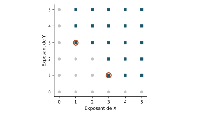
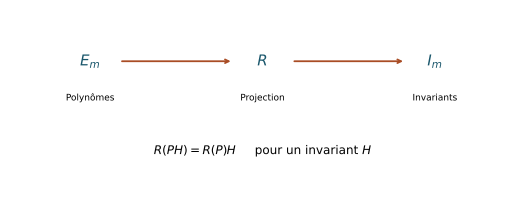

# ENS MP — Mathématiques D 2012 · Corrigé guidé

*Corrigé rédigé par IA, non officiel. Signalez toute erreur.*

**Rédaction** · GPT-6.2 Astra Ultra · vitesse non renseignée

**Révision (tour 1)** · GPT-6.2 Astra Ultra · vitesse non renseignée · 26 novembre 2026

**Invariants des formes binaires.** Le degré d’un polynôme en plusieurs variables est lexicographique dans la partie III. Dans les parties IV et V, le degré total en les coefficients et le poids d’un monôme sont distingués. Le dernier argument construit explicitement la projection sur les invariants.

## I. Polynômes homogènes et composition

### Question I.1

> [!INDICATION]
> Comparer la valeur en un point à celle en zéro.

#### Solution

Pour tout polynôme homogène d’ordre zéro, $f(tx)=f(x)$ pour $t\ne0$. En laissant $t\to0$ (ou en comparant les coefficients de ce polynôme en $t$), on obtient $f(x)=f(0)$ pour tout $x$. Réciproquement toute constante est homogène de degré zéro.

### Question I.2

> [!INDICATION]
> Identifier les monômes autorisés grâce à la variable scalaire.

#### Solution

La condition $f(tx)=t^kf(x)$ est linéaire en $f$. En développant $f=\sum c_\alpha X^\alpha$ et en identifiant les monômes en $x$, on voit que $c_\alpha\ne0$ impose $|\alpha|=\alpha_1+\cdots+\alpha_n=k$. Réciproquement toute combinaison de tels monômes est homogène d’ordre $k$. Ces monômes forment une base par liberté de la base monomiale. Les solutions entières positives ou nulles de $|\alpha|=k$ correspondent à une rangée de $k$ objets identiques et $n-1$ séparateurs. Leur nombre est $\binom{n+k-1}{n-1}$.

### Question I.3

> [!INDICATION]
> Regrouper une expansion monomiale unique par degré total.

#### Solution

Un polynôme ne comporte qu’un nombre fini de monômes. En regroupant par degré total, il s’écrit comme somme finie de composantes homogènes. Les familles de monômes de deux degrés distincts sont disjointes au sein d’une même base, donc l’annulation d’une telle somme impose que tous ses coefficients, puis toutes ses composantes, soient nuls. La somme est directe.

### Question I.4.a

> [!INDICATION]
> Substituer aux variables les coordonnées linéaires de l’image.

#### Solution

Écrivons $u(x)=(\ell_1(x),\ldots,\ell_n(x))$ avec des formes linéaires dans les $m$ coordonnées. Pour $f=\sum c_\alpha X^\alpha$, on obtient $f\circ u=\sum c_\alpha\prod_j\ell_j^{\alpha_j}$, polynôme en $m$ variables.

### Question I.4.b

> [!INDICATION]
> Vérifier ce qui est perdu sur l’image de u et sur ses fibres.

#### Solution

L’application $u^*:f\mapsto f\circ u$ est linéaire par évaluation en chaque point. Si $u$ est inversible, $(u^{-1})^*$ est son inverse. Si $u$ n’est pas surjective, une forme linéaire non nulle sur $\mathbb C^n$ annule son image, donc $u^*$ n’est pas injective. Si $u$ n’est pas injective, prenons $v\ne0$ dans son noyau. Toute image par $u^*$ a même valeur en 0 et $v$, ce qui n’est pas le cas d’une forme linéaire qui ne s’annule pas en $v$. Alors $u^*$ n’est pas surjective. Cela traite les deux sens.

## II. Invariants de matrices symétriques de taille deux

### Question II.1.a

> [!INDICATION]
> Construire une base orthogonale pour la forme bilinéaire symétrique, puis normaliser par des racines carrées complexes.

#### Solution

Posons $b(x,y)=x^{\mathsf T}My$. Il existe $v$ avec $b(v,v)\ne0$, sinon la polarisation donnerait $b=0$. La droite $v^\perp$ complète $\mathbb Cv$ et sa restriction est non dégénérée puisque $M$ est inversible. Prenons $w\ne0$ sur cette droite. La matrice dans $(v,w)$ est diagonale avec deux termes non nuls. Sur $\mathbb C$ on peut multiplier $v,w$ par deux scalaires de carrés prescrits, ce qui réalise toute diagonale $\operatorname{diag}(d_1,d_2)$ avec $d_1d_2\ne0$. L’inversibilité exclut toute autre diagonale.

### Question II.1.b

> [!INDICATION]
> Exploiter le déterminant de la congruence, puis rectifier un éventuel signe.

#### Solution

Pour $A\in SL_2$, $\det(A^{\mathsf T}MA)=\det M$. Réciproquement, une diagonale $D$ satisfaisant $d_1d_2=\det M$ est obtenue par un $A\in GL_2$ selon II.1.a. Alors $(\det A)^2=1$. Si $\det A=-1$, multiplions $A$ à droite par $\operatorname{diag}(-1,1)$, qui préserve $D$ par congruence et change ce déterminant. Ainsi toutes et seules les diagonales de déterminant $\det M$ sont obtenues.

Voici une congruence spéciale que la diagonalisation par similitude ne donnerait pas. Posons $N=\left(\begin{smallmatrix}1&i\\i&-1\end{smallmatrix}\right)$, matrice symétrique non nulle de carré nul. La matrice $M=I+N$ a pour seul sous-espace propre $\ker N$, de dimension un. Cependant $A=I-N/2$ est symétrique, de déterminant un, et $A^{\mathsf T}MA=(I-N/2)^2(I+N)=I$. Le déterminant prédit pour cette diagonale vaut bien $1$.

### Question II.2.a

> [!INDICATION]
> Décrire les trois coordonnées indépendantes de la matrice transformée.

#### Solution

Pour $A$ fixée, $M\mapsto A^{\mathsf T}MA$ est linéaire sur les matrices symétriques et à valeurs symétriques. Chacune des trois nouvelles coordonnées est donc une forme linéaire des anciennes. Par I.4.a leur substitution dans $\Phi$ est polynomiale.

### Question II.2.b

> [!INDICATION]
> Substituer directement les trois coordonnées de la diagonale.

#### Solution

Si $P(a,b,c)$ représente $\Phi$, l’application est $x\mapsto P(x,0,1)$. C’est un polynôme d’une variable par substitution.

### Question II.3

> [!INDICATION]
> Calculer le déterminant avant et après la congruence.

#### Solution

Pour $M=\begin{pmatrix}a&b\\b&c\end{pmatrix}$, $\Phi(M)=f(ac-b^2)$ est polynomiale. Pour $A\in SL_2$, $\det(A^{\mathsf T}MA)=(\det A)^2\det M=\det M$, donc $\Phi_A=\Phi$.

### Question II.4

> [!INDICATION]
> Partir des coordonnées, puis des sommes et produits qui forment le polynôme.

#### Solution

Les trois coordonnées sont continues pour toute norme sur $V$, identifié à $\mathbb C^3$ (équivalence des normes en dimension finie). Sommes et produits de fonctions continues sont continus. Cela donne la continuité de tout polynôme sur $V$.

### Question II.5

> [!INDICATION]
> Classer d’abord les matrices inversibles puis approcher les matrices singulières.

#### Solution

Posons $f(x)=\Phi(\operatorname{diag}(x,1))$, polynomial par II.2.b. Si $M$ est inversible, II.1.b permet de la transformer en $\operatorname{diag}(\det M,1)$ par congruence spéciale. L’invariance donne $\Phi(M)=f(\det M)$. Toute matrice singulière $M$ est limite de $M+tI$ inversibles, car le polynôme $\det(M+tI)$, unitaire de degré 2, n’a que deux zéros au plus. La continuité de II.4 étend l’égalité. Enfin, l’évaluation sur $\operatorname{diag}(x,1)$ impose $f(x)$ pour tout $x$, d’où l’unicité.

## III. Ordre lexicographique et génération finie des idéaux

### Question III.1

> [!INDICATION]
> Examiner le premier indice où deux listes diffèrent.

#### Solution

La réflexivité fait partie de la définition. Deux éléments distincts sont comparables dans un seul sens par leur première coordonnée différente, ce qui donne totalité et antisymétrie. Si $\alpha\prec\beta\prec\gamma$ avec premières différences aux indices $r,s$, les trois listes coïncident avant $\min(r,s)$. À cet indice $\alpha$ est strictement inférieure à $\gamma$, y compris si $r=s$. Donc $\alpha\prec\gamma$. L’égalité à une étape conserve la transitivité.

### Question III.2

> [!INDICATION]
> Ajouter un élément à la fois à une liste finie.

#### Solution

Pour un singleton le résultat est immédiat. En adjoignant un élément au sous-ensemble déjà traité, la totalité permet de retenir le plus grand entre l’ancien maximum et cet élément. Une récurrence sur le cardinal donne le maximum de toute partie finie non vide.

### Question III.3

> [!INDICATION]
> Observer la différence des deux listes après translation.

#### Solution

$(\beta+\gamma)-(\alpha+\gamma)=\beta-\alpha$. La nullité de la différence et le signe de son premier coefficient non nul sont inchangés. L’équivalence suit directement.

### Question III.4

> [!INDICATION]
> Distinguer le produit des deux monômes dominants de tous les autres produits.

#### Solution

Posons $a=\deg f$, $b=\deg g$. Toute somme d’exposants $u+v$ du produit vérifie $u+v\preccurlyeq a+b$ par III.3. Si $u\prec a$ ou $v\prec b$, au moins une des inégalités $u+v\preccurlyeq a+v\preccurlyeq a+b$ est stricte. Le monôme d’exposant $a+b$ provient donc exclusivement des deux termes dominants et a un coefficient non nul. Ainsi $\deg(fg)=a+b$.

### Question III.5

> [!INDICATION]
> Réduire le terme dominant s’il est divisible par un des monômes dominants. Sinon le transférer au reste.

#### Solution

Posons $h=f$ et initialisons les $q_i$ et $r$ à zéro. Si le terme dominant $t$ de $h$ est divisible par le terme dominant $t_i$ d’un $b_i$ (au sens coordonnée par coordonnée pour les exposants), ajoutons $t/t_i$ à $q_i$ et retranchons $(t/t_i)b_i$ de $h$. Sinon ajoutons $t$ au reste et retranchons-le de $h$. L’identité $f=h+\sum_iq_i b_i+r$ est conservée. Par III.4, le nouveau $h$ est nul ou de degré lexicographique strictement plus petit. L’ordre lexicographique sur $\mathbb N^n$ est bien fondé, car une partie non vide a un minimum en minimisant successivement ses coordonnées. La procédure termine donc avec $h=0$. Chaque terme transféré à $r$ échappait à tous les diviseurs dominants, ce qui donne la seconde condition.

### Question III.6.a

> [!INDICATION]
> Développer une combinaison finie de générateurs et examiner le coefficient de l’exposant recherché.

#### Solution

Si $\beta-\alpha\in\mathbb N^n$, $X^\beta=X^{\beta-\alpha}X^\alpha\in I(\Lambda)$. Inversement, écrivons $X^\beta=\sum_{\alpha\in J}P_\alpha X^\alpha$ avec $J\subset\Lambda$ fini. Le coefficient de $X^\beta$ dans cette somme est 1. Il faut donc que dans au moins un produit le monôme $X^\beta$ possède un coefficient non nul, d’où $\beta-\alpha\in\mathbb N^n$.

### Question III.6.b

> [!INDICATION]
> Les monômes susceptibles d’apparaître dans une combinaison de générateurs ont tous un facteur dans la liste.

#### Solution

Si $f=\sum P_\alpha X^\alpha$, tout monôme à coefficient non nul dans $f$ provient d’au moins un produit, et est multiple de son $X^\alpha$. Par 6.a il appartient à l’idéal. Réciproquement $f$ est la somme finie de ses monômes et l’idéal est stable par addition. Le cas $f=0$ convient également.

### Question III.6.c

> [!INDICATION]
> Dans une suite de listes d’entiers naturels, extraire une sous-suite croissante coordonnée par coordonnée.

#### Solution

Toute suite d’entiers naturels admet une sous-suite croissante au sens large. En effet, si une valeur se répète infiniment, on l’extrait, sinon toute queue est non bornée et on construit une sous-suite strictement croissante. Pour une suite de $n$-uplets, répétons cette extraction successivement sur les $n$ coordonnées. On obtient en particulier deux termes d’indices $i<j$ avec $\alpha_i\le\alpha_j$ dans chaque coordonnée.

Si aucune sous-famille finie de $\Lambda$ ne suffisait, on pourrait choisir $\alpha_j\in\Lambda$ dont le monôme n’appartient pas à l’idéal des précédents, à chaque étape (sinon ces précédents engendreraient déjà tout l’idéal). Les deux termes comparables contredisent 6.a. Donc une famille finie $\Lambda_0$ suffit, la famille vide convenant si $\Lambda=\varnothing$.

### Question III.7

> [!INDICATION]
> Diviser par des éléments de l’idéal dont les termes dominants engendrent son idéal de monômes dominants.

#### Solution

Si $I=0$, la famille vide convient. Sinon, III.6.c fournit $b_1,\ldots,b_s\in I$ non nuls tels que les $X^{\deg b_j}$ engendrent l’idéal de tous les monômes dominants d’éléments de $I$. Divisons un $f\in I$ non nul par les $b_j$ selon III.5. Le reste appartient à $I$ par soustraction. S’il était non nul, son monôme dominant appartiendrait à l’idéal de monômes dominants, donc serait divisible par un $X^{\deg b_j}$ d’après 6.a. Cela contredit la définition du reste. Donc $f\in(b_1,\ldots,b_s)$ et cette famille engendre $I$.

### Question III.8

> [!INDICATION]
> Exprimer les générateurs finis par des combinaisons de la famille initiale.

#### Solution

Par III.7, $I$ a des générateurs en nombre fini. Chacun est combinaison d’un nombre fini des $f_k$. La réunion des indices employés est finie, donc incluse dans $\{0,\ldots,r\}$ pour un certain $r$. Ainsi $(f_0,\ldots,f_r)$ contient les générateurs et est inclus dans $I$, d’où l’égalité. Si $I=0$, on peut prendre $r=0$.

## IV. Invariants des formes binaires

### Question IV.1.a

> [!INDICATION]
> La substitution linéaire conserve l’homogénéité de la forme en ses deux arguments.

#### Solution

Par I.4.a, $f^A(u,v)=f(A(u,v))$ est polynomial en $u,v$. Comme $A$ est linéaire et $f$ homogène d’ordre $m$, $f^A(tu,tv)=t^mf^A(u,v)$. On a donc $f^A\in B_m$. L’évaluation donne $(sf+tg)^A=sf^A+tg^A$. La substitution est un endomorphisme linéaire de $B_m$.

### Question IV.1.b

> [!INDICATION]
> Appliquer le résultat de composition aux coordonnées de la forme binaire.

#### Solution

Pour $A$ fixée, $L_A:f\mapsto f^A$ est un endomorphisme linéaire de $B_m\simeq\mathbb C^{m+1}$. Pour toute fonction polynomiale $\Phi$ sur cet espace, $\Phi_A=\Phi\circ L_A$ est donc polynomiale par I.4.a. La composition à droite est linéaire en $\Phi$, ce qui donne l’endomorphisme de $E_m$.

### Question IV.2

> [!INDICATION]
> Distinguer le degré en les variables de la forme du degré en ses coefficients.

#### Solution

Pour $\Phi$ homogène d’ordre $k$ en les coefficients et $c\in\mathbb C$, $\Phi_A(cf)=\Phi((cf)^A)=\Phi(cf^A)=c^k\Phi_A(f)$. Ainsi $\Phi_A\in E_{m,k}$.

### Question IV.3

> [!INDICATION]
> Regrouper les monômes de même poids dans une base déjà classée par degré.

#### Solution

Les monômes $X^\nu$ de degré total $k$ forment la base de I.2, ici avec $m+1$ variables. Chacun a un poids entier $p=\sum_{j=0}^m j\nu_j$ entre 0 et $mk$. Les classes de poids sont disjointes et couvrent la base, donc $E_{m,k}=\bigoplus_{p=0}^{mk}E_{m,k,p}$. Les autres espaces de poids sont nuls.

### Question IV.4.a

> [!INDICATION]
> Suivre la variable perdue par dérivation et la variable reçue par multiplication.

#### Solution

Chaque terme non nul de $D(X^\nu)$ remplace une occurrence de $X_j$ par $X_{j-1}$. Il conserve le degré total et diminue le poids d’une unité. De même, $D'$ (noté $D^\prime$ dans le sujet) remplace $X_j$ par $X_{j+1}$ dans chaque terme non nul et augmente le poids de 1. Cela donne les deux inclusions par linéarité.

### Question IV.4.b

> [!INDICATION]
> Le commutateur de dérivations est une dérivation. Le calcul sur les variables suffit.

#### Solution

La règle du produit donne que $H=[D,D']$ est une dérivation, les termes croisés se compensant. Avec les coefficients nuls aux extrémités, $DX_j=jX_{j-1}$ et $D'X_j=(m-j)X_{j+1}$, d’où
$$H X_j=((m-j)(j+1)-j(m-j+1))X_j=(m-2j)X_j.$$
Sur $X^\nu$, la règle de Leibniz multiplie par $\sum_j(m-2j)\nu_j=mk-2p$. Cela vaut sur tout $E_{m,k,p}$ par linéarité.

### Question IV.4.c

> [!INDICATION]
> Développer chaque commutateur par télescopage et tenir compte du poids au moment où intervient H.

#### Solution

On a $[D^r,D']=\sum_{j=0}^{r-1}D^{r-1-j}HD^j$. Sur $\Phi$ de poids $p$, $D^j\Phi$ a poids $p-j$ lorsqu’il est non nul. Chaque terme vaut donc $(mk-2p+2j)D^{r-1}\Phi$ (également si un itéré est nul). La somme vaut $r(mk-2p+r-1)D^{r-1}\Phi$. De même $[D,D'^r]=\sum_{j=0}^{r-1}D'^{r-1-j}HD'^j$ et les poids sont $p+j$. La somme des multiplicateurs $mk-2p-2j$ vaut $r(mk-2p-r+1)$, d’où la seconde formule.

### Question IV.4.d

> [!INDICATION]
> Au poids central, appliquer un commutateur juste après le dernier itéré non nul.

#### Solution

Sur $E_{m,k}$, $D$ et $D'$ sont nilpotents puisque leurs itérations sortent de la plage $0\le p\le mk$. Le cas $\Phi=0$ est immédiat. Si $D'\Phi=0$, soit $r\ge1$ le premier exposant tel que $D^r\Phi=0$. La première formule de 4.c, au poids central, donne $0=r(r-1)D^{r-1}\Phi$. Par minimalité, $r=1$, donc $D\Phi=0$. Inversement, si $D\Phi=0$, prenons le premier $r$ annulant $D'^r\Phi$. La seconde formule donne $0=r(1-r)D'^{r-1}\Phi$, d’où encore $r=1$ et $D'\Phi=0$.

### Question IV.5.a

> [!INDICATION]
> Calculer l’effet de la diagonale sur chaque coefficient et chaque monôme.

#### Solution

Avec $A=\operatorname{diag}(\lambda,\lambda^{-1})$, le coefficient $x_j$ de $e_j$ est multiplié par $\lambda^{m-2j}$. Le monôme $X^\nu$ de degré $k$ et poids $p$ est donc multiplié par $\lambda^{mk-2p}$. Une somme non nulle est invariante pour tout $\lambda\ne0$ exactement si chaque monôme de coefficient non nul a $mk-2p=0$ (tester par exemple $\lambda=2$). Cela impose $mk$ pair et $\Phi\in E_{m,k,mk/2}$, conditions également suffisantes.

### Question IV.5.b

> [!INDICATION]
> Dériver en zéro la famille de substitutions triangulaires, puis utiliser sa loi de groupe additif.

#### Solution

Soit $A_u=\begin{pmatrix}1&u\\0&1\end{pmatrix}$. Les coefficients $y_j(u)$ de $f(U+uV,V)$ dans la base binomiale satisfont $y_j(0)=x_j$ et $y_j'(0)=j x_{j-1}$ pour $j\ge1$, avec $y_0'(0)=0$. En effet le terme source d’indice $j-1$ donne le facteur $(m-j+1)\binom m{j-1}/\binom mj=j$. Par dérivation composée, $(d/du)_{u=0}\Phi(f^{A_u})=D\Phi(f)$. L’invariance implique donc $D\Phi=0$. Réciproquement, $A_uA_t=A_{u+t}$ donne en dérivant en $t=0$ la formule $(d/du)\Phi(f^{A_u})=D\Phi(f^{A_u})$, où le membre droit est $(D\Phi)(f^{A_u})$. S’il est nul à tout $f$, ce polynôme en $u$ est constant, égal à sa valeur en 0.

### Question IV.5.c

> [!INDICATION]
> Procéder avec la substitution sur la seconde variable cette fois.

#### Solution

Pour $B_v=\begin{pmatrix}1&0\\v&1\end{pmatrix}$, on développe $f(U,vU+V)$. Le coefficient à l’ordre 1 en $v$ de la coordonnée $j$ provient de $x_{j+1}$ avec multiplicateur $(j+1)\binom m{j+1}/\binom mj=m-j$ (nul pour $j=m$). La dérivée de $v\mapsto\Phi(f^{B_v})$ en zéro est donc $(D'\Phi)(f)$. À $v$ quelconque, la relation $B_v B_t=B_{v+t}$ donne la dérivée $(D'\Phi)(f^{B_v})$. L’invariance pour tout $v$ équivaut donc à $D'\Phi=0$.

### Question IV.6.a

> [!INDICATION]
> La substitution dans l’argument préserve les opérations de l’algèbre.

#### Solution

Les constantes sont invariantes. Si $\Phi$ et $\Psi$ sont invariantes sous toutes les substitutions $A\in SL_2(\mathbb C)$, alors l’évaluation en $f^A$ montre que leurs sommes, opposés, multiples scalaires et produits le sont. Ainsi $I_m$ est un sous-anneau unitaire et un sous-espace vectoriel de $E_m$.

### Question IV.6.b

> [!INDICATION]
> Comparer les composantes homogènes dans l’équation d’invariance.

#### Solution

Décomposons $\Phi=\sum_k\Phi_k$ par degré. La substitution préserve le degré par IV.2, donc l’égalité $\Phi_A=\Phi$ impose $(\Phi_k)_A=\Phi_k$ pour chaque $k$ par unicité de la décomposition. La réciproque découle de la linéarité. Ainsi $I_m=\bigoplus_{k\ge0}I_{m,k}$.

### Question IV.7.a

> [!INDICATION]
> Appliquer l’invariance au sous-groupe des matrices diagonales.

#### Solution

Si $I_{m,k}$ contient un élément non nul, celui-ci est invariant sous toutes les diagonales de IV.5.a. Donc $mk$ est pair et cet élément est de poids $mk/2$. Le même argument pour tout élément non nul, ainsi que la présence de zéro, donne $I_{m,k}\subset E_{m,k,mk/2}$.

### Question IV.7.b

> [!INDICATION]
> Séparer la partie scalaire du changement de variables de sa partie de déterminant un.

#### Solution

Pour $A\in GL_2$, choisissons $s$ avec $s^2=\det A$. Alors $B=A/s\in SL_2$ et $f^A=s^mf^B$. Pour $\Phi\in I_{m,k}$ on obtient $\Phi(f^A)=s^{mk}\Phi(f^B)=(\det A)^{mk/2}\Phi(f)$. Le résultat est indépendant du choix de la racine puisque $mk$ est pair.

## V. Opérateur oméga et finitude des invariants

### Question V.1

> [!INDICATION]
> Appliquer la règle de chaîne pour chacune des deux lignes puis prendre le déterminant des dérivations.

#### Solution

Pour $B=\begin{pmatrix}u&v\\w&x\end{pmatrix}$, les deux lignes de $AB$ sont $(au+bw,av+bx)$ et $(cu+dw,cv+dx)$. La composition est donc polynomiale. Écrivons $\partial_1,\ldots,\partial_4$ pour les dérivées de $G$ en ces quatre coordonnées. Les dérivées $D_a,D_b,D_c,D_d$ agissent respectivement via $u\partial_1+v\partial_2$, $w\partial_1+x\partial_2$, $u\partial_3+v\partial_4$, $w\partial_3+x\partial_4$. En développant $D_aD_d-D_bD_c$, les termes restants sont $(ux-vw)(\partial_1\partial_4-\partial_2\partial_3)$. D’où $\Omega(G(\,\cdot\, B))(A)=\det B\,(\Omega G)(AB)$.

### Question V.2.a

> [!INDICATION]
> Considérer f comme fixé et développer sa substitution en les quatre coefficients de A.

#### Solution

Dans $f(au+bv,cu+dv)$, chaque coordonnée de $f^A$ dans la base des formes binaires est un polynôme homogène de degré $m$ en les entrées de $A$, dont les coefficients dépendent linéairement des coordonnées de $f$. La composition par $\Phi$ puis le produit par $(ad-bc)^r$ sont donc polynomiaux en $A$.

### Question V.2.b

> [!INDICATION]
> Trouver une borne sur le degré indépendante de la forme f.

#### Solution

Pour $\Phi\ne0$ de degré total $d$, le degré de $G_f$ en $A$ est au plus $md+2r$ pour tout $f$. Chaque application de $\Omega$ abaisse le degré de 2 ou donne zéro. Prenons $q\ge r$ avec $2q>md+2r$, alors $\Omega^q G_f=0$ pour tout $f$, donc est constante. Si $\Phi=0$, $q=r$ convient.

### Question V.2.c

> [!INDICATION]
> La substitution sur f multiplie A à gauche. Déduire la covariance à gauche de celle à droite par transposition.

#### Solution

La formule définit une fonction sur $B_m$ (l’énoncé emploie ici $E_m$ comme domaine, alors que $f\in B_m$). L’expression $G_f(A)$ est polynomiale conjointement en les coordonnées de $f$ et de $A$. Après $q$ applications de $\Omega$, elle est constante en $A$ par hypothèse, donc son évaluation en $A=I$ définit un polynôme $\Theta$ sur $B_m$, c’est-à-dire un élément de $E_m$.

Pour $B\in GL_2$, $(f^B)^A=f^{BA}$ et $G_{f^B}(A)=(\det B)^{-r}G_f(BA)$. La transposition échange les coordonnées $b,c$ et commute à $\Omega$. En transposant la formule de V.1 on obtient aussi $\Omega(G(B\,\cdot\,))(A)=\det B\,(\Omega G)(BA)$. L’itération $q$ fois et la constance en $A$ donnent $\Theta(f^B)=(\det B)^{q-r}\Theta(f)$. En particulier $\Theta\in I_m$.

### Question V.3

> [!INDICATION]
> Calculer une première action sur une puissance du déterminant avant d’itérer.

#### Solution

Pour $\delta=ad-bc$ et $h\ge1$, la dérivation donne $D_aD_d\delta^h=h\delta^{h-1}+h(h-1)ad\delta^{h-2}$ et $D_bD_c\delta^h=-h\delta^{h-1}+h(h-1)bc\delta^{h-2}$, les termes de facteur $h-1$ étant nuls pour $h=1$. Ainsi $\Omega\delta^h=h(h+1)\delta^{h-1}$. En itérant, $\Omega^q\delta^q=q!(q+1)!$, également pour $q=0$.

### Question V.4

> [!INDICATION]
> Pour un invariant homogène, la dépendance en A est précisément une puissance du déterminant.

#### Solution

Si $\Psi=0$, prenons $\Phi=0$, $r=q=0$. Sinon $mk$ est pair et, avec $q=mk/2$, IV.7.b donne $\Psi(f^A)=\delta(A)^q\Psi(f)$ sur $GL_2$. Par densité des inversibles dans $M_2$ et continuité cette égalité vaut partout. Prenons $r=0$ et $\Phi=\Psi/(q!(q+1)!)$. D’après V.3, $\Omega^q G_f$ est alors la constante $\Psi(f)$.

### Question V.5

> [!INDICATION]
> Traiter chaque degré de l’identité et appliquer l’opérateur à tous les termes avec le même ordre total.

#### Solution

Décomposons $\Psi$ et les $\Psi_j$ en composantes homogènes, toutes invariantes par IV.6.b. Pour revenir aux **générateurs initiaux inhomogènes**, construisons une projection linéaire $R:E_m\to I_m$ qui commute à la multiplication par tout invariant. Sur les polynômes homogènes $P$ de degré $d$, posons $R(P)=0$ si $md$ est impair. Sinon posons $q=md/2$ et
$$ R(P)(f)=\frac{\Omega^q[P(f^A)]}{q!(q+1)!}.$$
L’expression est constante en $A$ (degré $2q$) et invariante par V.2.c. V.4 montre que $R$ fixe les invariants. Étendons $R$ par linéarité aux sommes de degrés.

Il reste à prouver $R(PH)=H R(P)$ pour un invariant homogène $H$ de degré $e$, supposé non nul. Écrivons $h=me/2$, entier. Si $md$ est impair, les deux projections sont nulles. Sinon posons $q=md/2$. Pour toute forme $f$, $H(f^A)=\delta(A)^h H(f)$. Pour un polynôme $G(A)$ homogène de degré $2q$, on a l’identité
$$\frac{\Omega^{q+h}(\delta^hG)}{(q+h)!(q+h+1)!}=\frac{\Omega^q G}{q!(q+1)!}.$$
On peut établir cette identité sans développer les monômes de $G$. Posons $\delta=ad-bc$ et notons $E=a\partial_a+b\partial_b+c\partial_c+d\partial_d$. La règle du produit dans les deux dérivées mixtes donne
$$\Omega(\delta G)=\delta\,\Omega G+(E+2)G.$$
Pour $G$ homogène de degré $m$, le dernier terme vaut $(m+2)G$. Comme $\Omega$ fait baisser le degré de deux, une récurrence sur $s\ge1$ donne
$$\Omega^s(\delta G)=\delta\,\Omega^sG+s(m-s+3)\Omega^{s-1}G.$$
En effet, au passage de $s$ à $s+1$, le coefficient nouveau est $(m-2s+2)+s(m-s+3)=(s+1)(m-s+2)$. Avec $m=2q$ et $s=q+1$, le premier terme est nul et le second vaut $(q+1)(q+2)\Omega^qG$. La division par $(q+1)!(q+2)!$ montre l’identité cherchée pour $h=1$. En répétant ce passage pour $G,\delta G,\ldots,\delta^{h-1}G$, on obtient tous les $h\ge0$.

Avec $G(A)=P(f^A)$, elle prouve la propriété de $R$. Par décomposition des degrés et bilinéarité, celle-ci vaut pour $P$ et $H$ quelconques, $H$ invariant. Appliquons-la à l’égalité initiale. On obtient $\Psi=R(\Psi)=\sum_j R(\Phi_j)\Psi_j$. Les coefficients $\Pi_j=R(\Phi_j)$ appartiennent bien à $I_m$.

### Question V.6

> [!INDICATION]
> Former l’idéal des invariants homogènes de degré positif, puis descendre en degré.

#### Solution

Dans $E_m$, prenons l’idéal $J$ engendré par tous les invariants homogènes de degré positif. L’argument de III.7 et III.8 (chaque générateur fini de $J$ est combinaison finie de la famille initiale) donne une sous-famille finie $H_1,\ldots,H_r$ de ces invariants qui engendre $J$. Si $J=0$, seuls les invariants constants subsistent et un générateur constant suffit.

Montrons par récurrence sur $d$ que tout invariant homogène $\Psi$ de degré $d$ est polynomial en les $H_j$. Le cas $d=0$ est immédiat. Pour $d>0$, $\Psi\in J$, donc $\Psi=\sum P_j H_j$. Par V.5 on peut prendre des coefficients invariants. En conservant seulement les composantes de degré $d-\deg H_j$, on garde l’égalité et l’invariance par IV.6.b. Ces composantes ont toutes degré strictement inférieur à $d$ (et sont nulles en degré négatif). La récurrence conclut. Enfin, tout invariant est somme finie de ses composantes homogènes. On a donc $I_m=\mathbb C[H_1,\ldots,H_r]$.

