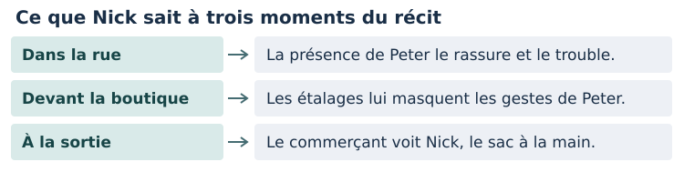
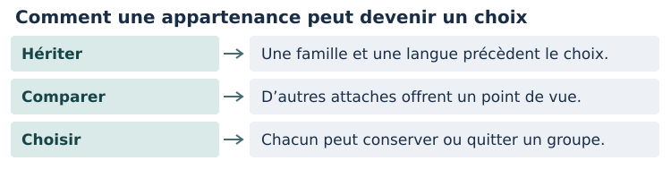
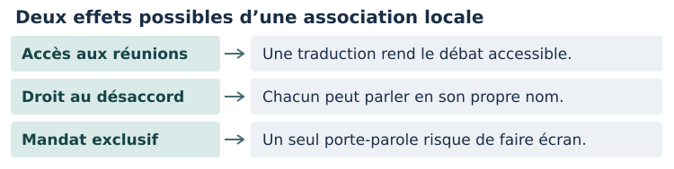

# X-ENS · MP-PC · Anglais 2012 — Corrigé guidé

*Corrigé rédigé par IA, non officiel. Signalez toute erreur.*

**Rédaction** · GPT-6.2 Astra Ultra · vitesse non renseignée

Les deux cahiers XEULC prévoient chacun une heure trente, sans dictionnaire. La version figure p. 3 du fascicule de langues. L’expression écrite sur le texte de Mona Ozouf comporte deux réponses en anglais d’environ 120 à 150 mots et 180 à 200 mots. Les correcteurs ont publié un rapport distinct pour chaque exercice.

Lire la scène de Brooklyn jusqu’au dernier mot avant de choisir l’équivalent français du cri du commerçant. Dans l’essai d’Ozouf, repérer où elle rapporte les propos de ses adversaires et où elle expose sa propre thèse. Les deux rapports apportent des critères précis pour cette double lecture.

## I. Version — Vol à l’étalage

**Reconstruire les points de vue.** C’est Nick qui éprouve le soulagement de marcher accompagné et qui voit dans les yeux de Peter le signe d’une inquiétante étrangeté. Le lecteur ne voit pas ce qui arrive derrière les étalages. L’odeur, le sommet d’une tête, puis la quantité de nourriture à la sortie conduisent à l’accusation finale. Dans *His clothes might have been worn and dirty*, le contraste qui suit donne à *might* une valeur concessive. « Avaient beau » fait entendre ce rapport.

**Le français de la rue.** *Hold up* demande à Nick de s’arrêter. *Lookout* désigne celui qui fait le guet. Le rapport insiste sur la différence entre « guet » et « gué » et sur le registre de *skedaddle*. « Filer » conserve le ton pressé d’un garçon sans outrer sa vulgarité. Le passage de l’allure tranquille au départ précipité prépare la chute. Le menu reste concret, avec notamment du riz sauté et des barres chocolatées.

**Un mot déformé.** Sous *TEEF*, on reconnaît *thief*. Une déformation française immédiatement compréhensible fait entendre l’accusation et prépare le trait ironique de la dernière phrase. Le jury a accepté et valorisé des trouvailles sur ce cri. La graphie « VOLEU » constitue un choix de traduction et n’imite aucune langue de façon systématique.

« Viens avec moi, dit Peter en remontant sa capuche. Tu verras. »

Nick suivit donc Peter. Ils se frayèrent un chemin dans les quartiers sombres de Brooklyn, toujours attentifs à éviter les grandes artères passantes et les coins de rue où traînaient des adolescents, mais ils avaient cessé de se précipiter dans les rues adjacentes ou de se cacher derrière les arbres. Si loin à l’ouest, Nick ne voyait aucune raison de s’inquiéter de Marko. Il ne pouvait pourtant s’empêcher de guetter la camionnette verte. Au bout d’un moment, il commença à se détendre, sentit son pas s’alléger et se rendit compte qu’il prenait plaisir au simple fait d’avoir quelqu’un avec qui marcher dans la rue. […]

Peter ne ressemblait pas aux autres gamins des rues que Nick avait vus. Ses vêtements avaient beau être usés et sales, lui n’était pas crasseux. Il était un peu dingue, d’accord, mais il n’avait pas l’air sous l’emprise de la drogue. Ses yeux étaient clairs et vifs, même s’ils étaient couleur d’or. Peter lui faisait l’effet d’un ami, de la meilleure espèce qui soit, de ceux sur qui on peut compter pour vous couvrir. Nick devait pourtant se rappeler qu’il ne savait rien de ce garçon bizarre et qu’il lui fallait rester prudent. Et puis il y avait autre chose. Sous ce rire communicatif et ces sourires malicieux, quelque chose tracassait Nick, quelque chose qu’il n’arrivait pas à définir, quelque chose de mauvais, quelque chose de… dangereux.

L’odeur des nectarines emplit les narines de Nick et lui mit l’eau à la bouche. Il se rendit compte que ces effluves provenaient du traiteur chinois juste devant eux.

« Tu as faim ? demanda Peter. »

Nick s’aperçut que oui. Il n’avait rien mangé depuis le petit déjeuner. Il se rappela aussi qu’il n’avait pas un sou.

« Attends un peu, dit Peter en jetant un coup d’œil des deux côtés de la rue. Tu fais le guet, d’accord ?

— Le guet ? fit Nick. Pourquoi ? »

Mais Peter était déjà entré dans la boutique.

Nick n’aimait guère la tournure que prenaient les choses. Il essaya de regarder par-dessus les étals de fruits pour voir ce que Peter pouvait bien fabriquer. Il n’apercevait que le sommet de sa tête, qui allait et venait dans le magasin. Quelques minutes plus tard, Peter en ressortit d’un pas tranquille, avec deux barquettes en plastique de poulet Kung Pao encore fumant, du riz sauté, des rouleaux de printemps et trois sacs de barres chocolatées. Il pouvait à peine tout porter.

« Tiens, aide-moi un peu, dit Peter en passant les friandises à Nick.

— Attends, fit Nick, tu n’as quand même pas…

— On ferait sans doute mieux de filer », l’interrompit Peter, qui s’éloigna à vive allure.

Une seconde plus tard, un Chinois déjà âgé et plutôt rondouillard déboula de la boutique en dérapant, vêtu d’un tablier taché et chaussé de bottes en caoutchouc jaunes.

L’homme regarda Nick, puis le sac de barres chocolatées.

Nick l’entendit marmonner quelque chose. L’homme avait beau parler chinois, Nick reconnut sans peine un juron. Puis il le montra du doigt et se mit à crier sans s’arrêter : « VOLEU ! VOLEU ! »

Nick détala à la suite de Peter.

Heureusement pour Nick, le vieux courait à peu près aussi bien qu’il parlait anglais. En un rien de temps, une ou deux rues les séparaient déjà.

*Brom, The Child Thief, 2009.*

## II.1. Quelle vision Mona Ozouf donne-t-elle de l’identité individuelle ?

**Identifier les porte-parole.** Les défenseurs d’un universalisme sans attaches soutiennent qu’une fidélité locale empêcherait de devenir libre. L’exemple scolaire illustre leur thèse. La réponse propre d’Ozouf commence lorsqu’elle demande quel individu pourrait exister sans aucune détermination. La multiplicité des liens introduit ensuite la possibilité d’en sortir. Dans la réponse anglaise, *ties*, *commitments* et *allegiance* traduisent trois aspects d’« appartenance ». *Belongings* désigne les objets que l’on possède, confusion relevée dans le rapport d’expression.

Mona Ozouf sees identity as something people make out of ties they did not initially choose. An ideal of emancipation once encouraged French schoolchildren to abandon their regional language and loyalties in order to become free citizens. Yet the capacity to speak, remember or create develops within a particular family and culture. There would be little to emancipate if these attachments could simply be erased. Nor does inheriting a language or religion settle who a person will be. Someone may also be a scientist, a parent and a member of a political party. These commitments overlap without ever exhausting the individual. Their very variety makes comparison possible. One can cultivate a bond, question it or eventually let it go. For Ozouf, freedom includes the ability to make an inherited allegiance one's own.

*132 mots.*

## II.2. La diversité des appartenances menace-t-elle la cohésion sociale ?

**Répondre à la question de société.** Il faut expliquer par quel mécanisme la diversité change les rapports entre citoyens. La réunion municipale fait apparaître deux effets observables. Une association aide certains habitants à décrire leurs besoins, tandis que le monopole d’un porte-parole peut étouffer un désaccord. Les règles proposées à la fin constituent une réponse à ce risque. Le rapport invite précisément à dépasser la paraphrase de la première question et à appuyer tout lien entre identité et conflit sur un exemple.

I think a town is more likely to hold together when its residents can enter public life through several doors. Suppose the council is consulting people about a new bus route. A parents' association can tell it when school ends, a disability group can point out an inaccessible stop and a neighbourhood language group can explain the proposal to residents who would otherwise miss the meeting. Someone who belongs to all three may notice a compromise that none of the groups would find on its own.

There is a danger when the council decides that one association speaks for everyone who shares a language or a faith. A young member who disagrees with its leaders may then have to choose between keeping quiet and being treated as disloyal. Insisting that everyone speak only as an individual would create a different obstacle for people who need help making their voices heard.

I would keep public meetings open to associations and individuals alike, provide interpretation and publish the reasons for the final decision. People can disagree about where a bus should stop and still trust the process by which they have reached a decision together.

*193 mots.*

[Version en anglais](https://banques-ecoles.fr/cms/wp-content/data/filiere-pc/annales-de-la-banque-pc/session-2012/pc2012_sujet_langue_vivante_version.pdf#page=3) · [Expression écrite commune, réponses en anglais](https://banques-ecoles.fr/cms/wp-content/data/filiere-pc/annales-de-la-banque-pc/session-2012/pc2012_sujet_langue_vivante_expression.pdf) · [Rapport d’anglais — version](https://www.ens.psl.eu/IMG/file/concours/2012/PC/2012MP_PCrapport_LVAnglais_XEULC.pdf) · [Rapport d’anglais — expression écrite](https://www.ens.psl.eu/IMG/file/concours/2012/PC/2012MP_PCrapport_expressionecriteLVAnglais_XEULC.pdf)
