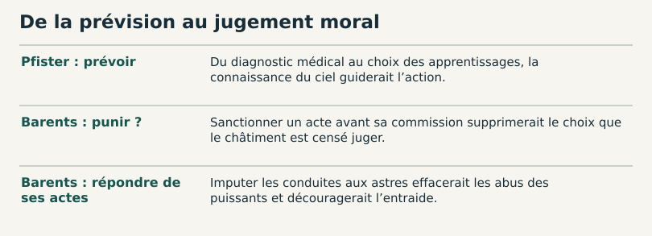

# X-ENS MP-PC — Espagnol 2012 · Corrigé guidé

*Corrigé rédigé par IA, non officiel. Signalez toute erreur.*

**Rédaction** · GPT-6.2 Astra Ultra · vitesse non renseignée

Les cahiers XEULC de version et d’expression écrite prévoient chacun une heure et demie, sans dictionnaire. La version se rédige en français. Les réponses à propos de Mona Ozouf se rédigent en espagnol, en 120 à 150 puis 180 à 200 mots environ.

## Version — La astrología, arte controvertido

> [!INDICATION]
> Attribuer chaque conditionnel à celui qui parle. Pfister imagine des possibilités pour la médecine, l’éducation et le gouvernement. Le *vosotros* de *los médicos deberíais* inclut son interlocuteur dans le corps médical. Barents lui répond en le tutoyant. L’incise qui ouvre chaque réplique est au présent.

**L’astrologie, un art controversé**

— S’il est démontré que les phénomènes de l’univers exercent une influence sur l’homme, dit Pfister à Barents au cours d’une autre de leurs promenades, il est absurde d’interdire l’astrologie dans les universités. Vous autres médecins, vous devriez être tenus de connaître la configuration astrale de vos patients. Grâce à l’astrologie, nous pourrions prévenir des maladies et saurions même qui en souffrira et quand elles se manifesteront. Nous pourrions aller jusqu’à prédire des comportements. Nous saurions quels enfants ont une disposition naturelle pour la musique et pourrions leur en faire cultiver l’étude dès leur plus jeune âge. Nous saurions aussi qui est particulièrement doué pour gouverner, ou qui est attiré par le mal.

— Mais c’est très dangereux, objecte Barents, car il s’en trouverait alors pour proposer de punir à l’avance, avant même que le crime ait été commis, justement pour l’empêcher. Non, je ne crois pas que tout soit écrit dans les astres. Comme saint Augustin, j’admets une certaine influence des étoiles, mais je crois que l’homme est avant tout un être libre. Les astres agissent sur le corps, sans avoir de prise sur la volonté. D’ailleurs, si nous rejetons toute la faute sur les planètes, que devient la responsabilité de l’homme envers ses semblables ? Il est bien tentant de dire que le criminel est criminel parce qu’ainsi l’a voulu la position de la Lune ou de Mars. Mais, de cette façon, on efface les injustices et les abus des puissants. Si l’on ne peut aller à l’encontre des desseins des astres, pourquoi aider son prochain ? Pourquoi corriger les vices ou les fautes si l’on ne peut rien changer ? Si j’étais roi ou pape, j’aurais tout intérêt à ce que chacun pense comme toi. Mais ce qui importe davantage que l’influence des étoiles, c’est la condition dans laquelle on naît, sa naissance, sa famille, sa fortune. Croire en l’astrologie comme l’ont fait Platon, Aristote, Pythagore, Galien et Hippocrate est une chose. Prêcher les mensonges de l’astrologie judiciaire en est une tout autre.

*Antonio Orejudo, Reconstrucción, 2005.*

> [!INDICATION]
> *Para con* marque ici un devoir envers autrui. *Estaría muy interesado* révèle l’intérêt qu’un souverain trouverait à la doctrine. Le mot *cuna* évoque l’origine sociale par le berceau. L’« astrologie judiciaire » est le nom historique de la pratique qui entend pronostiquer actes et destins individuels. Le délit évoqué auparavant pourrait induire en erreur sur ce dernier terme. Le rapport souligne aussi le sens de *incluso*, qui donne « même » ou « jusqu’à ».

## Expression écrite — Première question. L’identité selon Mona Ozouf

> [!INDICATION]
> Reconstituer le raisonnement de *Composition française*. Une doctrine exige l’arrachement aux héritages pour accéder à l’universel. Ozouf lui oppose d’abord la formation concrète d’une personne, puis un constat décisif : chacun relève de plusieurs groupes. C’est cette pluralité qui rend possible le choix personnel.

Para Mona Ozouf, aspirar a valores comunes y reconocerse heredero de una historia particular forman parte de una misma experiencia. Quienes exigen que el individuo abandone sus vínculos para ser libre olvidan que incluso la capacidad de crear se adquiere en una lengua, una familia o un paisaje determinados. La escuela francesa, al presentar la renuncia a las identidades regionales como precio de la emancipación, confundía un punto de partida con una cárcel. Además, cada persona pertenece simultáneamente a varios grupos, cuyas exigencias rara vez coinciden por completo. Puede comparar sus lealtades, profundizar en una costumbre o dejarla atrás sin perder las demás. Aunque nadie elija dónde nace, sí puede decidir qué lugar concede a esa herencia en su vida. La identidad se construye mediante estas decisiones sucesivas y permanece abierta a revisión.

## Expression écrite — Seconde question. Appartenances et cohésion sociale

> [!INDICATION]
> La diversité désigne ici des appartenances susceptibles de se croiser chez la même personne. Évaluer concrètement ce qui arrive lorsqu’une institution oblige à choisir un seul camp. Le rapport recommande des exemples précis et une position personnelle.

Creo que la diversidad de los vínculos suele favorecer la cohesión de una sociedad. Un vecino con el que discrepo sobre la lengua que debe emplear el ayuntamiento puede ser también el compañero que me ayuda a entrenar al equipo infantil del barrio. Nuestra relación no depende de que resolvamos antes el desacuerdo. Hasta podemos encontrar en esa tarea compartida la confianza necesaria para discutir la cuestión con más calma.

El peligro aparece cuando una institución exige una prueba de lealtad exclusiva. En una localidad española con dos lenguas de uso habitual, imponer a los padres que escojan entre transmitir la lengua de sus abuelos y preparar a sus hijos para trabajar fuera convertiría una riqueza familiar en motivo de recelo. Una escuela que enseñe bien ambas lenguas ampliaría, por el contrario, las posibilidades de todos, incluidos los recién llegados.

La convivencia tampoco se garantiza con celebrar una fiesta de cada comunidad una vez al año. Requiere espacios donde personas de procedencias distintas puedan decidir juntas sobre problemas corrientes, desde el transporte hasta la apertura de la biblioteca. Compartir la responsabilidad de esas decisiones da contenido a la igualdad sin exigir biografías idénticas.

[Cahier, p. 6](https://banques-ecoles.fr/cms/wp-content/data/filiere-pc/annales-de-la-banque-pc/session-2012/pc2012_sujet_langue_vivante_version.pdf#page=6) · [Cahier d’expression écrite](https://banques-ecoles.fr/cms/wp-content/data/filiere-pc/annales-de-la-banque-pc/session-2012/pc2012_sujet_langue_vivante_expression.pdf) · [Rapport du jury](https://www.ens.psl.eu/IMG/file/concours/2012/PC/2012MP_PCrapport_LVEspagnol_XEULC.pdf)
