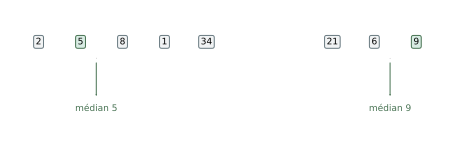
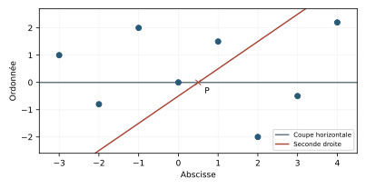

# X-ENS MP-PC · Informatique B 2012 · Corrigé guidé

*Corrigé rédigé par IA, non officiel. Signalez toute erreur.*

**Rédaction** · GPT-6.2 Astra Ultra · vitesse non renseignée · 25 novembre 2026

Langage choisi : Python. Les arguments et indices renvoyés suivent la numérotation du sujet à partir de 1. Les listes sont stockées sans case fictive. Les fonctions de la partie II peuvent modifier leur liste, les fonctions géométriques préservent l’ordre des points.

## Repères

En dimension un, le pivot délimite trois classes, dont une bande de valeurs égales. Dans le plan, la première droite fixe l’ordonnée et la seconde est repérée par une abscisse et une direction modulo un demi-tour.

## I · Grand, petit et médian

### Question 1 · Indice d’un maximum

**Indication.** Ne pas confondre l’indice renvoyé avec la valeur qui sert à la comparaison.

#### Solution

Initialiser l'indice à la première case autorisée, puis remplacer l'indice courant lorsqu'un élément strictement plus grand est trouvé. Ainsi le premier maximum est conservé en cas d'égalité. Dans l'exemple, la valeur 34 se trouve à l'indice 6. La fonction travaille sur des listes Python ordinaires et conserve la numérotation de 1 à $n$ pour les indices demandés dans le sujet.

```python
def calculeIndiceMaximum(tab, a, b):
    indice = a
    for j in range(a + 1, b + 1):
        if tab[j - 1] > tab[indice - 1]:
            indice = j
    return indice
```

### Question 2 · Nombre d’éléments inférieurs ou égaux

**Indication.** Inclure les occurrences exactement égales à la borne et les deux extrémités de l’intervalle.

#### Solution

Une comparaison et éventuellement une incrémentation suffisent par case de l'intervalle. Pour la borne 5 sur l'exemple, les valeurs retenues sont 3, 2, 5 et 1, d'où le résultat 4. Comme pour la Q1, le temps est $\Theta(b-a+1)$.

```python
def nombrePlusPetit(tab, a, b, val):
    total = 0
    for j in range(a, b + 1):
        if tab[j - 1] <= val:
            total += 1
    return total
```

## II · Sélection par partition

### Question 3 · Partition en place en trois régions

**Indication.** Conserver la valeur du pivot avant de déplacer son ancienne case.

#### Solution

Les indices de travail de cette fonction sont des indices Python. Au début d'un tour, les valeurs avant `petit` sont strictement inférieures au pivot, celles de `petit` à `courant` exclu lui sont égales, celles après `grand` sont strictement supérieures. La zone non traitée va de `courant` à `grand` inclus. Après un échange avec la droite, la valeur importée reste à examiner. À chaque tour la zone inconnue diminue d'une case. On renvoie l'indice, en numérotation du sujet, de la première occurrence du pivot dans la bande centrale. Sur le tableau officiel et pour le pivot 8, la bande centrale occupe les positions 6 et 7. La liste est modifiée en place, en temps linéaire et espace constant.

```python
def partition(tab, a, b, indicePivot):
    pivot = tab[indicePivot - 1]
    petit = courant = a - 1
    grand = b - 1
    while courant <= grand:
        if tab[courant] < pivot:
            tab[petit], tab[courant] = tab[courant], tab[petit]
            petit += 1
            courant += 1
        elif tab[courant] > pivot:
            tab[courant], tab[grand] = tab[grand], tab[courant]
            grand -= 1
        else:
            courant += 1
    return petit + 1
```

### Question 4 · Sélection du rang demandé

**Indication.** Après partition, soustraire le nombre de valeurs éliminées uniquement si l’on conserve la partie droite.

#### Solution

La première occurrence du pivot se trouve à `premier`. Il y a `premier-a` valeurs strictement inférieures. Les rangs suivants, jusqu'à `dernier-a+1`, ont pour valeur le pivot. À droite, on retire au rang exactement le nombre de cases abandonnées. La boucle remplace l'appel récursif du sujet et travaille sur un intervalle strictement plus court à chaque itération. Les répétitions sont éliminées en bloc. Le rang $k$ commence à 1 et appartient à $[1,b-a+1]$.

```python
def elementK(tab, a, b, k):
    while a < b:
        premier = partition(tab, a, b, a)
        dernier = premier
        while dernier < b and tab[dernier] == tab[premier - 1]:
            dernier += 1
        if k <= premier - a:
            b = premier - 1
        elif k <= dernier - a + 1:
            return tab[premier - 1]
        else:
            k -= dernier - a + 1
            a = dernier + 1
    return tab[a - 1]
```

### Question 5 · Coût de la succession de mauvais pivots

**Indication.** Faire la somme des tailles des sous-tableaux si une seule valeur disparaît à chaque étape.

#### Solution

Notons $m=b-a+1$. Sur des valeurs distinctes, si l'on cherche le plus petit élément et que le pivot est toujours le plus grand, on partitionne successivement des intervalles de tailles $m,m-1,\ldots,2$. Une partition est linéaire, d'où un coût $\Theta(m^2)$, soit $\Theta(n^2)$ pour le tableau entier. Une entrée avec répétitions peut aller plus vite si toute une bande de maxima est éliminée à la fois.

### Question 6 · Construction du pivot par paquets de cinq

**Indication.** Ramener les médians de groupes au début du même intervalle sans écraser une valeur qui doit rester dans le tableau.

#### Solution

On trie chaque paquet de taille au plus 5, choisit son médian inférieur si sa taille est paire, puis l'échange avec la prochaine case du préfixe réservé aux médians. Cette destination est dans le paquet courant ou parmi les paquets déjà traités. Les valeurs du sous-tableau sont donc conservées. Un nouveau tour travaille uniquement sur le préfixe. Dans l'exemple $a=2,b=9$, les paquets sont $(2,5,8,1,34)$ et $(21,6,9)$, de médians 5 et 9. La convention choisie renvoie 5. Chaque passage est linéaire en sa taille et la suivante vaut au plus son cinquième arrondi au supérieur, donc `choixPivot` seul prend $O(m)$.

Une nuance concerne la garantie de l'algorithme de sélection. Répéter simplement les regroupements jusqu'à un seul médian est bien le procédé décrit, mais il ne garantit pas en général une fraction fixe des valeurs de chaque côté. Sur $5^h$ valeurs distinctes, on peut agencer les groupes pour que seulement $3^h$ feuilles soient inférieures ou égales au pivot final : à chaque niveau trois sous-groupes seulement doivent fournir les valeurs petites. Le rapport $(3/5)^h$ tend vers zéro. Pour la garantie linéaire classique de la **sélection complète**, il faut sélectionner le véritable médian des médians du premier niveau par une sélection déterministe récursive. Une partition en trois bandes traite ensuite les égalités.

```python
def choixPivot(tab, a, b):
    while b - a + 1 > 5:
        destination = a - 1
        for debut in range(a - 1, b, 5):
            fin = min(debut + 5, b)
            tab[debut:fin] = sorted(tab[debut:fin])
            median = debut + (fin - debut - 1) // 2
            tab[destination], tab[median] = tab[median], tab[destination]
            destination += 1
        b = destination
    paquet = sorted(tab[a - 1:b])
    return paquet[(len(paquet) - 1) // 2]
```



## III · Deux droites dans le plan

### Question 7 · Coupe horizontale

**Indication.** Prendre la coordonnée d’ordonnée médiane et garder l’association des abscisses et ordonnées.

#### Solution

La primitive `indiceMedian` fournie renvoie un indice numéroté de 1 à $n$ sans déplacer les points. L'ordonnée renvoyée laisse donc au plus $\lfloor n/2\rfloor$ points strictement au-dessus et autant strictement au-dessous. Ceux qui sont sur la droite ne comptent dans aucune partie. Pour $n$ impair, le rang médian en numérotation à partir de 1 est $(n+1)/2$.

```python
def coupeY(tabX, tabY):
    i = indiceMedian(tabY, 1, len(tabY))
    return tabY[i - 1]
```

### Question 8 · Direction médiane au-dessus de la coupe

**Indication.** Les points de la droite horizontale et ceux du demi-plan inférieur doivent être écartés avant la sélection.

#### Solution

Pour chaque point strictement supérieur à $y$, l'angle fourni par `angle` appartient à $(0,\pi)$. Une valeur médiane parmi ces angles laisse au plus $\lfloor k/2\rfloor$ directions de part et d'autre. On renvoie **l'angle stocké** à l'indice médian. S'il n'y a aucun point supérieur, cette condition est vide et une verticale fournit une convention pour cette fonction. La Q10 utilise dans ce cas la médiane du côté inférieur pour équilibrer aussi celui-ci.

```python
from math import pi

def demiDroiteMedianeSup(tabX, tabY, x, y):
    angles = [angle(x, y, X, Y) for X, Y in zip(tabX, tabY) if Y > y]
    if not angles:
        return pi / 2
    i = indiceMedian(angles, 1, len(angles))
    return angles[i - 1]
```

### Question 9 · Vérification dans le demi-plan inférieur

**Indication.** Comparer les directions aux deux extrémités opposées de la même droite.

#### Solution

Les directions des points du bas sont dans $(\pi,2\pi)$. Le rayon de la droite qui les partage a donc pour angle $\theta+\pi$. On compte seulement les inégalités strictes. Si plus de $\lceil\ell/2\rceil$ angles sont en dessous de ce seuil, le résultat est $-1$ ; s'il y en a davantage au-dessus, le résultat est 1. Dans les autres cas le partage satisfait le critère demandé et on renvoie 0. Il n'est pas nécessaire que la droite passe par un point inférieur. Une absence de points inférieurs donne directement 0.

```python
def verifieAngleSecondeDroite(tabX, tabY, x, y, theta):
    petits = grands = 0
    seuil = theta + pi
    for X, Y in zip(tabX, tabY):
        if Y < y:
            alpha = angle(x, y, X, Y)
            if alpha < seuil:
                petits += 1
            elif alpha > seuil:
                grands += 1
    total = sum(Y < y for Y in tabY)
    limite = (total + 1) // 2
    if petits > limite:
        return -1
    if grands > limite:
        return 1
    return 0
```



### Question 10 · Recherche de l’intersection et de la seconde droite

**Indication.** Une dichotomie doit pouvoir conclure lorsqu’une solution se trouve entre deux abscisses successives testées.

#### Solution

La dichotomie prescrite commence avec $a=x_{\min}$, $b=x_{\max}$. Au milieu $x=(a+b)/2$, calculer $\theta$ à la Q8 puis le signe de la Q9. Sur 0, renvoyer $[x,\theta]$ ; sur $-1$, poser $b=x$ ; sur $+1$, poser $a=x$. Quand $x$ augmente, tous les angles supérieurs croissent, donc leur médiane aussi, tandis que les angles inférieurs ramenés dans $(0,\pi)$ décroissent. Cela justifie les deux sens de mise à jour. Un seuil arbitraire sur $b-a$ ne prouve pas qu'une droite renvoyée partage effectivement les points.

Voici une version finie de cette dichotomie pour des coordonnées rationnelles, y compris entières. Pour chaque point hors de l'horizontale, poser $d=Y-y$ et $c=(X-x)/d$. C'est la cotangente de sa direction ramenée dans $(0,\pi)$, donc un angle plus petit équivaut à un $c$ plus grand. Deux de ces expressions affines en $x$ ne peuvent échanger leur ordre qu'en leur intersection. Il suffit donc de considérer les abscisses de ces événements et un milieu entre deux événements consécutifs. Le signe des Q8–9 est constant dans chaque intervalle ouvert. La recherche dichotomique sur ces représentants teste également les événements eux-mêmes. Elle termine même si le milieu arithmétique usuel cesse d'évoluer en virgule flottante. Toutes les comparaisons sont rationnelles, l'angle en radians n'est arrondi qu'au retour. L'énoncé ne prescrit pas de complexité pour cette dernière question.

```python
from fractions import Fraction
from math import atan2

def secondeMediane(tabX, tabY, y):
    points = [(Fraction(X), Fraction(Y) - Fraction(y))
              for X, Y in zip(tabX, tabY) if Y != y]
    gauche, droite = Fraction(min(tabX)), Fraction(max(tabX))
    hauts = [(X, d) for X, d in points if d > 0]
    bas = [(X, d) for X, d in points if d < 0]

    def direction(x):
        groupe = hauts if hauts else bas
        if not groupe:
            return Fraction(0), 0
        cots = sorted((X - x) / d for X, d in groupe)
        cot = cots[(len(cots) - 1) // 2]
        valeurs = [(X - x) / d for X, d in bas]
        limite = (len(bas) + 1) // 2
        if sum(c > cot for c in valeurs) > limite:
            return cot, -1
        if sum(c < cot for c in valeurs) > limite:
            return cot, 1
        return cot, 0

    # Changement d'ordre de deux directions au passage de leur droite.
    evenements = {gauche, droite}
    for i, (X, d) in enumerate(points):
        for U, e in points[:i]:
            if d != e:
                z = (d * U - e * X) / (d - e)
                if gauche < z < droite:
                    evenements.add(z)
    xs = sorted(evenements)
    essais = sorted(set(xs + [(a + b) / 2 for a, b in zip(xs, xs[1:])]))
    debut, fin = 0, len(essais) - 1
    while debut <= fin:
        milieu = (debut + fin) // 2
        x = essais[milieu]
        cot, signe = direction(x)
        if signe == 0:
            return [x, atan2(1, cot)]
        if signe < 0:
            fin = milieu - 1
        else:
            debut = milieu + 1
    raise ValueError('Aucune bissectrice sur la droite fournie')
```
