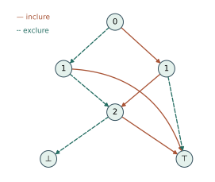
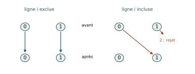
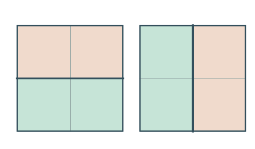

# X-ENS MP · Informatique A 2012 · Corrigé guidé

*Corrigé rédigé par IA, non officiel. Signalez toute erreur.*

**Rédaction** · GPT-6.2 Astra Ultra · vitesse non renseignée · 25 novembre 2026

**Arbres combinatoires.** Le langage choisi est OCaml. Dans les parties II à V, le type est `type ac = Zero | Un | Comb of int * ac * ac`. Le constructeur `cons` et les tables de mémorisation ont les interfaces du sujet. Les listes d’entiers sont strictement croissantes.

## Repères

Étiqueter chaque branche par la décision « inclure » ou « exclure ». Garder distincts la feuille qui rejette tout et celle qui accepte l’ensemble vide. Pour les coûts, compter les occurrences de nœuds avant mémorisation, puis les sous-arbres ou les couples différents après mémorisation.

## I. Arbres combinatoires

### Question 1 · Lire la famille représentée

**Indication.** Une branche droite ajoute l’étiquette courante à l’ensemble parcouru.

#### Solution

Le nœud $D=2\to\bot,\top$ représente $\{\{2\}\}$. Depuis la racine 0, la branche gauche représente $\{\{2\},\{1\}\}$. À droite, le nœud d’étiquette 1 représente $\{\varnothing,\{1,2\}\}$ avant l’ajout de 0. La famille cherchée est donc $\{\{2\},\{1\},\{0\},\{0,1,2\}\}$.

### Question 2 · Trois petits arbres

**Indication.** Distinguer la famille vide et la famille dont le seul élément est vide.

#### Solution

Pour $\{\{0\}\}$, on prend $0\to\bot,\top$. Pour $\{\varnothing,\{0\}\}$, on prend $0\to\top,\top$. Pour $\{\{0,2\}\}$, on prend $0\to\bot,(2\to\bot,\top)$. Un fils gauche égal à $\top$ signifie qu’une lecture peut aboutir avec succès en excluant l’étiquette.

### Question 3 · Existence d’une feuille de succès

**Indication.** À chaque nœud, la règle de suppression interdit un fils droit nul.

#### Solution

Si l’arbre est $\top$, la propriété est immédiate. Sinon, suivre le fils droit tant que le sommet courant est interne. Chaque pas descend strictement dans un arbre fini. La feuille d’arrivée ne peut être $\bot$, car elle a été atteinte par un arc droit. C’est donc $\top$.

### Question 4 · Nombre d’arbres et unicité de la représentation

**Indication.** Reconstruire la racine à partir de la famille avant de compter.

#### Solution

Les familles $\varnothing$ et $\{\varnothing\}$ sont représentées uniquement par $\bot$ et $\top$. Toute autre famille $\mathcal F$ contient un ensemble non vide. Soit $i=\min\bigcup\mathcal F$. La racine doit être $i$, car l’ordre interdit toute étiquette plus petite dans les descendants et la suppression assure que l’étiquette de la racine est effectivement présente dans une partie. Les deux familles filles sont imposées,

$$
\mathcal F_0=\{s\in\mathcal F:i\notin s\},\qquad
\mathcal F_1=\{s\setminus\{i\}:s\in\mathcal F,\ i\in s\}.
$$

Elles n’utilisent que des étiquettes supérieures, et $\mathcal F_1$ est non vide. La récurrence sur le nombre d’étiquettes disponibles prouve à la fois l’existence et l’unicité de l’arbre. Comme $|\mathcal P(E)|=2^n$, il y a **$2^{2^n}$ arbres**. Par dénombrement direct, si $a$ arbres sont possibles sans la première étiquette, on en a $a+a(a-1)=a^2$ en l’autorisant, avec $a_0=2$.

## II. Opérations élémentaires

### Question 5 · Extraire un ensemble représenté

**Indication.** Descendre par les fils droits et conserver les étiquettes.

#### Solution

```ocaml
let rec un_elt = function
  | Zero -> invalid_arg "famille vide"
  | Un -> []
  | Comb (i, _, droit) -> i :: un_elt droit
```

Le chemin aboutit par Q3. Les étiquettes lues, strictement croissantes, forment un ensemble accepté. La fonction visite un unique chemin et coûte $O(h+1)$ pour une hauteur en nombre d’arêtes $h$. L’exception couvre l’argument hors précondition.

### Question 6 · Construire une famille singleton

**Indication.** Chaque élément de la liste croissante est obligatoire.

#### Solution

```ocaml
let rec singleton = function
  | [] -> Un
  | i :: suite -> cons i Zero (singleton suite)
```

Pour la liste vide, la famille voulue est $\{\varnothing\}$. Pour $i::s$, la branche gauche échoue et la branche droite construit le suffixe. Son résultat est toujours différent de $\bot$. Un appel par élément suffit, soit $O(|s|+1)\subseteq O(n+1)$.

### Question 7 · Tester l’appartenance

**Indication.** Une liste épuisée doit encore pouvoir descendre par les fils gauches.

#### Solution

```ocaml
let rec appartient s = function
  | Zero -> false
  | Un -> s = []
  | Comb (i, gauche, droit) ->
      match s with
      | j :: _ when j < i -> false
      | j :: reste when j = i -> appartient reste droit
      | _ -> appartient s gauche
```

Si le plus petit élément demandé précède l’étiquette courante, aucune branche ne pourra le fournir. S’il lui est égal, on doit prendre le fils droit et le consommer. Sinon, on descend à gauche avec toute la liste, y compris si elle est vide. On ne visite qu’un nœud par étiquette possible, soit $O(n+1)$.

### Question 8 · Cardinal par partition disjointe

**Indication.** Les ensembles de la branche droite contiennent tous la racine, ceux de gauche ne la contiennent jamais.

#### Solution

```ocaml
let rec cardinal_naif = function
  | Zero -> 0
  | Un -> 1
  | Comb (_, gauche, droit) ->
      cardinal_naif gauche + cardinal_naif droit
```

L’ajout de l’étiquette est injectif sur la famille de droite. On peut donc additionner les deux cardinaux. Le coût est linéaire en nombre d’occurrences dans l’arbre déployé. La borne en seul nombre d’ensembles discutée dans le rapport du jury ne convient pas. Une unique partie $\{0,\ldots,n-1\}$ possède un arbre en chaîne de longueur $n$, bien que son cardinal vaille 1. L’addition est ici comptée à coût unitaire comme dans le sujet.

## III. Mémorisation

### Question 9 · Taille du graphe partagé

**Indication.** Compter les sous-arbres distincts et inclure chacune des deux feuilles.

#### Solution

On trouve $\bot,\top,D=(2\to\bot,\top)$, les deux nœuds différents $1\to D,\top$ et $1\to\top,D$, puis la racine 0. Il y en a **six**. Les deux occurrences de $D$ n’en constituent qu’un.



### Question 10 · Cardinal avec une table unique

**Indication.** Créer la table une seule fois, avant les appels récursifs.

#### Solution

```ocaml
let cardinal arbre =
  let memo = cree1 () in
  let rec compte a =
    if present1 (memo, a) then trouve1 (memo, a)
    else
      let total = match a with
        | Zero -> 0
        | Un -> 1
        | Comb (_, g, d) -> compte g + compte d
      in
      ajoute1 (memo, a, total);
      total
  in
  compte arbre
```

Le premier appel pour un sous-arbre $a$ effectue le calcul puis enregistre le résultat. Les appels ultérieurs le lisent. Le parcours est acyclique et chaque calcul nouveau engendre au plus deux appels. Sous les hypothèses du sujet sur les accès à la table, le temps et la mémoire des résultats sont $O(T(A))$, avec une pile de profondeur au plus $n+1$.

### Question 11 · Intersection de deux familles

**Indication.** Comparer les deux plus petites étiquettes et supprimer tout nœud dont la branche droite échoue.

#### Solution

```ocaml
let noeud i g d =
  match d with Zero -> g | _ -> cons i g d

let inter a b =
  let memo = cree2 () in
  let rec coupe x y =
    if present2 (memo, x, y) then trouve2 (memo, x, y)
    else
      let resultat = match x, y with
        | Zero, _ | _, Zero -> Zero
        | Un, Un -> Un
        | Un, Comb (_, g, _) -> coupe Un g
        | Comb (_, g, _), Un -> coupe g Un
        | Comb (i, g, _), Comb (j, _, _) when i < j ->
            coupe g y
        | Comb (i, _, _), Comb (j, h, _) when j < i ->
            coupe x h
        | Comb (i, g, d), Comb (_, h, e) ->
            noeud i (coupe g h) (coupe d e)
      in
      ajoute2 (memo, x, y, resultat);
      resultat
  in
  coupe a b
```

Si les deux étiquettes diffèrent, la plus petite est absente de tous les ensembles de l’autre opérande. Seule sa branche gauche subsiste. Deux étiquettes égales donnent l’intersection des familles excluant l’étiquette et celle des familles l’incluant. Si l’un des opérandes vaut $\top$, il faut encore tester si l’autre accepte l’ensemble vide. La fonction auxiliaire assure la suppression quand le fils droit vaut $\bot$. L’ordre est préservé par descente stricte. Cela prouve la correction par récurrence sur la somme des hauteurs.
Au plus $T(A_1)T(A_2)$ couples distincts sont rencontrés. Chaque premier traitement fait au plus deux appels et un travail local constant. Temps et espace de mémorisation sont donc au plus de cet ordre. Une borne en seule taille de la sortie, évoquée par le rapport, ne tient pas. Par exemple, tester l’intersection de $\top$ avec une longue chaîne de branches gauches peut explorer toute la chaîne pour renvoyer une feuille.

### Question 12 · Borne de taille du résultat

**Indication.** Associer chaque sous-arbre produit à un couple d’arguments effectivement rencontré.

#### Solution

Pour un appel, si le résultat est une feuille, cette feuille est bien le résultat de l’appel. S’il crée un nœud, ses deux enfants sont les résultats des sous-appels. S’il transmet un résultat sans créer de nœud, ses descendants figuraient déjà dans les résultats des sous-appels. Par récurrence, tout sous-arbre distinct du résultat final est la valeur d’au moins un couple traité dans $U(A_1)\times U(A_2)$. Chaque couple a une seule valeur. Le nombre de valeurs ne dépasse pas le nombre de couples, donc $T(\mathrm{inter}(A_1,A_2))\le T(A_1)T(A_2)$.

## IV. Pavages et couverture exacte

### Question 13 · Nombre de placements d’un domino

**Indication.** Compter séparément horizontales et verticales, avec leur case de départ.

#### Solution

Chacune des $p$ lignes offre $p-1$ paires adjacentes et chacune des $p$ colonnes en offre autant. Il existe $n=2p(p-1)$ placements. Pour $p=8$, cela donne 112 placements possibles. Retourner sur lui-même un domino ne crée pas de placement nouveau.

### Question 14 · Contrainte d’une seule case en temps linéaire

**Indication.** Sur le suffixe des lignes, conserver simultanément les familles à zéro et à exactement une couverture.

#### Solution

```ocaml
let colonne j =
  let aucun = ref Un and un_seul = ref Zero in
  for i = Array.length m - 1 downto 0 do
    let a = !aucun and b = !un_seul in
    if m.(i).(j) then
      un_seul := noeud i b a
    else begin
      aucun := noeud i a a;
      un_seul := noeud i b b
    end
  done;
  !un_seul
```

Après traitement des indices $i+1,\ldots,n-1$, $a$ représente les ensembles de ces lignes couvrant la case zéro fois et $b$ ceux la couvrant exactement une fois. Si la ligne $i$ couvre la case, l’exclure conserve les états. L’inclure transforme « zéro » en « exactement un » et l’état zéro ne peut la prendre. Si la ligne ne couvre pas la case, sa présence est facultative dans chacun des états. Les deux fils peuvent alors être identiques, ce qui est autorisé, mais le fils droit ne doit jamais être nul. Les deux anciens états sont lus avant toute modification. Au plus deux constructions par ligne suffisent, soit $O(n)$ en temps et en nombre de nœuds. La matrice globale est celle du sujet.



### Question 15 · Intersection des contraintes de couverture

**Indication.** Un pavage est un choix de placements qui couvre chaque case exactement une fois.

#### Solution

```ocaml
let pavage () =
  let contraintes = Array.length m.(0) in
  let sol = ref (colonne 0) in
  for j = 1 to contraintes - 1 do
    sol := inter !sol (colonne j)
  done;
  !sol
```

L’invariant est l’ensemble des choix qui satisfont les colonnes déjà traitées. À la fin, les dominos ne se chevauchent pas et couvrent tout l’échiquier. Ils sont donc exactement $p^2/2$. La bijection avec les pavages identifie le résultat au cardinal de la famille.
Chaque arbre colonne comporte au plus $2n+2$ sous-arbres distincts. Tout arbre ordonné a hauteur au plus $n$ et comporte au plus $2^{n+1}-1$ occurrences. Avec la borne de Q11, chaque intersection coûte ainsi $O(n2^n)$. Comme $p^2\le n$ pour $p\ge2$, la construction coûte au plus $O(n^2 2^n)$, hors construction préalable de la matrice. C’est un majorant. Pour $p=2,4,6,8$, le calcul renvoie respectivement $2$, $36$, $6728$ et **$12\,988\,816$** pavages.



## V. Tables de hachage

### Question 16 · Ajouter dans un seau

**Indication.** Insérer la nouvelle association en tête de la liste existante.

#### Solution

```ocaml
let ajoute t k v =
  let seau = hache k in
  t.(seau) <- (k, v) :: t.(seau)
```

L’affectation préserve l’ancienne chaîne et n’examine aucune clé. Le calcul du seau et cette insertion coûtent $O(1)$.

### Question 17 · Chercher dans un seul seau

**Indication.** La propriété de compatibilité localise toutes les clés égales dans le même seau.

#### Solution

```ocaml
let cherche t k =
  let rec dans = function
    | [] -> None
    | (cle, v) :: suite ->
        if egal cle k then Some v else dans suite
  in
  dans t.(hache k)

let present t k =
  match cherche t k with Some _ -> true | None -> false
```

La recherche utilise le prédicat d’égalité donné. Elle s’arrête au premier succès ou en fin de liste. Pour un seau de longueur $L$, le coût est $O(1+L)$. La valeur optionnelle servira également pour retrouver une association en un passage.

### Question 18 · Extraire la valeur associée

**Indication.** Réutiliser le parcours qui a déjà trouvé la clé.

#### Solution

```ocaml
let trouve t k =
  match cherche t k with
  | Some v -> v
  | None -> raise Not_found
```

La précondition exclut le cas de l’exception. Si plusieurs entrées ont la même clé, la première est la plus récemment ajoutée, selon la convention de Q16.

### Question 19 · Coût moyen et charge

**Indication.** Une moyenne bornée nécessite des hypothèses sur la répartition des clés recherchées.

#### Solution

Pour $N$ entrées et $H$ seaux, la charge est $N/H$. Si cette charge reste bornée et si le hachage répartit convenablement les clés et les requêtes, la longueur examinée a une espérance bornée. Le coût moyen de recherche est $O(1)$, avec comparaison et hachage à coût constant. L’ajout en tête est déjà $O(1)$ au pire cas pour une table de taille fixe. Une forte concentration des clés peut rendre une recherche linéaire. Une fonction injective n’est pas nécessaire.

## VI. Construction canonique

### Question 20 · Compatibilité entre égalité et hachage

**Indication.** Vérifier séparément les feuilles et les nœuds.

#### Solution

Deux feuilles égales sont toutes deux $\bot$ ou toutes deux $\top$ et ont la même image, respectivement 0 ou 1. Pour deux nœuds égaux au sens du prédicat du sujet, les trois entiers $i,\mathrm{unique}(g),\mathrm{unique}(d)$ coïncident. Le polynôme $19^2 i+19\,\mathrm{unique}(g)+\mathrm{unique}(d)$ puis son reste modulo $H$ sont donc identiques. L’implication réciproque est inutile et généralement fausse.

### Question 21 · Construction canonique avec partage

**Indication.** Le numéro unique doit être alloué seulement après une recherche infructueuse.

#### Solution

```ocaml
type ac = Zero | Un | Comb of int * int * ac * ac

let unique = function Zero -> 0 | Un -> 1 | Comb (u, _, _, _) -> u

let taille = 19997
let hache = function
  | Zero -> 0
  | Un -> 1
  | Comb (_, i, g, d) ->
      (19 * 19 * i + 19 * unique g + unique d) mod taille

let egal a b = match a, b with
  | Zero, Zero | Un, Un -> true
  | Comb (_, i, g, d), Comb (_, j, h, e) ->
      i = j && unique g = unique h && unique d = unique e
  | _ -> false

let uniques = Array.make taille []
let prochain = ref 2

let cons i g d =
  let sonde = Comb (0, i, g, d) in
  let seau = hache sonde in
  let rec cherche_ou_cree = function
    | [] ->
        let a = Comb (!prochain, i, g, d) in
        incr prochain;
        uniques.(seau) <- a :: uniques.(seau);
        a
    | a :: suite ->
        if egal a sonde then a
        else cherche_ou_cree suite
  in
  cherche_ou_cree uniques.(seau)
```

La partie VI remplace la définition de type des parties II à V. Un candidat temporaire portant 0 sert de sonde. Son propre identifiant n’intervient ni dans le hachage ni dans la comparaison des triples. Si un triple existe déjà, on renvoie le représentant stocké. Sinon on réserve un numéro frais, strictement supérieur à tous les précédents, puis on conserve le nœud dans son seau. Par induction sur l’historique des constructions, deux arbres identiques ont alors le même représentant et aucun numéro n’est partagé par deux structures différentes. La construction respecte les préconditions d’ordre et de suppression imposées à ses appelants. Sous les hypothèses de Q19 son coût est constant en moyenne.

### Question 22 · Comparaisons moyennes avec et sans succès

**Indication.** Une clé absente échantillonne les seaux, une clé présente échantillonne les entrées.

#### Solution

Notons $b_l$ le nombre de seaux de longueur $l$. Le tableau donne $\sum b_l=19\,997$, $\sum lb_l=22\,518$ et $\sum l(l+1)b_l/2=35\,037$. Pour une clé nouvelle dont le seau est uniforme, on compare les $l$ entrées du seau avant l’insertion. La moyenne est donc $22\,518/19\,997\simeq\mathbf{1,13}$.
Pour une clé choisie uniformément parmi celles présentes, les rangs du seau de longueur $l$ coûtent $1,2,\ldots,l$ comparaisons. La moyenne globale est $35\,037/22\,518\simeq\mathbf{1,56}$. Ces résultats correspondent à la recherche en un passage de Q21. Sans hypothèse sur les probabilités des requêtes, l’histogramme seul ne détermine pas les deux espérances.
