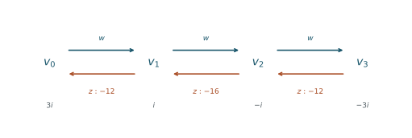

# X-ENS MP — Mathématiques A 2012 · Corrigé brut

*Corrigé rédigé par IA, non officiel. Signalez toute erreur.*

**Rédaction** · GPT-6.2 Astra Ultra · vitesse non renseignée

**Représentations de l’algèbre de Lie de SU(2).** Les deux premières parties étudient les matrices antihermitiennes de trace nulle et leur exponentielle. La dernière détermine comment les crochets imposent les valeurs propres le long d’une chaîne.

## I. L’algèbre de Lie et l’exponentielle

### Question 1.a

Les quatre coefficients complexes de $M_2(\mathbb C)$ représentent huit paramètres réels indépendants. La condition $A^*=-A$ (où $A^*=\overline A^{\mathsf T}$) et la trace nulle imposent
$$A=\begin{pmatrix}ix&-y+iz\\ y+iz&-ix\end{pmatrix}=xE+yF+zG,\qquad x,y,z\in\mathbb R.$$
Tout triplet fournit bien une telle matrice et les coefficients déterminent le triplet uniquement. Ainsi $\mathcal L$ est un sous-espace réel de dimension 3, de base $(E,F,G)$.

### Question 1.b

On obtient $EF=-G$, $FG=-E$ et $GE=-F$. Les produits dans l’autre ordre valent $FE=G$, $GF=E$ et $EG=F$. Donc $[E,F]=-2G$, $[F,G]=-2E$ et $[G,E]=-2F$.

### Question 2.a

L’inégalité $\|ABX\|_2\le\|A\|\|BX\|_2\le\|A\|\|B\|\|X\|_2$ donne $\|AB\|\le\|A\|\|B\|$. La série des normes $\sum_k\|A^k/k!\|$ est donc majorée par $\sum_k\|A\|^k/k!=e^{\|A\|}$. L’espace matriciel est complet en dimension finie, d’où la convergence de la série définissant l’exponentielle.

### Question 2.b

Pour tout $k\ge0$, $(P^{-1}AP)^k=P^{-1}A^kP$ par simplification des facteurs adjacents. La même relation vaut pour toute somme partielle exponentielle. L’application $A\mapsto P^{-1}AP$ est continue car sa norme est majorée par $\|P^{-1}\|\|A\|\|P\|$. Le passage à la limite donne $\exp(P^{-1}AP)=P^{-1}\exp(A)P$.

### Question 2.c

Les puissances $A^k$ sont triangulaires supérieures et leur diagonale est $(\lambda_1^k,\ldots,\lambda_n^k)$ (y compris $k=0$ avec des 1). Les sommes partielles ont le même caractère triangulaire et leurs termes diagonaux convergent vers $e^{\lambda_j}$. Les coefficients sous la diagonale restent nuls à la limite par continuité des coordonnées.

### Question 2.d

Sur $\mathbb C$, $A$ est semblable à une triangulaire supérieure $T$ de valeurs diagonales $\lambda_j$. Par 2.b et 2.c,
$$\det(e^A)=\det(e^T)=\prod_{j=1}^n e^{\lambda_j}=e^{\operatorname{Tr}T}=e^{\operatorname{Tr}A}.$$

## II. Le groupe spécial unitaire

### Question 3

La condition de l’énoncé est équivalente, par conjugaison, à $A^*A=I$. Une telle matrice carrée est inversible et $A^{-1}=A^*$. L’identité est unitaire, $(AB)^*(AB)=B^*A^*AB=I$ pour deux unitaires et l’inverse est unitaire puisque $AA^*=I$. Cela donne un sous-groupe de $GL_2(\mathbb C)$. Dans celui-ci, $SU(2,\mathbb C)$ est le noyau du morphisme déterminant, donc un sous-groupe.

### Question 4

Écrivons $A=\begin{pmatrix}a&b\\ c&d\end{pmatrix}$. Si $A\in SU(2,\mathbb C)$, on a $\begin{pmatrix}d&-b\\-c&a\end{pmatrix}=A^{-1}=A^*$. Ainsi $d=\overline a$ et $c=-\overline b$. Le déterminant vaut $|a|^2+|b|^2=1$. Inversement, pour toute telle matrice avec cette somme égale à 1, le déterminant est 1 et la formule explicite de son inverse est son adjoint. Elle est donc spéciale unitaire.

### Question 5.a

Une matrice unitaire préserve la norme hermitienne. Ainsi $\|X\|_2=\|MX\|_2=|\lambda|\|X\|_2$. Comme le vecteur propre est non nul, $|\lambda|=1$.

### Question 5.b

Dans la convention de l’énoncé $\langle X,Y\rangle=X^{\mathsf T}\overline Y$. Si $\langle X,Y\rangle=0$, alors $0=\langle MX,MY\rangle=\lambda\langle X,MY\rangle$. Comme $\lambda\ne0$, $\langle X,MY\rangle=0$. La droite orthogonale à $X$ est donc stable.

### Question 6.a

Choisissons un vecteur propre unitaire $X$ de $M$, qui existe sur $\mathbb C$. Sa valeur propre vaut $e^{i\theta}$ par 5.a. La droite $X^\perp$ est stable par 5.b, donc chacun de ses vecteurs non nuls est propre. Complétons par un vecteur unitaire $Y$ de cette droite. La matrice $S=(X,Y)$ est unitaire, de déterminant $d$ de module 1. En remplaçant $Y$ par $d^{-1}Y$, on obtient $S\in SU(2,\mathbb C)$. La seconde valeur propre vaut $e^{-i\theta}$ car le déterminant de $M$ vaut 1. Ainsi $M=S\operatorname{diag}(e^{i\theta},e^{-i\theta})S^{-1}$, ce qui donne la forme voulue avec $P=S^{-1}$.

### Question 6.b

Deux matrices conjuguées ont la même trace. Inversement, si les traces sont égales, les deux polynômes caractéristiques $X^2-\operatorname{Tr}(R)X+1$ et $X^2-\operatorname{Tr}(S)X+1$ coïncident. Par 6.a on peut diagonaliser les deux matrices dans $SU(2,\mathbb C)$. Si l’ordre des deux valeurs est échangé, la matrice $F=\begin{pmatrix}0&-1\\1&0\end{pmatrix}\in SU(2,\mathbb C)$ conjugue les deux diagonales inversées. En composant les changements de base dans le groupe, on obtient bien $R=P^{-1}SP$.

### Question 7.a

Notons $s_n(A)=\sum_{j=0}^n A^j/j!$. Si $AB=BA$, le binôme donne $s_n(A+B)=\sum_{j+k\le n}A^jB^k/(j!k!)$. Le produit $s_n(A)s_n(B)$ correspond à $0\le j,k\le n$. En retirant le triangle du carré, la norme de la différence est donc au plus
$$\sum_{j+k>n}\frac{\|A\|^j\|B\|^k}{j!k!}=\sum_{m>n}\frac{(\|A\|+\|B\|)^m}{m!}\longrightarrow0.$$
Les sommes partielles convergent par 2.a. La multiplication matricielle est continue grâce à la sous-multiplicativité, donc $e^{A+B}=e^Ae^B$.

### Question 7.b

Pour $A\in\mathcal L$, $(e^A)^*=e^{A^*}=e^{-A}$ par passage à la limite dans les sommes partielles, l’adjoint étant continu. La question 7.a donne $e^{-A}e^A=I$, donc $e^A$ est unitaire. Par 2.d, son déterminant vaut $e^{\operatorname{Tr}A}=1$. Ainsi $e^A\in SU(2,\mathbb C)$.

### Question 7.c

Si $M=P^{-1}\operatorname{diag}(e^{i\theta},e^{-i\theta})P$, posons $A=P^{-1}\operatorname{diag}(i\theta,-i\theta)P$. Sa trace est nulle et son adjoint est $-A$ car $P$ est unitaire. Ainsi $A\in\mathcal L$ et $e^A=M$ par 2.b. L’exponentielle est surjective.

### Question 7.d

Les matrices distinctes $0$ et $2\pi E$ sont dans $\mathcal L$ et leurs exponentielles valent toutes deux $I_2$. L’application n’est donc pas injective.

### Question 8.a

Choisissons $g\in G\setminus\{I,-I\}$. Par 6.a et l’invariance de $G$ par conjugaison, sa diagonale $D_\theta=\operatorname{diag}(e^{i\theta},e^{-i\theta})$ appartient à $G$. Si $\theta$ était multiple de $\pi$, cette diagonale serait scalaire $\pm I$, donc $g$ aussi, contradiction.

### Question 8.b

Pour $A$ de la forme en 4, $A^{-1}=A^*$. Le premier terme diagonal de $AD_\theta A^{-1}$ vaut $|a|^2e^{i\theta}+|b|^2e^{-i\theta}$, le second $|b|^2e^{i\theta}+|a|^2e^{-i\theta}$. Après multiplication à droite par $D_\theta^{-1}$, ils deviennent
$$|a|^2+(1-|a|^2)e^{-2i\theta},\qquad |a|^2+(1-|a|^2)e^{2i\theta}.$$
Les deux termes diagonaux sont conjugués.

### Question 8.c

$AD_\theta A^{-1}D_\theta^{-1}$ appartient à $G$ pour tout $A\in SU(2,\mathbb C)$ par normalité et stabilité par produit. Sa trace vaut $2t+2(1-t)\cos(2\theta)$, où $t=|a|^2$ parcourt tout $[0,1]$, par exemple en prenant $a=\sqrt t,b=\sqrt{1-t}$. Les traces de $G$ contiennent donc $[2\cos(2\theta),2]$. La longueur $\delta=2(1-\cos(2\theta))$ est strictement positive par 8.a.

### Question 9

Soit $M=P^{-1}D_\varphi P$. Pour $m$ assez grand, $2\cos(\varphi/m)\in[2-\delta,2]$. Il existe donc $g\in G$ de même trace que $P^{-1}D_{\varphi/m}P$. Par 6.b, ces deux matrices sont conjuguées dans le groupe, donc $P^{-1}D_{\varphi/m}P\in G$. Sa puissance $m$-ième est $M$. On en déduit $G=SU(2,\mathbb C)$. Tout sous-groupe distingué non trivial du quotient par $\{\pm I\}$ a pour préimage un tel $G$, donc est le quotient entier.

## III. Chaînes de vecteurs propres

### Question 10

Avec $z=f+ig$, $w=f-ig$, les relations donnent $[e,z]=-2g+2if=2iz$ et $[e,w]=-2g-2if=-2iw$. Enfin $[z,w]=-2i[f,g]=4ie$.

### Question 11

La relation $ez=ze+2iz$ donne $e(zv)=(\lambda+2i)zv$ si $ev=\lambda v$. En itérant, $e(z^kv)=(\lambda+2ik)z^kv$ pour tout $k\ge0$. La formule reste vraie lorsque $z^k v=0$, sans qualifier ce vecteur nul de vecteur propre.

### Question 12

Prenons un vecteur propre non nul $v$ de $e$. Tant que $z^kv$ n’est pas nul, 11 en fait un vecteur propre de valeur $\lambda+2ik$. Ces nombres étant tous distincts, la suite des itérés non nuls ne peut se prolonger au-delà de la dimension de l’espace. Le dernier, noté $v_0$, est propre, et $zv_0=0$.

### Question 13

De $[e,w]=-2iw$ il vient $ev_k=(\lambda_0-2ik)v_k$, avec $v_k=w^kv_0$. Comme $zw=wz+4ie$ et $zv_0=0$, on obtient $zv_k=c_kv_{k-1}$ avec $c_1=4i\lambda_0$ et $c_{k+1}=c_k+4i(\lambda_0-2ik)$ (ces scalaires sont donnés par la récurrence même si un vecteur s’annule). D’où
$$c_k=4ik\lambda_0+4k(k-1)=4k(i\lambda_0+k-1).$$

### Question 14.a

Tant que $v_k\ne0$, sa valeur propre pour $e$ est $\lambda_0-2ik$. Ces valeurs distinctes assurent la liberté des vecteurs correspondants. En dimension finie il y a donc un premier indice $n+1$ tel que $v_{n+1}=0$, avec $n\ge0$ puisque $v_0\ne0$. Dès lors $v_0,\ldots,v_n$ sont indépendants.

### Question 14.b

On a $0=zv_{n+1}=4(n+1)(i\lambda_0+n)v_n$. Comme $v_n\ne0$, $i\lambda_0=-n$, donc $\lambda_0=in$. Ainsi pour $0\le k\le n$, $ev_k=i(n-2k)v_k$. Pour $1\le k\le n$, $zv_k=-4k(n-k+1)v_{k-1}$ et $zv_0=0$. Enfin $wv_k=v_{k+1}$ pour $k<n$, tandis que $wv_n=0$. En particulier aux extrémités, $ev_0=inv_0$, $ev_n=-inv_n$, $zv_n=-4nv_{n-1}$, comme annoncé pour $n\ge1$.

