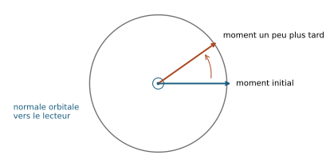
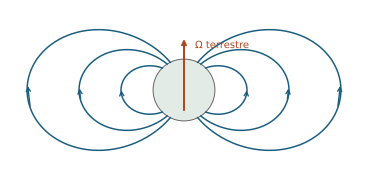
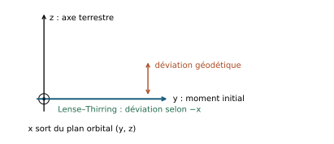

# X-ENS MP 2012 — Physique · Corrigé brut

*Corrigé rédigé par IA, non officiel. Signalez toute erreur.*

**Lecture du rapport du jury** · GPT-6.2 Astra Ultra · vitesse non renseignée

**Rédaction** · GPT-6.2 Astra Ultra · vitesse non renseignée

## Effet du champ gravitationnel terrestre sur le mouvement d’un gyroscope en orbite

## I — Analogie gravitomagnétique

### Question I.1 — Champ d’une source ponctuelle

Pour $\vec r=\overrightarrow{OM}$, le champ électrique est $\vec E=q\vec r/(4\pi\varepsilon_0r^3)$. Une masse ponctuelle positive crée le champ gravitationnel $\vec g=-Gm\vec r/r^3$. Il est dirigé vers la masse, ce qui fixe le signe de l’analogie.

### Question I.2 — Permittivité et flux gravitationnels

Pour une distribution continue, la superposition conserve la correspondance $1/(4\pi\varepsilon_0)\leftrightarrow-G$. On introduit $\varepsilon_g=-1/(4\pi G)$, donc $\nabla\cdot\vec g=\rho/\varepsilon_g=-4\pi G\rho$. En intégrant sur un volume et en utilisant la formule de la divergence, $\oint_{\partial V}\vec g\cdot d\vec S=-4\pi G M_{\rm int}$, la normale étant sortante.

### Question I.3 — Dimension du champ gravitomagnétique

L’équation $\nabla\times\vec g=-\partial_t\vec h$ donne $[h]=[g]\,\mathrm T/\mathrm L=\mathrm T^{-1}$. Le champ $\vec h$ s’exprime donc en $\mathrm{s^{-1}}$, comme une vitesse angulaire.

### Question I.4 — Continuité de la masse

Prenons la divergence de $\nabla\times\vec h=\mu_g(\vec j+\varepsilon_g\partial_t\vec g)$. Le membre gauche est nul. Remplaçons $\varepsilon_g\nabla\cdot\vec g$ par $\rho$ pour obtenir $\partial_t\rho+\nabla\cdot\vec j=0$, forme locale de la conservation de la masse.

### Question I.5 — Propagation dans le vide

En l’absence de sources, $\nabla\cdot\vec g=0$ et $\nabla\times\vec h=\mu_g\varepsilon_g\partial_t\vec g$. Le double rotationnel de $\vec g$ donne à la fois $-\nabla^2\vec g$ et $-\mu_g\varepsilon_g\partial_t^2\vec g$. Il vient $\nabla^2\vec g-\mu_g\varepsilon_g\partial_t^2\vec g=0$. Pour une célérité $c$, $\mu_g\varepsilon_g=1/c^2$, donc $\mu_g=-4\pi G/c^2$. Les deux constantes du modèle ont des signes identiques et leur produit est positif.

### Question I.6 — Force sur une masse mobile

La force gravitationnelle est $m\vec g$. Par analogie formelle, le terme gravitomagnétique vaut $m\vec v\times\vec h$. La force totale du modèle proposé est $m(\vec g+\vec v\times\vec h)$. Le signe attractif des masses intervient déjà dans les champs sources.

### Question I.7 — Champ d’un fil de masse

Un fil infini uniforme est invariant par translation axiale et par rotation autour de l’axe. Deux plans de symétrie passant par le point considéré, l’un méridien et l’autre perpendiculaire au fil, imposent à $\vec g$ leur intersection, la direction radiale. Son module ne dépend que de $r$. Sur un cylindre coaxial de longueur $\ell$, le flux est $2\pi r\ell\,g_r=-4\pi G\lambda\ell$. Par suite $\vec g=-2G\lambda\,\vec e_r/r$ à l’extérieur.

### Question I.8 — Attraction entre fils

Orientons $\vec e_r$ du premier fil vers le second. Un élément $d\ell$ du second a pour masse $\lambda\,d\ell$ et subit le champ du premier à $r=d$. La force par unité de longueur exercée sur le second vaut $-2G\lambda^2\vec e_r/d$. Elle est attractive.

### Question I.9 — Circulation autour d’un courant de masse

Prenons $\vec v=v\vec e_z$ et le sens direct associé pour $\vec e_\theta$. Le courant de masse vaut $I_g=\lambda v$. Le système est invariant par translation et rotation axiales. Le champ axial au sens de pseudo-vecteur est normal au plan méridien de symétrie du courant, donc orthoradial. En régime stationnaire $2\pi r h_\theta=\mu_g I_g$, d’où
$$
\vec h=-\frac{2G\lambda v}{c^2r}\,\vec e_\theta .
$$

### Question I.10 — Effet de deux courants parallèles

Pour le second fil, $\vec f_h=\lambda v\vec e_z\times\vec h(d)=2G\lambda^2v^2\vec e_r/(c^2d)$. Deux courants de masse parallèles produisent donc une contribution répulsive. Le rapport des normes est $v^2/c^2$, extrêmement petit aux vitesses ordinaires. Si l’un des fils inverse son mouvement, la force gravitomagnétique change de sens et devient attractive. La force newtonienne reste attractive dans les deux cas.

### Question I.11 — Moment d’une boucle électrique

Le moment magnétique d’une spire de surface $S=\pi R^2$ est $\vec{\mathcal M}=I\pi R^2\vec n$. Le sens positif du courant et la normale $\vec n$ sont associés par la règle de la main droite.

### Question I.12 — Moment d’une spire matérielle

La masse $m$ effectue un tour en $2\pi/\omega$. Le débit de masse est $I_g=m\omega/(2\pi)$. Son moment gravitomagnétique vaut $I_g\pi R^2\vec n=mR^2\vec\omega/2$. Or le moment cinétique de l’anneau est $\vec\sigma=mR^2\vec\omega$. D’où $\vec{\mathcal M}_g=\vec\sigma/2$.

### Question I.13 — Précession dans un champ uniforme

Le couple magnétique est $\vec{\mathcal M}\times\vec B$. Transposé au gyroscope, le théorème du moment cinétique donne $\dot{\vec\sigma}=\tfrac12\vec\sigma\times\vec h=(-\vec h/2)\times\vec\sigma$. La norme de $\vec\sigma$ et sa projection sur un champ constant sont conservées. Il décrit donc un cône autour du champ, avec le vecteur vitesse angulaire $\vec\omega_{\rm p}=-\vec h/2$. Un moment initial parallèle au champ conserve sa direction.

## II — Précession due à la révolution du satellite

### Question II.1 — Orbite circulaire basse

Posons $r_o=R_\oplus+a$. La condition centripète est $v^2/r_o=GM_\oplus/r_o^2$. Ainsi $v=\sqrt{GM_\oplus/r_o}=\sqrt{gR_\oplus^2/(R_\oplus+a)}$. Quand $a\ll R_\oplus$, $v\simeq\sqrt{gR_\oplus}\simeq8\times10^3\,\mathrm{m\,s^{-1}}$. La période vaut $T=2\pi r_o/v\simeq5\times10^3\,\mathrm s$, soit environ 85 minutes.

### Question II.2 — Champ au centre d’une spire

Pour une spire circulaire de rayon $R$ parcourue par $I$, la loi de Biot–Savart donne $\vec B(O)=\mu_0 I\vec n/(2R)$. Tous les éléments du fil donnent une contribution de même sens sur la normale orientée par le courant.

### Question II.3 — Courant orbital équivalent

Dans le référentiel choisi par le problème, la Terre ponctuelle passe une fois par période sur la trajectoire de rayon $r_o$. Le courant orbital équivalent est $M_\oplus/T$. Le champ au centre est aussi celui qu’on trouve instantanément par la loi de Biot–Savart pour une masse ponctuelle en mouvement circulaire. En orientant la normale $\vec n$ dans le sens du moment cinétique orbital,
$$
\vec h=\frac{\mu_g M_\oplus}{2r_oT}\vec n
=-\frac{2\pi v^2}{c^2T}\vec n ,
$$
car $GM_\oplus/r_o=v^2$. La normale au mouvement apparent de la Terre a le même sens que celle de l’orbite du satellite, les vecteurs position et vitesse étant tous deux inversés.

### Question II.4 — Précession géodétique du modèle

Le vecteur vitesse angulaire est $-\vec h/2$, soit $\vec\omega_1=(\pi v^2/(c^2T))\vec n$. Le moment initial est dans le plan orbital. Il y tourne autour de la normale dans le même sens que le mouvement orbital. Sa norme reste constante.

### Question II.5 — Angle accumulé en un an

Avec $v\simeq7{,}9\,\mathrm{km\,s^{-1}}$ et $T\simeq5{,}1\times10^3\,\mathrm s$, $\omega_1\simeq4{,}3\times10^{-13}\,\mathrm{s^{-1}}$. En $3{,}2\times10^7\,\mathrm s$, l’angle est d’environ $1{,}4\times10^{-5}\,\mathrm{rad}$, soit $10^{-5}\,\mathrm{rad}$ à un chiffre significatif. La mesure fournie, $3{,}2\times10^{-5}\,\mathrm{rad}$, est environ 2,3 fois plus grande. L’analogie post-newtonienne reproduit l’échelle de l’effet.

## III — Précession due à la rotation de la Terre

### Question III.1 — Moment dû à la rotation terrestre

Le moment cinétique de rotation propre vaut $\vec\sigma_\oplus=J_\oplus\Omega_\oplus\vec e_z$. La proportionnalité admise en I.12 donne $\vec{\mathcal M}_{g,\oplus}=(J_\oplus\Omega_\oplus/2)\vec e_z$. Cette contribution existe même si l’on écarte le mouvement orbital du satellite.

### Question III.2 — Dipôle terrestre

Par analogie avec le dipôle magnétique, on remplace son moment et sa perméabilité. Pour un point d’observation à la distance $r$ et de direction $\vec n$,
$$
\vec h=\frac{\mu_g}{4\pi r^3}
\big[3(\vec{\mathcal M}_{g,\oplus}\cdot\vec n)\vec n-\vec{\mathcal M}_{g,\oplus}\big].
$$
Les lignes ont la géométrie dipolaire usuelle, mais leur orientation tient à $\mu_g<0$. Sur l’axe extérieur, le champ pointe vers $-z$, et dans le plan équatorial vers $+z$.

### Question III.3 — Champ sur une orbite polaire

Avec $\vec n=\sin\theta\,\vec e_y+\cos\theta\,\vec e_z$, posons $C=\mu_g J_\oplus\Omega_\oplus/(8\pi r_o^3)=-GJ_\oplus\Omega_\oplus/(2c^2r_o^3)$. La projection du champ de III.2 donne
$$
h_y=3C\sin\theta\cos\theta,\qquad h_z=C(3\cos^2\theta-1),\qquad h_x=0 .
$$

### Question III.4 — Variation du moment en un tour

La faible précession pendant une orbite permet de remplacer $\vec\sigma(t)$ dans le membre droit par $\sigma\vec e_y$ à l’ordre recherché. Donc $\delta\vec\sigma=\tfrac12\sigma\vec e_y\times\int_0^T\vec h(t)\,dt$. Sur l’orbite circulaire, $\theta$ parcourt uniformément un tour. Les moyennes de $\sin\theta\cos\theta$ et $\cos^2\theta$ valent $0$ et $1/2$, d’où $\langle\vec h\rangle=(C/2)\vec e_z$ et $\delta\vec\sigma=(\sigma TC/4)\vec e_x$. Le signe négatif de $C$ oriente la déviation vers $-x$.

### Question III.5 — Précession moyenne due à la rotation

La variation calculée est perpendiculaire à $\vec\sigma$. Le petit angle vaut $\varepsilon=|\delta\vec\sigma|/\sigma=T|C|/4$. La vitesse angulaire moyenne est donc
$$
\omega_2=\frac{\varepsilon}{T}=\frac{GJ_\oplus\Omega_\oplus}{8c^2(R_\oplus+a)^3},
\qquad \vec\omega_2=\omega_2\vec e_z .
$$
Pour un moment initial suivant $y$, une rotation positive autour de $z$ produit bien une variation selon $-x$.

### Question III.6 — Formule en orbite basse

Au voisinage de la surface, $J_\oplus\simeq M_\oplus R_\oplus^2/3$, $r_o\simeq R_\oplus$ et $GM_\oplus/R_\oplus\simeq v^2$. Il vient $\omega_2\simeq(\Omega_\oplus/24)(v^2/c^2)$. Le facteur relativiste sans dimension est le même qu’en partie II.

### Question III.7 — Comparaison des vitesses angulaires

Le rapport vaut $\omega_2/\omega_1=\Omega_\oplus T/(24\pi)=T/(12T_\oplus)$ avec $T_\oplus\simeq8{,}6\times10^4\,\mathrm s$. Il est de l’ordre de $5\times10^{-3}$. La valeur annuelle du modèle est donc environ $7\times10^{-8}\,\mathrm{rad/an}$ contre $1{,}9\times10^{-7}\,\mathrm{rad/an}$ mesurés. Le modèle donne le bon ordre de grandeur, avec un écart d’un facteur voisin de trois.

### Question III.8 — Séparer les deux signaux

Pour l’orbite polaire $Oyz$, la précession géodétique a son axe suivant la normale à l’orbite, donc selon $Ox$. La précession due à la rotation terrestre a son axe suivant $Oz$. Avec $\vec\sigma$ initialement suivant $Oy$, la première déviation est selon $Oz$ et la seconde selon $Ox$. Deux projections transversales distinctes permettent donc de mesurer séparément les effets.

## IV — Mesure sur un gyroscope supraconducteur

### Question IV.1 — Dimension du potentiel vecteur

Comme $\vec B=\nabla\times\vec A$, $[A]=[B]\,\mathrm L$. La force magnétique $e\vec v\times\vec B$ donne $[eB/m_e]=\mathrm{s^{-1}}$. Par suite $(e/m_e)\vec A$ a la dimension d’une vitesse, ainsi que l’exige la relation admise.

### Question IV.2 — Densité de courant

Chaque électron a la charge $-e$. Pour une densité numérique uniforme $N$, $\vec j=-Ne\vec v=-(Ne^2/m_e)\vec A$. Le signe résulte du sens du courant conventionnel opposé au mouvement des électrons.

### Question IV.3 — Continuité intérieure et jauge

La forme locale est $\partial_t\rho_e+\nabla\cdot\vec j=0$, où $\rho_e$ désigne la densité de charge totale. À l’intérieur homogène électriquement neutre du conducteur, $\rho_e$ reste nulle et $\nabla\cdot\vec j=0$. Avec le coefficient uniforme de IV.2, $\nabla\cdot\vec A=0$. Une charge de surface éventuelle ne modifie pas cet argument dans le volume.

### Question IV.4 — Champs exprimés à l’aide du courant

Posons $D=m_e/(Ne^2)$, constant. Alors $\vec A=-D\vec j$. Pour $V=0$, $\vec E=-\nabla V-\partial_t\vec A=D\,\partial_t\vec j$ et $\vec B=\nabla\times\vec A=-D\nabla\times\vec j$.

### Question IV.5 — Vérifications de Maxwell

D’abord $\nabla\cdot\vec B=0$ puisque $\vec B$ est un rotationnel. Ensuite $\nabla\times\vec E=D\partial_t(\nabla\times\vec j)=-\partial_t\vec B$, ce qui vérifie Faraday. Enfin $\nabla\cdot\vec E=D\partial_t(\nabla\cdot\vec j)=0=\rho_e/\varepsilon_0$ dans le volume, d’après IV.3. La loi d’Ampère–Maxwell conserve un contenu dynamique et impose une condition supplémentaire sur $\vec j$.

### Question IV.6 — Champ d’un supraconducteur en rotation

Les électrons entraînés rigidement ont $\vec v=\vec\Omega\times\vec r=(-\Omega y,\Omega x,0)$. La relation de IV.1 implique
$$
\vec B=\frac{m_e}{e}\nabla\times\vec v=\frac{2m_e}{e}\vec\Omega
$$
dans la pellicule. Le facteur deux vient de $\partial_x v_y-\partial_y v_x$. Le champ est uniforme et parallèle à la rotation.

### Question IV.7 — Champ dans la boule de quartz

Dans le quartz intérieur, en régime permanent sans courant et avec la perméabilité du vide du modèle, $\nabla\times\vec B=0$ et $\nabla\cdot\vec B=0$. Le champ uniforme de la couche donne la valeur de la composante normale sur toute la sphère par continuité de $B_n$. Ce champ uniforme est aussi solution dans la boule. L’unicité du problème intérieur de potentiel à dérivée normale imposée fixe son gradient et donc $\vec B$ dans tout le quartz. Pour $\Omega=900\,\mathrm{rad\,s^{-1}}$, $B=2m_e\Omega/e\simeq1\times10^{-8}\,\mathrm T$.

### Question IV.8 — Précision sur une déviation annuelle

Pour une petite rotation $\theta$ du champ, la composante perpendiculaire initialement nulle devient $B\sin\theta\simeq B\theta$. Le seuil angulaire du capteur est donc $\delta\theta=\delta B/B\simeq5\times10^{-9}\,\mathrm{rad}$. La valeur annuelle mesurée de l’effet est $1{,}9\times10^{-7}\,\mathrm{rad}$. La précision relative correspondante est $\delta\theta/\theta\simeq0{,}026$, soit environ $3\,\%$, pour un an et avec le seuil de mesure annoncé.
