# X-ENS PC — Chimie 2012 · Corrigé brut

*Corrigé rédigé par IA, non officiel. Signalez toute erreur.*

**Rédaction** · modèle exact non renseigné (famille Claude) · effort non renseigné · vitesse non renseignée

## Premier problème · 1.1 Structure cristalline des cristaux de O

### Question I.1.1.1 — Angles de la maille orthorhombique

La maille orthorhombique est un parallélépipède rectangle : les trois vecteurs de base $\vec a$, $\vec b$, $\vec c$ sont deux à deux orthogonaux. Avec la convention usuelle ($\alpha$ entre $\vec b$ et $\vec c$, $\beta$ entre $\vec a$ et $\vec c$, $\gamma$ entre $\vec a$ et $\vec b$) :

$$\boxed{\alpha=\beta=\gamma=90^\circ}$$

Seules les longueurs diffèrent ($a<b<c$), ce qui distingue cette maille de la maille cubique.

### Question I.1.1.2 — Représentation de la maille

La maille est un parallélépipède rectangle d'arêtes $a<b<c$. Une molécule **O**, figurée par une sphère, occupe chacun des huit sommets et le centre de chacune des six faces.

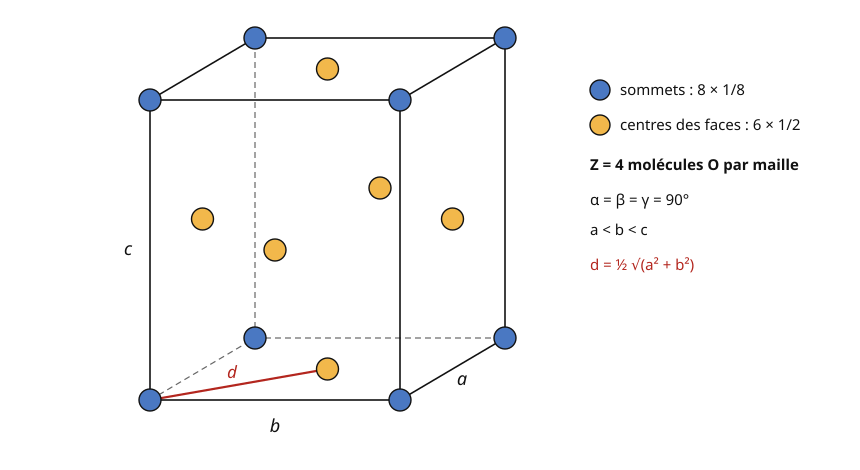

### Question I.1.1.3 — Population de la maille et masse volumique

Chaque sommet appartient à huit mailles et chaque centre de face à deux :

$$Z=8\times\frac18+6\times\frac12$$

$$\boxed{Z=4}$$

La maille, de volume $V=abc$, contient $Z$ molécules de masse $M_\mathrm{O}/N_A$ chacune :

$$\boxed{\rho=\frac{Z\,M_\mathrm{O}}{N_A\,abc}=\frac{4\,M_\mathrm{O}}{N_A\,abc}}$$

où $M_\mathrm{O}$ est la masse molaire de **O** ($\mathrm{C_{23}H_{14}F_6N_4S_2}$, soit $M_\mathrm{O}\approx 524\ \mathrm{g\,mol^{-1}}$) et $N_A$ la constante d'Avogadro.

### Question I.1.1.4 — Distance entre un sommet et le centre de la face (a, b)

Dans le plan $(\vec a,\vec b)$, le centre de la face a pour coordonnées $(a/2,\,b/2)$ par rapport à un sommet. Le théorème de Pythagore donne la demi-diagonale du rectangle :

$$\boxed{d=\frac12\sqrt{a^2+b^2}}$$

Comme $a<b<c$, c'est la plus courte des trois distances sommet–centre de face : les molécules les plus proches sont celles d'une même face $(\vec a,\vec b)$.

### Question I.1.1.5 — Type de cristal et exemples

Les nœuds du réseau sont occupés par des **molécules** neutres, dont les atomes sont liés entre eux par des liaisons covalentes mais qui ne sont retenues les unes aux autres que par des interactions faibles : c'est un **cristal moléculaire**.

Exemples de cristaux moléculaires : le diiode $\mathrm{I_2}$, la glace $\mathrm{H_2O}$, la carboglace $\mathrm{CO_2}$ (ou encore le naphtalène, le saccharose).

### Question I.1.1.6 — Propriétés des cristaux moléculaires

La cohésion est assurée par des interactions faibles, et les électrons restent localisés dans les molécules. Il en résulte :

- **propriétés mécaniques** : solides tendres, peu durs, fragiles et friables, de faible masse volumique ;
- **propriétés électriques** : isolants (pas d'électrons délocalisés à l'échelle du cristal, pas d'ions mobiles) ;
- **propriétés thermiques** : températures et enthalpies de fusion ou de sublimation basses (souvent bien inférieures à celles des cristaux ioniques, covalents ou métalliques), mauvaise conduction de la chaleur, forte dilatation thermique.

Ils sont en outre solubles dans les solvants dont les interactions avec la molécule sont de même nature que celles du cristal, ce que confirme la partie 1.2.

### Question I.1.1.7 — Interactions de cohésion et ordre de grandeur

La cohésion est due aux **interactions de van der Waals** entre molécules :

- interaction de **Keesom** entre dipôles permanents, importante ici car $\mu=9{,}0\ \mathrm{D}$ est élevé ;
- interaction de **Debye** entre dipôle permanent et dipôle induit ;
- interaction de **London** (dispersion) entre dipôles instantanés, forte pour une molécule volumineuse et polarisable (cycles aromatiques, atomes de soufre).

Il n'y a pas de liaison hydrogène : aucun atome d'hydrogène n'est porté par un atome d'azote, d'oxygène ou de fluor.

L'énergie de ces interactions est de l'ordre de **quelques kJ·mol⁻¹ à quelques dizaines de kJ·mol⁻¹** (typiquement 1 à 10 kJ·mol⁻¹ par interaction), très inférieure à celle d'une liaison covalente (plusieurs centaines de kJ·mol⁻¹).

### Question I.1.1.8 — Orientations stables de deux dipôles et agencement dans le cristal

Deux dipôles s'attirent lorsque l'extrémité positive de l'un est proche de l'extrémité négative de l'autre. Deux orientations sont stables :

- dipôles **colinéaires, tête-à-queue** (alignés sur une même droite, de même sens) ;
- dipôles **parallèles côte à côte, de sens opposés** (antiparallèles, ou tête-bêche).

Dans le cristal, deux molécules **O** voisines, symbolisées par $\Lambda$, adoptent donc l'un des deux agencements suivants : empilement des $\Lambda$ en colonne le long de la direction de $\vec\mu$ (les chevrons s'emboîtent, dipôles alignés), ou voisinage latéral de deux molécules tête-bêche ($\Lambda$ à côté de $\mathrm{V}$, dipôles antiparallèles).

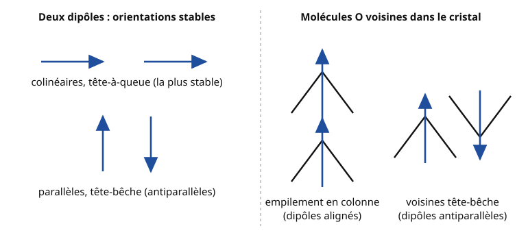

## Premier problème · 1.2 Solubilité de O dans le chloroforme

### Question I.1.2.1 — État standard d'un constituant en phase condensée

L'état standard d'un constituant en phase condensée, à la température $T$, est ce constituant **pur**, dans le même état physique (solide ou liquide), à la **même température $T$** et sous la **pression standard $p^\circ=1\ \mathrm{bar}$**.

Il existe donc un état standard à chaque température. Pour un soluté on choisit d'ordinaire une référence infiniment diluée, mais dans un mélange idéal où tous les constituants jouent le même rôle, comme ici, la référence est le corps pur.

### Question I.1.2.2 — Potentiel chimique et influence de la pression

Le potentiel chimique du constituant $i$ est l'enthalpie libre molaire partielle :

$$\boxed{\mu_i=\left(\frac{\partial G}{\partial n_i}\right)_{T,\,p,\,n_{j\neq i}}}$$

La différentielle $\mathrm dG=V\,\mathrm dp-S\,\mathrm dT+\sum_i\mu_i\,\mathrm dn_i$ et le théorème de Schwarz donnent :

$$\boxed{\left(\frac{\partial\mu_i}{\partial p}\right)_{T,\,n_j}=\left(\frac{\partial V}{\partial n_i}\right)_{T,\,p,\,n_{j\neq i}}=V_{m,i}}$$

où $V_{m,i}$ est le volume molaire partiel de $i$ (volume molaire $V_m^*$ pour un corps pur). Le potentiel chimique augmente donc avec la pression, d'autant plus que le volume molaire est grand.

### Question I.1.2.3 — Potentiel chimique d'un corps pur condensé

Pour le corps pur, à $T$ fixée, on intègre $\mathrm d\mu_i^*=V_{m,i}^*\,\mathrm dp$ entre $p^\circ$ et $p$ :

$$\mu_{i,cd}^*(T,p)=\mu_{i,cd}^\circ(T)+\int_{p^\circ}^{p}V_{m,i}^*\,\mathrm dp$$

**Hypothèse** : le volume molaire d'une phase condensée est très petit (de l'ordre de $10^{-5}$ à $10^{-4}\ \mathrm{m^3\,mol^{-1}}$) et quasiment indépendant de la pression, de sorte que le terme intégral $V_{m,i}^*(p-p^\circ)$ est négligeable devant $RT$ aux pressions usuelles. On néglige donc l'influence de la pression :

$$\boxed{\mu_{i,cd}^*(T,p)\approx\mu_{i,cd}^\circ(T)}$$

Ordre de grandeur : pour $V_m=10^{-4}\ \mathrm{m^3\,mol^{-1}}$ et $p-p^\circ=1\ \mathrm{bar}$, le terme vaut $10\ \mathrm{J\,mol^{-1}}$, contre $RT\approx2{,}5\ \mathrm{kJ\,mol^{-1}}$ à 298 K.

### Question I.1.2.4 — Potentiel chimique de O solide

Les cristaux sont constitués de **O** pur. D'après la question précédente :

$$\boxed{\mu_{\mathrm O,s}(T,p)=\mu_{\mathrm O,s}^\circ(T)}$$

### Question I.1.2.5 — Mélange idéal et potentiel chimique dans le mélange

Un mélange condensé est **idéal** si, pour tout constituant $i$ et à toute composition, le potentiel chimique s'écrit :

$$\mu_{i}(T,p,x_i)=\mu_{i}^*(T,p)+RT\ln x_i$$

où $\mu_i^*$ est le potentiel chimique de $i$ pur dans le même état physique. À l'échelle microscopique, cela correspond à des interactions de même intensité entre molécules identiques et entre molécules différentes (mélange sans effet thermique ni variation de volume).

En négligeant de nouveau l'influence de la pression sur $\mu_i^*$ :

$$\boxed{\mu_{i,l}(T,p,x_i)=\mu_{i,l}^\circ(T)+RT\ln x_i}$$

### Question I.1.2.6 — Potentiel chimique de O dissous

**O** dissous est un constituant du mélange liquide idéal **O**–chloroforme :

$$\boxed{\mu_{\mathrm O,l}(T,p,x_\mathrm O)=\mu_{\mathrm O,l}^\circ(T)+RT\ln x_\mathrm O}$$

L'état standard correspondant est **O** liquide pur à la température $T$ : c'est un état hypothétique (liquide surfondu) lorsque $T<T_\mathrm{fus}$.

### Question I.1.2.7 — Condition d'équilibre solide–solution

À l'équilibre $\mathrm{O_{(s)}}\rightleftharpoons\mathrm{O_{(solution)}}$, le potentiel chimique de **O** est le même dans les deux phases :

$$\mu_{\mathrm O,s}(T,p)=\mu_{\mathrm O,l}(T,p,x_\mathrm O)$$

soit :

$$\boxed{\mu_{\mathrm O,s}^\circ(T)=\mu_{\mathrm O,l}^\circ(T)+RT\ln x_\mathrm O}$$

### Question I.1.2.8 — Enthalpie libre standard de fusion

Pour la fusion $\mathrm{O_{(s)}\to O_{(l)}}$ :

$$\Delta_\mathrm{fus}G^\circ(T)=\mu_{\mathrm O,l}^\circ(T)-\mu_{\mathrm O,s}^\circ(T)$$

La condition d'équilibre de la question précédente donne alors :

$$\boxed{\Delta_\mathrm{fus}G^\circ(T)=-RT\ln x_\mathrm O}$$

Vérification du signe : en dessous de $T_\mathrm{fus}$, le solide est la phase stable, donc $\Delta_\mathrm{fus}G^\circ>0$, ce qui impose bien $x_\mathrm O<1$.

### Question I.1.2.9 — Relation de Gibbs-Helmholtz et loi de variation de la solubilité

La relation de Gibbs-Helmholtz, appliquée aux grandeurs standard de fusion, s'écrit :

$$\frac{\mathrm d}{\mathrm dT}\left(\frac{\Delta_\mathrm{fus}G^\circ}{T}\right)=-\frac{\Delta_\mathrm{fus}H^\circ}{T^2}$$

Or $\Delta_\mathrm{fus}G^\circ/T=-R\ln x_\mathrm O$, d'où :

$$\boxed{\frac{\mathrm d\ln x_\mathrm O}{\mathrm dT}=\frac{\Delta_\mathrm{fus}H^\circ}{RT^2}}$$

La fusion étant endothermique ($\Delta_\mathrm{fus}H^\circ>0$), la solubilité augmente avec la température. La relation a la forme d'une loi de van 't Hoff, avec $x_\mathrm O$ dans le rôle de la constante d'équilibre de dissolution.

### Question I.1.2.10 — Intégration : solubilité idéale

À $T=T_\mathrm{fus}$, le solide pur est en équilibre avec le liquide pur : $\Delta_\mathrm{fus}G^\circ(T_\mathrm{fus})=0$, donc $x_\mathrm O(T_\mathrm{fus})=1$. On intègre de $T$ à $T_\mathrm{fus}$ avec $\Delta_\mathrm{fus}H^\circ$ constant :

$$\ln 1-\ln x_\mathrm O(T)=\frac{\Delta_\mathrm{fus}H^\circ}{R}\int_T^{T_\mathrm{fus}}\frac{\mathrm dT'}{T'^2}$$

$$-\ln x_\mathrm O(T)=\frac{\Delta_\mathrm{fus}H^\circ}{R}\left(\frac1T-\frac1{T_\mathrm{fus}}\right)$$

$$\boxed{x_\mathrm O(T)=\exp\left[-\frac{\Delta_\mathrm{fus}H^\circ}{R}\left(\frac1T-\frac1{T_\mathrm{fus}}\right)\right]}$$

Pour $T<T_\mathrm{fus}$, l'argument de l'exponentielle est négatif et $x_\mathrm O<1$, comme il se doit. Dans ce modèle idéal, la solubilité ne dépend que des propriétés du soluté ($\Delta_\mathrm{fus}H^\circ$, $T_\mathrm{fus}$) et non de la nature du solvant.

### Question I.1.2.11 — Commentaire sur la valeur de la solubilité

Une solubilité $s=350\ \mathrm{g\,L^{-1}}$ est **très élevée** : **O** est très soluble dans le chloroforme. (Contrôle : le chloroforme pur, de masse volumique voisine de $1{,}5\ \mathrm{kg\,L^{-1}}$ et de masse molaire $119\ \mathrm{g\,mol^{-1}}$, contient environ $12\ \mathrm{mol\,L^{-1}}$ ; $x_\mathrm O=0{,}051$ correspond à $0{,}67$ mol de **O** par litre de solvant, soit environ $350\ \mathrm{g}$ avec $M_\mathrm O\approx524\ \mathrm{g\,mol^{-1}}$.)

On pouvait s'y attendre. **O** est une molécule organique **polaire** ($\mu=9{,}0\ \mathrm D$), polarisable et dépourvue de groupe donneur de liaison hydrogène ; le chloroforme est lui-même un solvant organique **polaire** et polarisable, aprotique. Les interactions soluté–solvant (van der Waals : Keesom, Debye, London) sont de même nature et de même ordre de grandeur que les interactions soluté–soluté du cristal moléculaire et solvant–solvant : « qui se ressemble s'assemble ». C'est précisément l'hypothèse du mélange idéal, et la faible cohésion du cristal moléculaire rend la dissolution peu coûteuse.

## Premier problème · 2.1 Génération d'une lumière monochromatique

### Question I.2.1.1 — Configurations électroniques de Hg et Xe

Règle de Klechkowski, principe de Pauli et règle de Hund donnent, à l'état fondamental :

$$\mathrm{Xe}\ (Z=54):\ 1s^2\,2s^2\,2p^6\,3s^2\,3p^6\,4s^2\,3d^{10}\,4p^6\,5s^2\,4d^{10}\,5p^6$$

$$\mathrm{Hg}\ (Z=80):\ 1s^2\,2s^2\,2p^6\,3s^2\,3p^6\,4s^2\,3d^{10}\,4p^6\,5s^2\,4d^{10}\,5p^6\,6s^2\,4f^{14}\,5d^{10}$$

soit $\mathrm{Xe}:[\mathrm{Kr}]\,4d^{10}5s^25p^6$ et $\mathrm{Hg}:[\mathrm{Xe}]\,4f^{14}5d^{10}6s^2$ (décompte : $54+2+14+10=80$).

Dans les deux atomes, **toutes les sous-couches occupées sont complètes**. Le xénon possède une couche de valence saturée $5s^25p^6$ (octet) ; le mercure a ses sous-couches $4f$, $5d$ et $6s$ pleines. Arracher, ajouter ou partager un électron est énergétiquement défavorable (énergie d'ionisation élevée, pas d'affinité électronique), d'où une grande stabilité et une faible réactivité : ce sont deux vapeurs monoatomiques.

### Question I.2.1.2 — Famille du xénon

Le xénon appartient à la famille des **gaz nobles** (gaz rares), colonne 18 de la classification, avec He, Ne, Ar, Kr et Rn.

### Question I.2.1.3 — Longueur d'onde de la transition E3 vers E1 du mercure

Le photon émis emporte l'énergie perdue par l'atome :

$$\Delta E=E_3-E_1=-2{,}72-(-4{,}99)=2{,}27\ \mathrm{eV}$$

$$\Delta E=2{,}27\times1{,}6\times10^{-19}=3{,}63\times10^{-19}\ \mathrm J$$

$$\lambda=\frac{hc}{\Delta E}=\frac{6{,}62\times10^{-34}\times3\times10^{8}}{3{,}63\times10^{-19}}=\frac{19{,}9\times10^{-26}}{3{,}63\times10^{-19}}$$

$$\boxed{\lambda\approx5{,}5\times10^{-7}\ \mathrm m\approx550\ \mathrm{nm}}$$

(valeur plus précise : 547 nm). Cette radiation appartient au **domaine visible** : c'est la raie **verte** du mercure (intervalle 530–560 nm du tableau).

## Premier problème · 2.2 Étude de la réaction photochrome

### Question I.2.2.1 — Couleurs des solutions de O et de F

Lecture de la figure 4.

- **O** (trait plein) absorbe essentiellement dans l'ultraviolet (maxima vers 320 et 360 nm). Le pied de sa bande déborde toutefois sur le visible : l'absorbance vaut encore environ 0,25 à 400 nm et ne s'annule que vers 430–440 nm. **O** absorbe donc faiblement le violet (380–440 nm) : sa solution est **presque incolore, légèrement jaune-vert** (jaune pâle).
- Les deux états photostationnaires absorbent jusqu'à environ 500 nm (absorbance de 0,15 à 0,20 vers 440–450 nm), domaine où **O** n'absorbe plus : cette absorption est due à **F**. **F** absorbe donc le violet, le bleu et le début du bleu-vert (380–500 nm) : sa solution est **jaune**, tirant sur l'orangé.

La réaction est bien photochrome : le passage $\mathbf O\to\mathbf F$ s'accompagne d'un jaunissement de la solution.

### Question I.2.2.2 — Différence des propriétés d'absorption d'après la figure 1B

Sur la figure 1B, les états fondamentaux $S_0(\mathrm O)$ et $S_0(\mathrm F)$ sont placés à des niveaux voisins, alors que l'état excité $S_1(\mathrm F)$ est plus bas que $S_1(\mathrm O)$. L'écart $S_0$–$S_1$ est donc plus petit pour **F** que pour **O** :

$$h\nu_2<h\nu_1\quad\Longleftrightarrow\quad\lambda_2=\frac{hc}{h\nu_2}>\lambda_1$$

**F** absorbe donc des photons de plus faible énergie, c'est-à-dire à **plus grande longueur d'onde** que **O** (effet bathochrome), ce qui est cohérent avec la figure 4 : **O** absorbe surtout dans l'UV, **F** jusque dans le visible. L'interprétation structurale est la conjugaison : dans la forme fermée **F**, le système $\pi$ est plan et conjugué d'un bout à l'autre de la molécule, alors que dans **O** les deux bras thiazole sont moins bien conjugués entre eux.

### Question I.2.2.3 — Domaines d'irradiation pour la cyclisation et la cycloréversion

Une réaction photochimique n'a lieu que si le réactif absorbe le rayonnement.

- **Cyclisation $\mathbf O\to\mathbf F$** : il faut irradier dans la bande d'absorption de **O**, soit $\lambda\lesssim430\ \mathrm{nm}$, et en pratique dans l'ultraviolet, entre 300 et 380 nm environ, où **O** absorbe fortement (c'est le cas des raies à 313 et 365 nm). **F** absorbant aussi dans ce domaine, on n'obtient pas **F** pur mais un état photostationnaire.
- **Cycloréversion $\mathbf F\to\mathbf O$** : il faut irradier là où **F** absorbe ; pour qu'elle soit totale, on choisit le domaine où **F** absorbe seul, soit dans le visible entre 440 et 500 nm environ (violet-bleu). **O** n'y absorbe pas, la cyclisation ne peut pas avoir lieu et tout **F** revient à **O**.

### Question I.2.2.4 — Usage de la raie verte du mercure

La transition $E_3\to E_1$ donne $\lambda\approx547\ \mathrm{nm}$. D'après la figure 4, l'absorbance de **O** comme celle des états photostationnaires est nulle au-delà de 500 nm environ : **ni O ni F n'absorbent** cette radiation.

Elle ne peut donc induire **ni la cyclisation, ni la cycloréversion** : l'énergie du photon (2,27 eV) est inférieure à l'écart $S_0$–$S_1$ de chacun des deux isomères.

## Premier problème · 2.3 Intensité absorbée par O

### Question I.2.3.1 — Loi de Beer-Lambert

Pour une solution traversée sur une longueur $l$ par un faisceau monochromatique, l'absorbance est proportionnelle à la longueur traversée et à la concentration de chaque espèce absorbante, les contributions étant additives :

$$\boxed{A=\sum_i\varepsilon_i(\lambda)\,l\,[i]}$$

où $\varepsilon_i$ est le coefficient d'absorption molaire de l'espèce $i$ à la longueur d'onde $\lambda$ (il dépend aussi du solvant et de la température).

Conditions de validité : lumière **monochromatique** ; solution **diluée** (concentrations inférieures à $10^{-2}\ \mathrm{mol\,L^{-1}}$ environ, absorbance pas trop grande) ; milieu **homogène et limpide** (ni diffusion, ni fluorescence parasite) ; espèces absorbantes sans interaction entre elles et, pour la mesure, non transformées par le faisceau d'analyse.

### Question I.2.3.2 — Absorbance et intensité transmise

À l'abscisse $x$ :

$$\boxed{A(x)=\log\frac{I_0}{I_t(x)}}$$

soit $I_t(x)=I_0\,10^{-A(x)}$. L'absorbance est positive puisque $I_t\leq I_0$.

### Question I.2.3.3 — Intensité transmise dans le mélange

Sur l'épaisseur $x$, les deux espèces absorbent :

$$A(x)=\left(\varepsilon_\mathrm O[\mathrm O]+\varepsilon_\mathrm F[\mathrm F]\right)x$$

$$I_t(x)=I_0\,10^{-A(x)}=I_0\exp\left(-\ln10\;A(x)\right)$$

$$\boxed{I_t(x)=I_0\exp\left[-\left(\varepsilon'_\mathrm O[\mathrm O]+\varepsilon'_\mathrm F[\mathrm F]\right)x\right]}$$

### Question I.2.3.4 — Intensité absorbée par O dans une tranche dx

Avec $\mathrm dI_{a,\mathrm O}(x)=[\mathrm O]\,\varepsilon'_\mathrm O\,I_t(x)\,\mathrm dx$ :

$$\boxed{\mathrm dI_{a,\mathrm O}(x)=[\mathrm O]\,\varepsilon'_\mathrm O\,I_0\exp\left[-\left(\varepsilon'_\mathrm O[\mathrm O]+\varepsilon'_\mathrm F[\mathrm F]\right)x\right]\mathrm dx}$$

### Question I.2.3.5 — Intégration sur la cuve

Posons $k=\varepsilon'_\mathrm O[\mathrm O]+\varepsilon'_\mathrm F[\mathrm F]$. Alors :

$$I_{a,\mathrm O}(l)=[\mathrm O]\,\varepsilon'_\mathrm O\,I_0\int_0^l\mathrm e^{-kx}\,\mathrm dx=\frac{[\mathrm O]\,\varepsilon'_\mathrm O\,I_0}{k}\left(1-\mathrm e^{-kl}\right)$$

C'est la forme demandée, $I_{a,\mathrm O}(l)=\alpha'_\mathrm O\left(1-\exp(-A')\right)$, avec :

$$\boxed{\alpha'_\mathrm O=\frac{\varepsilon'_\mathrm O[\mathrm O]}{\varepsilon'_\mathrm O[\mathrm O]+\varepsilon'_\mathrm F[\mathrm F]}\,I_0}$$

$$\boxed{A'=\left(\varepsilon'_\mathrm O[\mathrm O]+\varepsilon'_\mathrm F[\mathrm F]\right)l}$$

### Question I.2.3.6 — Passage aux coefficients décimaux et intensité absorbée par F

Avec $\varepsilon'_i=\varepsilon_i\ln10$, le facteur $\ln10$ se simplifie dans $\alpha'_\mathrm O$, et $A'=\ln10\,(\varepsilon_\mathrm O[\mathrm O]+\varepsilon_\mathrm F[\mathrm F])\,l=A\ln10$ où $A$ est l'absorbance de la solution. Comme $\exp(-A\ln10)=10^{-A}$ :

$$I_{a,\mathrm O}(l)=\alpha_\mathrm O\left(1-10^{-A}\right)$$

$$\boxed{\alpha_\mathrm O=\frac{\varepsilon_\mathrm O[\mathrm O]}{\varepsilon_\mathrm O[\mathrm O]+\varepsilon_\mathrm F[\mathrm F]}\,I_0}$$

Par analogie, en échangeant les rôles de **O** et **F** :

$$\boxed{I_{a,\mathrm F}(l)=\frac{\varepsilon_\mathrm F[\mathrm F]}{\varepsilon_\mathrm O[\mathrm O]+\varepsilon_\mathrm F[\mathrm F]}\,I_0\left(1-10^{-A}\right)}$$

Interprétation et contrôle : la somme $I_{a,\mathrm O}+I_{a,\mathrm F}=I_0(1-10^{-A})=I_0-I_t(l)$ est l'intensité totale absorbée ; chaque espèce en reçoit une fraction égale à sa part dans l'absorbance.

## Premier problème · 2.4 Obtention d'un état photostationnaire

### Question I.2.4.1 — Rendement quantique de cycloréversion

Par analogie avec la définition de $\phi_\mathrm O$ :

$$\boxed{\phi_\mathrm F=\frac{\text{nombre de molécules de }\mathbf O\text{ formées}}{\text{nombre de photons absorbés par }\mathbf F}}$$

C'est la fraction des photons absorbés par **F** qui conduisent effectivement à la cycloréversion ($0\leq\phi_\mathrm F\leq1$).

### Question I.2.4.2 — Réactions possibles à 365 nm

À 365 nm, **O** et **F** absorbent toutes deux : les **deux réactions photochromes** ont lieu simultanément, la cyclisation $\mathbf O\to\mathbf F$ (par absorption de **O**) et la cycloréversion $\mathbf F\to\mathbf O$ (par absorption de **F**).

### Question I.2.4.3 — Vitesse d'évolution de [O] à 365 nm

La cyclisation consomme **O** (terme donné par l'énoncé) ; la cycloréversion consomme **F** à la vitesse $I_{a,\mathrm F}(l)\,\phi_\mathrm F/V$ et forme autant de **O** :

$$\boxed{\frac{\mathrm d[\mathrm O]}{\mathrm dt}=-\frac{\phi_\mathrm O\,I_{a,\mathrm O}(l)}{V}+\frac{\phi_\mathrm F\,I_{a,\mathrm F}(l)}{V}}$$

### Question I.2.4.4 — État photostationnaire

Aux temps longs, les concentrations sont stationnaires, $\mathrm d[\mathrm O]/\mathrm dt=0$ : les deux réactions se compensent exactement,

$$\phi_\mathrm O\,I_{a,\mathrm O}(l)=\phi_\mathrm F\,I_{a,\mathrm F}(l)$$

Avec les expressions de la question 2.3.6, le facteur commun $I_0(1-10^{-A})/(\varepsilon_\mathrm O[\mathrm O]+\varepsilon_\mathrm F[\mathrm F])$ se simplifie :

$$\phi_\mathrm O\,\varepsilon_\mathrm O\,[\mathrm O]_\mathrm{EPS}=\phi_\mathrm F\,\varepsilon_\mathrm F\,[\mathrm F]_\mathrm{EPS}$$

$$\boxed{\left(\frac{[\mathrm O]}{[\mathrm F]}\right)_\mathrm{EPS}=\frac{\varepsilon_\mathrm F\,\phi_\mathrm F}{\varepsilon_\mathrm O\,\phi_\mathrm O}}$$

L'état photostationnaire est un état stationnaire dynamique et non un équilibre thermodynamique : sa composition dépend de la longueur d'onde par $\varepsilon_\mathrm O$ et $\varepsilon_\mathrm F$, mais ni de $I_0$ ni de $C_\mathrm{tot}$.

### Question I.2.4.5 — Taux de conversion de la cyclisation

Le taux de conversion est la fraction de **O** initialement introduit qui a été transformée en **F**. La matière se conserve, $C_\mathrm{tot}=[\mathrm O]+[\mathrm F]$ à tout instant :

$$\boxed{X_\mathrm F=\frac{[\mathrm F]}{C_\mathrm{tot}}=\frac{[\mathrm F]}{[\mathrm O]+[\mathrm F]}}$$

### Question I.2.4.6 — Taux de conversion à l'état photostationnaire

$$X_\mathrm F=\frac{1}{1+[\mathrm O]/[\mathrm F]}$$

et, à l'état photostationnaire, avec le résultat de 2.4.4 :

$$\boxed{X_\mathrm F^\mathrm{EPS}=\frac{\varepsilon_\mathrm O\,\phi_\mathrm O}{\varepsilon_\mathrm O\,\phi_\mathrm O+\varepsilon_\mathrm F\,\phi_\mathrm F}}$$

### Question I.2.4.7 — Comparaison des deux états photostationnaires

Les trois spectres de la figure 4 correspondent à la même concentration totale et à la même cuve.

- Entre 440 et 500 nm, **O** n'absorbe pas : l'absorbance est proportionnelle à $[\mathrm F]$. Elle est plus grande pour l'état photostationnaire obtenu à 365 nm (environ 0,20 vers 450 nm) que pour celui obtenu à 313 nm (environ 0,15).
- Vers 320–370 nm, où **O** absorbe fortement (absorbance voisine de 0,9 pour **O** pur), l'absorbance est tombée à 0,40 environ pour l'état obtenu à 313 nm et à 0,25 environ pour celui obtenu à 365 nm : il reste moins de **O** dans le second.

Les deux lectures concordent :

$$\boxed{X_\mathrm F(365\ \mathrm{nm})>X_\mathrm F(313\ \mathrm{nm})}$$

### Question I.2.4.8 — Comparaison des coefficients d'absorption molaire

Sur le spectre de **O** seul (trait plein), l'absorbance vaut environ 0,9 à 313 nm comme à 365 nm (les deux longueurs d'onde encadrent les maxima à 320 et 360 nm) :

$$\boxed{\varepsilon_\mathrm O(313\ \mathrm{nm})\approx\varepsilon_\mathrm O(365\ \mathrm{nm})}$$

D'après 2.4.6, à rendements quantiques indépendants de $\lambda$ :

$$X_\mathrm F^\mathrm{EPS}=\frac{1}{1+\dfrac{\varepsilon_\mathrm F\,\phi_\mathrm F}{\varepsilon_\mathrm O\,\phi_\mathrm O}}$$

est une fonction décroissante du rapport $\varepsilon_\mathrm F/\varepsilon_\mathrm O$. Comme $X_\mathrm F(365)>X_\mathrm F(313)$, ce rapport est plus petit à 365 nm, et puisque $\varepsilon_\mathrm O$ est le même aux deux longueurs d'onde :

$$\boxed{\varepsilon_\mathrm F(365\ \mathrm{nm})<\varepsilon_\mathrm F(313\ \mathrm{nm})}$$

**F** absorbe moins à 365 nm qu'à 313 nm : la cycloréversion y est moins efficace et l'état photostationnaire est plus riche en **F**.

### Question I.2.4.9 — Valeur maximale de X_F pour des rendements égaux

Avec $\phi_\mathrm O=\phi_\mathrm F$, le taux de conversion maximal, atteint à l'état photostationnaire, est :

$$X_\mathrm F^\mathrm{EPS}=\frac{\varepsilon_\mathrm O}{\varepsilon_\mathrm O+\varepsilon_\mathrm F}=\frac{2\varepsilon_\mathrm F}{2\varepsilon_\mathrm F+\varepsilon_\mathrm F}$$

$$\boxed{X_\mathrm F^\mathrm{max}=\frac23\approx0{,}67}$$

### Question I.2.4.10 — Condition pour obtenir F seul

Avec $\phi_\mathrm O=\phi_\mathrm F$, $X_\mathrm F^\mathrm{EPS}=\varepsilon_\mathrm O/(\varepsilon_\mathrm O+\varepsilon_\mathrm F)$ tend vers 1 si :

$$\boxed{\varepsilon_\mathrm F\ll\varepsilon_\mathrm O}$$

à la longueur d'onde d'irradiation (idéalement $\varepsilon_\mathrm F=0$) : il faut irradier à une longueur d'onde où **F** n'absorbe pas, de sorte que la cycloréversion n'ait pas lieu. La figure 4 montre que ce n'est pas possible pour ce composé, **F** absorbant partout où **O** absorbe.

## Premier problème · 2.5 Étude cinétique de la réaction photochrome

### Question I.2.5.1 — Point isobestique

B est un **point isobestique** (point d'isoabsorbance) : tous les spectres des mélanges **O**/**F** de même concentration totale s'y croisent. Sur la figure 4, il se situe vers $\lambda_\mathrm B\approx400\ \mathrm{nm}$ (absorbance voisine de 0,25).

En ce point, l'absorbance $A=(\varepsilon_\mathrm O[\mathrm O]+\varepsilon_\mathrm F[\mathrm F])\,l$ doit être indépendante de la répartition entre **O** et **F** lorsque $[\mathrm O]+[\mathrm F]=C_\mathrm{tot}$, ce qui impose :

$$\boxed{\varepsilon_\mathrm O(\lambda_\mathrm B)=\varepsilon_\mathrm F(\lambda_\mathrm B)}$$

### Question I.2.5.2 — Intensité absorbée par O au point isobestique

À $\lambda_\mathrm B$, posons $\varepsilon_\mathrm O=\varepsilon_\mathrm F=\varepsilon_\mathrm B$. Alors :

$$\alpha_\mathrm O=\frac{\varepsilon_\mathrm B[\mathrm O]}{\varepsilon_\mathrm B\left([\mathrm O]+[\mathrm F]\right)}\,I_0=\frac{[\mathrm O]\,I_0}{C_\mathrm{tot}}$$

$$\boxed{I_{a,\mathrm O}(l)=\frac{[\mathrm O]\,I_0}{C_\mathrm{tot}}\left(1-10^{-A}\right)}$$

avec $A=\varepsilon_\mathrm B\,l\,C_\mathrm{tot}$, absorbance de la solution à $\lambda_\mathrm B$, **constante au cours de l'irradiation**. De même $I_{a,\mathrm F}(l)=[\mathrm F]\,I_0\,(1-10^{-A})/C_\mathrm{tot}$.

### Question I.2.5.3 — Équation différentielle

On reporte dans la relation de 2.4.3, avec $[\mathrm F]=C_\mathrm{tot}-[\mathrm O]$ :

$$\frac{\mathrm d[\mathrm O]}{\mathrm dt}=\frac{I_0\left(1-10^{-A}\right)}{V\,C_\mathrm{tot}}\left(-\phi_\mathrm O[\mathrm O]+\phi_\mathrm F\left(C_\mathrm{tot}-[\mathrm O]\right)\right)$$

$$\boxed{\frac{\mathrm d[\mathrm O]}{\mathrm dt}=-K\left(\phi_\mathrm O+\phi_\mathrm F\right)[\mathrm O]+K'}$$

C'est une équation différentielle linéaire du premier ordre à coefficients constants, parce que $A$ est constante à $\lambda_\mathrm B$ : c'est tout l'intérêt d'irradier au point isobestique.

### Question I.2.5.4 — Expressions de K et K'

Par identification :

$$\boxed{K=\frac{I_0\left(1-10^{-A}\right)}{V\,C_\mathrm{tot}}}$$

$$\boxed{K'=\frac{\phi_\mathrm F\,I_0\left(1-10^{-A}\right)}{V}=K\,\phi_\mathrm F\,C_\mathrm{tot}}$$

Homogénéité : $I_0$ est en $\mathrm{mol\,s^{-1}}$, donc $K$ en $\mathrm{s^{-1}}$ et $K'$ en $\mathrm{mol\,L^{-1}\,s^{-1}}$, comme il convient.

### Question I.2.5.5 — Résolution

La solution particulière constante est la concentration stationnaire :

$$[\mathrm O]_\infty=\frac{K'}{K\left(\phi_\mathrm O+\phi_\mathrm F\right)}=\frac{\phi_\mathrm F}{\phi_\mathrm O+\phi_\mathrm F}\,C_\mathrm{tot}$$

La solution générale est $[\mathrm O](t)=[\mathrm O]_\infty+\lambda\,\mathrm e^{-K(\phi_\mathrm O+\phi_\mathrm F)t}$, et la condition initiale $[\mathrm O](0)=C_\mathrm{tot}$ donne $\lambda=C_\mathrm{tot}-[\mathrm O]_\infty=\phi_\mathrm O\,C_\mathrm{tot}/(\phi_\mathrm O+\phi_\mathrm F)$ :

$$\boxed{[\mathrm O](t)=\frac{C_\mathrm{tot}}{\phi_\mathrm O+\phi_\mathrm F}\left[\phi_\mathrm F+\phi_\mathrm O\exp\left(-K\left(\phi_\mathrm O+\phi_\mathrm F\right)t\right)\right]}$$

Contrôles : $[\mathrm O](0)=C_\mathrm{tot}$ ; $[\mathrm O]$ décroît vers $[\mathrm O]_\infty<C_\mathrm{tot}$ avec la constante de temps $\tau=1/\left(K(\phi_\mathrm O+\phi_\mathrm F)\right)$.

### Question I.2.5.6 — Évolution du taux de conversion

Avec $X_\mathrm F=[\mathrm F]/C_\mathrm{tot}=1-[\mathrm O]/C_\mathrm{tot}$ :

$$\boxed{X_\mathrm F(t)=\frac{\phi_\mathrm O}{\phi_\mathrm O+\phi_\mathrm F}\left[1-\exp\left(-K\left(\phi_\mathrm O+\phi_\mathrm F\right)t\right)\right]}$$

Le taux de conversion croît de 0 vers sa valeur limite suivant une loi exponentielle. À l'état photostationnaire ($t\to\infty$) :

$$\boxed{X_\mathrm F^\mathrm{EPS}=\frac{\phi_\mathrm O}{\phi_\mathrm O+\phi_\mathrm F}}$$

On retrouve le résultat de 2.4.6 avec $\varepsilon_\mathrm O=\varepsilon_\mathrm F$.

### Question I.2.5.7 — Accès expérimental à la somme des rendements quantiques

La loi précédente s'écrit $X_\mathrm F^\mathrm{EPS}-X_\mathrm F(t)=X_\mathrm F^\mathrm{EPS}\,\mathrm e^{-K(\phi_\mathrm O+\phi_\mathrm F)t}$, soit :

$$\boxed{\ln\left(1-\frac{X_\mathrm F(t)}{X_\mathrm F^\mathrm{EPS}}\right)=-K\left(\phi_\mathrm O+\phi_\mathrm F\right)t}$$

Protocole : on irradie la solution de **O** à $\lambda_\mathrm B$ et on suit $X_\mathrm F(t)$ par spectrophotométrie, par exemple à une longueur d'onde du visible où **F** absorbe seul (vers 450 nm), où l'absorbance d'analyse $A_\mathrm{an}$ est proportionnelle à $[\mathrm F]$ ; alors $1-X_\mathrm F/X_\mathrm F^\mathrm{EPS}=1-A_\mathrm{an}(t)/A_\mathrm{an}(\infty)$. On poursuit jusqu'au palier, puis on trace $\ln\left(1-X_\mathrm F/X_\mathrm F^\mathrm{EPS}\right)$ en fonction de $t$ : on obtient une droite passant par l'origine, de pente $-K(\phi_\mathrm O+\phi_\mathrm F)$.

La constante $K=I_0(1-10^{-A})/(V\,C_\mathrm{tot})$ se calcule à partir de grandeurs mesurables : $V$, $C_\mathrm{tot}$, l'absorbance $A$ de la solution à $\lambda_\mathrm B$ et le flux de photons $I_0$ de la lampe (mesuré par actinométrie). On en déduit $\phi_\mathrm O+\phi_\mathrm F$.

### Question I.2.5.8 — Détermination séparée des deux rendements

On dispose de deux équations pour deux inconnues : la somme $S=\phi_\mathrm O+\phi_\mathrm F$ (pente de la droite de 2.5.7) et le rapport $X_\mathrm F^\mathrm{EPS}=\phi_\mathrm O/(\phi_\mathrm O+\phi_\mathrm F)$ (palier de 2.5.6). D'où :

$$\boxed{\phi_\mathrm O=X_\mathrm F^\mathrm{EPS}\,S}$$

$$\boxed{\phi_\mathrm F=\left(1-X_\mathrm F^\mathrm{EPS}\right)S}$$

### Question I.2.5.9 — Application numérique

Avec $X_\mathrm F^\mathrm{EPS}=0{,}33$ et $\phi_\mathrm O+\phi_\mathrm F=0{,}95$ :

$$\phi_\mathrm O=0{,}33\times0{,}95$$

$$\boxed{\phi_\mathrm O\approx0{,}31}$$

$$\phi_\mathrm F=0{,}67\times0{,}95=0{,}95-0{,}31$$

$$\boxed{\phi_\mathrm F\approx0{,}64}$$

Contrôle : $\phi_\mathrm O/(\phi_\mathrm O+\phi_\mathrm F)=0{,}31/0{,}95\approx0{,}33$. Environ un photon absorbé par **O** sur trois conduit à la cyclisation, et deux photons absorbés par **F** sur trois à la cycloréversion : la réouverture est deux fois plus efficace que la fermeture.

## Deuxième problème · 1.1 Mécanisme de la réaction de Huisgen

### Question II.1.1.1 — Structure de Lewis et formes mésomères de l'azidométhane

Décompte : $4+3\times1+3\times5=22$ électrons de valence, soit 11 doublets. L'enchaînement est $\mathrm{H_3C{-}N(3){-}N(2){-}N(1)}$ ; on reprend la numérotation du tableau 1 de l'énoncé, N(1) étant l'azote terminal et N(3) l'azote lié au substituant. Les deux formes mésomères principales respectent la règle de l'octet pour tous les atomes :

$$\mathrm{H_3C{-}\overline N{=}\overset{\oplus}{N}{=}\overline{\underline N}^{\,\ominus}}\quad\longleftrightarrow\quad\mathrm{H_3C{-}\overline{\underline N}^{\,\ominus}{-}\overset{\oplus}{N}{\equiv}N|}$$

- forme de gauche : N(3) porte un doublet non liant, N(2) aucun (charge $+$), N(1) deux doublets (charge $-$) ;
- forme de droite : N(3) porte deux doublets (charge $-$), N(2) aucun (charge $+$), N(1) un doublet.

L'azote central, de type $\mathrm{AX_2}$, est linéaire ; N(3) est coudé (angle C–N–N voisin de 115 à 120°). La molécule est globalement neutre mais c'est un **dipôle-1,3** : la charge négative est répartie sur N(1) et N(3), soit 4 électrons $\pi$ délocalisés sur trois atomes.

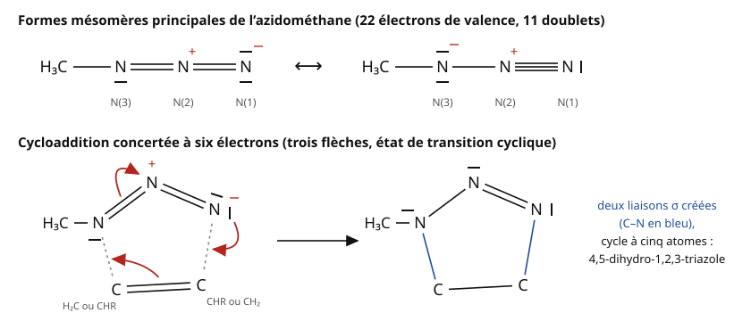

### Question II.1.1.2 — Produits de la réaction avec le propène

Par analogie avec le schéma 1, les deux atomes d'azote extrêmes de l'azoture se lient aux deux carbones de la double liaison pour former un cycle à cinq atomes, une 4,5-dihydro-1H-1,2,3-triazole (triazoline). Le propène étant dissymétrique, deux orientations sont possibles :

- le **1,4-diméthyl-4,5-dihydro-1H-1,2,3-triazole** (N(3) lié à $\mathrm{CH_2}$, le carbone porteur du méthyle est lié à N(1)) ;
- le **1,5-diméthyl-4,5-dihydro-1H-1,2,3-triazole** (N(3) lié au carbone qui porte le méthyle).

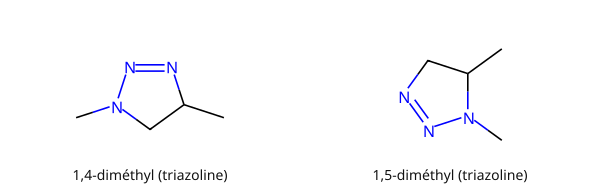

Ces deux produits ont la même formule brute $\mathrm{C_4H_9N_3}$ et des enchaînements d'atomes différents : ce sont des **isomères de constitution**, plus précisément des isomères de position, appelés **régioisomères**. Chacun possède un atome de carbone stéréogène et se forme sous forme de mélange racémique.

### Question II.1.1.3 — Mécanisme par analogie avec la réaction de Diels-Alder

Comme la réaction de Diels-Alder, la cycloaddition de Huisgen est **concertée** : les deux liaisons $\sigma$ C–N se forment en une seule étape élémentaire, sans intermédiaire, par un état de transition cyclique à **six électrons** (4 électrons $\pi$ du dipôle-1,3, 2 électrons $\pi$ du dipolarophile). C'est une cycloaddition $[4_\pi+2_\pi]$ suprafaciale sur les deux partenaires, permise thermiquement.

À partir de la forme $\mathrm{H_3C{-}N{=}N^+{=}N^-}$, on dessine trois flèches (figure 3) :

1. un doublet non liant de N(1) vers un carbone de l'alcène (création de la liaison N(1)–C) ;
2. le doublet $\pi$ de l'alcène vers N(3) (création de la liaison C–N(3)) ;
3. le doublet $\pi$ de la liaison N(3)=N(2) vers N(2), où il devient un doublet non liant.

Le produit ne porte plus de charge. Les deux régioisomères proviennent des deux orientations relatives des réactifs. Le caractère concerté explique la stéréospécificité observée sur le schéma 1 : la géométrie de l'alcène est conservée dans le produit (addition syn).

## Deuxième problème · 1.2 Étude orbitalaire de la réaction

### Question II.1.2.1 — Déterminant séculaire du propène

Dans la méthode de Hückel, le système $\pi$ comporte trois centres : C1 ($\mathrm{CH_2}$), C2 (CH) et le méthyle (centre 3), avec $\alpha_1=\alpha_2=\alpha$, $\alpha_3=\alpha+2\beta$, $\beta_{12}=\beta$, $\beta_{23}=0{,}7\beta$ et $\beta_{13}=0$ (atomes non liés). Le déterminant séculaire est :

$$\boxed{\begin{vmatrix}\alpha-E&\beta&0\\\beta&\alpha-E&0{,}7\beta\\0&0{,}7\beta&\alpha+2\beta-E\end{vmatrix}=0}$$

En divisant chaque ligne par $\beta$ et en posant $x=(\alpha-E)/\beta$ :

$$\begin{vmatrix}x&1&0\\1&x&0{,}7\\0&0{,}7&x+2\end{vmatrix}=0$$

### Question II.1.2.2 — Équation aux énergies

Développement par rapport à la première ligne :

$$x\left[x(x+2)-0{,}49\right]-1\times\left[(x+2)-0\right]=0$$

$$\boxed{x^3+2x^2-1{,}49\,x-2=0\quad\text{avec}\quad E=\alpha-x\beta}$$

Contrôle avec les énergies de l'énoncé : $E_1=\alpha+2{,}27\beta$, $E_2=\alpha+0{,}81\beta$ et $E_3=\alpha-1{,}08\beta$ correspondent à $x=-2{,}27$, $-0{,}81$ et $1{,}08$, qui annulent bien le polynôme (somme des racines $-2$, produit $+2$).

### Question II.1.2.3 — Diagramme complété : signes et remplissage

**Remplissage.** Le système $\pi$ compte 4 électrons (2 pour la liaison C=C, 2 apportés par le méthyle). Comme $\beta<0$, l'ordre des énergies est $E_1<E_2<E_3$. On remplit par énergie croissante : $E_1$ et $E_2$ sont doublement occupées (électrons appariés), $E_3$ est vacante.

**Signes.** Le nombre de changements de signe le long de la chaîne augmente avec l'énergie :

- $\psi_1$ ($E_1$) : aucun nœud, les trois coefficients sont de même signe ; l'orbitale est surtout développée sur le méthyle ;
- $\psi_2$ ($E_2$) : un nœud entre C2 et le méthyle ; C1 et C2 sont en phase (caractère liant $\pi_\mathrm{CC}$), le méthyle est en opposition de phase ; le plus gros coefficient est sur C1 ;
- $\psi_3$ ($E_3$) : deux nœuds, signes alternés ; C1 et C2 sont en opposition de phase (caractère antiliant $\pi^*_\mathrm{CC}$) ; le plus gros coefficient est sur C2.

La résolution du système séculaire donne les coefficients normalisés (C1, C2, Me) : $\psi_1$ : $(0{,}16\,;0{,}35\,;0{,}92)$, $\psi_2$ : $(0{,}73\,;0{,}59\,;-0{,}35)$, $\psi_3$ : $(0{,}67\,;-0{,}72\,;0{,}16)$, en accord avec la taille des lobes du diagramme de l'énoncé.

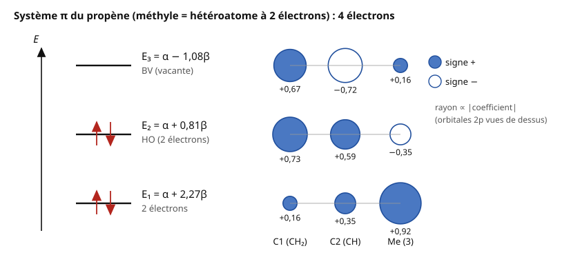

### Question II.1.2.4 — Approximation des orbitales frontières

**Approximation des orbitales frontières (Fukui).** Pour une réaction sous contrôle cinétique et orbitalaire, on ne retient, parmi toutes les interactions entre orbitales occupées de l'un des réactifs et orbitales vacantes de l'autre, que les interactions entre orbitales frontières : la plus haute occupée (HO) de l'un et la plus basse vacante (BV) de l'autre. Ce sont les plus proches en énergie, donc les plus stabilisantes ; la réaction privilégiée est celle qui présente le plus faible écart HO–BV et le meilleur recouvrement.

**Propène.** La HO est $\psi_2$ ($E_2=\alpha+0{,}81\beta$), la BV est $\psi_3$ ($E_3=\alpha-1{,}08\beta$).

### Question II.1.2.5 — Interaction principale entre le propène et l'azidobenzène

Deux interactions frontalières sont possibles :

$$E_\mathrm{BV}(\text{propène})-E_\mathrm{HO}(\text{azidobenzène})=4{,}9-(-11{,}1)=16{,}0\ \mathrm{eV}$$

$$E_\mathrm{BV}(\text{azidobenzène})-E_\mathrm{HO}(\text{propène})=3{,}1-(-13{,}6)=16{,}7\ \mathrm{eV}$$

L'écart le plus faible désigne l'interaction principale : **HO de l'azidobenzène – BV du propène** (16,0 eV). La différence entre les deux écarts est toutefois faible (0,7 eV) : la seconde interaction n'est pas négligeable.

### Question II.1.2.6 — Produit majoritaire avec le propène

Sous contrôle frontalier, l'état de transition le plus stable est celui du **recouvrement maximal** : l'atome de plus gros coefficient dans la HO de l'azoture se lie à l'atome de plus gros coefficient dans la BV du propène.

- HO de l'azidobenzène : $|c_\mathrm{N(3)}|=0{,}60>|c_\mathrm{N(1)}|=0{,}42$ ; le plus gros coefficient est sur l'azote lié au phényle.
- BV du propène ($\psi_3$) : le plus gros coefficient est sur C2, le carbone qui porte le méthyle ($0{,}72$ contre $0{,}67$ sur C1).

N(3) se lie donc à C2 et N(1) à C1. Les signes sont compatibles : les coefficients sont de signes opposés sur N(1) et N(3) dans la HO, et sur C1 et C2 dans la BV, de sorte que les deux recouvrements sont simultanément liants. Le produit majoritaire est le **5-méthyl-1-phényl-4,5-dihydro-1H-1,2,3-triazole**, où le carbone porteur du méthyle est lié à l'azote porteur du phényle (structure sur la figure 6).

L'interaction secondaire (HO du propène, gros coefficient sur C1 ; BV de l'azoture, gros coefficient sur N(1) : $0{,}50$ contre $0{,}17$) conduit à la même orientation. La différence entre les coefficients de la BV du propène étant faible, la régiosélectivité reste modérée.

### Question II.1.2.7 — Réactivité comparée des trois alcènes et régiosélectivité

**Écarts frontaliers** (en eV) avec l'azidobenzène (HO $-11{,}1$ ; BV $3{,}1$) :

| Alcène | BV(alcène) − HO(azoture) | BV(azoture) − HO(alcène) | Écart minimal |
|---|---|---|---|
| méthoxyéthène | $5{,}5+11{,}1=16{,}6$ | $3{,}1+13{,}6=16{,}7$ | 16,6 |
| propène | $4{,}9+11{,}1=16{,}0$ | $3{,}1+13{,}6=16{,}7$ | 16,0 |
| propénoate de méthyle | $2{,}7+11{,}1=13{,}8$ | $3{,}1+13{,}9=17{,}0$ | 13,8 |

Plus l'écart est petit, plus l'interaction est stabilisante et plus la réaction est rapide. Ordre de réactivité croissante :

$$\boxed{\text{méthoxyéthène}<\text{propène}<\text{propénoate de méthyle}}$$

Le groupe ester, attracteur, abaisse fortement la BV de l'alcène et rend l'acrylate nettement plus réactif ; l'écart entre les deux premiers alcènes est faible.

**Régiosélectivité** (carbone 1 = $\mathrm{CH_2}$ terminal, carbone 2 = carbone substitué).

- **Propénoate de méthyle.** L'interaction HO(azoture)–BV(alcène) domine nettement (13,8 contre 17,0 eV). Dans la BV de l'alcène, le plus gros coefficient est sur C1 ($0{,}61$ contre $0{,}41$) ; il se lie à N(3) ($0{,}60$), et C2 à N(1). Produit majoritaire : le **1-phényl-4,5-dihydro-1H-1,2,3-triazole-4-carboxylate de méthyle** (ester en position 4, loin du phényle). Une seule interaction compte et les coefficients sont bien différenciés : la régiosélectivité est bonne.
- **Méthoxyéthène.** Les deux interactions sont quasi dégénérées (16,6 et 16,7 eV). HO(azoture)–BV(alcène) : coefficients de la BV presque égaux ($0{,}68$ et $0{,}72$), préférence très faible pour la liaison N(3)–C2. HO(alcène)–BV(azoture) : gros coefficients sur C1 ($0{,}58$ contre $0{,}37$) et sur N(1) ($0{,}50$ contre $0{,}17$), d'où les liaisons C1–N(1) et C2–N(3), cette fois avec une préférence marquée. Les deux interactions convergent vers le **5-méthoxy-1-phényl-4,5-dihydro-1H-1,2,3-triazole** ; c'est la seconde qui impose la sélectivité.
- **Propène.** D'après la question précédente, **5-méthyl-1-phényl-4,5-dihydro-1H-1,2,3-triazole**, avec une régiosélectivité modérée.

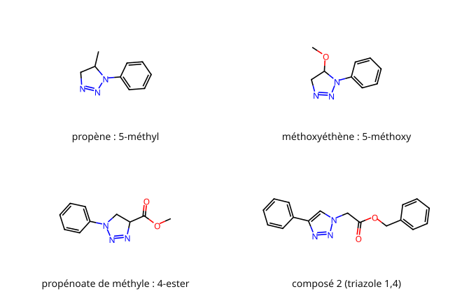

Bilan : les alcènes enrichis en électrons (propène, méthoxyéthène) placent leur substituant en position 5, au voisinage de l'azote porteur du phényle ; l'alcène appauvri (acrylate) le place en position 4. Le sens de la régiosélectivité s'inverse avec la nature électronique du substituant.

## Deuxième problème · 1.3 Extension à d'autres dipolarophiles

### Question II.1.3 — Structure du produit 2

Le phénylacétylène est un alcyne vrai : $\mathrm R=\mathrm{Ph}$, $\mathrm R'=\mathrm H$, et $\mathrm R^1=\mathrm{CH_2CO_2CH_2Ph}$. D'après le schéma 2, l'azote porteur de $\mathrm R^1$ se lie au carbone qui porte H, et le phényle se retrouve en position 4 du cycle aromatique 1,2,3-triazole : **2** est le triazole 1,4-disubstitué (un seul régioisomère en présence de Cu(I)).

**2** : 2-(4-phényl-1H-1,2,3-triazol-1-yl)acétate de benzyle, $\mathrm{C_{17}H_{15}N_3O_2}$ (structure sur la figure 6).

## Deuxième problème · 2.1 Synthèse stéréosélective du composé 4a

### Question II.2.1.1 — Structures de 3a et 3b

La bande d'absorption infrarouge large vers 3300 cm⁻¹ est caractéristique de la vibration d'élongation O–H d'un alcool (lié par liaison hydrogène). Dans l'eau, solvant en très large excès, c'est $\mathrm{H_2O}$ et non $\mathrm{Br^-}$ qui ouvre l'ion bromonium : chaque double liaison donne une **bromhydrine** (Br et OH sur deux carbones voisins). Les deux doubles liaisons réagissant, on obtient deux dibromodiols $\mathrm{C_6H_{10}Br_2O_2}$ selon l'orientation relative des deux additions :

- le **2,5-dibromocyclohexane-1,4-diol** (les deux OH en positions 1 et 4) ;
- le **4,6-dibromocyclohexane-1,3-diol** (les deux OH en positions 1 et 3, de part et d'autre d'un même $\mathrm{CH_2}$).

**3a** et **3b** ont la même formule brute et des enchaînements différents : ce sont des **isomères de constitution**, plus précisément des isomères de position (régioisomères).

### Question II.2.1.2 — Ions pontés intermédiaires

Chaque double liaison capte un « $\mathrm{Br^+}$ » pour former un ion **bromonium** ponté (cycle à trois atomes $\mathrm{C{-}Br^+{-}C}$, charge positive sur le brome). Les deux additions étant simultanées, l'intermédiaire est un dication bis-bromonium, qui existe sous deux formes :

- ion ***cis*** : les deux ponts bromonium sont sur la même face du cycle ;
- ion ***trans*** : les deux ponts sont sur des faces opposées.

Ces deux ions ont le même enchaînement d'atomes et ne sont pas images l'un de l'autre dans un miroir : ce sont des **diastéréoisomères**. Chacun est achiral (l'ion *cis* possède deux plans de symétrie, l'ion *trans* un centre de symétrie).

### Question II.2.1.3 — Stéréoisomères de 3a et 3b

L'eau ouvre chaque pont par attaque **anti** : dans chaque motif bromhydrine, Br et OH sont en relation *trans*. Numérotons le diène $\mathrm{C1{=}C2}$, $\mathrm{C4{=}C5}$.

**À partir de l'ion *cis*** (les deux Br sur une face, les deux OH sur l'autre) :

- attaque en C1 et C4, ou en C2 et C5 : 2,5-dibromocyclohexane-1,4-diol possédant un axe $C_2$ mais ni plan ni centre de symétrie, donc **chiral** ; les deux modes d'attaque, équiprobables, donnent les deux énantiomères **(1R,2R,4R,5R)** et **(1S,2S,4S,5S)** en mélange racémique ;
- attaque en C1 et C5, ou en C2 et C4 : 4,6-dibromocyclohexane-1,3-diol possédant un plan de symétrie (passant par les deux $\mathrm{CH_2}$), donc **achiral** : composé méso **(1R,3S,4S,6R)**.

**À partir de l'ion *trans*** (un Br et un OH sur chaque face) :

- attaque en C1 et C4, ou en C2 et C5 : 2,5-dibromocyclohexane-1,4-diol centrosymétrique, donc **achiral** : composé méso **(1R,2R,4S,5S)** ;
- attaque en C1 et C5, ou en C2 et C4 : 4,6-dibromocyclohexane-1,3-diol possédant seulement un axe $C_2$, donc **chiral** : couple d'énantiomères **(1R,3R,4R,6R)** et **(1S,3S,4S,6S)**, en mélange racémique.

Au total, **six stéréoisomères** : trois pour chaque régioisomère, dont **quatre chiraux** (deux couples d'énantiomères) et **deux achiraux** (méso).

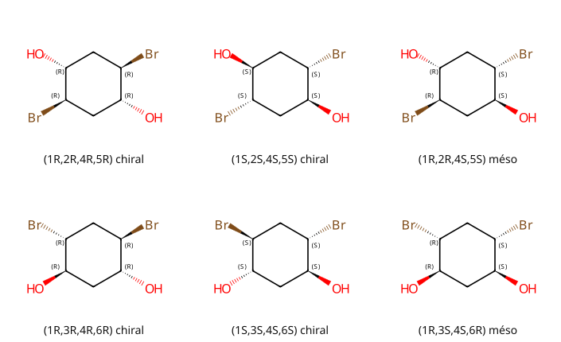

Descripteurs : sur un carbone porteur de OH, l'ordre de priorité est $\mathrm{OH}>\mathrm{C(Br)}>\mathrm{CH_2}>\mathrm H$ ; sur un carbone porteur de Br, $\mathrm{Br}>\mathrm{C(OH)}>\mathrm{CH_2}>\mathrm H$. Une relation *trans* entre OH et Br voisins correspond à deux descripteurs identiques (R,R ou S,S).

### Question II.2.1.4 — Mécanisme de formation du (1R,2R,4R,5R)-2,5-dibromocyclohexane-1,4-diol

D'après la question précédente, ce stéréoisomère provient de l'ion ponté ***cis***, l'eau attaquant C1 et C4.

1. **Formation des ions bromonium.** Le doublet $\pi$ de chaque double liaison attaque une molécule de dibrome, polarisée à son approche, tandis qu'un doublet du brome se referme sur l'autre carbone : il se forme un pont $\mathrm{C{-}Br^+{-}C}$ et un ion bromure est libéré. Les deux ponts sont ici sur la même face du cycle.
2. **Ouverture anti par l'eau.** Une molécule d'eau attaque C1 par la face opposée au pont, dans l'axe de la liaison C1–Br qui se rompt (substitution de type $\mathrm{S_N2}$, avec inversion sur C1) ; le brome reste lié à C2. Une seconde molécule d'eau attaque de même C4, le brome restant sur C5. On obtient un bis-oxonium.
3. **Déprotonation.** Deux molécules d'eau captent les protons des oxoniums pour donner les deux fonctions alcool.

Bilan : $\mathrm{C_6H_8+2\,Br_2+2\,H_2O\to C_6H_{10}Br_2O_2+2\,HBr}$.

Les deux OH sont sur une face du cycle, les deux Br sur l'autre, et chaque couple OH/Br voisin est *trans*. L'attaque en C2 et C5, tout aussi probable, donne l'énantiomère (1S,2S,4S,5S).

### Question II.2.1.5 — Formation de 4a ; stéréosélectivité et stéréospécificité

**Mécanisme** (deux fois, une par motif bromhydrine).

1. Réaction acide-base : l'ion hydroxyde déprotone la fonction alcool, $\mathrm{R{-}OH+HO^-\rightleftharpoons R{-}O^-+H_2O}$.
2. Substitution nucléophile **intramoléculaire** $\mathrm{S_N2}$ : l'alcoolate attaque le carbone voisin porteur du brome, par la face opposée à la liaison C–Br (O⁻ et Br en position antipériplanaire, ce que permet leur relation *trans*, en conformation diaxiale) ; l'ion bromure part et le cycle époxyde se ferme, avec inversion de configuration sur le carbone qui portait le brome.

Dans le stéréoisomère (1R,2R,4R,5R), les deux OH sont sur la même face : les deux atomes d'oxygène des époxydes se retrouvent du même côté du cycle, ce qui donne le diépoxyde *cis* **4a**.

**Sélectivité.** La réaction est **stéréospécifique** : le mécanisme $\mathrm{S_N2}$ impose la configuration du produit à partir de celle du réactif. Le diastéréoisomère (1R,2R,4R,5R), comme son énantiomère, ne conduit qu'à **4a**, tandis que le diastéréoisomère méso (1R,2R,4S,5S), dont les deux OH sont sur des faces opposées, ne conduit qu'à **4b**. Elle est par conséquent **stéréosélective** : à partir du stéréoisomère considéré, un seul des deux diépoxydes diastéréoisomères possibles est obtenu.

Remarque : la configuration du diépoxyde est fixée par celle de l'ion ponté de départ (*cis* ou *trans*), que le dibromodiol soit de type 1,4-diol ou 1,3-diol.

### Question II.2.1.6 — Obtention directe des diépoxydes 4

L'époxydation directe se fait par un **peroxyacide**, par exemple l'acide *méta*-chloroperoxybenzoïque (mCPBA), utilisé à raison d'**au moins deux équivalents** (un par double liaison), dans un solvant inerte comme le dichlorométhane, à température ambiante ou à 0 °C :

$$\mathrm{C_6H_8+2\,ArCO_3H\to C_6H_8O_2+2\,ArCO_2H}$$

L'addition de l'oxygène est concertée et syn sur chaque double liaison ; les deux époxydations se faisant sur la même face ou sur des faces opposées, on obtient le mélange de **4a** et **4b**.

## Deuxième problème · 2.2 Synthèse du composé 7

### Question II.2.2.1 — Représentation du composé 5

**5** est le (1R,2R,4R,5R)-2,5-diazidocyclohexane-1,4-diol. Le groupe $\mathrm{N_3}$ occupe le même rang de priorité que Br dans le dibromodiol de la question 2.1.4 ($\mathrm{OH}>\mathrm{C(N_3)}>\mathrm{CH_2}>\mathrm H$ et $\mathrm{N_3}>\mathrm{C(OH)}>\mathrm{CH_2}>\mathrm H$), de sorte que la disposition spatiale est la même : les deux OH sont sur une face du cycle, les deux groupes azido sur l'autre, et chaque couple OH/$\mathrm{N_3}$ voisin est *trans*.

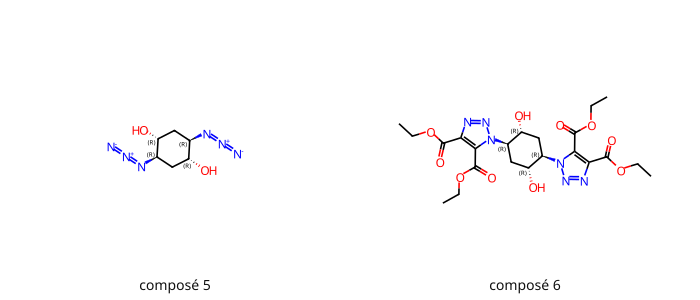

### Question II.2.2.2 — Mécanisme de formation de 5 et autre produit

**Mécanisme** (pour chaque époxyde).

1. **Ouverture $\mathrm{S_N2}$.** L'ion azoture, bon nucléophile, attaque un carbone de l'époxyde par la face opposée à la liaison C–O, qui se rompt : inversion de configuration sur le carbone attaqué, formation d'un alcoolate. Le groupe azido et l'oxygène sont donc *trans* (ouverture anti, trans-diaxiale). Il n'y a pas d'activation préalable par protonation : le milieu n'est que très faiblement acide.
2. **Protonation.** L'alcoolate, base forte, est protoné par l'ion ammonium ($\mathrm pK_A=9{,}2$) ou par l'eau : $\mathrm{RO^-+NH_4^+\to ROH+NH_3}$. Le chlorure d'ammonium tamponne ainsi le milieu et évite qu'il ne devienne fortement basique.

Dans **4a**, les deux oxygènes sont sur la même face ; les deux ions azoture attaquent par la face opposée. L'attaque en C2 et C5 donne le 2,5-diazidocyclohexane-1,4-diol **5**, obtenu sous forme racémique puisque **4a** est achiral (attaque en C2 et C5 ou en C1 et C4).

**Autre produit.** L'attaque sur les carbones C2 et C4 (ou C1 et C5) donne le régioisomère de **5** : le **4,6-diazidocyclohexane-1,3-diol**, composé méso (1R,3S,4S,6R).

### Question II.2.2.3 — Représentation du composé 6

Chaque fonction azoture de **5** réagit avec une molécule de but-2-ynedioate de diéthyle (deux équivalents) par cycloaddition de Huisgen. L'alcyne étant symétrique, il n'y a pas de problème de régiosélectivité : chaque azote lié au cycle devient l'atome N1 d'un cycle 1,2,3-triazole portant deux groupes $\mathrm{CO_2Et}$ en positions 4 et 5.

**6** est le (1R,2R,4R,5R)-2,5-bis[4,5-bis(éthoxycarbonyl)-1H-1,2,3-triazol-1-yl]cyclohexane-1,4-diol (figure 8). Les liaisons des carbones stéréogènes ne sont pas modifiées : la configuration est conservée, et les descripteurs restent R puisque les priorités ne changent pas.

### Question II.2.2.4 — Conformère de 6 expliquant la formation de 7

Sur une chaise, deux substituants *trans* portés par deux carbones voisins sont tous deux équatoriaux ou tous deux axiaux. Dans **6**, la disposition relative des quatre substituants impose que si le couple OH(1)/triazolyle(2) est diéquatorial, le couple OH(4)/triazolyle(5) est diaxial, et inversement. Le conformère chaise porte donc **deux substituants axiaux (un OH et un triazolyle) et deux substituants équatoriaux (un OH et un triazolyle)**.

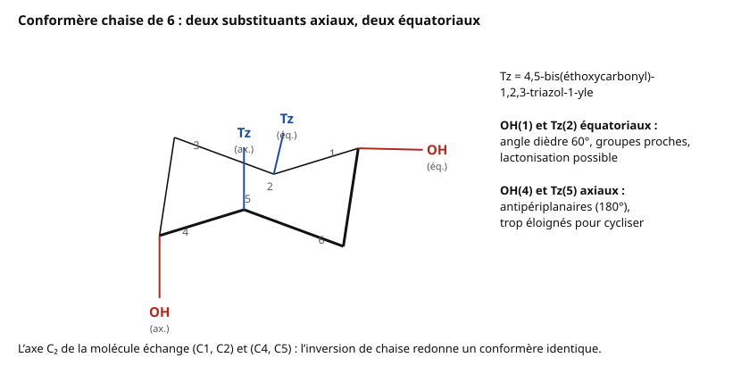

C'est ce conformère qui explique la formation de **7** : le groupe OH équatorial et le triazolyle équatorial voisin sont proches (angle dièdre de 60°), ce qui permet à l'hydroxyle d'atteindre le groupe ester en position 5 du triazole. Le couple diaxial, antipériplanaire (180°), est trop éloigné pour cycliser ; on le retrouve dans **7** sous la forme du OH et du triazolyle axiaux.

**C'est bien le conformère le plus stable**, et même le seul conformère chaise : l'inversion de la chaise échange les couples diaxial et diéquatorial, mais la molécule possède un axe $C_2$ qui échange (C1, C2) et (C4, C5), de sorte que les deux chaises sont identiques. La stéréochimie des quatre centres interdit toute chaise à quatre substituants équatoriaux.

### Question II.2.2.5 — Mécanisme de la transformation de 6 en 7 et sélectivité

La réaction est une **transestérification intramoléculaire** (lactonisation) catalysée par l'acide *para*-toluènesulfonique : le groupe OH équatorial remplace le groupe éthoxy de l'ester porté par le carbone 5 du triazole voisin. Toutes les étapes sont renversables.

1. **Activation électrophile** : protonation de l'oxygène du groupe carbonyle de l'ester (et non du groupe hydroxyle), ce qui exalte le caractère électrophile du carbone.
2. **Addition nucléophile** intramoléculaire de l'hydroxyle sur ce carbone : intermédiaire tétraédrique, formation d'un cycle à six atomes.
3. **Prototropie** : transfert du proton de l'oxygène qui vient de se lier vers l'oxygène du groupe éthoxy.
4. **Élimination** d'une molécule d'éthanol, bon groupe partant une fois protoné, avec reformation de la double liaison C=O.
5. **Déprotonation** : régénération du catalyseur et obtention de la lactone.

Bilan : $\mathbf 6\rightleftharpoons\mathbf 7+\mathrm{EtOH}$. L'équilibre est déplacé vers **7** par la formation d'un cycle à six atomes peu tendu (O, C1, C2, N1, C5 du triazole, carbone du carbonyle) et par le départ de l'éthanol, volatil ($T_\mathrm{eb}=78\ ^\circ\mathrm C$), au reflux du toluène ($111\ ^\circ\mathrm C$).

**Obtention du seul composé 7.**

- Seul l'ester en position 5 du triazole, voisin de N1, peut être atteint par l'hydroxyle ; l'ester en position 4 est trop éloigné.
- Seul le couple OH/triazolyle diéquatorial peut réagir. Une fois la première lactone formée, le nouveau cycle, accolé au cyclohexane par une jonction *trans* diéquatoriale, bloque la conformation chaise : le second couple OH/triazolyle reste figé en position diaxiale, ses deux groupes pointant sur des faces opposées, et ne peut plus cycliser. La bis-lactone ne se forme pas.

## Deuxième problème · 3.1 Synthèse de polymère par Chimie Click

### Question II.3.1.1 — Synthèse de l'organomagnésien 8

**Étape 1 : synthèse magnésienne** (insertion du magnésium dans la liaison C–Cl).

$$\mathrm{CH_3(CH_2)_3Cl+Mg\to CH_3(CH_2)_3MgCl}$$

Conditions : magnésium en copeaux, solvant éther anhydre (éther diéthylique ou THF, base de Lewis qui stabilise l'organomagnésien), verrerie sèche et garde à chlorure de calcium ou atmosphère inerte (absence d'eau, de dioxygène et de dioxyde de carbone), addition lente du dérivé chloré dilué pour maîtriser l'exothermicité et limiter le couplage de Wurtz, éventuellement amorçage par un cristal de diiode.

**Étape 2 : réaction acide-base** entre l'organomagnésien, base très forte ($\mathrm pK_A$ d'un alcane voisin de 50), et l'acétylène, dont l'hydrogène est relativement acide ($\mathrm pK_A\approx25$).

$$\mathrm{CH_3(CH_2)_3MgCl+H{-}C{\equiv}C{-}H\to H{-}C{\equiv}C{-}MgCl+CH_3(CH_2)_2CH_3}$$

La réaction est quantitative et dégage du butane gazeux. Conditions : acétylène en excès, barboté dans la solution d'organomagnésien dans le THF anhydre, afin d'éviter la double déprotonation qui donnerait le bis-magnésien $\mathrm{ClMgC{\equiv}CMgCl}$.

### Question II.3.1.2 — Structure de 12 et attribution du spectre RMN

L'organomagnésien **8** réagit sur le chlorotriméthylsilane par substitution nucléophile sur le silicium pour donner **10**, $\mathrm{HC{\equiv}C{-}SiMe_3}$. Un seul équivalent de **10** étant engagé par équivalent de diazoture **11**, une seule fonction azoture réagit. D'après le schéma 2 (alcyne vrai, catalyse par Cu(I)), on obtient le triazole 1,4-disubstitué :

**12** : 1-(4-azidophényl)-4-(triméthylsilyl)-1H-1,2,3-triazole, $\mathrm{C_{11}H_{14}N_6Si}$ (structure sur la figure 10).

| $\delta$ (ppm) | Multiplicité, intégration | Attribution |
|---|---|---|
| 0,32 | singulet, 9 H | $\mathrm{Si(CH_3)_3}$ : trois méthyles équivalents, sans voisin couplé, blindés par le silicium (domaine 0,5–0,0) |
| 7,34 | doublet, 2 H, $J=9{,}0$ Hz | H aromatiques en *ortho* du groupe azido |
| 7,95 | doublet, 2 H, $J=9{,}0$ Hz | H aromatiques en *ortho* du triazole (plus déblindés, substituant attracteur) |
| 8,84 | singulet, 1 H | H en position 5 du triazole, sans voisin couplé, fortement déblindé (cycle aromatique, voisinage des azotes) |

Les deux doublets de même constante de couplage ($^3J$ *ortho*) sont la signature d'un cycle benzénique *para*-disubstitué par deux groupes différents (deux couples de protons équivalents, chacun couplé à un seul voisin). Le rapport 9/2/2/1 confirme qu'une seule fonction azoture a réagi : le produit de double cycloaddition, symétrique, donnerait un singulet de 4 H aromatiques pour 18 H de groupes silyle.

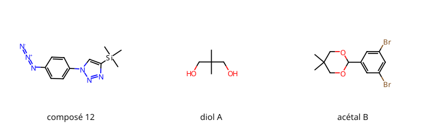

### Question II.3.1.3 — Condition d'obtention d'un polymère

Il faut que le partenaire du diazoture soit lui aussi **bifonctionnel** : un **dialcyne** (molécule portant deux triples liaisons terminales), engagé en proportions stœchiométriques. Chaque cycloaddition crée un triazole qui relie deux motifs et laisse une fonction réactive à chaque extrémité : la chaîne croît par polyaddition, $n\,\mathrm{N_3{-}Ar{-}N_3}+n\,\mathrm{HC{\equiv}C{-}R{-}C{\equiv}CH}\to$ polytriazole. Avec un alcyne monofonctionnel comme **10**, la croissance s'arrête au produit de mono- ou de double addition.

## Deuxième problème · 3.2 Synthèse de macrocycles par Chimie Click

### Question II.3.2.1 — Structure de 16 et mécanisme de sa formation

**Structure.** Chaque fonction phénol de **14** est transformée en éther par une molécule de **15** : dans **16**, les deux groupes OH phénoliques sont remplacés par des chaînes $\mathrm{{-}O{-}CH_2CH_2{-}O{-}CH_2CH_2{-}O{-}CH_2CH_2{-}OH}$ (c'est bien le précurseur de **17**, dont les alcools terminaux sont ensuite propargylés).

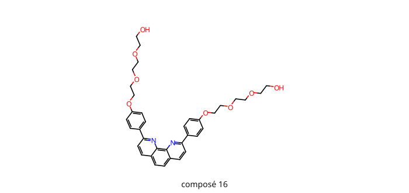

**Mécanisme** (deux fois).

1. **Réaction acide-base.** L'ion carbonate déprotone le phénol : $\mathrm{ArOH+CO_3^{2-}\rightleftharpoons ArO^-+HCO_3^-}$, de constante $K=10^{10{,}3-9{,}9}=10^{0{,}4}\approx2{,}5$. L'équilibre est peu déplacé, mais il est tiré vers la droite par la consommation du phénolate à l'étape suivante. La fonction alcool de **15** ($\mathrm pK_A\approx16$) n'est pas déprotonée par le carbonate : la réaction est chimiosélective.
2. **Substitution nucléophile $\mathrm{S_N2}$.** L'ion phénolate attaque le carbone primaire porteur du chlore, à l'opposé de la liaison C–Cl, en une seule étape : $\mathrm{ArO^-+Cl{-}CH_2R\to ArO{-}CH_2R+Cl^-}$. Le DMF, solvant polaire aprotique, solvate le cation potassium et laisse le phénolate très nucléophile.

Cette réaction est la **synthèse de Williamson** des éthers-oxydes.

### Question II.3.2.2 — Bromation du benzaldéhyde

**a) Produit et mécanisme.** Le produit monobromé majoritaire est le **3-bromobenzaldéhyde** (*méta*-bromobenzaldéhyde). Il se forme par substitution électrophile aromatique :

1. Formation de l'électrophile : l'acide de Lewis polarise la molécule de dibrome, $\mathrm{Br_2+FeBr_3\rightleftharpoons Br^{\delta+}{-}Br{-}FeBr_3^{\delta-}}$, équivalent de $\mathrm{Br^+}$, $\mathrm{FeBr_4^-}$.
2. Attaque du cycle aromatique sur le brome électrophile (étape cinétiquement déterminante) : formation de l'intermédiaire de Wheland, cation cyclohexadiényle dont la charge est délocalisée sur les positions *ortho* et *para* du carbone attaqué.
3. Réaromatisation : $\mathrm{FeBr_4^-}$ arrache le proton du carbone tétragonal, ce qui régénère le catalyseur et libère HBr.

Bilan : $\mathrm{C_6H_5CHO+Br_2\to BrC_6H_4CHO+HBr}$.

**b) Régiosélectivité.** La réaction est sous contrôle cinétique : le produit majoritaire provient de l'intermédiaire de Wheland le plus stable (postulat de Hammond). Le groupe formyle est attracteur par effets inductif et mésomère ($-I$, $-M$) et désactive le cycle. Pour une attaque en *ortho* ou en *para*, l'une des formes mésomères de l'intermédiaire place la charge positive sur le carbone qui porte le groupe CHO, lui-même porteur d'une charge partielle positive : cette forme est très déstabilisée. Pour une attaque en *méta*, aucune forme ne place la charge sur ce carbone : c'est l'intermédiaire le moins déstabilisé, d'où l'orientation en *méta*.

**c) Impossibilité d'obtenir le 3,5-dibromobenzaldéhyde.** Deux raisons se conjuguent.

- Après la première bromation, le cycle porte deux substituants désactivants (CHO et Br, ce dernier étant attracteur inductif) : la seconde substitution est beaucoup plus lente, d'où de simples traces de produits polybromés.
- Les orientations sont contradictoires : la position 5 est en *méta* de CHO, ce qui convient, mais aussi en *méta* du brome, alors que le brome, donneur mésomère, oriente en *ortho* et *para* (positions 2, 4 et 6). Les traces de dibromation ne correspondent donc pas à l'isomère 3,5.

Il faut par conséquent une autre voie d'accès au 3,5-dibromobenzaldéhyde.

### Question II.3.2.3 — Structures de A et B

Dans **18**, le carbone de l'ancien aldéhyde est lié à deux atomes d'oxygène dans un cycle 1,3-dioxane portant deux méthyles : c'est un acétal cyclique.

- **A** : 2,2-diméthylpropane-1,3-diol, $\mathrm{HOCH_2{-}C(CH_3)_2{-}CH_2OH}$.
- **B** : 2-(3,5-dibromophényl)-5,5-diméthyl-1,3-dioxane, acétal cyclique du 3,5-dibromobenzaldéhyde (structures sur la figure 10).

Les deux atomes de brome de **B** sont ensuite remplacés par des groupes azido pour donner **18**.

### Question II.3.2.4 — Mécanisme de formation de B

Il s'agit d'une **acétalisation** en catalyse acide (par exemple APTS), réaction de **protection** du groupe carbonyle ; elle procède par addition nucléophile suivie d'une substitution, et toutes ses étapes sont renversables.

1. Protonation de l'oxygène du groupe carbonyle (activation électrophile).
2. Addition nucléophile d'un groupe hydroxyle de **A** sur le carbone du carbonyle activé.
3. Prototropie, qui conduit à l'**hémiacétal** protoné sur son groupe OH.
4. Départ d'une molécule d'eau : formation d'un ion oxocarbénium stabilisé par mésomérie (doublet de l'oxygène et cycle aromatique).
5. Addition intramoléculaire du second groupe hydroxyle sur l'ion oxocarbénium : fermeture du cycle à six atomes.
6. Déprotonation : obtention de l'acétal **B** et régénération du catalyseur.

Bilan : $\mathrm{ArCHO+HOCH_2C(CH_3)_2CH_2OH\rightleftharpoons\mathbf B+H_2O}$. L'équilibre est déplacé vers l'acétal en éliminant l'eau au fur et à mesure (montage de Dean-Stark, entraînement azéotropique au reflux du toluène) ; la formation d'un cycle à six atomes est en outre favorable.

### Question II.3.2.5 — Structure de l'anneau 19

**17** porte deux alcynes vrais terminaux et **18** deux fonctions azoture : en présence de Cu(I), une **double cycloaddition de Huisgen** entre une molécule de **17** et une molécule de **18** referme un macrocycle.

Structure de **19** : chaque groupe $\mathrm{{-}CH_2{-}C{\equiv}CH}$ terminal de **17** est transformé en cycle 1,2,3-triazole 1,4-disubstitué, dont le carbone 4 porte le groupe $\mathrm{{-}CH_2{-}O{-}}$ de la chaîne polyéther, dont le carbone 5 porte un hydrogène, et dont l'azote 1 est lié au cycle benzénique provenant de **18**. Ce cycle benzénique, trisubstitué en 1, 3 et 5, porte les deux triazoles en positions 3 et 5 et conserve l'acétal (5,5-diméthyl-1,3-dioxan-2-yle) en position 1. L'anneau enchaîne donc : phénanthroline – phénylène – chaîne tri(oxyéthylène) – $\mathrm{O{-}CH_2}$ – triazole – benzène – triazole – $\mathrm{CH_2{-}O}$ – chaîne tri(oxyéthylène) – phénylène – retour à la phénanthroline.

La réaction est conduite à 70 °C avec un seul équivalent de **18** ; la fermeture intramoléculaire du second triazole est en compétition avec l'oligomérisation, que l'on défavorise en travaillant en milieu dilué.

### Question II.3.2.6 — Sites coordinants de 13 et 17

- **13** (*ortho*-phénanthroline) : **deux** sites, les deux atomes d'azote, dont le doublet non liant est situé dans le plan du cycle (azote de type pyridine). Leur disposition en fait un ligand bidentate.
- **17** : ces **deux** atomes d'azote, auxquels s'ajoutent les **huit** atomes d'oxygène des fonctions éther (quatre par chaîne), soit dix atomes porteurs de doublets non liants ; les deux triples liaisons terminales peuvent en outre se coordiner par leurs électrons $\pi$.

### Question II.3.2.7 — Stabilité thermodynamique du complexe

Deux équivalents de **17** sont engagés pour un équivalent de complexe de cuivre(I) : les deux ligands bidentates remplacent les quatre ligands acétonitrile monodentates.

$$\mathrm{[Cu(CH_3CN)_4]^++2\;\mathbf{17}\rightleftharpoons[Cu(\mathbf{17})_2]^++4\;CH_3CN}$$

Le nombre de liaisons Cu–N est conservé (quatre), de sorte que l'enthalpie de réaction est modérée (elle est plutôt favorable, la phénanthroline étant un meilleur ligand du cuivre(I) que l'acétonitrile). En revanche, le nombre d'espèces libres en solution passe de trois à cinq : $\Delta_rS^\circ>0$. C'est l'**effet chélate**, d'origine essentiellement **entropique** : $\Delta_rG^\circ=\Delta_rH^\circ-T\Delta_rS^\circ<0$, et la formation du complexe est thermodynamiquement favorisée. La rigidité de la phénanthroline, dont les deux azotes sont préorganisés pour former un cycle chélate à cinq atomes, renforce cet effet.

### Question II.3.2.8 — Structure spatiale et chiralité de 20

L'ion cuivre(I), de configuration $[\mathrm{Ar}]\,3d^{10}$, est lié aux quatre atomes d'azote des deux motifs phénanthroline : le complexe **20**, $[\mathrm{Cu}(\mathbf{17})_2]^+$, est **tétraédrique** (aucune stabilisation par le champ cristallin pour un ion $d^{10}$, la géométrie tétraédrique minimise les répulsions ; 18 électrons de valence).

Chaque phénanthroline, plane et rigide, occupe deux sommets du tétraèdre : les **plans des deux ligands sont perpendiculaires** et se coupent selon un axe passant par le cuivre. Les deux bras phénylène–polyéther de chaque ligand viennent ainsi se placer de part et d'autre de la phénanthroline de l'autre ligand : les deux ligands sont **entrecroisés** autour du métal, leurs extrémités alcyne pointant vers l'extérieur.

**Chiralité.** Chaque ligand est symétrique (ses deux azotes sont équivalents). Le plan de chacune des phénanthrolines contient le cuivre et l'un des ligands, et il est plan de symétrie de l'autre ligand : dans cette géométrie idéale, le complexe possède deux plans de symétrie orthogonaux. Il est superposable à son image dans un miroir : **20 est achiral**. La situation diffère de celle d'un complexe octaédrique à trois ligands bidentates, qui est chiral.

### Question II.3.2.9 — Intérêt de la dernière étape et autres réactifs

Le cuivre(I) sert de **gabarit** : dans **20**, il maintient les deux ligands entrecroisés, et la double cycloaddition de chacun d'eux avec une molécule de **18** referme deux anneaux passés l'un dans l'autre autour du métal (composé **21**, caténate de cuivre(I)).

La dernière étape est une **décomplexation** (démétallation) : l'ammoniac, en large excès, déplace les ligands phénanthroline en formant des complexes ammine du cuivre, solubles dans l'eau, ce qui libère le caténane **22** dépourvu de métal.

$$\mathbf{21}+n\;\mathrm{NH_3}\to\mathbf{22}+[\mathrm{Cu(NH_3)}_n]^+$$

D'autres réactifs conviennent, pourvu qu'ils forment avec le cuivre un complexe très stable : l'ion **cyanure** (KCN), l'**EDTA**, la pyridine, l'éthane-1,2-diamine.

### Question II.3.2.10 — Représentation schématique du caténane 22

**22** est un [2]caténane : deux anneaux **19** identiques, passés l'un dans l'autre comme deux maillons d'une chaîne. Ils ne sont reliés par aucune liaison covalente, mais on ne peut les séparer sans rompre une liaison (lien mécanique). Sur le schéma, les deux cercles se croisent en deux points : l'un des anneaux passe au-dessus de l'autre à un croisement et au-dessous à l'autre.

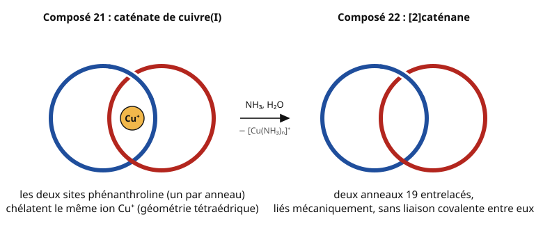
