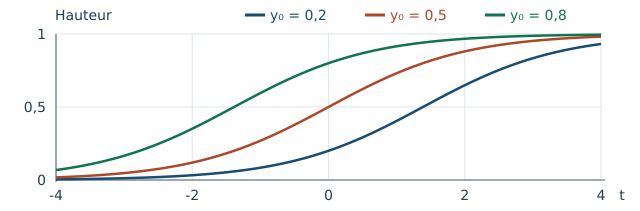
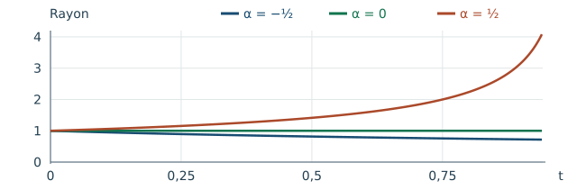

# X-ENS · PC · Mathématiques 2012 — corrigé brut

*Corrigé rédigé par IA, non officiel. Signalez toute erreur.*

**Rédaction** · GPT-6.2 Astra Ultra · vitesse non renseignée · 25 novembre 2026

**Révision** · GPT-6.2 Astra Ultra · vitesse non renseignée

On note $N(A)$ la norme d'opérateur induite par la norme euclidienne et $e_A(t)$ la matrice d'évolution construite à partir du problème de Cauchy. L'existence et l'unicité maximales annoncées dans le sujet sont utilisées sous leurs hypothèses.

## Partie préliminaire · Norme d'opérateur

### Question 1 · Axiomes d'une norme

La boule unité fermée est compacte et $x\mapsto\|Ax\|$ continue ; le supremum $N(A)$ est fini et positif au sens large. Si $N(A)=0$, toutes les colonnes $Ae_j$ sont nulles, donc $A=0$, et la réciproque est immédiate. L'homogénéité de la norme euclidienne donne $N(cA)=|c|N(A)$. Enfin $\|(A+B)x\|\le N(A)+N(B)$ pour $\|x\|\le1$, d'où l'inégalité triangulaire.

### Question 2 · Sous-multiplicativité

Pour tout $y$, $\|Ay\|\le N(A)\|y\|$ en normalisant $y$ s'il est non nul. Appliquer cette inégalité à $y=Bx$ puis à $B$ donne $\|ABx\|\le N(A)N(B)\|x\|$. Prendre le supremum sur la boule unité.

## Partie 1 · Équation logistique

### Question 3 · Problème maximal

Le champ $u\mapsto au(1-u/b)$ est polynomial, donc $C^1$ sur $\mathbb R$. Le théorème du sujet fournit une unique solution maximale sur un intervalle ouvert $I$ contenant $0$, pour tout $y_0\in\mathbb R$.

### Question 4a · Invariance de l'intervalle

Les constantes $0$ et $b$ sont solutions globales. Si la solution issue de $0<y_0<b$ en rencontrait une au temps $t_*$, l'unicité au temps $t_*$ les ferait coïncider jusque $0$, contradiction. La continuité interdit alors de sortir de $]0,b[$.

### Question 4b · Séparation des variables

Sur $]0,b[$, soit $H(v)=\int_{y_0}^v [u(1-u/b)]^{-1}du$. Alors $(H\circ y)'=y'/[y(1-y/b)]=a$ et $H(y_0)=0$. L'intégration entre $0$ et $t$ donne $H(y(t))=at$.

### Question 4c · Formule globale

La décomposition $1/[u(1-u/b)]=1/u+1/(b-u)$ donne
\[
\log\frac{y(t)}{b-y(t)}-\log\frac{y_0}{b-y_0}=at,\qquad
y(t)=\frac{b}{1+(b/y_0-1)e^{-at}}.
\]
Le dénominateur est strictement positif sur $\mathbb R$. La formule globale satisfait l'équation et la donnée initiale ; la maximalité impose $I=\mathbb R$.

### Question 4d · Limites

Puisque $(b/y_0-1)>0$, la formule donne $y(t)\to b$ quand $t\to+\infty$ et $y(t)\to0$ quand $t\to-\infty$.

## Partie 2 · Systèmes linéaires autonomes

### Question 5 · Opérateur d'évolution

Toute combinaison linéaire des solutions issues de $U,V$ est solution pour la combinaison des données correspondantes. L'unicité assure donc la linéarité de $\phi_A(t;\cdot)$. Si elle envoie $U$ sur zéro, l'unicité au temps $t$ avec la solution nulle entraîne $U=0$. En dimension finie, cette application linéaire injective est bijective ; sa matrice est $e_A(t)\in GL_n(\mathbb R)$.

### Question 6a · Dérivée de la matrice

La colonne $j$ de $e_A(t)$ est la solution de donnée $e_j$. Elle est $C^1$ et sa dérivée est son produit à gauche par $A$. Colonne par colonne, $e_A$ est $C^1$ et $e_A'=Ae_A$.

### Question 6b · Composition des temps

$e_A(0)U=U$ pour tout $U$, donc $e_A(0)=I_n$. À $s$ fixé, $t\mapsto e_A(t+s)U$ et $t\mapsto e_A(t)e_A(s)U$ vérifient la même équation et ont la même valeur $e_A(s)U$ à zéro. L'unicité pour tout $U$ donne $e_A(t+s)=e_A(t)e_A(s)$. Échanger $s,t$ donne l'autre ordre.

### Question 6c · Retour en arrière

La relation 6b avec $s=-t$ donne $e_A(t)e_A(-t)=e_A(-t)e_A(t)=I_n$. D'où $e_A(-t)=e_A(t)^{-1}$.

### Question 7a · Changement de base

La matrice $F(t)=P^{-1}e_A(t)P$ vérifie $F'=(P^{-1}AP)F$ et $F(0)=I_n$. Par unicité appliquée à ses colonnes, $F=e_{P^{-1}AP}$.

### Question 7b · Cas diagonal

Pour $A=\mathrm{diag}(\lambda_i)$, les équations $y_i'=\lambda_i y_i$ sont découplées. Donc $y_i(t)=e^{t\lambda_i}y_i(0)$ et $e_A(t)=\mathrm{diag}(e^{t\lambda_i})$.

### Question 7c · Calcul explicite

La matrice $\left(\begin{smallmatrix}4&-2\\1&1\end{smallmatrix}\right)$ a les valeurs propres $2,3$ avec vecteurs propres $(1,1)$ et $(2,1)$. Ses projecteurs spectraux sont $3I-A$ et $A-2I$. En posant $u=e^{2t},v=e^{3t}$, on obtient
\[
e_A(t)=u(3I-A)+v(A-2I)=
\begin{pmatrix}2v-u&2u-2v\\v-u&2u-v\end{pmatrix}.
\]

On peut vérifier les deux conditions initiales sans recalculer une matrice inverse. Les projecteurs ont pour somme $I$ et $2(3I-A)+3(A-2I)=A$. La formule donne donc à la fois $e_A(0)=I$ et $e'_A(0)=A$.

### Question 8a · Inégalité de Gronwall

Avec $H(t)=\alpha+\beta\int_0^t\varphi$, l'hypothèse est $\varphi\le H$. Donc $(e^{-\beta t}H)'=\beta e^{-\beta t}(\varphi-H)\le0$. Sa valeur initiale vaut $\alpha$, d'où $\varphi(t)\le H(t)\le\alpha e^{\beta t}$.

### Question 8b · Majoration dans les deux sens du temps

Pour $t\ge0$, intégrer $e_A'=Ae_A$ puis prendre la norme donne $N(e_A(t))\le1+N(A)\int_0^t N(e_A(s))\,ds$. Par 8a, $N(e_A(t))\le e^{N(A)t}$. Pour $t<0$, $u\mapsto e_A(-u)$ résout l'équation de matrice $-A$ et vaut $I$ en zéro. Puisque $N(-A)=N(A)$, la borne est $e^{N(A)|t|}$ pour tout réel $t$.

### Question 9a · Variation de la constante

L'intégrande $e_A(-s)g(s)$ est continue sur $\mathbb R$, donc $V(t)=Z_0+\int_0^t e_A(-s)g(s)\,ds$ est $C^1$. Pour $Z=e_A V$, on a $Z(0)=Z_0$ et $Z'=Ae_AV+e_A(t)e_A(-t)g(t)=AZ+g$. La formule définit une solution globale.

### Question 9b · Unicité avec second membre

La différence $\widetilde Z-Z$ vérifie $W'=AW$ et $W(0)=0$. L'unicité du problème homogène identifie cette différence à zéro sur l'intervalle commun. La formule précédente est l'unique solution de la donnée.

### Question 10a · Terme forcé négligeable

Posons $h(t)=e^{at}g(t)\to0$, $w(t)=e^{at}y(t)$ et $c=-(\lambda+a)>0$. Alors $w'=-cw+h$. Pour tout $\eta>0$, choisir $M$ tel que $|h(s)|\le\eta$ pour $s\ge M$. La variation de la constante donne
\[
|w(t)|\le e^{-c(t-M)}|w(M)|+\frac{\eta}{c}(1-e^{-c(t-M)}).
\]
La limite supérieure est au plus $\eta/c$ pour tout $\eta$, donc $w\to0$.

### Question 10b · Système triangulaire

La dernière coordonnée vérifie $y_n'=\lambda_n y_n$ et est $o(e^{-at})$. Si toutes les coordonnées d'indice $>i$ le sont, leur combinaison $g_i=\sum_{j>i}a_{ij}y_j$ l'est aussi. L'équation $y_i'=\lambda_i y_i+g_i$ satisfait 10a. Par récurrence descendante, toutes les coordonnées, puis la norme, sont $o(e^{-at})$.

### Question 10c · Décroissance en norme d'opérateur

Choisir $0<a<-\max\mathrm{Sp}(A)$. Le polynôme caractéristique scindé autorise une triangularisation réelle $A=PTP^{-1}$. Pour toute colonne $e_T(t)e_j$, 10b donne une norme $o(e^{-at})$. L'inégalité de Cauchy-Schwarz majore $N(e_T(t))$ par $\big(\sum_j\|e_T(t)e_j\|^2\big)^{1/2}=o(e^{-at})$. La conjugaison coûte seulement le facteur fixe $N(P)N(P^{-1})$.

### Question 11a · Valeurs propres complexes

Le polynôme annulateur $X^2+1$ impose des valeurs propres dans $\{\mathrm i,-\mathrm i\}$. Comme $A$ est réelle et $n\ge1$, les deux apparaissent et leurs multiplicités algébriques sont égales par conjugaison. Ainsi $n$ est pair.

### Question 11b · Conservation de la norme

$A^{-1}=-A$ et l'orthogonalité donne $A^{\mathsf T}=-A$. Donc $(\|Y\|^2)'=Y^{\mathsf T}(A+A^{\mathsf T})Y=0$ pour toute solution. L'application $e_A(t)$ conserve les normes et $N(e_A(t))=1$ à tout temps.

## Partie 3 · Systèmes non linéaires et stabilité

### Question 12a · Direction limite

Si $Y(t)\to l$, alors $Y'=f(Y)\to f(l)$ par continuité. Pour $f(l)\ne0$, $\langle Y'(t),f(l)\rangle\to\|f(l)\|^2>0$ et finit par être au moins $\|f(l)\|^2/2$.

### Question 12b · Dérive de la projection

Intégrer 12a sur $[M,t]$ donne $\langle Y(t),f(l)\rangle\ge\langle Y(M),f(l)\rangle+(t-M)\|f(l)\|^2/2$ pour $t\ge M$.

### Question 12c · Nécessité d'un équilibre

La projection $\langle Y(t),f(l)\rangle$ converge vers $\langle l,f(l)\rangle$ alors que sa borne inférieure tendrait vers $+\infty$. La contradiction impose $f(l)=0$.

### Question 13a · Rotation uniforme

Pour $\alpha=0$, la solution globale est $(y_0\cos t+z_0\sin t,-y_0\sin t+z_0\cos t)$. C'est le cercle de centre zéro et de rayon $\|Y_0\|$, parcouru dans le sens horaire à vitesse angulaire un ; si $Y_0=0$, la courbe est réduite à un point.

### Question 13b · Attraction pour un coefficient négatif

La solution initialement nulle est constante. Sinon elle évite zéro par unicité. Pour $q=\|Y\|^2$, on a $q'=2\alpha q^2$ car la partie de rotation est orthogonale à $Y$. Ainsi $q(t)=q(0)/(1-2\alpha q(0)t)$ sur son intervalle. Si $\alpha<0$, le dénominateur tend vers $+\infty$ dans le futur, donc $Y(t)\to0$.

### Question 13c · Explosion en temps fini

Pour $\alpha>0$ et $Y_0\ne0$, la même identité donne $\|Y(t)\|=\|Y_0\|/\sqrt{1-t/T}$ avec $T=1/(2\alpha\|Y_0\|^2)$. Sur $[0,T[$ cette norme diverge à gauche de $T$. Un intervalle maximal contenant $0$ ne peut contenir $T$ ni un point au-delà, car une solution y serait continue et de valeur finie. Donc $I\subset]-\infty,T[$.

Plus explicitement, avec $R(t)=\left(\begin{smallmatrix}\cos t&\sin t\\-\sin t&\cos t\end{smallmatrix}\right)$, la fonction $Y(t)=(1-t/T)^{-1/2}R(t)Y_0$ vérifie le système pour tout $t<T$. Sa dérivée additionne la rotation et le terme $\alpha\|Y(t)\|^2Y(t)$. L’unicité, puis la divergence de la norme, donnent même l’intervalle maximal $]-\infty,T[$.

### Question 14a · Jacobienne à l'origine

La continuité et $f(x)=Ax+o(\|x\|)$ imposent $f(0)=0$. Alors $f(x)-f(0)-Ax=o(\|x\|)$ est la définition de la différentiabilité en zéro de différentielle $A$, donc $Df(0)=A$.

### Question 14b · Inégalité de perturbation

Par 10c et continuité, il existe $a>0$, $K\ge1$ tels que $N(e_A(t))\le Ke^{-at}$ pour tout $t\ge0$. Posons $g(s)=f(Y(s))-AY(s)$. La variation de la constante et 6b donnent
\[
Y(t)=e_A(t)Y_0+\int_0^t e_A(t-s)g(s)\,ds.
\]
Si $\|g(s)\|\le\varepsilon\|Y(s)\|$ sur $[0,t]$, prendre les normes et factoriser $Ke^{-at}$ donne exactement $\|Y(t)\|\le Ke^{-at}(\|Y_0\|+\varepsilon\int_0^t e^{as}\|Y(s)\|ds)$.

### Question 14c · Stabilité exponentielle locale

Fixons $\varepsilon=a/(2K)$ et un rayon $\rho>0$ tel que le contrôle du reste vaille pour $\|x\|\le\rho$. Tant que la solution reste dans cette boule, Gronwall appliqué à $e^{at}\|Y(t)\|$ donne $\|Y(t)\|\le K\|Y_0\|e^{-(a-K\varepsilon)t}$. Prenons $\delta=\rho/(2K)$ ; pour $\|Y_0\|\le\delta$, un premier contact avec le bord aurait une norme au plus $\rho/2$, contradiction. L'estimation vaut à tout temps sur la demi-droite supposée incluse dans $I$, avec $b=a/2$ et $C=K\delta$.

### Question 14d · Application après translation

L'équilibre visé est $(1,1)$. Le champ $F(y,z)=(zy(1-y),y-z)$ y est nul et sa jacobienne est $\left(\begin{smallmatrix}-1&0\\1&-1\end{smallmatrix}\right)$, de spectre $\{-1\}$. Avec $U=(y-1,z-1)$, on obtient $U'=DF(1,1)U+o(\|U\|)$. Par 14c, pour $\|U_0\|\le\delta$ on a $U(t)\to0$ et ainsi $y(t),z(t)\to1$.

En posant $u=y-1$, $v=z-1$, le système translaté s’écrit $u'=-u-u^2-uv-u^2v$, $v'=u-v$. Le reste est bien de l’ordre de $\|(u,v)\|^2$ au voisinage de zéro. La condition initiale imprimée est exactement $\|(u(0),v(0))\|\le\delta$.
