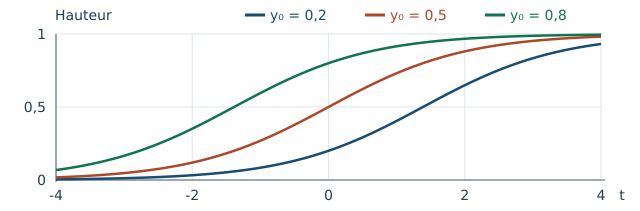
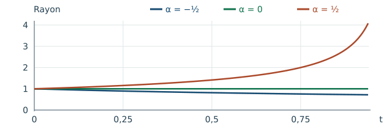

# X-ENS · PC · Mathématiques 2012 — corrigé guidé

*Corrigé rédigé par IA, non officiel. Signalez toute erreur.*

**Rédaction** · GPT-6.2 Astra Ultra · vitesse non renseignée · 25 novembre 2026

Comment passer d'une équation logistique scalaire à la stabilité d'un équilibre dans le plan ? Le fil conducteur est l'unicité des trajectoires. Des estimations en norme permettent ensuite de contrôler la perturbation d'un système linéaire stable.

## Partie préliminaire · Norme d'opérateur

### Question 1 · Axiomes d'une norme

Vérifiez d'abord que le nombre est défini : la fonction mesurée atteint son maximum sur la boule unité. Pour la séparation, il suffit de tester les vecteurs de base. Un scalaire sort de la norme en valeur absolue. Pour la somme, appliquez l'inégalité triangulaire avant de prendre le supremum sur les vecteurs.

### Question 2 · Sous-multiplicativité

Le vecteur $Bx$ ne se trouve pas nécessairement dans la boule unité. La définition s'applique à $Bx/\|Bx\|$ s'il est non nul, puis on remet le facteur. On obtient deux majorations successives, une par opérateur.

## Partie 1 · Équation logistique

### Question 3 · Problème maximal

Il suffit ici de vérifier la régularité du second membre. L'existence et l'unicité locales, puis l'existence de l'intervalle maximal, relèvent du théorème annoncé. L'étendue de cet intervalle sera déterminée pour les données de la question suivante.

### Question 4a · Invariance de l'intervalle

Aux deux bords du domaine souhaité, le champ s'annule. Chaque bord est donc une trajectoire constante. Deux trajectoires distinctes ne peuvent avoir le même point à la même date par unicité, en temps croissant comme décroissant. La trajectoire qui commence entre les deux y reste.

### Question 4b · Séparation des variables

Avant de diviser, utilisez 4a pour garantir que le dénominateur ne s'annule jamais. Choisissez une primitive qui vaut zéro en $y_0$. Sa composition avec la solution a une dérivée constante $a$, ce qui justifie la séparation rigoureusement, aussi pour $t<0$.

### Question 4c · Formule globale

L'intégration fournit le logarithme du rapport entre la hauteur et sa distance au plafond $b$. Ce rapport est donc multiplié par $e^{at}$ depuis l'instant initial. Isolez $y(t)$ pour obtenir $b/[1+((b-y_0)/y_0)e^{-at}]$. Vérifiez la dérivée de cette expression, définie sur toute la droite, pour conclure au prolongement maximal.

### Question 4d · Limites

Dans le dénominateur de 4c, le terme exponentiel disparaît vers le futur et croît sans borne vers le passé. Les deux équilibres de 4a sont ainsi les deux limites, dans cet ordre temporel : de zéro à $b$.

## Partie 2 · Systèmes linéaires autonomes

### Question 5 · Opérateur d'évolution

Fixez le temps d'observation et faites varier le point de départ. La superposition est justifiée en vérifiant l'équation puis la valeur initiale. Pour l'injectivité, deux solutions qui se rejoignent à l'arrivée coïncident par unicité à cette date. Elles sont globales dans le cas linéaire, donc ont aussi la même valeur à zéro.

### Question 6a · Dérivée de la matrice

Choisissez les vecteurs de la base canonique comme données initiales. Les coordonnées des trajectoires obtenues sont exactement les entrées de la matrice. Leur régularité et leur équation différentielle donnent celles de la matrice entière.

### Question 6b · Composition des temps

Faites d'abord évoluer une donnée pendant $s$, puis redémarrez l'horloge. Le champ autonome n'a pas changé. En prouvant l'égalité pour toute donnée initiale vous obtenez une identité matricielle. L'addition des durées commute, donc les deux opérateurs d'évolution commutent également.

### Question 6c · Retour en arrière

Un trajet de durée $t$ suivi d'un trajet de durée opposée a durée totale zéro. Sa matrice est l'identité. La formule de composition fournit l'inverse dans les deux ordres.

### Question 7a · Changement de base

Pour $Y'=AY$, posons $U=P^{-1}Y$. L'équation devient $U'=(P^{-1}AP)U$. À l'instant initial, puis à l'arrivée, traduisez les coordonnées à l'aide de $P$ et $P^{-1}$. Cette opération conjugue aussi la matrice d'évolution.

### Question 7b · Cas diagonal

Aucune coordonnée n'entre dans l'équation d'une autre. Chacune évolue suivant une exponentielle scalaire, et une coordonnée initialement nulle reste nulle. Cela fournit les colonnes diagonales de l'évolution.

### Question 7c · Calcul explicite

Le polynôme caractéristique est $(X-2)(X-3)$. Dans la base formée de $(1,1)$ et $(2,1)$, l'évolution multiplie donc ces colonnes par $u=e^{2t}$, $v=e^{3t}$. Le vecteur $(x,y)$ s'écrit $(2y-x)(1,1)+(x-y)(2,1)$. Après évolution, ses coordonnées sont $(2v-u)x+(2u-2v)y$ et $(v-u)x+(2u-v)y$.

### Question 8a · Inégalité de Gronwall

Le membre droit a une dérivée connue, même si $\varphi$ n'est que continue. Multipliez-le par le facteur intégrant $e^{-\beta t}$. La dérivée ainsi obtenue a le signe de $\varphi-H$, négatif ou nul, et la valeur initiale contrôle toute la suite.

### Question 8b · Majoration dans les deux sens du temps

Travaillez d'abord vers les temps positifs pour garder le bon sens de l'inégalité intégrale. Les normes de $I$ et d'un produit sont contrôlées par 1 et 2. Pour les temps négatifs, recommencez le même raisonnement avec le champ linéaire opposé et la durée positive $|t|$.

### Question 9a · Variation de la constante

Introduisez une donnée initiale variable $V$ en écrivant $Z=e_A V$. Le produit est dérivable si $V$ l'est. Pour fournir le second membre $g$, il faut $V'=e_A(-t)g(t)$ ; cette fonction est continue, donc son intégrale définit $V$ pour tout temps. La valeur en zéro fixe la constante.

### Question 9b · Unicité avec second membre

Retrancher deux solutions fait disparaître exactement le terme imposé $g$. La nouvelle équation est homogène et commence à zéro. Sa solution maximale est identiquement nulle, donc toute restriction sur un intervalle contenant zéro l'est aussi.

### Question 10a · Terme forcé négligeable

Multipliez la solution par le poids dont vous voulez tester la négligeabilité. Il reste une équation stable de taux $\lambda+a<0$ forcée par un terme qui tend vers zéro. Redémarrez au temps où ce terme devient inférieur à $\eta$ en valeur absolue. La donnée ancienne est amortie exponentiellement et le terme récent est borné par $\eta/|\lambda+a|$. Faites ensuite tendre $\eta$ vers zéro.

### Question 10b · Système triangulaire

Commencez par la dernière ligne, car le triangle supérieur la laisse indépendante. Remontez ensuite d'une ligne à la fois. Les termes venant des lignes déjà traitées forment le petit second membre de 10a. La dimension étant finie, le résultat coordonnée par coordonnée entraîne celui sur la norme.

### Question 10c · Décroissance en norme d'opérateur

Le même taux $a$ doit convenir à toutes les directions. Prenez-le strictement sous le plus petit taux de décroissance des valeurs propres, triangulez, puis testez les colonnes de la matrice d'évolution. Une somme finie de leurs normes contrôle uniformément toutes les données initiales de norme au plus un. Revenez à la base initiale par 7a.

### Question 11a · Valeurs propres complexes

Toute valeur propre doit être racine du polynôme donné. Il existe une valeur propre complexe et sa conjuguée est également racine du polynôme caractéristique réel, avec la même multiplicité. Cela organise toutes les racines par paires.

### Question 11b · Conservation de la norme

Le champ est orthogonal à la position : l'antisymétrie de $A$ donne $\langle AY,Y\rangle=0$. La vitesse ne modifie donc pas la norme. Chaque vecteur unitaire reste unitaire, d'où un supremum exactement égal à un.

## Partie 3 · Systèmes non linéaires et stabilité

### Question 12a · Direction limite

Projetez la vitesse sur le vecteur fixe $f(l)$. Cette quantité scalaire a une limite strictement positive dans l'hypothèse de contradiction ; la moitié de cette limite est une borne inférieure à partir d'un certain temps.

### Question 12b · Dérive de la projection

La dérivée de la projection de la position sur $f(l)$ est la projection de la vitesse. Intégrer la minoration constante de cette dérivée entre $M$ et $t$ fournit la minoration affine demandée.

### Question 12c · Nécessité d'un équilibre

Une trajectoire convergente a toutes ses projections bornées. Celle de 12b ne pourrait l'être si la vitesse limite était non nulle. Toute limite finie doit donc annuler le champ.

### Question 13a · Rotation uniforme

Écrivez $w=y+\mathrm iz$. On obtient $w'=-\mathrm iw$, donc $w(t)=w(0)e^{-\mathrm it}$ sur toute la droite. Le module reste fixe tandis que l'argument décroît au rythme de un radian par unité de temps, sauf pour la solution nulle.

### Question 13b · Attraction pour un coefficient négatif

Dérivez le carré du rayon. Les termes $yz$ et $-zy$ s'annulent, laissant une équation scalaire. Tant que le rayon est non nul, $(1/q)'=-2\alpha$. Pour $\alpha<0$ l'inverse du carré du rayon croît linéairement et la trajectoire se rapproche de l'origine. Si elle y est déjà, elle y reste.

### Question 13c · Explosion en temps fini

Le temps $T$ est le premier zéro du dénominateur de 13b. Si la solution existe jusqu'à tout $t<T$, son rayon devient arbitrairement grand lorsque $t$ approche $T$. Si elle devait être définie à $T$ ou après, son intervalle contiendrait $T$ et cette divergence contredirait la continuité. La figure compare les trois signes de $\alpha$.

### Question 14a · Jacobienne à l'origine

Commencez par passer à la limite dans l'hypothèse pour déterminer la valeur du champ à l'origine. Une fois cette valeur soustraite, le reste est négligeable devant la norme de l'accroissement. L'application linéaire du développement est précisément la jacobienne.

### Question 14b · Inégalité de perturbation

Traitez l'écart du système non linéaire au système linéaire comme un second membre connu le long de la trajectoire. Un apport à l'instant $s$ est propagé pendant $t-s$. Sa norme est donc multipliée au plus par $Ke^{-a(t-s)}$. La borne par $\varepsilon\|Y(s)\|$ et la mise en facteur de $e^{-at}$ fournissent l'inégalité.

### Question 14c · Stabilité exponentielle locale

Le contrôle du reste dépend de la taille de la trajectoire. Choisissez d'abord $\varepsilon$ pour que $K\varepsilon<a$, puis une boule où ce contrôle s'applique. Jusqu'au premier contact avec le bord, Gronwall donne une croissance de $e^{at}\|Y(t)\|$ au plus en $e^{K\varepsilon t}$. En prenant la donnée initiale dans une boule $2K$ fois plus petite, la borne reste à mi-rayon. Le premier contact est donc impossible et l'exponentielle décroissante vaut pour tout temps positif.

### Question 14d · Application après translation

Recentrer au bon équilibre est essentiel. Les dérivées partielles de la première composante sont $z(1-2y)$ et $y(1-y)$ ; celles de la seconde sont $1$ et $-1$. Au point $(1,1)$ on lit une matrice triangulaire dont les deux valeurs propres valent $-1$. L'hypothèse de la question est exactement que la donnée translatée appartient à la petite boule de 14c. La convergence annoncée s'ensuit.
