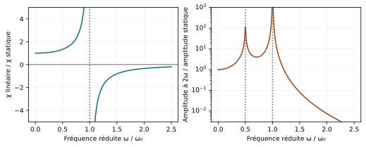
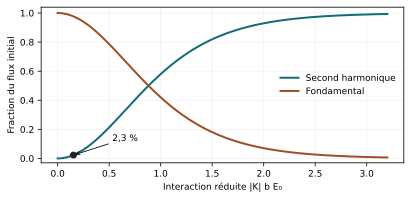

# X–ENS PC 2012 — Physique B (XELC) · Corrigé guidé

*Corrigé rédigé par IA, non officiel. Signalez toute erreur.*

**Lecture du rapport du jury** · GPT-6.2 Astra Ultra · vitesse non renseignée

**Rédaction** · GPT-6.2 Astra Ultra · vitesse non renseignée

## Étude de quelques phénomènes non linéaires dans les milieux diélectriques

## I. Réponse linéaire d’un électron lié

### Question 1.a — Force entre le nuage et le noyau

**Indication.** Calculer le champ de la boule au noyau, puis utiliser les actions réciproques.

La densité électronique vaut $-3e/(4\pi a^3)$. À l’intérieur de la boule, Gauss donne $\mathbf E(\mathbf s)=-e\mathbf s/(4\pi\epsilon_0a^3)$ à la position $\mathbf s$ comptée depuis son centre. Le noyau est en $\mathbf s=-\mathbf r$. La force sur lui est $+e^2\mathbf r/(4\pi\epsilon_0a^3)$, donc celle sur le nuage est $\mathbf F=-e^2\mathbf r/(4\pi\epsilon_0a^3)=-m_e\omega_0^2\mathbf r$.

### Question 1.b — Échelle de fréquence atomique

**Indication.** Prendre un rayon atomique de l’ordre de l’ångström.

L’identification donne $\omega_0^2=e^2/(4\pi\epsilon_0m_e a^3)$. Pour $a\sim10^{-10}\ \mathrm m$, $\omega_0^2\sim 2{,}5\times10^{32}\ \mathrm{s^{-2}}$, soit $\omega_0\sim 2\times10^{16}\ \mathrm{rad\,s^{-1}}$. Le résultat varie comme $a^{-3/2}$.

### Question 1.c — Énergie potentielle

**Indication.** Intégrer le rappel en choisissant une référence au centre.

Le travail élémentaire vaut $\mathbf F\cdot d\mathbf r=-m_e\omega_0^2r\,dr$. Donc $W_2(r)-W_2(0)=m_e\omega_0^2r^2/2$. Le centre est un minimum stable.

### Question 1.d — Sens physique de la pulsation

**Indication.** Supprimer le forçage dans l’équation du mouvement.

En l’absence d’onde, $\ddot{\mathbf r}+\omega_0^2\mathbf r=0$. Une petite séparation initiale déclenche des oscillations de période $2\pi/\omega_0$. La même pulsation gouverne la résonance lorsqu’on ajoute une excitation sinusoïdale.

### Question 2.a — Approximations de l’interaction

**Indication.** Comparer les dimensions du nuage à la longueur d’onde et sa vitesse à la vitesse de phase.

Dans la description dipolaire classique, le noyau est fixe et le champ est uniforme à l’échelle de l’entité ($ka\ll1$). La vitesse du mouvement est petite devant $E/B$, de l’ordre de la célérité de l’onde. La partie magnétique de la force est alors d’ordre supérieur. Le modèle suppose aussi un déplacement petit devant $a$ et néglige les pertes.

### Question 2.b — Force de l’onde

**Indication.** Intégrer la force électrique élémentaire sur la charge totale du nuage.

Sous ces hypothèses $\mathbf F_{\rm EM}=-e\mathbf E=-eE_0\cos(\omega t-kx)\mathbf u_y$. La force de Lorentz complète comprend en outre $-e\dot{\mathbf r}\times\mathbf B$, de taille relative $vB/E\ll1$.

### Question 3.a — Oscillation forcée

**Indication.** Essayer une solution proportionnelle au champ à la fréquence d’excitation.

L’équation devient $\ddot{\mathbf r}+\omega_0^2\mathbf r=-(e/m_e)\mathbf E$. En régime forcé $\ddot{\mathbf r}=-\omega^2\mathbf r$, donc $\mathbf r=-e\mathbf E/[m_e(\omega_0^2-\omega^2)]$ hors résonance. Les oscillations libres dépendent des conditions initiales.

### Question 3.b — Polarisation du milieu

**Indication.** Le moment d’un dipôle vaut la charge mobile multipliée par son déplacement.

Pour une entité $\mathbf p=-e\mathbf r$ et pour un volume contenant $N$ électrons par unité de volume $\mathbf P=N\mathbf p=Ne^2\mathbf E/[m_e(\omega_0^2-\omega^2)]$. Les deux facteurs de charge expliquent le signe positif à basse fréquence.

### Question 3.c — Susceptibilité et résonance

**Indication.** Introduire la variable sans dimension $u=\omega/\omega_0$.

La relation $\mathbf P=\epsilon_0\chi_L\mathbf E$ donne $\chi_L=\omega_p^2/(\omega_0^2-\omega^2)=\chi_0/(1-u^2)$. Positive à basse fréquence, elle croît de $\chi_0$ à $+\infty$ lorsque $u\to1^-$. Au-dessus du pôle elle est négative et remonte de $-\infty$ à zéro. La divergence traduit l’absence de dissipation dans le modèle et signale la perte de validité du régime de petit déplacement.

### Question 3.d — Ordre de grandeur statique

**Indication.** Éliminer la fréquence propre au profit de la taille atomique.

En substituant la définition de $\omega_0$, $\chi_0=4\pi Na^3$. À titre d’estimation de matière condensée, $N\sim10^{29}\ \mathrm{m^{-3}}$ et $a\sim10^{-10}\ \mathrm m$, donc $\chi_0\sim1$. La permittivité relative $1+\chi_0$ de quelques unités est compatible avec ce calcul, qui dépend de la densité choisie.

## II. Polarisation quadratique et doublement de fréquence

### Question 4 — Champ de cohésion

**Indication.** Estimer le champ coulombien d’une charge élémentaire à une distance atomique.

On obtient $E^\star\sim e/(4\pi\epsilon_0a^2)\simeq1{,}4\times10^{11}\ \mathrm{V\,m^{-1}}$ pour $a=10^{-10}\ \mathrm m$. Cette échelle interne sert de référence au champ de l’onde.

### Question 5 — Comparaison des échelles de champ

**Indication.** Passer d’abord de la puissance à l’intensité moyenne, puis de l’intensité au champ de crête.

Avec les données de l’énoncé, $I=10^4/(100\times10^{-12})=10^{14}\ \mathrm{W\,m^{-2}}$. Pour une onde progressive dans le vide $I=\epsilon_0c E_0^2/2$, d’où $E_0\simeq3\times10^8\ \mathrm{V\,m^{-1}}$. Cette valeur est du même ordre que le seuil annoncé $10^{-3}E^\star\sim10^8\ \mathrm{V\,m^{-1}}$ et le dépasse dans cette estimation.

### Question 6 — Symétrie du terme cubique

**Indication.** Appliquer la transformation $r\mapsto-r$ au modèle sphérique de la première partie.

Le modèle noyau–boule est invariant par inversion. Son énergie sur un axe doit vérifier $W(-r)=W(r)$, même si la réponse sort du domaine harmonique. Un terme cubique impair est donc interdit pour cette entité. Il peut intervenir pour une entité dont les deux directions de déformation sont physiquement différentes.

### Question 7 — Force anharmonique

**Indication.** Dériver le potentiel complet, y compris son terme en $r^3$.

Avec $W_3=m\omega_0^2(r^2+\alpha r^3/L)/2$, la dynamique est $\ddot r+\omega_0^2r+(3\alpha\omega_0^2/2L)r^2=(qE_0/m)\cos\omega t$. Le paramètre de développement effectif est de l’ordre de $|\alpha r/L|$.

### Question 8.a — Équation perturbative

**Indication.** Dans le terme déjà multiplié par $\alpha$, prendre seulement la partie d’ordre zéro de $r$.

Posons $c_j=\cos(j\omega t)$ et $D_j=\omega_0^2-j^2\omega^2$. À l’ordre demandé, $D_1a_1c_1+\alpha[\omega_0^2 a_0+D_2a_2c_2+(3\omega_0^2a_1^2/4L)(1+c_2)]=(qE_0/m)c_1$. Le carré $c_1^2=(1+c_2)/2$ fait apparaître à la fois un déplacement statique et un deuxième harmonique.

### Question 8.b — Trois coefficients du déplacement

**Indication.** Identifier les coefficients de $c_1$, de la constante et de $c_2$ séparément.

Hors des pôles, l’ordre zéro donne $a_1=qE_0/(mD_1)$. L’ordre un impose $a_0=-3a_1^2/(4L)$ et $a_2=-3\omega_0^2a_1^2/(4LD_2)$. La fréquence double rencontre sa résonance propre dès $\omega=\omega_0/2$.

### Question 8.c — Signe du déplacement moyen

**Indication.** Comparer les deux flancs du potentiel au voisinage de son minimum.

À distance égale le terme positif en $r^3$ raidit le flanc $r>0$ et assouplit le flanc $r<0$. Le déplacement moyen forcé s’effectue du côté le plus souple, donc $a_0<0$. L’équilibre en l’absence de champ demeure en $r=0$.

### Question 8.d — Polarisation développée

**Indication.** Exprimer l’amplitude $Nqa_1$ par la polarisation linéaire.

On a $P=Nqr$, $Nqa_1=\epsilon_0\chi_L E_0$, $\chi_L=\omega_p^2/D_1$ avec $\omega_p^2=Nq^2/(m\epsilon_0)$. En substituant $a_0$ et $a_2$, $P=\epsilon_0\chi_LE_0c_1-3\alpha(\epsilon_0\chi_LE_0)^2(1+Hc_2)/(4P^\star)$, avec $P^\star=NqL$ et $H=\omega_0^2/D_2$.

### Question 8.e — Spectre de la polarisation de fréquence double

**Indication.** Examiner séparément les pôles de $a_1$ et celui de $H$.

Le coefficient signé est proportionnel à $-1/(D_1^2D_2)$ pour $q>0$. Son module relatif au module statique vaut $1/(|1-u^2|^2|1-4u^2|)$. Il présente un pôle simple à $u=1/2$ et un pôle double à $u=1$, puis décroît comme $u^{-6}$. Le coefficient signé change de signe au premier pôle. Le voisinage immédiat des pôles dépasse la validité de la perturbation sans pertes.

### Question 8.f — Relation de Miller

**Indication.** Reconnaître $H$ dans la susceptibilité calculée à $2\omega$.

On a $H=\chi_L(2\omega)/\chi_0$ avec $\chi_0=\omega_p^2/\omega_0^2$. Par identification, $\Delta=-3\alpha/(4P^\star\chi_0)$ pour le coefficient signé ($|\Delta|$ pour son module). Dimensionnellement $1/P^\star$ est l’échelle de $\Delta$, les autres facteurs étant sans dimension. Sa faible variation entre matériaux permet d’estimer la polarisation non linéaire à partir de susceptibilités linéaires mesurables et d’une valeur de référence de $\Delta$.

### Question 8.g — Couleur du second harmonique

**Indication.** Relier la longueur d’onde dans le vide à la fréquence temporelle.

La source de polarisation possède une fréquence $2\nu$, donc elle rayonne dans le vide à $\lambda/2=532\ \mathrm{nm}$, dans le vert. Une fraction du fondamental à $1064\ \mathrm{nm}$ subsiste en général. La composante statique de $P$ ne rayonne pas d’onde lumineuse.

### Question 9 — Flux moyen de chaque onde

**Indication.** Dans le diélectrique, employer le rapport $B/E=n/c$ pour les deux harmoniques.

Pour une onde progressive, $\mathbf E\times\mathbf B/\mu_0$ est dirigé selon $+x$. Sous accord de phase $n=\sqrt{\epsilon_r}$ pour les deux ondes. Sur une période du fondamental, la moyenne d’un carré sinusoïdal vaut $1/2$, donc $R_j(x)=n\epsilon_0c E_j(x)^2/2$ pour $j=1,2$. Les produits croisés se moyennent à zéro.

### Question 10 — Conservation du flux

**Indication.** Dériver $E_1^2+E_2^2$ avec les deux équations couplées.

Sa dérivée est $2E_1(-KE_1E_2)+2E_2KE_1^2=0$, donc $R_1+R_2$ est constant. Le gain d’énergie du second harmonique est exactement compensé par la perte du fondamental dans le modèle sans absorption.

### Question 11 — Équation pour le second harmonique

**Indication.** Employer la constante de mouvement avec les conditions à l’entrée du cristal.

Le champ initial est à la seule fréquence fondamentale, $E_2(0)=0$, $E_1(0)=E_0$. Il en résulte $E_1^2+E_2^2=E_0^2$. En éliminant $E_1$, $dE_2/dx=K(E_0^2-E_2^2)$.

### Question 12 — Amplitude à la sortie

**Indication.** Séparer les variables et utiliser la primitive de $1/(1-u^2)$.

Avec $u=E_2/E_0$ on obtient $u'/(1-u^2)=KE_0$. L’intégration de 0 à $b$ donne $\operatorname{artanh}u(b)=KE_0b$, soit $E_2(b)=E_0\tanh(KE_0b)$.

### Question 13 — Rendement de conversion

**Indication.** Élever au carré le rapport d’amplitudes puisque les deux indices coïncident.

Le rapport $R_2(b)/R_1(0)=\tanh^2(KE_0b)$ débute comme $(KE_0b)^2$ puis tend vers un. La croissance ralentit parce que l’onde fondamentale qui fournit l’énergie s’épuise. L’accord de phase et l’absence de pertes conditionnent l’asymptote de conversion totale.

### Question 14 — Évaluation du rendement

**Indication.** Calculer l’intensité incidente puis le champ dans le milieu d’indice $\sqrt{2{,}3}$.

L’intensité donnée vaut $5\times10^{11}\ \mathrm{W\,m^{-2}}$. Il vient $E_0=\sqrt{2I/(n\epsilon_0c)}\simeq1{,}6\times10^7\ \mathrm{V\,m^{-1}}$ et $K=2\pi D/(\lambda n)\simeq1{,}9\times10^{-6}\ \mathrm{V^{-1}}$. Avec $b=0{,}005\ \mathrm m$, le produit vaut environ $0{,}15$. Le rendement $\tanh^2(0{,}15)\simeq2\times10^{-2}$ est de l’ordre de deux pour cent.

### Question 15 — Validité des enveloppes lentes

**Indication.** Comparer la longueur de conversion à l’inverse du nombre d’onde optique.

L’échelle de variation est $l=1/(|K|E_0)\simeq3\times10^{-2}\ \mathrm m$, alors que $1/k=\lambda/(2\pi n)\simeq10^{-7}\ \mathrm m$. Plus précisément $E_2''/E_2=-2(KE_0)^2\operatorname{sech}^2(x/l)$ est borné en module par $2/l^2$, très inférieur à $k^2$. Le même ordre de grandeur vaut pour $E_1''/E_1$.

## III. Effet Kerr et compétition avec la diffraction

### Question 16 — Équation du milieu centrosymétrique

**Indication.** Dériver le terme quartique, dont le signe est négatif dans l’énoncé.

La force interne $-dW_4/dr=-m\omega_0^2r+2\alpha m\omega_0^2r^3/L^2$ est impaire. Le mouvement vérifie $\ddot r+\omega_0^2r=(qE_0/m)\cos\omega t+2\alpha\omega_0^2r^3/L^2$. Le potentiel tronqué décrit seulement les petites déformations.

### Question 17 — Harmoniques impairs du déplacement

**Indication.** Employer $4\cos^3u=3\cos u+\cos3u$ dans la force perturbative.

En conservant les notations $D_j=\omega_0^2-j^2\omega^2$, l’ordre zéro donne $a_1=qE_0/(mD_1)$. L’ordre un donne $D_1b_1=3\omega_0^2a_1^3/(2L^2)$ et $D_3b_3=\omega_0^2a_1^3/(2L^2)$. Ces expressions divisées par $D_1$ et $D_3$ donnent les amplitudes hors résonance.

### Question 18 — Susceptibilité au fondamental

**Indication.** Dans $Nqr$ garder les coefficients de $\cos\omega t$ seulement.

Le rapport $b_1/a_1=(3/2)(\omega_0^2/D_1)(a_1/L)^2$ multiplie la correction relative. Comme $Nqa_1=\epsilon_0\chi_L E_0$, $P_\omega=\epsilon_0\chi_L(1+\alpha\beta)E(x,t)$ avec $\chi_L=\omega_p^2/D_1$ et $\beta=(3\omega_0^2/2D_1)[\epsilon_0\chi_LE_0/(NqL)]^2$. Le déplacement de phase $kx$ restitue le caractère progressif.

### Question 19 — Variation relative d’indice

**Indication.** Développer la racine autour de $n_L^2=1+\chi_L$.

L’identité $n^2-n_L^2=\chi_L\alpha\beta$ donne, au premier ordre, $n-n_L\simeq\chi_L\alpha\beta/(2n_L)$. Par conséquent $\delta=(n-n_L)/n_L\simeq[\chi_L/(2n_L^2)]\alpha\beta$.

### Question 20 — Proportionnalité à l’intensité

**Indication.** À fréquence fixée, isoler toute la dépendance en $E_0$ dans $\beta$.

À l’ordre considéré, $I=n_L\epsilon_0cE_0^2/2$ et $\beta\propto E_0^2$. Il s’ensuit $\delta=\Gamma I$, avec $\Gamma=[\chi_L\alpha/(n_L^3\epsilon_0 c)](\beta/E_0^2)$, indépendant de l’intensité à cette approximation.

### Question 21 — Contrôle du développement

**Indication.** Convertir les millimètres carrés en mètres carrés avant de multiplier par $\Gamma$.

L’intensité donnée atteint $10^{15}\ \mathrm{W\,m^{-2}}$. Donc $|\delta|\simeq2\times10^{-5}$. On retrouve $|\alpha\beta|\simeq 2n_L^2|\delta|/(n_L^2-1)$. Pour un diélectrique comme GaAs dont l’indice diffère sensiblement de l’unité, le facteur multiplicatif est de l’ordre de quelques unités, ce qui maintient $|\alpha\beta|\ll1$.

### Question 22 — Divergence diffractive

**Indication.** Prendre la largeur entière du faisceau et la longueur d’onde dans le milieu.

Pour une fente de largeur $2z_0$, le premier minimum est à $\sin\theta_d=\lambda/(2n_Lz_0)$. Aux petits angles $\theta_d\simeq0{,}7/(2\times1{,}5\times10)\simeq2\times10^{-2}\ \mathrm{rad}$, soit environ un degré.

### Question 23 — Angle rasant de réflexion totale

**Indication.** L’incidence à la normale est $\pi/2-\theta$.

Au seuil de réflexion totale, $n\cos\theta_\ell=n_L$. Pour $\theta<\theta_\ell=\arccos(n_L/n)$, le rayon reste confiné. Au premier ordre, $\cos\theta_\ell\simeq1-\theta_\ell^2/2$ et $n_L/n\simeq1-\gamma E_0^2/(2n_L^2)$, donc $\theta_\ell\simeq\sqrt\gamma\,|E_0|/n_L$.

### Question 24 — Champ de compensation

**Indication.** Comparer les deux demi-angles mesurés par rapport à l’axe du faisceau.

À la limite $\theta_d=\theta_\ell$, donc $E_c\simeq\lambda/(2z_0\sqrt\gamma)$. Avec $\sqrt\gamma=10^{-11}\ \mathrm{m\,V^{-1}}$, cela donne $E_c\simeq3{,}5\times10^9\ \mathrm{V\,m^{-1}}$, de l’ordre de quelques milliards de volts par mètre.

### Question 25 — Régimes du modèle

**Indication.** Demander si le lobe diffracté principal rentre dans le cône de réflexion totale.

Pour $E_0>E_c$, $\theta_\ell>\theta_d$ et le cœur d’indice plus élevé peut guider l’essentiel du faisceau. Pour $E_0<E_c$, des directions du lobe principal échappent au confinement et le faisceau s’élargit. Le profil en marche explique ce critère angulaire, mais ne donne pas la forme détaillée d’un faisceau autofocalisé.
