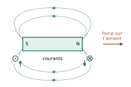
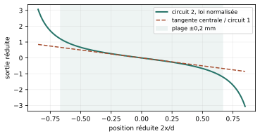
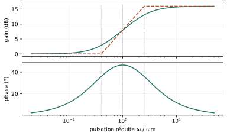
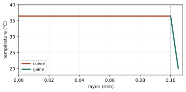

# X-ENS · PSI · Modélisation 2012 — corrigé guidé

*Corrigé rédigé par IA, non officiel. Signalez toute erreur.*

**Rédaction** · GPT-6.2 Astra Ultra · vitesse non renseignée · 25 novembre 2026

**Asservissement d’un actionneur magnétique bistable.** Le cahier CX2612 confronte une loi d’effort mesurée à un modèle dipolaire, stabilise la position médiane puis étudie l’échauffement du bobinage. Les tensions sont orientées selon les figures 5 et 6. Les gains de capteur utilisés pour le réglage sont exprimés en valeur absolue.

## Repères

Pour les capteurs, distinguer l’amplitude positive de la composante continue signée. Pour la boucle, commencer par localiser les pôles du mobile seul. Dans la dernière partie, appliquer séparément la condition à l’interface et celle à la surface extérieure.

## I. Maquette, mesure de position et matériau

### Question 1 · Intérêt de la commande magnétique

**Indication.** Séparer ce qui se déplace de ce qui fournit l’énergie.

#### Solution

L’aimant mobile ne porte ni câble d’alimentation ni train d’engrenages. Un courant dans des conducteurs fixes règle l’effort à distance, change son sens et se module rapidement. La faible masse permet de petites courses rapides. Les deux positions extrêmes sont maintenues sans courant. Une position intermédiaire exige en revanche une mesure et une régulation.

### Question 2 · Trois équilibres sans courant

**Indication.** Comparer les entrefers après une petite perturbation vers la droite.

#### Solution

Les pôles en regard s’attirent. Au centre, les attractions opposées ont même norme. Une petite translation vers la droite diminue l’entrefer droit et augmente l’attraction de ce côté. L’écart s’amplifie. Le centre est **instable**. Aux deux contacts $x=\pm d/2$, la réaction du support équilibre l’attraction. Un léger décollement est suivi d’un retour. Ce sont les deux positions stables, au sens d’un contact unilatéral.

### Question 3 · Champ et réaction sur l’aimant

**Indication.** Appliquer la force de Laplace au conducteur avant de passer à l’aimant.

#### Solution

À l’extérieur, les lignes sortent du pôle N à droite et entrent au pôle S à gauche. Sous le pôle S, le champ est orienté vers le haut, sous N il est orienté vers le bas. À gauche le courant sort du plan, à droite il y entre. Dans les deux cas la composante selon $x$ de $i\,d\boldsymbol\ell\times\mathbf B$ est négative pour le fil. Par action réciproque, l’aimant est poussé **vers la droite**. Une inversion des courants renverse ce déplacement initial.

### Question 4 · Capacités à l’équilibre médian

**Indication.** Appliquer Gauss aux deux faces, puis relier tension et distance.

#### Solution

Entre les faces, $E_{\rm el}=\sigma/\varepsilon_0$, $Q=\sigma bh$ et $U=E_{\rm el}d_i$. Ainsi $C_i=\varepsilon_0 bh/d_i$, en négligeant les effets de bord. Le coefficient en $\mathrm{F\,m^{-1}}$ est la **permittivité**. Pour $d_i=0,30$ mm et $bh=36$ mm², $C_1=C_2\simeq1,08\times10^{-12}$ F, soit environ un picofarad.

### Question 5 · Pont différentiel et multiplication

**Indication.** Le diviseur formé de deux capacités en série délivre la tension aux bornes de la capacité inférieure.

#### Solution

Le milieu du pont capacitif est au potentiel $eC_1/(C_1+C_2)$ et celui des deux résistances au potentiel $e/2$. Le sommateur soustrait le second au premier, puis le multiplieur multiplie par $e/15$. Comme $d_1=d/2+x$ et $d_2=d/2-x$, on obtient

$$
U_1(t)=\frac{e^2(t)}{15}\left(\frac{C_1}{C_1+C_2}-\frac12\right)=-\frac{x}{15d}\,e^2(t).
$$

La parenthèse est sans dimension. Le gain du multiplieur assure la conversion du produit en tension.

### Question 6 · Raies avant filtrage

**Indication.** Développer le carré du cosinus en conservant la composante moyenne.

#### Solution

Pour $e=E\cos\omega t$, $U_1=-xE^2(1+\cos2\omega t)/(30d)$. Le continu vaut $-xE^2/(30d)$ et la sinusoïde à $2\omega$ a pour amplitude $|x|E^2/(30d)$. En spectre bilatéral complexe les deux coefficients à $\pm2\omega$ valent chacun $-xE^2/(60d)$. Il n’y a pas de raie à $\omega$.

### Question 7 · Filtre de lecture du déplacement

**Indication.** La composante à conserver est celle de pulsation nulle.

#### Solution

Un passe-bas RC, résistance en série et condensateur à la masse avec sortie à ses bornes, a $H_f(p)=1/(1+RCp)$. La pulsation imposée est $\omega_f=2\omega/2=2\times10^6$ rad/s. Avec $R=500\,\Omega$, $C=1,0$ nF. La **valeur moyenne** de la sortie est proportionnelle à $x$. Le filtre du premier ordre conserve une ondulation à $2\omega$ dont l’amplitude vaut $1/\sqrt5$ de celle d’entrée à cette pulsation.

### Question 8 · Deux courants au nœud de sommation

**Indication.** Les deux tensions d’excitation sont opposées et l’entrée inverseuse est à la masse virtuelle.

#### Solution

Le courant dans $R_1$ est nul. La loi des nœuds donne $U_2(t)=-R_2(C_1-C_2)\dot e(t)=R_2\omega E(C_1-C_2)\sin\omega t$. L’amplitude positive est

$$
U_2=R_2\omega E|C_1-C_2|=\frac{8R_2\omega E\varepsilon_0bh\,|x|}{d^2-4x^2}.
$$

Le signe de $x$ se retrouve dans la phase de la tension, même si l’amplitude est donnée positive.

### Question 9 · Détection synchrone

**Indication.** La référence déphasée de moins un quart de période est en sinus.

#### Solution

C’est une détection synchrone ou démodulation cohérente. Le produit par $E\sin(\omega t)/15$ contient du continu et une composante à $2\omega$. La moyenne après filtrage est

$$
\overline U_{S2}=\frac{R_2\omega E^2}{30}(C_1-C_2)
=-\frac{4R_2\omega E^2\varepsilon_0bh}{15}\frac{x}{d^2-4x^2}.
$$

La courbe est impaire, décroissante et plus raide près des contacts. Elle est pratiquement rectiligne seulement au voisinage du centre. Les asymptotes du modèle idéal à $\pm d/2$ ne décrivent pas le contact réel.

### Question 10 · Comparaison aux relevés

**Indication.** Lire les échelles propres à chaque oscillogramme.

#### Solution

La première trace descend, conformément au signe de Q5, mais se courbe nettement aux extrémités et présente une épaisseur et des irrégularités visibles. Le pont est sensible aux capacités parasites, comparables à une capacité de l’ordre du pF. La seconde trace retrouve la sigmoïde décroissante à tangente centrale finie, plus pentue aux extrémités. Elle est plus fine et plus sensible en volts par millimètre. Le premier circuit conserve l’avantage d’une loi idéale linéaire sur toute la course et d’une électronique plus simple.

### Question 11 · Étalonnage sur la partie centrale

**Indication.** Convertir séparément les divisions horizontales et verticales des deux dessins.

#### Solution

Pour le premier relevé, $0,6$ mm occupe environ huit divisions, soit $0,075$ mm/div. Sur quatre divisions centrées, la baisse vaut environ une division verticale, soit $0,6$ V pour $0,30$ mm. Le module de pente vaut environ $2$ V/mm. Par Q6, $E\simeq\sqrt{30\times0,6\times2}=6$ V. Sur le second graphe, $0,6$ mm occupe six divisions. Entre $-0,2$ et $+0,2$ mm la baisse est d’environ deux divisions, soit $3,4$ V. Le gain moyen en module est donc proche de $8,5$ V/mm. La pente est négative avec le branchement dessiné. Le schéma d’asservissement utilisera sa valeur positive avec la polarité de retour choisie.
La pente théorique en valeur absolue à l’origine est $4R_2\omega E^2\varepsilon_0bh/(15d^2)\simeq8,6$ V/mm. L’accord donne le bon ordre de grandeur. La courbure visible aux limites de la plage empêche d’assimiler ce résultat à un étalonnage exact sur tout l’intervalle. Dans le modèle idéal le rapport à la tangente vaut $1/[1-(2x/d)^2]$, déjà $1,8$ à $|x|=0,2$ mm.

### Question 12 · Paramètre de maille par diffraction

**Indication.** Relier les positions des raies à l’espacement des plans indexés.

#### Solution

On relève sur un diffractogramme de poudre les angles de diffusion $2\theta$ pour un rayonnement de longueur d’onde connue $\lambda$. Pour chaque raie indexée $(hkl)$, la relation de Bragg au premier ordre donne $2d_{hkl}\sin\theta=\lambda$. Dans une maille cubique, $a=d_{hkl}\sqrt{h^2+k^2+l^2}$. Plusieurs raies indexées permettent de vérifier la cohérence et d’ajuster une valeur commune de $a$.

### Question 13 · Conservation de l’oxygène

**Indication.** Attribuer à chaque atome de fer la moitié d’une unité formule de son oxyde.

#### Solution

Un motif contient l’équivalent de $x$ unités MnO, $y$ unités ZnO et $z/2$ unités $\mathrm{Fe_2O_3}$. Le nombre total d’oxygènes vaut donc $x+y+3z/2=4$.

### Question 14 · Trois fractions massiques

**Indication.** Chaque masse d’oxyde se rapporte à une mole de motifs du solide.

#### Solution

Les masses de MnO, ZnO et $\mathrm{Fe_2O_3}$ pour une mole de motifs sont respectivement $x(M_3+M_1)$, $y(M_4+M_1)$ et $(z/2)(2M_2+3M_1)$. On a donc

$$
x(M_3+M_1)=0,152M,\qquad y(M_4+M_1)=0,142M,\qquad z(2M_2+3M_1)=1,412M.
$$

Les indices et les constantes numériques sont pris dans l’ordre imprimé du sujet.

### Question 15 · Composition moyenne de la ferrite

**Indication.** Le second membre du système a une seule composante non nulle.

#### Solution

On écrit $S(x,y,z,M)^\mathsf{T}=(4,0,0,0)^\mathsf{T}$. Il suffit de multiplier la première colonne donnée de $S^{-1}$ par 4. On trouve $x\simeq0,48$, $y\simeq0,40$, $z\simeq2,08$ et $M\simeq232$ g/mol. Les écarts résiduels en vérifiant les relations sont du niveau des arrondis de la colonne.

### Question 16 · Masse par maille puis masse mobile

**Indication.** La maille contient huit motifs et les longueurs doivent passer en mètres.

#### Solution

La densité de masse est $\rho=8M/(N_Aa^3)$. Avec $M=0,232$ kg/mol et $a=8,248\times10^{-10}$ m, $\rho\simeq5,5\times10^3$ kg/m³. L’aimant de dimensions $12\times4\times9$ mm³ occupe $4,32\times10^{-7}$ m³ et pèse environ $2,4$ g, soit $2,3$ g avec les approximations proposées. C’est la masse retenue en partie 3.

### Question 17 · Cavités du réseau d’oxygènes

**Indication.** Dans un cube CFC, les sites octaédriques d’arête sont partagés.

#### Solution

Un cube CFC contient huit sites tétraédriques internes et quatre sites octaédriques effectifs, un au centre et $12/4$ aux arêtes. Dans la maille de spinelle, composée de huit de ces cubes, il y a donc **64 sites T et 32 sites O**. Ce décompte de cavités ne suppose pas qu’elles soient toutes occupées.

### Question 18 · Répartition des ions et inversion

**Indication.** Appliquer séparément un critère électrostatique et un critère d’encombrement.

#### Solution

La coordinence est 4 en T et 6 en O. Une répartition guidée par la valence favorise les trivalents $\mathrm{Fe^{3+}}$ en O et les divalents $\mathrm{Zn^{2+}},\mathrm{Mn^{2+}}$ en T. Sur le seul critère de taille, les sites O, plus spacieux, peuvent au contraire recevoir de gros divalents, tandis que des trivalents passent en T. Dans le modèle idéal $AB_2O_4$, on écrit $(A_{1-i}B_i)_{\rm T}[A_i B_{2-i}]_{\rm O}O_4$, où $i$ est le taux d’inversion. Les deux arguments justifient le paramètre sans déterminer sa valeur numérique.

### Question 19 · Hystérésis et courants de Foucault

**Indication.** Distinguer la surface d’un cycle et les pertes électriques dans le volume.

#### Solution

Les pertes par hystérésis par unité de volume et par cycle correspondent à l’aire du cycle $B(H)$. Un matériau dur à forte rémanence conserve son aimantation et exige un champ inverse important pour la renverser. Si l’on parcourt tout le cycle, celui-ci peut être large. De petites excursions ne parcourent qu’un cycle mineur. Les pertes par courants de Foucault proviennent des courants induits dissipés par effet Joule. La forte résistivité de la ferrite les limite, ce qui est intéressant sous excitation variable.

### Question 20 · Forces expérimentales au centre

**Indication.** Comparer les ordonnées à l’origine et les pentes des deux figures.

#### Solution

À courant nul la force s’annule au milieu et croît approximativement avec $x$. Une perturbation y reçoit un effort de même signe, conformément à l’instabilité. Pour $i=1$ A la courbe a presque la même pente mais est décalée vers le haut. Au centre l’effort est désormais voisin de $0,04$ N, vers $+x$.

### Question 21 · Deux constantes d’effort

**Indication.** Lire la pente après conversion de $10^{-1}$ mm en mètres.

#### Solution

Un déplacement de $0,1$ mm procure environ $0,04$ N, soit $k_1\simeq0,04/10^{-4}=400$ N/m. Le déplacement vertical entre les deux courbes pour un écart de courant de 1 A donne $k_2\simeq0,04$ N/A. Cette loi locale explique aussi le changement de position d’équilibre à courant imposé.

## II. Interactions magnétiques et simulation

### Question 22 · Qualité de la simulation

**Indication.** Penser à la géométrie discrétisée, aux résultats et au coût.

#### Solution

Le calcul doit représenter le volume et les symétries, conserver les unités et correctement additionner des vecteurs parfois presque opposés. Il faut vérifier la convergence des efforts et couples lorsque la maille est raffinée, puis comparer ces observables à des mesures indépendantes. Temps de calcul, occupation mémoire et reproductibilité comptent également.

### Question 23 · Effet du raffinement

**Indication.** Comparer deux maillages emboîtés sur une même force totale.

#### Solution

Des éléments plus petits décrivent mieux les variations spatiales du champ et réduisent en général l’erreur d’intégration. Ils exigent davantage de mémoire et d’évaluations. Avec une somme directe de toutes les paires de deux maillages de $n$ éléments, le coût croît comme $n^2$. Le gain doit se juger sur la convergence de la grandeur demandée.

### Question 24 · Mémoire minimale

**Indication.** Convertir d’abord chaque enregistrement en octets.

#### Solution

Quatre nombres de 64 bits occupent $4\times8=32$ octets. Pour $13\,440$ éléments, le minimum est $430\,080$ octets, soit **420 Ko** suivant la convention $1$ Ko $=1024$ octets du sujet. Les structures de maillage et les résultats temporaires s’y ajouteraient.

### Question 25 · Champ et actions d’un dipôle

**Indication.** Différencier l’énergie par rapport à la position en gardant le moment fixé.

#### Solution

Le moment magnétique s’exprime en A·m², donc l’aimantation $\mathbf M=d\mathbf m/dV$ en A/m. Au point d’observation, $\mathbf n$ étant dirigé de la source vers ce point,

$$
\mathbf B=\frac{\mu_0}{4\pi r^3}\big[3(\mathbf m\cdot\mathbf n)\mathbf n-\mathbf m\big].
$$

Dans un champ extérieur, $U_p=-\mathbf m\cdot\mathbf B_{\rm ext}$, $\mathbf F=\nabla(\mathbf m\cdot\mathbf B_{\rm ext})$ et le couple au centre vaut $\boldsymbol\Gamma=\mathbf m\times\mathbf B_{\rm ext}$. L’approximation demande $r\gg R$ et un champ extérieur assez peu variable à l’échelle du dipôle.

### Question 26 · Énergie de deux dipôles

**Indication.** Prendre le champ du dipôle fixe au centre du dipôle mobile.

#### Solution

Soient $\mathbf r=\overrightarrow{O_2O_1}$, $r=\|\mathbf r\|$ et $\mathbf n=\mathbf r/r$. En posant $A=\mathbf m_1\cdot\mathbf m_2$ et $u_i=\mathbf m_i\cdot\mathbf n$, on obtient $U=-\mathbf m_1\cdot\mathbf B_2=\mu_0(A-3u_1u_2)/(4\pi r^3)$. L’échange des indices laisse cette énergie inchangée.

### Question 27 · Force issue du gradient

**Indication.** Le vecteur unitaire radial varie lui aussi quand on déplace le point d’observation.

#### Solution

Posons $b_i=\mathbf m_i\cdot\mathbf r$ et $c=\mu_0/(4\pi)$. L’énergie est $c(Ar^{-3}-3b_1b_2r^{-5})$. On utilise $\nabla b_i=\mathbf m_i$ et $\nabla r^{-q}=-q r^{-q-1}\mathbf n$. Après changement de signe et substitution $b_i=ru_i$,

$$
\mathbf F_1=\frac{3c}{r^4}\big[(A-5u_1u_2)\mathbf n+u_1\mathbf m_2+u_2\mathbf m_1\big].
$$

Ainsi $K=3\mu_0/(4\pi)$ pour $\mathbf n$ dirigé de $O_2$ vers $O_1$. Deux dipôles parallèles alignés avec $\mathbf n$ donnent une force attractive, ce qui contrôle le signe.

### Question 28 · Interaction avec un élément de fil

**Indication.** Calculer d’abord la force sur le fil dans le champ du dipôle.

#### Solution

Pour $\mathbf n=\overrightarrow{O_1P}/r$, le champ du dipôle au fil est $\mu_0[3(\mathbf m_1\cdot\mathbf n)\mathbf n-\mathbf m_1]/(4\pi r^3)$. La loi de Laplace puis la convention d’action réciproque demandée donnent

$$
d\mathbf F_1=-\frac{\mu_0 I}{4\pi r^3}\,d\boldsymbol\ell\times\big[3(\mathbf m_1\cdot\mathbf n)\mathbf n-\mathbf m_1\big].
$$

La somme se fait sur le circuit parcouru par le courant. La force mécanique résultante a le signe opposé à celle reçue par ce circuit.

### Question 29 · Somme des interactions

**Indication.** Garder le même point de réduction pour tous les moments.

#### Solution

Avec les aimantations et les courants prescrits, les champs se superposent. L’effort sur un élément est linéaire en champ extérieur. On additionne les contributions des sources extérieures pour chaque élément mobile, puis on somme les efforts et les moments ramenés au même point. Le raffinement transforme cette somme en intégrale. Les interactions internes ne participent pas au torseur résultant du solide entier.

### Question 30 · Comparaison calcul–mesure

**Indication.** Comparer deux cas de courant et l’ensemble de la course mesurée.

#### Solution

Sur la figure 12, le calcul retrouve la pente et le passage près de zéro pour $i=0$, puis la translation vers $+0,04$ N pour $i=1$ A. Les deux tracés presque superposés laissent de petites différences, en particulier du côté des $x$ positifs sous courant. Le modèle reproduit donc les efforts sur la plage essayée. Deux courbes longitudinales ne suffisent pas à valider toutes les configurations.

### Question 31 · Stabilité de deux degrés de liberté parasites

**Indication.** Un effort de rappel a un signe opposé à la petite coordonnée perturbée.

#### Solution

Au voisinage de $y=0$, la courbe $F_y(y)$ traverse zéro avec une pente négative. La force ramène vers le plan médian. De même, près de $\theta_z=0$, le couple est négatif pour une petite rotation positive et réciproquement. Les deux équilibres sont localement stables au sens du rappel. Cela justifie de privilégier $x$ pour une sollicitation centrée et de faibles perturbations. En l’absence d’amortissement spécifié, le rappel ne prouve pas une convergence asymptotique.

## III. Asservissement de position

### Question 32 · Pôle instable du système libre

**Indication.** La raideur magnétique change de côté lorsqu’on regroupe les termes en déplacement.

#### Solution

Pour des conditions initiales nulles, $(mp^2-k_1)X=k_2I$. Ainsi $H(p)=k_2/(mp^2-k_1)$. Ses pôles sont $p=\pm\sqrt{k_1/m}$, dont l’un est réel positif. L’équilibre médian en boucle ouverte est instable.

### Question 33 · Correcteur analogique

**Indication.** Écrire les deux courants d’entrée du premier inverseur, puis le courant de retour du second.

#### Solution

Au premier nœud virtuel l’admittance d’entrée vaut $Y=1/R_1+Cp/(1+R_2Cp)$. La première tension de sortie est $v_1=-R_3YU_e$. Au second nœud, la résistance d’entrée et celle de retour valent $R_4$. Avec la flèche du courant de retour dessinée, $I=-v_1/R_4$. On obtient

$$
C(p)=\frac{R_3}{R_1R_4}\frac{1+(R_1+R_2)Cp}{1+R_2Cp}.
$$

C’est une avance de phase. Les constantes sont $k_C=R_3/(R_1R_4)$ en A/V, $T_1=(R_1+R_2)C$ et $T_2=R_2C$, avec $T_1>T_2$.

### Question 34 · Dénominateur en boucle fermée

**Indication.** Former $1+GCH$ avant de normaliser le terme constant.

#### Solution

Posons $K=Gk_C k_2/k_1$ et $T^2=m/k_1$. Le dénominateur avant normalisation, après division par $k_1$, est

$$
(T^2p^2-1)(1+T_2p)+K(1+T_1p)
=(K-1)+(KT_1-T_2)p+T^2p^2+T^2T_2p^3.
$$

Pour $K\ne1$, on trouve $a_1=(KT_1-T_2)/(K-1)$, $a_2=T^2/(K-1)$ et $a_3=T^2T_2/(K-1)$. Si $K=1$ le terme constant s’annule et le système a un pôle en zéro au lieu de cette normalisation.

### Question 35 · Polynôme de Butterworth du troisième ordre

**Indication.** Associer les deux racines conjuguées pour retrouver des coefficients réels.

#### Solution

Les trois pôles ont pour arguments $2\pi/3,\pi,4\pi/3$ et pour module $\omega_c$. Tous ont une partie réelle strictement négative. Pour $s=p/\omega_c$, le produit devient $(s+1)(s^2+s+1)=1+2s+2s^2+s^3$. La stabilité suit directement de la position des trois pôles.

### Question 36 · Premier réglage face aux spécifications

**Indication.** La marge se mesure au gain zéro et le temps à 5 % au dernier passage dans la bande.

#### Solution

La figure 17 donne environ $-150^\circ$ à 0 dB, soit une marge proche de $30^\circ$, inférieure aux $45^\circ$ exigés. La réponse finale vaut environ $1,56\times10^{-4}$ m et le premier maximum environ $2,1\times10^{-4}$ m. La trace est dans sa bande à 5 % avant 9 ms, donc avant 10 ms. La rapidité convient, la réserve de phase est insuffisante.

### Question 37 · Gain et phase de l’avance

**Indication.** Placer le zéro avant le pôle sur l’axe logarithmique des pulsations.

#### Solution

Écrivons $\alpha=T_1/T_2>1$. Le gain en décibels est $10\log_{10}[(1+\omega^2T_1^2)/(1+\omega^2T_2^2)]$. Ses asymptotes sont 0 dB jusqu’à $1/T_1$, puis une pente de $+20$ dB par décade jusqu’à $1/T_2$, enfin un palier $20\log_{10}\alpha$. La phase est $\arctan(\omega T_1)-\arctan(\omega T_2)$. Elle est nulle aux deux limites. Son maximum est atteint à $\omega_m=1/\sqrt{T_1T_2}$, avec $\sin\varphi_m=(\alpha-1)/(\alpha+1)$. Le gain exact y vaut $\sqrt\alpha$.

### Question 38 · Choix des trois paramètres

**Indication.** Fixer d’abord la phase au croisement, puis le gain de boucle à ce même point.

#### Solution

$H(j\omega)G=-Gk_2/(k_1+m\omega^2)$ est réel négatif. Il faut apporter $45^\circ$ à $\omega_c$. En plaçant le maximum de phase à la pulsation choisie, $\alpha=(1+\sin45^\circ)/(1-\sin45^\circ)$, $T_1=\sqrt\alpha/\omega_c$ et $T_2=1/(\omega_c\sqrt\alpha)$. On lit $|GH(j\omega_c)|$ sur la figure 18 ou on le calcule. On règle alors $k_C=1/(\sqrt\alpha\,|GH(j\omega_c)|)$, ce qui ramène le gain de boucle exactement à 0 dB. Pour dépasser strictement $45^\circ$, on remplace la valeur cible par une valeur légèrement supérieure.

### Question 39 · Deuxième réglage et condition stricte

**Indication.** Distinguer la marge nominale du sens de l’inégalité imprimée au cahier des charges.

#### Solution

La figure 19 se stabilise vers $1,78\times10^{-4}$ m, avec un premier maximum proche de $1,85\times10^{-4}$ m, dans la bande de 5 %. L’entrée définitive dans cette bande se situe vers $2$ à $2,5$ ms. La rapidité est respectée. Le réglage nominal demandé en Q38 donne exactement $45^\circ$, au seuil. Pris à la lettre, le tableau exige $>45^\circ$ et il manque donc une petite réserve pour l’affirmer satisfait.

### Question 40 · Correcteur choisi sur le diagramme mesuré

**Indication.** Utiliser les deux paliers pour estimer le rapport des constantes de temps.

#### Solution

Les paliers de la figure 20 sont proches de 10 et 26 dB. On a $k_C\simeq3,16$ et $\alpha\simeq10^{16/20}=6,3$. Le gain à la pulsation médiane, vers $10^3$ rad/s, vaut environ 18 dB, compensant l’atténuation de $GH$ à cette fréquence. La phase y atteint environ $46$ à $47^\circ$. On attend donc l’allure de la figure 19 et un temps de réponse de quelques millisecondes. Les valeurs lues sont compatibles avec les deux exigences, avec une faible réserve au-dessus de $45^\circ$.

## IV. Électricité, diffusion thermique et décollage

### Question 41 · Résistance d’un demi-bobinage

**Indication.** La longueur développée est le nombre de tours multiplié par leur circonférence moyenne.

#### Solution

La loi d’Ohm locale est $\mathbf j=\sigma_{\rm Cu}\mathbf E$. Avec $\ell=N\pi D$ et $S=\pi R_i^2$, on trouve $R_B=\ell/(\sigma_{\rm Cu}S)=ND/(\sigma_{\rm Cu}R_i^2)$. Les données donnent $60\times0,009/(6\times10^7\times10^{-8})=0,90\,\Omega$.

### Question 42 · Tolérance de résistance

**Indication.** Le rayon entre au carré et au dénominateur.

#### Solution

Au premier ordre $dR_B/R_B=dD/D-2dR_i/R_i$. La borne relative au pire cas vaut $0,2\,\%+2(0,4\,\%)=1,0\,\%$, soit environ $\pm0,009\,\Omega$. Une combinaison quadratique demanderait une hypothèse statistique sur les incertitudes, absente ici.

### Question 43 · Inductance du solénoïde idéal

**Indication.** Additionner le flux lié aux $N$ spires et utiliser le diamètre extérieur du fil pour le pas.

#### Solution

Le champ intérieur est $\mu_0Ni/e$ et la section magnétique $\pi D^2/4$. Le flux lié vaut $N$ fois le flux d’une spire, d’où $L_B=\mu_0N^2\pi D^2/(4e)$. Les spires jointives donnent $e=2NR_e$, donc $L_B=\mu_0N\pi D^2/(8R_e)\simeq23\,\mu$H, de l’ordre de $25\,\mu$H avec l’approximation numérique du cahier. Les effets d’extrémité sont écartés par l’hypothèse du solénoïde infini.

### Question 44 · Temps électrique

**Indication.** Un circuit série RL a une constante de temps et non une fréquence propre.

#### Solution

$\tau_{\rm el}=L_B/R_B\simeq23\,\mu\mathrm H/(0,90\,\Omega)\simeq25\,\mu\mathrm s$, soit quelques $10^{-5}$ s. Une marche de tension approche le régime permanent en quelques constantes de temps.

### Question 45 · Diffusion radiale et échelles de temps

**Indication.** Pour la gaine, prendre son épaisseur et non le rayon total du fil.

#### Solution

$D_{\rm th}=\lambda/(\rho C)$ s’exprime en m²/s et $\tau\sim\delta^2/D_{\rm th}$. Dans le cuivre, $D_{\rm Cu}\simeq1,2\times10^{-4}$ m²/s et $\delta=10^{-4}$ m, d’où $\tau_{\rm Cu}\sim8,5\times10^{-5}$ s. Dans la gaine $D_P\simeq4,3\times10^{-7}$ m²/s, mais $\delta=5\times10^{-6}$ m seulement, d’où $\tau_P\sim6\times10^{-5}$ s. Les deux temps thermiques sont du même ordre et un peu plus longs que le temps électrique. Pour un palier de courant long devant ces transitoires, l’hypothèse d’un courant constant convient. Elle est moins bien justifiée aux tout premiers instants d’une marche.

### Question 46 · Bilan sur une couronne cylindrique

**Indication.** Comparer le flux sortant net à la source volumique de chaleur.

#### Solution

Par Fourier, le débit thermique traversant le cylindre de rayon $r$ vers l’extérieur est $\Phi(r)=-2\pi rH\lambda_{\rm Cu}T'(r)$. La puissance Joule de la couronne vaut $q_v\,2\pi rH\,dr$ avec $q_v=i^2/(\sigma_{\rm Cu}\pi^2R_i^4)$. En régime permanent $\Phi(r+dr)-\Phi(r)=q_v\,2\pi rH\,dr$. On en déduit

$$
\frac{d}{dr}\big(rT'(r)\big)+\frac{r\,i^2}{\pi^2\lambda_{\rm Cu}R_i^4\sigma_{\rm Cu}}=0 .
$$

### Question 47 · Profil dans le cuivre et maximum

**Indication.** Écarter le terme logarithmique qui divergerait sur l’axe.

#### Solution

L’intégration donne $rT'=-q_vr^2/(2\lambda_{\rm Cu})$, la constante étant nulle par régularité. La condition $T(R_i)=T_{\rm int}$ donne

$$
T(r)=T_{\rm int}+\frac{q_v}{4\lambda_{\rm Cu}}(R_i^2-r^2).
$$

Toute la chaleur s’évacue vers la périphérie. L’axe présente donc la température la plus élevée. Pour $i=10$ A, $T_{\max}-T_{\rm int}=i^2/(4\pi^2\lambda_{\rm Cu}\sigma_{\rm Cu}R_i^2)\simeq0,011$ K. Le cuivre est pratiquement isotherme en section.

### Question 48 · Profil dans la gaine

**Indication.** L’isolant électrique ne produit pas de chaleur volumique.

#### Solution

Dans la gaine $(rT')'=0$, donc $T=A\ln r+B$. Avec les deux températures imposées, on trouve

$$
T(r)=T_{\rm ext}+(T_{\rm int}-T_{\rm ext})\frac{\ln(R_e/r)}{\ln(R_e/R_i)},\qquad R_i\le r\le R_e .
$$

La température décroît de $T_{\rm int}$ à $20\,^\circ$C si le cuivre chauffe.

### Question 49 · Limite thermique du modèle permanent

**Indication.** Égaler à l’interface les densités de flux du cuivre et de la gaine.

#### Solution

À $R_i$, $\lambda_P(T_{\rm int}-T_{\rm ext})/[R_i\ln(R_e/R_i)]=q_v R_i/2$. Le cuivre est presque à $T_{\rm int}$, mais son seuil de fusion est d’environ $1000\,^\circ$C contre $100\,^\circ$C dans la gaine. Le premier seuil atteint est donc celui du polymère à sa face intérieure. La condition $T_{\rm int}=100\,^\circ$C donne

$$
i_{\rm lim}^2=\frac{2\pi^2\sigma_{\rm Cu}R_i^2\lambda_P(100-20)}{\ln(R_e/R_i)},\qquad i_{\rm lim}\simeq22\ {\rm A}.
$$

Les 10 A de l’énoncé sont inférieurs à ce seuil calculé pour une surface extérieure maintenue à $20\,^\circ$C. La température d’interface prévue à 10 A est voisine de $36,5\,^\circ$C.

### Question 50 · Travail de séparation initial

**Indication.** Multiplier la densité d’énergie du champ dans l’air par le volume d’entrefer créé.

#### Solution

Pour un champ local supposé constant, la valeur du travail est $W=(B^2/2\mu_0)bh\,\varepsilon$. Par identification à $F\varepsilon$, la force de contact en norme est $F=B^2bh/(2\mu_0)$. Avec $0,8$ T et $36$ mm², cela donne environ $9,2$ N, dirigés vers le contact pour la force attractive.

### Question 51 · Ordre de grandeur du courant au décollement

**Indication.** Modéliser la partie active d’une spire et distinguer borne idéale et estimation.

#### Solution

La translation utile résulte de la projection de la force de Laplace. Pour le demi-bobinage proche seul, écrivons $F_x\simeq NBi\ell_{\rm eff}$, où $\ell_{\rm eff}$ est une longueur de fil par spire pondérée par le champ local et sa projection axiale rapportés à $B$. En attribuant idéalement toute la circonférence au champ nominal et à une projection favorable, $\ell_{\rm eff}=\pi D$ donne une borne basse d’environ $9,2/(60\times0,8\times\pi\times0,009)=6,8$ A. Une fraction de tour seulement est proche de la zone active. Si l’on prend une demi-circonférence efficace, l’estimation monte à environ 14 A. Le cahier ne donne pas le champ sur le tour entier. La conclusion justifiée est **un courant de l’ordre de la dizaine d’ampères**. La constante $k_2$ mesurée près du centre ne s’extrapole pas au contact.

### Question 52 · Énergie d’amorçage et refroidissement

**Indication.** Calculer l’intégrale temporelle de la puissance de Joule sur l’impulsion donnée.

#### Solution

Les 12 A indiqués sont du même ordre que l’estimation précédente. Avec la force de Q50 ils correspondent à $\ell_{\rm eff}=9,2/(60\times0,8\times12)\simeq16$ mm par tour, valeur située entre le demi-périmètre et le périmètre de la spire. Pour le demi-bobinage de résistance voisine de $1\,\Omega$, $E_J=R_B i^2\Delta t\le1\times12^2\times0,050=7,2$ J. Il faut tenir compte du retour en température entre impulsions et limiter leur répétition. La conduction radiale à travers le fil et l’évacuation de la chaleur de l’ensemble du bobinage vers l’extérieur sont deux phénomènes distincts. Le temps de refroidissement global n’est pas fourni.
