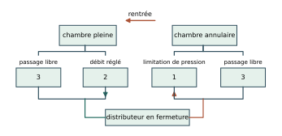
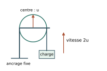
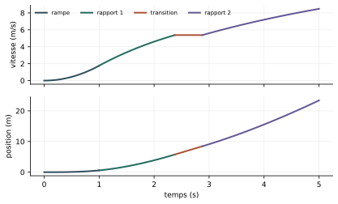
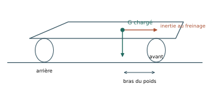
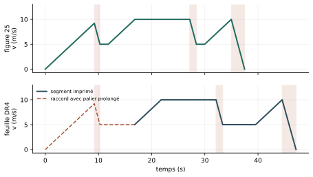

# X-ENS · PSI · Sciences industrielles 2012 — corrigé guidé

*Corrigé rédigé par IA, non officiel. Signalez toute erreur.*

**Rédaction** · GPT-6.2 Astra Ultra · vitesse non renseignée · 25 novembre 2026

**Révision** · GPT-6.2 Astra Ultra · vitesse non renseignée · 26 novembre 2026

**Chariot élévateur à bateaux.** Les 40 questions conservent leur numérotation dans le cahier CX2614. La figure 25 et la dernière feuille-réponse donnent des temps de parcours incompatibles. Les deux lectures sont détaillées aux questions III.8 à III.11.

## Repères

Sur les fourches, commencer par les deux chaînes fermées. Au changement de rapport, raccorder les vitesses du véhicule et les positions. Au freinage, choisir pour le bilan de moment la ligne de contact qui reste porteuse.

## I. Fourches, levage et inclinaison

### Question I.1 · Les deux fermetures de chaîne

**Indication.** Suivre d’abord le triangle du vérin, puis le quadrilatère des fourches.

#### Solution

Dans le plan transversal, les fermetures sont $\overrightarrow{BA}=\overrightarrow{BC}+\overrightarrow{CA}$ et $\overrightarrow{FE}+\overrightarrow{ED}=\overrightarrow{FC}+\overrightarrow{CD}$. Avec les repères de l’annexe 3, elles s’écrivent

$$
\mu\mathbf z_{10,11}=-g\mathbf y_8+h\mathbf z_8+i\mathbf y_6-j\mathbf z_6,\qquad
-a\mathbf y_7-b\mathbf z_7+f\mathbf z_9=-e\mathbf y_6+c\mathbf y_8+d\mathbf z_8 .
$$

Elles portent sur cinq inconnues scalaires et donnent quatre équations indépendantes en configuration régulière. En imposant la course, les quatre angles sont fixés localement sur la branche d’assemblage. Les rotations internes autour des axes longitudinaux des biellettes ne commandent pas l’ouverture.

### Question I.2 · Longueur de la barre de renvoi

**Indication.** À l’instant initial les bases des deux fourches coïncident avec celle du tablier.

#### Solution

À $\theta_1=\theta_2=0$, $\overrightarrow{ED}=\overrightarrow{FC}+\overrightarrow{CD}-\overrightarrow{FE}=(a+c-e)\mathbf y_6+(b+d)\mathbf z_6$. La longueur recherchée est $f=\sqrt{(a+c-e)^2+(b+d)^2}$. La valeur de $\mu(0)$ intervient dans l’autre fermeture.

### Question I.3 · Course utile à l’ouverture

**Indication.** Arrêter la lecture au passage de la fourche droite à 30°.

#### Solution

Dans l’annexe 4, $\theta_1=30^\circ$ vers $3,1$ s. La longueur du vérin passe alors de $0,777$ m à environ $1,08$–$1,09$ m. La course utile vaut environ $0,31$ m. Le temps maximal de 5 s est respecté. La fin à 4 s du tracé sort du domaine prévu par C108.

### Question I.4 · Écart de symétrie des fourches

**Indication.** Les deux rotations ont des valeurs algébriques opposées.

#### Solution

Une ouverture symétrique imposerait $\theta_2=-\theta_1$. À $30^\circ$ à droite, l’annexe donne environ $-25^\circ$ à gauche. L’écart atteint ainsi environ $5^\circ$, soit près de $17\,\%$ de la course angulaire nominale. Le critère strict C110 échoue. Une tolérance de cet ordre peut s’argumenter par le déplacement latéral disponible pour recentrer le tablier avant la prise, sous réserve d’une largeur suffisante et d’un appui correct des deux côtés.

### Question I.5 · Détermination de l’action du vérin

**Indication.** Choisir les axes de moment pour éliminer les réactions de pivot.

#### Solution

T9, de masse négligeable, est soumis aux efforts des deux articulations. Ses efforts sont opposés et dirigés suivant $ED$. De même, l’ensemble T10–T11 transmet une force suivant $AB$. Isoler T7 et écrire le moment statique sur l’axe du pivot en F. Le poids et sa géométrie sont connus, la réaction de pivot est éliminée et le module de l’effort en E est déterminé. Le transmettre en D par T9. Isoler ensuite T8 et écrire le moment sur l’axe du pivot en C. Le poids et l’effort en D y sont connus. Il reste le module de l’effort en B suivant $AB$. Le moment de l’action du vérin en B est nul dans le modèle articulé.

En écrivant le bilan en $C$, la contribution de la force du vérin est bien $(\overrightarrow{CB}\times\mathbf F_B)\cdot\mathbf x_6$. C’est le moment propre au point $B$ de cette liaison articulée qui est nul. Le calcul de $F_B$ exige un bras de levier non nul autour de l’axe passant par $C$.

### Question I.6 · Effort de dimensionnement

**Indication.** Chercher le maximum uniquement dans l’intervalle de course utile.

#### Solution

Entre $c_{\rm vérin}=0$ et environ $0,31$ m, la figure 7 donne un effort maximal voisin de **7,2 kN**. C’est la valeur à retenir du tracé pour la phase d’ouverture étudiée.

### Question I.7 · Vitesse angulaire de la fourche droite

**Indication.** Éliminer l’orientation du vérin en prenant le carré de sa longueur.

#### Solution

Posons $u=i-g\cos\theta_1-h\sin\theta_1$ et $v=-j-g\sin\theta_1+h\cos\theta_1$. La première fermeture donne $\mu^2=u^2+v^2$. Sa dérivation conduit à

$$
\dot\theta_1=\frac{\mu\dot\mu}{u(g\sin\theta_1-h\cos\theta_1)+v(-g\cos\theta_1-h\sin\theta_1)} .
$$

Le signe de $\dot\mu$ est négatif lors de la rentrée. La formule suppose un mécanisme hors de la position singulière pour laquelle le dénominateur s’annule.

### Question I.8 · DR1, circulation en fermeture

**Indication.** Le volume côté tige augmente pendant la rentrée de la tige.

#### Solution

La tige rentre vers la gauche sur DR1. L’huile sous pression emprunte la branche droite du distributeur et remonte à la chambre annulaire. La chambre pleine se vide par la branche gauche vers le retour. Sur les quatre cases pointillées, de gauche à droite, inscrire **3, 2, 1, 3**. Le régulateur dose le débit sortant de la chambre pleine. Le limiteur dérive vers le réservoir dès que la pression du côté alimenté atteint sa consigne. Les clapets sélectionnent la branche utile selon le sens du mouvement.

### Question I.9 · Consigne de débit compatible avec les deux critères

**Indication.** La durée de fermeture peut se calculer avec la course de tige, même si la vitesse angulaire varie.

#### Solution

La course de $0,31$ m en 5 s impose une vitesse de tige moyenne d’au moins environ $0,062$ m/s. La courbe la plus lente, $0,05$ m/s, ne convient donc pas. Les courbes de $0,15$ et $0,20$ m/s dépassent la limite angulaire de $0,2$ rad/s sur une partie du trajet. Celle de **0,10 m/s** respecte les deux conditions. Sur la chambre de section indiquée, $Q=S_{\rm vérin}|\dot\mu|=1,3\times10^{-4}$ m³/s, soit $0,13$ L/s ou $7,8$ L/min.

### Question I.10 · Accélération du bateau au levage

**Indication.** Le brin ancré est immobile, tandis que la vitesse du brin chargé est le double de celle du centre de la poulie.

#### Solution

Soit $u$ la vitesse ascendante du mât T4 et de la tige. Sans glissement sur la poulie, le bateau et S montent à $2u$, tandis que $|\omega_{12}|=u/R_{12}$. L’énergie cinétique est $\tfrac12[m_{T4}+4(m_S+m_B)+I_{12}/R_{12}^2]u^2$. La puissance des actions extérieures, en incluant le travail du vérin au sein du mécanisme mobile, vaut $[F_V-m_{T4}g-2(m_S+m_B)g]u$. Les liaisons idéales ne dissipent pas d’énergie. On obtient

$$
a_B=\frac{2[F_V-(m_{T4}+2m_S+2m_B)g]}{m_{T4}+4(m_S+m_B)+I_{12}/R_{12}^2}.
$$

Le temps de mise en vitesse à charge est $0,33/a_B$ pour une accélération constante positive. Il doit être au plus égal à $0,4$ s, soit $a_B\ge0,825$ m/s².

### Question I.11 · Consigne à vitesse constante

**Indication.** Distinguer l’angle de la route et l’angle absolu des fourches.

#### Solution

Sans décélération, les fourches doivent être horizontales et leur normale verticale. Il faut $\varphi=\alpha+\delta=0$, donc demander au mécanisme de compenser la pente avec $\alpha=-\delta$.

### Question I.12 · Équation mécanique de basculement

**Indication.** Le vérin fournit la puissance $Sp\dot\lambda$, avec $\dot\lambda=\dot\alpha/k$.

#### Solution

L’ensemble S2 tourne autour du pivot fixe d’axe $(O_1,\mathbf y_1)$. Selon la définition explicite de la page 12, $J_{S2}$ est déjà le moment autour de cet axe. Ainsi $E_c=\tfrac12J_{S2}\dot\alpha^2$ et $J_{\rm eq}=J_{S2}$. Si l’on part d’un moment central $J_{G,y}$, le même résultat s’écrit $J_{G,y}+m_{S2}(x_G^2+z_G^2)$. La liaison du vérin est de masse négligeable. Le frottement dissipe $\mu\dot\alpha^2$ et le poids apporte un couple proche de $m_{S2}gx_G$ autour de la position horizontale de référence. Dans l’approximation de couple de pesanteur constant retenue par le sujet,

$$
J_{\rm eq}\ddot\alpha+\mu\dot\alpha=Sp/k+m_{S2}gx_G .
$$

Plus précisément, le bras de levier horizontal est $x_G\cos\varphi+z_G\sin\varphi$ avec les axes dessinés. Retenir sa valeur de référence néglige aussi sa petite variation.

### Question I.13 · Blocs du modèle du vérin

**Indication.** Former d’une part la pression à partir du bilan de débit, d’autre part l’angle à partir du bilan des couples.

#### Solution

Pour des conditions initiales nulles, le débit compressible vérifie $P=(2B/V_0p)[Q-(S/k)p\alpha]$. L’équation mécanique transforme le couple résultant en angle par $1/[p(J_{\rm eq}p+\mu)]$. Dans l’ordre des cases de la figure 14,

$$
A(p)=\frac{2B}{V_0p},\quad B(p)=\frac{S}{k},\quad C(p)=\frac1{p(J_{\rm eq}p+\mu)},\quad D(p)=\frac Sk p .
$$

Le sommateur mécanique de la figure 14 porte un signe positif à l’entrée supérieure. On ajoute donc $C_{R0}=m_{S2}gx_G$, grandeur algébrique, soit $m_{S2}gx_G/p$ pour son échelon dans le domaine de Laplace. Dans un modèle de variations autour de l’équilibre ce biais disparaît.

### Question I.14 · Séparation des dynamiques

**Indication.** Comparer les pulsations auxquelles les deux organes commencent à atténuer la réponse.

#### Solution

L’annexe 6 montre que le débit de la servovalve garde presque la même amplitude et un faible retard jusqu’à environ $20$ rad/s. À $100$ puis $1000$ rad/s, son atténuation et son déphasage sont marqués. L’annexe 7 donne au vérin un comportement de premier ordre avec cassure vers $1$ rad/s. À $20$ rad/s il a déjà perdu environ 26 dB par rapport au plateau et sa phase approche $-90^\circ$. Le vérin limite donc la dynamique à basse fréquence et la servovalve y peut être assimilée à un gain.

### Question I.15 · Gain de la servovalve

**Indication.** Lire le rapport des amplitudes sur la sinusoïde la plus lente.

#### Solution

À $1$ rad/s, un courant d’amplitude $1$ A donne un débit d’amplitude voisine de $2$ sur l’échelle du graphique, avec très peu de déphasage. Le comportement reste proche sur la bande utile. Avec l’unité imprimée dans la légende de l’annexe 6, $K_{\rm serv}\simeq2\ {\rm m^3\,s^{-1}\,A^{-1}}$. Il s’agit d’une lecture de la figure, dont les unités affichées fixent le gain numérique.

### Question I.16 · Liaison équivalente entre la coque et les fourches

**Indication.** Écrire la condition de non-pénétration en deux points d’une même ligne de contact.

#### Solution

Les deux génératrices ont une direction longitudinale commune $\mathbf d$. Pour chaque contact $i$, de normale $\mathbf n_i$, on impose $\mathbf V(I_i)\cdot\mathbf n_i=0$ et $(\boldsymbol\Omega\times\mathbf d)\cdot\mathbf n_i=0$. Les normales transversales sont indépendantes, donc $\boldsymbol\Omega$ est parallèle à $\mathbf d$. Les normales passent par $O_{BT}$. Le transport de la vitesse à ce point ne change pas sa projection normale. On a alors aussi $\mathbf V(O_{BT})\parallel\mathbf d$. Le torseur cinématique comporte deux paramètres, translation et rotation selon $(O_{BT},\mathbf d)$, soit une **liaison pivot glissant**.

### Question I.17 · Inclinaison en décélération

**Indication.** La somme du poids et de la réaction doit donner l’accélération horizontale du bateau.

#### Solution

Sans mouvement relatif, le bateau accélère selon $-\Gamma_{\rm dec}\mathbf x_1$. Pour éviter une sollicitation tangentielle longitudinale des fourches, on oriente la normale $\mathbf z_{T3}$ suivant la réaction requise. Sur route horizontale, $\mathbf R_{F\to B}=m_B(-\Gamma_{\rm dec}\mathbf x_1+g\mathbf z_0)$. Avec la convention de rotation de la figure 10, $R\sin\varphi_{\rm dec}=-m_B\Gamma_{\rm dec}$ et $R\cos\varphi_{\rm dec}=m_Bg$. Ainsi $\tan\varphi_{\rm dec}=-\Gamma_{\rm dec}/g$. La normale s’incline vers l’arrière.

### Question I.18 · Linéarisation de la consigne

**Indication.** Employer les radians et développer la tangente au voisinage de zéro.

#### Solution

Pour $\Gamma_{\rm dec}/g\ll1$, $\varphi_{\rm dec}=-\arctan(\Gamma_{\rm dec}/g)\simeq-\Gamma_{\rm dec}/g$. Le gain de conversion est négatif et s’exprime en radian par m/s². L’erreur du développement commence à l’ordre trois.

### Question I.19 · Performances sans correction

**Indication.** Lire séparément régime final, bande à 5 %, dépassement et deux marges.

#### Solution

La réponse de l’annexe 8 rejoint sa consigne, conformément à l’intégrateur de boucle ouverte. La précision statique est satisfaite. Le dernier passage dans la bande à 5 % se situe vers $3,7$ s, au-delà de $0,9$ s. Il y a des dépassements. La marge de phase est voisine de $20^\circ$ et celle de gain d’environ $8$ dB, inférieures aux $35^\circ$ et 10 dB demandés. La réponse est stable mais ses réserves sont insuffisantes.

### Question I.20 · Réglage du correcteur à avance de phase

**Indication.** Au maximum de phase le correcteur augmente aussi le gain.

#### Solution

Choisir une nouvelle pulsation de croisement $\omega_m$, légèrement supérieure au croisement initial, dans la région de $10$ à $12$ rad/s à affiner sur les courbes. À cette pulsation, le système doit recevoir $\Phi_m=-180^\circ+35^\circ-\arg H_{\rm BO}(j\omega_m)$, avec une réserve si nécessaire. En déduire $a=(1+\sin\Phi_m)/(1-\sin\Phi_m)$ et $\tau=1/(\omega_m\sqrt a)$. Le gain du correcteur y vaut $\sqrt a$. Ajuster $\omega_m$ jusqu’à ce que $20\log_{10}|H_{\rm BO}(j\omega_m)|+10\log_{10}a=0$. Relire ensuite les deux marges et la réponse temporelle.

### Question I.21 · Validation après correction

**Indication.** Le diagramme de Black donne les marges, la réponse indicielle vérifie les autres critères.

#### Solution

Dans l’annexe 9 le croisement de 0 dB se produit vers $-130^\circ$, d’où environ $50^\circ$ de marge. Au passage à $-180^\circ$ le gain est voisin de $-14$ dB, soit 14 dB de marge. La réponse à l’échelon rejoint sa valeur prévue sans dépassement visible et entre dans sa bande à 5 % vers $0,7$ s. Avec l’erreur statique nulle, les quatre familles de critères sont respectées.

## II. Transmission Powershift

### Question II.1 · DR2, huit états de la boîte

**Indication.** Une voie embrayée impose un rapport. Deux voies différentes imposent des contraintes incompatibles.

#### Solution

En notant 0 un embrayage ouvert et 1 un embrayage fermé, les huit cases de DR2 sont les suivantes.

| $E_{ma}$ | $E_e=0,\ E_{ra}=0$ | $E_e=0,\ E_{ra}=1$ | $E_e=1,\ E_{ra}=1$ | $E_e=1,\ E_{ra}=0$ |
|---|---|---|---|---|
| 0 | aucune transmission | $-14/15\simeq-0,93$ | bloquée | $-13/20=-0,65$ |
| 1 | $+4/5=+0,80$ | bloquée | bloquée | bloquée |

La voie directe donne $-Z_{e2}/Z_{s2}$. Les autres voies donnent respectivement $-Z_{e1}Z_{ra2}/(Z_{ra1}Z_{s2})$ et $+Z_{e1}Z_{ma2}/(Z_{ma1}Z_{s2})$. Le pignon intermédiaire change le signe lorsqu’il ajoute un engrènement et son nombre de dents se simplifie. Les modules des deux rapports de marche étudiés sont $0,65$ et $0,933$.

### Question II.2 · Démarrage pendant le glissement

**Indication.** Le couple transmis impose l’effort de traction. La puissance de sortie de l’embrayage utilise la vitesse de son arbre de sortie.

#### Solution

Posons $M_d=13\,000$ kg à pleine charge, $D_j=R_{\rm roue}|r_{bj}r_s|$, $\tau_1=1$ s et $\omega_0=1050\pi/30$ rad/s. On néglige les résistances de roulement. Avec la fraction de puissance motrice $r_p$ réservée au déplacement, le couple disponible pour cette chaîne est $C_0=r_p C_{\rm mpe}$. Pendant la rampe $M_d\dot v=\eta_G C_0t/(D_1\tau_1)$, donc

$$
v(t)=\frac{\eta_G C_0}{2M_dD_1\tau_1}t^2,\qquad
|r_s|=\frac{1}{R_{\rm roue}|r_{b1}|}\sqrt{\frac{\eta_G C_0\tau_1}{2M_d\omega_0}} .
$$

La dernière égalité impose $v(\tau_1)=D_1\omega_0$. Avec $R_{\rm roue}=0,6096$ m et $r_p=0,75$, elle donne $|r_s|\simeq0,0405$ et $v(1)\simeq1,76$ m/s, en accord avec DR3 et la figure 22. La phrase décrivant les 1226 N·m les appelle aussi « couple transmis par l’embrayage ». Si c’était déjà le couple net dédié aux roues, on poserait $C_0=1226$ N·m, sans appliquer deux fois $r_p$, et obtiendrait $0,0467$ et $2,04$ m/s. Le graphique lève l’ambiguïté pour le tracé demandé.

### Question II.3 · Position pendant la rampe de couple

**Indication.** Intégrer la vitesse par rapport au temps et poser la position initiale nulle.

#### Solution

L’intégrale donne $s(t)=\eta_G C_0 t^3/(6M_dD_1\tau_1)=v(\tau_1)t^3/(3\tau_1^2)$. Avec la lecture précédente, $s(1)\simeq0,59$ m. La tangente initiale de la position et celle de la vitesse sont toutes deux horizontales.

### Question II.4 · Accélération sur les rapports engagés et passage de rapport

**Indication.** Changer l’origine des temps à chaque transition et raccorder vitesse et position.

#### Solution

Lorsque le rapport $j$ est verrouillé, $\omega=v/D_j$. Pour $C_{\rm moteur}=a\omega+b$ avec $a<0$, posons $A_j=\eta_Gr_pa/(M_dD_j^2)<0$, $B_j=\eta_Gr_pb/(M_dD_j)$ et $v_{\infty j}=-B_j/A_j$. À partir de $(s_i,v_i)$ et pour $u=t-t_i$,

$$
v=v_{\infty j}+(v_i-v_{\infty j})e^{A_ju},\qquad
s=s_i+v_{\infty j}u+(v_i-v_{\infty j})\frac{e^{A_ju}-1}{A_j}.
$$

En phase 2, $j=1$ et $(s_i,v_i)$ provient de la fin de la rampe. La phase 2 se termine quand $v=D_1\omega_{\rm Pmax}$. En phase 3, $v=v_i$ et $s=s_i+v_i u$ durant $0,5$ s. En phase 4 on reprend les expressions exponentielles avec $j=2$ et les valeurs obtenues en fin de phase 3. Le régime moteur change au changement de rapport, la vitesse du chariot reste continue.

### Question II.5 · DR3, attribution des branches

**Indication.** La vitesse de la phase 1 part du repos et croît d’abord avec une courbure positive.

#### Solution

Sur les deux graphes, la courbe continue fortement convexe correspond à la phase 1, quadratique pour la vitesse et cubique pour la position. La courbe en tirets passant par la fin de cette branche vers $t=1$ s correspond à la phase 2. La courbe en pointillés plus fins correspond à la phase 4. Les morceaux prolongés artificiellement hors de leurs intervalles, parfois à vitesse négative, servent seulement à distinguer les branches.

### Question II.6 · DR3, tracé recomposé

**Indication.** Lire sur la figure 22 la vitesse correspondant à 3200 tr/min sur le premier rapport.

#### Solution

Conserver le trait continu de 0 à 1 s, puis les tirets de phase 2 jusqu’à environ $t=2,4$–$2,5$ s, où $v\simeq5,4$ m/s et $\omega_{\rm moteur}\simeq3200$ tr/min. Tracer un palier de vitesse de $0,5$ s. Sur le graphe des positions, tracer en même temps une droite de pente $5,4$ m/s, donc de longueur verticale $2,7$ m. Poursuivre sur les pointillés de phase 4. Au passage sur le deuxième rapport, le régime retombe vers $2200$ tr/min. À 5 s on lit environ $8,3$–$8,5$ m/s et $23$ m.

### Question II.7 · Puissance disponible et distance en cinq secondes

**Indication.** Séparer l’objectif de distance et la validité de l’extrapolation du régime moteur.

#### Solution

La loi recomposée dépasse 15 m en 5 s. Le maximum de puissance de la figure 19 est voisin de 220 kW à 3200 tr/min, cohérent avec C205. À $8,4$ m/s, la figure 22 donne toutefois environ $3500$ tr/min en deuxième. Le dernier morceau extrapole donc la loi au-delà de la plage où le couple a été ajusté. Le critère de 15 m est déjà atteint auparavant. En plafonnant la vitesse au régime de 3200 tr/min dès son premier passage en phase 4, la distance resterait supérieure à 15 m.

### Question II.8 · Effet du modèle de couple

**Indication.** Comparer la corde joignant les deux points de réglage à la courbe plein gaz.

#### Solution

Entre 1050 et 3200 tr/min la courbe réelle présente un maximum et passe généralement au-dessus de la corde retenue. Le modèle affine peut donc sous-estimer l’accélération dans cette plage. Au-delà de 3200 tr/min, le prolongement de la droite n’est pas justifié. Une vérification plus précise intégrerait la courbe mesurée en imposant la plage de régime autorisée. Une hausse du couple, à rapport donné et à temps égal, tend à augmenter la vitesse.

## III. Stabilité et temps de cycle

### Question III.1 · Position longitudinale du contrepoids

**Indication.** Projeter la relation barycentrique sur l’axe du chariot, sans la masse du bateau.

#### Solution

Pour placer $G=O$, $m_1x_{G1}+m_Tx_{GT}+m_Cx_{GC}=0$. On obtient $x_{GC}=-(m_1x_{G1}+m_Tx_{GT})/m_C$. La cote O de la figure 23 est au tiers de l’empattement depuis l’essieu arrière. Le bateau est une charge rapportée et ne participe pas au réglage à vide.

### Question III.2 · Équations tridimensionnelles du freinage

**Indication.** Écrire les moments au point de contact avant I4, en gardant les hauteurs par rapport au sol.

#### Solution

Notons $m=M+m_B$, $x_A=2L/3$ l’abscisse des roues avant, $x_R=-L/3$ celle des roues arrière, $h$ la hauteur de O, $x_*=m_Bx_{GB}/m$ et $H_*=h+m_Bz_{GB}/m$ les coordonnées du centre chargé en abscisse et hauteur au-dessus du sol. Les quatre réactions sont $-T_i\mathbf x_1+N_i\mathbf z_1$. La résultante donne $\sum T_i=m\,\mathrm{dec}_x$ et $\sum N_i=mg$.
Le moment dynamique en $I_4$ vaut $\overrightarrow{I_4G_*}\times(-m\,\mathrm{dec}_x\mathbf x_1)$. Le moment des actions extérieures vaut

$$
\sum_i\overrightarrow{I_4I_i}\times(-T_i\mathbf x_1+N_i\mathbf z_1)+\overrightarrow{I_4G_*}\times(-mg\mathbf z_1).
$$

Leur égalité donne sur $\mathbf y_1$ la relation $L(N_1+N_2)=mg(x_A-x_*)-mH_*\mathrm{dec}_x$. Par symétrie de chargement, les autres projections donnent l’équilibre de roulis et de lacet, soit ici $N_1+N_4=N_2+N_3$ et $T_1+T_4=T_2+T_3$.

### Question III.3 · Réduction des inconnues

**Indication.** Identifier les deux roues de chaque essieu avant de prendre la limite de décollement.

#### Solution

La symétrie matérielle et celle du freinage longitudinal conduisent à $N_1=N_2$, $T_1=T_2$ à l’arrière et $N_3=N_4$, $T_3=T_4$ à l’avant. Au seuil de basculement frontal, les deux normales arrière s’annulent. La loi d’adhérence entraîne alors aussi la nullité des efforts tangentiels arrière. L’absence de glissement aux roues avant sera vérifiée ensuite.

### Question III.4 · Décélération de basculement frontal

**Indication.** À la limite, le terme de moment de la réaction arrière disparaît.

#### Solution

En posant $N_1+N_2=0$ dans le bilan de tangage,

$$
\mathrm{dec}_{x,\lim}=g\frac{x_A-x_*}{H_*}
=g\frac{(M+m_B)2L/3-m_Bx_{GB}}{(M+m_B)h+m_Bz_{GB}} .
$$

Une charge avancée ou élevée réduit la décélération admissible. Le modèle suppose un véhicule initialement stable, donc $x_*<x_A$ et $H_*>0$.

### Question III.5 · Adhérence des roues avant

**Indication.** Comparer au seuil de freinage le rapport effort tangent sur effort normal.

#### Solution

Au seuil, $N_4=mg/2$ et $T_4=m\,\mathrm{dec}_{x,\lim}/2$ en valeurs positives avec la convention $\mathbf R=-T\mathbf x_1+N\mathbf z_1$. Il y a basculement avant glissement si $\mathrm{dec}_{x,\lim}/g<f$. Au-delà la perte d’adhérence intervient en premier. L’égalité donne des seuils simultanés. La capacité de freinage requise par roue avant se compare en outre à $T_4R_{\rm roue}$ si l’on veut vérifier C202.

### Question III.6 · Axe du moment en virage

**Indication.** Choisir la ligne de contact qui restera au sol à la limite de roulis.

#### Solution

Le centre du virage est du côté $+\mathbf y_1$ relativement au centre chargé. Les roues extérieures I2 et I3 sont donc à $y=-E$. On applique le théorème du moment dynamique projeté sur l’axe $(I_2,\mathbf x_1)$ passant aussi par I3. Les réactions sur cet axe sont éliminées immédiatement.

### Question III.7 · Vitesse limite de basculement latéral

**Indication.** Équilibrer les moments du poids et de l’accélération centripète autour de la ligne des roues extérieures.

#### Solution

Le centre chargé est à la distance horizontale $b=E+y_{G_{\Sigma B}}$ de la ligne extérieure et à la hauteur $H=h+z_{G_{\Sigma B}}$. Son accélération vaut $(V^2/\rho)\mathbf y_1$. La vitesse angulaire de lacet est constante. Avec la matrice donnée, $\boldsymbol\Omega\times(\mathbf I_G\boldsymbol\Omega)$ n’a pas de composante sur $\mathbf x_1$, même en présence de $E_1$. À la limite où les normales intérieures s’annulent, la projection du moment en I2 impose $mgb=mH V^2/\rho$. Ainsi $V_{\lim}=\sqrt{\rho g (E+y_{G_{\Sigma B}})/(h+z_{G_{\Sigma B}})}$. Cette expression vaut pour le sens de virage dessiné. Le véhicule centré a $y_{G_{\Sigma B}}=0$.

### Question III.8 · DR4, parcours le plus rapide

**Indication.** Contrôler les distances par l’aire sous le graphe des vitesses.

#### Solution

La figure 25 cote la première droite à **50 m** et les deux virages à **5 m de rayon** sur un quart de tour. Le véhicule part au repos et doit entrer dans le premier virage à 5 m/s. Atteindre 10 m/s puis freiner à 5 m/s demanderait $10^2/2+(10^2-5^2)/8=59,375$ m. Le profil minimal sur la droite est donc triangulaire, avec $\hat v^2/2+(\hat v^2-25)/8=50$, soit $\hat v=\sqrt{85}\simeq9,22$ m/s. Accélérer à $+1$ jusqu’à $9,22$ s, freiner à $-4$ jusqu’à $10,27$ s, puis tenir 5 m/s pendant $\pi/2\simeq1,57$ s dans le virage. On arrive à P2 vers $11,85$ s.
**Incompatibilité du DR4 imprimé.** Le début du segment fourni en P2 est daté $t_3=16,8$ s. La figure 25, les accélérations et la minimisation ne permettent pas de raccorder toute la trajectoire à cette abscisse. Sur le DR4, la séquence à porter avant le segment fourni est une montée de pente $+1$, une descente de pente $-4$ puis un palier à 5. Les deux chronologies sont tracées sur la figure de solution. Un palier ou une attente supplémentaires ne seraient pas un optimum du trajet coté.

### Question III.9 · Instants des points de passage

**Indication.** Un point géométrique peut coïncider avec le début d’un palier sans coïncider avec le début d’un freinage.

#### Solution

Sur DR4 la correspondance demandée est $P_0:0,\ P_1:t_2,\ P_2:t_3,\ P_3:t_6,\ P_4:t_7,\ P_5:t_{10}$. La feuille préimprime $t_3=16,8$, $t_6=33,36$, $t_7=39,54$, $t_{10}=47,15$ s.
Avec les distances et rayons de la figure 25, la droite de 150 m demande 5 s d’accélération (37,5 m), $10,3125$ s à 10 m/s (103,125 m) puis $1,25$ s de freinage (9,375 m). Le deuxième virage dure $\pi/2$ s. La dernière droite de 50 m utilise 5 s de 5 à 10 m/s puis 2,5 s de 10 m/s à l’arrêt. La chronologie géométrique est donc environ $0,\ 10,27,\ 11,85,\ 28,41,\ 29,98,\ 37,48$ s. En particulier, le palier imprimé de $33,36$ à $39,54$ s représenterait $30,9$ m de virage, contre $5\pi/2\simeq7,85$ m sur la figure 25.

### Question III.10 · Intervalles ADS

**Indication.** Repérer toutes les portions de pente négative, y compris le dernier arrêt.

#### Solution

Le dispositif intervient pendant les trois freinages. Colorier $[t_1,t_2]$, $[t_5,t_6]$ et $[t_9,t_{10}]$. Sur la feuille, $t_5=32,11$ s, $t_6=33,36$ s et $t_9\simeq44,54$ s. Les segments horizontaux à vitesse de virage n’appellent pas le dispositif dans ce modèle. Sur la chronologie de la figure 25, les trois intervalles sont environ $[9,22;10,27]$, $[27,16;28,41]$ et $[34,98;37,48]$ s.

### Question III.11 · Cadence au quai

**Indication.** Comparer le cycle complet, incluant le retour, au temps autorisé par bateau.

#### Solution

Seize bateaux par heure laissent $3600/16=225$ s par bateau. En reprenant le temps final du DR4, le cycle aller-retour et manutention dure $2\times47,15+80=174,3$ s, soit environ $20,7$ bateaux/h. Avec les cotes de la figure 25, il représente environ $2\times37,48+80=154,96$ s, soit $23,2$ bateaux/h. **La cadence demandée est respectée avec les deux lectures.**

La durée maximale admissible par trajet simple se déduit aussi directement de $2t+80\le225$, soit $t\le72{,}5$ s. Même la durée de $47{,}15$ s préimprimée sur DR4 laisse $25{,}35$ s de réserve sur un trajet.
