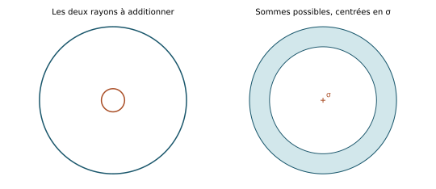

# École polytechnique MP — Mathématiques B 2012 · Corrigé brut

*Corrigé rédigé par IA, non officiel. Signalez toute erreur.*

**Rédaction** · GPT-6.2 Astra Ultra · vitesse non renseignée · 25 novembre 2026

**Révision** · GPT-6.2 Astra Ultra · vitesse non renseignée · 26 novembre 2026

**Valeurs d’adhérence sur le cercle de convergence.** Les moyennes de Cesàro identifient un centre. Le théorème de Kronecker décrit ensuite les phases accessibles aux sommes partielles et détermine la forme de leur ensemble d’adhérence.

## I. Convergence au sens de Cesàro

### Question 1

Si $a_k\to a$, pour $\varepsilon>0$ choisissons $K$ tel que $|a_k-a|\le\varepsilon$ dès $k\ge K$. Pour $n\ge K$,
$$|m_n-a|\le\frac{\sum_{k<K}|a_k-a|}{n+1}+\varepsilon.$$
Le premier terme tend vers zéro, d’où $m_n\to a$. La suite $a_n=(-1)^n$ ne converge pas, mais ses sommes sont bornées et ses moyennes tendent vers zéro.

### Question 2

Pour $n\ge1$, $a_n=(n+1)m_n-nm_{n-1}$, donc $a_n/n=(1+1/n)m_n-m_{n-1}$. Si $m_n$ converge, les deux termes ont la même limite et leur différence tend vers zéro.

### Question 3

Posons $A_n=\sum_{k=0}^n(-1)^k k^\alpha$. Par récurrence $0\le(-1)^nA_n\le n^\alpha$ car $(-1)^n A_n=n^\alpha-(-1)^{n-1}A_{n-1}$ et $n^\alpha\ge(n-1)^\alpha$. Ainsi $|A_n|/(n+1)\le n^\alpha/(n+1)\to0$ pour $0<\alpha<1$. La C-limite est 0.

### Question 4

Si $z_0=0$, le résultat est immédiat. Sinon, la suite $S_n(z_0)$ étant C-convergente, $S_n(z_0)/n\to0$ par 2. La différence $c_nz_0^n=S_n(z_0)-S_{n-1}(z_0)$ est donc $o(n)$. Pour tout $|z|<|z_0|$, $|c_nz^n|\le Cn(|z|/|z_0|)^n$ pour $n\ge1$. La série converge absolument sur ce disque, donc $R\ge|z_0|$.

### Question 5.a

Le rayon est $R=1$. Si $|z|=1$ et $z\ne1$, $S_n=(1-z^{n+1})/(1-z)$. La suite $z^{n+1}$ a des sommes partielles bornées, donc une moyenne tendant vers 0. Ainsi $\sigma(z)=1/(1-z)$. En $z=1$, $S_n=n+1$ a des moyennes divergentes. Donc $F=\{|z|=1\}\setminus\{1\}$.

### Question 5.b

Écrivons $A=\alpha+\beta/2$ et $B=-\beta/2$, tous deux non nuls par hypothèse. Alors $c_n=A+B(-1)^n$. La suite est bornée et l’une au moins des deux valeurs périodiques non nulle, d’où $R=1$. Par 5.a et linéarité, en dehors de $1,-1$ sur le cercle,
$$\sigma(z)=\frac{A}{1-z}+\frac{B}{1+z}.$$
En $z=1$ ou $-1$, exactement l’une des deux séries géométriques a des moyennes croissant linéairement avec coefficient non nul, l’autre a une C-limite finie. Ces points sont donc les seuls exclus de $F$.

### Question 5.c

Comme $1-\alpha\le|c_n|\le1+\alpha$ avec $0<\alpha<1$, le rayon vaut 1. Posons $u=e^{i\lambda}$. Sur le cercle unité, pour $z\notin\{1,u^{-1}\}$, par 5.a
$$\sigma(z)=\frac1{1-z}+\frac{\alpha}{1-uz}.$$
Si les points exclus sont distincts, l’un des deux termes donne une divergence linéaire des moyennes et l’autre a une limite. S’ils coïncident, $u=1$ et le coefficient résonant vaut $1+\alpha\ne0$. Ainsi $F$ est le cercle privé de cet ensemble, de cardinal un ou deux.

## II. Un théorème de Kronecker

### Question 6.a

Sur $[-x,x]$, la moyenne de $e_0$ vaut 1 et celle de $e_\lambda$, pour $\lambda\ne0$, vaut $\sin(\lambda x)/(\lambda x)\to0$. Une combinaison **finie** de ces fonctions possède donc une moyenne limite $M(f)$, linéaire en $f$. Comme chaque moyenne a module au plus $\|f\|_\infty$, $|M(f)|\le\|f\|_\infty$, ce qui donne la continuité.

### Question 6.b

Considérons $f=\sum_{j=1}^p c_j e_{\lambda_j}$ pour des fréquences distinctes. Par 6.a, $M(e_{-\lambda_k}f)=c_k$ car seule la fréquence $\lambda_k-\lambda_k$ vaut zéro. Si $f=0$, tous les coefficients sont nuls. La famille, génératrice par définition de $E$, est donc une base. La valeur $M(f)$ est exactement sa coordonnée suivant $e_0$ (nulle si la fréquence 0 est absente).

### Question 6.c

L’identité $e_\lambda e_\mu=e_{\lambda+\mu}$ et la distributivité donnent $fg\in E$. Pour $g\ge0$, le module de la moyenne de $fg$ sur $[-x,x]$ est au plus $\|f\|_\infty$ fois la moyenne de $g$. En passant à la limite, on obtient $|M(fg)|\le\|f\|_\infty M(g)$.

### Question 7.a

Les coefficients du noyau $K_N$ sont pairs en l’indice. Par la formule d’Euler,
$$K_N(t)=1+2\sum_{k=1}^N\left(1-\frac{k}{N+1}\right)\cos(kt)
=1+\sum_{j=1}^N\frac{2j}{N+1}\cos((N+1-j)t),$$
où $j=N+1-k$.

### Question 7.b

Pour $t\notin2\pi\mathbb Z$, la somme centrée est
$$\sum_{k=0}^N e^{i(N/2-k)t}=e^{iNt/2}\frac{1-e^{-i(N+1)t}}{1-e^{-it}}=\frac{\sin((N+1)t/2)}{\sin(t/2)}.$$
Le carré de son module est la somme des $e^{ijt}$ pour les couples d’indices de différence $j$, chaque $j$ ayant multiplicité $N+1-|j|$. En divisant par $N+1$, on obtient donc $K_N(t)=(N+1)^{-1}(\sin((N+1)t/2)/\sin(t/2))^2$. Aux multiples de $2\pi$ la somme géométrique non centrée vaut $N+1$, donc $K_N=N+1$. Le noyau est partout positif ou nul.

### Question 8.a

Notons $w_k=1-|k|/(N+1)$ pour $|k|\le N$. Alors
$$g_N(x)=\sum_{k_1,\ldots,k_{n+1}=-N}^N
\left(\prod_{j=1}^{n+1}w_{k_j}\right)e^{i\sum_j k_j\alpha_j}e_{\sum_j k_j\lambda_j}(x).$$
Par indépendance sur $\mathbb Q$, seule la liste entièrement nulle produit la fréquence 0. Son coefficient vaut 1, donc $M(g_N)=1$.

### Question 8.b

Le terme constant $r_0$ fournit $r_0M(g_N)=r_0$. Pour $a_je_{\lambda_j}$ et $N\ge1$, l’unique indice de 8.a donnant la fréquence totale nulle a $k_j=-1$ et tous les autres $k$ nuls. La contribution vaut $a_je^{-i\alpha_j}w_{-1}=r_j N/(N+1)$. Pour $N=0$, aucune de ces contributions n’intervient. Au total $M(fg_N)=r_0+\frac{N}{N+1}\sum_{j=1}^{n+1}r_j$.

### Question 8.c

L’inégalité triangulaire donne $\|f\|_\infty\le\sum_{j=0}^{n+1}r_j$. Comme $g_N\ge0$ partout par 7.b, les questions 6.c et 8.a donnent $|M(fg_N)|\le\|f\|_\infty M(g_N)=\|f\|_\infty$. En faisant tendre $N$ vers l’infini dans 8.b, on obtient la minoration inverse, donc l’égalité.

### Question 9

La contribution des $m-2$ autres termes a module au plus $m-2$, d’où $|u_k+u_j|\ge m-\varepsilon-(m-2)=2-\varepsilon$. Or $|u_k-u_j|^2=4-|u_k+u_j|^2=(2-|u_k+u_j|)(2+|u_k+u_j|)\le4\varepsilon$. Cela donne $|u_k-u_j|\le2\sqrt\varepsilon$, pour toute valeur positive de $\varepsilon$.

### Question 10.a

Avec la fonction $f$ indiquée, toutes les amplitudes valent 1, y compris celle du terme constant. Par 8.c, $\|f\|_\infty=n+2$. Choisissons $x_m$ tel que $|f(x_m)|>n+2-1/(m+1)$. La borne supérieure donne alors $|f(x_m)|\to n+2$.

### Question 10.b

Posons $\varepsilon_m=n+2-|f(x_m)|+1/(m+1)\to0$. Par 9, chacun des $e^{i\alpha_j}e^{i\lambda_jx_m}$ et $e^{2\pi i x_m}$ est à distance au plus $2\sqrt{\varepsilon_m}$ de 1. Ainsi $e^{i\lambda_jx_m}\to e^{-i\alpha_j}$ et $e^{2\pi ix_m}\to1$.

### Question 10.c

On a $e^{2\pi i y_m}=e^{2\pi ix_m}\to1$. Comme $|y_m|\le1/2$, $|e^{2\pi i y_m}-1|=2|\sin(\pi y_m)|\ge4|y_m|$ par concavité du sinus sur $[0,\pi/2]$. Ainsi $y_m\to0$. Alors $e^{i\lambda_j N_m}=e^{i\lambda_j x_m}e^{-i\lambda_j y_m}\to e^{-i\alpha_j}$ pour chaque $j$.

### Question 11.a

Sur un intervalle compact non vide, $|f|$ atteint son maximum. Si ce dernier valait $n+2$, tous les termes de module 1 seraient égaux au terme constant 1. Il faudrait donc $x\in\mathbb Z$ et $e^{i\lambda_jx}=-1$ pour tout $j$. En particulier $x\lambda_1=(2k+1)\pi$, relation rationnelle non triviale entre $\lambda_1$ et $2\pi$. C’est impossible. La borne du compact est donc strictement inférieure à $n+2$.

### Question 11.b

Par 10.a et 11.a, les points $x_m$ sortent de tout compact, donc $|x_m|\to\infty$. Comme $|N_m-x_m|\le1/2$, $|N_m|\to\infty$. Après extraction de termes de même signe, $N'_m\to+\infty$ ou $N'_m\to-\infty$. Les conclusions de 10.c donnent $e^{i\lambda_jN'_m}\to-1$. En élevant au carré, $e^{2i\lambda_jN'_m}\to1$.

### Question 12

Les nombres $\lambda_1,\ldots,\lambda_n,2\pi$ sont indépendants sur $\mathbb Q$ puisque les mêmes avec $\pi$ le sont. Appliquons 10.c avec les phases $-\alpha_j$ pour obtenir des entiers $a_m$ de signes quelconques avec $e^{i\lambda_j a_m}\to e^{i\alpha_j}$. Par 11.b il existe des entiers $b_k=2|N'_k|\to+\infty$ tels que $e^{i\lambda_j b_k}\to1$ pour tous $j$ (la conjugaison conserve la limite 1). Prenons $k_0$ tel que $N_0=a_0+b_{k_0}\ge0$. Une fois $N_{m-1}$ fixé, choisissons $k_m>k_{m-1}$ assez grand pour que $N_m=a_m+b_{k_m}>N_{m-1}$. Ces entiers naturels forment une suite strictement croissante, donc tendent vers $+\infty$. Pour chaque $j$, le produit $e^{i\lambda_j a_m}e^{i\lambda_j b_{k_m}}$ tend vers $e^{i\alpha_j}$.

## III. Valeurs d’adhérence des sommes partielles

### Question 13.a

Pour $z=e^{ix}\ne1$, $S_n=(1-z^{n+1})/(1-z)$. Si $x/\pi$ est rationnel, $z$ est de rang multiplicatif fini $d$ et chacune des $d$ valeurs $(1-z^j)/(1-z)$, $0\le j<d$, se répète indéfiniment. Cet ensemble est $\mathcal L(z)$. Au cas $z=1$, exclu de $F$, $S_n=n+1$ n’a aucune valeur d’adhérence complexe. Si $x/\pi$ est irrationnel, 12 appliquée à $x$ donne tout le cercle unité comme ensemble d’adhérence des puissances. L’image par $w\mapsto(1-w)/(1-z)$ est donc le cercle de centre $\sigma(z)=1/(1-z)$ et de rayon $1/|1-z|$.

### Question 13.b

Avec $A=\alpha+\beta/2$, $B=-\beta/2$ et $z=e^{ix}$, posons $C=A/(1-z)$, $D=B/(1+z)$, donc $\sigma=C+D$. La formule des deux séries géométriques donne
$$S_n=\sigma-z^{n+1}\big(C+(-1)^{n+1}D\big).$$
Les puissances de $z$ de chaque parité ont pour ensemble d’adhérence le cercle unité, par 12 appliquée à $2x$ puis par rotation. Les indices impairs donnent le rayon $|C+D|$, les indices pairs le rayon $|C-D|$. En fonction des coefficients du sujet, ces rayons autour de $\sigma$ valent respectivement
$$r_{\rm impair}=\frac{|\alpha+(\alpha+\beta)z|}{|1-z^2|},\qquad
r_{\rm pair}=\frac{|\alpha+\beta+\alpha z|}{|1-z^2|}.$$ Leur réunion est tout l’ensemble d’adhérence, car d’une sous-suite convergente on peut extraire des indices de même parité.

Les deux rayons sont distincts. En effet, leur différence de carrés vaut $4\operatorname{Re}(C\overline D)$ et $(1-z)(1+\overline z)=\overline z-z$ est imaginaire pur non nul. Or $A\overline B=-\alpha\overline\beta/2-|\beta|^2/4$ a une partie imaginaire non nulle car $\beta/\alpha\notin\mathbb R$. L’énoncé autorise un cercle réduit à un point. Par exemple, $\alpha=1$, $\beta=-1-z$ donne $C-D=0$ et respecte les hypothèses.

### Question 13.c

Posons $z=e^{ix}$, $v=e^{i(x+\lambda)}$, $C=1/(1-z)$, $D=\alpha/(1-v)$ et $\sigma=C+D$. Les dénominateurs sont non nuls par indépendance. On a $S_n=\sigma-Cz^{n+1}-Dv^{n+1}$. Or $x,x+\lambda,\pi$ sont libres sur $\mathbb Q$, donc la question 12 fournit toutes les paires de phases unitaires comme valeurs d’adhérence simultanées. Réciproquement, toute sous-suite convergente des sommes admet une sous-suite dont les deux phases convergent par compacité du tore. L’ensemble d’adhérence est donc exactement la somme des deux cercles de rayons $|C|,|D|$, translatée de $\sigma$.

La distance de la somme au centre parcourt $[\,||C|-|D||,|C|+|D|\,]$ en faisant varier l’angle relatif de 0 à $\pi$. Une rotation simultanée permet tous les arguments. Pour
$$0<\alpha<\min\left(1,\frac{|1-v|}{|1-z|}\right),$$
on a $|D|<|C|$, et les rayons de la couronne sont $r_1=1/|1-z|-\alpha/|1-v|>0$ et $r_2=1/|1-z|+\alpha/|1-v|>r_1$.

Pour tracer la figure, prenons $x=\pi\sqrt2/4$, $\lambda=\pi\sqrt3/6$ et $\alpha=1/4$. La liberté de $1,\sqrt2,\sqrt3$ sur $\mathbb Q$ donne celle de $x,\lambda,\pi$. Le calcul fournit $|C|\simeq0{,}9483$ et $|D|\simeq0{,}1477$. Les points représentés sont les valeurs $S_n-\sigma$ pour $0\le n<900$.

