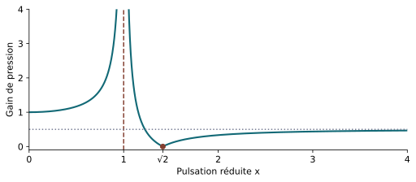
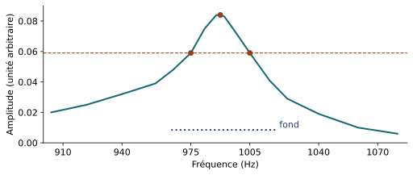

# École polytechnique et ESPCI PC 2012 — Physique A · Corrigé guidé

*Corrigé rédigé par IA, non officiel. Signalez toute erreur.*

**Lecture du rapport du jury** · GPT-6.2 Astra Ultra · vitesse non renseignée

**Rédaction** · GPT-6.2 Astra Ultra · vitesse non renseignée

## Oscillations d’une bulle

## I. Oscillations libres

### Question I.1 — Pression du gaz

**Indication.** Utiliser la pression absolue dans la loi adiabatique, puis développer autour du rayon d’équilibre.

À quantité d’air fixée, la transformation réversible adiabatique d’un gaz parfait donne $(P_0+p_a)V_a^\gamma=P_0 V_0^\gamma$. Comme $V_a/V_0=(1+r_1/R_0)^3$, on a $p_a=P_0[(1+r_1/R_0)^{-3\gamma}-1]\simeq-3\gamma P_0 r_1/R_0$. Une augmentation du rayon s’accompagne d’une baisse de pression.

### Question I.2 — Travail reçu par l’eau

**Indication.** Isoler une couronne matérielle d’eau. Les deux surfaces de cette couronne échangent du travail avec l’extérieur.

Lors d’une expansion $dV_a>0$, le gaz effectue sur l’eau le travail $(P_0+p_a)dV_a$. L’eau étant incompressible, le volume contenu à l’intérieur de la frontière extérieure augmente également de $dV_a$. La pression extérieure $P_0$ fournit donc à l’eau le travail $-P_0dV_a$. Le bilan est $\delta W=p_a\,dV_a$, avec le même signe algébrique en compression.

### Question I.3 — Raideur

**Indication.** Pour calculer le premier terme non nul de l’énergie, employer les expressions au premier ordre de la surpression et du déplacement de volume.

$-dU=\delta W=p_a\,4\pi R^2dr_1\simeq-12\pi\gamma P_0R_0 r_1dr_1$. Avec l’origine $U(0)=0$, on trouve $U=Kr_1^2/2$, $K=12\pi\gamma P_0R_0$, en $\mathrm{N\,m^{-1}}$. L’air comprimé joue le rôle du ressort.

### Question I.4 — Vitesse radiale de l’eau

**Indication.** À un instant fixé, comparer les débits à travers deux sphères concentriques dans l’eau.

L’incompressibilité impose $\nabla\cdot\mathbf v=r^{-2}\partial_r(r^2 v_1)=0$. Le débit $4\pi r^2 v_1$ est donc indépendant de $r$. La condition cinématique à l’interface est $v_1(R,t)=\dot R=\dot r_1$. Ainsi $v_1=R^2\dot r_1/r^2\simeq R_0^2\dot r_1/r^2$ à l’ordre linéaire.

### Question I.5 — Masse effective de liquide

**Indication.** Intégrer sur toute l’eau, y compris celle qui se déplace loin de l’interface.

L’énergie cinétique est quadratique en vitesse. À cet ordre,

$$
E_c=\frac12\rho_0\int_{R_0}^\infty\frac{R_0^4\dot r_1^2}{r^4}4\pi r^2dr=\frac12 M\dot r_1^2,\qquad M=4\pi\rho_0R_0^3.
$$

L’intégrale de $1/r^2$ converge. Cette masse effective correspond à la mise en mouvement de l’eau extérieure.

### Question I.6 — Pulsation propre

**Indication.** Différencier l’énergie mécanique conservée et identifier le quotient d’une raideur par une masse.

L’absence de pertes donne $d(E_c+U)/dt=\dot r_1(M\ddot r_1+Kr_1)=0$. Par continuité aux points de rebroussement, $\ddot r_1+\omega_0^2r_1=0$ où $\omega_0^2=K/M=3\gamma P_0/(\rho_0 R_0^2)$. Le rayon oscille autour de $R_0$ à la pulsation $\omega_0=c/R_0$ avec $c=\sqrt{3\gamma P_0/\rho_0}$.

### Question I.7 — Pression et déplacement

**Indication.** Éliminer $3\gamma P_0$ par l’expression de la pulsation propre.

La loi de I.1 devient $p_a=-\rho_0\omega_0^2R_0r_1$. Le produit d’une masse volumique, d’une longueur et d’une accélération a bien la dimension d’une pression.

### Question I.8 — Homogénéité de la pression et ordre de fréquence

**Indication.** Comparer la durée de traversée acoustique de la bulle au temps de variation de son rayon, puis convertir les radians par seconde en hertz.

$c\simeq20\,\mathrm{m\,s^{-1}}$, alors que la vitesse du son dans l’air ambiant vaut environ $340\,\mathrm{m\,s^{-1}}$. Le temps $R_0/c_{\rm air}$ nécessaire pour transmettre une fluctuation de pression est bien inférieur à $1/\omega_0=R_0/c$. L’air ajuste donc sa pression sur toute la bulle pendant une petite fraction du cycle. Pour $R_0\sim1\,\mathrm{mm}$, $f_0=c/(2\pi R_0)\sim3\times10^3\,\mathrm{Hz}$ est dans le domaine audible, d’environ 20 Hz à 20 kHz.

## II. Oscillations forcées d’une bulle en eau incompressible

### Question II.1 — Équation locale

**Indication.** Comparer l’ordre en amplitude des deux termes de la dérivée particulaire de la vitesse.

Sans viscosité ni pesanteur, la projection radiale d’Euler s’écrit $\rho_0(\partial_t v_1+v_1\partial_rv_1)=-\partial_r(P_0+p_1)$. $P_0$ est constant, et le terme convectif est quadratique en l’amplitude. Au premier ordre, $\rho_0\partial_t v_1=-\partial_rp_1$.

### Question II.2 — Pression à une distance quelconque

**Indication.** Intégrer le gradient depuis l’infini, où la surpression imposée est connue.

D’après I.4, $\partial_rp_1=-\rho_0R_0^2\ddot r_1/r^2$. Une primitive en $r$ est $\rho_0R_0^2\ddot r_1/r$. La limite à l’infini fixe la fonction d’intégration et donne $p_1(r,t)=p_e(t)+\rho_0R_0^2\ddot r_1(t)/r$.

### Question II.3 — Condition de pression à la surface

**Indication.** La différence entre évaluer un champ du premier ordre en $R$ ou en $R_0$ est du second ordre.

À l’interface, sans tension superficielle, $p_a=p_1(R,t)\simeq p_e+\rho_0R_0\ddot r_1$. En égalant cette valeur à $-\rho_0\omega_0^2R_0r_1$, on trouve $\ddot r_1+\omega_0^2r_1=-p_e/(\rho_0R_0)$. Pour $p_e=0$, on retrouve les oscillations libres de I.6.

### Question II.4 — Amplitude et phase du rayon

**Indication.** Chercher la solution sinusoïdale à la fréquence de l’excitation et donner séparément le module et l’argument de son coefficient.

Pour $p_e=p_{e0}\cos\omega t$, la solution forcée hors résonance est $r_1=p_{e0}\cos\omega t/[\rho_0R_0(\omega^2-\omega_0^2)]$. Son amplitude est $p_{e0}/(\rho_0 R_0|\omega^2-\omega_0^2|)$. Le rayon est en opposition de phase avec la pression pour $\omega<\omega_0$ et en phase pour $\omega>\omega_0$. À résonance, la solution particulière comporte $-p_{e0}t\sin(\omega_0t)/(2\rho_0R_0\omega_0)$ et aucune amplitude stationnaire finie.

### Question II.5 — Signal au microphone

**Indication.** Distinguer la pression imposée et celle que crée le mouvement du liquide.

À $r=d$, le microphone mesure $p_m(t)=p_e(t)+\rho_0R_0^2\ddot r_1(t)/d$. Le terme propre à la bulle décroît en $1/d$. Pour un rayon en mouvement sinusoïdal, $\ddot r_1=-\omega^2r_1$.

### Question II.6 — Module du signal

**Indication.** Additionner les deux contributions avec leur signe avant de prendre le module.

En posant $b=R_0/d$ et $x=\omega/\omega_0$, le coefficient réel qui multiplie $p_{e0}\cos\omega t$ est $1+b x^2/(1-x^2)$. Ainsi

$$
p_{m0}=p_{e0}\left|\frac{1-(1-b)x^2}{1-x^2}\right|.
$$

À très basse fréquence le microphone mesure essentiellement la pression imposée.

### Question II.7 — Résonance et annulation pour $d=2R_0$

**Indication.** Construire d’abord la fonction signée et replier vers le haut sa partie négative.

Le gain est $G=|(1-x^2/2)/(1-x^2)|$. Il part de 1 avec une tangente horizontale, croît jusqu’à $+\infty$ lorsque $x\to1^-$, puis décroît de $+\infty$ à zéro entre $1^+$ et $\sqrt2$. Au-delà de $\sqrt2$, il remonte et tend vers $1/2$ par valeurs inférieures. L’annulation est due à la compensation des deux pressions au microphone.

### Question II.8 — Fonction du filet

**Indication.** Dans l’expérience réelle, la masse volumique de l’air est bien inférieure à celle de l’eau.

La pesanteur crée un gradient de pression hydrostatique dans l’eau. La poussée d’Archimède, $\rho_0V_ag$ vers le haut, dépasse le poids de l’air emprisonné. Le filet empêche la remontée de la bulle.

## III. Rayonnement et amortissement

### Question III.1 — Équation acoustique

**Indication.** Écrire la conservation de la masse et celle de la quantité de mouvement à l’ordre linéaire avant d’éliminer la vitesse.

Autour d’un liquide homogène au repos, $\partial_t\rho_1+\rho_0\nabla\cdot\mathbf v_1=0$ et $\rho_0\partial_t\mathbf v_1=-\nabla p_1$. En dérivant la première relation en temps et en prenant la divergence de la seconde, on obtient $\partial_t^2\rho_1-\Delta p_1=0$. Comme $p_1=c_s^2\rho_1$, on a $\partial_t^2p_1-c_s^2\Delta p_1=0$.

### Question III.2 — Ondes sphériques

**Indication.** Multiplier l’équation par $r$ pour la ramener à une équation à une dimension.

Pour $u=rp_1$, le laplacien donné conduit à $\partial_t^2u=c_s^2\partial_r^2u$. Chacune des fonctions $\phi(t-(r-R_0)/c_s)$ et $\psi(t+(r-R_0)/c_s)$ vérifie cette équation car une double dérivation spatiale produit la double dérivée temporelle divisée par $c_s^2$. On retrouve la forme du sujet en additionnant et divisant par $r$.

### Question III.3 — Condition de rayonnement

**Indication.** Suivre un point de phase constante pour déterminer dans quelle direction il se déplace.

Pour $t-(r-R_0)/c_s$ constant, $dr/dt=+c_s$, tandis que le signe opposé correspond à une propagation vers l’origine. La bulle émet dans un grand volume sans onde incidente ni réflexion de retour. La composante entrante est donc nulle, $\psi=0$.

### Question III.4 — Accélération de l’interface

**Indication.** La particule d’eau en contact avec la bulle suit sa surface. Dériver sa vitesse en suivant cette particule.

De $v_1(R(t),t)=\dot R$ on tire $\ddot r_1=\partial_t v_1+\dot R\,\partial_rv_1$ à la surface. C’est précisément l’accélération matérielle de l’eau en contact avec l’interface. L’équation d’Euler donne $\rho\ddot r_1=-\partial_rp_1(R,t)$. Au premier ordre, on peut remplacer $\rho$ par $\rho_0$ et $R$ par $R_0$, donc $\rho_0\ddot r_1=-\partial_rp_1(R_0,t)$.

### Question III.5 — Gradient radial d’une onde sortante

**Indication.** Dériver à la fois le facteur géométrique et le temps retardé.

Avec $s=t-(r-R_0)/c_s$, $-\partial_r[\phi(s)/r]=\phi(s)/r^2+\dot\phi(s)/(r c_s)$. À l’interface il reste $\rho_0\ddot r_1=\phi(t)/R_0^2+\dot\phi(t)/(R_0c_s)$.

### Question III.6 — Raccord de pression

**Indication.** À la surface d’équilibre, la fonction retardée est évaluée à l’instant présent.

La pression est continue. On a donc $\phi(t)/R_0=p_a(t)$ et $\phi(t)=-\rho_0\omega_0^2R_0^2r_1(t)$. Le produit « surpression fois longueur » a bien la dimension de $\phi$.

### Question III.7 — Facteur de qualité radiatif

**Indication.** Reporter la valeur de $\phi$ et sa dérivée, puis lire le coefficient du terme en vitesse.

L’équation de III.5 devient $\ddot r_1+(\omega_0^2R_0/c_s)\dot r_1+\omega_0^2r_1=0$. L’identification à $\omega_0/Q$ donne $Q=c_s/(\omega_0R_0)=c_s/c$. Pour l’eau, $Q\simeq1500/20\simeq 7\times10^1$ (environ 73 avec $c=20,5\,\mathrm{m\,s^{-1}}$).

### Question III.8 — Limite incompressible

**Indication.** Traduire la compressibilité en vitesse de propagation par l’équation d’état isentropique.

Avec $\chi_S=(1/\rho_0)(\partial\rho/\partial P)_S$, $c_s^2=1/(\rho_0\chi_S)$. Quand $\chi_S\to0$, $c_s\to\infty$ et le coefficient $\omega_0^2R_0/c_s$ s’annule. On retrouve l’équation libre non amortie de I.6.

### Question III.9 — Où va l’énergie ?

**Indication.** Examiner ce que transporte l’onde progressive vers les grandes distances.

La bulle donne de l’énergie au liquide sous forme d’ondes acoustiques sortantes. À grande distance leur intensité décroît en $1/r^2$, ce qui laisse une puissance traversant toute une sphère finie. Sans retour d’onde, cette énergie quitte l’oscillateur. Cela suffit à amortir le rayon même dans un liquide sans viscosité.

## IV. Mesure expérimentale en régime forcé

### Question IV.1 — Onde plane incidente

**Indication.** Calculer le laplacien et la dérivée temporelle seconde d’un même cosinus.

Pour $p_e=p_{e0}\cos(\omega t-\mathbf k\cdot\mathbf r)$, on a $\Delta p_e=-|\mathbf k|^2p_e$ et $\partial_t^2p_e=-\omega^2p_e$. L’équation de propagation donne $|\mathbf k|=\omega/c_s$ pour $\omega>0$.

### Question IV.2 — Superposition

**Indication.** Identifier les deux solutions élémentaires et la propriété de l’équation qui permet de les additionner.

L’onde plane vérifie l’équation de d’Alembert par IV.1, et le champ sphérique sortant la vérifie pour $r\ge R_0$ par III.2. L’opérateur $\partial_t^2-c_s^2\Delta$ est linéaire, donc leur somme est également solution dans l’eau. Le raccord avec le gaz déterminera l’amplitude de la composante sortante.

### Question IV.3 — Système couplé

**Indication.** À l’échelle de la bulle, la composante uniforme de la pression incidente sollicite le mode radial, tout en ayant un gradient radial nul.

Dans l’approximation $|\mathbf k|R_0\ll1$, on conserve $p_e(t)=p_{e0}\cos\omega t$ uniforme près de la bulle. Seule la partie sphérique contribue alors au gradient radial. Plus précisément, le terme d’ordre $k$ de l’onde plane a une moyenne angulaire nulle pour le mode de respiration. Avec $c_s=Q\omega_0R_0$, III.4–5 et le raccord de pression deviennent

$$
\rho_0R_0^2\ddot r_1=\phi+\frac{\dot\phi}{Q\omega_0},\qquad
p_e+\frac{\phi}{R_0}=-\rho_0\omega_0^2R_0r_1.
$$

### Question IV.4 — Réponse complexe

**Indication.** Adopter une convention temporelle et la garder dans les deux équations. On peut éliminer $\phi$ avec le raccord de pression.

Avec $e^{i\omega t}$, notons $X$ et $\Phi$ les amplitudes complexes du rayon perturbé et de $\phi$. Le système s’écrit $-\rho_0R_0^2\omega^2 X=(1+i\omega/(Q\omega_0))\Phi$ et $\Phi=-R_0p_{e0}-\rho_0\omega_0^2R_0^2X$. Posons $L=\omega_0^2-\omega^2+i\omega\omega_0/Q$. La substitution et le report en retour donnent

$$
X=-\frac{p_{e0}}{\rho_0R_0}\frac{1+i\omega/(Q\omega_0)}{L},\qquad
\Phi=R_0p_{e0}\frac{\omega^2}{L}.
$$

À fréquence nulle, le rayon est réduit par la surpression et le rayonnement disparaît.

### Question IV.5 — Pression complexe mesurée

**Indication.** La propagation introduit deux phases, celle de l’onde plane et celle de l’onde sphérique entre la paroi et le capteur.

Pour $|\mathbf d|=d$, on trouve $P_m=p_{e0}e^{-i\mathbf k\cdot\mathbf d}+(\Phi/d)e^{-i\omega(d-R_0)/c_s}$. Comme $kd\ll1$, les deux exponentielles sont proches de 1. Avec $x=\omega/\omega_0$ et $b=R_0/d$,

$$
\frac{P_m}{p_{e0}}\simeq 1+\frac{b x^2}{1-x^2+i x/Q}.
$$

Dans la limite incompressible, $Q\to\infty$ et ce coefficient redevient réel hors résonance. Son module reproduit exactement II.6.

### Question IV.6 — Lecture du pic, largeur et distance

**Indication.** Lire le fond avec la courbe du haut-parleur seul. Le gain à résonance permet de séparer $d/R_0$ et $Q$ après une estimation de la largeur.

Sur la figure 1 du sujet, le maximum se situe vers $990\,\mathrm{Hz}$, avec une chute rapide du cosinus de phase à proximité. Ainsi $\omega_0\simeq2\pi\times990\simeq6\times10^3\,\mathrm{rad\,s^{-1}}$. Le pic domine le fond. À l’ordonnée $0,084/\sqrt2\simeq0,059$, les intersections sont vers 975 et 1005 Hz, soit $\Delta f\sim30\,\mathrm{Hz}$. Pour le terme résonnant, $|1-x^2+i x/Q|^2\simeq4(x-1)^2+Q^{-2}$ au voisinage de $x=1$. La largeur totale à mi-puissance est $f_0/Q$, d’où $Q\sim30$.

Le haut-parleur seul donne une amplitude voisine de $0,008$ à $0,009$ au pic, soit $G_0\sim10$. En $x=1$, IV.5 donne $G_0=\sqrt{1+(bQ)^2}$. Il vient $d/R_0=Q/\sqrt{G_0^2-1}\sim3$. La courbe du champ total comprend le fond direct et le signal diffusé, ce qui limite la précision de l’estimation par largeur.

### Question IV.7 — Rayon et uniformité du forçage

**Indication.** Calculer le rayon à partir de la fréquence propre. Employer la célérité dans l’eau pour tester la variation de phase incidente.

$R_0=c/\omega_0\simeq20/(2\pi\times990)\simeq3\times10^{-3}\,\mathrm m$, soit un diamètre voisin de 6 mm. À résonance, $kR_0=\omega_0R_0/c_s=c/c_s\simeq1,4\times10^{-2}$. Le déphasage sur tout le diamètre est inférieur à $0,03$ rad, ce qui valide l’hypothèse d’un forçage uniforme.

### Question IV.8 — Comparaison des amortissements

**Indication.** Un pic plus large à fréquence propre égale caractérise un oscillateur plus amorti.

Le modèle prédit $Q_{\rm rad}\simeq73$ et le pic donne environ 30. Le rayonnement explique l’ordre de grandeur, mais les oscillations mesurées perdent plus d’énergie par cycle. Des pertes supplémentaires, notamment thermiques et visqueuses, sont compatibles avec cet écart.

### Question IV.9 — Limites de l’adiabaticité et de la réversibilité

**Indication.** Une compression échauffe l’air. Examiner ce qui se produit si la température du gaz diffère de celle de l’eau au cours du cycle.

Le transfert de chaleur à travers la paroi intervient avec un déphasage sur l’oscillation. L’échange à différence de température finie crée de l’entropie et convertit une partie de l’énergie mécanique en chaleur. La raideur effective du gaz peut se rapprocher de la raideur isotherme pour un transfert rapide. Des pertes thermiques cycliques réduisent le facteur de qualité.

### Question IV.10 — Analogie avec l’électron lié

**Indication.** Mettre en regard l’oscillateur, son excitation, son champ secondaire et la façon dont ce champ transporte de l’énergie.

Le rayon de la bulle et le déplacement d’un électron lié obéissent près de l’équilibre à une équation d’oscillateur forcé. La surpression de l’onde sonore incidente joue le rôle du champ électrique incident. La vibration produit une onde secondaire qui se superpose à l’onde incidente, avec une résonance et une perte d’énergie par rayonnement. Pour la bulle, l’inertie provient surtout de l’eau et le rappel de la compressibilité de l’air. Le mode est un monopôle acoustique de pression, isotrope dans ce modèle, porté par un milieu matériel. Pour l’électron, la masse est celle de la particule, la force de rappel est électrique et le rayonnement est un champ électromagnétique transverse de dipôle, nul sur l’axe d’oscillation et possible dans le vide.
