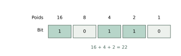
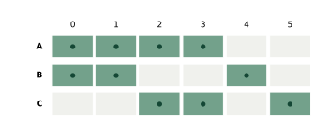
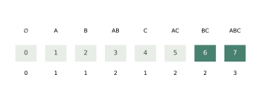

# École polytechnique · PSI et PT · Informatique 2012 · Corrigé brut

*Corrigé rédigé par IA, non officiel. Signalez toute erreur.*

**Rédaction** · GPT-6.2 Astra Ultra · vitesse non renseignée · 25 novembre 2026

**Couverture optimale.** Le langage choisi est Python. Le code emploie les primitives `allouer`, `taille`, `parite` et `quotient_div_2` définies dans le sujet. Les variables globales de la dernière partie sont la famille `f` et la taille `n` de l’univers.

## I · Autour des ensembles

### Question 1 · Compter les éléments

```python
def cardinal(t):
    nombre = 0
    for i in range(taille(t)):
        if t[i]:
            nombre += 1
    return nombre
```

Après le traitement des $i$ premières cases, le compteur est le nombre d’éléments représentés dans $\{0,\ldots,i-1\}$. La complexité est linéaire en la longueur du tableau.

### Question 2 · Tester une appartenance

```python
def appartient(i, t):
    return 0 <= i < taille(t) and t[i]
```

L’évaluation de gauche à droite empêche toute lecture hors domaine. Les entiers négatifs et les indices situés au-delà du tableau sont absents. Le temps est constant.

### Question 3 · Former la différence

```python
def diff(t1, t2):
    t = allouer(taille(t1), False)
    for i in range(taille(t1)):
        t[i] = t1[i] and not appartient(i, t2)
    return t
```

Pour chaque indice du premier tableau, le résultat est vrai exactement s’il appartient au premier ensemble et s’il est absent du second. Cela inclut le cas où le second tableau est plus court. Le coût est $O(1+\operatorname{taille}(t_1))$.

### Question 4 · Former l’union

```python
def union(t1, t2):
    longueur = max(taille(t1), taille(t2))
    resultat = allouer(longueur, False)
    for i in range(longueur):
        resultat[i] = appartient(i, t1) or appartient(i, t2)
    return resultat
```

Une case vraie dans l’un des opérandes suffit. Les valeurs absentes hors des tableaux sont prises égales à faux par la question 2. Le temps est linéaire en la plus grande longueur, et deux tableaux vides donnent le tableau vide.

## II · Représentation par entiers

### Question 5 · Trouver les codes extrêmes

Le plus petit code est $0$, celui de l’ensemble vide. Le plus grand correspond à tout l’univers. Il vaut $1+2+\cdots+2^{n-1}=2^n-1$. Si $n=0$, les deux réponses valent zéro. L’interdiction des primitives de puissance concerne les programmes, et la formule s’obtient dans un programme par $n$ doublements.

### Question 6 · Coder un tableau par un entier

```python
def set2int(t):
    s = 0
    for i in range(taille(t) - 1, -1, -1):
        s = 2 * s
        if t[i]:
            s += 1
    return s
```

La récurrence de Horner construit bien la somme des $2^i$ sur les indices vrais. Les zéros de poids fort n’influencent pas le résultat. Pour les indices $1,2,4$, on obtient $2+4+16=22$. Chaque case occasionne un doublement et au plus une addition. Dans le modèle d’opérations élémentaires du sujet, le temps est $\Theta(\operatorname{taille}(t))$ pour un tableau non vide.



### Question 7 · Décoder un entier avec les divisions par deux

```python
def int2set(s):
    q = s
    longueur = 0
    while q > 0:
        longueur += 1
        q = quotient_div_2(q)
    t = allouer(longueur, False)
    q = s
    for i in range(longueur):
        t[i] = parite(q) == 1
        q = quotient_div_2(q)
    return t
```

Pour $s>0$, le dernier bit est vrai. Le tableau obtenu est la représentation de longueur minimale et ne comporte aucun faux superflu à droite. Pour $s=0$, on choisit le tableau vide. Si $s>0$, chacun des deux parcours comporte $1+\lfloor\log_2 s\rfloor$ tours, d’où $\Theta(1+\log(s+1))$ en temps pour tout $s\geqslant0$. Le logarithme décrit le nombre de tours sur le papier. Le code n’en calcule aucun.

## III · Familles, sous-familles et couvertures

### Question 8 · Traduire le choix des sports en couverture

L’univers $U$ contient les élèves. À chaque activité $a$, associons $F_a=\{e\in U : e\text{ accepte }a\}$. Chaque élève accepte au moins une activité, donc l’union de tous ces ensembles est $U$. Pour une liste d’activités ouvertes $G$, tous les élèves trouvent une activité qui leur convient exactement lorsque $\bigcup_{a\in G}F_a=U$. Minimiser le nombre de sports ouverts est par conséquent le problème de la couverture de cardinal minimal.

### Question 9 · Un contre-exemple pour le glouton

Prenons $U=\{0,1,2,3,4,5\}$ et trois ensembles $A=\{0,1,2,3\}$, $B=\{0,1,4\}$, $C=\{2,3,5\}$. Au premier tour, le choix de $A$ est imposé car son gain est 4 contre 3 pour chacun des autres. Il reste les éléments 4 et 5, couverts respectivement par $B$ seul et $C$ seul. Le glouton prend donc les trois ensembles, quel que soit son départage au deuxième tour. Or $B\cup C=U$ et aucun ensemble isolé ne couvre $U$. L’optimum vaut exactement 2.



### Question 10 · Compter les éléments encore nouveaux

```python
def reste(s1, s2):
    return cardinal(diff(int2set(s1), int2set(s2)))
```

Les codes redeviennent ici des tableaux avant le calcul de $|S_1\setminus S_2|$. Avec les versions entières que l’énoncé autorise à partir de la partie III, on peut tout aussi bien composer directement la différence entière puis le cardinal entier. Pour deux sous-ensembles de l’univers à $n$ éléments, la version écrite coûte $O(n+1)$.

### Question 11 · Construire une couverture gloutonne

```python
def unionEntiere(s1, s2):
    return set2int(union(int2set(s1), int2set(s2)))

def codePlein(longueur):
    code = 0
    for i in range(longueur):
        code = 2 * code + 1
    return code

def glouton():
    total = codePlein(n)
    couvert = 0
    choix = 0
    while couvert != total:
        meilleur_gain = 0
        poids = 1
        for j in range(taille(f)):
            gain = reste(f[j], couvert)
            if gain > meilleur_gain:
                meilleur_gain = gain
                meilleur_j = j
                meilleur_poids = poids
            poids *= 2
        couvert = unionEntiere(couvert, f[meilleur_j])
        choix += meilleur_poids
    return choix
```

Avant couverture complète, une des familles candidates couvre un élément manquant et donne un gain strictement positif. Le meilleur indice est donc défini. Un ensemble déjà choisi a un gain nul, si bien que le poids ajouté à `choix` correspond toujours à un bit encore absent. Les égalités de gain sont départagées par le plus petit indice.

Avec $m=\operatorname{taille}(f)$, chaque tour scanne $m$ candidats, et chaque gain coûte $O(n+1)$ avec le code de la question 10. Il y a au plus $\min(n,m)$ tours, car chacun choisit un nouvel ensemble et couvre au moins un nouvel élément. Pour $n,m\geqslant1$, le temps est donc $O(n+mn\min(n,m))$ dans le modèle arithmétique indiqué. Si $U$ est vide, la boucle n’est pas exécutée et la famille vide convient.

### Question 12 · Tester une sous-famille

```python
def couverture(g):
    couvert = 0
    q = g
    j = 0
    while q > 0:
        if parite(q) == 1:
            couvert = unionEntiere(couvert, f[j])
        q = quotient_div_2(q)
        j += 1
    return couvert == codePlein(n)
```

À chaque tour, le bit de poids faible de `q` indique s’il faut incorporer $F_j$. L’argument représente par hypothèse une sous-famille valide. Après sa lecture, le résultat est vrai exactement lorsque l’union des ensembles choisis contient les $n$ éléments. En particulier `couverture(0)` est vraie exactement pour l’univers vide. Le coût est $O((m+1)(n+1))$.

### Question 13 · Trouver une solution optimale par énumération

```python
def optimale():
    m = taille(f)
    dernier = codePlein(m)
    meilleur = dernier
    meilleure_taille = m
    for candidat in range(dernier + 1):
        nombre = cardinal(int2set(candidat))
        if nombre < meilleure_taille and couverture(candidat):
            meilleur = candidat
            meilleure_taille = nombre
    return meilleur
```

La valeur initiale représente toute la famille, qui couvre $U$ par hypothèse. Le parcours visite chacun des $2^m$ masques. Il remplace la meilleure solution seulement par une couverture strictement plus petite. Ainsi, une fois le dernier masque visité, aucune couverture de cardinal inférieur ne peut avoir échappé au test. L’espace des tableaux temporaires est $O(n+m+1)$. Le temps est majoré par $O(2^m(m+1)(n+1))$ avec les primitives des réponses précédentes. Si la famille et l’univers sont vides, le code rendu est 0.


