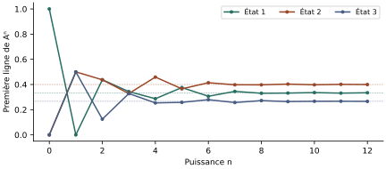
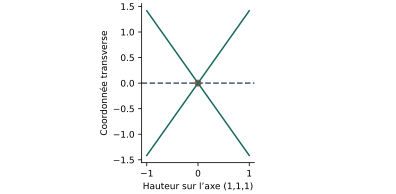

# Banque PT — Mathématiques A 2013 · Corrigé brut

*Corrigé rédigé par IA, non officiel. Signalez toute erreur.*

**Rédaction** · GPT-6.2 Astra Ultra · vitesse non renseignée

Le problème étudie les puissances de matrices stochastiques et leur spectre. L’exercice indépendant classe les cônes de l’espace définis par une forme quadratique à trois paramètres. La grille d’admissibilité attribue à Maths A un coefficient 6 pour l’École polytechnique et 3 pour l’ENS Cachan. [Sujet officiel](https://www.banquept.fr/documents/2013/math_a_2013_pt.pdf) · [Rapport du jury](https://www.banquept.fr/documents/ecrit/rapport/2013/rapport_math_a_ecrit_2013.pdf) · [Grille des coefficients](https://www.banquept.fr/documents/livret/2013/Livret_PT_2013.pdf#page=12)

## Question préliminaire

### P.1.a · Compatibilité des dimensions

Pour $A$ de taille $p\times q$ et $B$ de taille $r\times s$, $AB$ existe si et seulement si $q=r$. Il a alors $p$ lignes et $s$ colonnes.

### P.1.b · Entrées du produit

Si $q=r$, le coefficient de $AB$ en $(i,j)$ est $c_{ij}=\sum_{k=1}^{q}a_{ik}b_{kj}$, pour $1\le i\le p$, $1\le j\le s$.

### P.2.a · Limite d’une somme

Pour chaque couple $(i,j)$, $a_{ij}^{(p)}+b_{ij}^{(p)}\to a_{ij}+b_{ij}$ par la règle de somme sur $\mathbb C$. C’est le coefficient $(i,j)$ de $A+B$, d’où $A_p+B_p\to A+B$.

### P.2.b · Limite d’un produit

Pour chaque $(i,j)$, $(A_pB_p)_{ij}=\sum_{k=1}^n a_{ik}^{(p)}b_{kj}^{(p)}$. Chaque produit converge vers $a_{ik}b_{kj}$ et la somme est finie, donc sa limite est $(AB)_{ij}$. Ainsi $A_pB_p\to AB$.

## Partie I

### I.1 · Un premier vecteur propre

Pour $A=\tfrac18\left(\begin{smallmatrix}0&4&4\\6&0&2\\1&7&0\end{smallmatrix}\right)$, les sommes des lignes valent $1$. Donc $AX_1=X_1$ pour $X_1=(1,1,1)^{\mathsf T}\ne0$. C’est un vecteur propre de valeur propre $1$.

### I.2 · Spectre réel et complexe

La trace est nulle et $\det A=(4\cdot2\cdot1+4\cdot6\cdot7)/8^3=11/32$. Comme $1$ est racine du polynôme caractéristique unitaire de degré trois, la trace et le terme constant donnent $\chi_A(z)=(z-1)(z^2+z+11/32)$. Les deux autres racines sont $z_\pm=-1/2\pm i\sqrt6/8$. Le spectre possède trois éléments distincts sur $\mathbb C$, donc $A$ y est diagonalisable. Une diagonale réelle ne peut avoir ces racines non réelles, donc $A$ n’est pas diagonalisable sur $\mathbb R$.

### I.3 · Puissances diagonales

Dans l’ordre du sujet, $D^n=\operatorname{diag}(1,z_-^n,z_+^n)$. Or $|z_\pm|^2=1/4+6/64=11/32<1$. Les deux puissances complexes tendent vers zéro et $D^n\to\operatorname{diag}(1,0,0)$.

### I.4 · Limite explicite des puissances

Choisissons $S$ telle que $A=SDS^{-1}$. Par P.2.b, $A^n=SD^nS^{-1}\to S\operatorname{diag}(1,0,0)S^{-1}$. Le polynôme $q(z)=(32z^2+32z+11)/75$ vaut 1 en 1 et 0 en $z_\pm$. Ainsi $\operatorname{diag}(1,0,0)=q(D)$ et la limite vaut $q(A)$. Pour rendre explicite le calcul,
$$
64A^2=\begin{pmatrix}28&28&8\\2&38&24\\42&4&18\end{pmatrix},\qquad
\lim_{n\to\infty}A^n=\frac{32A^2+32A+11I}{75}
=\frac1{15}\begin{pmatrix}5&6&4\\5&6&4\\5&6&4\end{pmatrix}.
$$

### I.5 · Vecteur ligne stationnaire

Si $\pi A=\pi$ alors $\pi A^n=\pi$, puis $\pi\lim A^n=\pi$ par P.2.b. Pour $\pi=(a,b,c)$ avec $a+b+c=1$, le produit par la limite de I.4 est $(5,6,4)/15$, imposant l’unicité. Réciproquement ce vecteur est strictement positif, de somme 1, et $(5,6,4)A=(5,6,4)$ par produit direct. C’est donc le vecteur demandé.

## Partie II

### II.1 · Polynôme annulateur

Pour $B=\left(\begin{smallmatrix}a&1-a\\1-b&b\end{smallmatrix}\right)$, posons $r=a+b-1$. La trace est $1+r$, le déterminant $ab-(1-a)(1-b)=r$. Donc le polynôme caractéristique est $X^2-(1+r)X+r=(X-1)(X-r)=P$. Par Cayley-Hamilton, $P(B)=0_{2,2}$.

### II.2.a · Division euclidienne

Pour $p\ge1$, la division euclidienne de $X^p$ par le polynôme réel unitaire $P$ de degré deux fournit un quotient $Q\in\mathbb R[X]$ et un reste unique de degré strictement inférieur à deux. Il s’écrit $\alpha_pX+\beta_p$, coefficients éventuellement nuls.

### II.2.b · Coefficients du reste

En $1$ et en $r$, on trouve $1=\alpha_p+\beta_p$ et $r^p=\alpha_pr+\beta_p$. Comme $0<a,b<1$, $-1<r<1$ et $1-r\ne0$. En soustrayant, $\alpha_p=(1-r^p)/(1-r)$, puis $\beta_p=(r^p-r)/(1-r)$.

### II.2.c · Expression des puissances

Par II.1, la contribution de $P(B)Q(B)$ est nulle. On obtient donc
$$
B^p=\alpha_p B+\beta_p I_2=\frac{B-rI_2+r^p(I_2-B)}{1-r}.
$$

### II.3 · Limite des matrices d’ordre deux

Comme $|r|<1$, $r^p\to0$. Par II.2.c, la limite est
$$
\frac{B-rI_2}{1-r}=\frac1{2-a-b}\begin{pmatrix}1-b&1-a\\1-b&1-a\end{pmatrix}.
$$

## Partie III

### III.1 · Bornes sur chaque coefficient

Pour tout $(i,j)$, $0\le m_{ij}\le\sum_{k=1}^n m_{ik}=1$, par positivité des autres coefficients et définition d’une matrice stochastique.

### III.2.a · Vecteur propre commun

Pour $X_1=(1,\ldots,1)^{\mathsf T}$, $(MX_1)_i=\sum_j m_{ij}=1$. Donc $MX_1=X_1$ et $X_1\ne0$ est propre pour la valeur $1$.

### III.2.b · Caractérisation par les sommes de lignes

Si $M$ a des coefficients positifs ou nuls et $MX_1=X_1$, alors $\sum_jm_{ij}=1$ pour chaque $i$. Ces sommes et la positivité sont exactement les deux conditions de définition.

### III.2.c · Produit de matrices stochastiques

Pour deux matrices stochastiques $M,N$ de même ordre, $(MN)_{ij}=\sum_km_{ik}n_{kj}\ge0$. Comme $NX_1=X_1$ et $MX_1=X_1$, on a $(MN)X_1=X_1$. III.2.b montre que $MN$ est stochastique.

### III.3.a · Image d’un vecteur normalisé

Soit $\max_j|x_j|=1$ et $Y=MX$. Pour chaque ligne $i$,
$$
|y_i|=\left|\sum_j m_{ij}x_j\right|\le\sum_jm_{ij}|x_j|\le\sum_jm_{ij}=1.
$$

### III.3.b · Module d’une valeur propre

Si $MX=\lambda X$ et $\max_j|x_j|=1$, choisissons $j_0$ tel que $|x_{j_0}|=1$. Alors $|\lambda|=|\lambda x_{j_0}|=|y_{j_0}|\le1$ d’après III.3.a.

### III.3.c · Localisation de tout le spectre

Pour chaque valeur propre complexe $\lambda$, un vecteur propre $V$ est non nul. Le vecteur $X=V/\max_i|v_i|$ satisfait les hypothèses de III.3.b. Ainsi le spectre est dans le disque fermé $|\lambda|\le1$. Le bord est atteint puisque $1$ est toujours valeur propre.

## Exercice de géométrie

### G.1 · Premier cas dégénéré

Lorsque $\alpha=1$, $\beta=\gamma=0$, l’équation devient $yz=0$. La surface est la réunion des plans de coordonnées $y=0$ et $z=0$, qui se coupent suivant l’axe des abscisses.

### G.2 · Un ou deux paramètres nuls

Si deux paramètres sont nuls, l’équation est proportionnelle à $yz=0$, $xz=0$ ou $xy=0$ et représente deux plans de coordonnées. Si un seul est nul, par exemple $\alpha=0$, on obtient $x(\beta z+\gamma y)=0$, réunion du plan $x=0$ et du plan $\beta z+\gamma y=0$. Pour $\beta=0$ on a $y(\alpha z+\gamma x)=0$, et pour $\gamma=0$, $z(\alpha y+\beta x)=0$. Dans tous les cas les deux plans sont distincts et perpendiculaires, leurs normales étant orthogonales.

### G.3 · Cône non dégénéré

Pour $X=(x,y,z)^{\mathsf T}$, l’équation s’écrit $X^{\mathsf T}HX=0$, où
$$
H=\begin{pmatrix}0&\gamma&\beta\\\gamma&0&\alpha\\\beta&\alpha&0\end{pmatrix}.
$$
Le facteur 2 entre cette forme et l’équation initiale est sans effet. Si $\alpha\beta\gamma\ne0$, $\det H=2\alpha\beta\gamma\ne0$. La matrice symétrique réelle se diagonalise dans une base orthonormée et ses trois valeurs propres non nulles ont somme nulle. Après changement global de signe et permutation des axes, l’équation est $au^2+bv^2=cw^2$ avec $a,b,c>0$. C’est un cône elliptique réel à deux nappes, de sommet l’origine.

### G.4.a · Critère de rang un

La matrice imprimée est $H-\lambda I$. Si son rang est un, les trois mineurs principaux d’ordre deux s’annulent, donc $\lambda^2=\alpha^2=\beta^2=\gamma^2$. Réciproquement, supposons que ces trois carrés aient la même valeur non nulle (les paramètres ne sont pas tous nuls). Posons $\lambda=-\beta\gamma/\alpha$. On a $-\lambda\ne0$ et $\lambda^2=\alpha^2=\beta^2=\gamma^2$. La deuxième ligne de $H-\lambda I$ est $\gamma/(-\lambda)$ fois la première et la troisième est $\beta/(-\lambda)$ fois la première, par $\beta\gamma/(-\lambda)=\alpha$. Le rang est exactement un.

### G.4.b · Critère de révolution

Dans le cas non dégénéré, la forme réduite de G.3 donne des sections perpendiculaires à l’axe propre de signe isolé, $w=w_0$, qui sont des ellipses. Le cône est de révolution exactement lorsque les deux valeurs propres de même signe sont égales. Pour justifier la nécessité indépendamment du choix d’axe, un cône circulaire de demi-angle $\theta$ et d’axe unitaire $v$ a pour équation homogène $(X\cdot v)^2-\|X\|^2\cos^2\theta=0$. Toute forme quadratique s’annulant sur ce cône est proportionnelle à cette équation : dans un repère d’axe $v$, remplacer les coordonnées par $(k\cos t,k\sin t,1)$ pour le rayon $k$ de la section et identifier les coefficients de $1,\cos t,\sin t,\cos2t,\sin2t$. Cela impose deux coefficients diagonaux transverses égaux et annule les termes croisés. Une valeur propre double équivaut à $\operatorname{rang}(H-\lambda I)=1$ car $H$ est diagonalisable et ne peut être scalaire. Les cas dégénérés, réunion de deux plans distincts, n’admettent aucun axe continu de révolution. G.4.a donne donc le critère $\alpha^2=\beta^2=\gamma^2$.

### G.5 · Sommet, axe et ouverture

Si $\alpha=\beta=\gamma\ne0$, on a $xy+xz+yz=0$, soit $(x+y+z)^2=x^2+y^2+z^2$. Pour le vecteur unitaire $v=(1,1,1)/\sqrt3$, ceci devient $(v\cdot X)^2=\|X\|^2/3$. C’est le double cône de sommet $O$, d’axe $x=y=z$ et de demi-angle $\theta=\arccos(1/\sqrt3)=\arctan(\sqrt2)$, soit environ $54{,}74^\circ$. En coordonnées orthonormées d’axe $v$, sa section à hauteur $w$ est le cercle de rayon $\sqrt2|w|$.

