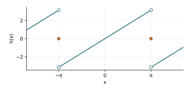
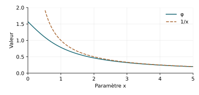

# Banque PT — Mathématiques C 2013 · Corrigé brut

*Corrigé rédigé par IA, non officiel. Signalez toute erreur.*

**Rédaction** · GPT-6.2 Astra Ultra · vitesse non renseignée · 26 novembre 2026

La Banque PT a programmé cet écrit le mardi 7 mai 2013, de 14 h à 18 h. La garde interdit la calculatrice. Les questions figurent aux pages 2 à 4 du PDF de 5 pages. En admissibilité, le coefficient de Mathématiques C est de 3 pour l’ENS Cachan et de 6 pour l’École polytechnique. [Sujet](https://www.banquept.fr/documents/2013/math_c_2013_pt.pdf) · [Rapport du jury](https://www.banquept.fr/documents/ecrit/rapport/2013/rapport_math_c_ecrit_2013.pdf) · [Livret de la Banque PT, p. 8, 9 et 12](https://www.banquept.fr/documents/livret/2013/Livret_PT_2013.pdf)

## I. Série de Fourier et intégrales de Wallis

### Question I.1.a

Sur $]-\pi,\pi[$, l’imparité donne $h(t)=t$. Périodicité et imparité imposent $h(\pi)=0$. Les produits $h(t)\cos(nt)$ sont impairs, donc tous les $a_n$ sont nuls, constante comprise. Pour $n\ge1$, l’intégration par parties donne
$$b_n=\frac2\pi\int_0^\pi t\sin(nt)\,dt=\frac2\pi\left[-\frac{t\cos(nt)}n+\frac{\sin(nt)}{n^2}\right]_0^\pi=\frac{2(-1)^{n-1}}n.$$

### Question I.1.b

Pour une fonction périodique de classe $C^1$ par morceaux sur une période, les sommes partielles de Fourier convergent en tout point vers la demi-somme des limites à gauche et à droite. En un point de continuité, cette demi-somme vaut la valeur de la fonction.

### Question I.1.c

La fonction périodique est affine entre les sauts, donc $C^1$ par morceaux. En $x=(2k+1)\pi$, ses limites sont $\pi$ et $-\pi$, de moyenne nulle. Partout la somme est donc $h(x)$, soit $x-2k\pi$ sur $](2k-1)\pi,(2k+1)\pi[$ et zéro aux sauts. Son expression est $\sum_{n\ge1}2(-1)^{n-1}\sin(nx)/n$.

### Question I.1.d

Pour $0\le x<\pi$, la valeur de la fonction est $x$. La division par deux de l’égalité de I.1.c donne $\sum_{n\ge1}(-1)^{n-1}\sin(nx)/n=x/2$.

### Question I.1.e

En $x=\pi/2$, les rangs pairs sont nuls. Pour $n=2j+1$, le premier signe est positif et $\sin((2j+1)\pi/2)=(-1)^j$. En conservant l’ordre des termes non nuls, on obtient $\pi=4\sum_{j\ge0}(-1)^j/(2j+1)$.

### Question I.2.a

Avec $u=\pi/2-t$, on a $\sin t=\cos u$ et $dt=-du$. L’inversion des bornes donne $\int_0^{\pi/2}\sin^{2n}t\,dt=\int_0^{\pi/2}\cos^{2n}u\,du$.

### Question I.2.b

Le changement $u=\pi-t$ dans la seconde moitié de $J_n=\int_0^\pi\sin^{2n}t\,dt$ conserve le sinus. Ainsi $J_n=2\int_0^{\pi/2}\sin^{2n}t\,dt=2\int_0^{\pi/2}\cos^{2n}t\,dt$.

### Question I.2.c

Pour tout réel $t$, $e^{it}=\cos t+i\sin t$ et $e^{-it}=\cos t-i\sin t$. D’où $\cos t=(e^{it}+e^{-it})/2$ et $\sin t=(e^{it}-e^{-it})/(2i)$.

### Question I.2.d

Pour $m\in\mathbb N$ et $a,b\in\mathbb C$, $(a+b)^m=\sum_{j=0}^m\binom mj a^j b^{m-j}$ avec $\binom mj=m!/(j!(m-j)!)$. Chaque terme provient du choix des $j$ facteurs fournissant $a$.

### Question I.2.e

Pour $k=0$ l’intégrale vaut $\pi$. Pour un entier non nul, elle vaut $(e^{ik\pi}-1)/(ik)=((-1)^k-1)/(ik)$. Elle est donc nulle pour $k$ pair non nul et vaut $2i/k$ pour $k$ impair.

### Question I.2.f

La formule du binôme appliquée à $2\cos t$ donne $\cos^{2n}t=4^{-n}\sum_{j=0}^{2n}\binom{2n}j e^{2i(j-n)t}$, car l’exposant additionne $j$ copies de $it$ et $2n-j$ copies de $-it$.

### Question I.2.g

Les fréquences de I.2.f sont paires. Par I.2.e, l’intégration de la somme finie sur $[0,\pi]$ ne conserve que $j=n$. Ainsi $\int_0^\pi\cos^{2n}t\,dt=\pi\binom{2n}n/4^n$.

### Question I.2.h

Le changement $t\mapsto\pi-t$ conserve aussi la puissance paire du cosinus. I.2.b et I.2.g donnent $J_n=\pi(2n)!/(4^n(n!)^2)$. Comme $(2n)!=2^nn!\prod_{j=1}^n(2j-1)$, on trouve $J_n=\pi\,\prod_{j=1}^n(2j-1)/(2^n n!)$.

## II. Intégrale de Dirichlet

### Question II.1

Pour $t>0$, $|\sin t|=|\int_0^t\cos s\,ds|\le\int_0^t1\,ds=t$. La division par $t$ donne l’inégalité sur tout le demi-axe.

### Question II.2

Fixons $x>0$. Les intégrandes de $\phi(x)=\int_0^\infty e^{-xt}\sin(t)/t\,dt$ et de $\psi(x)=x^{-1}\int_0^\infty e^{-xt}\cos t\,dt$ sont continus pour $t>0$ et majorés en valeur absolue par $e^{-xt}$ et $e^{-xt}/x$. Ces majorants sont intégrables sur $[0,\infty[$. Le premier intégrande a pour limite $1$ en zéro.

### Question II.3

Fixons $a>0$. Lorsque $x\ge a$, les intégrandes sont dominés par $e^{-at}$ et $e^{-at}/a$. Leurs dérivées en $x$ sont $-e^{-xt}\sin t$ et $-(t/x+1/x^2)e^{-xt}\cos t$, dominées par $e^{-at}$ et $(t/a+1/a^2)e^{-at}$. Ces quatre majorants sont intégrables. Continuité en $x$, convergence dominée et dérivation sous l’intégrale donnent deux fonctions $C^1$ sur $[a,\infty[$ dont les dérivées sont les intégrales de ces expressions.

### Question II.4

Sur $[0,T]$, l’intégration par parties de $\int e^{-xt}\cos t\,dt$ donne $e^{-xT}\sin T+x\int_0^T e^{-xt}\sin t\,dt$. Le terme au bord tend vers zéro. Après division par $x$, on reconnaît $\psi(x)=\int_0^\infty e^{-xt}\sin t\,dt=-\phi'(x)$.

### Question II.5

Posons $S=\int_0^\infty e^{-xt}\sin t\,dt$ et $C=\int_0^\infty e^{-xt}\cos t\,dt=xS$. Sur un segment puis à la limite, la primitive $-\cos t$ donne $S=1-xC$. D’où $(1+x^2)S=1$ et $\phi'(x)=-1/(1+x^2)$.

### Question II.6

Le premier majorant de II.2 donne $|\phi(x)|\le\int_0^\infty e^{-xt}\,dt=1/x$. Le membre droit tend vers zéro lorsque $x$ tend vers l’infini.

### Question II.7

Sur l’intervalle $]0,\infty[$, $\phi+\arctan$ a une dérivée nulle. Sa limite en l’infini vaut $\pi/2$. Par conséquent $\phi(x)=\pi/2-\arctan x$.

### Question II.8

Le passage à la limite $x\downarrow0$ fourni par le sujet identifie l’intégrale impropre du sinus cardinal à $\lim_{x\downarrow0}\phi(x)$. Ainsi $\int_0^\infty\sin t/t\,dt=\pi/2$. Le théorème de convergence dominée utilisé sur $[a,\infty[$ en II.3 ne fournit pas à lui seul ce passage en zéro.

## III. Développement de l’intégrale elliptique

### Question III.1

Pour $0\le c<1$, $1-c^2\sin^2t\ge1-c^2>0$. L’intégrande de $I(c)$ est donc continu et borné sur le segment $[0,\pi/2]$. Son intégrale existe.

### Question III.2.a

La formule $f(x)=1/\sqrt{1-x^2}$ définit un réel lorsque $1-x^2>0$, soit $D_f=]-1,1[$.

### Question III.2.b

La fonction puissance $u\mapsto u^{-1/2}$ est dérivable pour $u>0$. La composition avec $1-x^2$ l’est sur $D_f$ et $f'(x)=x(1-x^2)^{-3/2}$.

### Question III.2.c

Le développement binomial de $(1+u)^\alpha$, pour tout réel $\alpha$, converge vers cette fonction lorsque $|u|<1$. Prendre $\alpha=-1/2$ et $u=-x^2$ donne sur $|x|<1$ une série entière en puissances paires de $x$, de somme $f(x)$.

### Question III.2.d

En multipliant la dérivée de III.2.b par $1-x^2$, on obtient $x(1-x^2)^{-1/2}=xf(x)$. La différence demandée est donc nulle sur $D_f$.

### Question III.2.e.i

Écrivons $f(x)=\sum_{n\ge0}a_nx^n$. Dans le disque de convergence on dérive terme à terme. Le coefficient constant impose $a_1=0$. Pour $n\ge1$, celui de $x^n$ dans $(1-x^2)f'-xf$ est $(n+1)a_{n+1}-(n-1)a_{n-1}-a_{n-1}$. L’unicité des coefficients donne $a_{n+1}=na_{n-1}/(n+1)$.

### Question III.2.e.ii

De $a_0=f(0)=1$ et $a_1=0$, la récurrence donne $a_{2p+1}=0$ et $a_{2p}=\prod_{j=1}^p(2j-1)/(2j)=\binom{2p}p/4^p$, produit vide égal à un pour $p=0$.

### Question III.2.e.iii

Pour $|x|<1$, $f(x)=\sum_{p=0}^{\infty}\binom{2p}p x^{2p}/4^p$. Le rapport entre deux coefficients pairs successifs tend vers un, en accord avec le rayon de convergence $1$.

### Question III.3

Posons $A_p=\binom{2p}p/4^p$. I.2 donne $\int_0^{\pi/2}\sin^{2p}t\,dt=(\pi/2)A_p$, aussi pour $p=0$. La somme admise fournit
$$I(c)=\pi S,\qquad S=\frac12\sum_{p=0}^{\infty}\left(\frac{\binom{2p}p}{4^p}\right)^2c^{2p}.$$
Comme $0<A_p\le1$ et $c<1$, la série converge absolument. Pour $c$ fixé dans $]0,1[$, le rapport de deux termes successifs tend vers $c^2$.
