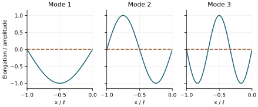
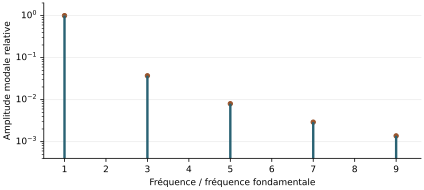
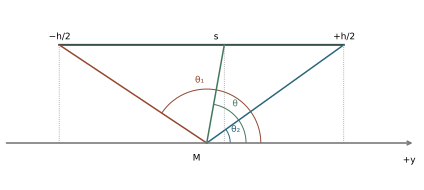
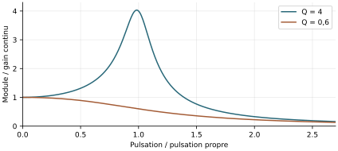
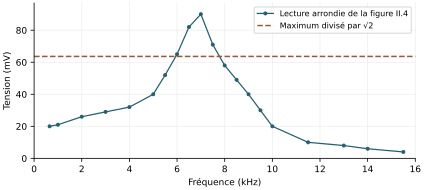
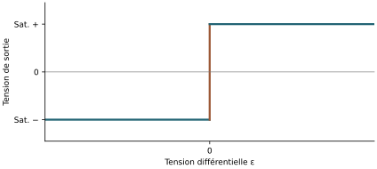
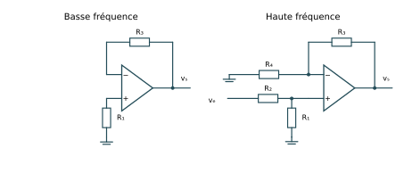
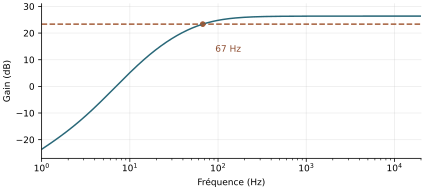
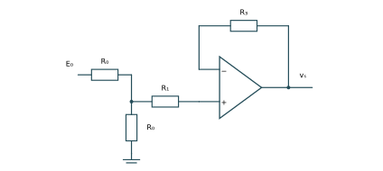

# Banque PT — Physique A 2013 · Corrigé guidé

*Corrigé rédigé par IA, non officiel. Signalez toute erreur.*

**Rédaction** · GPT-6.2 Astra Ultra · vitesse non renseignée · 27 novembre 2026

L’écrit dure quatre heures. La calculatrice est interdite. Sauf consigne particulière, les applications numériques se donnent avec un chiffre significatif. L’énoncé comporte des pages numérisées intercalées et des courbes à exploiter. Les coefficients d’admissibilité sont 6 à l’École polytechnique et 3 à l’ENS Cachan. [Sujet](https://www.banquept.fr/documents/2013/ph_a_2013_pt.pdf) · [Rapport du jury](https://www.banquept.fr/documents/ecrit/rapport/2013/rapport_phys_a_ecrit_2013.pdf) · [Grille de la Banque PT](https://www.banquept.fr/documents/livret/2013/Livret_PT_2013.pdf#page=12).

## I. Cavité résonante et corde de guitare

### Question I.A.1.a

> [!INDICATION]
> Partir de la conductivité et de la loi constitutive.

#### Solution

La loi d’Ohm locale d’un milieu isotrope est $\vec j=\gamma\vec E$. Un conducteur parfait correspond à la limite de conductivité $\gamma$ infinie, donc de résistivité nulle. Il peut porter un courant.

### Question I.A.1.b

> [!INDICATION]
> Prendre la limite à densité de courant finie.

#### Solution

À l’intérieur, $\vec E=\vec j/\gamma$. Si $\vec j$ reste finie lorsque $\gamma$ tend vers l’infini, le champ électrique tend vers zéro. Ce résultat n’exige pas l’absence de courant.

### Question I.A.1.c

> [!INDICATION]
> Fixer la normale du métal vers le vide.

#### Solution

La composante tangentielle de $\vec E$ est continue et la composante normale extérieure moins intérieure vaut $\sigma_s/\varepsilon_0$. Le champ intérieur étant nul, on a sur le bord, côté vide, $\vec E_\parallel=0$ et $\vec E=(\sigma_s/\varepsilon_0)\vec n$ où $\vec n$ sort du métal.

### Question I.A.2.a

> [!INDICATION]
> Éliminer charges et courants de conduction.

#### Solution

Les équations sont $\nabla\cdot\vec E=0$, $\nabla\cdot\vec B=0$, $\nabla\times\vec E=-\partial_t\vec B$ et $\nabla\times\vec B=\mu_0\varepsilon_0\partial_t\vec E$.

### Question I.A.2.b

> [!INDICATION]
> Prendre le rotationnel de Faraday et développer le double rotationnel.

#### Solution

Le membre gauche de $\nabla\times(\nabla\times\vec E)=-\partial_t(\nabla\times\vec B)$ vaut $\nabla(\nabla\cdot\vec E)-\Delta\vec E=-\Delta\vec E$. En substituant Ampère-Maxwell, il vient $\Delta\vec E-\mu_0\varepsilon_0\partial_t^2\vec E=0$, équation de d’Alembert.

### Question I.A.2.c

> [!INDICATION]
> Comparer avec l’équation d’onde de célérité c.

#### Solution

Le produit $\mu_0\varepsilon_0=1/c^2$ est l’inverse du carré de la célérité électromagnétique dans le vide. Sa dimension est $T^2/L^2$.

### Question I.A.2.d

> [!INDICATION]
> Dériver deux fois la fonction composée, y compris le facteur de chaîne.

#### Solution

Pour $F(t\mp x/c)$, $\partial_t^2 F=F''(t\mp x/c)$ tandis que $\partial_x^2F=F''(t\mp x/c)/c^2$. Les dérivées suivant $y,z$ sont nulles. Chaque profil suffisamment régulier, multiplié par $\vec u_y$ constant, vérifie donc l’équation d’onde.

### Question I.A.2.e

> [!INDICATION]
> Imposer que l’argument du profil reste constant.

#### Solution

Le profil $E_1(t-x/c)$ est une onde plane progressive vers $+x$ à la célérité $c$. Le profil $E_2(t+x/c)$ se déplace vers $-x$ à la même célérité.

### Question I.A.3.a

> [!INDICATION]
> Observer la direction du vecteur réel lorsque le temps varie.

#### Solution

Le champ physique est $E_0\cos(\omega t-kx)\vec u_y$, à une phase initiale près. Sa direction reste parallèle à $Oy$. La polarisation est rectiligne.

### Question I.A.3.b

> [!INDICATION]
> Substituer l’onde harmonique à l’équation de propagation.

#### Solution

Les dérivées secondes introduisent respectivement $-k^2$ et $-\omega^2$. On trouve $k^2=\omega^2/c^2$, d’où $k=\omega/c$ pour l’onde incidente écrite.

### Question I.A.4.a

> [!INDICATION]
> Appliquer la réflexion spéculaire à incidence normale.

#### Solution

La composante tangentielle du vecteur d’onde est conservée et vaut zéro. Le vecteur d’onde réfléchi pointe du conducteur vers le vide. Il vaut donc $-k\vec u_x$. L’angle de réflexion est nul.

### Question I.A.4.b

> [!INDICATION]
> Chercher les transformations laissant le problème physique inchangé.

#### Solution

L’onde incidente, la surface plane illimitée et les propriétés des deux milieux sont invariantes par toute translation selon $y$ ou $z$. La solution réfléchie doit respecter ces symétries. Son amplitude complexe ne dépend donc que de $x$.

### Question I.A.4.c

> [!INDICATION]
> Le champ total tangent doit s’annuler pour tout instant.

#### Solution

Le champ réfléchi obéit à la même équation de d’Alembert dans le vide. Son amplitude vérifie $\vec E_{r0}''+k^2\vec E_{r0}=0$ et représente une onde sortant vers $-x$. À la surface, $\vec E_{r,\parallel}(0,t)=-\vec E_{i,\parallel}(0,t)$. La transversalité exclut une composante normale pour ces ondes planes.

### Question I.A.4.d

> [!INDICATION]
> Déterminer le coefficient de l’exponentielle se dirigeant vers la gauche.

#### Solution

La forme sortante est $\vec E_r=\vec C\,e^{i(\omega t+kx)}$. La condition au bord impose $\vec C=-E_0\vec u_y$. Ainsi la réflexion sur le conducteur parfait ajoute un déphasage de $\pi$ au champ électrique incident en $x=0$.

### Question I.A.4.e

> [!INDICATION]
> Prendre la partie réelle après factorisation.

#### Solution

La somme complexe vaut $E_0 e^{i\omega t}(e^{-ikx}-e^{ikx})\vec u_y=-2iE_0e^{i\omega t}\sin(kx)\vec u_y$. Le champ physique est $\vec E(x,t)=2E_0\sin(\omega x/c)\sin(\omega t)\vec u_y$.

### Question I.A.4.f

> [!INDICATION]
> Comparer les positions des nœuds à deux instants.

#### Solution

Les dépendances spatiale et temporelle sont séparées. Les nœuds et ventres sont fixes et toute la figure oscille sur place. C’est une onde stationnaire produite par deux ondes de même amplitude et de sens opposés.

### Question I.A.4.g

> [!INDICATION]
> Annuler le facteur spatial indépendamment du temps.

#### Solution

Les plans nodaux vérifient $\sin(kx)=0$, soit $x=p\lambda/2$. Dans le demi-espace vide $x\le0$, les positions s’écrivent $x=-p\lambda/2$ pour $p=0,1,2,\ldots$. Deux plans successifs sont distants d’une demi-longueur d’onde.

### Question I.A.5.a

> [!INDICATION]
> Appliquer la même condition tangentielle à gauche.

#### Solution

Sur la paroi située à $x=-\ell$, le champ électrique parallèle doit aussi s’annuler pour tout instant. Il faut donc $\sin(k\ell)=0$ pour un champ non identiquement nul.

### Question I.A.5.b

> [!INDICATION]
> Combien de demi-longueurs d’onde la cavité peut-elle contenir ?

#### Solution

La seconde condition impose $k\ell=n\pi$. Comme $k=\omega/c$, les pulsations positives admises sont $\omega_n=n\pi c/\ell=n\omega_0$, avec $n=1,2,\ldots$. L’indice zéro ne donne aucune oscillation de champ.

### Question I.A.5.c

> [!INDICATION]
> Choisir la solution de plus basse fréquence.

#### Solution

Pour $n=1$, $\omega_0=\pi c/\ell$. La longueur d’onde du fondamental vaut $2\ell$.

### Question I.A.5.d

> [!INDICATION]
> Reporter les pulsations autorisées dans l’expression du champ réel.

#### Solution

Le mode est $\vec E_n=2E_0\sin[(n\omega_0/c)x]\sin(n\omega_0t)\vec u_y$. Les trois constantes dans l’ordre demandé sont $A=2E_0$, $\alpha=n\omega_0/c$ et $\beta=n\omega_0$, pour la phase incidente choisie.

### Question I.B.1.a

> [!INDICATION]
> Diviser la masse totale par la longueur.

#### Solution

Une corde cylindrique homogène de section $s=\pi D^2/4$ a une masse $M=\rho s\ell$. On obtient $\mu=M/\ell=\rho\pi D^2/4$ en kilogrammes par mètre.

### Question I.B.1.b

> [!INDICATION]
> Convertir les grammes et les millimètres carrés.

#### Solution

On a $s=\mu/\rho=0{,}006/8000=7{,}5\times10^{-7}\ {\rm m^2}$, soit $0{,}75\ {\rm mm^2}$ ou environ $0{,}8\ {\rm mm^2}$. La longueur mesurée par la masse est $\ell=M/\mu=3{,}6/6=0{,}6$ m.

### Question I.B.2.a

> [!INDICATION]
> Les attaches restent immobiles.

#### Solution

L’élongation est nulle aux deux extrémités pour tout instant. Les conditions sont $y(-\ell,t)=0$ et $y(0,t)=0$.

### Question I.B.2.b

> [!INDICATION]
> Remplacer la tension par les dimensions d’une force.

#### Solution

Le quotient $T_0/\mu$ a pour dimension $(MLT^{-2})/(ML^{-1})=L^2T^{-2}$. Sa racine carrée possède la dimension d’une vitesse.

### Question I.B.2.c

> [!INDICATION]
> Comparer les coefficients des dérivées secondes.

#### Solution

L’équation de corde prend la forme $\partial_t^2y=v^2\partial_x^2y$ avec $v=\sqrt{T_0/\mu}$. Ce terme joue le rôle de $c$. Il est la vitesse de propagation d’une perturbation transverse le long de la corde, indépendamment de la vitesse transverse d’un point matériel.

### Question I.B.2.d

> [!INDICATION]
> Conserver une valeur intermédiaire précise pour calculer la fréquence.

#### Solution

Avec $T_0=120$ N et $\mu=0{,}006\ {\rm kg\,m^{-1}}$, on trouve $v=\sqrt{20000}\simeq1{,}4\times10^2\ {\rm m\,s^{-1}}$, de l’ordre de $10^2\ {\rm m\,s^{-1}}$.

### Question I.B.2.e

> [!INDICATION]
> Transposer la condition d’une demi-onde entre les attaches.

#### Solution

La pulsation de base est $\omega_0=\pi v/\ell$. En fréquence usuelle $f_0=\omega_0/(2\pi)=v/(2\ell)$, environ $118$ Hz avec les valeurs non arrondies.

### Question I.B.2.f

> [!INDICATION]
> Différencier l’expression et tester les deux extrémités.

#### Solution

Pour $y_n=Y_{0n}\sin(n\pi x/\ell)\sin(n\omega_0t)$, les deux dérivées secondes sont $-(n\omega_0)^2 y_n$ en temps et $-(n\pi/\ell)^2 y_n$ en espace. Leur rapport est $v^2$. Aux bornes, les sinus spatiaux valent $\sin(-n\pi)=0$ et $\sin0=0$, comme requis.

### Question I.B.2.g

> [!INDICATION]
> Tenir compte des abscisses négatives du segment.

#### Solution

À $t=2\pi/\omega_n$ les trois profils sont la droite $y=0$. À $t=\pi/(2\omega_n)$, ils valent $Y_{0n}\sin(n\pi x/\ell)$. Du point $-\ell$ à zéro, le premier mode dessine une arche négative, le deuxième une positive puis une négative, le troisième une négative, une positive puis une négative, pour $Y_{0n}>0$. Les nœuds divisent la longueur en $n$ intervalles égaux.

### Question I.B.3.a

> [!INDICATION]
> Examiner les indices des coefficients non nuls.

#### Solution

Tous les $b_n$ sont nuls, comme les $a_n$ de rang pair. Les fréquences présentes dans le mouvement global et dans ce modèle de son sont $(2p+1)f_0$ pour $p=0,1,\ldots$, de coefficients modaux $A/(2p+1)^3$. Un point d’observation placé sur un nœud ne voit pas le mode concerné.

### Question I.B.3.b

> [!INDICATION]
> Comparer les amplitudes absolues des coefficients.

#### Solution

Le coefficient modal est maximal au rang un. Le son dominant est le fondamental de fréquence $f_0=v/(2\ell)\simeq1{,}2\times10^2$ Hz avant arrondi, de l’ordre de 100 Hz.

### Question I.B.3.c

> [!INDICATION]
> Tracer des raies au lieu de relier les valeurs discrètes.

#### Solution

Le spectre unilatéral des amplitudes modales a les hauteurs relatives $1,1/27,1/125,1/343,\ldots$ aux abscisses $f_0,3f_0,5f_0,7f_0,\ldots$. Les rangs pairs sont absents. L’échelle verticale logarithmique de la figure permet de voir les petites amplitudes.

### Question I.B.3.d

> [!INDICATION]
> Préciser ce qu’il faut préserver pour restituer le timbre.

#### Solution

Un microphone fidèle doit être linéaire sur la plage utile, avec un gain presque constant et une phase compatible avec un simple retard sur les fréquences du son. Il reproduit alors les fréquences présentes et leurs amplitudes relatives sans engendrer d’harmoniques supplémentaires.

## II. Microphone de guitare

### Question II.A.1.a

> [!INDICATION]
> Inclure le courant de déplacement.

#### Solution

La loi locale est $\nabla\times\vec B=\mu_0\vec j+\mu_0\varepsilon_0\partial_t\vec E$. Les deux termes ont la dimension d’une densité de courant après division par $\mu_0$.

### Question II.A.1.b

> [!INDICATION]
> Intégrer sur une surface fixe appuyée sur un contour fermé.

#### Solution

Par Stokes, pour un contour et une normale associés par la règle de la main droite, $\oint_{\partial S}\vec B\cdot d\vec\ell=\mu_0 I_{\rm traversant}+\mu_0\varepsilon_0\,d\Phi_E/dt$, avec $\Phi_E=\int_S\vec E\cdot d\vec S$. Le courant traversant est compté avec la même orientation.

### Question II.A.1.c

> [!INDICATION]
> Écrire la forme couramment utilisée pour les bobinages.

#### Solution

Dans l’approximation quasi stationnaire où le courant de déplacement est négligeable, $\oint\vec B\cdot d\vec\ell=\mu_0I_{\rm traversant}$.

### Question II.A.2.a

> [!INDICATION]
> Orienter le vecteur depuis l’élément de circuit jusqu’au point de mesure.

#### Solution

Un circuit filiforme parcouru par un courant permanent $I$ produit en M le champ $\vec B(M)=\mu_0 I/(4\pi)\oint d\vec\ell_P\times\overrightarrow{PM}/PM^3$, où $d\vec\ell_P$ est orienté dans le sens du courant.

### Question II.A.2.b

> [!INDICATION]
> Additionner deux contributions diamétralement opposées.

#### Solution

À l’abscisse axiale $y$, toutes les distances valent $\sqrt{R^2+y^2}$. Les contributions transverses de deux éléments opposés se compensent. La projection axiale de $d\vec\ell\times\overrightarrow{PM}$ vaut $R\,d\ell$ avec le sens de la figure II.1. L’intégration des $2\pi R$ de circonférence donne $\vec B=\mu_0IR^2\vec u_y/[2(R^2+y^2)^{3/2}]$.

### Question II.A.2.c

> [!INDICATION]
> Préciser le point d’où est mesuré l’angle.

#### Solution

Une tranche à la cote $s$, d’épaisseur $ds$, contient $N\,ds/h$ spires, soit $dI=(NI/h)\,ds$. En M de cote $y$, définissons $\theta$ entre $+\vec u_y$ et la direction allant de M au bord de la tranche. Alors $\cos\theta=(s-y)/\sqrt{R^2+(s-y)^2}$ et $\sin\theta=R/\sqrt{R^2+(s-y)^2}$. Le résultat de la spire donne $d\vec B=(\mu_0NI/(2hR))\sin^3\theta\,ds\,\vec u_y$.

### Question II.A.2.d

> [!INDICATION]
> Repérer les angles des deux extrémités avec la même convention.

#### Solution

La dérivée de $\cos\theta$ par rapport à $s$ vaut $R^2/[R^2+(s-y)^2]^{3/2}=\sin^3\theta/R$. Pour $\theta_1$ au bord $s=-h/2$ et $\theta_2$ au bord $s=h/2$, on intègre $d\vec B=(\mu_0NI/(2h))\,d(\cos\theta)\vec u_y$. Ainsi $\vec B=(\mu_0NI/(2h))(\cos\theta_2-\cos\theta_1)\vec u_y$. À l’intérieur d’une bobine très longue, les deux cosinus tendent vers $+1$ et $-1$ dans cet ordre de soustraction.

### Question II.A.3.a

> [!INDICATION]
> Étudier translations, rotations et plans perpendiculaires à l’axe.

#### Solution

L’invariance par translation axiale et rotation autour de l’axe laisse une dépendance en distance radiale seule. Le plan perpendiculaire à l’axe passant par le point est un plan de symétrie des courants azimutaux. Le champ magnétique, pseudovecteur, y est normal. Donc $\vec B_s=B_y(r)\vec u_y$ dans chaque domaine, intérieur ou extérieur.

### Question II.A.3.b

> [!INDICATION]
> Utiliser un rectangle dont les deux grands côtés sont parallèles à l’axe.

#### Solution

Un contour sans courant enlacé montre que $B_y$ est constant de part et d’autre du bobinage, séparément. Un rectangle de longueur axiale $a$ traversant la nappe donne $(B_{\rm int}-B_{\rm ext})a=\mu_0naI$. Pour le champ propre seul, le champ extérieur est nul, comme dans la limite d’une bobine de longueur croissante, et $\vec B_{\rm int}=\mu_0 nI\vec u_y$. Le résultat concorde avec la limite sur l’axe de la question précédente.

### Question II.A.3.c

> [!INDICATION]
> Prendre la normale positive du côté du champ.

#### Solution

Le champ étant uniforme sur le disque de rayon $R$, le flux orienté d’une spire vaut $\Phi_1=B_{\rm int}\pi R^2=\mu_0 nI\pi R^2$.

### Question II.B.1.a

> [!INDICATION]
> Relier flux local et courant traversant une section.

#### Solution

La densité volumique de courant $\vec j$ décrit le flux de charges. L’intensité orientée à travers une surface est $I=\int_S\vec j\cdot d\vec S$. Son unité est l’ampère par mètre carré.

### Question II.B.1.b

> [!INDICATION]
> Commencer par le champ uniforme entre les bornes.

#### Solution

En convention récepteur, le champ axial est $E=U/d$. Avec la loi locale $j=\gamma U/d$ et la section uniforme, $I=jS=\gamma SU/d$.

### Question II.B.1.c

> [!INDICATION]
> Le coefficient de proportionnalité entre U et I est la résistance.

#### Solution

De $U=dI/(\gamma S)$ on tire la résistance $R_{\rm fil}=d/(\gamma S)$ exprimée en ohms.

### Question II.B.1.d

> [!INDICATION]
> Employer le diamètre du fil pour la section et le rayon des spires pour la longueur.

#### Solution

La longueur vaut $2\pi RN$, la section est $\pi d_f^2/4$. Ainsi $R_{\rm fil}=8RN/(\gamma d_f^2)$. Pour $R=5\times10^{-3}$ m, $N=10^4$, $d_f=5\times10^{-5}$ m et $\gamma=6\times10^7\ {\rm S/m}$, on obtient environ $2{,}7$ kΩ, soit 3 kΩ à un chiffre.

### Question II.B.2.a

> [!INDICATION]
> Chaque spire enlace le même flux dans l’approximation admise.

#### Solution

On a $n=N/h$ et $\Phi_N=N\Phi_1$. Le flux total enlacé vaut donc $\Phi_N=\mu_0N^2\pi R^2I/h$.

### Question II.B.2.b

> [!INDICATION]
> Diviser le flux enlacé par l’intensité qui le produit.

#### Solution

La définition $L=\Phi_N/I$ conduit à $L=\mu_0N^2\pi R^2/h$ pour la bobine assimilée à un solénoïde long sans noyau magnétique.

### Question II.B.2.c

> [!INDICATION]
> Identifier conducteurs séparés par un isolant dans le bobinage.

#### Solution

Des segments de fil voisins peuvent se trouver à des potentiels différents et sont séparés par leur vernis isolant ou par de l’air. Les champs électriques entre spires et entre couches emmagasinent de l’énergie et créent des capacités parasites.

### Question II.B.3.a

> [!INDICATION]
> Associer la branche parallèle de sortie et la branche série du bobinage.

#### Solution

Avec $s=j\omega$, la charge est $Z_p=(1/R_0+sC_0)^{-1}$ et la série interne a pour impédance $R_L+sL$. Le diviseur donne
$$
H=\frac{Z_p}{Z_p+R_L+sL}=\frac{1}{1+R_L/R_0+s(L/R_0+R_LC_0)+s^2LC_0}.
$$

### Question II.B.3.b

> [!INDICATION]
> Normaliser par le terme constant et identifier chaque coefficient.

#### Solution

Posons $a=1+R_L/R_0$, $b=L/R_0+R_LC_0$. La forme est $H=H_0/(1-x^2+jx/Q)$ avec $x=\omega/\omega_0$, $H_0=1/a$, $\omega_0=\sqrt{a/(LC_0)}$ et $Q=\sqrt{aLC_0}/b$. L’indice zéro désigne ici le paramètre du microphone.

### Question II.B.3.c

> [!INDICATION]
> Minimiser le carré du module du dénominateur.

#### Solution

Il vaut $D(x)=(1-x^2)^2+x^2/Q^2$. Pour $x>0$, $D'(x)=2x[2x^2-2+Q^{-2}]$. Un minimum intérieur existe pour $Q>1/\sqrt2$, à $\omega_r=\omega_0\sqrt{1-1/(2Q^2)}$. Sinon le module décroît à partir de sa valeur continue.

### Question II.B.3.d

> [!INDICATION]
> Identifier le plateau initial, le pic éventuel et la pente finale.

#### Solution

Le module part de $H_0$. Si $Q>1/\sqrt2$, il monte jusqu’à $H_0Q/\sqrt{1-1/(4Q^2)}$ puis décroît. À haute fréquence $|H|\sim H_0(\omega_0/\omega)^2$. La figure trace un cas résonant et un cas sans résonance.

### Question II.B.3.e

> [!INDICATION]
> Préciser la référence lors d’une mesure de largeur de résonance.

#### Solution

Une chute de trois décibels sur l’amplitude correspond au facteur $10^{-3/20}\simeq1/\sqrt2$. Sur le pic, les deux pulsations de coupure encadrant la résonance sont celles pour lesquelles $|H|=|H|_{\max}/\sqrt2$. Elles définissent ici la largeur à mi-puissance.

### Question II.B.3.f

> [!INDICATION]
> Lire le niveau de basse fréquence et le maximum sur la même ordonnée.

#### Solution

Le maximum de la figure II.4 vaut environ 90 mV à 7,0 kHz, et le niveau bas voisin de 20 mV. Sous l’hypothèse de grand $Q$, $|H|_{\max}/H_0\simeq Q$, soit $Q\simeq90/20=4{,}5$. Le niveau de référence est estimé par les premiers points.

### Question II.B.3.g

> [!INDICATION]
> Lire les deux intersections avec la droite horizontale à 64 mV.

#### Solution

Le niveau $90/\sqrt2\simeq64$ mV est atteint vers $5{,}9$ à $6{,}0$ kHz et $7{,}8$ kHz. La largeur est voisine de $1{,}9$ kHz. Avec l’approximation $\Delta f\simeq f_r/Q$, on trouve $Q\simeq3{,}7$ à $3{,}9$ selon l’interpolation.

### Question II.B.3.h

> [!INDICATION]
> Identifier la fréquence propre au pic à l’ordre de l’approximation.

#### Solution

À grand $Q$, $\omega_0\simeq2\pi f_r$. On déduit $L\simeq(1+R_L/R_0)/[C_0(2\pi f_r)^2]$. Pour $C_0=100$ pF et $f_r=7{,}0$ kHz, $L\simeq5{,}2$ H. En remplaçant dans l’expression exacte du facteur de qualité avec $R_0=1$ MΩ et $R_L=3$ kΩ, on trouve $Q\simeq4{,}2$.

### Question II.B.3.i

> [!INDICATION]
> Distinguer précision de lecture et validité de l’approximation asymptotique.

#### Solution

Les trois méthodes donnent un facteur de qualité de l’ordre de 4. Le pic expérimental est échantillonné par pas finis, le niveau continu est extrapolé et un facteur de qualité de 4 ne réalise qu’approximativement l’hypothèse de grand $Q$. L’écart de quelques dixièmes est compatible avec la précision des lectures et avec le modèle simplifié.

### Question II.B.3.j

> [!INDICATION]
> Identifier les composantes fréquentielles amplifiées.

#### Solution

Un déplacement de la résonance renforce une autre zone du spectre des vibrations. Le rapport des amplitudes des harmoniques restituées change, donc le timbre aussi, même pour une même fréquence fondamentale.

### Question II.C.1.a

> [!INDICATION]
> Orienter l’aire par le sens du courant.

#### Solution

Le moment d’un circuit filiforme plan parcouru par $i$ est $\vec m=iS\vec n$, où $S$ est l’aire délimitée et $\vec n$ la normale orientée par le courant. Son unité est $\mathrm{A\,m^2}$.

### Question II.C.1.b

> [!INDICATION]
> Identifier aire et normale sur la figure.

#### Solution

Pour la spire circulaire orientée autour de $+Oy$ suivant la règle de la main droite, $\vec m=i\pi a^2\vec u_y$. Le sens s’inverse si l’on inverse le courant.

### Question II.C.1.c

> [!INDICATION]
> Intégrer la force élémentaire de Laplace sur un contour fermé.

#### Solution

Dans un champ uniforme, $\vec F=i\oint d\vec\ell\times\vec B_0=i(\oint d\vec\ell)\times\vec B_0=0$. Cette annulation utilise la fermeture du contour.

### Question II.C.1.d

> [!INDICATION]
> Le moment tend à aligner le dipôle sur le champ.

#### Solution

Le moment résultant est $\vec\Gamma=\vec m\times\vec B_0$. Sa valeur est indépendante du point de réduction puisque la résultante des forces est nulle.

### Question II.C.2.a

> [!INDICATION]
> Projeter le potentiel sur la direction azimutale avant de prendre le rotationnel.

#### Solution

Choisissons l’axe polaire $+Oy$. Le seul terme de $\vec A=\mu_0\vec m\times\vec r/(4\pi r^3)$ est $A_\varphi=\mu_0m\sin\theta/(4\pi r^2)$. Le rotationnel donne $B_r=(r\sin\theta)^{-1}\partial_\theta(\sin\theta A_\varphi)=2\mu_0m\cos\theta/(4\pi r^3)$ et $B_\theta=-r^{-1}\partial_r(rA_\varphi)=\mu_0m\sin\theta/(4\pi r^3)$. On a $B_\varphi=0$.

### Question II.C.2.b

> [!INDICATION]
> Traiter aussi la demi-droite négative.

#### Solution

Sur l’axe, $\sin\theta=0$ et le champ est purement axial. Sur les deux demi-axes, $\cos\theta\,\vec u_r=\vec u_y$, donc $\vec B=\mu_0m\vec u_y/(2\pi|y|^3)$.

### Question II.C.2.c

> [!INDICATION]
> Développer le résultat de Biot et Savart en a sur la distance.

#### Solution

Si $|y|\gg a$, le champ de la spire est $\mu_0 i a^2\vec u_y/(2|y|^3)$ au premier ordre. Comme $m=i\pi a^2$, c’est exactement le champ axial du dipôle. Ce rapprochement justifie le modèle dipolaire loin de la taille de la source.

### Question II.C.3.a

> [!INDICATION]
> Décrire comment la position change le flux dans le circuit.

#### Solution

L’aimant aimante la corde. La portion en mouvement modifie le flux magnétique enlacé par la bobine. La loi de Faraday engendre $e(t)=-d\Phi_m/dt$. Cette source commande le courant dans le circuit fermé et la tension aux bornes de l’amplificateur, donc tous deux dépendent du mouvement.

### Question II.C.3.b

> [!INDICATION]
> Séparer le flux de la corde du flux propre de la bobine.

#### Solution

L’équation de Kirchhoff est $L\,di/dt+(R_L+R_A)i=e(t)=-d\Phi_m/dt$. Le terme $L\,di/dt$ représente déjà l’effet du flux propre. Le flux extérieur $\Phi_m$ reste une fonction de la position de la corde.

### Question II.C.3.c

> [!INDICATION]
> Appliquer la loi d’Ohm au récepteur et dériver le flux par composition.

#### Solution

Comme $u=R_Ai$, il vient $du/dt+(R_L+R_A)u/L=-(R_A/L)\dot y\,d\Phi_m/dy$. Le produit à droite est simplement $-(R_A/L)d\Phi_m/dt$.

### Question II.C.4.a

> [!INDICATION]
> Écrire le transfert de la composante alternative à la fréquence imposée.

#### Solution

Pour $d\Phi_m/dy=K$ constant et $R=R_L+R_A$, le transfert complexe entre la partie oscillante de $y$ et $u$ est $-j\omega R_AK/(R+j\omega L)$. L’amplitude est $U=R_A|K|\omega Y_0/\sqrt{R^2+(\omega L)^2}$. Pour $K>0$, la phase de $u$ relativement à la partie oscillante de $y$ vaut $-\pi/2-\arctan(\omega L/R)$ modulo $2\pi$. Pour $K<0$, ajouter $\pi$. Le décalage constant $Y_R$ ne contribue pas.

### Question II.C.4.b

> [!INDICATION]
> La dérivation et le circuit linéaire modifient-ils la fréquence ?

#### Solution

Le régime établi ne contient que la fréquence imposée de $y(t)$. Le modèle à $K$ constant ne génère aucun harmonique supplémentaire pour un déplacement sinusoïdal.

### Question II.C.5.a

> [!INDICATION]
> Comparer la sensibilité près de l’aimant et à dix millimètres.

#### Solution

La figure II.8 donne une sensibilité normalisée forte au voisinage de zéro, décroissante et presque nulle à une distance de 1 cm. Sur une excursion finie, le produit $\dot y\,\Phi_m'(y)$ introduit une non-linéarité. Une sensibilité constante ne convient qu’à de petites excursions autour d’une position donnée.

### Question II.C.5.b

> [!INDICATION]
> Observer ce que représentent les abscisses et les hauteurs.

#### Solution

Un spectre d’amplitude indique les fréquences présentes et leurs amplitudes. Ici les ordonnées sont ramenées au maximum de chaque signal, donc on compare les poids relatifs. Les tracés ne renseignent pas sur les phases ni sur le rapport des amplitudes absolues entre les deux dispositifs.

### Question II.C.5.c

> [!INDICATION]
> Lire l’espacement des raies et la première composante non nulle.

#### Solution

La première raie du déplacement se situe vers 200 Hz. Les suivantes sont approximativement des multiples de 200 Hz. Le fondamental de cette mesure est donc voisin de 200 Hz.

### Question II.C.5.d

> [!INDICATION]
> Compter le rang à partir du fondamental.

#### Solution

La composante à 600 Hz est le troisième harmonique, puisqu’elle est à trois fois la fréquence fondamentale. Le fondamental lui-même porte le rang un.

### Question II.C.5.e

> [!INDICATION]
> Comparer le rapport entre les raies de 400 et 200 Hz dans les deux spectres.

#### Solution

Aux figures II.9 et II.10 les principales raies sont sur la même grille de fréquences. Toutefois la raie à 400 Hz, à peine le cinquième du fondamental en déplacement, dépasse la moitié du fondamental en tension. Celle à 600 Hz s’accroît aussi relativement. Le microphone restitue la hauteur de la note mais altère le timbre au sens de la fidélité spectrale.

### Question II.C.6.a

> [!INDICATION]
> Distinguer étendue spatiale, alignement et réponse du matériau.

#### Solution

Le modèle concentre une portion de corde en un moment ponctuel, axial, déterminé instantanément par la seule distance $y$. Une corde réelle présente une aimantation distribuée qui dépend du champ local, de la géométrie, de l’état magnétique du matériau et éventuellement de son histoire. Le champ de la corde peut aussi perturber le champ appliqué.

### Question II.C.6.b

> [!INDICATION]
> Rappeler le couple d’un dipôle et l’effet d’un gradient.

#### Solution

Un champ incliné peut exercer un couple $\vec m\times\vec B$ si le moment et le champ ne sont pas alignés. Le gradient d’un champ non uniforme attire aussi la corde aimantée et peut comporter une force transverse hors du plan idéal du mouvement. À faible distance, le microphone peut perturber la position d’équilibre, la vibration et les fréquences de la corde.

## III. Pédale à effet

### Question III.1.a

> [!INDICATION]
> Placer en abscisse la différence entre entrée positive et négative.

#### Solution

Posons $\epsilon=v_+-v_-$. En modèle idéal à deux saturations, $v_s=V_{\rm sat+}$ pour $\epsilon>0$ et $v_s=V_{\rm sat-}$ pour $\epsilon<0$. Le segment vertical à $\epsilon=0$ décrit le régime linéaire de gain différentiel infini, avec $v_s$ compris entre les deux limites. En contre-réaction négative, il est possible d’y imposer $v_+=v_-$.

### Question III.1.b

> [!INDICATION]
> Remplacer chaque condensateur par un circuit ouvert ou un fil selon la limite.

#### Solution

En basse fréquence, $C_2,C_4$ sont ouverts. L’entrée positive revient à la masse par $R_1$, l’entrée négative à la sortie par $R_3$, et les autres branches interrompues ne transportent pas de courant. En haute fréquence, les condensateurs sont court-circuités. $R_2,R_1$ forment alors le diviseur alimentant l’entrée positive, et $R_3,R_4$ le réseau de contre-réaction.

### Question III.1.c

> [!INDICATION]
> Dans le régime linéaire imposer l’égalité des potentiels d’entrée.

#### Solution

En basse fréquence, $v_+=0$ et $v_-=v_s$, donc $v_s=0$. En haute fréquence, $v_+=R_1v_e/(R_1+R_2)$ et $v_-=R_4v_s/(R_3+R_4)$. Le gain haut vaut $(1+R_3/R_4)R_1/(R_1+R_2)$.

### Question III.1.d

> [!INDICATION]
> Comparer les deux régimes asymptotiques.

#### Solution

La sortie est nulle en continu et proportionnelle à l’entrée aux hautes fréquences. On s’attend à un filtre passe-haut actif, dont le gain de bande passante peut dépasser un.

### Question III.1.e

> [!INDICATION]
> Multiplier le diviseur d’entrée par le gain non inverseur.

#### Solution

Posons $s=j\omega$. Le diviseur donne $v_+/v_e=sR_1C_2/[1+s(R_1+R_2)C_2]$. L’entrée négative est reliée à la masse par $R_4+1/(sC_4)$ et à la sortie par $R_3$. Ainsi $v_s/v_+=1+R_3/[R_4+1/(sC_4)]$. Leur produit a la forme demandée avec
$$
\omega_1=\frac1{R_1C_2},\qquad \omega_2=\frac1{(R_3+R_4)C_4},\qquad
\omega_3=\frac1{(R_1+R_2)C_2},\qquad \omega_4=\frac1{R_4C_4}.
$$
On obtient bien $H=(j\omega/\omega_1)(1+j\omega/\omega_2)/[(1+j\omega/\omega_3)(1+j\omega/\omega_4)]$.

### Question III.1.f

> [!INDICATION]
> Évaluer le plateau en décibels.

#### Solution

Le plateau haut vaut $H_\infty=(1+10^6/(5\times10^4))10^6/(10^6+10^4)\simeq20{,}8$. Son gain est $20\log_{10}(20{,}8)\simeq26{,}4$ dB, en accord avec le palier de la figure III.2. Les deux facteurs constitutifs, le diviseur passe-haut et le gain non inverseur, ont chacun un module croissant ici.

### Question III.1.g

> [!INDICATION]
> Mesurer trois décibels sous le plateau et lire l’abscisse logarithmique.

#### Solution

La droite de niveau à $26{,}4-3\simeq23{,}4$ dB coupe la courbe entre 60 et 70 Hz, soit environ 67 Hz à la précision du graphique. La résolution de $|H|=H_\infty/\sqrt2$ avec les données donne aussi $67$ Hz à deux chiffres. Le circuit atténue les composantes basses et amplifie avec un gain proche du plateau la plupart des harmoniques aigus.

### Question III.2.a

> [!INDICATION]
> En régime permanent, ouvrir C₁, C₂ et C₄.

#### Solution

La source musicale est mise à zéro. Les trois condensateurs ouverts isolent les branches d’entrée alternatives. Il reste le diviseur des deux $R_0$ entre $E_0$ et la masse, son point milieu relié à $v_+$ par $R_1$, et la contre-réaction $R_3$ de la sortie vers $v_-$. Les entrées idéales n’absorbent aucun courant.

### Question III.2.b

> [!INDICATION]
> Calculer d’abord la tension médiane du pont symétrique.

#### Solution

Le courant de $R_1$ est nul, donc $V_{+0}=E_0/2$. Le courant de $R_3$ est également nul et $V_{s0}=V_{-0}=V_{+0}=E_0/2$.

### Question III.2.c

> [!INDICATION]
> Comparer l’impédance du point milieu à la résistance R₁.

#### Solution

Avec $E_0$ court-circuitée, les deux $R_0$ et $C_1$ sont en parallèle depuis le point milieu vers la masse. L’impédance de retour est $Z=R_1+[2/R_0+j\omega C_1]^{-1}$. À 30 Hz déjà, $1/(\omega C_1)\simeq5{,}3$ kΩ, très inférieur à $R_1=1$ MΩ. Au-dessus de 30 Hz, la correction est au plus d’environ 0,53 % et diminue encore. L’ensemble se ramène donc à $R_1$.

### Question III.2.d

> [!INDICATION]
> Retrouver le diviseur d’entrée et le transfert du premier montage.

#### Solution

En grandeurs complexes, $V_{+1}\simeq [j\omega R_1C_2/(1+j\omega(R_1+R_2)C_2)]V_e$ et $V_{s1}\simeq H(\omega)V_e$ avec le $H$ déterminé en III.1.e. Les grandeurs temporelles sont les parties réelles après multiplication par $e^{j\omega t}$.

### Question III.2.e

> [!INDICATION]
> Distinguer le point de repos de la composante musicale.

#### Solution

Les deux résistances $R_0$ établissent le potentiel médian $E_0/2$. $R_1$ transmet ce potentiel à l’entrée positive, lui donne un chemin continu et fixe avec $R_2,C_2$ la réponse musicale. La sortie se centre sur $E_0/2$ tant que l’amplificateur reste linéaire.

### Question III.2.f

> [!INDICATION]
> Identifier la composante bloquée par le condensateur d’entrée de l’oscilloscope.

#### Solution

En couplage DC on observe $E_0/2+v_{s1}(t)$, une oscillation décalée. En AC, la composante continue est bloquée et l’on voit l’oscillation centrée sur zéro, pour une fréquence bien supérieure à la coupure propre de l’oscilloscope.

### Question III.3.a

> [!INDICATION]
> Comparer l’excursion de la sortie linéaire à chacune de ses marges.

#### Solution

À 10 kHz le gain en module est voisin de 20,8 et le repos est à $4{,}5$ V. Les marges aux rails $+9$ V et $-9$ V sont donc $4{,}5$ V et $13{,}5$ V. Pour une amplitude d’entrée inférieure à $4{,}5/20{,}8\simeq0{,}22$ V les deux crêtes passent. Entre environ 0,22 et 0,65 V, les crêtes positives sont écrêtées. Au-delà de $13{,}5/20{,}8\simeq0{,}65$ V, les deux alternances atteignent une limite. Une note de quelques centaines de millivolts peut ainsi devenir non sinusoïdale, ce qui enrichit son spectre.

### Question III.3.b

> [!INDICATION]
> Suivre le gain haut lorsque R₄ augmente.

#### Solution

Quand $R_4$ passe de 50 à 500 kΩ, le facteur non inverseur $1+R_3/R_4$ passe de 21 à 3. Le gain haut global baisse d’environ 20,8 à 3,0. Pour un même niveau musical, augmenter $R_4$ réduit l’écrêtage. Le réglage change ainsi l’intensité de la distorsion et modifie aussi les pulsations dépendant de $R_4$.
