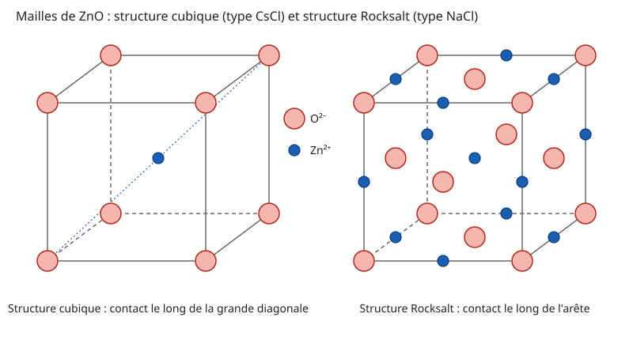
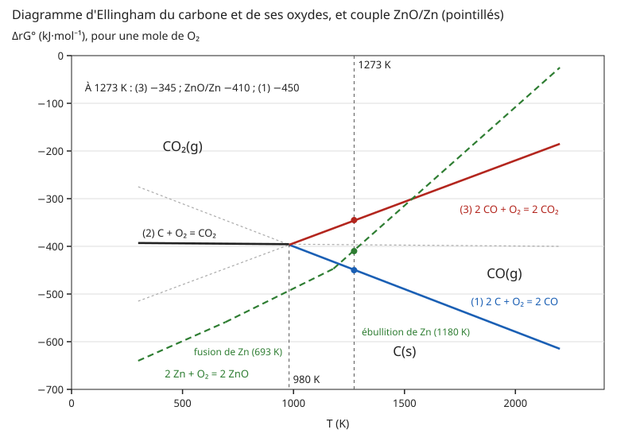
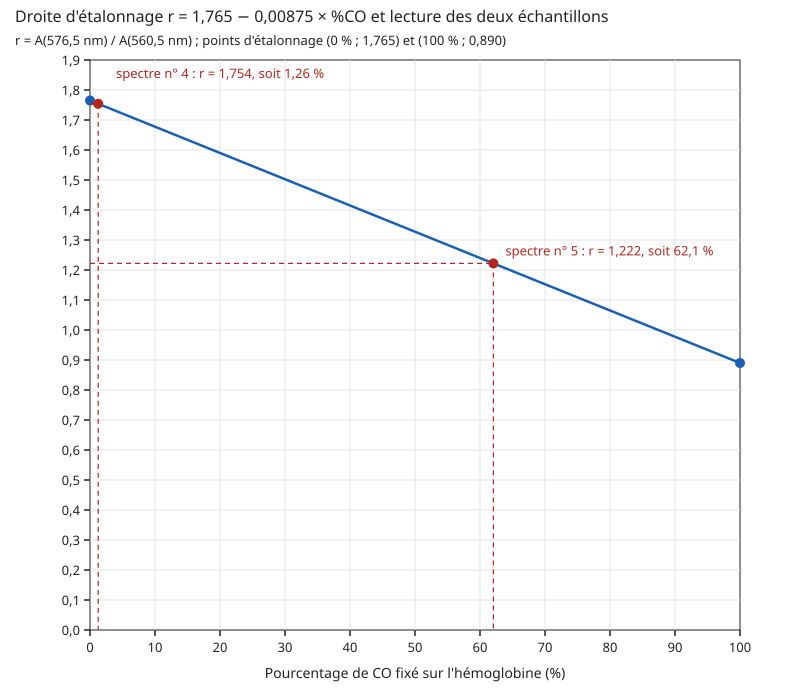

# Banque PT PT — Physique C - Chimie 2013 · Corrigé guidé

*Corrigé rédigé par IA, non officiel. Signalez toute erreur.*

**Rédaction** · modèle exact non renseigné (famille Claude) · effort non renseigné · vitesse non renseignée

**Révision (tour 2)** · modèle exact non renseigné (famille Claude) · effort non renseigné · vitesse non renseignée · 28 novembre 2026

## Présentation du sujet

**Thème.** Le monoxyde de carbone, réducteur industriel et poison : la molécule, son rôle dans la pyrométallurgie du zinc, puis le dosage de la carboxyhémoglobine dans le sang. L'épreuve dure 2 heures, **sans calculatrice**, et comporte 42 questions numérotées de 1 à 42, réparties en trois parties largement indépendantes. Deux feuilles annexes sont à rendre avec la copie : les mailles à dessiner et le diagramme d'Ellingham à compléter, puis le papier millimétré de la courbe d'étalonnage. Les données et une liste d'aides numériques figurent à la fin de l'énoncé.

- *Partie 1 (questions 1 à 9)* : configurations électroniques, règles de remplissage, tétravalence et isotopes du carbone, place de l'oxygène dans la classification, formule de Lewis de $\mathrm{CO}$ et électronégativité.
- *Partie 2 (questions 10 à 32)* : cristallographie de l'oxyde de zinc (questions 10 à 18 : structures cubique, Rocksalt et Würtzite, paramètres de maille, masses volumiques), puis diagramme d'Ellingham (questions 19 à 32 : couples du carbone, dismutation de $\mathrm{CO}$, équilibre de Boudouard, couple $\mathrm{ZnO/Zn}$, réduction de l'oxyde de zinc).
- *Partie 3 (questions 33 à 42)* : oxydation de $\mathrm{CO}$ par les ions palladium(II) (questions 33 à 37 : demi-équations, quotient de réaction, relation de Nernst), puis dosage spectrophotométrique (questions 38 à 42 : loi de Beer-Lambert, droite d'étalonnage, exploitation de deux spectres).

**Notions mobilisées.** Configuration électronique et classification périodique, schéma de Lewis et charges formelles, cristaux ioniques (contenu d'une maille, contact, masse volumique), approximation d'Ellingham et diagrammes associés, enthalpie libre standard et constante d'équilibre, oxydoréduction et relation de Nernst, absorbance et étalonnage. Le programme est celui en vigueur à la session 2013, antérieur à la réforme de 2013-2014.

**Difficulté.** Les questions sont courtes et proches du cours ; les calculs se réduisent à des combinaisons simples grâce aux aides numériques. La difficulté tient au nombre de questions, à l'exigence de justification systématique, à la consigne des trois chiffres significatifs et à la lecture soignée du diagramme d'Ellingham (température en kelvins, choix de la bonne courbe).

**Gestion du temps.** Environ 15 minutes pour la partie 1, 60 minutes pour la partie 2 (25 pour la cristallographie, 35 pour le diagramme d'Ellingham) et 40 minutes pour la partie 3, en gardant 5 minutes pour relire et vérifier que les deux annexes sont complétées. Parcourir tout l'énoncé avant de commencer, données et aides numériques comprises.

> [!JURY]
> Le rapport 2013 salue les efforts de présentation et le soin apporté aux copies. Son message principal porte sur la rigueur : justifier systématiquement chaque réponse (une réponse sans justification ne rapporte pas de points), prendre du recul sur la plausibilité des résultats, respecter la consigne des trois chiffres significatifs pour chaque calcul, préciser l'état physique de chaque espèce et respecter les notations de l'énoncé. Il conseille aussi de parcourir rapidement l'ensemble du sujet, certains candidats n'ayant pas vu les aides numériques placées à la fin. Ces détails, cumulés, font une forte différence sur la note finale.

[Sujet officiel](https://www.banquept.fr/documents/2013/ph_c_ch_2013_pt.pdf) · [Rapport du jury](https://www.banquept.fr/documents/ecrit/rapport/2013/rapport_phys_c_ecrit_2013.pdf)

*Mode d'emploi* : chercher chaque question seul, lire la première indication en cas de blocage, réessayer, puis la seconde, et seulement ensuite la solution.

## Partie 1 — Généralités sur la molécule de monoxyde de carbone

### Question 1

> [!INDICATION]
> Répartir les $Z$ électrons dans les sous-couches prises par énergie croissante : $1s$, puis $2s$, puis $2p$.

> [!INDICATION]
> Une sous-couche $s$ contient au plus 2 électrons, une sous-couche $p$ au plus 6. Vérifier que la somme des exposants redonne $Z$.

#### Solution

L'atome d'oxygène possède 8 électrons, l'atome de carbone 6. En remplissant les sous-couches par énergie croissante ($1s$, $2s$, $2p$) :

$$\boxed{\mathrm{O}\ (Z = 8) : 1s^2\,2s^2\,2p^4 \qquad \mathrm{C}\ (Z = 6) : 1s^2\,2s^2\,2p^2}$$

La couche de valence est la couche $n = 2$ : 6 électrons de valence pour l'oxygène, 4 pour le carbone.

> [!METHODE]
> Contrôle immédiat : la somme des exposants vaut $Z$ ($2 + 2 + 4 = 8$ et $2 + 2 + 2 = 6$). Repérer tout de suite les électrons de valence, qui servent aux questions 3, 5 et 7.

### Question 2

> [!INDICATION]
> Trois règles : l'une fixe l'ordre des sous-couches, l'autre le nombre maximal d'électrons par orbitale, la dernière la répartition des électrons dans une sous-couche incomplète.

#### Solution

Trois règles sont utilisées :

- la **règle de Klechkowski** : les sous-couches se remplissent par valeurs croissantes de $n + \ell$ et, à égalité, par $n$ croissant ;
- le **principe d'exclusion de Pauli** : deux électrons d'un même atome ne peuvent avoir leurs quatre nombres quantiques identiques, donc une orbitale contient au plus deux électrons, de spins opposés ;
- la **règle de Hund** : dans une sous-couche incomplète, les électrons occupent le maximum d'orbitales avec des spins parallèles avant de s'apparier.

> [!JURY]
> Le rapport demande de connaître l'orthographe des noms propres des scientifiques qui ont donné leur nom à ces règles.

> [!PIEGE]
> Citer les noms ne suffit pas dans une épreuve où toute réponse doit être justifiée : énoncer chaque règle en une ligne.

### Question 3

> [!INDICATION]
> Compter les électrons de valence du carbone et le nombre d'électrons qui lui manquent pour atteindre l'octet.

> [!INDICATION]
> Dans l'état fondamental $2s^2\,2p^2$, seuls deux électrons sont célibataires. Que devient ce nombre si un électron $2s$ passe dans l'orbitale $2p$ vacante ?

#### Solution

Le carbone possède 4 électrons de valence ($2s^2\,2p^2$) : il lui en manque 4 pour atteindre la configuration du gaz noble qui le suit (le néon, $2s^2\,2p^6$). Il respecte la règle de l'octet en mettant en commun ses 4 électrons de valence, c'est-à-dire en formant **quatre liaisons covalentes** : il est tétravalent.

Dans l'état fondamental, la règle de Hund ne donne que deux électrons célibataires ($2s^2\,2p_x^1\,2p_y^1$). La tétravalence s'explique par le passage d'un électron $2s$ dans l'orbitale $2p$ vacante, qui donne l'état $2s^1\,2p^3$ à quatre électrons célibataires. Le coût énergétique de cette promotion, faible car les niveaux $2s$ et $2p$ sont proches, est plus que compensé par la formation de deux liaisons supplémentaires.

> [!PIEGE]
> Répondre seulement « parce qu'il a quatre électrons de valence » est incomplet : l'état fondamental ne présente que deux électrons célibataires, et c'est l'octet (quatre électrons manquants) ou la promotion $2s \to 2p$ qui justifie les quatre liaisons.

### Question 4

> [!INDICATION]
> Deux isotopes ont le même nombre de protons et des nombres de neutrons différents. Le plus abondant sert de référence pour la définition de la mole.

> [!INDICATION]
> La notation est $^{A}_{Z}\mathrm{X}$, avec $A$ le nombre de nucléons et $Z$ le nombre de protons.

#### Solution

Les deux isotopes les plus répandus sont le **carbone 12** (environ 98,9 %) et le **carbone 13** (environ 1,1 %), tous deux stables :

$$\boxed{^{12}_{\ 6}\mathrm{C} \qquad ^{13}_{\ 6}\mathrm{C}}$$

Ils possèdent 6 protons chacun, et respectivement 6 et 7 neutrons. Le carbone 14, radioactif, n'existe qu'à l'état de traces.

> [!PIEGE]
> Le carbone 14 est le plus célèbre (datation) mais il est présent à l'état de traces : ce n'est pas l'un des deux isotopes les plus répandus.

### Question 5

> [!INDICATION]
> Le numéro de la ligne est le plus grand nombre quantique principal $n$ occupé.

> [!INDICATION]
> Pour un élément du bloc $p$, le numéro de colonne vaut $10$ plus le nombre d'électrons de valence (les colonnes 3 à 12 sont celles du bloc $d$).

#### Solution

La configuration $1s^2\,2s^2\,2p^4$ se termine dans la couche $n = 2$ : l'oxygène est dans la **deuxième ligne** (deuxième période). Il appartient au bloc $p$, avec 4 électrons $p$ : c'est la quatrième colonne du bloc $p$, soit, en comptant les 2 colonnes du bloc $s$ et les 10 colonnes du bloc $d$,

$$\boxed{\text{2}^{\text{e}}\ \text{ligne},\quad 2 + 10 + 4 = 16^{\text{e}}\ \text{colonne}}$$

C'est la famille des chalcogènes.

> [!METHODE]
> Ligne = valeur maximale de $n$ ; colonne = position dans le bloc ($s$ : colonnes 1 et 2 ; $d$ : 3 à 12 ; $p$ : 13 à 18). La justification à partir de la configuration est indispensable.

### Question 6

> [!INDICATION]
> Un élément de la même colonne a la même configuration de valence, avec $n$ augmenté d'une unité.

#### Solution

Le **soufre** S ($Z = 16$, $[\mathrm{Ne}]\,3s^2\,3p^4$), situé juste sous l'oxygène, a la même configuration de valence en $ns^2\,np^4$. On peut aussi citer le sélénium Se ou le tellure Te.

> [!METHODE]
> Justifier par la configuration de valence commune $ns^2\,np^4$ : des propriétés chimiques voisines en découlent (ions $\mathrm{O^{2-}}$ et $\mathrm{S^{2-}}$, composés $\mathrm{H_2O}$ et $\mathrm{H_2S}$).

### Question 7

> [!INDICATION]
> Compter les électrons de valence de la molécule, puis le nombre de doublets à répartir.

> [!INDICATION]
> Chercher à satisfaire l'octet pour les deux atomes : il faut une liaison triple. Calculer ensuite les charges formelles en comparant, pour chaque atome, les électrons attribués à ses électrons de valence.

#### Solution

Nombre d'électrons de valence : $4 + 6 = 10$, soit **5 doublets**. Pour que les deux atomes respectent la règle de l'octet, il faut une liaison triple et un doublet non liant sur chaque atome :

$$\boxed{{}^{\ominus}\,\lvert\mathrm{C}{\equiv}\mathrm{O}\rvert\,{}^{\oplus}}$$

Charges formelles :

- carbone : 1 doublet non liant et 3 liaisons, soit $2 + 3 = 5$ électrons attribués pour 4 électrons de valence : charge formelle $-1$ ;
- oxygène : 1 doublet non liant et 3 liaisons, soit $2 + 3 = 5$ électrons attribués pour 6 électrons de valence : charge formelle $+1$.

La somme des charges formelles est nulle, comme il se doit pour une molécule neutre.

Une autre écriture, $\lvert\mathrm{C}{=}\overline{\underline{\mathrm{O}}}$ (liaison double, un doublet non liant sur le carbone, deux sur l'oxygène), ne fait apparaître aucune charge formelle, mais le carbone n'y est entouré que de 6 électrons : elle ne respecte pas l'octet et contribue moins à la description de la molécule.

> [!JURY]
> Le rapport constate que les règles de remplissage sont connues de la majorité des candidats mais peu comprises, ce qui se traduit par de nombreuses erreurs dans l'écriture des représentations de Lewis, construites à partir de la couche de valence.

> [!PIEGE]
> Ne pas oublier les charges formelles : sans elles, la formule à liaison triple est fausse. Vérifier que leur somme redonne la charge globale, ici zéro.

### Question 8

> [!INDICATION]
> Dans une ligne, le nombre de protons augmente alors que les électrons de valence restent dans la même couche.

#### Solution

L'électronégativité traduit l'aptitude d'un atome à attirer à lui les électrons d'une liaison. Dans une ligne de la classification, elle **augmente de la gauche vers la droite** : la charge du noyau augmente alors que les électrons de valence occupent la même couche, ils sont donc de plus en plus fortement attirés. (Dans une colonne, elle diminue de haut en bas.)

> [!JURY]
> Le rapport relève une certaine confusion entre électronégativité et électroneutralité : la première est une propriété d'un élément (questions 8 et 9), la seconde un bilan de charges (questions 12 et 17).

### Question 9

> [!INDICATION]
> Situer C et O dans leur ligne commune et dire lequel est le plus électronégatif. Comparer avec le signe des charges formelles de la question 7.

#### Solution

Le carbone (colonne 14) et l'oxygène (colonne 16) sont dans la même ligne : l'oxygène est le **plus électronégatif** des deux. On attendrait donc une charge partielle négative sur l'oxygène.

Or la formule à liaison triple porte la charge formelle négative sur le carbone et la charge positive sur l'oxygène : **elle n'est pas en accord avec les électronégativités**. Elle est pourtant retenue parce qu'elle est la seule à respecter la règle de l'octet pour les deux atomes.

La réalité est intermédiaire : la polarisation des liaisons vers l'oxygène compense à peu près la répartition des charges formelles, ce qui explique que le moment dipolaire du monoxyde de carbone soit très faible. La formule à liaison double sans charge, elle, est en accord avec les électronégativités mais ne respecte pas l'octet du carbone.

> [!PIEGE]
> Une charge formelle est un outil de comptage, pas une charge réelle : le désaccord avec les électronégativités ne rend pas la formule fausse. La réponse attendue est une discussion argumentée, pas un simple « oui » ou « non ».

## Partie 2 — Pyrométallurgie du zinc

**Structures cristallines**

### Question 10

> [!INDICATION]
> Structure cubique : un anion à chaque sommet, un cation au centre du cube (type chlorure de césium).

> [!INDICATION]
> Structure Rocksalt : les anions forment un réseau cubique à faces centrées. Les sites octaédriques de ce réseau sont le centre du cube et les milieux des douze arêtes (type chlorure de sodium).

#### Solution

Les deux mailles à tracer sur l'annexe sont reproduites ci-dessous.

- **Structure cubique** : un ion $\mathrm{O^{2-}}$ à chacun des 8 sommets du cube, un ion $\mathrm{Zn^{2+}}$ au centre (structure de type chlorure de césium).
- **Structure Rocksalt** : un ion $\mathrm{O^{2-}}$ à chacun des 8 sommets et au centre de chacune des 6 faces (réseau cubique à faces centrées) ; un ion $\mathrm{Zn^{2+}}$ dans chaque site octaédrique, c'est-à-dire au centre du cube et au milieu de chacune des 12 arêtes (structure de type chlorure de sodium).

Sur l'annexe, le quadrillage et les axes tracés au centre de chaque cube aident à placer les centres des faces et le centre de la maille ; une légende distinguant les deux ions est indispensable.

> [!METHODE]
> Deux symboles nettement différents (taille ou couleur) et une légende. Placer d'abord les anions, puis les cations ; compter les positions dessinées (8 sommets et 1 centre ; 8 sommets, 6 faces, 12 arêtes et 1 centre) avant de passer à la question 11.

### Question 11

> [!INDICATION]
> Un sommet est partagé entre 8 mailles, une arête entre 4, une face entre 2 ; le centre appartient à une seule maille.

#### Solution

Un ion compte pour $1/8$ à un sommet, $1/4$ au milieu d'une arête, $1/2$ au centre d'une face et $1$ à l'intérieur de la maille.

| Maille | Ions $\mathrm{O^{2-}}$ | Ions $\mathrm{Zn^{2+}}$ |
|---|---|---|
| Cubique | $8 \times \dfrac18 = 1$ | $1 \times 1 = 1$ |
| Rocksalt | $8 \times \dfrac18 + 6 \times \dfrac12 = 4$ | $12 \times \dfrac14 + 1 = 4$ |

$$\boxed{\text{cubique : 1 Zn et 1 O par maille} \qquad \text{Rocksalt : 4 Zn et 4 O par maille}}$$

> [!PIEGE]
> Dans la structure Rocksalt, ne pas oublier le cation du centre du cube : les 12 milieux d'arêtes ne donnent que 3 cations.

### Question 12

> [!INDICATION]
> Comparer la charge totale apportée par les cations à celle apportée par les anions, dans chaque maille.

#### Solution

Les ions $\mathrm{Zn^{2+}}$ et $\mathrm{O^{2-}}$ portent des charges opposées de même valeur absolue $2e$. Chaque maille contient autant de cations que d'anions :

- maille cubique : $1 \times (+2e) + 1 \times (-2e) = 0$ ;
- maille Rocksalt : $4 \times (+2e) + 4 \times (-2e) = 0$.

**L'électroneutralité est respectée dans les deux mailles**, en accord avec la formule $\mathrm{ZnO}$.

> [!JURY]
> Le rapport signale une confusion, dans certaines copies, entre électroneutralité et électronégativité. Il s'agit ici d'un bilan de charges dans la maille.

### Question 13

> [!INDICATION]
> Dans un cristal ionique, quels ions sont en contact : deux ions de même signe ou deux ions de signes opposés ? Chercher la direction qui relie un sommet au centre du cube.

> [!INDICATION]
> La grande diagonale du cube mesure $a\sqrt3$ et porte un rayon d'anion, un diamètre de cation et un rayon d'anion.

#### Solution

Dans un cristal ionique, le contact se fait entre ions de charges opposées (les ions de même signe se repoussent). Dans la structure cubique, le cation du centre touche les anions des sommets : le contact a lieu **le long de la grande diagonale du cube**, de longueur $a\sqrt3$, sur laquelle on trouve un rayon d'anion, un diamètre de cation et un rayon d'anion :

$$a\sqrt3 = 2\left(r_{\mathrm{Zn^{2+}}} + r_{\mathrm{O^{2-}}}\right)$$

$$\boxed{a = \frac{2\left(r_{\mathrm{Zn^{2+}}} + r_{\mathrm{O^{2-}}}\right)}{\sqrt3}}$$

Application numérique, avec l'aide numérique de l'énoncé :

$$a = \frac{2 \times (72 + 140)}{\sqrt3} = \frac{424}{\sqrt3}$$

$$\boxed{a \approx 245\ \mathrm{pm}}$$

Remarque : avec cette valeur, deux anions voisins sur une arête seraient distants de $a = 245\ \mathrm{pm}$, valeur inférieure à $2\,r_{\mathrm{O^{2-}}} = 280\ \mathrm{pm}$. Le modèle des sphères dures conduit donc à un recouvrement des anions ($r_{\mathrm{Zn^{2+}}}/r_{\mathrm{O^{2-}}} \approx 0{,}51 < \sqrt3 - 1 \approx 0{,}73$), ce qui est cohérent avec l'instabilité de cette structure annoncée par l'énoncé.

> [!JURY]
> Le rapport rappelle que, dans un cristal ionique, le contact s'effectue entre ions de charges opposées.

> [!PIEGE]
> Écrire $a = 2\,r_{\mathrm{O^{2-}}}$ (contact le long de l'arête) revient à mettre en contact deux anions : c'est l'erreur à éviter. L'arête et la diagonale d'une face ne portent ici que des ions de même signe.

### Question 14

> [!INDICATION]
> Chercher la direction de la maille sur laquelle alternent anions et cations plus proches voisins.

> [!INDICATION]
> Sur une arête : un anion à chaque extrémité et un cation au milieu.

#### Solution

Dans la structure Rocksalt, un cation occupe le milieu de chaque arête, entre deux anions situés aux sommets : le contact entre ions de charges opposées a lieu **le long de l'arête du cube**, qui porte un rayon d'anion, un diamètre de cation et un rayon d'anion :

$$\boxed{a = 2\left(r_{\mathrm{Zn^{2+}}} + r_{\mathrm{O^{2-}}}\right)}$$

$$a = 2 \times (72 + 140)$$

$$\boxed{a = 424\ \mathrm{pm}}$$

Vérification : les anions les plus proches, sur la diagonale d'une face, sont distants de $a\sqrt2/2 \approx 300\ \mathrm{pm}$, valeur supérieure à $2\,r_{\mathrm{O^{2-}}} = 280\ \mathrm{pm}$ : ils ne se touchent pas, le modèle est cohérent.

> [!PIEGE]
> Le réflexe « cubique à faces centrées, donc contact sur la diagonale d'une face » vaut pour un métal. Ici la diagonale d'une face ne porte que des anions, qui ne sont pas en contact.

### Question 15

> [!INDICATION]
> La masse volumique est la masse des motifs contenus dans la maille divisée par le volume $a^3$ de la maille.

> [!INDICATION]
> Convertir avec soin : $1\ \mathrm{pm} = 10^{-12}\ \mathrm{m}$, donc $1\ \mathrm{pm^3} = 10^{-36}\ \mathrm{m^3}$, et $M$ en $\mathrm{kg\cdot mol^{-1}}$. Les rapports utiles figurent dans les aides numériques.

#### Solution

Une maille de volume $a^3$ contient $Z$ motifs $\mathrm{ZnO}$, chacun de masse $M(\mathrm{ZnO})/N_A$ :

$$\boxed{\rho = \frac{Z\,M(\mathrm{ZnO})}{N_A\,a^3}}$$

**Structure cubique** ($Z = 1$, $a = 245\ \mathrm{pm} = 245\cdot10^{-12}\ \mathrm{m}$) :

$$\rho_{\text{cub}} = \frac{81{,}38\cdot10^{-3}}{6{,}02\cdot10^{23} \times (245)^3\cdot10^{-36}} = \frac{81{,}38\cdot10^{7}}{6{,}02 \times (245)^3} \times 10^{3}$$

L'aide numérique donne $9{,}192$ pour la fraction :

$$\boxed{\rho_{\text{cub}} \approx 9{,}19\cdot10^{3}\ \mathrm{kg\cdot m^{-3}}}$$

**Structure Rocksalt** ($Z = 4$, $a = 424\ \mathrm{pm}$) :

$$\rho_{\text{RS}} = \frac{4 \times 81{,}38\cdot10^{-3}}{6{,}02\cdot10^{23} \times (424)^3\cdot10^{-36}} = 4 \times \frac{81{,}38\cdot10^{7}}{6{,}02 \times (424)^3} \times 10^{3}$$

L'aide numérique donne $1{,}773$ pour la fraction et $1{,}773 \times 4 \approx 7{,}092$ :

$$\boxed{\rho_{\text{RS}} \approx 7{,}09\cdot10^{3}\ \mathrm{kg\cdot m^{-3}}}$$

Ces valeurs, de l'ordre de 7 à 9 $\mathrm{g\cdot cm^{-3}}$, sont plausibles pour un oxyde métallique dense obtenu sous haute pression.

> [!JURY]
> Le rapport demande du recul sur les résultats : un candidat qui aboutit à une masse volumique de quelques grammes par mètre cube doit se demander si sa valeur est plausible. Il rappelle aussi que la consigne des trois chiffres significatifs vaut pour chaque calcul, et que certains candidats n'ont pas vu les aides numériques fournies en fin de sujet.

> [!PIEGE]
> Parmi les aides numériques figure aussi $1{,}773/4 \approx 0{,}443$ : c'est un leurre. Il y a 4 motifs par maille Rocksalt, il faut multiplier par 4 et non diviser.

### Question 16

> [!INDICATION]
> La maille surlignée est un prisme droit à base losange. Repérer les atomes d'oxygène aux sommets et celui qui se trouve à l'intérieur du prisme.

> [!INDICATION]
> Les huit sommets d'un prisme, pris ensemble, apportent l'équivalent d'un atome, même si chacun ne compte pas pour $1/8$ (angles de 60° et de 120°).

#### Solution

La maille conventionnelle est le prisme droit à base losange (côté $a$, angles de 60° et 120°, hauteur $c$) de l'empilement hexagonal compact. Les atomes d'oxygène y occupent :

- les 8 sommets : quatre comptent pour $1/12$ (angles de 60°) et quatre pour $1/6$ (angles de 120°), soit au total $4 \times \dfrac1{12} + 4 \times \dfrac16 = 1$ ;
- 1 position à l'intérieur du prisme (plan intermédiaire de l'empilement, à la cote $c/2$), qui compte pour 1.

$$\boxed{N(\mathrm{O}) = 1 + 1 = 2\ \text{atomes d'oxygène par maille}}$$

> [!PIEGE]
> Le prisme hexagonal complet du schéma contient trois mailles conventionnelles, donc 6 atomes d'oxygène ($12 \times \frac16 + 2 \times \frac12 + 3$). La question porte sur la maille surlignée, qui en contient 2.

### Question 17

> [!INDICATION]
> Comparer les nombres de cations et d'anions de la maille, puis leurs charges.

#### Solution

La maille contient 2 ions $\mathrm{Zn^{2+}}$ (donnée de l'énoncé) et 2 ions $\mathrm{O^{2-}}$ (question 16) :

$$2 \times (+2e) + 2 \times (-2e) = 0$$

**L'électroneutralité est respectée** ; la maille contient deux motifs $\mathrm{ZnO}$.

Ce décompte est cohérent avec la description : un empilement hexagonal compact comporte deux sites tétraédriques par atome, soit 4 sites pour 2 atomes d'oxygène, et la moitié seulement est occupée, d'où 2 ions zinc.

> [!METHODE]
> Recouper avec la formule : la maille doit contenir un nombre entier de motifs $\mathrm{ZnO}$, ici $Z = 2$, valeur à réutiliser à la question 18.

### Question 18

> [!INDICATION]
> Le volume d'un prisme droit est l'aire de sa base multipliée par sa hauteur. La base est un losange de côté $a$ et d'angle 60°.

> [!INDICATION]
> Aire du losange : $a^2 \sin 60° = a^2\sqrt3/2$. L'aide numérique donne le volume en $10^7\ \mathrm{pm^3}$.

#### Solution

La base de la maille est un losange de côté $a$ et d'angle 60°, d'aire $a^2\sin 60° = a^2\sqrt3/2$. Le volume de la maille est donc

$$V = \frac{\sqrt3}{2}\,a^2\,c$$

Avec $Z = 2$ motifs par maille :

$$\boxed{\rho = \frac{2\,M(\mathrm{ZnO})}{N_A\,\dfrac{\sqrt3}{2}\,a^2\,c}}$$

Application numérique : d'après l'aide numérique, $\dfrac{\sqrt3}{2} \times (325)^2 \times 521\cdot10^{-7} \approx 4{,}77$, donc

$$V \approx 4{,}77\cdot10^{7}\ \mathrm{pm^3} = 4{,}77\cdot10^{-29}\ \mathrm{m^3}$$

$$\rho = \frac{2 \times 81{,}38\cdot10^{-3}}{6{,}02\cdot10^{23} \times 4{,}77\cdot10^{-29}} = \frac{2 \times 81{,}38}{6{,}02 \times 4{,}77} \times 10^{3}$$

$$\boxed{\rho \approx 5{,}67\cdot10^{3}\ \mathrm{kg\cdot m^{-3}}}$$

Cette valeur est proche de la masse volumique usuelle de l'oxyde de zinc (environ 5,6 $\mathrm{g\cdot cm^{-3}}$). Elle est inférieure à celles des deux structures obtenues sous pression, ce qui est cohérent : une pression élevée favorise les structures les plus denses.

> [!PIEGE]
> Le volume n'est pas $a^2c$ : la base est un losange, pas un carré. Oublier le facteur $\sqrt3/2$ fausse le résultat de 13 %.

**Diagramme d'Ellingham**

### Question 19

> [!INDICATION]
> Écrire $\Delta_r G^\circ$ en fonction de $\Delta_r H^\circ$, $\Delta_r S^\circ$ et $T$, puis dire quelle hypothèse rend cette fonction affine.

#### Solution

L'approximation d'Ellingham consiste à considérer que l'enthalpie standard de réaction $\Delta_r H^\circ$ et l'entropie standard de réaction $\Delta_r S^\circ$ sont **indépendantes de la température** dans tout intervalle où aucun constituant ne change d'état physique. Alors

$$\boxed{\Delta_r G^\circ(T) = \Delta_r H^\circ - T\,\Delta_r S^\circ}$$

est une fonction affine de $T$ sur chaque intervalle : ordonnée à l'origine $\Delta_r H^\circ$, pente $-\Delta_r S^\circ$. Le diagramme est continu et sa pente change à chaque changement d'état.

> [!PIEGE]
> Dire seulement « $\Delta_r G^\circ$ est une droite » ne répond pas à la question : il faut nommer les deux grandeurs supposées constantes et la restriction aux intervalles sans changement d'état, qui sert à la question 27.

### Question 20

> [!INDICATION]
> Pour chaque couple, écrire l'oxydation du réducteur par le dioxygène, avec le coefficient 1 devant $\mathrm{O_2}$.

#### Solution

Chaque réaction est écrite pour une mole de dioxygène, avec les états physiques :

$$
\begin{aligned}
&(1)\quad 2\,\mathrm{C_{(s)}} + \mathrm{O_{2(g)}} = 2\,\mathrm{CO_{(g)}} \\
&(2)\quad \mathrm{C_{(s)}} + \mathrm{O_{2(g)}} = \mathrm{CO_{2(g)}} \\
&(3)\quad 2\,\mathrm{CO_{(g)}} + \mathrm{O_{2(g)}} = 2\,\mathrm{CO_{2(g)}}
\end{aligned}
$$

> [!JURY]
> Le rapport insiste sur la précision des états physiques de chaque espèce.

> [!METHODE]
> Les états physiques servent dès la question suivante, pour compter les moles de gaz.

### Question 21

> [!INDICATION]
> La pente d'une droite d'Ellingham vaut $-\Delta_r S^\circ$. Quelles espèces dominent l'entropie de réaction ?

> [!INDICATION]
> Calculer, pour chaque réaction, la variation du nombre de moles de gaz et en déduire le signe de la pente.

#### Solution

La pente de chaque droite vaut $-\Delta_r S^\circ$, et le signe de $\Delta_r S^\circ$ est celui de la variation $\Delta\nu_g$ du nombre de moles de gaz (l'entropie molaire d'un gaz est très supérieure à celle d'un solide).

| Réaction | $\Delta\nu_g$ | $\Delta_r S^\circ$ | Pente | Courbe |
|---|---|---|---|---|
| (1) $2\,\mathrm{C} + \mathrm{O_2} = 2\,\mathrm{CO}$ | $2 - 1 = +1$ | positive | négative | droite décroissante |
| (2) $\mathrm{C} + \mathrm{O_2} = \mathrm{CO_2}$ | $1 - 1 = 0$ | presque nulle | presque nulle | droite quasi horizontale |
| (3) $2\,\mathrm{CO} + \mathrm{O_2} = 2\,\mathrm{CO_2}$ | $2 - 3 = -1$ | négative | positive | droite croissante |

Sur l'annexe, la droite décroissante porte le repère 1, la droite quasi horizontale le repère 2 et la droite croissante le repère 3 :

$$\boxed{\text{courbe 1} \leftrightarrow \mathrm{CO/C} \qquad \text{courbe 2} \leftrightarrow \mathrm{CO_2/C} \qquad \text{courbe 3} \leftrightarrow \mathrm{CO_2/CO}}$$

> [!METHODE]
> Le raisonnement sur $\Delta\nu_g$ est la justification attendue : les repères 1, 2 et 3 du graphique coïncident avec les numéros des couples, mais le constater sans l'expliquer ne rapporte rien.

### Question 22

> [!INDICATION]
> Les trois droites se coupent en un même point. De part et d'autre, se demander si le monoxyde de carbone possède un domaine d'existence : il est l'oxydant du couple 1 et le réducteur du couple 3.

> [!INDICATION]
> Si la droite du couple où $\mathrm{CO}$ est oxydant passe au-dessus de celle du couple où il est réducteur, $\mathrm{CO}$ se dismute et ces deux droites n'ont plus de sens ; dans le cas contraire, c'est la droite du couple 2 qui disparaît.

#### Solution

Lecture de l'annexe : les trois droites se coupent en un même point, d'abscisse $T_i \approx 980\ \mathrm{K}$ et d'ordonnée voisine de $-395\ \mathrm{kJ\cdot mol^{-1}}$.

Dans un diagramme d'Ellingham, l'oxyde se place au-dessus de la droite de son couple et le réducteur au-dessous. Le monoxyde de carbone est l'oxydant du couple 1 (il se place au-dessus de la droite 1) et le réducteur du couple 3 (il se place au-dessous de la droite 3).

- **Pour $T < T_i$**, la droite 1 est au-dessus de la droite 3 : $\mathrm{CO}$ devrait se trouver à la fois au-dessus de la droite 1 et au-dessous de la droite 3, ce qui est impossible. Il est instable et se dismute selon $2\,\mathrm{CO_{(g)}} = \mathrm{C_{(s)}} + \mathrm{CO_{2(g)}}$. Les droites 1 et 3 n'ont pas de sens physique ; seul le couple 2, $\mathrm{CO_2/C}$, est à considérer.
- **Pour $T > T_i$**, la droite 1 est au-dessous de la droite 3 : $\mathrm{CO}$ possède un domaine de stabilité, compris entre les deux droites. Le carbone s'oxyde d'abord en $\mathrm{CO}$, puis $\mathrm{CO}$ en $\mathrm{CO_2}$ : la droite 2 n'a plus de sens physique.

Le diagramme final comporte donc la droite 2 pour $T < 980\ \mathrm{K}$, puis les droites 1 (en bas) et 3 (en haut) pour $T > 980\ \mathrm{K}$.

> [!METHODE]
> Sur l'annexe, repasser en trait épais les trois demi-droites conservées et hachurer ou gommer les autres. La justification tient en une phrase par zone : existence ou non d'un domaine pour l'espèce de degré d'oxydation intermédiaire.

### Question 23

> [!INDICATION]
> Au-dessus d'une droite d'Ellingham se trouve l'oxydant du couple, au-dessous le réducteur.

#### Solution

Dans le diagramme final (figure 2) :

- **au-dessous** de la droite 2 ($T < 980\ \mathrm{K}$) et de la droite 1 ($T > 980\ \mathrm{K}$) : domaine d'existence du carbone solide $\mathrm{C_{(s)}}$ ;
- **au-dessus** de la droite 2 ($T < 980\ \mathrm{K}$) et de la droite 3 ($T > 980\ \mathrm{K}$) : domaine du dioxyde de carbone $\mathrm{CO_{2(g)}}$ ;
- **entre** les droites 1 et 3, pour $T > 980\ \mathrm{K}$ : domaine du monoxyde de carbone $\mathrm{CO_{(g)}}$.

Le monoxyde de carbone n'est donc stable qu'à haute température, au-dessus de 980 K environ.

> [!PIEGE]
> Le carbone est un solide : son domaine est un domaine d'existence. Pour les gaz, la frontière correspond à des pressions partielles égales à la pression standard ; on parle de domaine de prédominance.

### Question 24

> [!INDICATION]
> Convertir la température en kelvins avant de lire le graphique.

> [!INDICATION]
> Repérer l'abscisse 1273 K (un peu moins de trois petits carreaux après 1000 K, chaque carreau valant 100 K) et lire les ordonnées des droites 1 et 3, un carreau valant $20\ \mathrm{kJ\cdot mol^{-1}}$.

#### Solution

$1000\ °\mathrm{C}$ correspond à $T = 1273\ \mathrm{K}$. À cette abscisse, on lit sur l'annexe :

- droite 1 (couple $\mathrm{CO/C}$, décroissante) : ordonnée située deux carreaux et demi sous la graduation $-400$, soit environ $-450\ \mathrm{kJ\cdot mol^{-1}}$ ;
- droite 3 (couple $\mathrm{CO_2/CO}$, croissante) : ordonnée située un peu plus de deux carreaux sous la graduation $-300$, soit environ $-345\ \mathrm{kJ\cdot mol^{-1}}$.

Parmi les valeurs proposées :

$$\boxed{\Delta_r G_1^\circ(1000\ °\mathrm{C}) = -450\ \mathrm{kJ\cdot mol^{-1}} \qquad \Delta_r G_3^\circ(1000\ °\mathrm{C}) = -345\ \mathrm{kJ\cdot mol^{-1}}}$$

Cohérence : à 1273 K, au-delà du point de concours, la droite 1 est bien au-dessous de la droite 3.

> [!PIEGE]
> L'axe des abscisses est gradué en kelvins et la question est posée en degrés Celsius : lire à 1000 K donnerait deux valeurs presque égales (environ $-400$), ce qui doit alerter.

### Question 25

> [!INDICATION]
> Chercher la combinaison linéaire des réactions (1) et (3) qui donne $\mathrm{C} + \mathrm{CO_2} = 2\,\mathrm{CO}$.

> [!INDICATION]
> $(1) - (3)$ donne $2\,\mathrm{C} + 2\,\mathrm{CO_2} = 4\,\mathrm{CO}$ : il reste à diviser par 2.

#### Solution

La différence $(1) - (3)$ s'écrit $2\,\mathrm{C_{(s)}} + 2\,\mathrm{CO_{2(g)}} = 4\,\mathrm{CO_{(g)}}$, soit deux fois la réaction de Boudouard. Les enthalpies libres standard se combinent comme les équations :

$$\boxed{\Delta_r G_{\text{Boud}}^\circ = \frac{\Delta_r G_1^\circ - \Delta_r G_3^\circ}{2}}$$

À 1000 °C :

$$\Delta_r G_{\text{Boud}}^\circ(1000\ °\mathrm{C}) = \frac{-450 - (-345)}{2} = \frac{-105}{2}$$

$$\boxed{\Delta_r G_{\text{Boud}}^\circ(1000\ °\mathrm{C}) = -52{,}5\ \mathrm{kJ\cdot mol^{-1}}}$$

On retrouve la valeur annoncée par l'énoncé.

> [!METHODE]
> Vérifier la combinaison en additionnant les équations membre à membre avant de combiner les $\Delta_r G^\circ$ : $(1)$ et l'inverse de $(3)$ font disparaître $\mathrm{O_2}$.

### Question 26

> [!INDICATION]
> Relation entre enthalpie libre standard de réaction et constante d'équilibre : $\Delta_r G^\circ + RT\ln K^\circ = 0$.

> [!INDICATION]
> Attention aux unités : $\Delta_r G^\circ$ en $\mathrm{J\cdot mol^{-1}}$ et $T$ en kelvins. Le quotient et l'exponentielle sont dans les aides numériques.

#### Solution

Par définition, $\Delta_r G^\circ(T) = -RT\ln K^\circ(T)$, donc

$$\boxed{K_{\text{Boud}}^\circ = \exp\left(-\frac{\Delta_r G_{\text{Boud}}^\circ}{RT}\right)}$$

Avec $T = 1273\ \mathrm{K}$ et les aides numériques :

$$-\frac{\Delta_r G_{\text{Boud}}^\circ}{RT} = \frac{52{,}5\cdot10^{3}}{8{,}314 \times 1273} \approx 4{,}96$$

$$\boxed{K_{\text{Boud}}^\circ(1000\ °\mathrm{C}) = e^{4{,}96} \approx 143}$$

$K_{\text{Boud}}^\circ \gg 1$ : à 1000 °C, l'équilibre est très favorable à la formation de $\mathrm{CO}$, en accord avec le diagramme (à 1273 K, $\mathrm{C}$ et $\mathrm{CO_2}$ ont des domaines disjoints).

> [!PIEGE]
> Deux erreurs classiques : laisser $\Delta_r G^\circ$ en kilojoules, et se tromper de signe (l'aide numérique propose aussi $e^{-4{,}96} \approx 7{,}01\cdot10^{-3}$). Un $\Delta_r G^\circ$ négatif donne une constante supérieure à 1.

### Question 27

> [!INDICATION]
> Regarder les températures de changement d'état fournies dans les données et les comparer à l'intervalle 300 K à 2200 K.

> [!INDICATION]
> Écrire la réaction d'oxydation du zinc dans chaque intervalle et comparer les entropies standard de réaction : que devient $\Delta\nu_g$ quand le zinc est gazeux ?

#### Solution

L'approximation d'Ellingham ne vaut qu'en l'absence de changement d'état. Or, entre 300 K et 2200 K, le zinc change deux fois d'état : fusion à 693 K, ébullition à 1180 K (l'oxyde de zinc reste solide, sa fusion n'ayant lieu qu'à 2248 K). Le diagramme est donc formé de **trois segments de droite** raccordés continûment :

$$
\begin{aligned}
&T < 693\ \mathrm{K} : \quad 2\,\mathrm{Zn_{(s)}} + \mathrm{O_{2(g)}} = 2\,\mathrm{ZnO_{(s)}} \\
&693\ \mathrm{K} < T < 1180\ \mathrm{K} : \quad 2\,\mathrm{Zn_{(\ell)}} + \mathrm{O_{2(g)}} = 2\,\mathrm{ZnO_{(s)}} \\
&T > 1180\ \mathrm{K} : \quad 2\,\mathrm{Zn_{(g)}} + \mathrm{O_{2(g)}} = 2\,\mathrm{ZnO_{(s)}}
\end{aligned}
$$

À chaque changement d'état du réducteur, son entropie molaire augmente, donc $\Delta_r S^\circ$ diminue et la pente $-\Delta_r S^\circ$ augmente :

- à 693 K, la rupture de pente est très faible (l'entropie de fusion est petite), à peine visible sur l'annexe ;
- à 1180 K, elle est très marquée : la réaction consomme alors 3 moles de gaz au lieu d'une ($\Delta\nu_g = -3$), et la pente est environ deux fois plus forte.

> [!METHODE]
> Les données de fin d'énoncé ($T_{fus}$ et $T_{eb}$ du zinc, $T_{fus}$ de l'oxyde) sont là pour cette question : les citer avec leurs valeurs et relier chaque rupture de pente à une variation de $\Delta_r S^\circ$.

### Question 28

> [!INDICATION]
> Lire l'ordonnée de la courbe en pointillés à 1273 K, sur le segment situé après la rupture de pente de 1180 K.

#### Solution

À $T = 1273\ \mathrm{K}$, la courbe en pointillés, sur son segment de forte pente (zinc gazeux), a une ordonnée située entre un demi-carreau et un carreau sous la graduation $-400$, soit une lecture voisine de $-415\ \mathrm{kJ\cdot mol^{-1}}$ (un carreau vaut $20\ \mathrm{kJ\cdot mol^{-1}}$). Parmi les valeurs proposées, la plus proche est

$$\boxed{\Delta_r G_{\mathrm{ZnO/Zn}}^\circ(1000\ °\mathrm{C}) = -410\ \mathrm{kJ\cdot mol^{-1}}}$$

Cohérence : à 1273 K, la courbe du zinc se trouve entre la droite 1 ($-450$) et la droite 3 ($-345$), ce que confirme l'annexe.

> [!PIEGE]
> La pente est forte à cet endroit : une lecture décalée de 50 K change la valeur de $20\ \mathrm{kJ\cdot mol^{-1}}$. Tracer la verticale $T = 1273\ \mathrm{K}$ à la règle sur l'annexe.

### Question 29

> [!INDICATION]
> Combiner la réaction (3) et la réaction d'oxydation du zinc (toutes deux écrites pour une mole de $\mathrm{O_2}$) pour obtenir $\mathrm{ZnO} + \mathrm{CO} = \mathrm{Zn} + \mathrm{CO_2}$.

> [!INDICATION]
> $(3)$ moins la réaction du zinc donne deux fois la réaction cherchée. À 1000 °C le zinc est gazeux, comme dans l'équation de l'énoncé.

#### Solution

Notons $(\mathrm{Zn})$ la réaction $2\,\mathrm{Zn_{(g)}} + \mathrm{O_{2(g)}} = 2\,\mathrm{ZnO_{(s)}}$, valable à 1273 K puisque le zinc bout à 1180 K. La différence $(3) - (\mathrm{Zn})$ s'écrit $2\,\mathrm{ZnO_{(s)}} + 2\,\mathrm{CO_{(g)}} = 2\,\mathrm{Zn_{(g)}} + 2\,\mathrm{CO_{2(g)}}$, soit deux fois la réaction (4) :

$$\boxed{\Delta_r G_4^\circ = \frac{\Delta_r G_3^\circ - \Delta_r G_{\mathrm{ZnO/Zn}}^\circ}{2}}$$

$$\Delta_r G_4^\circ(1000\ °\mathrm{C}) = \frac{-345 - (-410)}{2} = \frac{65}{2}$$

$$\boxed{\Delta_r G_4^\circ(1000\ °\mathrm{C}) = +32{,}5\ \mathrm{kJ\cdot mol^{-1}}}$$

Constante d'équilibre, avec les aides numériques :

$$\frac{\Delta_r G_4^\circ}{RT} = \frac{32{,}5\cdot10^{3}}{8{,}314 \times 1273} \approx 3{,}07$$

$$\boxed{K_4^\circ(1000\ °\mathrm{C}) = e^{-3{,}07} \approx 4{,}64\cdot10^{-2}}$$

$K_4^\circ < 1$ : à 1000 °C, la réduction de l'oxyde de zinc par le monoxyde de carbone seul est peu favorable.

> [!PIEGE]
> Ici $\Delta_r G^\circ$ est positif, donc l'exposant est négatif : choisir $e^{-3{,}07}$ et non $e^{3{,}07} \approx 21{,}5$, également proposé dans les aides.

### Question 30

> [!INDICATION]
> Additionner membre à membre la réaction (4) et la réaction de Boudouard.

> [!INDICATION]
> Quand on additionne deux équations, les enthalpies libres standard s'ajoutent et les constantes d'équilibre se multiplient.

#### Solution

La somme de la réaction (4) et de la réaction de Boudouard donne

$$\mathrm{ZnO_{(s)}} + \mathrm{CO_{(g)}} + \mathrm{C_{(s)}} + \mathrm{CO_{2(g)}} = \mathrm{Zn_{(g)}} + \mathrm{CO_{2(g)}} + 2\,\mathrm{CO_{(g)}}$$

soit, après simplification, la réaction (5) : $\mathrm{ZnO_{(s)}} + \mathrm{C_{(s)}} = \mathrm{Zn_{(g)}} + \mathrm{CO_{(g)}}$. Donc $\Delta_r G_5^\circ = \Delta_r G_4^\circ + \Delta_r G_{\text{Boud}}^\circ$ et

$$\boxed{K_5^\circ = K_4^\circ \times K_{\text{Boud}}^\circ}$$

Avec l'aide numérique $143 \times 4{,}64\cdot10^{-2} \approx 6{,}64$ :

$$\boxed{K_5^\circ(1000\ °\mathrm{C}) \approx 6{,}64}$$

Contrôle : $\Delta_r G_5^\circ = 32{,}5 - 52{,}5 = -20{,}0\ \mathrm{kJ\cdot mol^{-1}}$, négatif, en accord avec $K_5^\circ > 1$.

> [!PIEGE]
> Les constantes se multiplient, elles ne s'ajoutent pas. L'aide $143/(4{,}64\cdot10^{-2}) \approx 3{,}08\cdot10^{2}$ correspond à une autre combinaison (Boudouard moins la réaction 4), qui n'est pas la réaction demandée.

### Question 31

> [!INDICATION]
> Comparer $K_4^\circ$ et $K_5^\circ$ à 1000 °C : laquelle des deux réactions est favorable ?

> [!INDICATION]
> Chercher sur l'annexe la température à partir de laquelle la courbe du couple ZnO/Zn passe au-dessus de la droite du couple CO/C, et la comparer à la température d'ébullition du zinc.

#### Solution

À 1000 °C, $K_4^\circ \approx 4{,}64\cdot10^{-2}$ alors que $K_5^\circ \approx 6{,}64$ : c'est la **réduction de l'oxyde de zinc par le carbone en excès** qu'il faut exploiter,

$$\boxed{\mathrm{ZnO_{(s)}} + \mathrm{C_{(s)}} = \mathrm{Zn_{(g)}} + \mathrm{CO_{(g)}}}$$

Le carbone en excès consomme le dioxyde de carbone formé par la réaction (4) et régénère le monoxyde de carbone (équilibre de Boudouard), ce qui tire la réduction dans le sens direct.

**Température.** La réaction (5) est favorable ($\Delta_r G_5^\circ < 0$) dès que la courbe du couple $\mathrm{ZnO/Zn}$ passe au-dessus de la droite 1 du couple $\mathrm{CO/C}$. Sur l'annexe, ce croisement se produit juste après la rupture de pente due à l'ébullition du zinc, vers $1{,}2\cdot10^{3}\ \mathrm{K}$ (lecture graphique). Il faut donc travailler au-dessus de 1200 K environ :

$$\boxed{T \gtrsim 1{,}2\cdot10^{3}\ \mathrm{K},\ \text{par exemple } 1000\ °\mathrm{C}\ (1273\ \mathrm{K})\ \text{ou davantage}}$$

À ces températures, le zinc est obtenu à l'état gazeux ($T > T_{eb} = 1180\ \mathrm{K}$) : il quitte le milieu réactionnel, ce qui déplace encore l'équilibre, puis il est récupéré par condensation. Une température plus élevée augmente $K_5^\circ$ (l'écart entre les deux courbes croît très vite) au prix d'un coût énergétique supérieur.

> [!METHODE]
> Une question de bilan se traite en trois temps : comparer les constantes calculées, traduire la condition $\Delta_r G^\circ < 0$ en position relative de deux courbes, lire la température de croisement en précisant qu'il s'agit d'une lecture graphique.

### Question 32

> [!INDICATION]
> Placer à 1273 K les domaines de $\mathrm{ZnO}$, de $\mathrm{C}$ et de $\mathrm{CO}$ sur le diagramme complété. Deux espèces dont les domaines sont disjoints réagissent.

> [!INDICATION]
> Recalculer $\Delta_r G_5^\circ$ directement à partir des ordonnées lues pour la droite 1 et pour la courbe du zinc.

#### Solution

Oui. À 1273 K, sur le diagramme final (figure 2) :

- la courbe du couple $\mathrm{ZnO/Zn}$ ($-410\ \mathrm{kJ\cdot mol^{-1}}$) est **au-dessus** de la droite 1 du couple $\mathrm{CO/C}$ ($-450\ \mathrm{kJ\cdot mol^{-1}}$) : l'oxyde $\mathrm{ZnO}$ (au-dessus de sa courbe) et le carbone (au-dessous de la droite 1) ont des domaines disjoints, ils réagissent ;
- à cette température supérieure à 980 K, l'oxyde stable au contact du carbone est $\mathrm{CO}$ et non $\mathrm{CO_2}$ : le produit attendu est bien le monoxyde de carbone ;
- la courbe du zinc est en revanche **au-dessous** de la droite 3 ($-345\ \mathrm{kJ\cdot mol^{-1}}$) : $\mathrm{ZnO}$ et $\mathrm{CO}$ ont une partie de domaine commune, la réduction par $\mathrm{CO}$ seul est défavorable, ce qui correspond à $K_4^\circ < 1$.

Vérification chiffrée : $(1) - (\mathrm{Zn})$ donne deux fois la réaction (5), donc

$$\Delta_r G_5^\circ = \frac{\Delta_r G_1^\circ - \Delta_r G_{\mathrm{ZnO/Zn}}^\circ}{2} = \frac{-450 + 410}{2} = -20{,}0\ \mathrm{kJ\cdot mol^{-1}}$$

valeur identique à $\Delta_r G_4^\circ + \Delta_r G_{\text{Boud}}^\circ$ et qui redonne $K_5^\circ = \exp\left(\dfrac{20{,}0\cdot10^{3}}{8{,}314 \times 1273}\right) \approx 6{,}6$. Le diagramme et le calcul sont en accord.

La réduction par $\mathrm{CO}$ seul ne deviendrait favorable qu'au-delà du croisement de la courbe du zinc avec la droite 3, vers 1530 K d'après l'annexe.

> [!PIEGE]
> « Domaines disjoints » se raisonne avec l'oxydant d'un couple et le réducteur de l'autre : $\mathrm{ZnO}$ au-dessus de sa courbe, $\mathrm{C}$ au-dessous de la sienne. Comparer $\mathrm{Zn}$ et $\mathrm{C}$ n'a pas de sens.

## Partie 3 — Nocivité du CO pour l'organisme

**Méthode par microdiffusion**

### Question 33

> [!INDICATION]
> Identifier l'oxydant et le réducteur de chaque couple : $\mathrm{CO_2/CO}$ et $\mathrm{Pd^{2+}/Pd}$. Le carbone passe du degré d'oxydation $+\mathrm{II}$ à $+\mathrm{IV}$.

> [!INDICATION]
> Équilibrer la demi-équation du carbone avec $\mathrm{H_2O}$ et $\mathrm{H^+}$. Les deux couples échangent le même nombre d'électrons.

#### Solution

Demi-équations électroniques :

$$
\begin{aligned}
&\mathrm{CO_{2(g)}} + 2\,\mathrm{H^+_{(aq)}} + 2\,e^- = \mathrm{CO_{(g)}} + \mathrm{H_2O_{(\ell)}} \\
&\mathrm{Pd^{2+}_{(aq)}} + 2\,e^- = \mathrm{Pd_{(s)}}
\end{aligned}
$$

Le monoxyde de carbone (réducteur) est oxydé par les ions palladium(II) (oxydant). Les deux couples échangent 2 électrons :

$$\boxed{\mathrm{CO_{(g)}} + \mathrm{Pd^{2+}_{(aq)}} + \mathrm{H_2O_{(\ell)}} = \mathrm{CO_{2(g)}} + \mathrm{Pd_{(s)}} + 2\,\mathrm{H^+_{(aq)}}}$$

Les ions chlorure sont spectateurs.

> [!JURY]
> Le rapport demande de respecter les notations du texte : le symbole du palladium est Pd, et non Pb, qui désigne le plomb.

> [!METHODE]
> Contrôler l'équation bilan : conservation de chaque élément (1 C, 2 O, 2 H, 1 Pd de chaque côté) et de la charge ($+2$ de chaque côté).

### Question 34

> [!INDICATION]
> Recenser l'état physique de chaque espèce : soluté, gaz, solide, solvant. Quelle activité associer à chacun ?

#### Solution

Activités : $[\,\cdot\,]/c^\circ$ pour un soluté, $P/P^\circ$ pour un gaz, 1 pour le solide $\mathrm{Pd}$ et pour le solvant $\mathrm{H_2O}$. À l'équilibre, le quotient de réaction est égal à la constante d'équilibre :

$$\boxed{Q_{r,\text{éq}} = \frac{\dfrac{P_{\mathrm{CO_2}}}{P^\circ}\left(\dfrac{[\mathrm{H^+}]}{c^\circ}\right)^{2}}{\dfrac{P_{\mathrm{CO}}}{P^\circ}\,\dfrac{[\mathrm{Pd^{2+}}]}{c^\circ}} = \frac{P_{\mathrm{CO_2}}\,[\mathrm{H^+}]^{2}}{P_{\mathrm{CO}}\,[\mathrm{Pd^{2+}}]\,c^\circ} = K^\circ}$$

avec $c^\circ = 1\ \mathrm{mol\cdot L^{-1}}$ et $P^\circ = 1\ \mathrm{bar}$, les pressions partielles et les concentrations étant prises à l'équilibre.

> [!JURY]
> Le rapport relève de nombreuses erreurs dans l'expression de la constante d'équilibre de cette question : certains candidats n'ont pas vu que toutes les espèces n'étaient pas en solution aqueuse et que certaines étaient gazeuses. Les états physiques doivent être précisés pour chaque espèce.

> [!PIEGE]
> Écrire $[\mathrm{CO}]$ et $[\mathrm{CO_2}]$ est l'erreur signalée : ce sont des gaz, ils interviennent par leurs pressions partielles. Le palladium solide et l'eau, solvant, n'apparaissent pas.

### Question 35

> [!INDICATION]
> Écrire la relation de Nernst pour chacun des deux couples, avec $\dfrac{RT}{F}\ln 10 \approx 0{,}06\ \mathrm{V}$ et 2 électrons échangés.

> [!INDICATION]
> À l'équilibre, les potentiels des deux couples sont égaux : isoler le logarithme du quotient de réaction.

#### Solution

Relations de Nernst à 25 °C (2 électrons échangés, $\dfrac{RT}{F}\ln10 \approx 0{,}06\ \mathrm{V}$, grandeurs standard sous-entendues) :

$$
\begin{aligned}
E_{\mathrm{Pd}} &= E^\circ(\mathrm{Pd^{2+}/Pd}) + \frac{0{,}06}{2}\log[\mathrm{Pd^{2+}}] \\
E_{\mathrm{C}} &= E^\circ(\mathrm{CO_2/CO}) + \frac{0{,}06}{2}\log\frac{P_{\mathrm{CO_2}}\,[\mathrm{H^+}]^{2}}{P_{\mathrm{CO}}}
\end{aligned}
$$

À l'équilibre, tous les couples présents ont le même potentiel, $E_{\mathrm{Pd}} = E_{\mathrm{C}}$ :

$$E^\circ(\mathrm{Pd^{2+}/Pd}) - E^\circ(\mathrm{CO_2/CO}) = 0{,}03\,\log\frac{P_{\mathrm{CO_2}}\,[\mathrm{H^+}]^{2}}{P_{\mathrm{CO}}\,[\mathrm{Pd^{2+}}]} = 0{,}03\,\log K^\circ$$

$$\boxed{K^\circ = 10^{\frac{2\left[E^\circ(\mathrm{Pd^{2+}/Pd}) - E^\circ(\mathrm{CO_2/CO})\right]}{0{,}06}}}$$

Application numérique :

$$\log K^\circ = \frac{0{,}951 - (-0{,}520)}{0{,}03} = \frac{1{,}471}{0{,}03} \approx 49{,}0$$

$$\boxed{K^\circ \approx 10^{49}}$$

> [!METHODE]
> Contrôle du signe : l'oxydant du couple de plus haut potentiel ($\mathrm{Pd^{2+}}$) réagit avec le réducteur du couple de plus bas potentiel ($\mathrm{CO}$) ; la constante doit être supérieure à 1, et l'exposant fait intervenir $E^\circ_{\text{oxydant}} - E^\circ_{\text{réducteur}}$.

> [!PIEGE]
> Ne pas oublier le nombre d'électrons échangés : avec $0{,}06$ au lieu de $0{,}03$ au dénominateur, on trouverait $10^{24{,}5}$.

### Question 36

> [!INDICATION]
> Comparer la constante à 1, ou au seuil usuel de $10^{4}$ pour une réaction quantitative.

#### Solution

$K^\circ \approx 10^{49} \gg 10^{4}$ : la réaction est **quantitative (totale)** dans le sens de l'oxydation du monoxyde de carbone. En présence d'un excès d'ions palladium(II), tout le monoxyde de carbone libéré est transformé en dioxyde de carbone, et la quantité de palladium métallique formé est égale à la quantité de monoxyde de carbone initiale :

$$\boxed{n(\mathrm{Pd})_{\text{formé}} = n(\mathrm{CO})_{\text{libéré}}}$$

La réaction peut donc servir de support à un dosage. (La thermodynamique ne dit rien de la vitesse : il faut aussi que la réaction soit assez rapide, point sur lequel l'énoncé ne donne aucune information.)

> [!PIEGE]
> « La réaction est favorable » est insuffisant : la conclusion utile pour la suite est le caractère total et la relation entre quantités de matière qu'il permet d'écrire.

### Question 37

> [!INDICATION]
> Suivre le monoxyde de carbone étape par étape : fixé sur l'hémoglobine, puis libéré, puis oxydé. Quelle relation lie les quantités de matière à chaque étape ?

> [!INDICATION]
> Un pourcentage est un rapport : à quelle quantité faut-il rapporter la quantité de $\mathrm{HbCO}$ ?

#### Solution

Le raisonnement suit le devenir du monoxyde de carbone dans un échantillon de sang de volume connu :

1. **Libération.** Le réactif dénaturant détruit le complexe $\mathrm{HbCO}$ et libère la totalité du monoxyde de carbone fixé : chaque $\mathrm{HbCO}$ fixant une molécule de $\mathrm{CO}$, $n(\mathrm{CO})_{\text{libéré}} = n(\mathrm{HbCO})$.
2. **Oxydation.** Le gaz libéré diffuse jusqu'à la solution de chlorure de palladium, introduite en excès. La réaction étant totale (question 36) et de stœchiométrie 1 pour 1, $n(\mathrm{Pd})_{\text{formé}} = n(\mathrm{CO})_{\text{libéré}}$.
3. **Titrage.** Le dosage colorimétrique du palladium donne $n(\mathrm{Pd})$, donc $n(\mathrm{HbCO})$ dans l'échantillon.
4. **Rapport à l'hémoglobine totale.** La quantité totale d'hémoglobine du même volume de sang, $n(\mathrm{Hb})_{\text{tot}}$, est déterminée séparément (par exemple en saturant au préalable un second échantillon en monoxyde de carbone et en lui appliquant le même protocole, ou par un dosage de l'hémoglobine).

$$\boxed{\%\,\mathrm{CO} = \frac{n(\mathrm{HbCO})}{n(\mathrm{Hb})_{\text{tot}}} \times 100 = \frac{n(\mathrm{Pd})_{\text{formé}}}{n(\mathrm{Hb})_{\text{tot}}} \times 100}$$

La méthode repose donc sur deux conditions : la libération complète du monoxyde de carbone et le caractère total de sa réaction avec les ions palladium(II), utilisés en excès.

> [!PIEGE]
> Le titrage du palladium donne une quantité de matière, pas un pourcentage : sans référence à l'hémoglobine totale, l'explication est incomplète. L'excès d'ions palladium(II) doit aussi être mentionné.

**Méthode spectroscopique**

### Question 38

> [!INDICATION]
> Quelle loi relie l'absorbance d'une solution à la concentration de l'espèce absorbante ?

#### Solution

La méthode repose sur la **loi de Beer-Lambert** : pour une solution diluée traversée par un rayonnement monochromatique de longueur d'onde $\lambda$, l'absorbance est proportionnelle à la concentration de l'espèce absorbante et à la longueur de cuve $\ell$, et les absorbances de plusieurs espèces s'ajoutent :

$$\boxed{A(\lambda) = \log\frac{I_0}{I} = \sum_i \varepsilon_i(\lambda)\,\ell\,c_i}$$

Ici, $\mathrm{HbO_2}$ et $\mathrm{HbCO}$ absorbent toutes deux aux longueurs d'onde choisies, avec des coefficients d'absorption molaire différents : c'est l'additivité qui rend le rapport des absorbances sensible à la composition du mélange.

> [!METHODE]
> Donner le nom de la loi, son expression, la signification de chaque grandeur et ses conditions de validité (lumière monochromatique, solution diluée et limpide). L'additivité est l'argument qui sert à la question 40.

### Question 39

> [!INDICATION]
> Quelle fraction de la lumière incidente traverse la cuve quand $A = 2$ ? Et la loi utilisée reste-t-elle linéaire à forte concentration ?

#### Solution

Deux raisons :

- **validité de la loi** : la proportionnalité entre absorbance et concentration n'est vérifiée que pour des solutions suffisamment diluées ; à forte concentration (donc forte absorbance), les interactions entre espèces absorbantes rendent la relation non linéaire et l'étalonnage inexploitable ;
- **précision de la mesure** : $A = \log(I_0/I)$, de sorte qu'une absorbance de 2 correspond à 1 % seulement de lumière transmise. Le détecteur mesure alors une intensité très faible, comparable à la lumière parasite et au bruit : l'incertitude relative sur $A$ devient grande, et le spectrophotomètre peut saturer.

On dilue donc l'échantillon pour garder des absorbances modérées : sur les spectres de l'énoncé, elles restent inférieures à 1,5.

> [!PIEGE]
> Donner une seule des deux raisons est incomplet : la limite de linéarité tient à la solution, la perte de précision tient à l'appareil.

### Question 40

> [!INDICATION]
> Une loi affine est fixée par deux points. Lesquels l'énoncé fournit-il ?

> [!INDICATION]
> Les spectres n° 2 et n° 3 donnent $r$ pour 0 % et pour 100 % de $\mathrm{CO}$ : placer ces deux points et tracer la droite à la règle.

#### Solution

La loi étant affine, deux points suffisent. L'énoncé les fournit :

- spectre n° 2, 0 % de $\mathrm{CO}$ : $r_{0\,\%} = 1{,}765$ ;
- spectre n° 3, 100 % de $\mathrm{CO}$ : $r_{100\,\%} = 0{,}890$.

On place ces deux points sur le papier millimétré de l'annexe et on trace à la règle le segment qui les joint. Son équation est

$$r = r_{0\,\%} + \frac{r_{100\,\%} - r_{0\,\%}}{100} \times \%\,\mathrm{CO}$$

$$\boxed{r = 1{,}765 - 8{,}75\cdot10^{-3} \times \%\,\mathrm{CO}}$$

puisque $1{,}765 - 0{,}890 = 0{,}875$. Le rapport $r$ décroît quand le pourcentage de $\mathrm{CO}$ augmente.

> [!METHODE]
> Travailler avec un rapport d'absorbances plutôt qu'avec une absorbance seule élimine la concentration totale en hémoglobine et la longueur de cuve : l'étalonnage reste valable quel que soit le taux de dilution de l'échantillon.

### Question 41

> [!INDICATION]
> Calculer $r$ pour chaque spectre avec les absorbances du tableau, aux longueurs d'onde 576,5 nm et 560,5 nm (lignes 1 et 4). Les deux quotients sont dans les aides numériques.

> [!INDICATION]
> Reporter chaque valeur de $r$ sur la droite d'étalonnage, ou inverser son équation : $\%\,\mathrm{CO} = (1{,}765 - r)/(8{,}75\cdot10^{-3})$.

#### Solution

Dans chaque tableau, les lignes 1 et 4 donnent les absorbances à 576,5 nm et à 560,5 nm. En inversant l'équation de la droite d'étalonnage :

$$\%\,\mathrm{CO} = \frac{1{,}765 - r}{0{,}875} \times 100$$

**Spectre n° 4** : d'après l'aide numérique,

$$r_4 = \frac{1{,}049}{0{,}598} \approx 1{,}754$$

$$\%\,\mathrm{CO} = \frac{1{,}765 - 1{,}754}{0{,}875} \times 100 = \frac{0{,}011}{0{,}875} \times 100$$

$$\boxed{\%\,\mathrm{CO}_{(4)} \approx 1{,}26\ \%}$$

**Spectre n° 5** : d'après l'aide numérique,

$$r_5 = \frac{0{,}583}{0{,}477} \approx 1{,}222$$

$$\%\,\mathrm{CO} = \frac{1{,}765 - 1{,}222}{0{,}875} \times 100 = \frac{0{,}543}{0{,}875} \times 100$$

$$\boxed{\%\,\mathrm{CO}_{(5)} \approx 62{,}1\ \%}$$

Ces valeurs se retrouvent par lecture sur la droite de la figure 3 : environ 1 % et 62 %.

Remarque sur la précision : ces pourcentages sont obtenus avec les quotients arrondis fournis par l'énoncé ($1{,}754$ et $1{,}222$) ; sans arrondir les quotients ($1{,}049/0{,}598 \approx 1{,}7542$ et $0{,}583/0{,}477 \approx 1{,}2222$), on trouverait $1{,}24\ \%$ et $62{,}0\ \%$ : le troisième chiffre dépend donc de l'arrondi des aides numériques. Pour le spectre n° 4, $r$ ne diffère de $r_{0\,\%}$ que de $0{,}011$, c'est-à-dire de l'ordre de la précision des absorbances ; le résultat signifie « environ 1 %, en tout cas très faible ». Les absorbances résiduelles à 700 nm ($0{,}008$ et $0{,}011$), où aucune des deux formes n'absorbe, donnent l'ordre de grandeur de l'incertitude sur la ligne de base : les retrancher conduirait à environ 0,1 % et 61 %, sans changer les conclusions.

> [!PIEGE]
> Prendre le rapport des deux maxima du spectre (lignes 1 et 2 du tableau) n'est pas ce que définit l'énoncé : $r$ est le rapport de l'absorbance à 576,5 nm à l'absorbance à 560,5 nm, c'est-à-dire la ligne 1 divisée par la ligne 4.

### Question 42

> [!INDICATION]
> Comparer chaque pourcentage aux seuils donnés par l'énoncé : 5 %, 9 %, 25 %, 60 %.

> [!INDICATION]
> Si le taux est normal, le monoxyde de carbone n'est pas la cause du décès. Que faut-il alors soupçonner, d'après l'énoncé ?

#### Solution

**Première personne (spectre n° 4) : environ 1,3 % de $\mathrm{HbCO}$.** Ce taux est inférieur à 5 % : c'est celui d'une personne non fumeuse non exposée. Le monoxyde de carbone **n'est pas la cause du décès** : il ne s'agit pas d'un accident d'intoxication. Conformément à l'énoncé, il y a alors suspicion d'homicide volontaire : le tribunal doit ouvrir une **enquête pour homicide volontaire**.

**Seconde personne (spectre n° 5) : environ 62 % de $\mathrm{HbCO}$.** Ce taux dépasse 60 %, seuil au-delà duquel le risque de mortalité est élevé, et il est très supérieur aux 25 % d'une toxicité grave. Le décès est **compatible avec une intoxication au monoxyde de carbone**, donc avec un accident sur le site industriel : le tribunal ouvre une **enquête pour homicide involontaire**, destinée à établir l'origine de l'exposition et les responsabilités éventuelles.

| Personne | $r$ | $\%\,\mathrm{CO}$ | Interprétation | Enquête |
|---|---|---|---|---|
| Spectre n° 4 | 1,754 | 1,26 % | taux normal (inférieur à 5 %) | homicide volontaire |
| Spectre n° 5 | 1,222 | 62,1 % | intoxication mortelle (supérieur à 60 %) | homicide involontaire |

> [!METHODE]
> Conclure en trois temps pour chaque personne : valeur trouvée, comparaison explicite à un seuil de l'énoncé, conséquence judiciaire. Une conclusion sans le seuil qui la justifie n'est pas une réponse justifiée.

## Bilan

**Ce qu'il faut retenir.**

- *Atomistique* : règles de Klechkowski, de Pauli et de Hund, à savoir nommer et énoncer ; ligne et colonne se déduisent de la configuration ; un schéma de Lewis se construit en comptant les doublets de valence et se termine par le calcul des charges formelles ; l'électronégativité croît de gauche à droite dans une ligne.
- *Cristaux ioniques* : contenu d'une maille par partage des positions ($1/8$, $1/4$, $1/2$, $1$) ; contact entre ions de charges opposées, le long de la grande diagonale dans la structure cubique et le long de l'arête dans la structure Rocksalt ; $\rho = Z\,M/(N_A\,V)$ avec le volume de la maille en mètres cubes.
- *Approximation d'Ellingham* : $\Delta_r G^\circ = \Delta_r H^\circ - T\,\Delta_r S^\circ$, affine par morceaux ; pente de signe opposé à la variation du nombre de moles de gaz ; rupture de pente à chaque changement d'état ; l'oxyde est au-dessus de la droite, le réducteur au-dessous ; une espèce intermédiaire sans domaine se dismute.
- *Combinaisons de réactions* : les $\Delta_r G^\circ$ s'ajoutent, les constantes d'équilibre se multiplient ; $K^\circ = \exp(-\Delta_r G^\circ/RT)$ avec $\Delta_r G^\circ$ en joules par mole et $T$ en kelvins.
- *Oxydoréduction* : activités selon l'état physique (pression partielle pour un gaz, concentration pour un soluté, 1 pour un solide ou le solvant) ; à l'équilibre les potentiels de Nernst sont égaux, d'où $\log K^\circ = n\,\Delta E^\circ/0{,}06$.
- *Spectrophotométrie* : loi de Beer-Lambert, additive, valable en solution diluée ; un étalonnage affine se construit avec deux points et s'exploite par lecture ou par inversion de l'équation.

**Résultats numériques.** Structure cubique : $a \approx 245\ \mathrm{pm}$, $\rho \approx 9{,}19\cdot10^{3}\ \mathrm{kg\cdot m^{-3}}$ ; structure Rocksalt : $a = 424\ \mathrm{pm}$, $\rho \approx 7{,}09\cdot10^{3}\ \mathrm{kg\cdot m^{-3}}$ ; Würtzite : 2 motifs par maille, $\rho \approx 5{,}67\cdot10^{3}\ \mathrm{kg\cdot m^{-3}}$. À 1000 °C : $\Delta_r G_1^\circ = -450$, $\Delta_r G_3^\circ = -345$, $\Delta_r G_{\mathrm{ZnO/Zn}}^\circ = -410$, $\Delta_r G_{\text{Boud}}^\circ = -52{,}5$ et $\Delta_r G_4^\circ = +32{,}5\ \mathrm{kJ\cdot mol^{-1}}$ ; $K_{\text{Boud}}^\circ \approx 143$, $K_4^\circ \approx 4{,}64\cdot10^{-2}$, $K_5^\circ \approx 6{,}64$. Oxydation de $\mathrm{CO}$ par $\mathrm{Pd^{2+}}$ : $K^\circ \approx 10^{49}$. Étalonnage : $r = 1{,}765 - 8{,}75\cdot10^{-3} \times \%\,\mathrm{CO}$ ; échantillons à 1,26 % et 62,1 % de $\mathrm{CO}$.

**Points signalés par le jury.** Réponses non justifiées ; résultats non plausibles acceptés sans réaction (masse volumique de quelques grammes par mètre cube) ; consigne des trois chiffres significatifs à suivre pour chaque calcul ; états physiques absents, d'où des constantes d'équilibre fausses à la question 34 ; aides numériques non vues ; symbole Pb employé pour le palladium ; confusion entre électroneutralité et électronégativité ; contact entre ions de charges opposées dans un cristal ionique ; orthographe des noms propres des règles à connaître ; représentations de Lewis erronées.

**Pour s'entraîner.** Refaire sans aide les questions 13 à 15, puis l'enchaînement 21 à 26 en reproduisant le diagramme à main levée, les questions 29 à 32 en vérifiant chaque combinaison d'équations, enfin 33 à 35 en soignant les états physiques.
