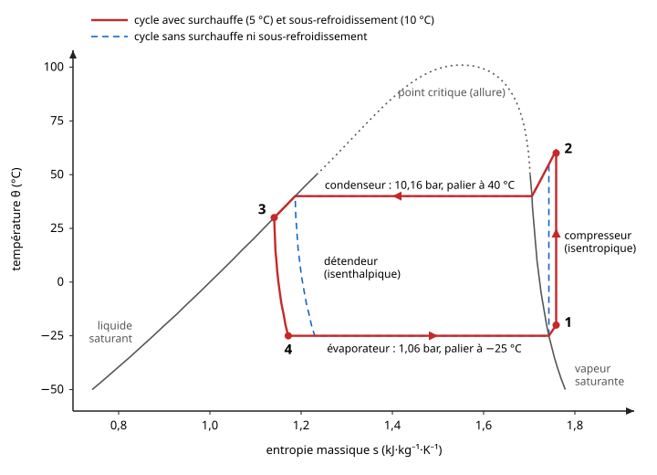

# Banque PT PT — Physique C - Thermodynamique 2013 · Corrigé guidé

*Corrigé rédigé par IA, non officiel. Signalez toute erreur.*

**Rédaction** · modèle exact non renseigné (famille Claude) · effort non renseigné · vitesse non renseignée

**Révision (tour 2)** · modèle exact non renseigné (famille Claude) · effort non renseigné · vitesse non renseignée · 28 novembre 2026

## Présentation du sujet

**Thème.** Étude d'un congélateur domestique. L'épreuve dure 2 heures, **sans calculatrice**, et comporte 30 questions numérotées de 1 à 30, en deux parties.

- *Partie I (questions 1 à 15)* : principe d'une machine frigorifique ditherme (questions 1 à 6), air humide et condensation de la vapeur d'eau à l'ouverture de la porte (questions 7 à 10), bilans de puissance (questions 11 à 13), régime transitoire d'une machine réversible dont la source froide se refroidit (questions 14 et 15).
- *Partie II (questions 16 à 30)* : cycle du fluide R134a avec surchauffe et sous-refroidissement. Détente isenthalpique, diagramme entropique, lecture d'une table de saturation, bilans d'enthalpie et d'entropie dans chaque organe, COP, premier principe des systèmes ouverts, débit massique.

**Notions mobilisées.** Machines dithermes, premier et second principes, COP et cycle de Carnot ; gaz parfaits et pressions partielles ; changements d'état, enthalpie et entropie d'un mélange diphasé, titre en vapeur ; premier principe des systèmes ouverts en régime stationnaire ; diagramme $(T, s)$.

**Documents à lire.** L'annexe 1 est le diagramme de l'air humide (humidité absolue en fonction de la température, courbes d'égale humidité relative) : on y lit une ordonnée à la question 7 et une abscisse à la question 8. L'annexe 2 est la table de saturation du R134a : les deux pressions du cycle, $1{,}06$ et $10{,}16\ \mathrm{bar}$, correspondent aux lignes $-25{,}0\ ^\circ\mathrm{C}$ et $40{,}0\ ^\circ\mathrm{C}$.

**Difficulté.** La partie I demande surtout du sens physique et des arguments enchaînés avec rigueur ; les questions 7 à 9 sortent des habitudes (air humide) et la question 14 exige de définir deux systèmes. La partie II est classique, mais elle punit la lecture rapide (températures des états 1 et 3) et l'emploi de $c_p\,\Delta T$ là où le fluide change d'état.

**Gestion du temps.** Environ 50 minutes pour la partie I et 60 minutes pour la partie II, en gardant 10 minutes de relecture. Les questions 1 à 6, 10, 16 à 20 et 29 ne demandent aucun calcul : elles rapportent des points rapidement, à condition de justifier.

> [!JURY]
> Le rapport 2013 constate que trop de candidats affirment sans justifier ou construisent des raisonnements incohérents, que les questions sur la vapeur d'eau n'ont été que très rarement traitées en entier, et que les applications numériques sans calculatrice ainsi que l'établissement de l'équation différentielle ont été très souvent délaissés. La seconde partie, plus classique, n'a pas été mieux réussie. En conclusion, il rappelle qu'un résultat sans justification équivaut à une absence de résultat, que les applications numériques doivent être faites et éventuellement commentées, et qu'un raisonnement fondé sur « un » ou « le » transfert thermique, sans préciser lequel, ne peut être démonstratif.

[Sujet officiel](https://www.banquept.fr/documents/2013/ph_c_th_2013_pt.pdf) · [Rapport du jury](https://www.banquept.fr/documents/ecrit/rapport/2013/rapport_phys_c_ecrit_2013.pdf)

*Mode d'emploi* : chercher chaque question seul, lire la première indication en cas de blocage, réessayer, puis la seconde, et seulement ensuite la solution.

## Partie I — Étude des échanges énergétiques

### Question 1 — Machine ditherme réceptrice

> [!INDICATION]
> Il y a deux adjectifs à justifier, donc deux arguments distincts : l'un porte sur le travail, l'autre sur les transferts thermiques.

> [!INDICATION]
> Repérer l'organe qui fournit du travail au fluide, puis les deux milieux extérieurs avec lesquels le fluide échange de la chaleur, et dans quels organes.

#### Solution

Le système étudié est le fluide frigorigène, qui décrit un cycle.

- **Réceptrice.** Le seul organe à pièces mobiles est le compresseur : il fournit au fluide un travail $W > 0$. Le détendeur n'échange aucun travail. Sur un cycle, le fluide **reçoit** donc du travail : la machine est réceptrice (un moteur en fournirait).
- **Ditherme.** Le fluide échange de la chaleur avec **deux sources** seulement, chacune dans un échangeur : l'intérieur du congélateur (source froide, $-10\ ^\circ\mathrm{C}$), dont il reçoit $Q_f > 0$ dans l'évaporateur, et l'air de la pièce (source chaude, $20$ ou $30\ ^\circ\mathrm{C}$), auquel il cède de la chaleur dans le condenseur ($Q_c < 0$). Compresseur et détendeur sont adiabatiques.

Le premier principe sur un cycle donne $W + Q_f + Q_c = 0$. Faire passer de la chaleur de la source froide vers la source chaude n'est pas spontané (second principe) : il faut payer avec le travail $W > 0$.

> [!JURY]
> Le rapport attend les deux caractères : le fluide reçoit un travail, et il échange de la chaleur avec deux sources différentes. Des candidats n'abordent que l'un des deux. L'erreur la plus fréquente est d'écrire que la machine est réceptrice parce qu'elle reçoit de la chaleur ; le rapport y voit une confusion entre travail et chaleur. Il sanctionne aussi « la machine reçoit de l'énergie » sans dire sous quelle forme ni dans quel organe, et déplore l'emploi du mot température à la place du mot source.

### Question 2 — Échangeur au contact du contenu

> [!INDICATION]
> Dans quel sens la chaleur doit-elle passer entre les aliments et le fluide ?

> [!INDICATION]
> Un changement d'état qui absorbe de la chaleur est une vaporisation ; celui qui en libère est une liquéfaction.

#### Solution

Le contenu doit être refroidi : il doit **céder** de la chaleur au fluide, qui en reçoit donc ($Q_f > 0$).

Or le fluide absorbe de la chaleur quand il se vaporise (la vaporisation est endothermique : il faut fournir $l_v$ par kilogramme), et il en libère quand il se liquéfie. De plus la chaleur ne passe spontanément que du corps chaud vers le corps froid : il faut que le fluide soit plus froid que les aliments, ce qui est le cas dans la partie basse pression du circuit.

**Le contenu doit être au contact de l'évaporateur.** Placé contre le condenseur, il recevrait au contraire la chaleur libérée par la liquéfaction et s'échaufferait.

> [!JURY]
> Selon le rapport, des arguments simples et clairs suffisaient pour les questions 2 à 4, mais beaucoup de candidats donnent la bonne réponse sans aucune justification, ce qui ne rapporte rien. D'autres placent la source froide contre le condenseur, sans argument, sans doute en associant condensation et froid.

### Question 3 — Position de l'évaporateur

> [!INDICATION]
> Suivre le fluide dans le sens de la flèche du schéma à partir de la sortie du compresseur.

> [!INDICATION]
> Dans quel état (pression, température) le fluide sort-il du compresseur ? Que doit-il lui arriver ensuite ? Et que doit aspirer un compresseur ?

#### Solution

Sur le schéma du sujet, la flèche placée à la sortie du compresseur pointe vers l'échangeur 1 : le fluide parcourt le circuit dans l'ordre compresseur, échangeur 1, détendeur, échangeur 2, puis retour au compresseur.

- À la sortie du compresseur, le fluide est une vapeur à haute pression et à température élevée, plus chaude que l'air extérieur : il peut lui céder de la chaleur et se liquéfier. L'échangeur 1 est donc le **condenseur**.
- Après le détendeur, le fluide est à basse pression, donc à basse température d'équilibre liquide-vapeur : il peut recevoir de la chaleur de l'intérieur du congélateur et se vaporiser dans l'échangeur 2. La vapeur formée est ensuite aspirée par le compresseur, qui doit recevoir un gaz.

**L'évaporateur est l'échangeur 2.**

### Question 4 — Rôle du condenseur

> [!INDICATION]
> Ne pas répondre « condenser » : se demander à quoi sert cette liquéfaction dans le cycle.

> [!INDICATION]
> Écrire le premier principe sur un cycle : où part l'énergie reçue à la source froide et au compresseur ?

#### Solution

Le condenseur sert à **évacuer vers l'air extérieur** (source chaude) la chaleur que le fluide a prélevée à l'intérieur du congélateur, augmentée du travail reçu dans le compresseur :

$$|Q_c| = Q_f + W$$

Le fluide revient ainsi à l'état liquide et peut, après détente, prélever de nouveau de la chaleur à la source froide : le cycle peut recommencer.

Le changement d'état est le moyen le plus efficace de réaliser ce transfert : la liquéfaction libère une grande quantité de chaleur par kilogramme (ici $l_v \approx 162\ \mathrm{kJ\cdot kg^{-1}}$ à $40\ ^\circ\mathrm{C}$, ligne $40{,}0\ ^\circ\mathrm{C}$ de l'annexe 2), à température constante.

> [!JURY]
> Le rapport reproche à la majorité des candidats de confondre le but et le moyen : le rôle du condenseur n'est pas de condenser, mais d'évacuer la chaleur du fluide vers l'extérieur pour qu'il puisse décrire un nouveau cycle et prélever de nouveau de la chaleur à la source froide ; le changement d'état est la manière la plus efficace de le faire. Il relève aussi des copies où le fluide se solidifie dans le condenseur, ce qui empêcherait sa circulation.

### Question 5 — Haute pression en hiver

> [!INDICATION]
> La haute pression fixe la température à laquelle le fluide se liquéfie. Quelle condition cette température doit-elle remplir par rapport à l'air extérieur ?

> [!INDICATION]
> Pour un corps pur en équilibre liquide-vapeur, pression et température sont liées : la pression de vapeur saturante croît avec la température. Bien préciser que l'on parle du fluide frigorigène, pas de l'air.

#### Solution

Dans le condenseur, le fluide frigorigène est en équilibre liquide-vapeur sous la haute pression $P_{HP}$ : sa température de liquéfaction $T_{cond}$ est fixée par $P_{HP} = P_{sat}(T_{cond})$, et la pression de vapeur saturante d'un corps pur croît avec la température.

Pour que le fluide cède de la chaleur à l'air extérieur, il faut $T_{cond} > T_{ext}$, avec un écart suffisant pour que l'échange soit assez rapide. En été ($T_{ext} = 30\ ^\circ\mathrm{C}$), le sujet règle la haute pression à $10{,}16\ \mathrm{bar}$, soit $T_{cond} = 40\ ^\circ\mathrm{C}$ (ligne $40{,}0\ ^\circ\mathrm{C}$ de l'annexe 2 : $10{,}1593\ \mathrm{bar}$), donc un écart de $10\ ^\circ\mathrm{C}$.

En hiver, $T_{ext} = 20\ ^\circ\mathrm{C}$ : on peut liquéfier le fluide à une température plus basse, par exemple $30\ ^\circ\mathrm{C}$ en gardant le même écart. Il faut donc **abaisser la haute pression** : la ligne $30{,}0\ ^\circ\mathrm{C}$ de l'annexe 2 donne $7{,}69\ \mathrm{bar}$.

Il n'y a aucune raison de garder $10{,}16\ \mathrm{bar}$ en hiver : la machine fonctionnerait, mais en comprimant plus que nécessaire.

> [!JURY]
> Le rapport indique que cette question demandait une réflexion approfondie, menée à son terme par très peu de candidats. L'une des erreurs les plus fréquentes est d'exploiter $PV = nRT$ sans préciser de quel gaz il s'agit, l'air ou le fluide.

### Question 6 — Conséquence sur le COP

> [!INDICATION]
> Le COP est le rapport de la chaleur prélevée à la source froide au travail dépensé. Comment évolue chacun des deux termes quand la haute pression baisse ?

> [!INDICATION]
> Vérifier le sens de variation sur le COP de Carnot d'un réfrigérateur, qui s'exprime avec les deux températures de source.

#### Solution

Le coefficient de performance du réfrigérateur est $\mathrm{COP} = Q_f / W$.

Quand la haute pression baisse, le compresseur fournit moins de travail pour la même masse de fluide (taux de compression plus faible). De plus le liquide sort du condenseur plus froid : il se vaporise moins dans le détendeur et prélève davantage de chaleur dans l'évaporateur. Le numérateur augmente, le dénominateur diminue : **le COP est meilleur en hiver qu'en été.**

La borne de Carnot varie dans le même sens :

$$\mathrm{COP}_C = \frac{T_f}{T_c - T_f}$$

avec $T_f = 263\ \mathrm{K}$. Elle vaut $263/40 \approx 6{,}6$ en été ($T_c = 303\ \mathrm{K}$) et $263/30 \approx 8{,}8$ en hiver ($T_c = 293\ \mathrm{K}$).

> [!JURY]
> Le rapport signale que de nombreux candidats concluent à tort que le COP est meilleur en été qu'en hiver, certains en s'appuyant sur une définition erronée du COP de Carnot. Quelques candidats construisent une argumentation rigoureuse et pertinente.

### Question 7 — Humidité absolue de l'air en été

> [!INDICATION]
> Traduire les deux définitions : l'humidité relative donne la pression partielle de l'eau ; l'humidité absolue est un rapport de masses dans un même volume, à la même température.

> [!INDICATION]
> Appliquer la loi des gaz parfaits séparément à la vapeur d'eau (pression partielle $P_{eau}$) et à l'air sec (pression partielle $P_{atm} - P_{eau}$, et non $P_{atm}$).

#### Solution

**Pression partielle de l'eau.** En été, $T_{ext} = 30\ ^\circ\mathrm{C}$ et $H_R = 0{,}60$ :

$$P_{eau} = H_R\,P_{sat}(30\ ^\circ\mathrm{C}) = 0{,}60 \times 4000 = 2400\ \mathrm{Pa}$$

**Rapport des masses.** Dans un volume $V$ à la température $T$, la vapeur d'eau et l'air sec sont deux gaz parfaits de pressions partielles $P_{eau}$ et $P_{atm} - P_{eau}$ :

$$m_{eau} = \frac{M_{eau}\,P_{eau}\,V}{RT} \qquad m_{air} = \frac{M_{air}\,(P_{atm} - P_{eau})\,V}{RT}$$

L'humidité absolue, exprimée en grammes d'eau par kilogramme d'air sec, vaut donc

$$\boxed{H_A = 1000\,\frac{M_{eau}}{M_{air}}\,\frac{P_{eau}}{P_{atm} - P_{eau}}}$$

**Application numérique.** $P_{atm} - P_{eau} = 101\,300 - 2400 = 98\,900\ \mathrm{Pa}$, d'où

$$H_A = 1000 \times \frac{18}{29} \times \frac{2400}{98\,900} \approx 1000 \times 0{,}62 \times 0{,}0243$$

$$\boxed{H_A \approx 15\ \mathrm{g\cdot kg^{-1}}}$$

**Vérification sur l'annexe 1.** Sur la verticale d'abscisse $30\ ^\circ\mathrm{C}$, la courbe oblique étiquetée 60 % est coupée à une ordonnée d'environ $16\ \mathrm{g\cdot kg^{-1}}$ (un carreau au-dessus de la graduation 15, le quadrillage fin valant $1\ \mathrm{g\cdot kg^{-1}}$). L'accord est correct : l'écart vient de la valeur arrondie $P_{sat} = 4000\ \mathrm{Pa}$ donnée par l'énoncé (la valeur tabulée est voisine de $4{,}2\ \mathrm{kPa}$) et de la précision de lecture.

> [!JURY]
> Pour les questions 7 à 13, le rapport précise que la valeur exacte de l'humidité absolue suppose de ne pas assimiler la pression de l'air sec à la pression atmosphérique, puisqu'on tient compte de la pression partielle de l'eau. Il note que ces questions ont été très peu abordées.

### Question 8 — Point de rosée

> [!INDICATION]
> Quand on refroidit de l'air humide sans lui ajouter ni lui retirer d'eau, quelle grandeur du diagramme reste constante ?

> [!INDICATION]
> Partir du point (30 °C, 60 %) et se déplacer horizontalement vers la gauche jusqu'à la courbe de saturation (100 %).

#### Solution

Quand l'air humide se refroidit à pression constante sans échange de matière, les masses d'eau et d'air sec ne changent pas : $H_A$ reste constante, et le point représentatif se déplace **horizontalement vers la gauche** sur l'annexe 1. La vapeur commence à se condenser quand ce point atteint la courbe de saturation (100 %), qui limite le graphique à gauche.

**Lecture.** L'horizontale d'ordonnée 15 à $16\ \mathrm{g\cdot kg^{-1}}$ coupe la courbe 100 % juste à droite de la verticale $20\ ^\circ\mathrm{C}$ (sur cette verticale, la courbe 100 % passe un peu en dessous de $15\ \mathrm{g\cdot kg^{-1}}$ ; sur la verticale $25\ ^\circ\mathrm{C}$, elle est à $20\ \mathrm{g\cdot kg^{-1}}$).

$$\boxed{\theta_{rosée} \approx 21\ ^\circ\mathrm{C}}$$

La lecture donne $20$ à $22\ ^\circ\mathrm{C}$ selon que l'on part de 15 ou de $16\ \mathrm{g\cdot kg^{-1}}$. Toute paroi plus froide que cette température, et en particulier l'intérieur du congélateur, se couvre d'eau condensée.

### Question 9 — Puissance perdue par condensation de la vapeur d'eau

> [!INDICATION]
> Trois étapes : masse d'air renouvelée à chaque ouverture, masse d'eau qu'elle contient, énergie à extraire pour amener cette eau de l'état de vapeur à 30 °C à l'état de glace à −10 °C.

> [!INDICATION]
> L'enthalpie est une fonction d'état : choisir le chemin qui passe par 0 °C (refroidissement de la vapeur, liquéfaction, solidification, refroidissement de la glace). Une puissance est une énergie divisée par une durée : 40 ouvertures en 12 heures.

#### Solution

**Masse d'air renouvelée à chaque ouverture.** Le congélateur a un volume $0{,}20 \times 0{,}50 \times 0{,}50 = 0{,}050\ \mathrm{m^3}$. Il est à moitié rempli : l'air occupe $V_{air} = 0{,}025\ \mathrm{m^3}$, soit

$$m_{air} = \mu_{air}\,V_{air} = 1{,}3 \times 0{,}025 \approx 3{,}3\times 10^{-2}\ \mathrm{kg}$$

**Masse d'eau apportée à chaque ouverture.** Avec $H_A = 15\ \mathrm{g\cdot kg^{-1}}$ :

$$m_{eau} = H_A\,m_{air} = 15\times 10^{-3} \times 3{,}3\times 10^{-2} \approx 4{,}9\times 10^{-4}\ \mathrm{kg} \approx 0{,}5\ \mathrm{g}$$

**Énergie à extraire par kilogramme d'eau.** La vapeur entre à $30\ ^\circ\mathrm{C}$ et finit en glace à $-10\ ^\circ\mathrm{C}$. L'enthalpie étant une fonction d'état, on choisit le chemin qui passe par $0\ ^\circ\mathrm{C}$, où les chaleurs latentes sont données : refroidissement de la vapeur, liquéfaction, solidification, refroidissement de la glace.

$$e = c_{vap}\,(30 - 0) + l_v + l_f + c_s\,\big(0 - (-10)\big)$$

$$e = 42 + 2500 + 300 + 21 \approx 2{,}9\times 10^{3}\ \mathrm{kJ\cdot kg^{-1}}$$

Les deux changements d'état ($l_v + l_f = 2800\ \mathrm{kJ\cdot kg^{-1}}$) représentent 98 % du total.

**Puissance moyenne.** Avec $N = 40$ ouvertures pendant $\Delta t = 12\ \mathrm{h} = 4{,}32\times 10^{4}\ \mathrm{s}$ :

$$P_{eau} = \frac{N\,m_{eau}\,e}{\Delta t} = \frac{40 \times 4{,}9\times 10^{-4} \times 2{,}9\times 10^{6}}{4{,}32\times 10^{4}}$$

$$\boxed{P_{eau} \approx 1{,}3\ \mathrm{W}}$$

Cette puissance est très faible : comme l'annonce l'énoncé, le problème posé par la vapeur d'eau n'est pas énergétique.

*Remarque.* Refroidir de $30$ à $-10\ ^\circ\mathrm{C}$ l'air sec renouvelé demande $N\,m_{air}\,c_a \times 40 / \Delta t \approx 1{,}2\ \mathrm{W}$ : c'est du même ordre, mais ce n'est pas la grandeur demandée ici.

> [!JURY]
> Le rapport précise que la valeur exacte de cette puissance suppose de tenir compte du passage de la vapeur à l'état liquide puis à l'état solide, de ne pas se tromper d'unités et de savoir calculer une puissance : beaucoup de candidats oublient de diviser par la durée, ou multiplient par elle.

> [!PIEGE]
> Les chaleurs latentes sont données en $\mathrm{kJ\cdot kg^{-1}}$ et les capacités thermiques en $\mathrm{J\cdot kg^{-1}\cdot K^{-1}}$ : convertir avant d'additionner. L'air n'occupe que la moitié du volume du congélateur.

### Question 10 — Nécessité du dégivrage

> [!INDICATION]
> Le givre se dépose sur la paroi la plus froide, celle de l'évaporateur. Quelle est sa propriété thermique gênante ?

> [!INDICATION]
> Raisonner en résistance thermique placée entre l'intérieur du congélateur et le fluide : que devient le transfert thermique, et que doit faire la machine pour le maintenir ?

#### Solution

Le givre se dépose sur la paroi la plus froide du compartiment, celle de l'évaporateur. Or la glace, et plus encore le givre qui emprisonne de l'air, conduit mal la chaleur : la couche de givre ajoute une **résistance thermique** entre l'intérieur du congélateur et le fluide frigorigène, d'autant plus grande que la couche est épaisse.

À écart de température donné, le transfert thermique de l'intérieur vers le fluide **diminue**. Pour extraire la même puissance, le fluide doit s'évaporer à une température plus basse, donc à une pression plus basse : le compresseur travaille davantage et plus longtemps, le COP baisse et la consommation électrique augmente. Si le givre s'épaissit trop, la température de consigne n'est plus tenue.

Le givre réduit aussi le volume utile. Il faut donc dégivrer régulièrement pour retrouver un bon échange thermique.

> [!JURY]
> Le rapport cite la réponse fréquente selon laquelle le givre « empêche la circulation du fluide » : ce n'est pas la circulation du fluide qui est gênée, mais celle de l'énergie. Il juge de plus le mot « empêchée » inapproprié, car il peut vouloir dire bloquée, diminuée ou retardée, trois choses différentes, et demande un vocabulaire clair, précis et adapté. Il relève aussi la justification erronée d'un givre qui obstruerait les entrées d'air froid.

### Question 11 — Pertes par conduction thermique

> [!INDICATION]
> Pendant la panne, la machine est arrêtée : seule la chaleur qui entre par les parois réchauffe les aliments. Entre quelles températures passent-ils en 6 heures ?

> [!INDICATION]
> Écrire le premier principe pour les aliments congelés, de −10 °C à 0 °C sans décongélation, puis diviser par la durée exprimée en secondes.

#### Solution

Pendant la panne, le fluide ne circule plus : la seule énergie reçue par les aliments est la chaleur qui traverse les parois, de puissance moyenne $P_{cond}$. D'après l'énoncé, les aliments congelés passent de $-10\ ^\circ\mathrm{C}$ à $0\ ^\circ\mathrm{C}$, sans commencer à décongeler, en $\tau = 6\ \mathrm{h} = 2{,}16\times 10^{4}\ \mathrm{s}$.

Premier principe appliqué aux aliments (phase condensée, à pression constante) :

$$P_{cond}\,\tau = m\,c_{cong}\,\big(0 - (-10)\big)$$

$$P_{cond} = \frac{m\,c_{cong}\,\Delta T}{\tau} = \frac{20 \times 1500 \times 10}{2{,}16\times 10^{4}} = \frac{3{,}0\times 10^{5}}{2{,}16\times 10^{4}}$$

$$\boxed{P_{cond} \approx 14\ \mathrm{W}}$$

*Choix du système.* On ne compte ici que les aliments, comme le suggère l'énoncé qui parle de maintenir « la température de 20 kg d'aliments ». Avec la capacité $C = 5\times 10^{5}\ \mathrm{J\cdot K^{-1}}$ du congélateur et de son contenu, introduite seulement à la question 14, on trouverait $230\ \mathrm{W}$, valeur supérieure à elle seule aux $200\ \mathrm{W}$ que l'énoncé retient pour la puissance frigorifique totale. Avec $14\ \mathrm{W}$, la somme de la question 13 vaut $1{,}7\times 10^{2}\ \mathrm{W}$, soit $2\times 10^{2}\ \mathrm{W}$ à un chiffre significatif : c'est la lecture cohérente avec l'énoncé.

### Question 12 — Puissance de congélation

> [!INDICATION]
> Découper la transformation des aliments en trois étapes dont on connaît les caractéristiques : refroidissement avant congélation, congélation à 0 °C, refroidissement après congélation.

> [!INDICATION]
> Additionner $m\,c_{dec} \times 20$, $m\,l_c$ et $m\,c_{cong} \times 10$, puis diviser par 12 heures en secondes.

#### Solution

Les aliments passent de $20\ ^\circ\mathrm{C}$ (décongelés) à $-10\ ^\circ\mathrm{C}$ (congelés). L'énergie à leur retirer se calcule sur le chemin : refroidissement de $20$ à $0\ ^\circ\mathrm{C}$, congélation à $0\ ^\circ\mathrm{C}$, refroidissement de $0$ à $-10\ ^\circ\mathrm{C}$.

$$Q_{cong} = m\,\big[c_{dec} \times 20 + l_c + c_{cong} \times 10\big]$$

$$Q_{cong} = 20 \times \big[72 + 250 + 15\big]\ \mathrm{kJ} = 20 \times 337\ \mathrm{kJ} \approx 6{,}7\times 10^{6}\ \mathrm{J}$$

Cette énergie est extraite en $\Delta t = 12\ \mathrm{h} = 4{,}32\times 10^{4}\ \mathrm{s}$ :

$$P_{cong} = \frac{Q_{cong}}{\Delta t} = \frac{6{,}7\times 10^{6}}{4{,}32\times 10^{4}}$$

$$\boxed{P_{cong} \approx 1{,}6\times 10^{2}\ \mathrm{W}}$$

Le changement d'état représente les trois quarts de cette énergie ($250$ sur $337\ \mathrm{kJ\cdot kg^{-1}}$).

### Question 13 — Puissance frigorifique globale

> [!INDICATION]
> Le fluide doit extraire tout ce qui entre ou se libère dans le compartiment : faire la somme des trois puissances.

> [!INDICATION]
> Comparer l'ordre de grandeur obtenu à la valeur que l'énoncé impose pour la suite.

#### Solution

En régime permanent, la puissance que le fluide doit prélever dans l'évaporateur compense les trois apports calculés :

$$P_f = P_{eau} + P_{cond} + P_{cong} \approx 1{,}3 + 14 + 156$$

$$\boxed{P_f \approx 1{,}7\times 10^{2}\ \mathrm{W}}$$

soit de l'ordre de $200\ \mathrm{W}$, valeur que l'énoncé demande de retenir pour la suite. La congélation domine très largement (environ 90 %) ; une fois les aliments congelés, le simple maintien à $-10\ ^\circ\mathrm{C}$ ne demande que $P_{eau} + P_{cond} \approx 15\ \mathrm{W}$.

### Question 14 — Équation différentielle du régime transitoire

> [!INDICATION]
> Il faut deux systèmes : le fluide frigorigène, qui décrit des cycles, et le congélateur avec son contenu, de capacité thermique $C$. Nommer les transferts reçus par le fluide pendant $\mathrm{d}t$.

> [!INDICATION]
> Pour le fluide : premier principe ($\mathrm{d}U = 0$ sur un nombre entier de cycles) et second principe avec égalité (réversible), les sources étant à $T$ et à $T_{ext}$. Pour le congélateur : il perd ce que le fluide lui prend.

#### Solution

On considère une durée $\mathrm{d}t$ grande devant la durée d'un cycle du fluide, mais assez courte pour que la température intérieure $T$ varie peu. On néglige les fuites thermiques des parois devant la puissance extraite.

**Système 1 : le fluide frigorigène.** Pendant $\mathrm{d}t$, il décrit un nombre entier de cycles et reçoit :

- le travail $\delta W = P\,\mathrm{d}t$ du compresseur ;
- le transfert thermique $\delta Q_f$ de la source froide (intérieur du congélateur, à la température $T$) ;
- le transfert thermique $\delta Q_c$ de la source chaude (air extérieur, à la température $T_{ext}$).

Premier principe, l'énergie interne du fluide étant une fonction d'état :

$$0 = P\,\mathrm{d}t + \delta Q_f + \delta Q_c$$

Second principe, l'entropie étant une fonction d'état et le fonctionnement étant réversible (entropie créée nulle) :

$$0 = \frac{\delta Q_f}{T} + \frac{\delta Q_c}{T_{ext}}$$

On en tire $\delta Q_c = -\dfrac{T_{ext}}{T}\,\delta Q_f$, puis

$$P\,\mathrm{d}t = -\delta Q_f - \delta Q_c = \left(\frac{T_{ext}}{T} - 1\right)\delta Q_f$$

**Système 2 : le congélateur et son contenu.** C'est une phase condensée de capacité thermique $C$, qui ne reçoit aucun travail et dont le seul échange thermique est celui avec le fluide : il reçoit $-\delta Q_f$. Premier principe :

$$C\,\mathrm{d}T = -\delta Q_f$$

**Conclusion.** En éliminant $\delta Q_f$ :

$$\boxed{P\,\mathrm{d}t = -C\left(\frac{T_{ext}}{T} - 1\right)\mathrm{d}T}$$

**Vérification.** Comme $T < T_{ext}$, la parenthèse est positive ; $P\,\mathrm{d}t > 0$ impose $\mathrm{d}T < 0$ : l'intérieur se refroidit. Le facteur $T_{ext}/T - 1$ est l'inverse du COP de Carnot : plus l'intérieur est froid, plus chaque kelvin coûte de travail.

> [!JURY]
> Le rapport range cette question parmi les moins traitées et les plus mal traitées. Il juge impensable d'établir correctement l'équation sans préciser le système considéré, ce que fait pourtant la majorité des candidats.

> [!METHODE]
> Pour toute machine ditherme dont une source a une température qui évolue : écrire les deux principes pour le fluide sur une durée $\mathrm{d}t$ (cycles), puis le premier principe pour la source de capacité finie, en faisant attention au signe du transfert thermique vu de chaque système.

### Question 15 — Durée de retour au régime permanent

> [!INDICATION]
> Séparer les variables et intégrer entre la température initiale (0 °C) et la température finale (−10 °C), en kelvins.

> [!INDICATION]
> La primitive de $T_{ext}/T - 1$ est $T_{ext}\ln T - T$. Utiliser la valeur de $\ln(273/263)$ fournie. L'énoncé ne chiffre pas $P$ : prendre, faute d'autre donnée, les 200 W retenus après la question 13, en signalant que c'est un choix.

#### Solution

On intègre l'équation de la question 14 entre l'instant initial ($T_i = 273\ \mathrm{K}$) et l'instant où $T_f = 263\ \mathrm{K}$, la puissance $P$ étant constante :

$$P\,\Delta t = -C\int_{T_i}^{T_f}\left(\frac{T_{ext}}{T} - 1\right)\mathrm{d}T = -C\left[T_{ext}\ln\frac{T_f}{T_i} - (T_f - T_i)\right]$$

$$\boxed{\Delta t = \frac{C}{P}\left[T_{ext}\ln\frac{T_i}{T_f} - (T_i - T_f)\right]}$$

**Application numérique.** $T_{ext} = 303\ \mathrm{K}$ et $\ln(273/263) = 0{,}04$ (donnée) :

$$T_{ext}\ln\frac{T_i}{T_f} - (T_i - T_f) = 303 \times 0{,}04 - 10 \approx 12{,}1 - 10 = 2{,}1\ \mathrm{K}$$

*Choix de la puissance.* L'énoncé ne chiffre pas la puissance $P$ du compresseur. La seule puissance qu'il fournit est la valeur de $200\ \mathrm{W}$ retenue après la question 13, et c'est une puissance frigorifique, non celle du compresseur. Faute d'autre donnée, ce corrigé choisit de la prendre comme valeur de $P$ : c'est une hypothèse du corrigé, pas une consigne de l'énoncé. Avec $C = 5\times 10^{5}\ \mathrm{J\cdot K^{-1}}$, on a $P\,\Delta t = 5\times 10^{5} \times 2{,}1 \approx 1{,}1\times 10^{6}\ \mathrm{J}$, d'où, pour $P = 200\ \mathrm{W}$ :

$$\Delta t = \frac{5\times 10^{5} \times 2{,}1}{200}$$

$$\boxed{\Delta t \approx 5\times 10^{3}\ \mathrm{s} \approx 1{,}5\ \mathrm{h}}$$

*Remarques.* Le travail nécessaire, $P\,\Delta t \approx 1\times 10^{6}\ \mathrm{J}$, est bien inférieur à la chaleur extraite, $C\,(T_i - T_f) = 5\times 10^{6}\ \mathrm{J}$ : la machine réversible a un COP moyen voisin de 5. Le résultat est la différence de deux nombres proches ($12{,}1$ et $10$) : il est très sensible à l'arrondi du logarithme. Avec $\ln(273/263) = 0{,}0373$, on trouverait $1{,}3\ \mathrm{K}$ et $\Delta t \approx 3\times 10^{3}\ \mathrm{s}$, un peu moins d'une heure. Une machine réelle, irréversible, mettrait plus longtemps. Enfin, la valeur de $P$ choisie ici n'est pas cohérente avec la suite : à la question 30, le compresseur du cycle étudié ne fournit qu'environ $90\ \mathrm{W}$ pour une puissance frigorifique de $200\ \mathrm{W}$. La durée étant inversement proportionnelle à $P$, on trouverait avec $90\ \mathrm{W}$ environ $1{,}2\times 10^{4}\ \mathrm{s}$, un peu plus de trois heures.

> [!PIEGE]
> Les températures de la formule sont en kelvins : $T_{ext} = 303\ \mathrm{K}$, et non 30. La différence $T_i - T_f = 10\ \mathrm{K}$, elle, a la même valeur en degrés Celsius.

## Partie II — Étude du cycle thermodynamique

### Question 16 — Détente isenthalpique

> [!INDICATION]
> Le détendeur est un système ouvert en régime stationnaire : écrire le premier principe des systèmes ouverts entre l'entrée et la sortie.

> [!INDICATION]
> Examiner un à un les termes : travail utile (y a-t-il des pièces mobiles ?), transfert thermique, énergie cinétique, énergie potentielle. Ne pas invoquer une pression ou une entropie constante.

#### Solution

**Système.** Le fluide qui traverse le détendeur, système ouvert en régime stationnaire, entre l'entrée (état 3) et la sortie (état 4).

Le premier principe des systèmes ouverts s'écrit, par unité de masse de fluide traversant l'organe :

$$(h_4 - h_3) + \Delta e_c + \Delta e_p = w_u + q$$

- le détendeur est un tuyau indéformable, sans pièce mobile : le travail utile est nul, $w_u = 0$ ;
- il ne reçoit pas de chaleur : $q = 0$ ;
- l'écoulement est lent : la variation d'énergie cinétique massique est négligeable devant celle de l'enthalpie ;
- la dénivellation entre l'entrée et la sortie est insignifiante : $\Delta e_p \approx 0$.

Il reste

$$\boxed{h_4 = h_3}$$

La détente est isenthalpique (détente de Joule-Thomson). Elle n'est ni isobare (la pression chute de $10{,}16$ à $1{,}06\ \mathrm{bar}$), ni isentropique : elle est adiabatique mais irréversible (question 26).

> [!JURY]
> D'après le rapport, c'est l'une des questions les mieux traitées, par une bonne moitié des candidats. Dans l'autre moitié, certains posent $\mathrm{d}h = 0$ sans justification, d'autres démontrent que la détente est isentropique, et beaucoup la déclarent isobare et isentropique pour en déduire qu'elle est isenthalpique.

### Question 17 — Allure d'une isobare dans le diagramme (T, s)

> [!INDICATION]
> Traiter les trois domaines séparément. Pour le liquide et la vapeur, utiliser l'identité $\mathrm{d}h = T\,\mathrm{d}s + v\,\mathrm{d}P$ à pression constante.

> [!INDICATION]
> À pression constante, $\mathrm{d}h = c\,\mathrm{d}T$ pour le liquide comme pour le gaz parfait (avec $c_p$) : en déduire $T(s)$. Dans le domaine diphasé, que vaut la température d'un corps pur à pression fixée ?

#### Solution

À pression constante, l'identité thermodynamique $\mathrm{d}h = T\,\mathrm{d}s + v\,\mathrm{d}P$ se réduit à $\mathrm{d}h = T\,\mathrm{d}s$.

**Liquide.** Pour une phase condensée, $\mathrm{d}h \approx c_l\,\mathrm{d}T$, donc $\mathrm{d}s = c_l\,\dfrac{\mathrm{d}T}{T}$ et

$$T = T_0\,\exp\!\left(\frac{s - s_0}{c_l}\right)$$

L'isobare est une exponentielle croissante, de pente $T/c_l$. L'entropie d'un liquide ne dépendant pratiquement pas de la pression, les isobares du liquide sont presque confondues avec la courbe d'ébullition.

**Système diphasé.** Pour un corps pur en équilibre liquide-vapeur, fixer la pression fixe la température : l'isobare est aussi une isotherme, donc un **palier horizontal**, de longueur $l_v(T)/T$.

**Vapeur.** Pour un gaz parfait, $\mathrm{d}h = c_p\,\mathrm{d}T$, donc $\mathrm{d}s = c_p\,\dfrac{\mathrm{d}T}{T}$ à pression constante et

$$T = T_0\,\exp\!\left(\frac{s - s_0}{c_p}\right)$$

L'isobare est encore une exponentielle croissante, de pente $T/c_p$. Pour le R134a, l'annexe 2 montre que l'enthalpie du liquide saturant augmente d'environ $7\ \mathrm{kJ\cdot kg^{-1}}$ tous les $5\ ^\circ\mathrm{C}$, soit $c_l \approx 1{,}4\ \mathrm{kJ\cdot kg^{-1}\cdot K^{-1}}$, alors que $c_p = 0{,}8\ \mathrm{kJ\cdot kg^{-1}\cdot K^{-1}}$ pour la vapeur : au point de rosée, l'isobare repart avec une pente plus forte que celle qu'elle avait dans le liquide.

L'isobare complète est donc continue, croissante, avec deux points anguleux aux extrémités du palier.

> [!JURY]
> Le rapport indique que les questions 17 et 19 ont été bien traitées, mais que plusieurs candidats affirment sans justifier ni établir.

### Question 18 — Courbe de saturation et cycles

> [!INDICATION]
> Placer d'abord la courbe en cloche (ébullition à gauche, rosée à droite, point critique au sommet), puis les deux paliers : condensation en haut, évaporation en bas.

> [!INDICATION]
> La compression isentropique est un segment vertical. La détente isenthalpique n'est pas verticale : l'entropie y augmente. Surchauffe et sous-refroidissement prolongent les paliers le long des isobares de la question 17.

#### Solution

La figure est tracée avec les valeurs de l'annexe 2 (entropies du liquide saturant et de la vapeur saturante de $-50$ à $50\ ^\circ\mathrm{C}$) ; au-delà, la fermeture de la courbe vers le point critique n'est qu'une allure.

**Courbe de saturation.** Courbe en cloche : la courbe d'ébullition à gauche (liquide saturant), la courbe de rosée à droite (vapeur saturante), qui se rejoignent au point critique. Le liquide est à gauche, la vapeur sèche à droite, le mélange diphasé sous la cloche.

**Cycle sans surchauffe ni sous-refroidissement (pointillés).**

- compression isentropique : segment vertical partant de la vapeur saturante à basse pression ;
- désurchauffe isobare jusqu'à la courbe de rosée, puis palier de condensation à $40\ ^\circ\mathrm{C}$ jusqu'à la courbe d'ébullition ;
- détente isenthalpique du liquide saturant jusqu'au palier bas : courbe descendante **inclinée vers la droite**, car l'entropie augmente ;
- palier d'évaporation à $-25\ ^\circ\mathrm{C}$ jusqu'à la courbe de rosée.

**Cycle avec surchauffe et sous-refroidissement (trait plein).**

- le palier d'évaporation se prolonge par un petit arc d'isobare dans le domaine de la vapeur, jusqu'à l'état 1 ($-20\ ^\circ\mathrm{C}$) ;
- la compression $1 \to 2$ est un segment vertical, décalé vers la droite, qui aboutit à $T_2 \approx 60\ ^\circ\mathrm{C}$ ;
- après le palier de condensation, le liquide descend le long de la courbe d'ébullition jusqu'à l'état 3 ($30\ ^\circ\mathrm{C}$) ;
- la détente $3 \to 4$ part de plus bas et arrive plus à gauche sur le palier d'évaporation : le titre en vapeur à l'état 4 est plus faible.

> [!JURY]
> Le rapport relève de nombreuses détentes tracées à entropie décroissante, ou représentées par un segment vertical, ainsi que des erreurs sur la position des axes et sur la nature même du diagramme, confondu avec un diagramme $(P, T)$. Il invite à réfléchir à la nature des transformations que l'on représente plutôt qu'à reproduire un tracé de mémoire.

### Question 19 — État physique du fluide aux quatre points

> [!INDICATION]
> Parcourir le cycle organe par organe, en utilisant la description de l'énoncé : 1 entrée du compresseur, 2 sortie du compresseur, 3 sortie du condenseur, 4 sortie du détendeur.

> [!INDICATION]
> Pour chaque état, comparer la température à la température de changement d'état sous la pression considérée (annexe 2) : −25 °C sous 1,06 bar, 40 °C sous 10,16 bar.

#### Solution

L'annexe 2 donne les températures de changement d'état : $-25\ ^\circ\mathrm{C}$ sous la basse pression (ligne $-25{,}0\ ^\circ\mathrm{C}$ : $1{,}0635\ \mathrm{bar}$) et $40\ ^\circ\mathrm{C}$ sous la haute pression (ligne $40{,}0\ ^\circ\mathrm{C}$ : $10{,}1593\ \mathrm{bar}$).

| État | Position | Pression | Température | État physique |
|---|---|---|---|---|
| 1 | entrée du compresseur | $1{,}06\ \mathrm{bar}$ | $-25 + 5 = -20\ ^\circ\mathrm{C}$ | vapeur sèche, surchauffée de $5\ ^\circ\mathrm{C}$ |
| 2 | sortie du compresseur | $10{,}16\ \mathrm{bar}$ | $\approx 60\ ^\circ\mathrm{C}$ | vapeur sèche, surchauffée de $20\ ^\circ\mathrm{C}$ |
| 3 | sortie du condenseur | $10{,}16\ \mathrm{bar}$ | $40 - 10 = 30\ ^\circ\mathrm{C}$ | liquide sous-refroidi |
| 4 | sortie du détendeur | $1{,}06\ \mathrm{bar}$ | $-25\ ^\circ\mathrm{C}$ | mélange liquide-vapeur, riche en liquide |

**Justifications.** En 1, le fluide sort de l'évaporateur où il s'est totalement vaporisé puis réchauffé de $5\ ^\circ\mathrm{C}$ : sa température dépasse la température de saturation, c'est une vapeur sèche. En 2, la compression isentropique d'une vapeur sèche l'éloigne encore de la saturation ($60\ ^\circ\mathrm{C} > 40\ ^\circ\mathrm{C}$). En 3, le fluide s'est entièrement liquéfié puis refroidi de $10\ ^\circ\mathrm{C}$ sous la haute pression : c'est un liquide plus froid que le liquide saturant. En 4, l'énoncé indique que le fluide s'est partiellement vaporisé dans le détendeur : il est diphasé, à la température de saturation de la basse pression.

> [!JURY]
> Le rapport note que plusieurs candidats se contentent des états 1 et 2, et que certains affirment sans justifier.

### Question 20 — Intérêt de la surchauffe et du sous-refroidissement

> [!INDICATION]
> Dire « on améliore le COP » ne suffit pas : chercher, pour chacun des deux dispositifs, ce qu'il change à l'entrée de l'organe qui suit.

> [!INDICATION]
> Surchauffe : que risque un compresseur qui aspire des gouttes de liquide ? Sous-refroidissement : comparer l'enthalpie à l'entrée du détendeur, donc le titre en vapeur à sa sortie et la chaleur prélevée dans l'évaporateur.

#### Solution

**Surchauffe.** Elle garantit que le fluide aspiré par le compresseur est une vapeur **sèche**, sans aucune goutte de liquide. Un liquide est quasi incompressible : des gouttes aspirées endommageraient le compresseur (« coups de liquide »). La surchauffe donne une marge de sécurité si le régime fluctue. Elle augmente aussi légèrement la chaleur prélevée par kilogramme de fluide, de $c_p \times 5 = 4\ \mathrm{kJ\cdot kg^{-1}}$, tant qu'elle se fait au contact du compartiment froid.

**Sous-refroidissement.** Il abaisse l'enthalpie du liquide à l'entrée du détendeur, donc celle du mélange à la sortie ($h_4 = h_3$) : le titre en vapeur en 4 est plus faible, il reste davantage de liquide à vaporiser dans l'évaporateur. D'après l'annexe 2, $h_3$ passe de $255{,}4$ (liquide saturant à $40\ ^\circ\mathrm{C}$) à $241{,}0\ \mathrm{kJ\cdot kg^{-1}}$ (à $30\ ^\circ\mathrm{C}$) : la chaleur prélevée à la source froide augmente de $14{,}4\ \mathrm{kJ\cdot kg^{-1}}$, soit environ 11 %, **sans travail supplémentaire** au compresseur. Le COP augmente d'autant. Le sous-refroidissement garantit de plus que le détendeur est alimenté en liquide pur, sans bulles de vapeur, ce qui stabilise le débit.

> [!JURY]
> Le rapport refuse la réponse « on améliore le COP » donnée seule : il faut dire en quoi.

### Question 21 — Titre en vapeur à la sortie du détendeur

> [!INDICATION]
> La détente est isenthalpique : $h_4 = h_3$. L'enthalpie d'un mélange diphasé s'exprime avec le titre et les enthalpies du liquide saturant et de la vapeur saturante à la même température.

> [!INDICATION]
> Lire $h_3$ sur la ligne 30 °C (liquide), puis l'enthalpie du liquide et la chaleur de vaporisation sur la ligne −25 °C. Vérifier que le titre trouvé est compris entre 0 et 1.

#### Solution

**État 3.** Liquide sous-refroidi à $30\ ^\circ\mathrm{C}$, assimilé au liquide saturant à $30\ ^\circ\mathrm{C}$. Ligne $30{,}0\ ^\circ\mathrm{C}$ de l'annexe 2, colonne « Enthalpie liquide » :

$$h_3 = h_l(30\ ^\circ\mathrm{C}) = 241{,}0\ \mathrm{kJ\cdot kg^{-1}}$$

**État 4.** Mélange diphasé à $-25\ ^\circ\mathrm{C}$, de titre massique en vapeur $x_4$. Ligne $-25{,}0\ ^\circ\mathrm{C}$ : $h_l = 167{,}6\ \mathrm{kJ\cdot kg^{-1}}$ et chaleur de vaporisation $l_v = 215{,}2\ \mathrm{kJ\cdot kg^{-1}}$. L'enthalpie massique du mélange est

$$h_4 = h_l(-25\ ^\circ\mathrm{C}) + x_4\,l_v(-25\ ^\circ\mathrm{C})$$

**Détente isenthalpique.** $h_4 = h_3$ donne

$$x_4 = \frac{h_l(30\ ^\circ\mathrm{C}) - h_l(-25\ ^\circ\mathrm{C})}{l_v(-25\ ^\circ\mathrm{C})} = \frac{241{,}0 - 167{,}6}{215{,}2} = \frac{73{,}4}{215{,}2} \approx 0{,}34$$

$$\boxed{x_4 \approx 0{,}3}$$

Environ un tiers du fluide se vaporise dans le détendeur : c'est cette vaporisation, qui puise son énergie dans le fluide lui-même, qui le refroidit de $30$ à $-25\ ^\circ\mathrm{C}$. Sans sous-refroidissement, on aurait $x = (255{,}4 - 167{,}6)/215{,}2 \approx 0{,}41$.

> [!JURY]
> Le rapport rappelle seulement qu'un titre ne peut être ni supérieur à 1 ni négatif.

### Question 22 — Chaleur échangée dans l'évaporateur

> [!INDICATION]
> L'évaporateur est un échangeur sans pièce mobile : le premier principe des systèmes ouverts donne $q = \Delta h$ entre l'état 4 et l'état 1.

> [!INDICATION]
> Décomposer en deux étapes isobares : vaporisation de la fraction liquide $(1 - x_4)$ à −25 °C, puis échauffement de la vapeur de 5 °C. La formule $c_p\,\Delta T$ ne vaut que pour cette seconde étape. Même découpage pour l'entropie.

#### Solution

**Chaleur massique.** L'évaporateur ne comporte aucune pièce mobile ($w_u = 0$) : le premier principe des systèmes ouverts donne, entre l'état 4 et l'état 1,

$$q_{ev} = h_1 - h_4$$

On décompose le trajet isobare en deux étapes : vaporisation de la fraction liquide $(1 - x_4)$ à $T_{ev} = 248\ \mathrm{K}$, puis échauffement de la vapeur, assimilée à un gaz parfait, de $-25$ à $-20\ ^\circ\mathrm{C}$ :

$$\boxed{q_{ev} = (1 - x_4)\,l_v(T_{ev}) + c_p\,(T_1 - T_{ev})}$$

Avec les valeurs de l'annexe 2 (ligne $-25{,}0\ ^\circ\mathrm{C}$ : enthalpie de la vapeur $382{,}8\ \mathrm{kJ\cdot kg^{-1}}$) :

$$h_1 = 382{,}8 + 0{,}8 \times 5 = 386{,}8\ \mathrm{kJ\cdot kg^{-1}}$$

$$q_{ev} = h_1 - h_3 = 386{,}8 - 241{,}0$$

$$\boxed{q_{ev} \approx 146\ \mathrm{kJ\cdot kg^{-1}}}$$

$q_{ev} > 0$ : le fluide reçoit cette chaleur de l'intérieur du congélateur. Avec le titre arrondi $x_4 = 0{,}3$, la formule donne $0{,}7 \times 215 + 4 \approx 155\ \mathrm{kJ\cdot kg^{-1}}$ : l'écart de 6 % vient du seul arrondi du titre ; on garde $146\ \mathrm{kJ\cdot kg^{-1}}$.

**Variation d'entropie massique.** Sur le même chemin isobare (palier à $T_{ev}$, puis gaz parfait à pression constante) :

$$\boxed{s_1 - s_4 = (1 - x_4)\,\frac{l_v(T_{ev})}{T_{ev}} + c_p\,\ln\frac{T_1}{T_{ev}}}$$

Numériquement, avec $x_4 = 0{,}34$ :

$$s_1 - s_4 = 0{,}66 \times \frac{215{,}2}{248} + 0{,}8 \times \ln\frac{253}{248} \approx 0{,}57 + 0{,}02 \approx 0{,}59\ \mathrm{kJ\cdot kg^{-1}\cdot K^{-1}}$$

L'entropie du fluide augmente : il reçoit de la chaleur.

> [!JURY]
> Pour les questions 22 à 26, le rapport rappelle qu'en dehors du compresseur le fluide est diphasé, de sorte que la formule $c_p\,\Delta T$ n'y est pas valable ; une écrasante majorité de candidats l'utilise pourtant. Plus généralement, il constate que la plupart des transferts énergétiques ont été calculés avec des formules inadaptées, et que des lectures trop rapides ont conduit à de mauvaises valeurs de températures.

### Question 23 — Température en fin de compression

> [!INDICATION]
> Compression isentropique : $s_2 = s_1$. Il faut donc deux expressions de l'entropie de la vapeur, l'une à basse pression, l'autre à haute pression.

> [!INDICATION]
> Sur chaque isobare, partir de la vapeur saturante, dont l'entropie est tabulée, et ajouter $c_p\ln(T/T_{sat})$ (question 17). L'égalité $s_2 = s_1$ donne alors $T_2$.

#### Solution

La compression est isentropique : $s_2 = s_1$. On exprime chaque entropie à partir de celle de la vapeur saturante sous la même pression (annexe 2), en suivant l'isobare du gaz parfait, pour laquelle $\mathrm{d}s = c_p\,\mathrm{d}T/T$ (question 17).

**État 1**, sur l'isobare basse pression, à partir de la vapeur saturante à $T_{ev} = 248\ \mathrm{K}$ :

$$s_1 = s_v(T_{ev}) + c_p\,\ln\frac{T_1}{T_{ev}}$$

**État 2**, sur l'isobare haute pression, à partir de la vapeur saturante à $T_{cond} = 313\ \mathrm{K}$ :

$$s_2 = s_v(T_{cond}) + c_p\,\ln\frac{T_2}{T_{cond}}$$

**Égalité des entropies :**

$$\boxed{T_2 = T_{cond}\,\exp\!\left(\frac{s_1 - s_v(T_{cond})}{c_p}\right)}$$

**Contrôle numérique.** Colonne « Entropie vapeur » de l'annexe 2 : $s_v = 1{,}743$ à $-25\ ^\circ\mathrm{C}$ et $1{,}706\ \mathrm{kJ\cdot kg^{-1}\cdot K^{-1}}$ à $40\ ^\circ\mathrm{C}$. Alors

$$s_1 = 1{,}743 + 0{,}8 \times \ln\frac{253}{248} \approx 1{,}743 + 0{,}016 = 1{,}759\ \mathrm{kJ\cdot kg^{-1}\cdot K^{-1}}$$

$$T_2 = 313 \times \exp\!\left(\frac{1{,}759 - 1{,}706}{0{,}8}\right) \approx 313 \times 1{,}07 \approx 334\ \mathrm{K}$$

soit $T_2 \approx 61\ ^\circ\mathrm{C}$, en accord avec la valeur $60\ ^\circ\mathrm{C}$ annoncée.

*Remarque.* La loi de Laplace $T^{\gamma}P^{1-\gamma} = \text{cste}$ suppose de connaître $\gamma$, donc la masse molaire du R134a, que l'énoncé ne donne pas. On peut aussi lire $T_2$ sur un diagramme du fluide, à l'intersection de l'isentrope passant par 1 et de l'isobare $10{,}16\ \mathrm{bar}$.

> [!METHODE]
> Pour comparer les entropies de deux vapeurs sous des pressions différentes avec une table de saturation, on rejoint chaque état depuis la vapeur saturante de même pression, le long de l'isobare. On évite ainsi d'avoir besoin de la constante massique du gaz.

### Question 24 — Travail indiqué du compresseur

> [!INDICATION]
> Premier principe des systèmes ouverts pour le compresseur : que valent le transfert thermique et les variations d'énergie cinétique ?

> [!INDICATION]
> Le fluide est gazeux d'un bout à l'autre du compresseur, et l'énoncé l'assimile à un gaz parfait : la variation d'enthalpie ne dépend que des températures $T_1 = -20\ ^\circ\mathrm{C}$ et $T_2 = 60\ ^\circ\mathrm{C}$.

#### Solution

Le compresseur est adiabatique (compression isentropique, donc adiabatique et réversible) et l'écoulement est lent. Le premier principe des systèmes ouverts donne, entre 1 et 2 :

$$w_i = h_2 - h_1$$

Le fluide est gazeux tout au long de la compression ; assimilé à un gaz parfait, son enthalpie ne dépend que de la température :

$$\boxed{w_i = c_p\,(T_2 - T_1)}$$

$$w_i = 0{,}8 \times \big(60 - (-20)\big) = 0{,}8 \times 80$$

$$\boxed{w_i \approx 64\ \mathrm{kJ\cdot kg^{-1}}}$$

$w_i > 0$ : le fluide reçoit ce travail.

*Limite du modèle.* Si l'on calcule $h_2$ à partir de la table, en partant de la vapeur saturante à $40\ ^\circ\mathrm{C}$ ($417{,}8\ \mathrm{kJ\cdot kg^{-1}}$), on obtient $h_2 = 417{,}8 + 0{,}8 \times 20 = 433{,}8\ \mathrm{kJ\cdot kg^{-1}}$ et $w_i = 433{,}8 - 386{,}8 = 47\ \mathrm{kJ\cdot kg^{-1}}$. Les deux valeurs diffèrent parce que la vapeur de R134a n'est pas un gaz parfait près de la saturation : d'après la table, son enthalpie n'augmente que de $35\ \mathrm{kJ\cdot kg^{-1}}$ entre $-25$ et $40\ ^\circ\mathrm{C}$ le long de la courbe de rosée, alors que $c_p\,\Delta T$ donnerait $52\ \mathrm{kJ\cdot kg^{-1}}$. On retient la valeur du modèle imposé par l'énoncé, $64\ \mathrm{kJ\cdot kg^{-1}}$, en gardant en tête qu'elle surestime le travail.

> [!JURY]
> Pour les questions 22 à 26, le rapport écrit qu'en dehors du compresseur le fluide est diphasé, de sorte que la formule $c_p\,\Delta T$ n'y est pas valable. Le compresseur est donc le seul organe pour lequel le rapport n'écarte pas cette formule : c'est elle qui donne ici $w_i = c_p\,(T_2 - T_1) = 64\ \mathrm{kJ\cdot kg^{-1}}$, réponse principale de ce corrigé.

### Question 25 — Chaleur échangée dans le condenseur

> [!INDICATION]
> Le condenseur est un échangeur isobare sans pièce mobile : $q = h_3 - h_2$. Découper le trajet en trois étapes dont on sait calculer la variation d'enthalpie.

> [!INDICATION]
> Désurchauffe de la vapeur de 60 à 40 °C ($c_p\,\Delta T$), liquéfaction totale à 40 °C ($-l_v$), puis refroidissement du liquide de 40 à 30 °C, lu comme une différence d'enthalpies du liquide saturant.

#### Solution

**Chaleur massique.** Comme pour l'évaporateur, $w_u = 0$ et

$$q_{cond} = h_3 - h_2$$

Le trajet isobare se découpe en trois étapes :

- désurchauffe de la vapeur de $T_2 = 60\ ^\circ\mathrm{C}$ à $T_{cond} = 40\ ^\circ\mathrm{C}$ (gaz parfait) : $c_p\,(T_{cond} - T_2) = 0{,}8 \times (-20) = -16\ \mathrm{kJ\cdot kg^{-1}}$ ;
- liquéfaction totale à $40\ ^\circ\mathrm{C}$ : $-l_v(40\ ^\circ\mathrm{C}) = -162{,}4\ \mathrm{kJ\cdot kg^{-1}}$ (ligne $40{,}0\ ^\circ\mathrm{C}$) ;
- sous-refroidissement du liquide de $40$ à $30\ ^\circ\mathrm{C}$, assimilé au liquide saturant : $h_l(30\ ^\circ\mathrm{C}) - h_l(40\ ^\circ\mathrm{C}) = 241{,}0 - 255{,}4 = -14{,}4\ \mathrm{kJ\cdot kg^{-1}}$.

$$\boxed{q_{cond} = c_p\,(T_{cond} - T_2) - l_v(T_{cond}) + h_l(T_3) - h_l(T_{cond})}$$

$$q_{cond} = -16 - 162{,}4 - 14{,}4$$

$$\boxed{q_{cond} \approx -193\ \mathrm{kJ\cdot kg^{-1}}}$$

$q_{cond} < 0$ : le fluide cède cette chaleur à l'air extérieur. La liquéfaction en représente 84 %.

**Variation d'entropie massique.** Sur le même chemin :

$$\boxed{s_3 - s_2 = c_p\,\ln\frac{T_{cond}}{T_2} - \frac{l_v(T_{cond})}{T_{cond}} + s_l(T_3) - s_l(T_{cond})}$$

$$s_3 - s_2 \approx 0{,}8 \times \ln\frac{313}{333} - \frac{162{,}4}{313} + (1{,}141 - 1{,}187) \approx -0{,}050 - 0{,}519 - 0{,}046$$

$$s_3 - s_2 \approx -0{,}61\ \mathrm{kJ\cdot kg^{-1}\cdot K^{-1}}$$

L'entropie du fluide diminue, ce qui est permis : le fluide n'est pas isolé, il cède de la chaleur.

*Contrôle.* Le premier principe sur le cycle impose $q_{ev} + w_i + q_{cond} = 0$. Ici $146 + 64 - 193 = 17\ \mathrm{kJ\cdot kg^{-1}}$ : le bilan ne se referme pas exactement, à cause de l'écart entre le modèle du gaz parfait et la table, signalé à la question 24. Avec $w_i = 47\ \mathrm{kJ\cdot kg^{-1}}$, il se referme : $146 + 47 - 193 = 0$.

### Question 26 — Variation d'entropie dans la détente

> [!INDICATION]
> L'entropie est une fonction d'état : $s_4 - s_3$ se calcule avec la table, sans s'occuper de la nature de la transformation.

> [!INDICATION]
> Écrire $s_4$ pour le mélange diphasé de titre $x_4$ à −25 °C. Pour le signe : la détente est adiabatique ; est-elle réversible ?

#### Solution

**Expression.** L'entropie est une fonction d'état. En 3, le liquide est assimilé au liquide saturant à $T_3 = 303\ \mathrm{K}$ ; en 4, le mélange a le titre $x_4$ à $T_{ev} = 248\ \mathrm{K}$, et la différence d'entropie entre vapeur et liquide saturants vaut $l_v/T_{ev}$ :

$$\boxed{s_4 - s_3 = s_l(T_{ev}) + x_4\,\frac{l_v(T_{ev})}{T_{ev}} - s_l(T_3)}$$

Avec la colonne « Entropie liquide » de l'annexe 2 ($0{,}876$ à $-25\ ^\circ\mathrm{C}$, $1{,}141$ à $30\ ^\circ\mathrm{C}$) et $x_4 = 0{,}341$ :

$$s_4 - s_3 = 0{,}876 + 0{,}341 \times \frac{215{,}2}{248} - 1{,}141 \approx 0{,}876 + 0{,}296 - 1{,}141$$

$$s_4 - s_3 \approx +0{,}03\ \mathrm{kJ\cdot kg^{-1}\cdot K^{-1}}$$

**Signe.** Il est prévisible. Le second principe appliqué au fluide qui traverse le détendeur en régime stationnaire s'écrit $s_4 - s_3 = s_{éch} + s_{créée}$. La détente est adiabatique : $s_{éch} = 0$. Elle est irréversible (détente brutale dans un tuyau fin, avec frottements visqueux, le fluide ne peut pas remonter spontanément vers la haute pression) : $s_{créée} > 0$. Donc

$$\boxed{s_4 - s_3 = s_{créée} > 0}$$

*Contrôle.* Sur le cycle, la somme des variations d'entropie doit être nulle : $0{,}59 + 0 - 0{,}61 + 0{,}03 = 0{,}01\ \mathrm{kJ\cdot kg^{-1}\cdot K^{-1}}$, nul à la précision des arrondis (l'écart vient de $T_2$, pris égal à $60\ ^\circ\mathrm{C}$ au lieu des $61\ ^\circ\mathrm{C}$ de la question 23).

> [!PIEGE]
> Le résultat est une petite différence entre deux nombres proches. Avec le titre arrondi $x_4 = 0{,}3$, on trouverait $0{,}876 + 0{,}260 - 1{,}141 \approx -0{,}005$, valeur négative, donc absurde pour une détente adiabatique. Il faut garder ici $x_4 = 0{,}34$.

### Question 27 — COP du réfrigérateur et comparaison au cycle de Carnot

> [!INDICATION]
> Le COP est le rapport de ce que l'on veut obtenir à ce que l'on paie : chaleur prélevée à la source froide sur travail du compresseur.

> [!INDICATION]
> Pour Carnot, repartir des deux principes avec égalité de Clausius ; ne pas réciter le rendement d'un moteur. Les températures sont en kelvins : 263 K et 303 K.

#### Solution

**COP du cycle.** La grandeur utile est la chaleur prélevée à la source froide, la grandeur coûteuse est le travail du compresseur :

$$\boxed{\mathrm{COP} = \frac{q_{ev}}{w_i} = \frac{h_1 - h_4}{h_2 - h_1}}$$

$$\mathrm{COP} = \frac{146}{64}$$

$$\boxed{\mathrm{COP} \approx 2{,}3}$$

Avec le travail calculé à partir de la table ($47\ \mathrm{kJ\cdot kg^{-1}}$, question 24), on trouverait $\mathrm{COP} \approx 3{,}1$.

**COP de Carnot.** Pour un cycle ditherme réversible entre $T_f = 263\ \mathrm{K}$ et $T_c = 303\ \mathrm{K}$, les deux principes donnent $W + Q_f + Q_c = 0$ et $Q_f/T_f + Q_c/T_c = 0$, d'où

$$\mathrm{COP}_C = \frac{Q_f}{W} = \frac{T_f}{T_c - T_f} = \frac{263}{40}$$

$$\boxed{\mathrm{COP}_C \approx 6{,}6}$$

**Conclusion.** Le COP du cycle étudié est deux à trois fois plus faible que celui de Carnot, qui est la valeur maximale permise par le second principe entre ces deux sources. Le cycle étudié est irréversible :

- la détente isenthalpique crée de l'entropie (question 26) ;
- les échanges thermiques se font sous des écarts de température finis : le fluide s'évapore à $-25\ ^\circ\mathrm{C}$ pour refroidir un compartiment à $-10\ ^\circ\mathrm{C}$, et cède sa chaleur entre $60$ et $30\ ^\circ\mathrm{C}$ à de l'air à $30\ ^\circ\mathrm{C}$.

Le cycle travaille en réalité entre $-25$ et $40\ ^\circ\mathrm{C}$ : même un cycle de Carnot entre ces deux températures n'aurait qu'un COP de $248/65 \approx 3{,}8$.

> [!JURY]
> Le rapport signale que beaucoup de candidats donnent sans démonstration, comme COP du cycle de Carnot, la formule du rendement d'un moteur.

### Question 28 — Abaisser la température de condensation

> [!INDICATION]
> Regarder ce que deviennent les états 2 et 3 quand le palier de condensation descend dans le diagramme, puis les deux termes du COP.

> [!INDICATION]
> Pour la limite : dans quel sens la chaleur doit-elle passer dans le condenseur, et avec quelle rapidité ? Ne pas invoquer une solidification du fluide.

#### Solution

**Économie.** Abaisser la température de condensation, c'est abaisser la haute pression (question 5). Alors :

- le taux de compression diminue : la température $T_2$ en fin de compression est plus basse, et le travail $w_i = c_p\,(T_2 - T_1)$ diminue ;
- le liquide sort du condenseur plus froid : $h_3 = h_4$ diminue, le titre $x_4$ aussi, et la chaleur prélevée $q_{ev} = h_1 - h_4$ augmente.

Le COP $= q_{ev}/w_i$ augmente : pour extraire la même quantité de chaleur du congélateur, le compresseur consomme moins d'énergie électrique. La borne de Carnot $T_f/(T_c - T_f)$ varie dans le même sens.

*Ordre de grandeur.* Avec une condensation à $35\ ^\circ\mathrm{C}$ et le même sous-refroidissement, $h_3 = h_l(25\ ^\circ\mathrm{C}) = 233{,}9\ \mathrm{kJ\cdot kg^{-1}}$ : $q_{ev}$ passe de $146$ à $153\ \mathrm{kJ\cdot kg^{-1}}$, alors que le travail diminue.

**Limite.** Le fluide doit céder sa chaleur à l'air extérieur : il faut que sa température de condensation reste **supérieure à la température extérieure** ($30\ ^\circ\mathrm{C}$ en été), sinon le transfert thermique ne se fait pas dans le bon sens et le fluide ne se liquéfie pas. De plus, la puissance cédée est proportionnelle à l'écart de température entre le fluide et l'air : si cet écart devient trop faible, il faudrait un condenseur de surface démesurée, ou la chaleur ne serait plus évacuée assez vite pour le débit de fluide. On garde donc un écart d'une dizaine de degrés, ce qui fixe $40\ ^\circ\mathrm{C}$ en été.

> [!JURY]
> Le rapport déplore sur cette question l'absence ou l'insuffisance de réflexion, et relève que les candidats y invoquent une solidification possible du fluide. Quelques copies développent une argumentation rigoureuse et pertinente.

### Question 29 — Premier principe des systèmes ouverts : étapes de la démonstration

> [!INDICATION]
> On ne demande pas la démonstration : lister les hypothèses, puis les étapes, en définissant les notations.

> [!INDICATION]
> Le point clé est le passage du système ouvert (volume de contrôle) à un seul système fermé, que l'on suit entre $t$ et $t + \mathrm{d}t$.

#### Solution

**Notations.** Volume de contrôle $\Sigma_0$ : l'intérieur de l'organe, entre une section d'entrée (indice $e$) et une section de sortie (indice $s$). Grandeurs massiques : enthalpie $h$, énergie interne $u$, volume $v$, énergie cinétique $e_c$, énergie potentielle de pesanteur $e_p$ ; travail utile $w_u$ (fourni par les parties mobiles) et transfert thermique $q$ reçus par unité de masse traversant l'organe.

**Hypothèses.**

- écoulement stationnaire : en tout point de $\Sigma_0$, les grandeurs ne dépendent pas du temps ;
- une seule entrée et une seule sortie, grandeurs uniformes sur chaque section ;
- pression uniforme sur chaque section, égale à $P_e$ en amont et $P_s$ en aval.

**Étapes.**

1. *Choix d'un système fermé.* Le premier principe n'est connu que pour un système fermé. On définit **un seul** système fermé $\Sigma^*$, suivi dans son mouvement : à l'instant $t$, il est formé du fluide contenu dans $\Sigma_0$ et de la masse $\mathrm{d}m_e$ qui va y entrer pendant $\mathrm{d}t$ ; à l'instant $t + \mathrm{d}t$, il est formé du fluide contenu dans $\Sigma_0$ et de la masse $\mathrm{d}m_s$ qui en est sortie.
2. *Conservation de la masse.* La masse de $\Sigma^*$ est constante et, en régime stationnaire, celle contenue dans $\Sigma_0$ aussi : $\mathrm{d}m_e = \mathrm{d}m_s = \mathrm{d}m$.
3. *Variation d'énergie de $\Sigma^*$.* En régime stationnaire, l'énergie contenue dans $\Sigma_0$ est la même à $t$ et à $t + \mathrm{d}t$. Il ne reste que la différence entre la masse sortie et la masse entrée : $\mathrm{d}E = \mathrm{d}m\,\big[(u + e_c + e_p)_s - (u + e_c + e_p)_e\big]$.
4. *Travail reçu.* On sépare le travail des forces de pression exercées par le fluide en amont et en aval, $(P_e v_e - P_s v_s)\,\mathrm{d}m$ (travail de transvasement), du travail utile $w_u\,\mathrm{d}m$.
5. *Premier principe pour $\Sigma^*$ entre $t$ et $t + \mathrm{d}t$,* puis regroupement des termes $u + Pv = h$ et division par $\mathrm{d}m$ :

$$\boxed{(h_s - h_e) + (e_{c,s} - e_{c,e}) + (e_{p,s} - e_{p,e}) = w_u + q}$$

En multipliant par le débit massique $D_m$, on obtient la forme en puissance : $D_m\,\Delta(h + e_c + e_p) = \mathcal{P}_u + \mathcal{P}_{th}$.

> [!JURY]
> Le rapport rappelle que l'énoncé demandait les hypothèses et les étapes, et non la démonstration. Il constate que peu de candidats ont compris la différence entre système ouvert et système fermé, et cite des formulations fautives : définir un système à $t$ et un autre système à $t + \mathrm{d}t$, ou appliquer le premier principe à deux systèmes fermés. Il demande de définir clairement les notations lorsque l'énoncé ne les fournit pas.

### Question 30 — Débit massique de R134a

> [!INDICATION]
> La puissance frigorifique est le produit du débit massique par la chaleur massique prélevée dans l'évaporateur.

> [!INDICATION]
> Utiliser la puissance de 200 W retenue par l'énoncé à la fin de la partie I et $q_{ev}$ de la question 22, en joules par kilogramme.

#### Solution

En régime permanent, la puissance prélevée par le fluide dans l'évaporateur est $P_f = D_m\,q_{ev}$ (premier principe des systèmes ouverts, forme en puissance). Elle doit compenser les apports évalués dans la partie I, pour lesquels l'énoncé retient $P_f = 200\ \mathrm{W}$ :

$$\boxed{D_m = \frac{P_f}{q_{ev}}}$$

$$D_m = \frac{200}{146\times 10^{3}}$$

$$\boxed{D_m \approx 1{,}4\times 10^{-3}\ \mathrm{kg\cdot s^{-1}} \approx 1{,}4\ \mathrm{g\cdot s^{-1}}}$$

Soit environ $5\ \mathrm{kg}$ de fluide par heure. Le compresseur fournit alors $D_m\,w_i \approx 1{,}4\times 10^{-3} \times 64\times 10^{3} \approx 90\ \mathrm{W}$, soit $P_f/\mathrm{COP}$. Cette puissance est plus de deux fois plus faible que les $200\ \mathrm{W}$ pris pour le compresseur à la question 15, faute de donnée : voir la remarque de cette question.

*Remarque.* Les $200\ \mathrm{W}$ comprennent la congélation des aliments. Si l'on ne retient que les pertes proprement dites, $P_{eau} + P_{cond} \approx 15\ \mathrm{W}$, qui suffisent à maintenir à $-10\ ^\circ\mathrm{C}$ des aliments déjà congelés, le débit moyen tombe à environ $0{,}1\ \mathrm{g\cdot s^{-1}}$ : en pratique, le compresseur fonctionne alors par intermittence.

## Bilan

**Résultats à retenir.**

| Grandeur | Valeur |
|---|---|
| Humidité absolue de l'air en été (question 7) | $15\ \mathrm{g\cdot kg^{-1}}$ (lecture : 16) |
| Point de rosée (question 8) | $\approx 21\ ^\circ\mathrm{C}$ |
| $P_{eau}$, $P_{cond}$, $P_{cong}$ (questions 9, 11, 12) | $1{,}3\ \mathrm{W}$, $14\ \mathrm{W}$, $1{,}6\times 10^{2}\ \mathrm{W}$ |
| Durée du retour à $-10\ ^\circ\mathrm{C}$ (question 15) | $\approx 5\times 10^{3}\ \mathrm{s}$ pour $P = 200\ \mathrm{W}$ (choix du corrigé) |
| Titre en sortie de détendeur (question 21) | $0{,}34$, arrondi à $0{,}3$ |
| $q_{ev}$, $w_i$, $q_{cond}$ (questions 22, 24, 25) | $146$, $64$ et $-193\ \mathrm{kJ\cdot kg^{-1}}$ |
| COP du cycle, COP de Carnot (question 27) | $2{,}3$ et $6{,}6$ |
| Débit massique (question 30) | $1{,}4\ \mathrm{g\cdot s^{-1}}$ |

**Méthodes à retenir.**

- Machine ditherme : toujours dire quel système reçoit quoi, de quelle source, dans quel organe ; distinguer travail et chaleur.
- Air humide : deux gaz parfaits dans le même volume, chacun avec sa pression partielle.
- Organe traversé par un fluide en régime stationnaire : premier principe des systèmes ouverts, puis examen des termes un par un (travail utile, chaleur, énergie cinétique).
- Fluide qui change d'état : passer par les enthalpies et les entropies tabulées, avec le titre en vapeur ; $c_p\,\Delta T$ est réservé aux tronçons où le fluide reste gazeux.
- Fonctions d'état : choisir un chemin commode (isobare passant par l'état saturant) pour calculer $\Delta h$ et $\Delta s$.

**Points de vigilance.**

- Températures en kelvins dans les rapports et les logarithmes ; chaleurs latentes en kilojoules, capacités en joules.
- Une puissance est une énergie divisée par une durée exprimée en secondes.
- La détente isenthalpique n'est ni isobare ni isentropique : son entropie augmente, et sa trace dans le diagramme $(T, s)$ penche vers la droite.
- Les petites différences (questions 15 et 26) sont sensibles aux arrondis.
- Le modèle du gaz parfait appliqué à la vapeur de R134a n'est pas cohérent avec la table à mieux que 15 à 20 kJ par kilogramme : le signaler plutôt que de masquer l'écart (questions 24, 25 et 27).
- La puissance du compresseur n'est pas donnée à la question 15 : dire quelle valeur on prend et pourquoi.

*Remarque.* Les réponses principales des questions 24 et 27 sont celles du modèle du gaz parfait posé par l'énoncé : $w_i = 64\ \mathrm{kJ\cdot kg^{-1}}$ et $\mathrm{COP} \approx 2{,}3$. Avec l'enthalpie $h_2$ tirée de la table de l'annexe 2, on obtiendrait $w_i = 47\ \mathrm{kJ\cdot kg^{-1}}$ et $\mathrm{COP} \approx 3{,}1$ ; seules ces valeurs referment le bilan d'énergie du cycle ($146 + 47 - 193 = 0$).
