# Banque PT 2013 — Sciences industrielles A · Corrigé guidé

*Corrigé rédigé par IA, non officiel. Signalez toute erreur.*

**Rédaction** · GPT-6.2 Astra Ultra · vitesse non renseignée · 27 novembre 2026

**Révision (tour 1)** · GPT-6.2 Astra Ultra · vitesse non renseignée · 27 novembre 2026

Le Clever est un tricycle urbain dont l’habitacle peut s’incliner indépendamment du groupe arrière. Le sujet relie trois modèles de cet objet, depuis le contact roue–route jusqu’à l’essai au banc de l’asservissement hydraulique. Les renvois comptent les pages physiques du fichier de la Banque PT.

[Sujet et cahier officiels](https://www.banquept.fr/documents/2013/si_a_2013_pt.pdf) · [Rapport du jury](https://www.banquept.fr/documents/ecrit/rapport/2013/rapport_si_a_ecrit_2013.pdf)

Le jury attribue 25 % du barème à la stabilité en virage, 55 % à la transmission et 20 % au contrôle. Il signale des erreurs dès la vitesse du centre de gravité, puis dans la mobilité, l’énergie cinétique et son théorème. Pour les calculs graphiques, écrire les deux coordonnées effectivement lues, leur unité et la précision du tracé.

## I — Stabilité en virage

### Question 1 — Vitesse du centre de gravité

> [!INDICATION]
> Repérer le rayon horizontal décrit par G pendant que l’inclinaison reste fixe.

#### Solution

Posons $x=e\sin\alpha$, déport radial de G, et $\rho=R_C+x$. Le vecteur $\vec z_1=\sin\alpha\,\vec x_0+\cos\alpha\,\vec z_0$. Puisque $\dot\theta=V/R_C$, la dérivée galiléenne de $\rho\vec x_0+e\cos\alpha\,\vec z_0$ donne $\vec V_G=V(1+x/R_C)\vec y_0$.

[Sujet p. 6](https://www.banquept.fr/documents/2013/si_a_2013_pt.pdf#page=6) · [Cahier p. 28 du PDF](https://www.banquept.fr/documents/2013/si_a_2013_pt.pdf#page=28)

### Question 2 — Accélération centripète

> [!INDICATION]
> La norme de la vitesse reste constante et sa direction tourne.

#### Solution

$\mathrm d\vec y_0/\mathrm dt=-\dot\theta\vec x_0$, donc $\vec a_G=-a_c\vec x_0$ avec $a_c=\rho(V/R_C)^2=(V^2/R_C)(1+x/R_C)$. L’accélération est dirigée vers le centre du virage.

### Question 3 — Moment dynamique en G

> [!INDICATION]
> Différencier le moment cinétique dans le référentiel galiléen. Le repère du véhicule tourne.

#### Solution

Avec $\vec\Omega=(V/R_C)\vec z_0$ et l’opérateur d’inertie $J_G$ fixe dans l’habitacle, $\vec\delta_G=\vec\Omega\times(J_G\vec\Omega)$. La partie tangentielle $J_G\dot{\vec\Omega}$ est nulle. Pour le modèle ponctuel, ou si la verticale est axe principal, $\vec\delta_G=\vec0$. Le seul fait que le rayon, l’inclinaison et la vitesse sont constants ne suffit pas à annuler le couple gyroscopique d’un solide étendu. Les calculs numériques du sujet demandent implicitement de négliger sa composante de roulis, aucune inertie numérique n’étant fournie.

### Question 4 — Équations des contacts

> [!INDICATION]
> Projeter deux résultantes et le moment autour de l’axe de roulis passant par G.

#### Solution

Avec $h=r+e\cos\alpha$ et $\delta_y=\vec\delta_G\cdot\vec y_0$, les résultantes donnent $T_A+T_B=-ma_c$ et $N_A+N_B=mg$. Le moment en G donne $-h(T_A+T_B)-\ell(N_A-N_B)/2+x(N_A+N_B)=\delta_y$. Le poids passe par G et les bras de levier des actions tangentielles valent $h$.

### Question 5 — Transfert de charge vers la roue extérieure

> [!INDICATION]
> Additionner et soustraire les deux équations portant sur les efforts normaux.

#### Solution

Posons $D=m(ha_c+gx)-\delta_y$. Alors $N_A=mg/2+D/\ell$, $N_B=mg/2-D/\ell$. Dans le modèle de renversement du sujet, $\delta_y=0$. Le contact A est à l’extérieur, dans le sens positif du rayon. Quand la vitesse augmente, B, la roue intérieure, se décharge et finit par décoller.

### Question 6 — Domaine de non-renversement

> [!INDICATION]
> Les deux contacts doivent pouvoir pousser vers le haut.

#### Solution

Sous l’approximation précédente, $N_A,N_B\ge0$ équivaut à $\left|x+h a_c/g\right|\le\ell/2$. Pour le décollage intérieur, cela impose $V^2/R_C\le g(\ell/2-x)/[h(1+x/R_C)]$. L’autre borne est $V^2/R_C\ge g(-\ell/2-x)/[h(1+x/R_C)]$ et la vitesse réelle impose déjà $V^2/R_C\ge0$.

### Question 7 — Adhérence des deux contacts

> [!INDICATION]
> Combiner les deux cônes de Coulomb et la somme des réactions verticales.

#### Solution

Il faut $\lvert T_A\rvert\le fN_A$ et $\lvert T_B\rvert\le fN_B$. Alors $ma_c=\lvert T_A+T_B\rvert\le fmg$, d’où $V^2/R_C\le fg/(1+x/R_C)$. Tant que les normales restent positives, une répartition admissible est $T_i=-(a_c/g)N_i$.

### Question 8 — Cas d’un habitacle fixe

> [!INDICATION]
> Poser le déport radial à zéro.

#### Solution

Pour $\alpha=0$, le non-glissement impose $V^2/R_C\le fg$ et le non-renversement $V^2/R_C\le g\ell/[2(r+e)]$. Le premier seuil est indépendant de la voie, le second croît proportionnellement à celle-ci.

### Question 9 — Voie qui départage les deux risques

> [!INDICATION]
> Égaler les deux seuils d’accélération.

#### Solution

$\ell_*=2f(r+e)=2(0,8)(0,30+0,50)=1,28$ m. À 1,50 m, le pneu dérape en premier. À 0,90 m, le véhicule non inclinable soulève sa roue intérieure en premier.

### Question 10 — Vitesse maximale sans inclinaison

> [!INDICATION]
> Retenir la plus faible des deux vitesses et convertir en km/h.

#### Solution

Pour $R_C=20$ m, $\sqrt{R_Cg\ell/[2(r+e)]}=10,50$ m/s, soit 37,8 km/h. La limite d’adhérence vaut 45,1 km/h. Le seuil le plus bas exclut les 55 km/h demandés.

### Question 11 — Sens de l’inclinaison

> [!INDICATION]
> Situer le centre du virage à l’opposé de $\vec x_0$.

#### Solution

L’habitacle doit basculer vers l’intérieur. Il faut donc $\alpha<0$, $x<0$ dans le virage représenté. Le poids apporte alors un moment qui soulage la roue extérieure et le rayon décrit par G diminue.

### Question 12 — Lecture du seuil à 55 km/h

> [!INDICATION]
> Couper la courbe I.3 par l’horizontale 55 et projeter sur l’axe des angles.

#### Solution

La figure I.3 croise 55 km/h à environ $-38^\circ$. La plage admissible pour le seul renversement, selon ce tracé, est donc approximativement $[-45^\circ,-38^\circ]$. Le tracé coupe l’axe $\alpha=0$ à 43,7 km/h, contre 37,8 avec les données de Q10. En outre, à 55 km/h et $-38^\circ$, l’adhérence demanderait $f\ge1,17$ pour le modèle de Q7. La courbe de renversement seule ne valide donc pas les deux exigences de FS1.

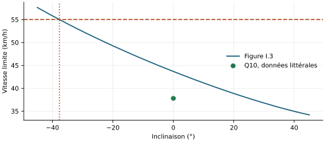

[Sujet p. 8](https://www.banquept.fr/documents/2013/si_a_2013_pt.pdf#page=8) · [Cahier p. 30 du PDF](https://www.banquept.fr/documents/2013/si_a_2013_pt.pdf#page=30)

## II.3 — Circuit hydraulique et montage

### Question 13 — Raccordement du distributeur

> [!INDICATION]
> Suivre la ligne sous pression, le réservoir et les chambres motrices des deux vérins.

#### Solution

Du point étoilé, amener la pression à P. Relier T au réservoir et A, B aux chambres motrices gauche et droite. Dans la case centrale, les quatre orifices sont obturés. Dans une case extrême, P communique avec A et B avec T. Dans l’autre, P communique avec B et A avec T. Les deux côtés opposés des pistons simple effet restent à l’air. Le tracé distingue les trois positions du tiroir.

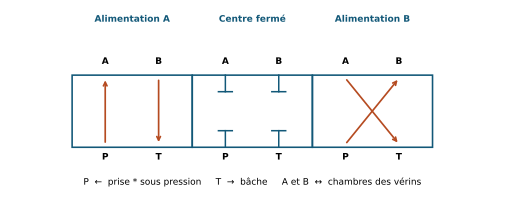

[Sujet p. 11](https://www.banquept.fr/documents/2013/si_a_2013_pt.pdf#page=11) · [Cahier p. 31 du PDF](https://www.banquept.fr/documents/2013/si_a_2013_pt.pdf#page=31)

### Question 14 — Charge de l’accumulateur

> [!INDICATION]
> Distinguer le chemin du débit et la pression conservée en aval du clapet.

#### Solution

Au démarrage le distributeur est fermé. La pompe charge l’accumulateur à travers le clapet. À 160 bar, la valve de décharge ouvre le retour à la bâche et le clapet empêche l’accumulateur de se vider vers la pompe. Quand les vérins consomment de l’huile et que la pression redescend à 100 bar, la décharge se ferme et la pompe recharge. La temporisation empêche toute demande avant constitution de la réserve. Un pressostat sur la ligne de l’accumulateur autorise le mouvement au seuil requis. Il tient compte d’une pression initiale ou d’un défaut de montée, au prix du capteur, de son câblage et du risque de défaillance supplémentaire.

### Question 15 — Course tirée du dessin

> [!INDICATION]
> Tourner B autour d’O aux deux butées et conserver A fixe. Utiliser la barre d’échelle du cahier.

#### Solution

La construction sur l’axe droit donne environ 0,35 et 0,55 m, soit une course d’environ 0,20 m. Le vérin de 200 mm correspond à la course nominale lue. Le pointage des centres donne 0,349 et 0,552 m, soit 202 mm environ. L’arrondi du dessin autorise la conclusion pédagogique de compatibilité à l’échelle du centimètre, mais le dessin ne garantit aucune marge pour les butées et tolérances.

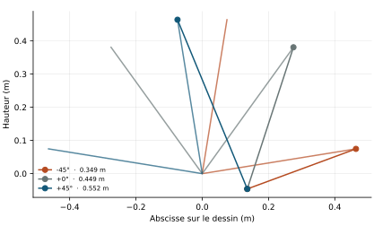

[Sujet p. 11](https://www.banquept.fr/documents/2013/si_a_2013_pt.pdf#page=11) · [Cahier p. 32 du PDF](https://www.banquept.fr/documents/2013/si_a_2013_pt.pdf#page=32)

### Question 16 — Débit et rapport de poulies

> [!INDICATION]
> Calculer le volume de la course, puis encadrer le régime de pompe aux deux régimes moteur extrêmes.

#### Solution

La section est $S=\pi(0,032)^2/4=8,04\,10^{-4}$ m². Pour 0,20 m en 1,5 s, $Q_{\rm moy}=S\Delta\lambda/1,5=6,43$ L/min (6,50 avec 202 mm). Une cylindrée de 11,5 cm³/tr donne au moins 6,9 L/min à 600 tr/min. Si $k=n_p/n_m$, il faut $600/1700\le k\le4000/8500$, soit $0,353\le k\le0,471$. Le choix 0,40 donne 680 à 3400 tr/min et 7,82 L/min au ralenti. Le débit maximal instantané dépend du profil de vitesse, de l’adaptateur mécanique et des pertes. L’accumulateur peut fournir une pointe.

### Question 17 — Guidage de tige

> [!INDICATION]
> Examiner les deux portées coaxiales courtes distantes le long du vérin.

#### Solution

Chaque portée circulaire courte peut se modéliser par une liaison linéaire annulaire. Deux telles liaisons coaxiales en parallèle à des abscisses distinctes suppriment les deux déplacements et les deux basculements transversaux. La translation et la rotation axiales subsistent, ce qui donne un pivot glissant.

### Question 18 — Mobilité et montage isostatique

> [!INDICATION]
> Distinguer la représentation plane et le comptage spatial des contraintes.

#### Solution

Les deux vérins suivent la même inclinaison, d’où une mobilité utile et $m_c=1$ avec les pivots d’extrémité du schéma. En dimension trois, cinq pivots et deux pivots glissants donnent neuf mobilités de liaison et deux cycles indépendants. Ainsi $h=6\times2-9+1=4$. Avec des rotules aux quatre ancrages, les deux corps et les deux tiges peuvent chacun tourner autour de leur axe. On a $m_c=1+4=5$, somme des libertés $1+4\times3+2\times2=17$, donc $h=12-17+5=0$. En mécanique strictement plane, le même dessin réduit comporte cinq pivots et deux glissières, soit $h=3\times2-7+1=0$. C’est le montage réel en trois dimensions qui motive la modification des chapes.

## II.4 — Géométrie et premier asservissement

### Question 19 — Fermeture géométrique

> [!INDICATION]
> Projeter la somme des vecteurs en $x_0,z_0$ et éliminer l’angle du vérin en sommant les carrés.

#### Solution

La figure II.4 donne $\overrightarrow{OA_1}=-a\vec x_0-b\vec z_0$. Donc $\lambda_1\sin\theta_1=a+L\cos\alpha_1$ et $\lambda_1\cos\theta_1=b-L\sin\alpha_1$. En sommant les carrés, $\lambda_1^2=a^2+b^2+L^2+2L(a\cos\alpha_1-b\sin\alpha_1)$. Pour $\cos(\alpha_1+\psi)=A/B$, prendre $\psi=\operatorname{atan2}(b,a)$, $A=\lambda_1^2-a^2-b^2-L^2$, $B=2L\sqrt{a^2+b^2}$.

[Sujet p. 14](https://www.banquept.fr/documents/2013/si_a_2013_pt.pdf#page=14) · [Cahier p. 34 du PDF](https://www.banquept.fr/documents/2013/si_a_2013_pt.pdf#page=34)

### Question 20 — Sept positions et gain de l’adaptateur

> [!INDICATION]
> Choisir 15° et 30°, compléter avec les positions symétriques puis mesurer les distances entre axes.

#### Solution

En tournant les deux ancrages B autour d’O, pour $\alpha=-45,-30,-15,0,15,30,45$ degrés, les longueurs $A_1B_1$ lues sont respectivement 0,349, 0,377, 0,412, 0,449, 0,486, 0,521 et 0,552 m. Le côté opposé donne les valeurs en ordre inverse. Le graphe présente une légère courbure. Après recentrage, sa pente moyenne est $(\pi/2)/(0,552-0,349)\simeq7,8$ rad/m et la pente locale centrale environ 7,0 rad/m. L’approximation proposée $R=7,5$ rad/m est raisonnable.

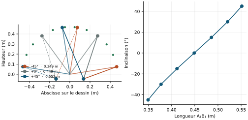

[Sujet p. 14](https://www.banquept.fr/documents/2013/si_a_2013_pt.pdf#page=14) · [Cahier p. 35 du PDF](https://www.banquept.fr/documents/2013/si_a_2013_pt.pdf#page=35)

### Question 21 — Vérin incompressible et blocs

> [!INDICATION]
> Un débit impose une vitesse. La longueur s’obtient par intégration.

#### Solution

Sous conditions initiales nulles, $\lambda/Q=H_{V1}=1/(Sp)$. La chaîne directe contient successivement l’adaptateur $C$ pour la consigne, le sommateur de retour négatif, le correcteur unitaire, $K_S$, $1/(Sp)$ et $R$. Le capteur en retour a pour gain $C=1$ V/rad.

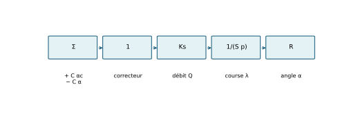

[Sujet p. 14](https://www.banquept.fr/documents/2013/si_a_2013_pt.pdf#page=14) · [Cahier p. 36 du PDF](https://www.banquept.fr/documents/2013/si_a_2013_pt.pdf#page=36)

### Question 22 — Gain nécessaire à la rapidité

> [!INDICATION]
> Écrire la boucle fermée avant d’utiliser le temps de réponse du premier ordre.

#### Solution

Avec $H_{ae}=C$, $\alpha/\alpha_c=1/(1+\tau_1p)$, $K_1=1$, $\tau_1=S/(CK_SR)$. Le temps à 5 % vaut $\tau_1\ln20$. Pour $t_{r5}\le0,1$ s, $K_S\ge S\ln20/(0,1CR)\simeq3,21\,10^{-3}$ m³/(s·V) avec $R=7,5$ rad/m. Un autre gain d’adaptation donnerait $K_1=H_{ae}/C$.

### Question 23 — Écart de traînage du premier modèle

> [!INDICATION]
> Prendre la limite finale pour une rampe de pente unitaire.

#### Solution

Pour une rampe $\alpha_c=t$, l’erreur angulaire tend vers $\tau_1=S/(CK_SR)$ rad et la tension $\varepsilon$ vers $C\tau_1=S/(K_SR)$ V. Au gain minimal, cela représente environ 0,0334 rad, soit 1,91°. Le critère d’écart nul échoue.

### Question 24 — Intégrateur et précision formelle

> [!INDICATION]
> Compter le nombre de pôles à l’origine puis vérifier la stabilité exigée par le théorème de la valeur finale.

#### Solution

Avec $H_r=1/p$, la boucle ouverte est $k/p^2$ où $k=CK_SR/S$. Une boucle stable de classe 2 annulerait l’erreur de rampe. Ici $\alpha_c-\alpha$ a pour transformée $1/(p^2+k)$ pour la rampe unitaire. L’erreur oscille comme $\sin(\sqrt k\,t)/\sqrt k$. Aucun écart asymptotique nul ne peut être constaté dans ce modèle idéal.

### Question 25 — Marge du double intégrateur

> [!INDICATION]
> Observer la phase au passage du gain par 0 dB.

#### Solution

La phase vaut $-180^\circ$ à toute fréquence, donc la marge de phase est nulle. Les pôles de la boucle fermée sont $\pm j\sqrt k$, avec oscillations entretenues. La marge exigée de 45 à 50° n’est pas satisfaite.

### Question 26 — Diagramme FAST

> [!INDICATION]
> À chaque fonction terminale, associer l’organe dont le texte décrit l’action.

#### Solution

FT11 détermine la position demandée par calculateur. FT121 transforme la puissance mécanique en hydraulique par pompe à engrenages et FT122 la transmet par le circuit. FT123 la convertit en puissance mécanique de translation par les vérins. FT124 adapte la translation en rotation de l’habitacle par le mécanisme articulé. FT131 mesure l’angle par capteur, FT132 compare mesure et consigne par le comparateur du régulateur, FT133 élabore la commande par le correcteur, appliquée au servo-distributeur proportionnel.

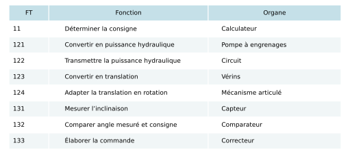

[Sujet p. 15](https://www.banquept.fr/documents/2013/si_a_2013_pt.pdf#page=15) · [Cahier p. 38 du PDF](https://www.banquept.fr/documents/2013/si_a_2013_pt.pdf#page=38)

## II.5 — Dynamique du vérin

### Question 27 — Débit de compression et effort

> [!INDICATION]
> Soustraire le débit de déplacement avant d’intégrer le débit qui comprime l’huile.

#### Solution

Pour $v=\dot\lambda$, $P_r=B(Q-SV)/(V_0p)$ et $F_V=SP_r$. Le sommateur reçoit $Q$ avec signe plus et $SV$ en retour négatif. Son résultat entre dans $B/(V_0p)$ puis $S$. L’intégrateur terminal $1/p$ transforme la vitesse en course. Le schéma de Q31 ferme aussi la partie mécanique.

[Sujet p. 15](https://www.banquept.fr/documents/2013/si_a_2013_pt.pdf#page=15) · [Cahier p. 39 du PDF](https://www.banquept.fr/documents/2013/si_a_2013_pt.pdf#page=39)

### Question 28 — Énergie de l’ensemble mobile

> [!INDICATION]
> Utiliser le point fixe A pour le corps et le centre de masse pour la tige.

#### Solution

L’habitacle apporte $J_1\dot\alpha^2/2$. Le corps du vérin apporte $A_4\dot\theta_1^2/2$. Pour la tige, $\overrightarrow{A_1G_5}=(\lambda_1-d_5)\vec z_4$, donc $v_{G_5}^2=\dot\lambda^2+(\lambda_1-d_5)^2\dot\theta_1^2$. Au total $2E_c=J_1\dot\alpha^2+[A_4+A_5+m_5(\lambda_1-d_5)^2]\dot\theta_1^2+m_5\dot\lambda^2$. L’inertie $A_4$ est déjà exprimée au fond de vérin.

### Question 29 — Pente d’orientation du corps

> [!INDICATION]
> Choisir deux points voisins de l’origine et utiliser le quotient des différences.

#### Solution

Le graphique du cahier donne environ $-0,14$ rad pour $-0,020$ m et $+0,14$ rad pour $+0,020$ m, soit $T\simeq7$ rad/m. Une sécante entre les extrémités donne environ 7,8 rad/m. La suite fixe $R=T=7,5$ rad/m pour les calculs.

### Question 30 — Masse équivalente ramenée à la tige

> [!INDICATION]
> Identifier le coefficient de la vitesse au carré autour de la position moyenne.

#### Solution

En posant $2E_c=M_{\rm eq}\dot\lambda^2$, on trouve $J_1R^2+T^2[A_4+A_5+m_5(\lambda_{10}-d_5)^2]+m_5$ pour l’ensemble étudié. Avec $\lambda_{10}\simeq0,449$ m, la contribution du vérin vaut environ 3,26 kg et celle de l’habitacle $175(7,5)^2=9844$ kg. En ajoutant le vérin symétrique, les deux apportent environ 6,5 kg, moins de 0,07 % de l’inertie ramenée de l’habitacle.

### Question 31 — Poids et dynamique de la course

> [!INDICATION]
> L’énergie potentielle d’un centre de masse situé au-dessus du pivot diminue quand l’habitacle s’incline.

#### Solution

Le poids fournit la puissance $mge\sin\alpha\,\dot\alpha$, l’actionneur $F_V\dot\lambda$. Avec $\alpha\simeq R\lambda$, le théorème de l’énergie cinétique donne $M_{\rm eq}\ddot\lambda=F_V+k_g\lambda$, $k_g=mgeR^2$. C’est un terme déstabilisant. En symbolique, $V=(F_V+k_g\lambda)/(M_{\rm eq}p)$ et $\lambda=V/p$. Le renvoi de la position au sommateur d’efforts porte donc un signe plus.

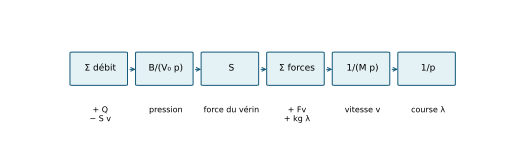

[Sujet p. 16](https://www.banquept.fr/documents/2013/si_a_2013_pt.pdf#page=16) · [Cahier p. 41 du PDF](https://www.banquept.fr/documents/2013/si_a_2013_pt.pdf#page=41)

### Question 32 — Fonction débit–déplacement

> [!INDICATION]
> Éliminer la pression à partir des deux équations hydrauliques et de la dynamique.

#### Solution

Notons $k_h=BS^2/V_0$ la raideur hydraulique. L’élimination donne $H_{V2}=\lambda/Q=(BS/V_0)/[p(M_{\rm eq}p^2+k_h-k_g)]$. Sous la forme $K_V/[p(1+p^2/\omega_V^2)]$, $K_V=(BS/V_0)/(k_h-k_g)$ et $\omega_V=\sqrt{(k_h-k_g)/M_{\rm eq}}$.

### Question 33 — Ordre de grandeur de la pesanteur

> [!INDICATION]
> Comparer la raideur de pesanteur à celle de l’huile.

#### Solution

$k_h\simeq2,59\,10^7$ N/m. En prenant les 395 kg du véhicule à vide comme ordre de grandeur majorant la masse du seul habitacle vide, $k_g\simeq1,09\,10^5$ N/m, soit 0,42 % de $k_h$. Avec et sans ce terme, on obtient environ 51,2 et 51,3 rad/s, puis 1 249 et 1 243 m⁻² pour $K_V$. On le néglige dans la suite. Le tableau donne la masse à vide du véhicule complet. Le rapport exact pour un habitacle chargé varierait en proportion de sa masse.

### Question 34 — Boucle globale sans amortissement

> [!INDICATION]
> Développer le polynôme caractéristique et examiner la colonne de Routh.

#### Solution

Pour le correcteur unitaire de l’étude de stabilité, posons $k=CK_SK_VR>0$. Avec adaptation $H_{ae}=C$, $\alpha/\alpha_c=k\omega_V^2/(p^3+\omega_V^2p+k\omega_V^2)$. Remplaçons le coefficient nul de $p^2$ par $\epsilon>0$. La première colonne est $1,\epsilon,\omega_V^2-k\omega_V^2/\epsilon,k\omega_V^2$. Elle a deux changements de signe pour $\epsilon\to0^+$. La boucle fermée a donc deux pôles dans le demi-plan droit. Le vérin sans dissipation ne permet pas une commande proportionnelle stable.

### Question 35 — Fuite et signe de l’amortissement

> [!INDICATION]
> Définir le sens positif d’un débit sortant de la chambre avant de calculer la fonction de transfert.

#### Solution

Pour une fuite dissipative $q_f=d\,p_r$ avec $d>0$, le débit de pompe vérifie $q=S v+(V_0/B)\dot p_r+d p_r$. Soustraire $dP_r$ au sommateur hydraulique. En négligeant $k_g$, $H_{V3}=(1/S)/[p(1+a_1p+p^2/\omega_V^2)]$, $a_1=M_{\rm eq}d/S^2$ et $\xi_V=a_1\omega_V/2=d\sqrt{M_{\rm eq}B/V_0}/(2S)$. La ligne imprimée porte précisément $-\delta p_r$. Si on garde cette notation algébrique avec $q$ en entrée, $d=-\delta$, $a_1=-M_{\rm eq}\delta/S^2$ et la stabilisation nécessite $\delta<0$. Mettre une fuite positive avec le signe imprimé produirait de l’anti-amortissement.

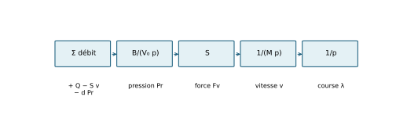

[Sujet p. 17](https://www.banquept.fr/documents/2013/si_a_2013_pt.pdf#page=17) · [Cahier p. 44 du PDF](https://www.banquept.fr/documents/2013/si_a_2013_pt.pdf#page=44)

### Question 36 — Pulsation hydro-mécanique

> [!INDICATION]
> Utiliser des mètres cubes pour le volume comprimé.

#### Solution

$\omega_V=S\sqrt{B/(M_{\rm eq}V_0)}$, avec $V_0=2,5\,10^{-5}$ m³, $B=10^9$ Pa et $M_{\rm eq}\simeq9,84\,10^3$ kg. On obtient $51,3$ rad/s, soit 8,16 Hz. La partie III arrondit à 50 rad/s.

### Question 37 — Bode de la boucle ouverte proportionnelle

> [!INDICATION]
> Tracer d’abord l’intégrateur, puis ajouter deux pôles à la pulsation hydraulique.

#### Solution

Pour les valeurs imposées en II.5.5, $L_1=k/[p(1+2\xi_Vp/\omega_V+p^2/\omega_V^2)]$ et $k=1(0,0065)(1250)(7,5)=60,94$ s⁻¹. Avant 51,3 rad/s, le gain vaut asymptotiquement $20\log_{10}(k/\omega)$ et décroît de 20 dB/décade. Après le coude, il décroît de 60 dB/décade. À 1 rad/s l’asymptote vaut 35,7 dB, au coude 1,5 dB. La phase passe de $-90^\circ$ à $-270^\circ$ et vaut $-180^\circ$ au coude.

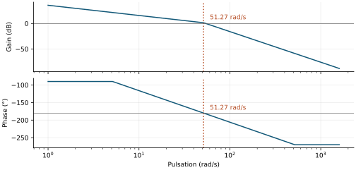

[Sujet p. 17](https://www.banquept.fr/documents/2013/si_a_2013_pt.pdf#page=17) · [Cahier p. 45 du PDF](https://www.banquept.fr/documents/2013/si_a_2013_pt.pdf#page=45)

### Question 38 — Fuite minimale stabilisante

> [!INDICATION]
> Appliquer Routh au cubique amorti et garder l’inégalité stricte.

#### Solution

Le dénominateur monique est $p^3+2\xi_V\omega_Vp^2+\omega_V^2p+k\omega_V^2$. Il faut $2\xi_V\omega_V>k$, donc $\xi_V>0,594$ pour $\omega_V=51,3$ rad/s (0,609 si l’on arrondit à 50). Pour la conductance de fuite positive, $d>kS^2/(M_{\rm eq}\omega_V^2)=kV_0/B\simeq1,52\,10^{-12}$ m³/(s·Pa). Dans la convention littérale du sujet, $\delta<-1,52\,10^{-12}$ m³/(s·Pa). À l’égalité, deux pôles sont imaginaires purs.

## III — Correction et essai de validation

### Question 39 — Échelle du comparateur

> [!INDICATION]
> Les deux grandeurs soustraites doivent être des images identiques du même angle.

#### Solution

$\varepsilon=K_{ae}\alpha_c-C\alpha$. Pour comparer consigne et mesure dans la même échelle de tension, $K_{ae}=C=1$ V/rad, donc $\varepsilon=C(\alpha_c-\alpha)$.

[Sujet p. 19](https://www.banquept.fr/documents/2013/si_a_2013_pt.pdf#page=19) · [Cahier p. 47 du PDF](https://www.banquept.fr/documents/2013/si_a_2013_pt.pdf#page=47)

### Question 40 — Gain de l’intégrateur

> [!INDICATION]
> Choisir une pulsation dans la plage visée et relever le gain nécessaire à la traversée de 0 dB.

#### Solution

Adoptons 60 rad/s, milieu de la plage 50–70. Pour $K_i=1$, $L_2=28,125/[p^2(1+0,02p+p^2/2500)]$. À 60 rad/s, le gain est $-44,3$ dB. Le décalage nécessaire est $+44,3$ dB, donc $K_i=10^{44,3/20}\simeq164$ s⁻¹. Un choix de coupure à 65 rad/s conduirait à 221 s⁻¹. Il s’agit d’une cible de coupure de boucle ouverte, la bande passante de boucle fermée devant être contrôlée séparément.

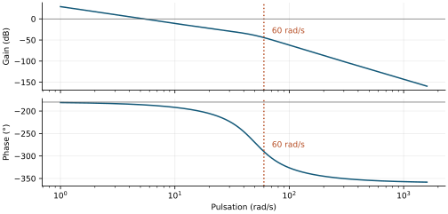

[Sujet p. 19](https://www.banquept.fr/documents/2013/si_a_2013_pt.pdf#page=19) · [Cahier p. 47 du PDF](https://www.banquept.fr/documents/2013/si_a_2013_pt.pdf#page=47)

### Question 41 — Nombre d’avances de phase

> [!INDICATION]
> Additionner le déficit par rapport à −180° et la marge demandée.

#### Solution

À la coupure choisie de 60 rad/s, la phase est $-180^\circ-\operatorname{atan2}(1,2;1-1,2^2)=-290,1^\circ$. Pour obtenir 45 à 50° de marge, il faut ajouter environ 155 à 160°. Avec 50° au plus par correcteur, il en faut quatre, en compensant leur gain au recroisement. Le choix de 65 rad/s conduit également à quatre. Au bord inférieur de 50 rad/s trois suffiraient pour la phase seule.

### Question 42 — Somme de rampes retardées

> [!INDICATION]
> Arrêter une pente en lui ajoutant la pente opposée au moment voulu.

#### Solution

Première rampe de pente $+60^\circ$/s dès $t=0$, deuxième rampe de pente $-60^\circ$/s dès $t=0,75$ s, avec un sommateur. Cela donne $\alpha_c(t)=60[t\,u(t)-(t-0,75)u(t-0,75)]$ en degrés. En radians, la pente est $\pi/3$ rad/s. On atteint et maintient 45°.

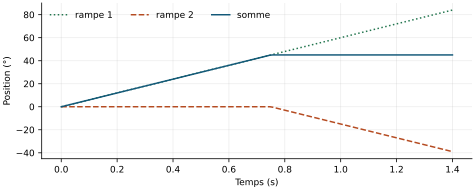

[Sujet p. 19](https://www.banquept.fr/documents/2013/si_a_2013_pt.pdf#page=19) · [Cahier p. 48 du PDF](https://www.banquept.fr/documents/2013/si_a_2013_pt.pdf#page=48)

### Question 43 — Première simulation

> [!INDICATION]
> Examiner le début de la rampe, le dépassement et le dernier retour dans la bande à 5 %.

#### Solution

La figure III.3 présente environ 3,0° de retard vers 0,13 s et un maximum de 48,0° vers 0,875 s pour une consigne à 45°. Le critère d’écart dynamique inférieur à 1° échoue. Après l’arrêt de la rampe à 0,75 s, le dernier passage sous $47,25^\circ$ se produit vers 0,963 s, soit environ 0,21 s, supérieur à 0,10 s. La valeur finale rejoint 45°. L’essai en rampe ne mesure pas directement le temps normalisé de réponse à un échelon.

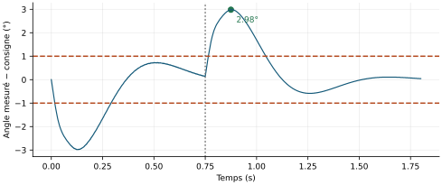

[Sujet p. 19](https://www.banquept.fr/documents/2013/si_a_2013_pt.pdf#page=19) · [Cahier p. 48 du PDF](https://www.banquept.fr/documents/2013/si_a_2013_pt.pdf#page=48)

### Question 44 — Diamètre requis pour séparer les modes

> [!INDICATION]
> À masse, volume et module constants, la pulsation du vérin croît comme sa section.

#### Solution

À 60 rad/s de coupure visée, deux décades imposeraient $\omega_{V,\rm nouv}\ge6000$ rad/s. Comme $\omega_V\propto S\propto D^2$, $D_{\rm nouv}\ge32\sqrt{6000/50}\simeq351$ mm (365 mm pour 65 rad/s). Ce diamètre, onze fois celui du vérin initial, imposerait un débit environ 120 fois plus élevé à la même vitesse de tige. Cette solution est incompatible avec l’encombrement et la pompe considérés.

### Question 45 — Essai à la génératrice

> [!INDICATION]
> La mesure porte sur une vitesse, donc la dérivation de l’angle annule l’intégration du vérin.

#### Solution

La chaîne comporte $U_e\to K_S\to Q\to H_V\to\lambda\to R\to\alpha\to p\to\Omega\to K_{gt}\to M_\Omega$. Ainsi $H_{\rm essai}=K_{gt}K_SK_VR/(1+2\xi_Vp/\omega_V+p^2/\omega_V^2)$. Le zéro initial de l’essai rend licite $\Omega=p\alpha$. La courbe mesurée sert à identifier le mode réel.

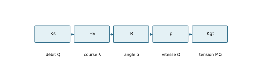

[Sujet p. 20](https://www.banquept.fr/documents/2013/si_a_2013_pt.pdf#page=20) · [Cahier p. 48 du PDF](https://www.banquept.fr/documents/2013/si_a_2013_pt.pdf#page=48)

### Question 46 — Mode propre mesuré

> [!INDICATION]
> Relever le premier maximum et le niveau final, puis la période entre deux maxima.

#### Solution

La tension finale est proche de 2,40 V. Le premier maximum, près de 0,061 s, atteint 4,1 à 4,15 V. Le dépassement relatif est environ 0,72. Le graphe III.4 ou $\xi=-\ln D/\sqrt{\pi^2+(\ln D)^2}$ donne $\xi_V\simeq0,10$. Avec une pseudopériode proche de 0,12 s, $\omega_V=2\pi/[T_d\sqrt{1-\xi_V^2}]\simeq52$ rad/s. La valeur finale appartient à l’essai et le quotient du dépassement se calcule avec elle. Utiliser à sa place le gain théorique des composants change artificiellement l’amortissement identifié.

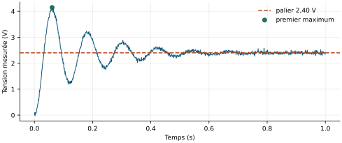

[Sujet p. 20](https://www.banquept.fr/documents/2013/si_a_2013_pt.pdf#page=20) · [Cahier p. 49 du PDF](https://www.banquept.fr/documents/2013/si_a_2013_pt.pdf#page=49)

### Question 47 — Sensibilité de la compensation

> [!INDICATION]
> Distinguer la disparition d’un facteur dans la formule de la disparition du mode physique.

#### Solution

Un filtre fixé à la pulsation et à l’amortissement mesurés ne coïncide plus exactement avec le vérin lorsque la charge, la température, la compressibilité ou les fuites changent. Une résonance et un déphasage résiduels réapparaissent. Même en compensation nominale, une perturbation injectée après le filtre et des conditions initiales peuvent exciter le mode. La correction exige donc de vérifier ses marges avec des paramètres variables.

### Question 48 — Réglage de l’avance finale

> [!INDICATION]
> Centrer la bosse de phase sur la coupure et neutraliser son gain à cette pulsation.

#### Solution

À 65 rad/s, après compensation et intégration, la phase vaut $-180^\circ-2\arctan(65/1000)=-187,44^\circ$. Pour viser 47,5° de marge, il faut $\phi_m=54,94^\circ$. L’annexe donne $a_{av}=(1+\sin\phi_m)/(1-\sin\phi_m)\simeq10,02$. Poser $\tau_{av}=1/(65\sqrt{a_{av}})=4,86$ ms et $K_{av}=1/\sqrt{a_{av}}=0,316$. Le module du correcteur vaut 1 à 65 rad/s et la marge obtenue est 47,5°.

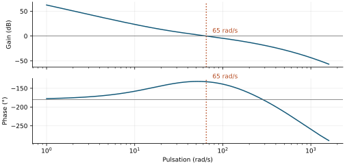

[Sujet p. 21](https://www.banquept.fr/documents/2013/si_a_2013_pt.pdf#page=21) · [Cahier p. 50 du PDF](https://www.banquept.fr/documents/2013/si_a_2013_pt.pdf#page=50)

### Question 49 — Critères effectivement vérifiables

> [!INDICATION]
> Séparer ce que mesure l’essai de poursuite et ce qui exige une mesure fréquentielle ou une réponse indicielle.

#### Solution

Figure III.6, le mouvement parcourt 45° en 0,75 s et la sortie suit la rampe après un bref transitoire, puis revient à 45°. L’écart de traînage est compatible avec zéro, comme le prévoit la classe 2 stable. Le pic mesuré vers 0,776 s est proche de 46° (environ 45,9° sur l’enveloppe lissée). L’écart dynamique est donc à la limite du degré. Les pointes numérisées atteignent environ 1,01°, si bien que le respect du seuil strict de 1° n’est pas démontré. Le retour reste dans la bande de 5 % après la rupture de pente. Le temps de réponse indicielle demanderait un essai en échelon. La marge nominale est vérifiée en Q48. Les 65 rad/s mesurent la traversée de 0 dB en boucle ouverte. Avec le modèle nominal parfaitement compensé et le réglage donné en Q48, le module de $L/(1+L)$ tombe à $1/\sqrt2$ vers 118 rad/s, au-delà de la plage 50–70 rad/s si elle désigne la bande passante en boucle fermée. L’essai temporel seul ne peut valider cette exigence fréquentielle.

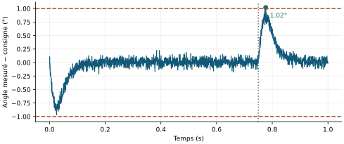

[Sujet p. 21](https://www.banquept.fr/documents/2013/si_a_2013_pt.pdf#page=21) · [Cahier p. 50 du PDF](https://www.banquept.fr/documents/2013/si_a_2013_pt.pdf#page=50)
