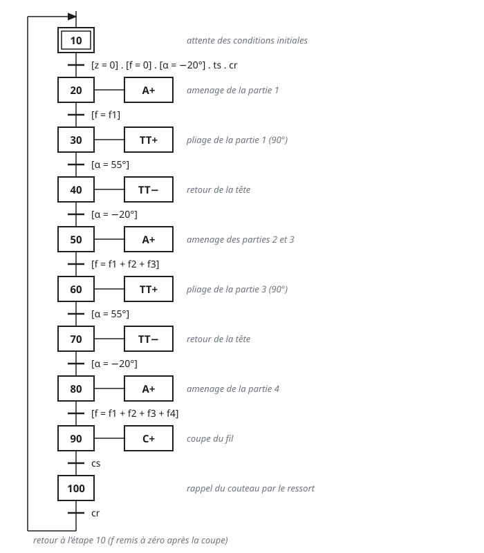
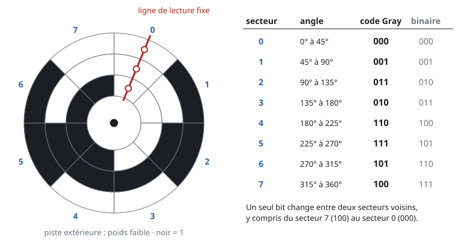
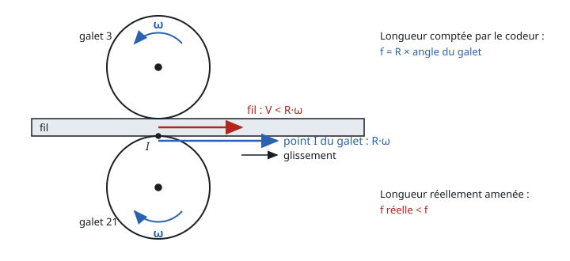
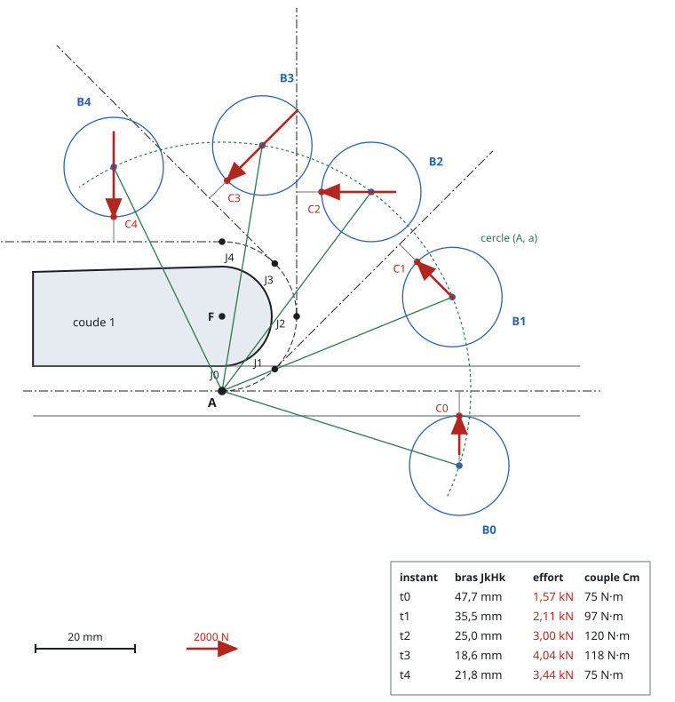
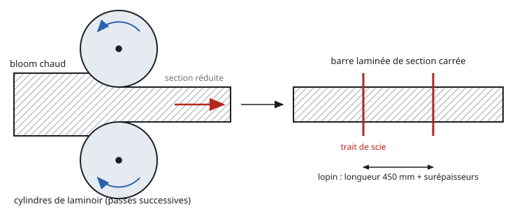
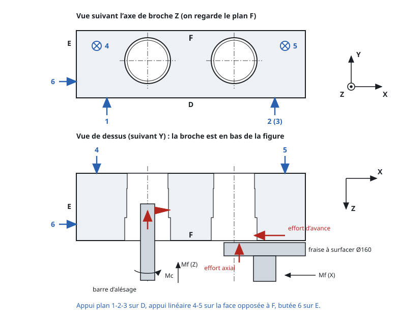
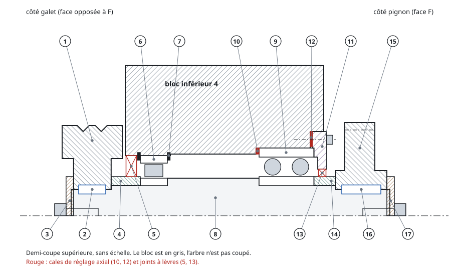
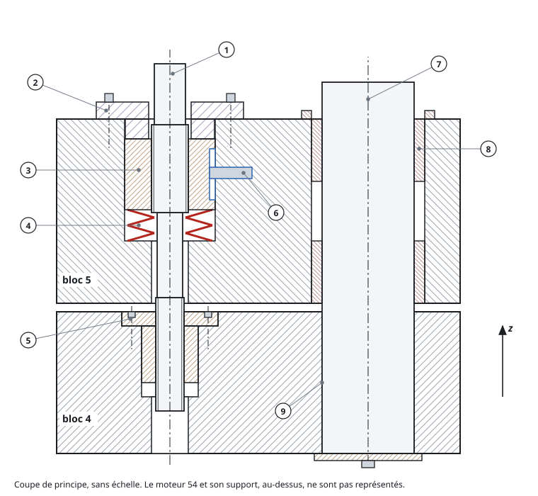

# Banque PT PT — Sciences industrielles C 2013 · Corrigé guidé

*Corrigé rédigé par IA, non officiel. Signalez toute erreur.*

**Rédaction** · modèle exact non renseigné (famille Claude) · effort non renseigné · vitesse non renseignée

**Révision (tour 2)** · modèle exact non renseigné (famille Claude) · effort non renseigné · vitesse non renseignée · 28 novembre 2026

Sur les 32 questions du sujet, 27 sont entièrement traitées et cinq le sont en partie : pour les questions 28 à 32 (avant-projet de conception), les solutions sont choisies, justifiées et représentées par deux coupes de principe originales, mais le tracé à l’échelle sur le calque A3 du sujet n’est pas reproduit. Les autres réponses graphiques (grafcet de la question 1, codeur de la question 3, schéma de la question 7, épure des questions 10 et 11, croquis de la question 21, sous-phase de la question 27) sont données par des figures originales ; le tableau des questions 11 et 12 et les fiches de la question 24 sont rendus par des tableaux.

## Présentation du sujet

L’épreuve dure six heures, sans calculatrice ni document ; l’énoncé impose $\pi\approx3$ dans plusieurs applications numériques et fournit des tables et des courbes pour les autres. Le support est une machine de cambrage-pliage de fil métallique : le fil, tiré d’une bobine, est poussé par quatre galets, redressé, puis mis en forme par une tête tournante et coupé par un couteau.

Le sujet comprend six parties indépendantes, 32 questions, douze documents ressources, un cahier réponses de treize pages et un calque réponse au format A3 :

- partie I (questions 1 à 7, environ 20 % du temps) : grafcet de fabrication d’une pièce pliée, codeur absolu, précision de la longueur amenée ;
- partie II (questions 8 à 12, 15 %) : géométrie du cambrage, puis statique graphique du pliage et couple moteur ;
- partie III (questions 13 à 18, 15 %) : adhérence des galets, vis-écrou différentiel, liaison équivalente, hyperstatisme ;
- partie IV (questions 19 et 20, 5 %) : effort de coupe et vérin du couteau ;
- partie V (questions 21 à 27, 25 %) : brut, matériau, spécifications, conditions de coupe et sous-phase d’usinage du bloc inférieur ;
- partie VI (questions 28 à 32, 20 %) : avant-projet de conception du dispositif d’amenage, sur calque.

> [!JURY]
> Le rapport juge que le sujet couvrait une large part du programme des deux années et que le soin progresse, mais que l’orthographe et la grammaire restent très perfectibles. Il regrette que beaucoup de candidats laissent de côté des parties entières alors que les six heures semblaient suffisantes, et conseille de lire tout le sujet puis d’aborder toutes les parties, quitte à ne pas les finir. Il rappelle que les applications numériques sont des questions à part entière, dont il faut examiner l’ordre de grandeur et le nombre de chiffres significatifs.

[Sujet officiel](https://www.banquept.fr/documents/2013/si_c_2013_pt.pdf) · [Rapport du jury](https://www.banquept.fr/documents/ecrit/rapport/2013/rapport_si_c_ecrit_2013.pdf)

## Partie I — Analyse du fonctionnement global du système

### Question 1 — Grafcet de production normale

> [!INDICATION]
> Décomposer la pièce de la ressource 4 dans l’ordre où elle sort de la machine : la section S passe en premier, donc la partie 1 est formée d’abord.

> [!INDICATION]
> Chaque coude demande trois étapes : amener, plier (rotation positive jusqu’à 55°), ramener la tête à −20°. Les deux coudes sont du même côté.

#### Solution

La section S sort la première : la machine forme successivement l’arc 1, le tronçon droit 2, l’arc 3 et le tronçon droit 4, puis coupe. Les deux arcs ont leur centre du même côté du fil : les deux pliages se font dans le même sens (rotation positive TT+, de $\alpha=-20^\circ$ à $\alpha=55^\circ$ pour un angle droit, d’après les hypothèses). Entre deux pliages, la tête revient à $-20^\circ$ (TT−) pour laisser passer le fil.

On note $f$ la longueur amenée depuis la dernière coupe, lue par le codeur 64 ($f=0$ dans les conditions initiales). Le grafcet du cahier réponses, commencé jusqu’à l’étape 30, se poursuit ainsi :

| Étape | Action | Réceptivité de sortie |
|---|---|---|
| 10 (initiale) | aucune | $[z=0]\cdot[f=0]\cdot[\alpha=-20^\circ]\cdot ts\cdot cr$ |
| 20 | A+ | $[f=f_1]$ |
| 30 | TT+ | $[\alpha=55^\circ]$ |
| 40 | TT− | $[\alpha=-20^\circ]$ |
| 50 | A+ | $[f=f_1+f_2+f_3]$ |
| 60 | TT+ | $[\alpha=55^\circ]$ |
| 70 | TT− | $[\alpha=-20^\circ]$ |
| 80 | A+ | $[f=f_1+f_2+f_3+f_4]$ |
| 90 | C+ | $cs$ |
| 100 | aucune | $cr$, puis retour à l’étape 10 |

Remarques :

- le vérin du couteau est à simple effet : il n’existe pas d’ordre de rentrée, le ressort rappelle le couteau dès que C+ cesse ; l’étape 100 attend seulement l’information $cr$ ;
- la tête reste sortie ($ts$) pendant tout le cycle : pour cette pièce en U, le brin déjà plié passe au-dessus du doigt, il n’est pas nécessaire de l’escamoter (ST, RT) ;
- le tronçon 2 et l’arc 3 sont amenés en une seule fois, puisque le pliage enroule autour du coude 1 la longueur $f_3$ qui vient d’être amenée ;
- le retour à l’étape 10 suppose que le comptage de $f$ est remis à zéro après la coupe. Si l’on préfère des longueurs comptées à partir de chaque arrêt, les réceptivités des étapes 50 et 80 deviennent $[f=f_2+f_3]$ et $[f=f_4]$.

> [!JURY]
> Le rapport indique que la grande majorité des candidats sait construire un grafcet linéaire, et que les erreurs viennent surtout d’une mauvaise compréhension du fonctionnement du système.

> [!PIEGE]
> Oublier le retour de la tête à −20° avant l’amenage suivant : le doigt resterait sur la trajectoire du fil. Autre oubli fréquent : commander la rentrée d’un couteau dont le vérin est à simple effet.

### Question 2 — Longueur amenée en fonction de l’angle du moteur

> [!INDICATION]
> Suivre la chaîne cinématique de la ressource 2 : moteur 62, réducteur 61, pignon arbré 63, pignons 14, galets.

> [!INDICATION]
> Sans glissement, la longueur amenée est le rayon du galet multiplié par son angle de rotation.

#### Solution

Le moteur 62 tourne de $\beta$. Le réducteur 61 divise cet angle par $\mu$ ; le pignon arbré 63 ($Z_{63}$ dents) entraîne les pignons 14 ($Z_{14}$ dents), solidaires des galets. L’angle de rotation d’un galet est donc

$$\theta_{21}=\frac{\beta}{\mu}\,\frac{Z_{63}}{Z_{14}}$$

Sans glissement entre galet et fil, et le fil étant droit et indéformable, la longueur amenée est l’arc développé par le galet de diamètre $\varnothing_{21}$ :

$$\boxed{f=\frac{\varnothing_{21}}{2}\,\frac{Z_{63}}{Z_{14}}\,\frac{\beta}{\mu}}$$

Numériquement, avec $\varnothing_{21}=120\ \mathrm{mm}$, $Z_{63}=18$, $Z_{14}=40$ et $\mu=9$ :

$$f=60\times\frac{18}{40}\times\frac{\beta}{9}$$

$$\boxed{f=3\,\beta\quad(f\ \text{en mm},\ \beta\ \text{en rad})}$$

> [!METHODE]
> Garder le coefficient numérique ($3\ \mathrm{mm\,rad^{-1}}$) : il sert tel quel à la question 5.

### Question 3 — Codeur absolu à trois pistes en code Gray

> [!INDICATION]
> Un codeur absolu porte un disque à pistes concentriques, chacune lue par une cellule : trois pistes donnent huit secteurs.

> [!INDICATION]
> En code Gray, deux secteurs voisins ne diffèrent que d’un bit. Écrire la suite des huit codes en vérifiant cette propriété, y compris entre le dernier et le premier.

#### Solution

Un codeur absolu de position comporte un disque solidaire de l’arbre, divisé en pistes concentriques alternativement opaques et transparentes. Chaque piste est éclairée par une diode et lue par une cellule photosensible fixe : elle fournit un bit. Avec trois pistes, le mot de trois bits désigne l’un des $2^3=8$ secteurs de $45^\circ$. La position est connue dès la mise sous tension, sans prise d’origine, contrairement à un codeur incrémental.

Le code Gray (binaire réfléchi) est choisi pour qu’un seul bit change au passage d’un secteur au suivant : 000, 001, 011, 010, 110, 111, 101, 100, puis retour à 000. En binaire naturel, plusieurs bits changent en même temps (011 vers 100 par exemple) ; comme les cellules ne commutent jamais exactement au même instant, le codeur délivrerait des valeurs transitoires fausses. En code Gray, l’erreur de lecture à une frontière ne dépasse jamais un secteur.

> [!JURY]
> D’après le rapport, le code Gray n’est connu que d’environ un candidat sur deux.

> [!METHODE]
> Pour retrouver le code Gray : écrire 0, 1, puis recopier la liste en miroir en ajoutant un 1 devant (00, 01, 11, 10), et recommencer pour le troisième bit.

### Question 4 — Résolution angulaire du codeur à dix pistes

> [!INDICATION]
> Dix pistes donnent $2^{10}$ positions distinctes sur un tour.

> [!INDICATION]
> L’énoncé impose $\pi\approx3$ pour les applications numériques.

#### Solution

Dix pistes distinguent $2^{10}=1024$ positions par tour. Le plus petit angle mesurable est

$$\boxed{\Delta\beta=\frac{2\pi}{2^{10}}=\frac{2\pi}{1024}}$$

Avec $\pi\approx3$ :

$$\Delta\beta\approx\frac{6}{1024}$$

$$\boxed{\Delta\beta\approx5{,}9\cdot10^{-3}\ \mathrm{rad}}$$

soit environ $0{,}35^\circ$ (un tour divisé par 1024). Avec la valeur exacte de $\pi$, on trouverait $6{,}1\cdot10^{-3}\ \mathrm{rad}$.

> [!JURY]
> Le rapport note que la notion de résolution d’un codeur n’est pas assez maîtrisée, et que les rares applications numériques de cette partie comportent beaucoup d’erreurs de calcul.

### Question 5 — Incrément de longueur de fil

> [!INDICATION]
> Utiliser la relation linéaire de la question 2 entre $f$ et $\beta$.

#### Solution

La relation $f=3\,\beta$ est linéaire, donc

$$\Delta f=\frac{\varnothing_{21}}{2}\,\frac{Z_{63}}{Z_{14}}\,\frac{\Delta\beta}{\mu}=3\,\Delta\beta$$

$$\Delta f\approx3\times\frac{6}{1024}=\frac{18}{1024}$$

$$\boxed{\Delta f\approx1{,}8\cdot10^{-2}\ \mathrm{mm}\approx18\ \mathrm{\mu m}}$$

La résolution de la mesure est donc de l’ordre de deux centièmes de millimètre : elle est très inférieure aux écarts dus à la fibre neutre et au glissement, étudiés aux deux questions suivantes.

### Question 6 — Écart dû à la position de la fibre neutre

> [!INDICATION]
> Comparer le rayon de l’axe du fil, $R_i+d/2$, et celui de la fibre neutre, $R_i+w$, à l’aide du tableau de la ressource 5.

> [!INDICATION]
> L’écart est la différence de deux arcs de $90^\circ$. Chercher le diamètre de fil, entre 3 et 10 mm, qui rend $d/2-w$ le plus grand.

#### Solution

La partie 1 est un arc de $90^\circ$ de rayon intérieur $R_i=10\ \mathrm{mm}$. La longueur à amener est celle de la fibre neutre, de rayon $R_i+w$ :

$$L_{th}=\frac{\pi}{2}\,(R_i+w)$$

Si l’on calcule à partir de l’axe du fil, de rayon $R_i+d/2$, on amène

$$L_{axe}=\frac{\pi}{2}\left(R_i+\frac d2\right)$$

D’après la ressource 5, $w\le d/2$ dans tous les cas : la fibre neutre est décalée vers l’intérieur du coude. Donc $L_{axe}\ge L_{th}$ :

**la longueur réellement amenée est supérieure à la longueur théorique** (il faut entourer « > »). L’écart vaut

$$\boxed{\Delta L=\frac{\pi}{2}\left(\frac d2-w\right)}$$

Selon le diamètre du fil, avec $R_i=10\ \mathrm{mm}$ :

| $d$ | $R_i/d$ | $w$ | $\Delta L$ |
|---|---|---|---|
| 10 mm | 1 | $d/3$ | $\dfrac{\pi}{2}\cdot\dfrac d6\approx2{,}5\ \mathrm{mm}$ |
| 5 mm | 2 | $2d/5$ | $\dfrac{\pi}{2}\cdot\dfrac d{10}\approx0{,}75\ \mathrm{mm}$ |
| 3 mm | environ 3 | $d/2$ | $0$ |

L’écart est maximal pour le plus gros fil :

$$\boxed{\Delta L_{max}=\frac{\pi\,d}{12}\approx\frac{3\times10}{12}=2{,}5\ \mathrm{mm}\quad(d=10\ \mathrm{mm})}$$

soit 22,5 mm amenés pour 20 mm nécessaires : plus de 10 % d’erreur sur cet arc, et plus de cent fois la résolution du codeur.

> [!PIEGE]
> Le rayon $R_i$ est celui du bord intérieur du coude, pas celui de l’axe : l’axe est à $R_i+d/2$ et la fibre neutre à $R_i+w$.

### Question 7 — Effet du glissement entre galets et fil

> [!INDICATION]
> Comparer, au point de contact, la vitesse du point du galet et celle du fil lorsque le galet patine.

> [!INDICATION]
> Le codeur est monté sur le moteur : il mesure la rotation des galets, pas le déplacement du fil.

#### Solution

Le codeur 64 mesure l’angle du moteur : la longueur « théorique » est celle que les galets auraient développée en roulant sans glisser, $f=R\,\theta_{21}$.

Les galets sont moteurs et le fil résiste (jusqu’à 8000 N en cambrage). S’il y a glissement au point de contact $I$, la vitesse du fil est inférieure à la vitesse $R\,\omega$ du point du galet : le galet tourne plus que le fil n’avance. La vitesse de glissement du galet par rapport au fil est dirigée dans le sens de l’amenage.

**La longueur réellement amenée est inférieure à la longueur théorique** (il faut entourer « < »). L’erreur est de sens contraire à celle de la question 6, mais elle n’est pas maîtrisée : elle dépend de l’effort résistant et de l’état des surfaces.

## Partie II — Performances de la tête de cambrage-pliage

### Question 8 — Fermeture géométrique du cambrage

> [!INDICATION]
> Écrire $\overrightarrow{AB}=\overrightarrow{AE}+\overrightarrow{EB}$. Le point $A$ est sur l’axe du fil, donc $AE=R_i+d/2$ ; les points $E$, $D$, $C$, $B$ sont alignés, donc $EB=R_i+d+b$.

> [!INDICATION]
> Projeter sur $\vec X$ et $\vec Y$, puis éliminer $\psi$ en élevant au carré et en additionnant.

#### Solution

Sur la ressource 6-a, $E$ est le centre de courbure du fil cambré. En $A$ le fil est encore tangent à $\vec X$ et $A$ est sur son axe ; le bord intérieur, de rayon $R_i$, est à $d/2$ de l’axe. Donc

$$\overrightarrow{AE}=\left(R_i+\frac d2\right)\vec Y$$

La tête est tangente au bord extérieur du fil en $C$ : $E$, $D$, $C$ et $B$ sont alignés, sur une droite qui fait l’angle $\psi$ avec $-\vec Y$, et $EB=ED+DC+CB=R_i+d+b$ :

$$\overrightarrow{EB}=(R_i+d+b)\left(\sin\psi\,\vec X-\cos\psi\,\vec Y\right)$$

Enfin $\overrightarrow{AB}=a\left(\cos\alpha\,\vec X+\sin\alpha\,\vec Y\right)$. La fermeture $\overrightarrow{AB}=\overrightarrow{AE}+\overrightarrow{EB}$ donne, en projection :

$$\begin{cases}a\cos\alpha=(R_i+d+b)\sin\psi\\[4pt] a\sin\alpha=R_i+\dfrac d2-(R_i+d+b)\cos\psi\end{cases}$$

On isole les termes en $\psi$, on élève au carré et on additionne :

$$a^2\cos^2\alpha+\left(R_i+\frac d2-a\sin\alpha\right)^2=(R_i+d+b)^2$$

$$a^2-2a\left(R_i+\frac d2\right)\sin\alpha+\left(R_i+\frac d2\right)^2=(R_i+d+b)^2$$

Avec $\sin\alpha\approx\alpha$ :

$$\boxed{\alpha\approx\frac{a^2+\left(R_i+\dfrac d2\right)^2-(R_i+d+b)^2}{2a\left(R_i+\dfrac d2\right)}}$$

Contrôle : pour un fil droit ($R_i\to\infty$), l’expression tend vers $-\dfrac{b+d/2}{a}$, qui est bien l’angle sous lequel on voit, depuis $A$, le centre d’une tête posée sous le fil.

> [!JURY]
> Le rapport regrette que trop peu de candidats aient obtenu une expression correcte de $\alpha$, et constate que les compétences mathématiques semblent s’effacer dès qu’il s’agit de sciences industrielles.

> [!PIEGE]
> Deux longueurs se lisent mal sur la figure : $AE$ n’est pas $R_i$ mais $R_i+d/2$ (le point $A$ est sur l’axe du fil), et $EB$ contient le diamètre entier $d$.

> [!METHODE]
> Si l’on applique $\cos\alpha\approx1$ avant d’éliminer $\psi$, on obtient $a\,\alpha\approx R_i+\frac d2-\sqrt{(R_i+d+b)^2-a^2}$, qui demande une racine carrée. L’élimination exacte ci-dessus ne fait intervenir que des carrés, lus directement dans la table de la ressource 6-b ; la variante avec racine s’y lit aussi, par encadrement ($210^2=44\,100<45\,900<215^2=46\,225$, soit une racine voisine de 214).

### Question 9 — Angle de cambrage pour un rayon de 200 mm

> [!INDICATION]
> Avec $R_i=200$, $d=10$ et $b=10$, les deux carrés à calculer sont $205^2$ et $220^2$ : ils figurent dans la ressource 6-b.

#### Solution

Avec $R_i=200\ \mathrm{mm}$, $d=10\ \mathrm{mm}$, $b=10\ \mathrm{mm}$ et $a=50\ \mathrm{mm}$ : $R_i+d/2=205\ \mathrm{mm}$ et $R_i+d+b=220\ \mathrm{mm}$. La ressource 6-b donne $205^2=42\,025$ et $220^2=48\,400$.

$$\alpha\approx\frac{2500+42\,025-48\,400}{2\times50\times205}=\frac{-3875}{20\,500}$$

$$\boxed{\alpha\approx-0{,}19\ \mathrm{rad}\approx-11^\circ}$$

Le signe négatif signifie que le centre $B$ de la tête est sous l’axe $(A,\vec X)$, du côté opposé au centre de courbure : la ressource 6-a, dont les proportions ne sont pas respectées, le dessine au-dessus. Le résultat est cohérent avec le cas du fil droit, $\alpha=-(b+d/2)/a=-0{,}30\ \mathrm{rad}$ (environ $-17^\circ$, proche de la position de repos à $-20^\circ$) : pour cambrer à 200 mm, la tête remonte d’environ $0{,}11\ \mathrm{rad}$, soit $6^\circ$. L’hypothèse des petits angles est acceptable ($\sin0{,}19=0{,}188$). La variante avec racine carrée donne $-0{,}18\ \mathrm{rad}$.

> [!PIEGE]
> Ne pas « corriger » le signe pour retrouver le dessin : un résultat négatif s’interprète, et le cas limite du fil droit le confirme.

### Question 10 — Positions de la tête pendant le pliage

> [!INDICATION]
> Le centre $B$ reste sur le cercle de centre $A$ et de rayon $a$. La tête reste tangente au bord extérieur du brin plié.

> [!INDICATION]
> Tracer, pour chaque instant, la parallèle à l’axe du fil plié située à $b+d/2$ du côté extérieur : son intersection avec le cercle donne $B_k$.

#### Solution

Construction, à l’échelle 2:1 du cahier réponses (les longueurs ci-dessous sont les longueurs réelles) :

1. le centre $B$ de la tête décrit le cercle de centre $A$ et de rayon $a=50\ \mathrm{mm}$ ;
2. à l’instant $t_k$, le brin plié est rectiligne, son axe est tangent en $J_k$ au cercle de centre $F$ et de rayon $R_i+d/2=15\ \mathrm{mm}$ ; la tête touche le bord extérieur du fil, donc $B_k$ est à la distance $b+d/2=15\ \mathrm{mm}$ de cet axe, du côté opposé à $F$ ;
3. $B_k$ est l’intersection du cercle avec la parallèle à l’axe du fil menée à 15 mm ; $H_k$ est le pied de la perpendiculaire abaissée de $B_k$ sur l’axe, et $C_k$ est sur le segment $[H_kB_k]$, à $d/2=5\ \mathrm{mm}$ de $H_k$.

Le calcul confirme le tracé. En notant $\varphi_k=k\times45^\circ$ l’angle de pliage et $s_k=J_kH_k$, la condition $AB_k=a$ s’écrit

$$s_k^2+2\left(R_i+\frac d2\right)\sin\varphi_k\;s_k-\left[a^2-\left(R_i+\frac d2\right)^2-(R_i+d+b)^2+2\left(R_i+\frac d2\right)(R_i+d+b)\cos\varphi_k\right]=0$$

soit, en millimètres, $s_k^2+30\sin\varphi_k\,s_k-(1375+900\cos\varphi_k)=0$.

| Instant | $t_0$ | $t_1$ | $t_2$ | $t_3$ | $t_4$ |
|---|---|---|---|---|---|
| $J_kH_k$ (mm) | 47,7 | 35,5 | 25,0 | 18,6 | 21,8 |
| Angle de $\overrightarrow{AB_k}$ avec l’axe initial | $-17{,}5^\circ$ | $22^\circ$ | $53^\circ$ | $81^\circ$ | $116^\circ$ |

On retrouve les valeurs de la partie I : un pliage à angle droit fait passer la tête d’environ $-20^\circ$ à $55^\circ$.

> [!METHODE]
> Sur le cahier, la parallèle se trace à 30 mm de l’axe (échelle 2:1) et le cercle au compas, rayon 100 mm. Le point $C_k$ est sur la perpendiculaire à l’axe passant par $B_k$, pas sur la droite $(AB_k)$.

### Question 11 — Effort de la tête sur le fil

> [!INDICATION]
> Isoler le brin de fil situé au-delà de la section $J_k$ : il ne reçoit que l’action de la tête, perpendiculaire au fil puisque le contact est sans frottement.

> [!INDICATION]
> Le moment en $J_k$ de cette force vaut $F_k\times J_kH_k$. La courbe $y=75/x$ de la ressource 7-b donne directement $F_k$ en fonction du bras de levier en mètres.

#### Solution

On isole le brin de fil situé au-delà de la section droite passant par $J_k$. Il est soumis à l’action de la tête en $C_k$ et aux efforts de cohésion dans la section. Le contact est ponctuel et sans frottement : la force $\vec F_k$ (tête sur fil) est portée par la normale au contact, c’est-à-dire la droite $(B_kC_k)$, perpendiculaire à l’axe du brin, et dirigée de $B_k$ vers $C_k$.

Le moment fléchissant dans la section $J_k$ est le moment en $J_k$ de cette force :

$$M_f\,\vec z=\overrightarrow{J_kC_k}\wedge\vec F_k=\left(\overrightarrow{J_kH_k}+\overrightarrow{H_kC_k}\right)\wedge\vec F_k$$

Comme $\overrightarrow{H_kC_k}$ est colinéaire à $\vec F_k$, il ne reste que le bras de levier $J_kH_k$, mesuré le long de l’axe du brin :

$$\boxed{F_k=\frac{M_f}{J_kH_k}}$$

Avec $M_f=75\ \mathrm{N\,m}$ et les distances de la question 10 converties en mètres (c’est la courbe $y=75/x$ de la ressource 7-b) :

| Instant | $t_0$ | $t_1$ | $t_2$ | $t_3$ | $t_4$ |
|---|---|---|---|---|---|
| $J_kH_k$ (m) | 0,048 | 0,035 | 0,025 | 0,019 | 0,022 |
| Effort tête sur fil (N) | 1600 | 2100 | 3000 | 4000 | 3400 |

Le calcul exact donne 1570, 2110, 3000, 4040 et 3440 N ; la lecture graphique justifie deux chiffres significatifs. L’effort est maximal à $t_3$, lorsque le point de contact est le plus proche du coude.

Représentation : à l’échelle 1 cm pour 1000 N, les cinq vecteurs mesurent 1,6 cm, 2,1 cm, 3,0 cm, 4,0 cm et 3,4 cm ; chacun est tracé en $C_k$, perpendiculairement au brin plié, de la tête vers le fil (figure 4).

> [!JURY]
> Le rapport signale que la modélisation en résistance des matériaux, instant par instant, a posé beaucoup de problèmes : bras de levier fantaisistes et équation vectorielle trop rarement écrite.

> [!PIEGE]
> Le bras de levier n’est ni $AC_k$ ni $AH_k$ : le fil plie autour de $J_k$, qui se déplace sur le coude. Seul l’instant $t_0$ fait coïncider $J_0$ et $A$.

### Question 12 — Couple moteur nécessaire

> [!INDICATION]
> Isoler la tête de cambrage-pliage : action du fil en $C_k$, pivot d’axe $(A,\vec z)$, couple moteur. Écrire le théorème du moment en $A$ en projection sur $\vec z$.

> [!INDICATION]
> La force du fil passe par $B_k$ : son bras de levier par rapport à $A$ est la distance de $A$ à la droite $(B_kC_k)$.

#### Solution

On isole la tête de cambrage-pliage, à l’équilibre (mouvement lent, inertie négligée). Elle est soumise à :

- l’action du fil en $C_k$, $-\vec F_k$, portée par $(C_kB_k)$ ;
- l’action du bâti par la pivot d’axe $(A,\vec z)$, supposée parfaite : moment nul en $A$ autour de $\vec z$ ;
- le couple moteur $C_m\,\vec z$.

Théorème du moment statique en $A$, en projection sur $\vec z$ :

$$C_m\,\vec z+\overrightarrow{AC_k}\wedge(-\vec F_k)=\vec 0$$

$$\boxed{C_m=F_k\,\delta_k}$$

où $\delta_k$ est la distance de $A$ à la droite d’action $(B_kC_k)$. Sur l’épure, $\delta_k$ se mesure parallèlement à l’axe du brin plié ; par le calcul, $\delta_k=J_kH_k+\left(R_i+\frac d2\right)\sin\varphi_k$.

| Instant | $t_0$ | $t_1$ | $t_2$ | $t_3$ | $t_4$ |
|---|---|---|---|---|---|
| Effort (N) | 1600 | 2100 | 3000 | 4000 | 3400 |
| $\delta_k$ (mm) | 47,7 | 46,1 | 40,0 | 29,2 | 21,8 |
| Couple moteur $C_m$ (N·m) | 75 | 97 | 120 | 118 | 75 |

Aux instants $t_0$ et $t_4$, $A$ et $J_k$ sont à la même distance de la droite d’action : le couple est égal à $M_f$. Entre les deux, il passe par un maximum : 120 N·m parmi les cinq positions étudiées, environ 124 N·m par le calcul continu, pour un pliage voisin de $110^\circ$.

**Conclusion.** $C_{m,max}\approx125\ \mathrm{N\,m}<C_{max}=500\ \mathrm{N\,m}$ : le moteur de la tête convient pour plier le fil de 10 mm, avec un coefficient de sécurité d’environ 4. Cette marge couvre les frottements négligés, l’écrouissage du fil et les phases d’accélération.

> [!JURY]
> Pour le couple moteur, le rapport fait le même constat qu’à la question précédente : sans équation vectorielle, la réponse est le plus souvent fausse.

> [!PIEGE]
> Écrire $C_m=F_k\times a$ revient à supposer la force perpendiculaire à $(AB_k)$ : ce n’est jamais le cas ici.

## Partie III — Performances du dispositif d’amenage

### Question 13 — Effort normal sur un galet et effort de serrage

> [!INDICATION]
> Le fil est pincé entre deux paires de galets : compter les contacts. À la limite du glissement, chaque contact transmet $T=f\,N$.

> [!INDICATION]
> La vis de bridage agit sur le bloc supérieur, qui porte deux galets.

#### Solution

Le fil est entraîné par quatre galets (deux inférieurs 21, deux supérieurs 3), tous moteurs et chargés de façon identique : il y a quatre contacts. Pour pousser le fil contre la tête, la somme des efforts tangentiels doit atteindre $F_L=8000\ \mathrm{N}$. D’après les lois de Coulomb, chaque contact transmet au plus $T=f\,N$ ; à la limite du glissement :

$$4\,f\,N=F_L$$

$$\boxed{N=\frac{F_L}{4f}=\frac{8000}{4\times0{,}1}=20\,000\ \mathrm{N}}$$

On isole ensuite l’ensemble formé par le bloc supérieur 5 et ses deux galets 3, en équilibre suivant $\vec z$ (poids et frottements du guidage négligés) : l’effort de la vis de bridage, transmis par les rondelles ressorts, équilibre les deux réactions normales du fil.

$$\boxed{F=2N=40\,000\ \mathrm{N}}$$

Ce sont des valeurs minimales : il faut $N\ge20\ \mathrm{kN}$ et $F\ge40\ \mathrm{kN}$ pour ne pas glisser. L’ordre de grandeur (quatre tonnes de serrage) explique la robustesse des blocs et des colonnes.

> [!JURY]
> Le rapport constate que les lois de Coulomb ne sont pas assez connues : la moitié des candidats se trompe en appliquant $T=f\,N$.

> [!PIEGE]
> Avec $f=0{,}1$, l’effort normal est dix fois plus grand que l’effort tangentiel, et non dix fois plus petit.

### Question 14 — Avantages d’un système vis-écrou différentiel

> [!INDICATION]
> Deux filetages de même sens et de pas voisins : de combien l’écrou supérieur se déplace-t-il par rapport à l’écrou inférieur à chaque tour ?

#### Solution

La vis 7 porte deux filetages de même sens et de pas différents ($p_6=2{,}5\ \mathrm{mm}$, $p_8=2\ \mathrm{mm}$). Par tour, l’écrou 8 ne se déplace par rapport à l’écrou 6 que de la différence des pas, $p_6-p_8=0{,}5\ \mathrm{mm}$. Avantages :

- **un pas apparent très fin** (0,5 mm par tour) obtenu avec deux filetages à gros pas, donc à filets épais, résistants et faciles à réaliser, ce qu’un filetage unique au pas de 0,5 mm sur un tel diamètre ne permettrait pas ;
- **une forte amplification d’effort** : à couple moteur donné, l’effort axial varie en raison inverse du pas apparent, ce qui permet d’atteindre les 40 kN de serrage avec un petit motoréducteur ;
- **un réglage fin et progressif** de la position du bloc supérieur et de la compression des rondelles ressorts, donc de l’effort presseur ;
- **l’irréversibilité** : le serrage est conservé moteur arrêté.

En contrepartie, la course par tour est faible (l’approche est lente) et le rendement est médiocre.

> [!JURY]
> Le rapport qualifie le système vis-écrou différentiel de grande inconnue de cette session.

### Question 15 — Déplacements pendant la phase d’approche

> [!INDICATION]
> La vis est en pivot avec le stator 54 : $z(7/54)=0$. Écrire la loi d’une liaison hélicoïdale à droite pour chaque écrou, en faisant attention au signe de la rotation relative.

> [!INDICATION]
> En phase d’approche, le galet 3, l’écrou 8 et le bloc 5 sont solidaires : $z(5/4)=z(8/4)=-2\ \mathrm{mm}$.

#### Solution

Conventions : $\theta$ est l’angle de la vis 7 par rapport au stator 54, compté positivement autour de $\vec z$ ; ni le stator, ni les écrous, ni les blocs ne tournent. Pour un filetage à droite de pas $p$, une vis qui tourne de $\theta$ dans son écrou avance de $p\,\theta/2\pi$ suivant $\vec z$.

- Écrou inférieur 6, lié au bloc 4 :

$$z(7/4)=p_6\,\frac{\theta}{2\pi}$$

- Écrou supérieur 8, qui ne tourne pas (la rotation de 8 par rapport à 7 vaut $-\theta$) :

$$z(8/7)=-p_8\,\frac{\theta}{2\pi}$$

- Par composition :

$$z(8/4)=z(8/7)+z(7/4)=(p_6-p_8)\,\frac{\theta}{2\pi}$$

Pendant l’approche, 3, 8 et 5 sont solidaires : $z(5/4)=z(8/4)=z(3/4)=-2\ \mathrm{mm}$. Donc

$$\frac{\theta}{2\pi}=\frac{-2}{2{,}5-2}=-4$$

$$\boxed{\theta=-8\pi\approx-24\ \mathrm{rad}\quad(\text{quatre tours, dans le sens du vissage vers le bas})}$$

$$\boxed{z(7/4)=2{,}5\times(-4)=-10\ \mathrm{mm}}$$

La vis est en pivot avec le stator : $z(54/4)=z(7/4)=-10\ \mathrm{mm}$. D’où

$$z(5/54)=z(5/4)-z(54/4)=-2-(-10)$$

$$\boxed{z(5/54)=+8\ \mathrm{mm}}$$

Vérification : $z(5/54)=z(8/7)=-p_8\,\theta/2\pi=-2\times(-4)=+8\ \mathrm{mm}$. Le motoréducteur descend de 10 mm pendant que le bloc supérieur ne descend que de 2 mm. Le capteur inductif 60 relève le déplacement vertical du motoréducteur : 10 mm par rapport au bloc inférieur, 8 mm par rapport au bloc supérieur, selon la pièce qui porte le capteur.

> [!PIEGE]
> Additionner les pas au lieu de les soustraire : les deux filetages sont de même sens, la vis descend dans l’écrou 6 pendant que l’écrou 8 remonte le long de la vis.

### Question 16 — Liaison équivalente à deux pivots glissants parallèles

> [!INDICATION]
> Les deux liaisons sont en parallèle : le torseur cinématique de 5 par rapport à 4 doit être compatible avec chacune. Écrire les deux torseurs au même point.

> [!INDICATION]
> Transporter le second torseur au point $O_1$ : la vitesse fait apparaître un terme $\overrightarrow{O_1O_2}\wedge\omega\,\vec z$.

#### Solution

Soient $(O_1,\vec z)$ et $(O_2,\vec z)$ les axes des deux colonnes, avec $\overrightarrow{O_1O_2}=e\,\vec x$ et $e\neq0$. Les deux pivots glissants sont en parallèle entre 5 et 4 : le torseur cinématique de 5 par rapport à 4 doit avoir la forme permise par chacune des deux liaisons.

$$\{\mathcal V_1\}=\begin{Bmatrix}\omega_1\,\vec z\\ v_1\,\vec z\end{Bmatrix}_{O_1}\qquad\{\mathcal V_2\}=\begin{Bmatrix}\omega_2\,\vec z\\ v_2\,\vec z\end{Bmatrix}_{O_2}$$

On transporte le second en $O_1$ :

$$\vec V_2(O_1)=v_2\,\vec z+\overrightarrow{O_1O_2}\wedge\omega_2\,\vec z=v_2\,\vec z-e\,\omega_2\,\vec y$$

L’égalité des deux torseurs en $O_1$ donne $\omega_1=\omega_2$, puis, sur $\vec y$, $e\,\omega_2=0$, et sur $\vec z$, $v_1=v_2$. Il reste

$$\{\mathcal V_{5/4}\}=\begin{Bmatrix}\vec 0\\ v\,\vec z\end{Bmatrix}$$

**La liaison équivalente est une glissière de direction $\vec z$.**

On le retrouve par les actions transmissibles : chaque pivot glissant transmet une résultante sans composante sur $\vec z$ et un moment sans composante sur $\vec z$ en un point de son axe (4 inconnues). Ramenées au même point, les deux résultantes radiales, appliquées sur deux axes distincts, donnent en plus un moment autour de $\vec z$ : la somme comporte 5 composantes indépendantes (toutes sauf la résultante suivant $\vec z$), ce qui est le torseur d’une glissière. Avec $8$ inconnues pour $5$ composantes, ce guidage est hyperstatique d’ordre $h=8-5=3$.

> [!JURY]
> Le rapport relève que la liaison équivalente a souvent été donnée sans justification, alors que l’énoncé la demandait expressément.

### Question 17 — Avantages et inconvénients d’un guidage hyperstatique

> [!INDICATION]
> Penser d’un côté à la rigidité et à la tenue aux efforts, de l’autre aux conditions géométriques qu’il faut respecter pour que le montage soit possible.

#### Solution

**Avantages.**

- Rigidité élevée : les efforts (40 kN de serrage, excentrés par rapport aux colonnes) sont répartis sur deux guidages longs, les déformations et le basculement du bloc supérieur sont faibles.
- Bonne précision de guidage sous charge, donc bon alignement des galets supérieurs et inférieurs.
- Pressions de contact et usure réduites, durée de vie accrue.

**Inconvénients.**

- Le montage et le fonctionnement exigent des conditions géométriques (ici trois) : même entraxe des colonnes et des alésages, parallélisme des axes dans deux directions. D’où des tolérances serrées (localisation Ø0,05 et perpendicularité Ø0,02 des alésages Ø65 H7 sur la ressource 10), un usinage soigné et un coût plus élevé.
- Si ces conditions sont mal respectées : contraintes internes, frottements, coincement ou arc-boutement, usure rapide.
- Les efforts dans chaque liaison ne peuvent pas être calculés par la seule statique : il faut tenir compte des déformations.
- Sensibilité aux dilatations différentielles.

> [!JURY]
> Le rapport note que les avantages et les inconvénients d’un système hyperstatique sont le plus souvent connus.

### Question 18 — Degré d’hyperstatisme en phase d’approche

> [!INDICATION]
> Commencer par regrouper les pièces solidaires d’après les hypothèses, puis dresser le graphe des liaisons du schéma 8-b.

> [!INDICATION]
> Compter les inconnues statiques, les équations et la mobilité : $h=N_s-6(n-1)+m$, ou $h=m+6\gamma-N_c$ avec le nombre de cycles.

#### Solution

**Classes d’équivalence.** Avec les hypothèses de l’énoncé (liaisons complètes 3-8, 8-5 et fil-6), le schéma 8-b comporte quatre ensembles :

- $S_0=\{4,\ 6,\ 21,\ \text{fil}\}$, pris comme bâti ;
- $S_5=\{5,\ 8,\ 3\}$ ;
- la vis 7 ;
- le stator 54.

**Liaisons.**

| Liaison | Nature (lecture du schéma 8-b) | Inconnues statiques | Inconnues cinématiques |
|---|---|---|---|
| $S_5$ – $S_0$ | glissière de direction $\vec z$ | 5 | 1 |
| 54 – $S_5$ | glissière de direction $\vec z$ | 5 | 1 |
| 7 – 54 | pivot d’axe $\vec z$ | 5 | 1 |
| 7 – $S_5$ (écrou 8) | hélicoïdale d’axe $\vec z$ | 5 | 1 |
| 7 – $S_0$ (écrou 6) | hélicoïdale d’axe $\vec z$ | 5 | 1 |

Soit $N_s=25$ inconnues statiques et $N_c=5$ inconnues cinématiques.

**Mobilité.** La rotation $\theta$ de la vis impose tous les autres mouvements (question 15) : $m=1$, mobilité utile, sans mobilité interne.

**Degré d’hyperstatisme.** Trois solides mobiles, donc $6\times3=18$ équations :

$$h=N_s-6(n-1)+m=25-18+1$$

$$\boxed{h=8}$$

Vérification par la cinématique : $\gamma=5-4+1=2$ cycles indépendants, $h=m+6\gamma-N_c=1+12-5=8$.

Ce degré élevé a une origine simple : toutes les liaisons ont le même axe ou la même direction $\vec z$, de sorte que chaque cycle fermé impose plusieurs conditions de parallélisme et de coaxialité (vis, écrous, guidages). Si l’on détaille le guidage 5-4 en deux pivots glissants, comme à la question 16, on ajoute 3 : $h=11$.

> [!JURY]
> D’après le rapport, la formule générale donnant le degré d’hyperstatisme est connue, mais son application est beaucoup plus aléatoire.

> [!METHODE]
> Faire le calcul par les deux formules, statique et cinématique : si elles ne donnent pas le même $h$, c’est en général la mobilité ou le nombre de solides qui est faux.

## Partie IV — Performances statiques du couteau

### Question 19 — Effort de coupe du fil

> [!INDICATION]
> Le fil est cisaillé : la contrainte à atteindre dans la section est la résistance à la rupture en cisaillement.

#### Solution

Le couteau cisaille le fil dans une section droite, d’aire $S=\pi d^2/4$. La rupture se produit lorsque la contrainte tangentielle moyenne atteint $\tau_R$ :

$$\boxed{T=\tau_R\,\frac{\pi\,d^2}{4}}$$

Pour le plus gros fil, $d=10\ \mathrm{mm}$, avec $\tau_R=360\ \mathrm{MPa}$ et $\pi\approx3$ :

$$T=360\times\frac{3\times10^2}{4}=360\times75$$

$$\boxed{T=27\,000\ \mathrm{N}=27\ \mathrm{kN}}$$

> [!JURY]
> Le rapport indique que les questions sur l’effort et la pression nécessaires à la coupe ont été assez bien traitées.

> [!PIEGE]
> La donnée utile est $\tau_R$, et non $\sigma_e$ ou $\sigma_R$ : il s’agit de rompre le fil en cisaillement.

### Question 20 — Vérification de la pression du vérin

> [!INDICATION]
> Calculer l’effort de poussée du vérin sous 6 MPa et le comparer aux 27 kN nécessaires.

#### Solution

Le vérin est à simple effet et pousse le couteau en sortie de tige : la pression $p$ s’exerce sur la pleine section du piston, de diamètre $D_e=140\ \mathrm{mm}$ (effort du ressort de rappel négligé).

$$F_v=p\,\frac{\pi\,D_e^2}{4}=6\times\frac{3\times140^2}{4}=6\times14\,700$$

$$\boxed{F_v\approx88\,000\ \mathrm{N}=88\ \mathrm{kN}>27\ \mathrm{kN}}$$

La pression d’alimentation est suffisante, avec un coefficient de sécurité supérieur à 3. De façon équivalente, la pression strictement nécessaire est

$$p_{min}=\frac{T}{\pi D_e^2/4}=\frac{27\,000}{14\,700}\approx1{,}8\ \mathrm{MPa}<6\ \mathrm{MPa}$$

Si la pression agissait du côté de la tige (section annulaire $\pi(D_e^2-D_i^2)/4=14\,400\ \mathrm{mm^2}$), l’effort serait de 86 kN : la conclusion est la même.

## Partie V — Fabrication du bloc inférieur

### Question 21 — Procédé d’obtention du brut

> [!INDICATION]
> Regarder la forme générale de la pièce (un parallélépipède de 450 × 132 × 132), la nuance (acier non allié pour traitement thermique) et la taille de la série.

> [!INDICATION]
> Un outillage spécifique (modèle, matrices) ne s’amortit pas sur une petite série : chercher un demi-produit du commerce.

#### Solution

Le bloc inférieur est un parallélépipède massif (450 mm de long, section de 132 mm de côté) dont toutes les formes fonctionnelles sont usinées. Le C38 est un acier de construction livré en demi-produits laminés, ce n’est pas une nuance de fonderie ; et une petite série ne justifie ni modèle ni matrices.

**Procédé retenu : débit par sciage d’un lopin dans une barre laminée à chaud** de section carrée légèrement supérieure à celle de la pièce (de l’ordre de 140 mm de côté, ce qui laisse les quelque 4 mm de surépaisseur annoncés à la question 26), coupée à une longueur d’environ 460 mm.

Principe du laminage à chaud : un bloom issu de la coulée continue, porté vers 1100 à 1200 °C, passe plusieurs fois entre des cylindres tournant en sens inverses, dont l’écartement diminue à chaque passe. La section se réduit et la barre s’allonge par déformation plastique ; le métal est corroyé (grain affiné, porosités refermées), ce qui lui donne de bonnes caractéristiques mécaniques. La barre est ensuite débitée à la scie à ruban.

Variantes acceptables en petite série : oxycoupage du lopin dans une tôle forte laminée, ou forgeage libre. Le moulage en sable est possible pour la forme, mais il demanderait une nuance d’acier moulé, un modèle et des surépaisseurs importantes, pour une santé matière moins bonne.

> [!JURY]
> Le rapport observe que le moulage semble être le seul procédé d’obtention de brut connu de trois candidats sur quatre.

### Question 22 — Désignation de l’acier C38

> [!INDICATION]
> Dans la désignation des aciers non alliés, le nombre qui suit la lettre C est une teneur multipliée par 100.

#### Solution

**C38** : acier non allié (acier au carbone) apte aux traitements thermiques, dont la teneur moyenne en carbone est de $38/100=0{,}38\ \%$ en masse. Le nombre n’est ni un pourcentage direct, ni une résistance.

C’est un acier mi-dur : il peut être trempé et revenu pour durcir les portées, et s’usine sans difficulté à l’état recuit ou normalisé.

> [!JURY]
> Le rapport juge la désignation assez bien connue, mais relève encore beaucoup de réponses « 38% de C, ou 38 MPa ».

### Question 23 — Spécification dimensionnelle 132 ± 0,05

> [!INDICATION]
> C’est une tolérance dimensionnelle entre deux plans parallèles en vis-à-vis : dire ce que l’on mesure, et entre quelles limites.

#### Solution

La cote $132\pm0{,}05$ est une **spécification dimensionnelle** (taille linéaire) portée entre deux faces planes parallèles et opposées du bloc (sur la coupe A-A, la face F et la face qui lui est opposée).

- Élément concerné : la paire de surfaces réelles, nominalement planes et parallèles.
- Condition : chaque **dimension locale** $d_i$, c’est-à-dire chaque distance entre deux points en vis-à-vis des deux faces (mesure entre deux points), doit vérifier

$$131{,}95\ \mathrm{mm}\le d_i\le132{,}05\ \mathrm{mm}$$

- Intervalle de tolérance : 0,1 mm, centré sur la dimension nominale 132 mm.

Selon le principe d’indépendance, cette cote ne limite ni la planéité des faces ni leur parallélisme au-delà de ce que permettent les dimensions locales ; ces défauts relèvent de spécifications géométriques distinctes.

> [!JURY]
> Le rapport indique que les questions portant sur les spécifications ont été, dans l’ensemble, mal traitées.

### Question 24 — Interprétation de deux spécifications géométriques

> [!INDICATION]
> Repérer sur la ressource 10 à quelle cote chaque cadre est attaché : c’est elle qui désigne l’élément tolérancé. Les lettres A, B et C sont portées par des cotes de diamètre : les références sont des axes.

> [!INDICATION]
> Remplir les colonnes dans l’ordre : élément tolérancé (réel), élément de référence (réel), référence spécifiée (idéale, associée), puis forme et situation de la zone de tolérance.

#### Solution

Lecture de la ressource 10. Chaque logement d’arbre comporte un alésage Ø80 H7 (côté opposé à F) et un alésage Ø90 H7 (côté F). Pour l’un des logements, l’alésage Ø80 H7 porte la référence A et l’alésage Ø90 H7 la référence B ; pour l’autre, l’alésage Ø80 H7 porte la référence C. Le cadre de coaxialité Ø0,02 A est attaché à la cote Ø90 H7 du premier logement, le cadre de parallélisme Ø0,05 A-B à la cote Ø80 H7 du second.

| | Coaxialité Ø0,02 A | Parallélisme Ø0,05 A-B |
|---|---|---|
| Symbole, nom | deux cercles concentriques : coaxialité (concentricité) | deux traits obliques parallèles : parallélisme |
| Type | position | orientation |
| Élément tolérancé (non idéal) | axe réel de l’alésage Ø90 H7 (ligne des centres des sections de la surface réelle, nominalement cylindrique) | axe réel de l’alésage Ø80 H7 repéré C, dans l’autre logement |
| Élément de référence (non idéal) | surface réelle, nominalement cylindrique, de l’alésage Ø80 H7 repéré A | les deux surfaces réelles, nominalement cylindriques et coaxiales, A (Ø80 H7) et B (Ø90 H7) |
| Référence spécifiée (idéale) | A : axe du cylindre parfait associé à la surface A (plus grand cylindre inscrit, côté libre de la matière) | référence commune A-B : droite, axe commun de deux cylindres parfaits coaxiaux associés simultanément à A et à B |
| Zone de tolérance, forme | cylindre de diamètre 0,02 mm | cylindre de diamètre 0,05 mm |
| Zone de tolérance, situation | axe du cylindre confondu avec la référence A (position imposée) | axe du cylindre parallèle à la référence A-B (orientation imposée, position libre) |

Condition de conformité : l’élément tolérancé doit être tout entier dans la zone de tolérance.

Rôle fonctionnel : la coaxialité garantit que les deux roulements d’un même arbre sont alignés ; le parallélisme garantit que les deux arbres porte-galets du bloc sont parallèles, donc que les galets attaquent le fil de la même façon.

> [!PIEGE]
> Confondre l’élément de référence (la surface réelle, palpée) et la référence spécifiée (l’axe idéal qu’on lui associe). Pour un parallélisme, la zone n’a pas de position imposée : seule son orientation l’est.

### Question 25 — Conditions de coupe en ébauche

> [!INDICATION]
> La fréquence de rotation se déduit de la vitesse de coupe et du diamètre de la fraise ; la vitesse d’avance, de l’avance par dent, du nombre de dents et de la fréquence de rotation.

> [!INDICATION]
> L’engagement radial vaut 80 % du diamètre. Écrire $P\le20\ \mathrm{kW}$ et isoler $a_p$.

#### Solution

**Fréquence de rotation.** Avec $V_c=240\ \mathrm{m\,min^{-1}}$ et $D=160\ \mathrm{mm}$ :

$$N=\frac{1000\,V_c}{\pi\,D}=\frac{1000\times240}{3\times160}$$

$$\boxed{N=500\ \mathrm{tr\,min^{-1}}}$$

**Vitesse d’avance.**

$$v_f=f_z\,Z\,N=0{,}25\times10\times500$$

$$\boxed{v_f=1250\ \mathrm{mm\,min^{-1}}}$$

**Profondeur de passe maximale.** L’engagement radial est $a_e=0{,}8\times160=128\ \mathrm{mm}$. La puissance de coupe ne doit pas dépasser 20 kW :

$$P=\frac{a_p\,a_e\,v_f\,k_c}{6\cdot10^{7}}\le20$$

$$a_p\le\frac{20\times6\cdot10^{7}}{128\times1250\times2000}=\frac{1{,}2\cdot10^{9}}{3{,}2\cdot10^{8}}$$

$$\boxed{a_{p,max}=3{,}75\ \mathrm{mm}}$$

Ces valeurs sont plausibles pour le surfaçage d’un acier avec une fraise à plaquettes carbure de 160 mm.

> [!JURY]
> Le rapport précise que les conditions de coupe n’ont été abordées que dans de rares copies, avec des résultats le plus souvent faux, et s’étonne de voir proposées sans réserve des fréquences de rotation de 500 000 tr/min ou des profondeurs de passe de 300 mm.

> [!PIEGE]
> Les unités de la formule de puissance sont imposées : millimètres et millimètres par minute, résultat en kilowatts. Convertir $V_c$ en $\mathrm{mm\,min^{-1}}$ avant de diviser par $\pi D$.

### Question 26 — Passes d’ébauche et de finition, puissances

> [!INDICATION]
> La surépaisseur de 4 mm dépasse la profondeur maximale d’ébauche : une seule passe ne suffit pas. Le minimum est donc une ébauche et une finition.

> [!INDICATION]
> Recalculer $N$ et $v_f$ pour la finition avant d’appliquer la formule de puissance.

#### Solution

La surépaisseur (4 mm) est supérieure à $a_{p,max}=3{,}75\ \mathrm{mm}$ : il faut au moins deux passes, et une passe de finition est de toute façon nécessaire pour la qualité de la surface F. On retient donc **une passe d’ébauche et une passe de finition**.

| | Ébauche | Finition |
|---|---|---|
| $V_c$ | $240\ \mathrm{m\,min^{-1}}$ | $300\ \mathrm{m\,min^{-1}}$ |
| $f_z$ | 0,25 mm | 0,10 mm |
| $a_p$ | 3,5 mm | 0,5 mm |
| $N$ | $500\ \mathrm{tr\,min^{-1}}$ | $\dfrac{1000\times300}{3\times160}=625\ \mathrm{tr\,min^{-1}}$ |
| $v_f$ | $1250\ \mathrm{mm\,min^{-1}}$ | $0{,}10\times10\times625=625\ \mathrm{mm\,min^{-1}}$ |

**Puissances.**

$$P_{eb}=\frac{3{,}5\times128\times1250\times2000}{6\cdot10^{7}}$$

$$\boxed{P_{eb}\approx18{,}7\ \mathrm{kW}}$$

$$P_{fin}=\frac{0{,}5\times128\times625\times2000}{6\cdot10^{7}}$$

$$\boxed{P_{fin}\approx1{,}3\ \mathrm{kW}}$$

**Commentaire.** L’ébauche utilise 93 % de la puissance disponible : la machine est bien employée, avec une petite marge pour les variations de surépaisseur du brut laminé (4 mm « environ »). La finition ne demande qu’une puissance très faible : ce n’est plus la puissance qui limite, mais l’état de surface et la précision recherchés, d’où une faible avance et une faible profondeur. La répartition 3,75 mm + 0,25 mm serait possible, mais elle placerait l’ébauche exactement à 20 kW, sans aucune marge.

> [!METHODE]
> Contrôle rapide : la puissance est proportionnelle à $a_p\,v_f$. Entre ébauche et finition, $a_p$ est divisé par 7 et $v_f$ par 2 : la puissance est divisée par 14, ce qui redonne bien 1,3 kW.

### Question 27 — Sous-phase 10 : agencement, isostatisme, ordre des opérations

> [!INDICATION]
> La broche est horizontale : le plan F doit lui faire face. Les trois diamètres d’un logement décroissent à partir de F, ils sont donc tous accessibles du même côté.

> [!INDICATION]
> Choisir les surfaces d’appui d’après les références du dessin (D, E, face opposée à F) et vérifier que chaque effort de coupe plaque la pièce sur ses appuis.

#### Solution

**Sous-phase 10.** Machine : centre d’usinage 4 axes à broche horizontale (X = 1000, Y = 500, Z = 500, plateau tournant B). La pièce est posée sur le plateau, le plan F face à la broche (normale à F suivant Z). Les trois diamètres de chaque logement (Ø90, Ø82, Ø80) décroissent à partir de F : tout s’usine du même côté, sans rotation du plateau ni reprise de pièce.

**Mise en position isostatique** (les surfaces d’appui ont été usinées dans une phase précédente) :

- **appui plan, normales 1, 2 et 3, sur la face D** : c’est la référence primaire des alésages (localisation Ø0,05 par rapport à D et E, axes à 73 mm de D) ; la pièce repose sur le plateau par cette grande face ;
- **appui linéaire, normales 4 et 5, sur la face opposée à F** : il réalise la cote $132\pm0{,}05$ et oriente la pièce autour de Y ; il s’oppose directement aux efforts axiaux du surfaçage et de l’alésage, dirigés suivant Z vers la pièce ;
- **butée, normale 6, sur la face E** : elle réalise les cotes 60, 80 et 170 comptées depuis E ; l’avance du surfaçage est orientée de façon à pousser la pièce vers cette butée.

Les six normales éliminent les six degrés de liberté, sans redondance. Les normales sont placées loin les unes des autres et en dehors des surfaces usinées (F et les alésages restent entièrement dégagés).

**Outils et efforts** (figure 6) : la fraise à surfacer Ø160 tourne autour de Z et avance suivant X, son effort principal sur la pièce est axial (vers les normales 4-5) et tangentiel (vers la normale 6 et l’appui plan) ; la barre d’alésage tourne autour de Z et avance suivant Z, son effort d’avance est repris par les normales 4-5.

**Ordre des opérations** (toutes les ébauches avant les finitions, pour que les déformations et l’échauffement de l’ébauche n’altèrent pas les surfaces finies) :

1. surfaçage d’ébauche de F — fraise à surfacer Ø160 ($a_p=3{,}5\ \mathrm{mm}$) ;
2. ébauche des deux logements, Ø90 puis Ø82 puis Ø80 — fraise deux tailles en contournage circulaire (ou outil à aléser d’ébauche) ;
3. surfaçage de finition de F — fraise à surfacer Ø160 ($a_p=0{,}5\ \mathrm{mm}$) ;
4. finition de l’alésage Ø82 H11 — outil à aléser ;
5. demi-finition puis finition des alésages Ø80 H7 et Ø90 H7 du premier logement — outils à aléser (barre d’alésage), les deux diamètres étant usinés sans déplacement en X ni en Y ;
6. même opération sur le second logement, après un déplacement de 170 mm suivant X ;
7. chanfreins d’entrée — fraise à chanfreiner.

Usiner les deux portées d’un même logement dans le même posage et sur le même axe de broche assure la coaxialité Ø0,02 ; le passage d’un logement à l’autre par un simple déplacement suivant X assure le parallélisme Ø0,05 et l’entraxe.

> [!JURY]
> Selon le rapport, de trop rares candidats ont proposé un isostatisme et un agencement d’opérations corrects ; la grande majorité ne traite pas la question ou y répond sans rigueur, au point que le jury a l’impression que la fabrication a disparu du programme.

> [!PIEGE]
> Placer une normale de repérage sur une surface usinée dans la sous-phase (F ou un alésage), ou choisir des appuis que les efforts de coupe tendent à décoller.

## Partie VI — Avant-projet de conception

### Question 28 — Encastrement de l’arbre intermédiaire et du galet 21

> [!INDICATION]
> Un encastrement démontable se décompose en mise en position (centrage, appui plan), arrêt en rotation et maintien axial.

> [!INDICATION]
> Les galets doivent pouvoir être changés depuis l’avant de la machine, sans démonter l’arbre : le serrage doit se faire en bout d’arbre et se refermer sur des pièces tournantes.

#### Solution

Les questions 28 à 32 se traitent sur le calque A3 (échelle 1:2). Les solutions sont décrites ci-dessous et représentées par deux coupes de principe, sans échelle : elles ne remplacent pas le tracé sur le fond du sujet. Lecture du calque et de la ressource 10 retenue ici : la face F du bloc (alésages Ø90 H7 avec lamage et trous taraudés) est du côté du pignon 14, l’alésage Ø80 H7 du côté du galet 21.

Repères de la figure 7 : 1 galet 21 ; 2 clavette parallèle ; 3 rondelle et vis en bout d’arbre ; 4 entretoise ; 5 joint à lèvre ; 6 roulement à rouleaux cylindriques ; 7 anneaux élastiques pour alésage ; 8 arbre intermédiaire ; 9 roulement à deux rangées de billes à contact oblique ; 10 cale de réglage ; 11 couvercle, bague plate logée dans le lamage ; 12 cales sous le couvercle ; 13 passage étroit entre le couvercle et le moyeu du pignon ; 14 moyeu étagé du pignon ; 15 pignon 14 ; 16 clavette parallèle ; 17 rondelle et vis en bout d’arbre.

**Solution pour le galet.**

- *Mise en position.* Centrage du galet sur une portée cylindrique en bout d’arbre, ajustement **Ø35 H7/g6** (glissant juste, pour un démontage fréquent), et appui plan de son voile contre l’entretoise 4, elle-même en appui sur la bague intérieure du roulement 6 et sur l’épaulement de l’arbre.
- *Arrêt en rotation.* Clavette parallèle 2 (forme A) entre l’arbre et le moyeu : elle transmet le couple d’entraînement du fil.
- *Maintien en position.* Rondelle d’appui 3 et vis à tête cylindrique à six pans creux vissée dans un taraudage axial en bout d’arbre. La portée de l’arbre est un peu plus courte que le moyeu, pour que la rondelle serre bien le galet et non l’arbre.

L’empilage serré (rondelle, galet, entretoise, bague intérieure, épaulement) ne comprend que des pièces tournantes : le galet n’est jamais serré contre le bloc. Pour changer de galet, on retire la seule vis 3.

> [!JURY]
> Le rapport note que les montages des galets sont en général corrects, mais que trop de solutions conduisent à serrer les roues contre le bâti.

### Question 29 — Encastrement de l’arbre intermédiaire et du pignon 14

> [!INDICATION]
> Même décomposition qu’à la question précédente ; le pignon se démonte rarement, l’ajustement peut être plus précis.

#### Solution

Même principe que pour le galet, à l’autre bout de l’arbre (figure 7, repères 14 à 17), avec le pignon 14 tel que le calque l’impose : sa face est presque au ras de la face F et son moyeu étagé (environ Ø80 sur 5 mm, puis environ Ø55 sur 5 mm de plus, alésage voisin de Ø40) pénètre dans le lamage.

- *Mise en position.* Centrage long du pignon sur l’arbre, dans le prolongement de la portée du roulement 9, ajustement **Ø40 H7/h6** (ou H7/k6, le pignon étant rarement démonté et la concentricité de la denture importante), et appui plan du petit étage du moyeu (14) directement contre la bague intérieure du roulement 9, sans entretoise (ou par une rondelle d’épaisseur ajustée).
- *Arrêt en rotation.* Clavette parallèle 16.
- *Maintien en position.* Rondelle et vis en bout d’arbre 17. La même vis serre le pignon et la bague intérieure du roulement 9 contre l’épaulement de l’arbre ; le bout d’arbre reste en retrait du moyeu.

Le pignon ne laisse aucune place entre lui et la face F : le couvercle 11 du roulement doit tenir tout entier dans le lamage, profond de 8 à 9 mm. C’est une bague plate, alésée pour laisser passer le moyeu, fixée par des vis à tête fraisée noyées.

### Question 30 — Guidage en rotation de l’arbre intermédiaire

> [!INDICATION]
> Les alésages du bloc sont donnés par la ressource 10 : Ø80 H7 d’un côté, Ø90 H7 de l’autre. Chercher dans les ressources 11 et 12 des roulements de ces diamètres extérieurs.

> [!INDICATION]
> Quelle bague tourne par rapport à la charge ? C’est elle qui est montée serrée. Prévoir un palier qui arrête l’arbre dans les deux sens et un palier libre, puis un moyen de décaler axialement le palier fixe.

#### Solution

**Choix des roulements** (ressources 11 et 12, diamètres extérieurs imposés par les alésages du bloc) :

- côté F, dans l’alésage Ø90 H7 : **roulement à deux rangées de billes à contact oblique 40 × 90 × 36,5** (9). Il reprend les charges radiales et les charges axiales dans les deux sens : c’est le **palier fixe** ;
- côté galet, dans l’alésage Ø80 H7 : **roulement à rouleaux cylindriques de type NU 40 × 80 × 18** (6). Sa capacité radiale est élevée (c’est le palier le plus chargé, le galet étant en porte-à-faux sous un effort normal de 20 kN) et sa bague intérieure peut se déplacer axialement par rapport aux rouleaux : c’est le **palier libre**, qui absorbe les dilatations et les écarts de cotes.

**Ajustements.** La charge (effort presseur du fil) a une direction fixe par rapport au bloc et l’arbre tourne : les bagues intérieures tournent par rapport à la charge, elles sont montées **serrées, arbre Ø40 k6** ; les bagues extérieures sont montées **glissantes, alésages H7** (c’est la tolérance portée sur la ressource 10).

**Arrêts axiaux.**

- Bagues intérieures : chacune est prise entre l’épaulement central de l’arbre et la pièce voisine (entretoise 4 côté galet, moyeu du pignon côté F), serrée par la vis en bout d’arbre.
- Bague extérieure du palier fixe 9 : prise entre l’épaulement de l’alésage (passage de Ø90 à Ø82), par l’intermédiaire de la cale 10, et le couvercle 11, bague plate centrée dans le lamage de la face F, qui ne dépasse pas de F et se fixe par des vis à tête fraisée dans les taraudages prévus autour de l’alésage.
- Bague extérieure du palier libre 6 : arrêtée des deux côtés par deux anneaux élastiques pour alésage 7, le jeu axial étant donné par le roulement lui-même.

**Réglage axial.** La position de l’arbre, donc du plan médian du galet, est fixée par l’épaisseur de la cale 10. On la modifie en ajoutant, ou en retirant, la même épaisseur à la cale 10 et aux cales 12 placées sous le couvercle, au fond du lamage (cales pelables) : la bague extérieure et le couvercle se déplacent ensemble, la différence des deux épaisseurs reste constante, la bague reste serrée sans jeu entre la cale 10 et le couvercle, et l’arbre se décale de la quantité voulue. Le réglage porte sur une bague montée glissante, il reste donc possible après montage.

**Étanchéité et lubrification.** Graissage à vie ; joint à lèvre 5 dans l’alésage Ø80, frottant sur l’entretoise 4 rectifiée ; côté F, passage étroit (13) entre l’alésage du couvercle et la portée Ø80 du moyeu du pignon.

**Montage.** Anneau élastique intérieur, bague extérieure et rouleaux du roulement 6, second anneau, joint 5 ; bague intérieure du roulement 6 et roulement 9 emmanchés à la presse sur l’arbre ; cale 10 ; introduction de l’arbre par la face F (le roulement NU est séparable) ; cales 12, couvercle 11 et ses vis ; puis, côté F, clavette, pignon, rondelle et vis et, côté galet, entretoise, clavette, galet, rondelle et vis. Le démontage se fait dans l’ordre inverse.

> [!JURY]
> Le rapport constate que la plupart des candidats ont dessiné un montage de roulements, mais avec beaucoup de solutions erronées : bagues extérieures serrées, réglage du jeu prévu sur des roulements montés serrés, absence d’arrêt axial sur l’arbre ou dans l’alésage, montage impossible.

> [!METHODE]
> Contrôler un montage de roulements en quatre points : quelle bague est serrée et pourquoi, par quoi chaque bague est arrêtée de chaque côté, par où passent les efforts axiaux dans les deux sens, dans quel ordre les pièces se montent.

### Question 31 — Guidage en translation du bloc supérieur sur le bloc inférieur

> [!INDICATION]
> La question 16 a montré que deux pivots glissants parallèles forment une glissière : il suffit de deux colonnes cylindriques.

> [!INDICATION]
> Préciser dans quel bloc chaque colonne est fixée, dans lequel elle coulisse, avec quels ajustements et quel matériau de frottement.

#### Solution

Repères de la figure 8 : 1 vis de bridage 7 ; 2 couvercle formant butée ; 3 écrou supérieur 8 ; 4 rondelles ressorts 57 ; 5 écrou inférieur 6 ; 6 vis-guide ; 7 colonne 16 ; 8 bagues en bronze ; 9 portée de la colonne dans le bloc 4.

Le guidage reprend le modèle de la question 16 : **deux colonnes cylindriques 16 parallèles**, donc deux pivots glissants dont l’association donne la glissière de direction $\vec z$. Aucune forme prismatique, clavette ou cannelure n’est nécessaire.

- *Liaison colonne – bloc inférieur 4.* Chaque colonne est encastrée dans un alésage Ø65 H7 du bloc 4 (ressource 10, perpendicularité Ø0,02 par rapport à D) : ajustement **Ø65 H7/m6**, légèrement serré mais démontable, arrêt axial par un épaulement ou, comme sur la figure, par une rondelle et une vis en bout de colonne ; le calque dessine d’ailleurs une plaque rapportée sous le bloc 4, au droit de l’axe de la colonne, qui peut fermer l’alésage et servir d’arrêt axial.
- *Liaison colonne – bloc supérieur 5.* La colonne coulisse dans deux **bagues en bronze** épaulées (8), emmanchées serrées dans le bloc 5, **H7/p6**, et ajustées glissantes sur la colonne, **Ø65 H7/f7**. Les deux bagues sont placées aux extrémités de l’alésage : la longueur de guidage est supérieure à 1,5 fois le diamètre, ce qui limite le risque d’arc-boutement.
- *Matériaux et lubrification.* Colonnes en acier trempé et rectifié, bagues en bronze avec rainures de graissage.

Le guidage est hyperstatique d’ordre 3 : l’entraxe et le parallélisme des alésages des deux blocs doivent être tenus, ce que traduisent les tolérances de la ressource 10.

> [!JURY]
> Le rapport regrette que peu de candidats aient fait le lien avec la question sur la glissière équivalente : beaucoup de formes prismatiques, de cannelures et de clavettes, presque pas de paliers en bronze et presque jamais d’ajustements.

### Question 32 — Liaisons hélicoïdales de la vis de bridage avec les deux blocs

> [!INDICATION]
> S’appuyer sur le schéma 8-a : l’écrou inférieur est fixé au bloc 4, l’écrou supérieur coulisse dans le bloc 5, pousse les rondelles ressorts et vient en butée contre le bloc.

> [!INDICATION]
> Un écrou qui coulisse doit être arrêté en rotation, sinon il tourne avec la vis. Les rondelles doivent être logées entre deux faces d’appui réelles.

#### Solution

Les deux écrous sont des pièces rapportées, en bronze (bon frottement sur la vis en acier, remplacement en cas d’usure), repérées sur la figure 8.

**Vis 7 – bloc inférieur 4 (pas de 2,5 mm).** L’écrou inférieur 6 (repère 5) est un **écrou à collerette** : corps centré dans un alésage du bloc 4, **H7/g6**, collerette noyée dans un lamage de la face supérieure du bloc et fixée par des vis à tête cylindrique, qui assurent aussi l’arrêt en rotation (complété si besoin par une goupille). L’effort de serrage tire l’écrou vers le haut : il est repris par les vis de la collerette, à dimensionner pour 40 kN ; on peut aussi monter l’écrou par le dessous du bloc, pour que cet effort plaque la collerette contre le bloc. Démontage : on retire les vis de la collerette.

**Vis 7 – bloc supérieur 5 (pas de 2 mm).** Le schéma 8-a impose trois fonctions entre l’écrou supérieur 8 et le bloc 5 : une glissière, un ressort, une butée.

- *Glissière.* L’écrou 8 (repère 3) est un coulisseau cylindrique taraudé, guidé dans un alésage du bloc 5, **H7/f7**. Il est **arrêté en rotation** par une vis-guide (repère 6) fixée dans le bloc et engagée dans une rainure longitudinale de l’écrou (une clavette conviendrait aussi).
- *Ressort.* Les rondelles ressorts 57 (repère 4), empilées en opposition et centrées sur la vis, sont logées dans le même alésage, entre la face inférieure de l’écrou 8 et l’épaulement du fond de l’alésage : elles ont deux faces d’appui planes et la place de s’écraser.
- *Butée.* Un couvercle (repère 2), centré dans l’alésage et vissé sur la face supérieure du bloc 5, limite la remontée de l’écrou 8 : c’est l’appui plan du schéma 8-a.

**Mise sous pression des rondelles.** Au montage, on empile les rondelles puis l’écrou 8 dans l’alésage ; le serrage progressif des vis du couvercle écrase les rondelles jusqu’à ce que le couvercle porte sur le bloc. La précharge est fixée par la hauteur du bossage du couvercle, ajustable par des cales.

**Fonctionnement.** En approche, l’écrou 8, plaqué contre le couvercle par la précharge, entraîne le bloc 5. Lorsque les galets touchent le fil, le bloc s’arrête, l’écrou continue de descendre, quitte le couvercle et comprime davantage les rondelles : l’effort presseur augmente avec la rotation de la vis. Au desserrage, l’écrou retrouve le couvercle et relève le bloc.

**Démontage.** Les vis du couvercle retirées, l’ensemble vis, écrou 8 et motoréducteur se sort par le haut en dévissant la vis de l’écrou 6.

> [!JURY]
> Le rapport juge cette question moins bien réussie : rondelles dessinées dans la matière ou dans le vide, pas d’arrêt en rotation de la pièce intermédiaire qui s’appuie sur les rondelles ; très peu de candidats l’ont traitée correctement.

> [!PIEGE]
> Fixer rigidement l’écrou supérieur au bloc 5 supprimerait la phase de serrage : les rondelles ne seraient plus comprimées par la rotation de la vis et l’effort presseur ne serait plus réglable.

## Bilan

- **Partie I.** Le grafcet se construit en suivant la pièce dans l’ordre de sortie : amener, plier, ramener la tête, deux fois, puis amener et couper. La chaîne de mesure donne $f=3\,\beta$ et une résolution de 18 µm, très inférieure aux deux erreurs systématiques : la fibre neutre (jusqu’à 2,5 mm de trop) et le glissement (longueur trop courte).
- **Partie II.** Une fermeture vectorielle écrite proprement donne $\alpha\approx-0{,}19\ \mathrm{rad}$ pour un rayon de 200 mm ; le signe s’interprète. En pliage, le bras de levier du moment fléchissant se mesure depuis $J_k$ et celui du couple moteur depuis $A$ : effort maximal de 4 kN, couple maximal voisin de 125 N·m, loin des 500 N·m disponibles.
- **Partie III.** $T=f\,N$ sur quatre contacts impose 20 kN par galet et 40 kN de serrage. La vis différentielle ne déplace le bloc que de 0,5 mm par tour. Deux pivots glissants parallèles forment une glissière ; le modèle d’approche est hyperstatique d’ordre 8 avec la lecture retenue.
- **Partie IV.** 27 kN pour cisailler le fil de 10 mm, 88 kN disponibles au vérin.
- **Partie V.** Brut scié dans une barre laminée, acier à 0,38 % de carbone ; les spécifications se lisent en séparant éléments réels, références et zone de tolérance ; 500 tr/min, 1250 mm/min et 3,75 mm de profondeur maximale en ébauche ; une sous-phase unique, appuyée sur D, sur la face opposée à F et sur E.
- **Partie VI.** Chaque liaison se conçoit en trois temps : mise en position, maintien en position, montage. Bagues intérieures serrées et extérieures glissantes, réglage axial par cales sur le palier fixe, colonnes dans des bagues en bronze avec leurs ajustements, écrou supérieur coulissant arrêté en rotation.
- **Points à retenir.** Écrire les équations vectorielles avant de projeter, annoncer les conventions de signe, justifier ce que l’énoncé demande de justifier, et contrôler chaque valeur numérique par un ordre de grandeur.
