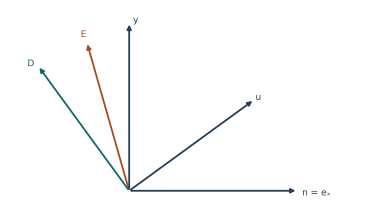
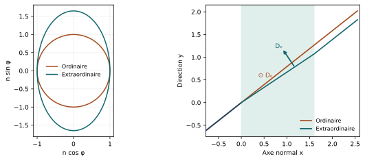
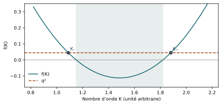
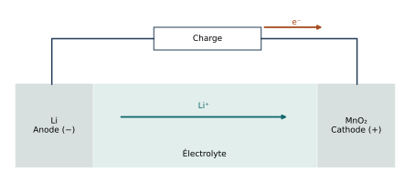
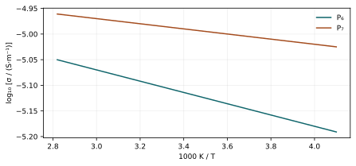

# ENS de Lyon PC 2013 — Physique-chimie (L) · Corrigé guidé

*Corrigé rédigé par IA, non officiel. Signalez toute erreur.*

**Rédaction** · GPT-6.2 Astra Ultra · vitesse non renseignée

Le sujet officiel et ses annexes servent de sources à cette correction. Le rapport spécifique de cet écrit de Lyon reste à retrouver.

## Quelques aspects physiques et chimiques des cristaux liquides

**Couverture.** La numérotation recommence en chimie. P. désigne les questions de physique et C. celles de chimie. Restent hors de ce corrigé les questions C.7, C.9, C.10, C.34, C.44, C.45.

## I · Ondes planes dans un isolant polarisable

### Question P.1 — Moment dipolaire et polarisation

**Indication.** Former le premier moment d’une distribution neutre, puis rapporter les moments moléculaires à un volume mésoscopique.

Pour des charges $q_i$ placées en $\mathbf r_i$, $\mathbf p=\sum_i q_i\mathbf r_i$. Pour une molécule neutre cette somme est indépendante de l’origine et s’exprime en $\mathrm{C\,m}$. La polarisation est la densité volumique moyenne de moments, $\mathbf P=\sum_{i\in\delta V}\mathbf p_i/\delta V$, en $\mathrm{C\,m^{-2}}$.

### Question P.2 — Charge liée et divergence

**Indication.** Utiliser la continuité locale de la charge liée.

La conservation impose $\partial_t\rho+\nabla\cdot\mathbf j=0$. Avec $\mathbf j=\partial_t\mathbf P$, les dérivées commutent et $\partial_t(\rho+\nabla\cdot\mathbf P)=0$. La somme est indépendante du temps en chaque point. La constante étant choisie nulle, $\rho=-\nabla\cdot\mathbf P$.

### Question P.3 — Maxwell avec le déplacement

**Indication.** Transférer au même membre les termes de polarisation et de courant de déplacement du vide.

Comme $\nabla\cdot\mathbf E=\rho/\epsilon_0$, la relation précédente donne $\nabla\cdot\mathbf D=0$. De même $\nabla\times\mathbf B=\mu_0(\partial_t\mathbf P+\epsilon_0\partial_t\mathbf E)=\mu_0\partial_t\mathbf D$. Il n’y a aucune charge ou courant libre dans ce milieu.

### Question P.4 — Équations harmoniques

**Indication.** Lire les deux dérivées du facteur $e^{i(\mathbf k\cdot\mathbf r-\omega t)}$.

Avec $\nabla\to i\mathbf k$ et $\partial_t\to-i\omega$, Ampère donne $\mathbf k\times\mathbf B=-\mu_0\omega\mathbf D$ et Faraday donne $\mathbf k\times\mathbf E=\omega\mathbf B$.

### Question P.5 — Projection transverse

**Indication.** Éliminer le champ magnétique avec un double produit vectoriel.

$\mathbf k\times(\mathbf k\times\mathbf E)=-\mu_0\omega^2\mathbf D$ et le membre de gauche vaut $\mathbf k(\mathbf k\cdot\mathbf E)-k^2\mathbf E$. Ainsi $\mathbf D=k^2[\mathbf E-\mathbf u(\mathbf u\cdot\mathbf E)]/(\mu_0\omega^2)$ avec $\mathbf u=\mathbf k/k$.

### Question P.6 — Composantes dans le plan d’incidence

**Indication.** Écrire $\mathbf u=(\cos\varphi,\sin\varphi,0)$ et développer la projection précédente.

En posant $C_0=k^2/(\mu_0\omega^2)$, $c_\varphi=\cos\varphi$, $s_\varphi=\sin\varphi$, on obtient $D_x=C_0(s_\varphi^2 E_x-s_\varphi c_\varphi E_y)$, $D_y=C_0(-s_\varphi c_\varphi E_x+c_\varphi^2 E_y)$ et $D_z=C_0E_z$.

### Question P.7 — Direction de D

**Indication.** Projeter l’expression précédente sur le vecteur d’onde ou utiliser Gauss.

Le produit $\mathbf k\cdot\mathbf D$ est nul. Le déplacement électrique est transverse au vecteur d’onde même lorsque la permittivité est anisotrope.

## II · Biréfringence nématique

### Question P.8 — Susceptibilités selon les axes

**Indication.** Seule une composante de champ le long du bâtonnet peut y induire un dipôle.

Dans les axes propres du milieu, $P_x=\epsilon_0\chi_xE_x$, $P_y=\epsilon_0\chi_yE_y$, $P_z=\epsilon_0\chi_zE_z$. Le modèle impose $\chi_x=\chi$, $\chi_y=\chi_z=0$, puisque le directeur est l’axe x.

### Question P.9 — Permittivités principales

**Indication.** Additionner $\epsilon_0\mathbf E$ à la polarisation composante par composante.

Les composantes s’écrivent $D_x=\epsilon_0\epsilon_\parallel E_x$, $D_{y,z}=\epsilon_0\epsilon_\perp E_{y,z}$, avec $\epsilon_\parallel=1+\chi$ et $\epsilon_\perp=1$. Puisque $\chi\ge0$, $\epsilon_\parallel\ge\epsilon_\perp$.

### Question P.10 — Onde polarisée selon z

**Indication.** La relation constitutive dans cette direction et la relation de Maxwell doivent coïncider.

Pour $E_z\ne0$, $k^2 E_z/(\omega^2\mu_0)=\epsilon_0\epsilon_\perp E_z$. Donc $k^2=\epsilon_\perp\omega^2/c^2$, avec $c=(\epsilon_0\mu_0)^{-1/2}$.

### Question P.11 — Indice ordinaire

**Indication.** L’indice de phase est le rapport du nombre d’onde à celui du vide.

$n_o=ck/\omega=\sqrt{\epsilon_\perp}$. Il est indépendant de $\varphi$. Dans ce modèle de polarisation purement axiale, sa valeur est un.

### Question P.12 — Champ électrique non transverse

**Indication.** Le déplacement et le champ électrique ont des composantes multipliées par des facteurs différents.

Écrivons $\mathbf D=D(-\sin\varphi,\cos\varphi,0)$. Alors $\mathbf u\cdot\mathbf E=(D/\epsilon_0)\sin\varphi\cos\varphi(1/\epsilon_\perp-1/\epsilon_\parallel)$. C’est non nul pour une incidence oblique et une anisotropie non nulle. Le champ est transverse dans les directions principales ou dans la limite isotrope. C’est la transversalité de $\mathbf D$ que Gauss impose toujours ici.

### Question P.13 — Système homogène du mode dans le plan

**Indication.** Identifier chaque $D_i$ obtenue par Maxwell avec sa valeur constitutive.

Posons $v=\omega/k$ et $c^{-2}=\mu_0\epsilon_0$. Après division des deux premières équations de P.6 par $C_0$, le système est $(\sin^2\varphi-\epsilon_\parallel v^2/c^2)E_x-\sin\varphi\cos\varphi E_y=0$ et $-\sin\varphi\cos\varphi E_x+(\cos^2\varphi-\epsilon_\perp v^2/c^2)E_y=0$.

### Question P.14 — Vitesse de phase extraordinaire

**Indication.** Une solution non nulle impose l’annulation du déterminant, et la fréquence de l’onde est non nulle.

En posant $w=v^2/c^2$, le déterminant est $w[\epsilon_\parallel\epsilon_\perp w-\epsilon_\parallel\cos^2\varphi-\epsilon_\perp\sin^2\varphi]$. La racine propagative est donc $v=c\sqrt{\cos^2\varphi/\epsilon_\perp+\sin^2\varphi/\epsilon_\parallel}$.

### Question P.15 — Indice effectif directionnel

**Indication.** Passer à l’inverse du carré de l’indice plutôt que de développer sa racine.

Avec $n_{eff}=c/v$, $n_e=\sqrt{\epsilon_\parallel}$ et $n_o=\sqrt{\epsilon_\perp}$, on retrouve $1/n_{eff}^2=\cos^2\varphi/n_o^2+\sin^2\varphi/n_e^2$. Pour une propagation le long du directeur, $n_{eff}=n_o$, tandis que pour une direction perpendiculaire il vaut $n_e$.

### Question P.16 — Deux indices pour une direction

**Indication.** Comparer les deux polarisations linéaires indépendantes à direction de phase fixée.

Pour une direction oblique générale, la polarisation selon z voit l’indice $n_o$, celle dans le plan voit $n_{eff}(\varphi)$. Elles accumulent une phase différente sur une même distance. Cette dépendance de l’indice à la polarisation est la biréfringence.

### Question P.17 — Construction des directions de champ

**Indication.** Tracer le déplacement perpendiculaire à $\mathbf u$, puis comprimer davantage sa composante x pour obtenir $\mathbf E$.

Sur le tracé, le directeur vaut $\mathbf e_x$, $\mathbf u=(\cos\varphi,\sin\varphi)$ et l’on choisit $\mathbf D=D(-\sin\varphi,\cos\varphi)$. Le champ $\mathbf E=(D/\epsilon_0)(-\sin\varphi/\epsilon_\parallel,\cos\varphi/\epsilon_\perp)$ se trouve entre $\mathbf D$ et $+y$ pour $0<\varphi<\pi/2$ si $n_e>n_o$.

### Question P.18 — Inclinaison du champ

**Indication.** Former le rapport des composantes horizontale et verticale.

En mesurant $\phi$ depuis $+y$ vers $-x$ comme sur la construction, $\tan\phi=-E_x/E_y=(\epsilon_\perp/\epsilon_\parallel)\tan\varphi=(n_o/n_e)^2\tan\varphi$. Pour une fréquence et une direction données, ce rapport fixe la polarisation extraordinaire.

## III · Lame de cristal liquide

### Question P.19 — Modes réfractés

**Indication.** La continuité de phase conserve la composante tangentielle du vecteur d’onde pour chaque polarisation.

Une incidence non polarisée contient les deux composantes propres. À l’intérieur, l’une se propage avec $n_o$ et forme l’angle $r_o$, l’autre avec $n_{eff}(r_e)$ et forme l’angle $r_e$ avec la normale x. On a $\sin i=n_o\sin r_o=n_{eff}(r_e)\sin r_e$.

### Question P.20 — Trajet ordinaire

**Indication.** Substituer la valeur de la permittivité transverse du modèle dans la loi de phase à l’interface.

L’air et le mode ordinaire ont le même indice puisque $n_o=1$. Donc $\sin r_o=\sin i$, soit $r_o=i$ pour l’onde transmise. Le rayon ordinaire continue tout droit.

### Question P.21 — Angle réfracté extraordinaire

**Indication.** Combiner la conservation de la composante tangentielle avec l’équation de l’indice effectif.

De $\sin^2i=\sin^2r_e/[\cos^2r_e/n_o^2+\sin^2r_e/n_e^2]$, on tire $\tan^2r_e(1-\sin^2i/n_e^2)=\sin^2 i/n_o^2$. Donc $\tan r_e=\sin i/[n_o\sqrt{1-\sin^2 i/n_e^2}]$ avec le signe de $i$.

### Question P.22 — Courbes polaires des indices

**Indication.** Poser $X=n\cos\varphi$ et $Y=n\sin\varphi$.

Le mode ordinaire est le cercle $X^2+Y^2=n_o^2$. Le mode extraordinaire décrit l’ellipse $X^2/n_o^2+Y^2/n_e^2=1$, de grand axe y lorsque $n_e>n_o$. L’ellipse entoure le cercle, donc $n_{eff}\ge n_o$. Il y a égalité le long de l’axe optique.

### Question P.23 — Directions dans et après la lame

**Indication.** Les faces sont parallèles et le même milieu se trouve des deux côtés.

L’ordinaire traverse sans déviation, avec $\mathbf D_o\parallel z$. Dans la lame, la normale de phase extraordinaire a l’angle $r_e<i$ pour $i>0$, et $\mathbf D_e$ lui est perpendiculaire dans le plan. À la seconde face, la composante tangentielle de $\mathbf k$ est encore la même. Les deux directions sortantes sont parallèles à l’incidente, avec un décalage latéral. La figure suit la convention du sujet qui trace les directions de phase. En anisotropie, le flux d’énergie extraordinaire peut former un autre angle dans la lame.

## IV · Directeur hélicoïdal dans une phase cholestérique

### Question P.24 — Dérivées de la base locale

**Indication.** Exprimer le directeur comme un vecteur tournant d’angle $\theta=qz$ dans le plan horizontal.

$\mathbf e_r=(\cos qz,\sin qz,0)$ et $\mathbf e_\theta=(-\sin qz,\cos qz,0)$. Donc $d\mathbf e_r/dz=q\mathbf e_\theta$ et $d\mathbf e_\theta/dz=-q\mathbf e_r$.

### Question P.25 — Première expression du gradient axial

**Indication.** Dériver à la fois la phase commune et la base d’expression des composantes.

Pour $\mathbf E=(E_r^0\mathbf e_r+E_\theta^0\mathbf e_\theta)e^{i(Kz-\omega t)}$, $\partial_z\mathbf E=[(iKE_r^0-qE_\theta^0)\mathbf e_r+(qE_r^0+iKE_\theta^0)\mathbf e_\theta]e^{i(Kz-\omega t)}$.

### Question P.26 — Polarisation dans la base tournante

**Indication.** Le directeur est ici le vecteur radial local.

$\mathbf P=\epsilon_0\chi E_r\mathbf e_r$ et $\mathbf D=\epsilon_0(\epsilon_\parallel E_r\mathbf e_r+\epsilon_\perp E_\theta\mathbf e_\theta)$. Le mode radial polarise les bâtonnets et voit $n_e$ puisque la propagation selon z est perpendiculaire au directeur. Le mode orthoradial voit $n_o$.

### Question P.27 — Vitesses dans une tranche mince

**Indication.** Dans la tranche, utiliser les axes locaux comme des axes fixes.

Pour la propagation suivant z, les deux célérités locales sont $c_o=c/n_o$ et $c_e=c/n_e$. Pour $\chi>0$, le mode radial est plus lent.

### Question P.28 — Validité locale

**Indication.** Il doit exister une épaisseur grande devant la distance de variation de phase optique et petite devant celle du directeur.

Les nombres d’onde sont $k_o=n_o\omega/c$ et $k_e=n_e\omega/c$. Pour disposer d’une tranche $1/k_{o,e}\ll\delta z\ll1/|q|$, il faut $|q|\ll k_o,k_e$. Cela revient à un pas hélicoïdal grand devant la longueur d’onde dans le matériau.

### Question P.29 — Propagation locale indépendante

**Indication.** Geler les directions propres au bord amont de la tranche et avancer les phases séparément.

Pour une petite avancée $s$ depuis $z_0$, le champ local est $e^{-i\omega t}[E_r(z_0)e^{ik_e s}\mathbf e_r(z_0)+E_\theta(z_0)e^{ik_o s}\mathbf e_\theta(z_0)]$. Les amplitudes au bord sont complexes et contiennent déjà la phase accumulée avant la tranche.

### Question P.30 — Deuxième gradient axial

**Indication.** Dériver le champ local au bord dans la base supposée fixe de la tranche.

Au bord amont, on obtient $\partial_z\mathbf E=i[k_e E_r^0\mathbf e_r+k_o E_\theta^0\mathbf e_\theta]e^{i(Kz-\omega t)}$. Ici les facteurs $k_e$ et $k_o$ s’appliquent aux deux composantes physiques locales.

### Question P.31 — Système de propagation couplé

**Indication.** Les deux calculs de la dérivée évalués au même point doivent coïncider.

La projection radiale donne $i(K-k_e)E_r^0-qE_\theta^0=0$. La projection orthoradiale donne $qE_r^0+i(K-k_o)E_\theta^0=0$. Les termes en $q$ proviennent de la rotation géométrique du directeur.

### Question P.32 — Équation caractéristique du nombre d’onde

**Indication.** Annuler le déterminant de la matrice complexe pour obtenir un champ non nul.

Le déterminant est $-(K-k_e)(K-k_o)+q^2$. Par conséquent $f(K)=q^2$ avec $f(K)=(K-k_e)(K-k_o)$.

### Question P.33 — Deux racines réelles

**Indication.** Comparer la parabole à la droite horizontale positive et calculer leurs intersections.

$f$ est une parabole ouverte vers le haut, nulle en $k_o,k_e$ et de minimum $-(k_e-k_o)^2/4$. Ses intersections avec le niveau $q^2$ donnent $K_\pm=(k_e+k_o)/2\pm\sqrt{[(k_e-k_o)/2]^2+q^2}$. Elles sont distinctes pour un pas fini.

### Question P.34 — Intervalle sans nombre d’onde propre

**Indication.** Observer le signe du produit entre $k_o$ et $k_e$.

Avec $k_e\ge k_o$ et $q\ne0$, la racine haute satisfait $K_+>k_e$, la basse $K_-<k_o$. Aucun $K$ entre $k_o$ et $k_e$ ne peut donc résoudre l’équation à cette fréquence. Les deux modes s’écartent lorsque $|q|$ augmente. L’intervalle identifié est en nombre d’onde pour ce modèle local à fréquence fixée.

## V.A · Spectroscopie et fonctions chimiques du cristal liquide

### Question C.1 — Catalyse par transfert de phase

**Indication.** La base et le substrat organique ne se trouvent pas spontanément dans la même phase.

Un catalyseur de transfert de phase peut associer un contre-ion lipophile à l’anion réactif ou complexer son cation. L’espèce ionique peut ainsi rencontrer le substrat dans la phase organique. Le transfert accélère la réaction sans modifier le bilan global.

### Question C.2 — Structure de l’aldéhyde P₁

**Indication.** Repérer le nucléophile du 4-hydroxybenzaldéhyde et le carbone primaire porteur du chlore.

La déprotonation de OH donne un phénolate. Un de ses doublets remplace le chlorure au carbone primaire de R–Cl par substitution bimoléculaire. Avec le substituant R de la figure 4, P₁ est $p$-$\mathrm{RO{-}C_6H_4{-}CHO}$. La fonction aldéhyde et la substitution para sont conservées.

### Question C.3 — Bande qui suit la transformation

**Indication.** Comparer les fonctions présentes dans P₁ et dans P₂.

La bande à $1720\ \mathrm{cm^{-1}}$ est une vibration d’élongation du carbonyle de l’aldéhyde P₁. Sa diminution suit donc la disparition de ce réactif, sous réserve de l’absence de contribution notable d’une autre espèce à ce nombre d’onde.

### Question C.4 — Absorbance et mesure

**Indication.** Distinguer la transmittance et la grandeur proportionnelle à la concentration.

L’instrument compare l’intensité transmise $I$ à la référence $I_0$. Avec $\mathcal T=I/I_0$, $A=-\log_{10}\mathcal T$. À longueur de trajet $l$, nombre d’onde et composition de matrice fixés, la loi de Beer–Lambert donne $A=\epsilon l c$ pour l’espèce absorbante.

### Question C.5 — Taux de conversion infrarouge

**Indication.** Former le rapport des absorbances pour éliminer la longueur de cuve et le coefficient d’absorption.

À volume constant et après correction du fond, $c_f/c_i=A_f/A_i=0{,}02/0{,}8=0{,}025$. La fraction de P₁ consommée est donc $1-0{,}025=0{,}975$, soit $97{,}5\,\%$. Pour une masse initiale de $1{,}15\ \mathrm g$, cela représente environ $1{,}12\ \mathrm g$ de P₁ consommé.

### Question C.6 — Bilan de réduction d’un nitroarène

**Indication.** Équilibrer d’abord les O et H, puis la charge par des électrons.

La transformation du groupe s’écrit $\mathrm{ArNO_2+6H^++6e^-\to ArNH_2+2H_2O}$. Si le fer passe en Fe(II), le bilan est $\mathrm{ArNO_2+6H^++3Fe\to ArNH_2+2H_2O+3Fe^{2+}}$. P₃ est le stilbène para-amino correspondant à P₂, $\mathrm{RO{-}C_6H_4{-}CH{=}CH{-}C_6H_4{-}NH_2}$, avec les substitutions para de la figure.

### Question C.8 — Structure électronique du nitrosonium

**Indication.** Compter les électrons de valence et tester la règle de l’octet.

$\mathrm{NO^+}$ a $5+6-1=10$ électrons de valence. La structure $[\!:\!\mathrm N{\equiv}O\!:\!]^{+}$ comporte un triple lien et un doublet libre sur chaque atome. Dans cette écriture la charge formelle est sur O. L’ion est isoélectronique de CO.

### Question C.11 — Sélectivité des deux oxygènes phénoliques

**Indication.** Comparer la stabilisation de l’arylsulfonate partant et l’accessibilité des deux OH de P₄.

Un sulfonate d’alkyle possède un bon groupe partant, l’arylsulfonate étant stabilisé par résonance. Sur la figure 7, l’éther se forme sur l’oxygène para de l’azo. L’autre OH, ortho de l’azo, peut former une liaison H intramoléculaire avec un N de l’azo et il est plus encombré entre les substituants. Ces différences rendent compte de la régiosélectivité observée.

## V.B · Organisation et fonction de la membrane

### Question C.12 — Interactions entre mésogènes

**Indication.** Repérer la partie aromatique, les groupes polaires et les chaînes peu polaires.

La cohésion inclut les forces de dispersion (notamment entre noyaux polarisables), les interactions dipôle–dipôle et des liaisons hydrogène impliquant les groupes OH et les O ou N accepteurs. Une interaction de dispersion ou dipolaire individuelle vaut typiquement quelques $\mathrm{kJ\,mol^{-1}}$ et une liaison hydrogène ordinaire de l’ordre de 10 à $30\ \mathrm{kJ\,mol^{-1}}$. Plusieurs contacts peuvent s’additionner par molécule.

### Question C.13 — Fluidité et ordre d’orientation

**Indication.** Séparer la mobilité du centre de masse et la rotation des molécules allongées.

Les interactions intermoléculaires réversibles permettent les déplacements relatifs, donc l’écoulement. Les cœurs rigides et allongés gagnent en compacité et en interactions lorsqu’ils sont approximativement parallèles. Dans la phase smectique, la séparation entre les régions riches en cœurs aromatiques et celles riches en chaînes, jointe à l’empilement anisotrope, favorise des couches qui restent fluides dans leur plan.

### Question C.14 — Effet de la température sur les deux parties

**Indication.** Identifier les liaisons simples capables de rotations internes et le squelette conjugué plus rigide.

Les chaînes terminales éthoxy et alkyles explorent progressivement plus de conformations et occupent un volume transverse plus important. Le cœur aromatique et conjugué conserve davantage sa forme. À plus haute température, les axes des cœurs eux-mêmes se désorientent et l’ordre nématique disparaît.

### Question C.15 — Facteur de forme

**Indication.** Suivre l’enveloppe moyenne de la molécule en passant du smectique au liquide isotrope.

Le bâtonnet initial s’élargit relativement à sa longueur lorsque les chaînes se replient et se désordonnent. Le rapport longueur sur diamètre effectif décroît. Les contacts directionnels entre cœurs et l’empilement en couches deviennent moins avantageux. L’ordre de position est perdu avant l’ordre d’orientation.

### Question C.16 — Nombres d’oxydation du manganèse

**Indication.** Attribuer $-2$ aux oxygènes et $+1$ au lithium inséré.

Dans $\mathrm{MnO_2}$, $x-4=0$ donne Mn(IV). Dans $\mathrm{LiMnO_2}$, $1+x-4=0$ donne Mn(III). L’insertion d’un ion Li accompagne donc l’apport d’un électron au manganèse.

### Question C.17 — Demi-équations de la pile

**Indication.** En décharge, l’électrode qui libère les électrons est l’anode.

À l’anode négative $\mathrm{Li\to Li^++e^-}$. À la cathode positive $\mathrm{MnO_2+Li^++e^-\to LiMnO_2}$. Leur somme retrouve la réaction de fonctionnement. Les électrons vont du lithium vers la cathode par la charge extérieure.

### Question C.18 — Rôle des cations dans la membrane

**Indication.** Identifier la source et le puits de lithium ionique durant la décharge.

Le lithium métallique crée des $\mathrm{Li^+}$ à l’anode et l’oxyde les consomme à la cathode. Leur passage dans l’électrolyte ferme le circuit ionique, évite une accumulation de charge et alimente la réaction d’insertion. La membrane doit bloquer la conduction électronique directe.

### Question C.19 — Schéma de fonctionnement

**Indication.** Tracer des chemins distincts pour les électrons et les cations.

Le schéma de cellule se lit $(-)\ \mathrm{Li(s)\,|\,membrane\ contenant\ Li^+,A^-\,|\,MnO_2(s),LiMnO_2(s)}\ (+)$. Dans la membrane les $\mathrm{Li^+}$ vont de gauche à droite. Dans le circuit extérieur des électrons quittent également l’anode et traversent la charge avant d’arriver au pôle positif.

### Question C.20 — Solvatation des ions par P₅

**Indication.** Localiser les dipôles et les doublets susceptibles de coordonner un cation.

Les oxygènes des chaînes polyéther dirigent leurs doublets vers $\mathrm{Li^+}$ et produisent des interactions ion–dipôle, éventuellement multidentates. L’anion peut rencontrer les extrémités positives des dipôles et accepter une liaison H du OH disponible. La solvatation dépend de la taille et de la répartition de charge du contre-ion.

### Question C.21 — Concentration du sel

**Indication.** La conductivité dépend simultanément de la densité de porteurs libres et de leur mobilité.

À faible concentration, le nombre d’ions transporteurs limite le courant. Une concentration excessive accroît les paires ou agrégats d’ions, peut ralentir les mouvements de chaîne et perturber l’ordre du matériau. La conductivité peut passer par un maximum et du sel peut rester non dissous.

### Question C.22 — Anisotropie de conduction

**Indication.** Les cœurs aromatiques et les domaines solvatants sont orientés et ne constituent pas les mêmes chemins dans toutes les directions.

En général $\sigma_\parallel\ne\sigma_\perp$. Les ions préfèrent les régions polyéthers polaires. Dans une phase smectique constituée de couches ionophiles perpendiculaires au directeur, le déplacement dans la couche peut ainsi être plus facile que la traversée successive des régions aromatiques. Le signe et l’amplitude de l’anisotropie dépendent de l’organisation effective.

### Question C.23 — Séparation des réactifs

**Indication.** Examiner l’état physique des deux réactifs dans la réaction choisie.

Le lithium métallique et le dioxyde de manganèse sont des solides immobilisés chacun dans une électrode. Ils ne diffusent pas sous leur forme massive à travers la membrane. Cela rend possible la séparation recherchée pour cette cellule. Une perméabilité strictement nulle aux espèces dissoutes éventuelles ne se déduit pas de la seule structure nématique.

## V.C · Mécanismes de transport et conductivité

### Question C.24 — Cinq contre-ions et leurs charges

**Indication.** Vérifier la charge totale de chaque structure et repérer les atomes reliés par résonance.

$\mathrm{Cl^-}$ porte quatre doublets. Dans $[\mathrm{BF_4}]^-$, B est tétraédrique, lié par quatre liaisons simples à F, chacun à trois doublets, et la charge formelle est sur B. Le perchlorate est tétraédrique, avec les formes résonantes $\mathrm{^-O{-}Cl(=O)_3}$. Le triflate a pour forme $\mathrm{CF_3{-}S(=O)_2{-}O^-}$ avec charge délocalisée sur les trois O. Le dernier anion s’écrit $[\mathrm{CF_3SO_2{-}N^{-}{-}SO_2CF_3}]$, la charge étant délocalisée vers les oxygènes sulfonyle. Les deux groupes $\mathrm{CF_3}$ renforcent la stabilisation électronique.

### Question C.25 — Effet du contre-ion

**Indication.** Distinguer dissociation des paires et vitesse de déplacement d’un anion dissocié.

Un contre-ion à charge compacte, tel le chlorure, peut fortement retenir $\mathrm{Li^+}$. Des anions plus encombrants et à charge délocalisée, notamment le bis(sulfonyl)imidure, tendent à moins coordonner le cation et peuvent accroître la population de porteurs libres. Une grande taille peut en revanche ralentir l’anion lui-même. Un classement quantitatif exige les données expérimentales.

### Question C.26 — Diffusion corrélée ou par sauts

**Indication.** Suivre ce qui accompagne physiquement un ion Li dans chacun des trois dessins.

Dans le mécanisme 1, lithium et molécule hôte fortement associée diffusent ensemble, lentement comme un objet volumineux. L’anion libre peut diffuser plus vite. Dans le mécanisme 2, Li et anion présentent des corrélations de paire, avec passage de Li entre anions successifs. La matrice n’accompagne pas le cation. Une paire durable aurait les deux mêmes vitesses moyennes de translation, tandis que les échanges permettent une diffusion supplémentaire de Li. Dans le mécanisme 3, Li saute d’une chaîne à l’autre grâce aux réorientations segmentaires. Il peut diffuser plus vite que les mésogènes, sans entraînement permanent de l’anion. Le classement exact de deux ions libres dépend de leur mobilité.

### Question C.27 — Relation de Kohlrausch

**Indication.** Exprimer les concentrations dans l’unité compatible avec les conductivités molaires.

$\sigma=\sum_i\lambda_i[X_i]$, avec $[X_i]$ en $\mathrm{mol\,m^{-3}}$ et $\lambda_i$ en $\mathrm{S\,m^2\,mol^{-1}}$. Le résultat s’exprime en $\mathrm{S\,m^{-1}}$. Dans un milieu associant il faut considérer les porteurs effectivement mobiles.

### Question C.28 — Comparaison des deux graphes thermiques

**Indication.** L’axe des abscisses est l’inverse de la température, donc la lecture en température croissante s’effectue vers la gauche.

La conductivité augmente au chauffage dans les deux membranes. La pente est plus forte pour P₆ et P₇ demeure plus conducteur sur tout l’intervalle mesuré avec LiCl. À concentration nominale identique, cela indique un transport plus efficace dans P₇. Pour attribuer tout l’écart aux mobilités, il faut supposer comparables les fractions de sel dissocié.

### Question C.29 — Loi d’Arrhenius

**Indication.** Prendre le logarithme de la loi exponentielle donnée.

Une droite de $\log_{10}\sigma$ en fonction de $1/T$ est compatible avec $\sigma=\sigma_0e^{-E_a/(RT)}$ dans la gamme mesurée. $E_a$ est l’énergie d’activation molaire apparente du transport. $\sigma_0$ est le facteur préexponentiel en $\mathrm{S\,m^{-1}}$, extrapolé par le modèle vers $1/T=0$.

### Question C.30 — Paramètres des ajustements

**Indication.** Utiliser le logarithme décimal et la graduation $x=1000/T$.

Pour $y=mx+b$, $E_a=-1000R\ln(10)m$ et $\sigma_0=10^b$. Pour P₆ cela donne $E_a\simeq2{,}1\ \mathrm{kJ\,mol^{-1}}$ et $\sigma_0\simeq1{,}8\times10^{-5}\ \mathrm{S\,m^{-1}}$. Pour P₇ on obtient $0{,}96\ \mathrm{kJ\,mol^{-1}}$ et $1{,}5\times10^{-5}\ \mathrm{S\,m^{-1}}$. Une pente en logarithme naturel aurait omis à tort le facteur $\ln10$.

### Question C.31 — Effet des sels à température donnée

**Indication.** Comparer $\sigma_0$ et $E_a$ conjointement et appliquer l’exponentielle si les tendances s’opposent.

Pour chaque matrice, les quatre anions du tableau donnent des conductivités décroissant dans l’ordre NTFSi, perchlorate, triflate, tétrafluoroborate. En effet le facteur préexponentiel diminue et la barrière augmente dans cet ordre. Le chlorure de C.30 a un plus petit préfacteur et une barrière plus élevée que ces quatre sels. À $298\ \mathrm K$, pour P₆, on va d’environ $2{,}8\times10^{-4}$ avec NTFSi à $7{,}7\times10^{-6}\ \mathrm{S\,m^{-1}}$ avec Cl. P₇ est en général plus conducteur dans la plage étudiée.

### Question C.32 — Différences entre P₆ et P₇

**Indication.** La chaîne centrale longue peut envelopper un cation et multiplier les contacts simultanés.

La partie PEG de P₆ peut agir comme un ligand multidentate et retenir $\mathrm{Li^+}$ sur la même molécule. Le déplacement de ce gros complexe est lent, ce qui favorise l’interprétation par le mécanisme 1. Dans P₇, les chaînes terminales plus courtes échangent plus facilement le cation et le transfert de proche en proche du mécanisme 3 rend compte de la meilleure mobilité. L’association du contre-ion peut aussi introduire une contribution de type 2. Les deux courbes seules ne déterminent pas les coefficients d’autodiffusion.

### Question C.33 — Conductivité aqueuse de référence

**Indication.** Convertir le litre en mètres cubes avant d’additionner les deux contributions.

Avec $[\mathrm{Li^+}]=[\mathrm{Cl^-}]=1000\ \mathrm{mol\,m^{-3}}$, $\sigma=(3{,}9+7{,}6)10^{-3}\times1000=11{,}5\ \mathrm{S\,m^{-1}}$ selon les conductivités fournies. C’est environ six ordres de grandeur au-dessus de ces membranes au chlorure à température ambiante. En solution concentrée, les conductivités molaires effectives peuvent différer de leurs valeurs limites.

## VI · Molécule à cavité de reconnaissance

### Question C.35 — Équation de l’oxydation benzylique

**Indication.** Équilibrer le passage de l’alcool primaire au groupe carboxylique pour le squelette aromatique indiqué par R₁.

Soit $Ar$ le noyau 3,4-dihydroxyphényle. La demi-équation acide est $\mathrm{ArCH_2OH+H_2O\to ArCOOH+4H^++4e^-}$. Pour le couple $\mathrm{MnO_4^-/Mn^{2+}}$, le bilan formel est $\mathrm{5ArCH_2OH+4MnO_4^-+12H^+\to5ArCOOH+4Mn^{2+}+11H_2O}$. Le produit du manganèse dépend du milieu. Pour une réduction en $\mathrm{MnO_2}$ avec carboxylate, le bilan en milieu basique est $\mathrm{3ArCH_2OH+4MnO_4^-\to3ArCOO^-+4MnO_2+OH^-+4H_2O}$, en ne faisant pas figurer les équilibres acide–base phénoliques.

### Question C.36 — Spectre infrarouge du dihydroxyacide

**Indication.** Sur un spectre en transmittance, une absorption se traduit par un creux.

La bande O–H très large de $2500$ à $3500\ \mathrm{cm^{-1}}$ superpose les groupes phénoliques et carboxylique liés par liaison H. La forte absorption autour de $1680\ \mathrm{cm^{-1}}$ est celle du carbonyle d’un acide conjugué. Les bandes vers $1600$ et $1500\ \mathrm{cm^{-1}}$ correspondent au noyau aromatique et la zone $1200$–$1300\ \mathrm{cm^{-1}}$ inclut les étirements C–O.

### Question C.37 — Attribution des protons de R₁

**Indication.** Numéroter C1 au carbone portant COOH et C3/C4 aux carbones portant OH.

Le singulet large vers 12,4 ppm est attribué au proton de l’acide. Les trois H aromatiques donnent vers 7,3 ppm deux signaux rapprochés de H2 (petit couplage méta avec H6) et H6 (doublet de doublets, ortho avec H5 et méta avec H2). Vers 6,75 ppm se trouve H5 (doublet ortho avec H6). Le signal du DMSO résiduel est à 2,5 ppm. Le pic large vers 3,5 ppm, d’intégrale apparente proche de deux, se trouve dans la zone de l’eau résiduelle et de protons échangeables. Une attribution de ce pic aux deux OH phénoliques sur sa seule intégrale est incertaine. Les OH dans le DMSO sont souvent nettement plus déblindés et l’échange peut masquer leurs signaux.

### Question C.38 — Dérivé du tétraéthylèneglycol

**Indication.** Compter l’ossature polyéther du schéma et vérifier la formule brute annoncée.

Avec $\mathrm{Ts}=p$-tolylsulfonyle, P₈ s’écrit $\mathrm{TsO{-}(CH_2CH_2O)_3{-}CH_2CH_2{-}OTs}$. Les deux extrémités sont des esters sulfoniques, les trois oxygènes intérieurs restent des éthers. On retrouve $\mathrm{C_{22}H_{30}O_9S_2}$.

### Question C.39 — Rôle basique de la pyridine

**Indication.** Identifier le doublet libre de l’azote qui n’appartient pas au sextet aromatique.

La pyridine accepte les protons libérés lors de la formation des esters sulfoniques et les fixe sous forme de pyridinium. Le bilan de sulfonylation peut alors éliminer l’acide produit sans protoner durablement les fonctions présentes.

### Question C.40 — Connectivité du cycle polyéther

**Indication.** Relier les deux oxygènes phénoliques adjacents par les deux extrémités d’un seul pont.

P₉ est un dérivé carboxylé du benzo-15-couronne-5. Les oxygènes en positions 3 et 4 du noyau de R₁ sont reliés par le pont $\mathrm{{-}CH_2CH_2(OCH_2CH_2)_3{-}}$, formant la couronne à cinq O, et la fonction carboxyle subsiste. La compétition avec des liaisons entre molécules distinctes peut conduire à des oligomères, des polymères ou des cycles plus grands.

### Question C.41 — Sélectivité de fermeture

**Indication.** Après la première liaison, comparer les partenaires qui peuvent former la seconde.

Si les deux extrémités d’une même molécule P₈ sont maintenues à proximité des deux sites de la même R₁, le second contact devient intramoléculaire et profite d’une forte concentration locale du partenaire. L’interprétation par la préorganisation du PEG favorise ainsi la fermeture du cycle 1:1 aux dépens de l’allongement de chaîne.

### Question C.42 — Structures de Lewis du chlorure de thionyle et de la DMF

**Indication.** Compter les doublets libres sur le soufre et prendre en compte la conjugaison de l’amide.

Dans $\mathrm{Cl{-}S(=O){-}Cl}$ le soufre possède un doublet libre, chaque Cl trois et O deux. La diméthylformamide est $\mathrm{H{-}C(=O){-}N(CH_3)_2}$, avec deux doublets sur O et un sur N. La forme mésomère $\mathrm{H{-}C(-O^-){=}N^+(CH_3)_2}$ explique le caractère partiellement double de C–N.

### Question C.43 — Identification du chlorure d’acyle

**Indication.** Repérer la seule fonction carboxylique de P₉.

P₁₀ est le même noyau benzo-couronne portant $\mathrm{-C(O)Cl}$ à la place de $\mathrm{-C(O)OH}$. Les liaisons éther de la cavité sont conservées.

### Question C.46 — Propriétés mésogènes du dernier composé

**Indication.** Distinguer la forme du cœur conjugué et la mobilité des groupements terminaux.

P₁₃ possède une longue portion rigide aromatique conjuguée, notamment les ponts éthylénique et azo, susceptible de s’orienter collectivement. La chaîne alkyle et le macrocycle polyéther apportent des parties plus souples. La coexistence d’ordre d’orientation et de mobilité rend une mésophase plausible.

### Question C.47 — Site de fixation du lithium

**Indication.** Chercher plusieurs donneurs d’oxygène orientables vers la même cavité.

L’ion $\mathrm{Li^+}$ est accepté dans le site polyéther macrocyclique, un éther-couronne. Les doublets d’oxygène assurent une coordination multidentate. Il s’agit d’une reconnaissance supramoléculaire hôte–invité.

### Question C.48 — Sélectivité en taille

**Indication.** Comparer le rayon de l’ion et la taille intérieure accessible au groupe de donneurs.

Une cavité convenablement dimensionnée permet plusieurs contacts Li–O de longueurs favorables avec un faible coût de déformation. Trop petite, elle exclut ou déplace le cation hors du plan. Trop grande, elle ne permet pas tous les contacts simultanés. La flexibilité et la solvatation modulent cette sélectivité.

### Question C.49 — Mécanisme de transport de P₁₃

**Indication.** Le cation reste complexé à la matrice et son anion complète la coordinence d’après la RMN.

L’association durable au même mésogène favorise le transport véhiculaire du mécanisme 1. $\mathrm{BF_4^-}$ peut accompagner le complexe sous forme de paire. Une paire strictement neutre se déplaçant sans échange ne produit pas à elle seule un courant net, ce qui limite les porteurs efficaces.

### Question C.50 — Comparaison avec les deux matrices antérieures

**Indication.** Chercher quelle structure offre, comme la couronne, plusieurs contacts durables avec un même lithium.

P₁₃ se rapproche de P₆, dont la longue chaîne PEG peut envelopper le cation. La couronne préorganisée renforce encore cette fixation. P₇, aux chaînes terminales plus courtes, permet plus aisément les échanges de site qui caractérisent le mécanisme 3.
