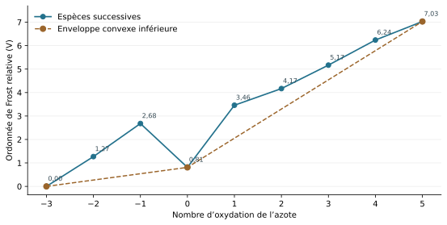
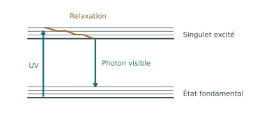
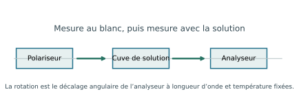

# ENS de Lyon — Second concours, Chimie 2013 · Corrigé guidé

*Corrigé rédigé par IA, non officiel.*

**Rédaction (tour 1)** · GPT-6.2 Astra Ultra · vitesse non renseignée

Les deux éditions traitent intégralement 32 des 85 questions et partiellement B.2.4, C.2.6 et C.3.6. La partie A est complète. Les autres réponses portent sur la thermodynamique et la catalyse générales, le budget d’azote, la polarimétrie et des définitions structurales indépendantes. Les conditions et étapes de production, de caractérisation ou d’isolement spécifiques aux substances dangereuses ne sont pas développées. Les numéros hors couverture sont recensés en fin de copie. Le sujet et son annexe sont disponibles, sans rapport écrit de chimie 2013 identifié dans le catalogue.

## A.1. Structure atomique

### Question A.1.1 — Masse de l’isotope majoritaire

> [!INDICATION]
> Distinguer nombre de masse, masse d’un isotope et masse atomique moyenne de l’élément naturel.

#### Solution

L’azote 14 est l’isotope stable majoritaire. Son nombre de masse est 14 et la masse d’un atome est voisine de 14 u (plus précisément 14,003 u), soit environ $2,33\times10^{-26}$ kg. L’azote 15 est également stable. La masse atomique moyenne de l’azote naturel est proche de 14,007 u.

### Question A.1.2 — Notation nucléaire

> [!INDICATION]
> Le nombre de protons est fixé par l’élément et le nombre de nucléons par l’isotope.

#### Solution

On écrit $^{14}_{7}\mathrm N$. Le noyau contient sept protons et $14-7=7$ neutrons. Un atome neutre possède aussi sept électrons.

### Question A.1.3 — Valence usuelle de l’azote

> [!INDICATION]
> Partir de la couche de valence puis compter les électrons attribués à l’atome dans le modèle de Lewis.

#### Solution

La configuration de valence est $2s^2 2p^3$. L’azote neutre qui satisfait l’octet forme usuellement trois liaisons covalentes et porte un doublet non liant, comme dans l’ammoniac. Il se voit attribuer deux électrons du doublet et trois électrons provenant du partage des liaisons, ce qui donne une charge formelle nulle. Une liaison triple utilise à elle seule les trois paires liantes.

## A.2. Équilibres rédox de l’azote

### Question A.2.1 — Une série continue de nombres d’oxydation

> [!INDICATION]
> Fixer H à +I et O à −II, puis imposer la somme égale à la charge. Utiliser la charge de l’ion hydrazinium explicitée dans l’annexe.

#### Solution

Dans l’ordre du sujet, les nombres d’oxydation de N sont $-3,-2,-1,0,+1,+2,+3,+4,+5$. Dans $\mathrm{NH_4^+}$, on obtient $x+4=1$. Dans $\mathrm{N_2H_5^+}$, $2x+5=1$, donc $x=-2$ en moyenne. Le signe + de ce dernier ion figure dans le tableau des potentiels. Dans $\mathrm{NH_3OH^+}$, les quatre H donnent $x+4-2=1$, d’où $-1$. Dans le corps simple $\mathrm{N_2}$ on a 0. Pour $\mathrm{H_2N_2O_2}$, NO, $\mathrm{HNO_2}$, $\mathrm{N_2O_4}$ et $\mathrm{NO_3^-}$, le bilan donne dans cet ordre +1 à +5.

### Question A.2.2 — Noms des formes neutres

> [!INDICATION]
> Pour un cation protoné, retirer un proton. Pour le dernier anion, se placer du côté de l’acide conjugué.

#### Solution

L’ammonium donne l’ammoniac, l’hydrazinium l’hydrazine et l’hydroxylammonium l’hydroxylamine. Les espèces neutres suivantes sont le diazote, l’acide hyponitreux, le monoxyde d’azote, l’acide nitreux et le tétraoxyde de diazote. L’acide conjugué de l’ion nitrate est l’acide nitrique.

### Question A.2.3 — Point de référence

> [!INDICATION]
> Une translation de l’ordonnée laisse les pentes et les potentiels inchangés.

#### Solution

L’ion ammonium a le plus petit nombre d’oxydation, $-3$. On pose son ordonnée égale à zéro et on conserve en abscisse le nombre d’oxydation véritable, d’où le premier point $(-3,0)$. On pourrait translater aussi l’abscisse de trois unités pour placer ce point à l’origine géométrique.

### Question A.2.4 — Construire les coordonnées de Frost

> [!INDICATION]
> Entre deux degrés successifs, le changement d’abscisse vaut une unité. L’incrément en ordonnée est donc le potentiel du couple correspondant.

#### Solution

Notons $y$ l’ordonnée en volts rapportée à un atome d’azote et à la référence ammonium. On applique $y_{i+1}=y_i+E^\circ_{i+1/i}$, en gardant le signe de chaque potentiel.

| Espèce | Nombre d’oxydation | $y$ (V) |
|---|---:|---:|
| $\mathrm{NH_4^+}$ | −3 | 0,00 |
| $\mathrm{N_2H_5^+}$ | −2 | 1,27 |
| $\mathrm{NH_3OH^+}$ | −1 | 2,68 |
| $\mathrm{N_2}$ | 0 | 0,81 |
| $\mathrm{H_2N_2O_2}$ | +1 | 3,46 |
| $\mathrm{NO}$ | +2 | 4,17 |
| $\mathrm{HNO_2}$ | +3 | 5,17 |
| $\mathrm{N_2O_4}$ | +4 | 6,24 |
| $\mathrm{NO_3^-}$ | +5 | 7,03 |

Le passage de −1 à 0 fait descendre l’ordonnée de 1,87 V. Le choix usuel du corps simple à l’ordonnée nulle reviendrait à soustraire 0,81 V à toute la colonne.

### Question A.2.5 — Tracer le diagramme à pH nul

> [!INDICATION]
> La pente entre deux points doit redonner le potentiel standard de réduction du degré supérieur au degré inférieur.

#### Solution

On porte le nombre d’oxydation de −3 à +5 en abscisse et les ordonnées précédentes en ordonnée. Les segments successifs reconstituent les huit potentiels fournis. En particulier, le segment de −1 à 0 descend et celui de 0 à +1 est le plus fortement ascendant. L’enveloppe convexe inférieure, indiquée sur la figure, répond à la question de stabilité globale.

### Question A.2.6 — Énergie libre et potentiel

> [!INDICATION]
> Identifier le nombre d’électrons du bilan auquel se rapporte l’énergie libre.

#### Solution

Pour une réaction d’oxydoréduction échangeant $n$ électrons, $\Delta_{\mathrm r}G^\circ=-nF E^\circ_{\rm pile}$, où $F$ est la constante de Faraday et $E^\circ_{\rm pile}$ la différence des potentiels de réduction des deux couples. Pour une demi-réaction de réduction, le même lien entre l’énergie standard conventionnelle et $E^\circ$ suppose la même référence électronique que l’électrode standard à hydrogène.

### Question A.2.7 — Critère de dismutation

> [!INDICATION]
> À un degré d’oxydation moyen donné, la droite entre deux points représente un mélange conservant ce degré moyen.

#### Solution

Soit un degré intermédiaire $j$ entre $i$ et $k$. On choisit les fractions des états $i$ et $k$ qui donnent la moyenne $j$. L’ordonnée de leur mélange est celle de la corde en $j$. Si le point $j$ est plus haut, le mélange des deux états possède une énergie libre standard plus faible par atome d’azote. Une dismutation est alors thermodynamiquement favorable. En termes de pentes, le potentiel $E^\circ_{j/i}$ dépasse $E^\circ_{k/j}$, donc la différence des deux est positive.

### Question A.2.8 — Stabilité locale et stabilité globale

> [!INDICATION]
> Un point peut se trouver sous la corde de ses deux voisins immédiats et au-dessus d’une corde plus longue.

#### Solution

Pour les seuls voisins immédiats, les degrés −1, +1 et +4 sont au-dessus de la corde et susceptibles d’une dismutation locale. Pour la stabilité vis-à-vis de **tous** les mélanges possibles, l’enveloppe inférieure passe par −3, 0 et +5. Les formes stables selon ce critère parmi celles du tableau sont donc l’ammonium, le diazote et le nitrate. Les formes de degrés −2, −1, +1, +2, +3 et +4 sont au-dessus d’au moins une corde. Ce classement vaut pour les conditions standards indiquées à pH nul. La cinétique peut retarder une évolution favorable.

### Question A.2.9 — Trois potentiels par différence de coordonnées

> [!INDICATION]
> Un potentiel sur plusieurs degrés est une pente, donc une différence d’ordonnées divisée par le nombre de degrés franchis.

#### Solution

On lit $E^\circ(\mathrm{N_2/NH_4^+})=(0,81-0)/3=0,27\ \mathrm V$. De même $E^\circ(\mathrm{NO_3^-/N_2})=(7,03-0,81)/5=1,24\ \mathrm V$ et $E^\circ(\mathrm{NO_3^-/NH_4^+})=7,03/8=0,88\ \mathrm V$. Le dernier est la moyenne pondérée des deux premiers, avec les poids respectifs 3 et 5.

## A.3. Azote et molécules du vivant

### Question A.3.1 — Le réservoir atmosphérique

> [!INDICATION]
> Distinguer abondance environnementale et forme directement assimilable par les plantes.

#### Solution

L’azote est abondant dans l’atmosphère sous forme de diazote $\mathrm{N_2}$, qui représente près de 78 % de l’air sec en volume. Cet important réservoir est peu directement utilisable par la plupart des organismes. Les plantes assimilent notamment le nitrate et l’ammonium.

### Question A.3.2 — Petits constituants azotés du vivant

> [!INDICATION]
> Rechercher les monomères des deux grandes familles de macromolécules azotées.

#### Solution

Les acides aminés contiennent une fonction amine. Les nucléotides comprennent une base azotée, par exemple l’adénine ou la cytosine, liée à un sucre portant un ou plusieurs phosphates. Ces deux familles fournissent les principaux exemples pour la question suivante.

### Question A.3.3 — Des monomères aux macromolécules

> [!INDICATION]
> Repérer les deux groupes de chaque nouvelle liaison covalente.

#### Solution

Les acides aminés forment des peptides et des protéines. La liaison peptidique est un motif amide $\mathrm{-CO-NH-}$ entre le carboxyle de l’un et l’amine du suivant. Les nucléotides forment les acides nucléiques, ADN ou ARN. Leur squelette contient des liaisons phosphodiester reliant les positions $3'$ et $5'$ de deux sucres successifs.

### Question A.3.4 — Trois exemples d’alcaloïdes

> [!INDICATION]
> On peut choisir des molécules d’une même famille d’alcaloïdes végétaux.

#### Solution

La caféine, la théobromine du cacao et la théophylline sont trois alcaloïdes de la famille des méthylxanthines. Leur squelette hétérocyclique contient plusieurs atomes d’azote.

### Question A.3.5 — Fonctions de la quinine

> [!INDICATION]
> Lire séparément la partie aromatique et la cage bicyclique.

#### Solution

On reconnaît un alcool secondaire, un éther aryl–méthyle, un alcène terminal, une amine tertiaire aliphatique de la partie bicyclique et un azote aromatique de type pyridinique dans le noyau quinoléine. L’amine tertiaire et l’azote du noyau aromatique correspondent à deux environnements distincts.

### Question A.3.6 — Chiralité du squelette

> [!INDICATION]
> Repérer un carbone porteur de quatre substituants différents et examiner si une symétrie interne pourrait compenser les centres.

#### Solution

Le carbone portant OH est lié à H, à OH, à la partie quinoléine et au fragment bicyclique. Il est stéréogène. Le fragment bicyclique comporte d’autres carbones stéréogènes et le squelette asymétriquement substitué n’a pas de plan de symétrie interne compensant ces centres. La quinine est chirale.

### Question A.3.7 — Émission bleue sous lumière UV

> [!INDICATION]
> La couleur est celle de la lumière émise après absorption du rayonnement incident.

#### Solution

Il s’agit d’une **fluorescence** de la quinine. L’absorption se produit dans l’ultraviolet et l’émission est observée dans le bleu visible.

### Question A.3.8 — Perte d’énergie avant l’émission

> [!INDICATION]
> Décomposer l’évolution en absorption, relaxation non radiative et émission du photon.

#### Solution

Le système électronique conjugué absorbe un photon UV et accède à un état électronique excité. Une partie de l’énergie se dissipe rapidement par relaxation vibrationnelle, éventuellement après conversion interne vers le premier singulet excité. Le retour radiatif de cet état vers l’état fondamental donne un photon généralement moins énergétique et de longueur d’onde plus grande. C’est le déplacement de Stokes. La conjugaison du noyau aromatique favorise l’absorption dans l’UV, tandis que l’environnement influe sur le rendement d’émission.

### Question A.3.9 — Deux applications de l’émission de fluorescence

> [!INDICATION]
> Dans chaque usage, nommer ce qui est excité et ce que l’on mesure ou observe.

#### Solution

En microscopie de fluorescence, un marqueur permet de localiser une structure cellulaire par détection de sa lumière émise. En fluorimétrie analytique, on mesure l’intensité d’un analyte fluorescent et on la compare à une série étalon pour en déduire une concentration dans le domaine linéaire.

## B.1. Grandeurs thermodynamiques et catalyse

### Question B.1.1 — Approximation d’Ellingham

> [!INDICATION]
> Utiliser les relations de Kirchhoff sur un intervalle de température sans changement d’état.

#### Solution

On suppose $\Delta_{\mathrm r}H^\circ$ et $\Delta_{\mathrm r}S^\circ$ sensiblement indépendantes de la température sur l’intervalle considéré, en négligeant les effets de $\Delta_{\mathrm r}C_p^\circ$. Alors $\Delta_{\mathrm r}G^\circ(T)\simeq\Delta_{\mathrm r}H^\circ-T\Delta_{\mathrm r}S^\circ$ est affine en $T$. Un changement de phase oblige à reprendre l’approximation par intervalles.

### Question B.1.2 — Utiliser les données d’enthalpie et d’entropie

> [!INDICATION]
> Appliquer la somme des grandeurs molaires avec leurs coefficients stœchiométriques, puis harmoniser les unités.

#### Solution

Pour l’équation (1) écrite dans le sens du sujet, $\Delta_{\mathrm r}H^\circ=2(-46,3)=-92,6$ kJ par mole de réaction. L’entropie de réaction vaut $2(192,3)-191,5-3(130,6)=-198,7$ J par kelvin et par mole. L’approximation linéaire donne donc $\Delta_{\mathrm r}G^\circ(T)\simeq -92,6+0,1987T$ en kJ par mole de réaction avec $T$ en kelvins. Cette expression est une extrapolation dans l’intervalle de validité posé en B.1.1.

### Question B.1.3 — Compter les degrés de liberté

> [!INDICATION]
> Trois espèces soumises à un équilibre chimique n’équivalent pas à trois constituants indépendants.

#### Solution

Avec trois espèces, une relation de réaction indépendante et une phase gazeuse, la règle des phases donne $v=3-1+2-1=3$. On peut choisir la température, la pression totale et un paramètre indépendant de composition. Une relation supplémentaire imposée au mélange initial peut réduire d’une unité le nombre de degrés de liberté effectivement ajustables.

### Question B.1.7 — Définir la catalyse

> [!INDICATION]
> Distinguer la modification de vitesse et le bilan thermodynamique final.

#### Solution

Un catalyseur intervient dans une suite d’étapes élémentaires et est régénéré au cours du cycle. Il fournit une voie cinétique de plus faible énergie libre d’activation et accélère l’établissement de l’équilibre. À température fixée, la constante thermodynamique et la composition d’équilibre restent déterminées par les états initial et final.

### Question B.1.8 — Une catalyse à l’interface

> [!INDICATION]
> Définir la différence de phase et en tirer à la fois un avantage de séparation et une limite cinétique.

#### Solution

Le catalyseur hétérogène appartient à une phase différente de celle des réactifs, par exemple une phase solide au contact d’une phase fluide. Sa récupération et son réemploi peuvent en être facilités. L’activité dépend de l’accessibilité de la surface, de la diffusion et de l’état des sites, qui peuvent être occupés par des espèces indésirables. La vitesse observée peut ainsi traduire autant le transport que la réaction de surface.

### Question B.1.9 — Signification du facteur d’équilibre

> [!INDICATION]
> Distinguer une constante thermodynamique d’une constante de vitesse.

#### Solution

$K$ désigne la constante d’équilibre de la réaction à la température étudiée. En écriture thermodynamique, c’est un quotient d’activités à l’équilibre et il est sans dimension, avec $\Delta_{\mathrm r}G^\circ=-RT\ln K$. Les constantes cinétiques traduisent d’autres propriétés.

## B.2. Sélectivité générale et cycle de l’azote

### Question B.2.4 — Rôle général d’un catalyseur sélectif

> [!INDICATION]
> Comparer deux chemins concurrents sur un profil d’énergie libre, en gardant les mêmes états initiaux et finaux pour chacun.

#### Solution

**Portée partielle.** Un catalyseur peut modifier différemment les barrières de deux voies concurrentes. Il change alors le partage cinétique entre produits, tout en conservant les différences d’énergie libre entre les états d’équilibre. Les considérations de réalisation de l’étape industrielle sont hors couverture.

### Question B.2.9 — Budget annuel d’azote d’origine atmosphérique

> [!INDICATION]
> Convertir les kilomètres carrés en hectares, puis comparer des masses d’azote élémentaire avant d’exprimer l’équivalent en engrais.

#### Solution

Les terres cultivées représentent $(5,5\times10^5)(100)/3\simeq1,83\times10^7$ ha. Le dépôt annuel représente donc $7\times1,83\times10^7\simeq1,28\times10^8$ kg d’équivalent acide nitrique, soit $1,28\times10^8\times14/63\simeq2,85\times10^7$ kg d’azote. Le nitrate d’ammonium apporte deux atomes d’azote pour 80 g par mole, donc la masse d’engrais apportant la même quantité totale d’azote est $2,85\times10^7\times80/28\simeq8,1\times10^7$ kg, soit environ **81 000 t**, ou 2,7 % de 3 Mt. Un calcul fondé sur le seul azote nitrique, une mole de nitrate pour une mole de sel, donnerait 163 000 t équivalentes en nitrate mais compterait à part l’azote ammoniacal. Le chiffre agronomique effectif dépend aussi de la rétention et de l’assimilation.

## C.1. Activité optique

### Question C.1.1 — Signe du pouvoir rotatoire

> [!INDICATION]
> Le signe observé au polarimètre et le descripteur de configuration sont indépendants.

#### Solution

Le signe $(−)$ indique que la substance est lévogyre dans les conditions de mesure, avec une rotation négative du plan de polarisation. Ce signe ne donne pas la configuration absolue $R$ ou $S$ d’un centre.

### Question C.1.2 — Principe de la polarimétrie

> [!INDICATION]
> Décrire une mesure différentielle et préciser les grandeurs qui déterminent la rotation observée.

#### Solution

Un polarimètre envoie une lumière polarisée rectilignement à travers une cuve et détermine l’angle de rotation du plan de polarisation. Le zéro est repéré avec le solvant seul. L’écart angulaire dans des conditions fixées de longueur d’onde et de température donne le signe et l’amplitude de la rotation. Pour une solution diluée, $\alpha=[\alpha]^T_\lambda\,l\,c$ dans les unités de concentration et de longueur convenues. Une solution de saccharose permet d’illustrer la mesure au laboratoire pédagogique.

## C.2 à C.4. Propriétés moléculaires indépendantes

### Question C.2.6 — Structure de Lewis du DMSO

> [!INDICATION]
> Compter les électrons de valence et vérifier les charges formelles dans la représentation séparée.

#### Solution

**Portée partielle.** Le diméthylsulfoxyde peut s’écrire $(\mathrm{CH_3})_2\mathrm{S^+-O^-}$, avec un doublet sur le soufre et trois sur l’oxygène. L’écriture $(\mathrm{CH_3})_2\mathrm{S=O}$ est une autre représentation usuelle de cette liaison polarisée. Il s’agit d’un solvant polaire aprotique. Sa fonction dans la transformation particulière du sujet est hors couverture.

### Question C.3.5 — Propriété générale d’une amine tertiaire

> [!INDICATION]
> Relier la réactivité acido-basique au doublet de l’azote.

#### Solution

La triéthylamine est une base de Brønsted. Son doublet libre accepte un proton, donnant l’ion triéthylammonium. Elle peut aussi se comporter comme base de Lewis en donnant ce doublet. Son encombrement influe sur sa nucléophilie vis-à-vis de certains électrophiles.

### Question C.3.6 — Structure d’un solvant moléculaire

> [!INDICATION]
> Répartir les quatre liaisons du carbone et respecter la valence des deux halogènes.

#### Solution

**Portée partielle.** Le dichlorométhane a pour formule $\mathrm{CH_2Cl_2}$. Le carbone tétraédrique forme deux liaisons C–H et deux liaisons C–Cl. Chaque chlore porte trois doublets non liants. Sa géométrie et ses liaisons polaires lui donnent un moment dipolaire non nul. Seules les propriétés structurales et la classification comme solvant aprotique sont traitées.

### Question C.4.5 — Définir une acylation

> [!INDICATION]
> Écrire la nature du fragment transféré en conservant le carbonyle.

#### Solution

Une acylation introduit sur un substrat un groupe acyle $\mathrm{R-C(=O)-}$. Le terme décrit la nature du groupe transféré et peut, selon le substrat, conduire notamment à une liaison ester ou amide. Cette définition est indépendante de la voie de synthèse du dossier.

## Questions hors couverture

B.1.4, B.1.5, B.1.6, B.1.10, B.1.11, B.1.12, B.1.13, B.1.14, B.1.15, B.1.16, B.2.1, B.2.2, B.2.3, B.2.5, B.2.6, B.2.7, B.2.8, C.1.3, C.1.4, C.1.5, C.1.6, C.1.7, C.2.1, C.2.2, C.2.3, C.2.4, C.2.5, C.3.1, C.3.2, C.3.3, C.3.4, C.3.7, C.4.1, C.4.2, C.4.3, C.4.4, C.4.6, C.4.7, C.4.8, C.4.9, C.4.10, C.4.11, C.4.12, C.4.13, C.4.14, C.4.15, C.4.16, C.4.17, C.4.18, C.4.19.
