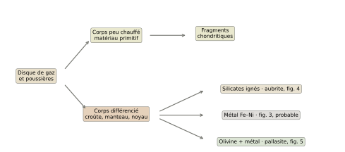
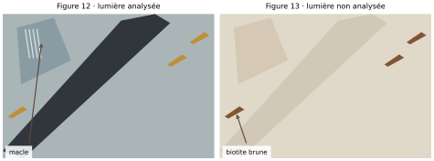
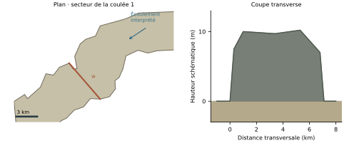
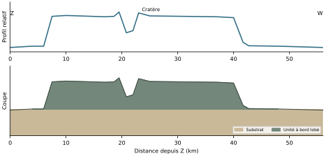

# ENS de Lyon, second concours 2013 — Géosciences · Corrigé guidé

*Corrigé rédigé par IA, non officiel. Signalez toute erreur.*

**Rédaction** · GPT-6.2 Astra Ultra · vitesse non renseignée

Lire les barres d’échelle avant de convertir les longueurs. La direction de l’éclairage guide la lecture du relief. Les identifications minérales et la chronologie dépendent des observations effectivement accessibles.

## I — Dater les surfaces

### Question I.1 — Relier cratérisation et âge

> [!INDICATION]
> Noter ce que mesurent respectivement l’abscisse et l’ordonnée de la figure 2, puis identifier ce qui date indépendamment les points.

#### Solution

Une coulée ou une nappe d’éjectas recouvre le sol et efface une partie des cratères préexistants. Les impacts ultérieurs s’accumulent. Sur la figure 1, le terrain de gauche, très cratérisé et portant de grands impacts recoupés, est donné à plus de 3 Ga. La plaine centrale est attribuée à 100–500 Ma. À droite, le front lobé et sa surface peu cratérisée sont donnés à moins de 100 Ma. Il faut comparer des nombres par unité de surface et par classe de diamètre, en tenant compte des échelles et des cratères secondaires. Une surface fraîche qui en recouvre une autre est plus jeune au contact. La figure 2 associe des densités lunaires à des âges radiométriques d’échantillons rapportés par les missions Apollo, notamment des basaltes et des éjectas. Elle donne une calibration empirique avec des intervalles, et montre un bombardement ancien beaucoup plus intense. Pour Mars, on adapte le flux d’impacteurs, la gravité et les propriétés des cibles. Le comptage fournit un âge modèle de rétention depuis le dernier resurfaçage.

### Question I.2 — Application à la Terre

> [!INDICATION]
> Chercher des processus qui retirent un cratère du catalogue sans modifier l’âge du socle.

#### Solution

Le principe de superposition reste valable. Un cratère qui recoupe une couche lui est postérieur, une coulée qui le comble est plus récente. Mais l’atmosphère détruit beaucoup de petits objets. Océans, sédimentation, érosion, glaciations, volcanisme et tectonique font disparaître ou enfouissent des cratères. La croûte océanique elle-même se renouvelle. Un comptage brut sur une carte terrestre ne donne donc pas un âge universel. On privilégie datation radiométrique, stratigraphie et, pour un impact conservé, datation des produits fondus et encadrement par les couches encaissantes.

## II — Météorites et différenciation

### Question II.1 — Diagnostiquer les trois météorites

> [!INDICATION]
> Comparer la continuité du métal, la présence de cristaux et la différence entre la croûte externe et la face sciée.

#### Solution

**Figure 3.** Sur la coupe d’environ 10 cm, un intérieur gris continu, à plages de réflectivité différente, contraste avec l’enveloppe brun-rouille. La face paraît métallique, avec quelques inclusions et traces rectilignes. Une météorite de fer, ou sidérite, riche en Fe–Ni oxydé en surface, constitue l’interprétation privilégiée. Une attaque métallographique ou une analyse de Ni et de la proportion de silicates confirmerait ce diagnostic. Les taches en coupe ne suffisent pas à reconnaître des chondres ni à attribuer un groupe chimique précis.
**Figure 4.** L’aubrite nommée dans la légende est une achondrite pierreuse, claire, à agrégats cristallins de pyroxène pauvre en fer, principalement l’enstatite, et de plagioclase. Des plages plus sombres interrompent la matrice claire. Il s’agit d’une roche ignée différenciée. **Figure 5.** De gros cristaux translucides, jaune-vert, subarrondis à anguleux, forment des îlots dans une phase métallique continue à éclat gris. L’association olivine et alliage Fe–Ni caractérise une pallasite, météorite mixte.

### Question II.2 — Accrétion, différenciation et fragments

> [!INDICATION]
> Nommer l’origine des fragments en remontant de leur minéralogie vers le réservoir qui pouvait les produire.

#### Solution

À gauche de la figure 6, inscrire **nébuleuse et disque de gaz et poussières**. Les petits solides condensent et s’accrètent en planétésimaux. Branche A, **accrétion d’un corps peu chauffé**, puis **fragmentation par impact** et **chondrites** à droite. La plupart des chondrites conservent des chondres silicatés, des grains de métal et une matrice primitive. Branche B, inscrire **accrétion**, **fusion partielle ou étendue et différenciation**. Sur la sphère stratifiée, de l’extérieur vers le centre, placer **croûte silicatée**, **manteau silicaté**, **noyau métallique**. Les collisions entre corps, l’énergie gravitationnelle et la décroissance de radionucléides de courte période au début du Système solaire permettent l’échauffement. Une phase Fe–Ni dense ségrège vers le centre, les roches à olivine et pyroxènes forment le manteau et des liquides extraits peuvent cristalliser en croûte. Sur les flèches terminales de B, inscrire **collision, fragmentation** puis **achondrites**, **fragments métalliques** et **météorites mixtes** selon le matériel libéré. Placer la figure 4 dans les silicates ignés, la figure 3 parmi les fragments métalliques sous l’hypothèse de II.1 et la figure 5 à l’association olivine–métal. Un mélange lors d’impacts peut aussi produire cette association. Les intérieurs des deux planètes de la figure 7 enregistrent une différenciation analogue. Les cratères des figures 1 et 2 documentent les collisions ultérieures et le renouvellement des surfaces.

## III — Comparer la Terre et Mars

### Question III.1 — Croûtes, âges et tectonique

> [!INDICATION]
> Pour chaque planète, établir une observation de carte pour les âges, une pour le volcanisme et une pour le métamorphisme.

#### Solution

En Europe (fig. 8), un socle archéen et protérozoïque affleure au nord-est. S’y ajoutent les chaînes calédonienne, varisque puis alpine, les bassins sédimentaires et la croûte océanique mafique, jeune à la dorsale. Les continents préservent donc plusieurs milliards d’années tandis que la plupart des fonds océaniques actuels ont moins de 200 Ma. Les alignements volcaniques terrestres (fig. 11), notamment autour du Pacifique, jalonnent les subductions. S’y ajoutent dorsales et points chauds intraplaques. Les schistes bleus et les éclogites en contexte de haute pression et basse température traduisent l’enfouissement rapide d’une lithosphère froide et son exhumation dans certaines chaînes.
Sur Mars, les hauts terrains méridionaux anciens et très cratérisés contrastent avec les plaines plus jeunes du nord. La figure 9 distingue notamment des unités noachiennes, hespériennes et amazoniennes, des bassins d’impact, des plaines volcaniques et des dépôts sédimentaires ou glaciaires. Les surfaces silicatées sont largement basaltiques. Tharsis et Elysium regroupent des édifices durables dans quelques provinces (fig. 10). Dykes, fossés extensifs et grandes fractures témoignent de déformation. Ces cartes ne montrent ni système global de dorsales et fosses actives comparable à celui de la Terre, ni ceintures régionales démontrées de schistes bleus. Un impact peut produire de très hautes pressions de choc sans constituer un métamorphisme régional de subduction.

### Question III.2 — La lame mince et l’aubrite

> [!INDICATION]
> Repérer un même cristal sur les deux vues avant d’attribuer sa couleur à un minéral.

#### Solution

Les deux clichés, échelle 500 µm, montrent le même champ de cristaux jointifs millimétriques. La figure 13, en lumière polarisée non analysée, présente des plages incolores, certains feldspaths troublés par une altération et de petites lames brunes de biotite. La figure 12, en lumière polarisée analysée, fait apparaître les gris ou blancs du premier ordre, des cristaux à fines macles polysynthétiques de plagioclase et des teintes plus vives dans certains petits feuillets. Les plages claires, limpides et anédriques, sans macle visible, sont compatibles avec du quartz. Une grande plage noire en lumière analysée mais claire dans l’autre vue correspond à un cristal à l’extinction dans cette orientation. On peut légender les fines lamelles en haut à gauche, des plages claires en bordure de feldspath et les feuillets bruns à droite. La texture entièrement grenue et l’association quartz–feldspaths–mica désignent un **granitoïde**, de la famille des granites. Pour trancher granite ou granodiorite au sens modal, il faudrait mesurer les proportions de quartz, feldspath alcalin et plagioclase sur une surface représentative. Cette roche est globalement siliceuse et alumino-alcaline. L’aubrite de la figure 4 est dominée par du pyroxène magnésien très pauvre en fer. La présence possible de plagioclase dans les deux ne rend pas leurs compositions globales identiques.

### Question III.3 — Construction d’une croûte continentale

> [!INDICATION]
> Distinguer la fabrication d’un liquide différencié de la conservation sur des milliards d’années d’un continent.

#### Solution

La figure 7 oppose sur Terre une croûte océanique mince et essentiellement basaltique à une croûte continentale plus épaisse, en moyenne plus felsique et moins dense. Mars porte sur ce schéma une croûte essentiellement basaltique. La particularité terrestre est le vaste domaine continu de croûte continentale différenciée, remaniée et conservée en cratons. Des produits évolués peuvent aussi exister localement sur Mars. Sur Terre, l’eau libérée en subduction facilite la fusion partielle du manteau sus-jacent. Cristallisation fractionnée, séparation de cumulats, mélange, fusion de roches basaltiques hydratées ou refusion de croûtes plus anciennes produisent des magmas intermédiaires et felsiques. Les arcs s’accrètent, les collisions épaississent et remanient la croûte, puis l’érosion et le recyclage sédimentaire la redistribuent.

## IV — Rhéologie des laves

### Question IV.1 — Paramètres de la viscosité

> [!INDICATION]
> Lire d’abord la pente d’une seule série puis comparer plusieurs compositions à température voisine.

#### Solution

À composition fixée, la viscosité du liquide diminue lorsque la température augmente. À température comparable, la polymérisation des tétraèdres de silice augmente la résistance à l’écoulement. La figure 14 place les rhyolites au-dessus des dacites, andésites, basaltes et komatiites dans leurs domaines respectifs. Vers 1 000 °C on lit environ $10^7$ Pa·s pour la rhyolite, $10^6$ pour la dacite et $10^4$ pour l’andésite, par ordre de grandeur. L’eau dissoute dépolymérise généralement un liquide silicaté. Pendant l’ascension, dégazage et refroidissement favorisent une hausse de viscosité du liquide résiduel. Les cristaux augmentent la viscosité apparente de la suspension, surtout lorsqu’ils forment un réseau. L’effet des bulles dépend de leur fraction et de leur déformation. Le débit et la pente influencent la morphologie observée sans fixer seuls la viscosité intrinsèque.

### Question IV.2 — Dessiner la coulée et ses contacts

> [!INDICATION]
> Suivre une bordure à travers les changements d’éclairement de la mosaïque et chercher où elle se termine en lobe.

#### Solution

Sur la mosaïque redressée, situer le ruban lisse portant le chiffre 1, ses deux bords sinueux, les lobes et les terrains voisins de texture différente. Des fronts successifs se recouvrent ou se juxtaposent. Les longues bandes rectilignes du cliché sont des raccords d’images. L’axe est oblique du bas gauche au haut droit. Les terminaisons festonnées de plusieurs lobes suggèrent une composante d’écoulement vers le bas gauche, mais ni le point d’émission ni une pente mesurée ne sont fournis. La flèche blanche horizontale indique l’éclairage venant de l’ouest. En coupe perpendiculaire à l’allongement, figurer la plaine antérieure, sa couverture de lave à toit peu accidenté et des bords s’amincissant ou formant un léger ressaut, avec une forte exagération verticale. Les 10 m donnés dans la question suivante sont une épaisseur du modèle.

### Question IV.3 — Mesurer et calculer la viscosité

> [!INDICATION]
> Le chiffre 3 intervient à deux endroits différents, dans la constante du modèle et dans la longueur de la barre en kilomètres.

#### Solution

On mesure les deux marges obliques de la coulée 1 de part et d’autre de la partie médiane de l’inscription, perpendiculairement à son axe. Le trait est reporté sur le croquis dans les mêmes proportions que la barre de 3 km. Il vaut environ 2,3 barres, soit $w\simeq6,9$ km. Un décalage du profil sur les marges irrégulières conduit par exemple à 6–8 km. La formule imprimée donne $\eta=\rho g h^3w\sin\alpha/(nQ)$. En unités SI le facteur devant $w$ est $2500\times3{,}71\times10^3\times\sin(5^\circ)/(3\times330)\simeq817$ Pa·s par mètre. On obtient **environ $5,6\times10^6$ Pa·s**, ou $4,9$ à $6,5\times10^6$ Pa·s pour la plage de largeurs proposée. Le résultat se met à l’échelle linéairement avec la largeur mais comme le cube de l’épaisseur. Il s’agit d’une viscosité apparente du modèle de coulée. La figure 14 ne permet pas à elle seule d’en déduire la composition d’un liquide martien.

## V — Histoire géologique locale

### Question V.1 — Transect Z–W

> [!INDICATION]
> Pour placer un cratère en coupe, dessiner ses deux rebords de part et d’autre d’une dépression, puis seulement reporter les ruptures plus lointaines.

#### Solution

Dans le sens Z vers W, le trait mesure environ $1,12$ fois la barre de 50 km, soit 56 km. Il coupe une première limite sinueuse vers 6–8 km, traverse vers 21 km le petit cratère bien défini, puis une deuxième limite vers 40–42 km avant la plaine de W. Le profil doit donc montrer deux ruptures de pente et le creux du cratère entre ses rebords. L’éclairage sud-ouest et la vue détaillée de l’escarpement sont compatibles avec un niveau tabulaire à bord lobé, dominant son substrat. Les altitudes restent relatives, sans échelle verticale mesurable. Sur les cartouches du document, les deux flèches de gauche visent des cratères au contact d’un escarpement, les trois flèches de droite de petites formes circulaires plus discrètes de la plaine, la flèche inférieure l’intérieur du grand cratère à relief central. L’encart agrandit un front à paroi raide devant un terrain à petits cratères. Le schéma montre en coupe l’unité superficielle, son substrat et la cavité d’impact qui entaille son toit.

### Question V.2 — Chronologie relative

> [!INDICATION]
> Pour chaque événement proposé, désigner une limite recoupée ou un dépôt qui la recouvre sur la figure.

#### Solution

Un terrain est d’abord mis en place puis cratérisé. La surface à bord sinueux se distingue de l’extérieur par ses escarpements et son aspect relativement lisse. Une couverture lobée progressant sur le terrain ancien peut enfouir ou contourner des reliefs d’impact. Le grand cratère à relief central témoigne d’un impact assez important pour produire un rebond du plancher. Son âge par rapport à chaque bord ne peut être étendu à tout le cliché sans contact observable. Des impacts ultérieurs creusent des cavités nettes à travers le sommet de la couverture, notamment sur Z–W. L’évolution des versants et les dépôts fins adoucissent ensuite certains reliefs. Une mise en place volcanique est compatible avec un front lobé. Un dépôt d’éjectas mobiles, notamment à proximité d’un grand cratère, peut aussi dessiner des lobes. La vue unique ne fournit ni analyse de roche, ni profil altimétrique, ni âge numérique. C’est la superposition locale du petit cratère et de l’unité, visible sur le transect, qui fixe l’ordre le plus directement.

[Sujet officiel de l’ENS de Lyon](https://banques-ecoles.fr/cms/wp-content/uploads/2013/06/13_2c_suj_g%C3%A9oscioences.pdf)
