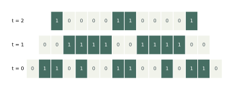
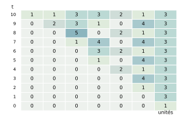
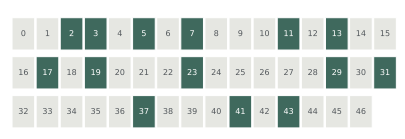

# ENS de Lyon · Second concours · Informatique 2013 · Corrigé guidé

*Corrigé rédigé par IA, non officiel. Signalez toute erreur.*

**Rédaction** · GPT-6.2 Astra Ultra · vitesse non renseignée · 25 novembre 2026

**Langage choisi.** Python. Les diagrammes sont lus de bas en haut. Le corrigé conserve la numérotation interne des parties et distingue les deux questions 5 de la partie IV par les lettres a et b.

## Repères

Repérer les données de bord qui restent inconnues avant de prolonger un motif fini. Un indice de cellule, un poids binaire de règle et une position de chiffre dans l’écriture en base six jouent des rôles différents.

## I · Automates cellulaires élémentaires

### Question 1.1 · Dénombrer les règles élémentaires

**Indication.** Compter les entrées possibles de la fonction locale, puis les sorties possibles pour chacune.

#### Solution

Le voisinage comporte trois bits, soit huit entrées possibles. Pour chacune on choisit indépendamment une sortie 0 ou 1. Il existe donc $\mathcal N=2^8=256$ automates élémentaires. Deux règles locales différentes donnent bien des fonctions globales différentes, car on peut placer au centre un triplet sur lequel elles diffèrent.

### Question 1.2 · Numéroter sans ambiguïté

**Indication.** Les coefficients de la somme sont les bits d’un entier sur huit positions.

#### Solution

Pour le triplet $(a,b,c)$, l’indice usuel vaut $i=4a+2b+c$. La sortie $f(a,b,c)$ est le bit de poids $2^i$ dans $n(F)$. L’unicité de l’écriture binaire assure l’injectivité et chaque entier de 0 à 255 donne inversement une règle par lecture de ses huit bits. Le texte imprime $5=(011)_2$, alors que $(011)_2=3$ et $5=(101)_2$. L’indexation par l’écriture binaire figurant dans la définition fixe la convention utilisée ici.

### Question 1.3 · Reconstruire une règle depuis un diagramme

**Indication.** Lire le temps de bas en haut. Une cellule est contrainte seulement si tout son voisinage de la ligne précédente est connu.

#### Solution

**a.** Dans l’ordre $000,001,010,011,100,101,110,111$, les sorties de la règle $54=2^1+2^2+2^4+2^5$ sont $0,1,1,0,1,1,0,0$. Les points extérieurs au mot affiché ne sont pas spécifiés. Les deux lignes déterminées sans hypothèse de bord sont, de bas en haut,

```text
0110100110010110
 00111100111100
  100001100001
```

**b.** Dans le premier diagramme de la page 4, les huit triplets apparaissent avec un successeur visible. On relève les sorties $1,0,0,1,1,0,0,0$ dans le même ordre. Ainsi $n(F)=1+2^3+2^4=25$.

**c.** Numérotons de 0 à 11 les colonnes du deuxième motif et de 0 à 4 ses lignes en partant du bas. Le voisinage de sept cellules $1101010$ apparaît centré en colonne 4 à la ligne 0 et en colonne 8 à la ligne 2. Leurs sorties sont respectivement 1 et 0. Aucun rayon $r\leq3$ ne peut convenir, car même le voisinage de rayon 3 est identique dans les deux cas.

Pour vérifier qu’un rayon 4 **suffit**, complétons chaque ligne par un zéro à droite et prolongeons-la par périodicité de période 13. Voici les cinq périodes, toujours de bas en haut.

```text
1110101011000
1101100111010
1110011010100
0101001101000
0010100010000
```

Pour chacun des quatre passages et de chacune des treize colonnes $j$, attribuer au mot de neuf bits centré en $j$ la sortie lue à la colonne $j$ sur la ligne suivante. Les 52 observations donnent 51 mots distincts, et le seul doublon a la même sortie. Le contrôle ci-dessous fournit donc une règle partielle cohérente, que l’on peut compléter par zéro pour toutes les autres entrées. Le voisinage centré minimal est $[-4,4]\cap\mathbb Z$.

```python
def regle_du_motif(lignes):
    regle = {}
    for entree, sortie in zip(lignes, lignes[1:]):
        for j, bit in enumerate(sortie):
            mot = "".join(entree[(j + h) % 13] for h in range(-4, 5))
            if mot in regle and regle[mot] != bit:
                raise ValueError("sorties incompatibles")
            regle[mot] = bit
    return regle
```



### Question 1.4 · Surjectivité de la règle 150

**Indication.** La sortie est la somme des trois entrées modulo deux. Deux bits voisins et l’image permettent de reconstruire dans les deux directions.

#### Solution

**a.** $150=2^1+2^2+2^4+2^7$. Les triplets envoyés sur 1 sont ceux de parité impaire. Ainsi $y_i=x_{i-1}\oplus x_i\oplus x_{i+1}$. Les deux itérées déterminées sont

```text
0110100110010110
 00011100111000
  010101101010
```

**b.** Pour une image bi-infinie arbitraire $y$, choisissons librement $x_0$ et $x_1$. Vers la droite, $x_{i+1}=y_i\oplus x_i\oplus x_{i-1}$ pour $i\geq1$. Vers la gauche, $x_{i-1}=y_i\oplus x_i\oplus x_{i+1}$ pour $i\leq0$. Les choix produisent une configuration et toutes les équations de l’image y sont satisfaites. Les quatre paires initiales produisent quatre configurations distinctes et tout antécédent a l’une de ces paires. La règle est surjective, non injective, avec exactement quatre antécédents par configuration.

## II · Calculer une fenêtre

### Question 2.1 · Calcul exact sur une fenêtre qui rétrécit

**Indication.** Après un pas, perdre une cellule à chaque bord afin de n’utiliser que des données connues.

#### Solution

La case $i$ du tableau initial représente $x_{i-N}$. Au temps $j$, on peut déterminer exactement les indices de $-N+j$ à $N-j$. Ainsi au temps $n\leq N$, la case $i$ du résultat représente $[F^n(x)]_{i-k}$ avec $k=N-n$. Le signe $i+k$ imprimé est incompatible avec une fenêtre centrée en 0, déjà pour $n=0$. Une implémentation directe à deux lignes est

```python
def fenetre(table, initiale, n):
    ligne = list(initiale)
    for _ in range(n):
        ligne = [table[(ligne[i], ligne[i+1], ligne[i+2])]
                 for i in range(len(ligne)-2)]
    return ligne
```

Chaque nouvelle case utilise les trois valeurs de la ligne précédente, ce qui prouve le résultat par récurrence. Le nombre d’évaluations vaut $\sum_{j=1}^n(2N-2j+1)=n(2N-n)$. Avec la copie initiale, le temps est $O(N+n(2N-n))$ et la mémoire simultanée $O(N+1)$. Si l’on conserve toutes les lignes du diagramme au lieu des deux dernières, l’espace devient $O(N+n(2N-n)+1)$.

### Question 2.2 · Comprendre la mise à jour sur place

**Indication.** Avant d’écrire une case, vérifier si une itération suivante de la même boucle doit encore lire son ancienne valeur.

#### Solution

**a.** L’algorithme 1 est correct. Après le passage $j$, $X[i]=[F^j(x)]_{i-N+j}$ sur le domaine de la boucle. Le triplet $X[i],X[i+1],X[i+2]$ est encore intact au moment du calcul car seuls les indices strictement inférieurs à $i$ ont déjà été écrasés. L’indice du centre après $n$ pas est $i=N-n$.

L’algorithme 2 lit $X[i-1]$ alors qu’il vient de le remplacer par sa valeur au temps suivant. Par exemple avec la règle $f(a,b,c)=a$ et la ligne $[1,0,0,0,0]$ ($N=2$), le centre après un pas doit recevoir l’ancien indice 1, de valeur 0. Le balayage propage le 1 de l’indice 0 à 1 puis à 2 dans le même pas.

**b.** Les deux boucles font $n(2N-n)$ évaluations et copient $2N+1$ cases initialement. Temps $O(N+n(2N-n))$, espace $O(N+1)$ pour $X$, puis variables auxiliaires en quantité constante. Le même coût ne garantit pas le même résultat.

## III · Périodicité spatiale et bords aléatoires

### Question 3.1.1 · Conserver une période spatiale

**Indication.** Le voisin de droite de la dernière cellule d’une période est la première cellule de cette même période.

#### Solution

Pour une période connue $q\geq1$, conserver une seule période et calculer tous les nouveaux états à partir d’une copie de l’ancienne rangée.

```python
def sur_anneau(table, periode, n):
    ligne = list(periode)
    q = len(ligne)
    for _ in range(n):
        ligne = [table[(ligne[(i-1) % q], ligne[i], ligne[(i+1) % q])]
                 for i in range(q)]
    return ligne
```

La localité et l’invariance par translation préservent la période $q$ à chaque temps, même si la période minimale diminue. En partant d’une période déjà donnée, le coût est $O((n+1)q)$ en temps et $O(q)$ en espace. Si l’on demande le tableau entier d’une fenêtre de longueur $m$, il faut en outre $O(m)$ pour matérialiser la sortie.

### Question 3.1.2 · Inégalité triangulaire de la distance

**Indication.** Des configurations qui coïncident chacune avec la même troisième sur une fenêtre coïncident entre elles sur cette fenêtre.

#### Solution

Pour $x\neq y$, posons $m(x,y)=\min\{|i|:x_i\neq y_i\}$ et posons $m(x,x)=+\infty$. Pour tout $|i|<\min(m(x,y),m(y,z))$ on a $x_i=y_i=z_i$. Ainsi $m(x,z)\geq\min(m(x,y),m(y,z))$. Comme $u\mapsto2^{-u}$ décroît et $2^{-\infty}=0$, on obtient $d(x,z)\leq\max(d(x,y),d(y,z))\leq d(x,y)+d(y,z)$.

### Question 3.1.3 · Approcher une configuration par une périodique

**Indication.** Répéter le mot central assez long de la configuration à approcher.

#### Solution

Choisissons $R$ tel que $2^{-(R+1)}<\varepsilon$. Répétons bi-infiniment le bloc $x_{-R}\cdots x_R$, avec la phase qui place sa copie d’origine sur $[-R,R]$. La configuration $y$ obtenue a pour période $2R+1$ et elle coïncide avec $x$ sur toute cette fenêtre. Ainsi $d(x,y)\leq2^{-(R+1)}<\varepsilon$.

### Question 3.1.4 · Périodicité temporelle d’un anneau

**Indication.** Compter le nombre de configurations de période spatiale donnée.

#### Solution

Si $x$ admet la période $q$, toute itérée possède cette période puisque $F$ commute avec le décalage spatial. Il existe au plus $|A|^q$ configurations ainsi représentées. Parmi les $|A|^q+1$ premières itérées, deux sont donc identiques. La détermination de la suite par la fonction $F$ assure alors la périodicité à partir de la première rencontre.

### Question 3.1.5 · Construire une orbite jamais périodique

**Indication.** Faire voyager un symbole isolé sur une ligne infinie.

#### Solution

Sur l’alphabet binaire, prenons $F(x)_i=x_{i+1}$ et $x$ nul partout sauf $x_0=1$. Au temps $n$, l’unique 1 est en $-n$. Deux configurations à des temps différents diffèrent donc sur cette position. La suite ne peut être ultimement périodique.

### Question 3.1.6 · Portée du modèle périodique

**Indication.** Distinguer une fenêtre d’observation à temps fini de l’orbite complète à tous les temps.

#### Solution

Sur un anneau fini, l’orbite est toujours ultimement périodique. Un tel anneau ne peut représenter l’orbite globale exacte de l’exemple précédent à tous les temps. Pour une observation donnée sur $[-L,L]$ après $n$ pas de rayon 1, il suffit toutefois de recopier la configuration initiale sur $[-L-n,L+n]$ avant de la prolonger périodiquement. La propagation de l’information à vitesse au plus une cellule par pas garantit alors les réponses exactes sur la fenêtre demandée.

### Question 3.2.1 · Compléter les bords au hasard

**Indication.** Tirer les deux voisins extérieurs nécessaires au pas, puis mettre à jour la fenêtre de manière synchrone.

#### Solution

Soit une fonction $\texttt{tirer()}$ qui fournit une lettre uniforme de l’alphabet. Au lieu de rétrécir la ligne, on peut appliquer le procédé suivant, qui retourne le même nombre de cellules qu’à l’entrée.

```python
def bords_aleatoires(table, initiale, n, tirer):
    ligne = list(initiale)
    for _ in range(n):
        etendue = [tirer()] + ligne + [tirer()]
        ligne = [table[tuple(etendue[i:i+3])]
                 for i in range(len(ligne))]
    return ligne
```

Les valeurs extérieures tirées à un même pas sont utilisées pour toute cette ligne, et les états à l’intérieur évoluent simultanément. La complexité est $O((n+1)(2N+1))$ en temps et $O(N+1)$ en espace.

### Question 3.2.2 · Localiser l’erreur due aux bords

**Indication.** Tester la règle qui copie son voisin de droite à partir d’une configuration véritablement nulle.

#### Solution

Le bord tiré au sort peut différer du vrai état de la configuration infinie. Pour $F(x)_i=x_{i+1}$ et la configuration toute nulle, un tirage droit égal à 1 crée un 1 à l’extrémité droite dès la première itération, alors que la solution exacte reste nulle. Il se déplace ensuite d’une cellule vers la gauche par pas. La zone d’incertitude pénètre ainsi dans le domaine observé. En revanche, les cellules dont tout le cône de dépendance reste dans la fenêtre initiale gardent leur valeur exacte.

## IV · Génération de motifs en base six

### Question 4.1 · Coder une configuration par un nombre en base six

**Indication.** Pour un support fini, multiplier par une puissance de six pour se ramener à l’écriture d’un entier.

#### Solution

Si deux configurations à support fini ont même valeur $\alpha$, prenons $J$ au moins aussi grand que leurs derniers indices non nuls. Après multiplication par $6^J$, l’égalité porte sur deux entiers écrits en base six avec des chiffres de 0 à 5. Les restes successifs modulo 6 déterminent tous les chiffres, donc les configurations sont égales. Sur des configurations quelconques, la série peut même diverger vers $+\infty$. Parmi celles où elle converge, l’injectivité échoue déjà : $x_0=1$ et tous les autres chiffres nuls donne la même valeur que $y_i=5$ pour $i\geq1$ et $y_i=0$ ailleurs, car $\sum_{i=1}^\infty5\,6^{-i}=1$.

### Question 4.2 · Multiplier par une puissance de six

**Indication.** Changer d’indice dans la somme représentant le nombre codé.

#### Solution

On a $6^{-m}\alpha(x)=\sum_i x_i6^{-(i+m)}=\sum_j x_{j-m}6^{-j}$. Posons donc $y_j=x_{j-m}$, c’est-à-dire $y=\sigma^{-m}(x)$ avec la définition $\sigma(x)_i=x_{i+1}$. Le support est simplement translaté, donc fini, et l’injectivité précédente garantit l’unicité de $y$.

### Question 4.3 · Règle des chiffres et dix itérations

**Indication.** Distinguer le reste d’un chiffre triplé et la retenue du chiffre situé à droite.

#### Solution

**a.** La relation de division écrite dans le sujet donne à « mod » le sens de reste et à « div » le sens de quotient entier, malgré l’inversion de ces noms dans la phrase précédente. Pour $s,t\in\{0,\ldots,5\}$,

$$
f(s,t)=3(s\bmod 2)+\lfloor t/2\rfloor .
$$

Le premier terme vaut 0 ou 3 et le second vaut 0, 1 ou 2. La somme est donc un chiffre de 0 à 5.

**b.** La ligne est indexée par $s$ et la colonne par $t$.

| $s$ / $t$ | 0 | 1 | 2 | 3 | 4 | 5 |
|---:|---:|---:|---:|---:|---:|---:|
| 0 | 0 | 0 | 1 | 1 | 2 | 2 |
| 1 | 3 | 3 | 4 | 4 | 5 | 5 |
| 2 | 0 | 0 | 1 | 1 | 2 | 2 |
| 3 | 3 | 3 | 4 | 4 | 5 | 5 |
| 4 | 0 | 0 | 1 | 1 | 2 | 2 |
| 5 | 3 | 3 | 4 | 4 | 5 | 5 |

**c.** Plaçons le 1 à l’indice zéro. Le diagramme se lit de bas en haut et les chiffres des unités sont alignés à droite. En omettant les zéros extérieurs, les lignes de $n=0$ à $n=10$ sont successivement $1$, $3$, $13$, $43$, $213$, $1043$, $3213$, $14043$, $50213$, $231043$, $1133213$, tous en base six. Par exemple $43$ devient $213$ par la règle locale appliquée à chaque paire de chiffres.



### Question 4.4 · Interpréter une itération comme une multiplication

**Indication.** Décaler d’une position le quotient de la division de chaque chiffre triplé.

#### Solution

Écrivons $3x_i=r_i+6c_i$ avec $0\leq r_i<6$. La règle produit $F(x)_i=r_i+c_{i+1}$, sans débordement par la question 4.3. Donc

$$
\alpha(F(x))=\sum_i r_i6^{-i}+\sum_i c_{i+1}6^{-i}
=\sum_i(r_i+6c_i)6^{-i}=3\alpha(x).
$$

Les sommes sont finies et le support reste fini puisque $f(0,0)=0$.

### Question 4.5a · Irrationalité du logarithme

**Indication.** Traduire une égalité entre logarithme et fraction en égalité de puissances entières.

#### Solution

Si $\log_6 3=a/b$ avec $a,b$ entiers strictement positifs, alors $6^a=3^b$. Le membre de gauche est pair et celui de droite impair. Contradiction. Le numéro 5 étant utilisé deux fois sur la page 6, cette première occurrence est notée 4.5a.

### Question 4.5b · Apparition d’un mot à partir d’une graine non nulle

**Indication.** Faire varier les chiffres de tête de la mantisse. Pour admettre un mot commençant par zéro, lui ajouter un chiffre 1 à gauche.

#### Solution

Le résultat écrit pour *toute* configuration à support fini a une exception. Si $x$ est partout nulle, toutes les itérées le restent et, par exemple, le mot $1$ n’y apparaît jamais. Supposons donc $c=\alpha(x)>0$ et $w$ un mot de longueur $m$ (le mot vide est immédiat). Soit $a$ l’entier de base six représenté par $1w$. Les nombres de mantisse comprise strictement entre $a/6^m$ et $(a+1)/6^m$ commencent par $1w$ dans leur écriture en base six. Cet intervalle non vide est compris dans $[1,6[$.

D’après la question précédente sur le codage, $\alpha(F^n(x))=3^n c$. Sa mantisse est $6^{\{n\log_63+\log_6c\}}$. La densité admise reste vraie après une translation modulo 1. Les mantisses rencontrent donc l’intervalle ouvert précédent pour un certain $n$. Le support fini donne l’écriture terminée, et le choix strict évite toute ambiguïté de bord. Le mot $w$ apparaît comme voulu. Le même argument s’applique après tout temps initial, donc même une infinité de fois.

### Question 4.6 · Localiser le mot 354

**Indication.** Comparer les lignes calculées à la question 4.3 et prolonger la multiplication si nécessaire.

#### Solution

Le mot $354$ ne figure sur aucune des lignes $0$ à 10 de la question 4.3c. Pour la graine formée du seul 1, sa première apparition **horizontale** est au temps $18$. La ligne non nulle est alors $102235433213$ en base six, soit $1022\,\mathbf{354}\,33213$. Les chiffres correspondent aux indices $-7,-6,-5$ si l’unité initiale est en 0. La vérification finie peut se faire par ce calcul indépendant.

```python
def chiffres_six(n):
    chiffres = []
    while n:
        n, reste = divmod(n, 6)
        chiffres.append(str(reste))
    return "".join(reversed(chiffres)) or "0"

def premiere_occurrence():
    for n in range(19):
        mot = chiffres_six(3 ** n)
        if "354" in mot:
            return n, mot
```

### Question 4.7 · Construire un automate inverse

**Indication.** Diviser par trois revient à multiplier par deux puis à décaler le résultat d’un chiffre en base six.

#### Solution

Le double d’un chiffre $s$ laisse le reste $(2s)\bmod6\in\{0,2,4\}$ et produit la retenue $\lfloor s/3\rfloor\in\{0,1\}$. L’automate $D$ défini par $D(x)_i=(2x_i\bmod6)+\lfloor x_{i+1}/3\rfloor$ code ainsi $2\alpha(x)$. Posons $G=\sigma^{-1}\circ D$. Sa règle est

$$
G(x)_i=(2x_{i-1}\bmod6)+\lfloor x_i/3\rfloor.
$$

Elle dépend de deux voisins, utilise bien les six chiffres, et préserve le support fini. Par les questions 4.2 et 4.4, $\alpha(G(x))=2\alpha(x)/6=\alpha(x)/3$. Les deux composées $G\circ F$ et $F\circ G$ ont donc la même valeur que $x$. Par injectivité sur les configurations à support fini, elles lui sont égales.

## V · Expression libre

### Question 5 · Interpréter le dernier diagramme

**Indication.** Choisir une cellule fixe et relever les temps auxquels elle prend l’état noir. Ne pas confondre ces marques avec les signaux qui se déplacent.

#### Solution

Dans la première colonne active à gauche, une cellule grise est présente au temps zéro. En montant ligne à ligne, les cases noires de cette colonne portent les temps

$$
2,3,5,7,11,13,17,19,23,29,31,37,41,43 .
$$

Ce sont exactement les nombres premiers sur la fenêtre visible, jusqu’au temps 46. Les temps 0 et 1 ainsi que les temps composés, par exemple 9, 15, 25 et 35, restent gris. L’interprétation est celle d’un crible présentant le résultat **dans le temps** à une position fixe. Les lignes verticales représentent des états qui restent sur place. Les diagonales représentent des signaux qui se déplacent d’une cellule par pas à gauche ou à droite. Leurs croisements et changements de sens organisent les marques périodiques à partir desquelles les temps composés peuvent être écartés. Le grand signal vers la droite se propage à vitesse un.

Le document fournit une seule trajectoire finie et la liste des neuf états graphiques. On peut y identifier les temps premiers observés et les déplacements de signaux. Une preuve que la même colonne reconnaît tous les nombres premiers à tout temps demanderait aussi la table de transition ou un invariant de construction spécifié pour l’automate.


