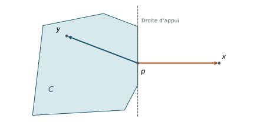
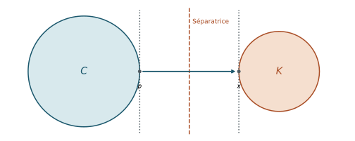

# ENS de Lyon, second concours — Mathématiques 2013 · Corrigé brut

*Corrigé rédigé par IA, non officiel. Signalez toute erreur.*

**Rédaction** · GPT-6.2 Astra Ultra · vitesse non renseignée

**Géométrie des ensembles convexes.** Dans un espace euclidien de dimension finie, l’existence du point de distance minimale conduit à une séparation par hyperplan. Le dernier exercice applique un théorème de point fixe aux cocycles. L’archive officielle du concours fournit le sujet de quatre pages. Aucun rapport de jury n’y est rattaché à cet écrit de mathématiques.

## Convexes de la droite réelle

### Question 1

Les convexes sont tous les intervalles, avec l’ensemble vide et les singletons. En effet si $a<b$ appartiennent à un convexe, chaque $s\in[a,b]$ s’écrit $(1-t)a+tb$ avec $t=(s-a)/(b-a)$. Réciproquement, cette propriété caractéristique des intervalles entraîne directement leur convexité. Les bornes finies peuvent être incluses ou exclues et les intervalles peuvent être non bornés.

## Projection sur un convexe fermé

### Question 2

Par bilinéarité et symétrie, $\|x\pm y\|^2=\|x\|^2+\|y\|^2\pm2\langle x,y\rangle$. En additionnant ces deux égalités, puis en divisant par quatre, on obtient
$$\left\|\frac{x+y}{2}\right\|^2+\left\|\frac{x-y}{2}\right\|^2=\tfrac12(\|x\|^2+\|y\|^2).$$

### Question 3.a

Posons $d=d(x,C)$. Ce nombre est fini puisque $C$ est non vide. On a $K_n=C\cap\overline B(x,d+1/(n+1))$. La boule est convexe par inégalité triangulaire, donc l’intersection l’est aussi. Elle est fermée et bornée, donc compacte en dimension finie. Enfin, par définition de $d$, un élément de $C$ réalise une distance strictement inférieure à $d+1/(n+1)$ et appartient à $K_n$.

### Question 3.b

Prenons $z_n\in K_n$. Tous les $z_n$ appartiennent au compact $K_0$. Une sous-suite $z_{n_j}$ converge vers $z\in K_0\subset C$. L’encadrement $d\le\|x-z_{n_j}\|\le d+1/(n_j+1)$ et la continuité de la norme donnent $\|x-z\|=d$.

### Question 3.c

Si $p,p'$ réalisent $d$, leur milieu appartient à $C$. La question 2 appliquée à $x-p,x-p'$ donne
$$\left\|x-\frac{p+p'}2\right\|^2+\frac14\|p-p'\|^2=d^2.$$
Le premier terme est au moins $d^2$, d’où $p=p'$. Avec 3.b cela définit $P_C(x)$ pour tout $x$.

### Question 4

Soient $p=P_C(x)$ et $y\in C$. Pour $0<t\le1$, le point $p+t(y-p)$ appartient à $C$. La minimalité de $p$ donne
$$0\le\|x-p-t(y-p)\|^2-\|x-p\|^2=-2t\langle x-p,y-p\rangle+t^2\|y-p\|^2.$$
Divisons par $t$ et faisons tendre $t$ vers 0 par valeurs positives. Ainsi $\langle y-p,x-p\rangle\le0$.

### Question 5

Écrivons $p_i=P_C(x_i)$ et $v=p_1-p_2$. La question 4 donne $\langle x_1-p_1,v\rangle\ge0$ et $\langle x_2-p_2,v\rangle\le0$. En retranchant,
$$\|v\|^2\le\langle x_1-x_2,v\rangle\le\|x_1-x_2\|\,\|v\|.$$
Si $v\ne0$, divisons par sa norme. Si $v=0$, la majoration est immédiate.

## Théorème de Carathéodory

### Question 6

Appelons $B$ l’ensemble des combinaisons convexes finies d’éléments de $X$. Il contient $X$ (coefficient unique égal à 1). Si deux combinaisons ont pour poids $a_i,b_j$, leur mélange dans les proportions $t,1-t$ a pour poids $ta_i,(1-t)b_j$, tous positifs ou nuls et de somme 1. Ainsi $B$ est convexe et $\operatorname{conv}(X)\subset B$. Réciproquement tout convexe contenant $X$ contient $B$ par récurrence sur le nombre de poids positifs. Pour l’étape, isolons un poids $s<1$ et normalisons les autres en les divisant par $1-s$. L’intersection de tous ces convexes contient donc $B$.

### Question 7

Posons $N=\dim E$. Le domaine a dimension $k+1$, l’espace d’arrivée dimension $N+1$. Par la formule du rang,
$$\dim\ker\Phi=k+1-\operatorname{rg}\Phi\ge k-N>0.$$

### Question 8

Soit $x=\sum_{i=1}^m t_i x_i$ une représentation à poids strictement positifs, de somme 1. Si $m>N+1$, la question 7 donne des réels $a_i$ non tous nuls tels que $\sum a_i x_i=0$ et $\sum a_i=0$. Il existe des $a_i>0$ et des $a_i<0$. Prenons
$$s=\min_{a_i>0} t_i/a_i,\qquad t'_i=t_i-sa_i.$$
Tous les nouveaux poids sont positifs ou nuls et l’un d’eux est nul. Leur somme vaut 1 et $\sum t'_ix_i=x$. Supprimons les poids nuls et recommençons. Le nombre de termes décroît strictement, donc on aboutit à au plus $N+1$ points. Pour en écrire exactement $N+1$, on peut ajouter des points de $X$ munis d’un poids nul.

### Question 9

Le simplexe $\Delta_N=\{t\in[0,1]^{N+1}:\sum t_i=1\}$ est fermé dans un compact. Si $X$ est compact, le produit $\Delta_N\times X^{N+1}$ l’est. L’application continue $(t,(x_i))\mapsto\sum t_ix_i$ a exactement pour image $\operatorname{conv}(X)$ par 6 et 8. Cette image est donc compacte.

## Séparation de deux convexes

### Question 10

La fonction $z\mapsto \|z-P_C(z)\|$ est continue par la question 5. Elle atteint donc son minimum sur le compact non vide $K$, en un point $x\in K$.

### Question 11

Posons $p=P_C(x)$. Pour tout $z\in K$,
$$\|z-p\|\ge d(z,C)\ge d(x,C)=\|x-p\|.$$
Ainsi $x$ minimise sur $K$ la distance à $p$. Le compact $K$ est fermé et convexe, donc l’unicité de 3.c donne $P_K(p)=x$.

### Question 12

Gardons $p=P_C(x)$ et posons $v=x-p$. Comme $C$ et $K$ sont disjoints, $v\ne0$. La forme $\varphi(u)=\langle u,v\rangle$ est non nulle. Pour $y\in C$, la question 4 donne $\varphi(y)\le\varphi(p)$. Pour $z\in K$, les questions 11 et 4 appliquées au projeté de $p$ donnent $\langle z-x,p-x\rangle\le0$, donc $\varphi(z)\ge\varphi(x)$. Enfin $\varphi(x)-\varphi(p)=\|v\|^2>0$. La moyenne $\alpha=(\varphi(x)+\varphi(p))/2$ vérifie même $\varphi(y)<\alpha<\varphi(z)$ pour toute paire.

## Point fixe de Markov-Kakutani

### Question 13

Une application affine préserve les milieux en prenant $t=1/2$. Pour la réciproque, fixons $x,y\in K$ et $h(t)=T((1-t)x+ty)$. L’identité $h(t)=(1-t)T(x)+tT(y)$ vaut aux extrémités. Si elle vaut pour tous les $j/2^m$, elle vaut aux points déjà obtenus et aux milieux de deux points consécutifs, puisque $T$ préserve les milieux. Par récurrence, elle vaut à tout dyadique de $[0,1]$. Par densité et continuité de $h$, elle s’étend à tout le segment. Cela prouve que $T$ est affine.

### Question 14

Fixons $y\in K$. Les points $y_n=(n+1)^{-1}\sum_{j=0}^n T^j(y)$ appartiennent à $K$. Par affinité (étendue aux combinaisons convexes finies par récurrence),
$$T(y_n)-y_n=\frac{T^{n+1}(y)-y}{n+1}.$$
Le numérateur est borné par le diamètre du compact $K$. Une sous-suite de $y_n$ converge vers un $x\in K$. Sur cette sous-suite la différence tend vers zéro et la continuité de $T$ donne $T(x)=x$.

## Application aux cocycles bornés

### Question 15.a

Pour $b(n)=x-U^nx$ et tous $m,n\in\mathbb Z$,
$$x-U^{m+n}x=(x-U^mx)+U^m(x-U^nx)=b(m)+U^m b(n).$$
L’identité des puissances vaut également pour les exposants négatifs puisque $U$ est inversible.

### Question 15.b

Les puissances de $U$ et de son inverse sont orthogonales. Pour tout $n\in\mathbb Z$ on a donc $\|b(n)\|\le\|x\|+\|U^nx\|=2\|x\|$. Cette borne est uniforme en $n$.

### Question 16.a

L’application $u\mapsto Uu+b(1)$ est définie et continue sur $E$. Elle préserve les combinaisons convexes par linéarité de $U$ et parce que les coefficients ont somme 1. L’identité de cocycle donne $T(b(n))=b(1)+Ub(n)=b(n+1)$. Par continuité l’image de l’adhérence $X$ est incluse dans $X$. L’image de toute combinaison convexe de points de $X$ est donc dans $K=\operatorname{conv}(X)$. Ainsi $T$ se restreint en une application affine de $K$ dans lui-même.

### Question 16.b

L’ensemble $X$ est fermé et borné dans $E$ de dimension finie, donc compact. Par 9, $K$ est compact, convexe et non vide. Les questions 14 et 16.a fournissent un point fixe $x$ de $T$, donc $b(1)=x-Ux$. Le cobord $c(n)=x-U^nx$ est un cocycle par 15.a et coïncide avec $b$ en 1. Les deux valent 0 en 0 (pour $b$, appliquer l’identité de cocycle en $(0,0)$). Pour leur différence $d$, l’identité $d(n+1)=Ud(n)$ est valable pour tout entier. L’itération vers l’avant et l’itération de $U^{-1}$ vers l’arrière donnent $d(n)=0$ sur $\mathbb Z$. Ainsi $b(n)=x-U^nx$ pour tout $n$.
