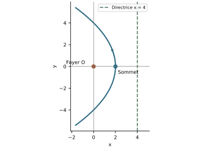
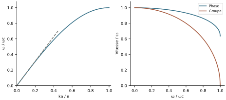
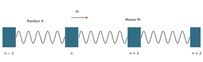
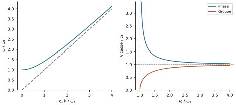

# ENS de Lyon, second concours 2013 — Physique · Corrigé guidé

*Corrigé rédigé par IA, non officiel. Signalez toute erreur.*

**Rédaction** · GPT-6.2 Astra Ultra · vitesse non renseignée

Identifier ce qui conserve la forme de la trajectoire puis comparer les deux mécanismes de coupure des lignes.

## I — Mécanique du point

### Question I.1 — Tourner la base

> [!INDICATION]
> Dessiner les vecteurs pour un angle aigu puis projeter le vecteur horizontal sur la tangente.

#### Solution

À l’angle $\theta$ orienté de $\vec e_x$ vers $\vec e_r$, la base mobile tourne dans le même sens que l’angle. En projetant les vecteurs fixes sur elle, $\vec e_x=\cos\theta\,\vec e_r-\sin\theta\,\vec e_\theta$ et $\vec e_y=\sin\theta\,\vec e_r+\cos\theta\,\vec e_\theta$. Pour $\theta=0$, on retrouve la base initiale.

### Question I.2 — Composantes de la vitesse

> [!INDICATION]
> Dans $V_0(\vec e_\theta+\vec e_y)$, un des vecteurs est déjà exprimé dans la base choisie.

#### Solution

La composante radiale est $\dot r=V_0\sin\theta$ et la composante orthoradiale est $r\dot\theta=V_0(1+\cos\theta)$. Au départ $r=a$, la vitesse vaut $2V_0\vec e_y$ et la tangente est verticale.

### Question I.3 — Équation de forme

> [!INDICATION]
> Le quotient utile est la vitesse radiale divisée par la vitesse angulaire.

#### Solution

À distance finie sur la branche issue du point initial, $1+\cos\theta>0$. En divisant les équations précédentes on élimine le temps et on obtient $dr/d\theta=r\sin\theta/(1+\cos\theta)$. Les directions $\theta=\pm\pi$ se traitent par passage à la limite.

### Question I.4 — Équation polaire

> [!INDICATION]
> Dériver le dénominateur et conserver la constante d’intégration jusqu’à la substitution du point initial.

#### Solution

Puisque $d\ln r=-d\ln(1+\cos\theta)$, le produit $r(1+\cos\theta)$ est constant. En $(a,0)$ il vaut $2a$, donc $r=2a/(1+\cos\theta)$. Le facteur $2$ provient de la condition initiale.

### Question I.5 — Parabole pour a = 2

> [!INDICATION]
> L’identité $x=r\cos\theta$ élimine le cosinus avant l’élévation au carré.

#### Solution

On a $r+x=2a$ et $r^2=x^2+y^2$, d’où $y^2=4a(a-x)$. La parabole a pour foyer $O$, pour sommet $(a,0)$ et pour directrice $x=2a$ puisque $r=2a-x$. Pour $a=2$, elle passe par $(2,0)$ et $(0,\pm4)$, s’ouvre vers les $x$ décroissants et parcourt d’abord la branche supérieure pour $t>0$.

### Question I.6 — Nature de la force

> [!INDICATION]
> Dériver la loi vectorielle donnée dans l’énoncé avant de développer une accélération polaire complète.

#### Solution

Le vecteur $\vec e_y$ est fixe et $d\vec e_\theta/dt=-\dot\theta\vec e_r$. Ainsi $\vec a=-V_0\dot\theta\vec e_r$. En remplaçant $1+\cos\theta$ par $2a/r$ on trouve $\vec F=-2maV_0^2\vec e_r/r^2$. La force est dirigée vers le foyer à tout instant. Son moment en $O$ est nul.

### Question I.7 — Constante des aires

> [!INDICATION]
> L’aire d’un petit secteur de rayon $r$ vaut la moitié de $r^2d\theta$.

#### Solution

Le moment cinétique par unité de masse est $C=r^2\dot\theta=rV_0(1+\cos\theta)=2aV_0$, en $\mathrm{m^2\,s^{-1}}$. Si l’on appelle constante des aires la vitesse de balayage elle-même, $dA/dt=C/2=aV_0$.

### Question I.8 — Changer la vitesse

> [!INDICATION]
> Revenir à l’équation de forme et distinguer l’ensemble des points de la façon de les parcourir.

#### Solution

Le facteur $V_0$ disparaît de l’équation de forme. Son changement de signe inverse le sens du parcours et le signe de $C$. Le doubler conserve le sens, double la vitesse au même point et divise par deux le temps pour parcourir un même arc. Dans la réalisation dynamique de I.6 la force nécessaire est alors multipliée par quatre.

## II — Ligne périodique et approximation continue

### Question II.1 — Lois des composants

> [!INDICATION]
> Une bobine s’oppose à la variation de son courant et un condensateur à la variation de sa tension.

#### Solution

En convention récepteur, $I_n=C\,du_n/dt$ dans le condensateur dérivé et $V_n=L\,di_n/dt$ aux bornes de la bobine série. Dans les amplitudes complexes le facteur de dérivation est $j\omega$.

### Question II.2 — Maille et nœuds

> [!INDICATION]
> Au nœud d’indice $n$, un courant arrive de la gauche et deux courants repartent.

#### Solution

Le rail inférieur donne la référence commune. La chute de potentiel entre les deux nœuds vaut $V_n=u_n-u_{n+1}$. Les courants descendants des condensateurs sont $I_n=i_{n-1}-i_n$ et $I_{n+1}=i_n-i_{n+1}$. La bobine portant $i_n$ se trouve donc entre les deux nœuds.

### Question II.3 — Équation discrète du courant

> [!INDICATION]
> Écrire les deux différences de courants avant d’ouvrir la parenthèse correspondant au nœud suivant.

#### Solution

Dérivons $L\dot i_n=u_n-u_{n+1}$ et remplaçons $C\dot u_n$ et $C\dot u_{n+1}$ par les bilans des nœuds. Il vient $LC\ddot i_n=i_{n-1}-2i_n+i_{n+1}$, soit l’équation demandée avec $\omega_0=1/\sqrt{LC}$ en $\mathrm{s^{-1}}$.

### Question II.4 — Équation discrète de la tension

> [!INDICATION]
> L’opération échange les rôles des mailles et des nœuds.

#### Solution

On part cette fois de $C\dot u_n=i_{n-1}-i_n$. On dérive puis on emploie les chutes de tension dans les deux bobines adjacentes. Ainsi $LC\ddot u_n=(u_{n-1}-u_n)-(u_n-u_{n+1})=u_{n-1}-2u_n+u_{n+1}$.

### Question II.5 — Relation de dispersion

> [!INDICATION]
> La dérivée seconde en temps fournit un signe moins. Regrouper les deux exponentielles en cosinus.

#### Solution

L’onde de phase $\omega t-kn a$ donne $i_{n\pm1}=i_ne^{\mp jka}$. Par substitution, $\omega^2=2\omega_0^2(1-\cos ka)=4\omega_0^2\sin^2(ka/2)$. Sur $0\leq k\leq\pi/a$, $\omega=\omega_c\sin(ka/2)$ avec $\omega_c=2/\sqrt{LC}$.

### Question II.6 — Courbe de la bande

> [!INDICATION]
> Le graphique demandé ne couvre que le premier quart de la sinusoïde en $ka/2$.

#### Solution

La branche croît de $(0,0)$ à $(\pi/a,\omega_c)$ et elle est concave vers le bas. Sa tangente à l’origine a pour pente $c_0=a/\sqrt{LC}$ et devient horizontale au bord de bande. Le pas de réseau impose la périodicité en $k$ de la relation au carré.

### Question II.7 — Vitesses de phase et de groupe

> [!INDICATION]
> Tracer d’abord la corde joignant le point courant à l’origine, puis la tangente à la courbe.

#### Solution

La pente de la corde issue de l’origine est $v_\phi=\omega/k$, celle de la tangente est $v_g=d\omega/dk$. À l’origine leurs limites valent $c_0$. Au bord de bande $v_\phi=\omega_c a/\pi=2c_0/\pi$ et $v_g=0$. Pour tracer, posons $z=\omega/\omega_c$. On a $v_\phi/c_0=z/\arcsin z$ et $v_g/c_0=\sqrt{1-z^2}$. La vitesse de groupe est plus petite dans l’intervalle ouvert.

### Question II.8 — Coupure haute

> [!INDICATION]
> Interpréter la borne du sinus comme condition d’existence d’un mode propagatif.

#### Solution

Pour un $k$ réel, $|\sin(ka/2)|\leq1$ borne la pulsation par $\omega_c$. Au-delà, aucune onde progressive de nombre d’onde réel n’existe dans le réseau idéal infini. C’est un filtre passe-bas. À la limite supérieure, deux nœuds successifs oscillent en opposition de phase et le paquet a une vitesse de groupe nulle.

### Question II.9 — Grande longueur d’onde

> [!INDICATION]
> Remplacer la différence entre deux valeurs de nœuds voisins par le pas fois une dérivée.

#### Solution

Pour $|ka|\ll1$ et au premier ordre spatial, les bilans s’écrivent $\partial_xu=-(L/a)\partial_t i$ et $\partial_xi=-(C/a)\partial_tu$. Leur composition donne $\partial_t^2 f=c_0^2\partial_x^2 f$ pour $f=u$ ou $i$, avec $c_0=a/\sqrt{LC}$. On peut aussi remplacer la différence seconde par $a^2\partial_x^2 f$. Pour une limite matérielle à pas décroissant, on garde les inductance et capacité par unité de longueur fixées.

### Question II.10 — Dispersion dans la limite continue

> [!INDICATION]
> Comparer les valeurs de $ka$ au bord de bande et dans l’hypothèse de développement.

#### Solution

La substitution de l’onde plane donne $\omega^2=c_0^2 k^2$, donc $\omega=c_0k$ dans le sens retenu. Le développement $\sin(ka/2)\simeq ka/2$ conserve seulement la tangente à l’origine. La coupure apparaît à $ka=\pi$, hors du domaine de validité de cette approximation.

### Question II.11 — Chaîne de masses et de ressorts

> [!INDICATION]
> Évaluer la traction à droite puis celle à gauche d’une même masse légèrement déplacée.

#### Solution

Des masses identiques $M$ séparées de $a$ et reliées par des ressorts de raideur $K$ oscillent longitudinalement sans frottement. Pour le déplacement $q_n$ depuis l’équilibre, $M\ddot q_n=K(q_{n-1}-2q_n+q_{n+1})$. On identifie $K/M=1/(LC)$. La masse assure l’inertie et les deux ressorts voisins fournissent les deux termes de couplage.

## Ligne à condensateur série

### Question II.12 — Ligne à condensateur série

> [!INDICATION]
> Prendre les valeurs de composants de la figure puis former leur impédance complexe.

#### Solution

La capacité série inscrite sur le dessin est $C_1=1/(\gamma_1 dx)$, la capacité en dérivation $C_2=\Gamma_2dx$. Ainsi $Z_L=j\omega\Lambda dx$, $Z_{C1}=\gamma_1dx/(j\omega)$ et $Z_{C2}=1/(j\omega\Gamma_2dx)$. La chute série et le courant dérivé donnent, au premier ordre, $du=-(j\omega\Lambda+\gamma_1/(j\omega))i\,dx$ et $di=-j\omega\Gamma_2u\,dx$. Le mot « admittance » désigne ici le coefficient imprimé $\gamma_1 dx$ pour l’inverse de capacité. Une admittance électrique au sens usuel aurait l’unité siemens et une dépendance en fréquence.

### Question II.13 — Équation du courant modifié

> [!INDICATION]
> Multiplier les deux coefficients de dérivation spatiale et regrouper le terme en pulsation au carré.

#### Solution

Dériver $\partial_xi=-j\omega\Gamma_2u$ selon $x$ donne $\partial_x^2i=(\gamma_1\Gamma_2-\omega^2\Lambda\Gamma_2)i$. La traduction temporelle est $\partial_t^2i-c_1^2\partial_x^2i+\omega_1^2i=0$. Les constantes sont $c_1=1/\sqrt{\Lambda\Gamma_2}$ (m/s) et $\omega_1=\sqrt{\gamma_1/\Lambda}$ (rad/s). En effet $[\Lambda]=\mathrm{H/m}$, $[\Gamma_2]=\mathrm{F/m}$ et $[\gamma_1]=\mathrm{F^{-1}m^{-1}}$.

### Question II.14 — Équation de la tension modifiée

> [!INDICATION]
> Permuter les deux relations du premier ordre utilisées pour le courant.

#### Solution

Les paramètres sont constants. Dériver la relation pour $\partial_xu$ et éliminer $\partial_xi$ donne $\partial_x^2u=(\gamma_1\Gamma_2-\omega^2\Lambda\Gamma_2)u$. Par retour au temps, $\partial_t^2u-c_1^2\partial_x^2u+\omega_1^2u=0$.

### Question II.15 — Branche propagative

> [!INDICATION]
> Le terme sans dérivée du champ ajoute le carré d’une pulsation à la relation de la ligne ordinaire.

#### Solution

Pour $e^{j(\omega t-kx)}$, les dérivées secondes multiplient l’amplitude par $-\omega^2$ et $-k^2$. La relation est donc $\omega^2=\omega_1^2+c_1^2k^2$. La branche de pulsation positive se trouve au-dessus de $\omega_1$ pour $k\ne0$ réel.

### Question II.16 — Asymptotes

> [!INDICATION]
> Développer la racine en sortant d’abord le terme dominant dans chaque limite.

#### Solution

Au voisinage de zéro $\omega=\omega_1+c_1^2k^2/(2\omega_1)+O(k^4)$. La tangente est horizontale. Pour $k$ grand et positif, $\omega=c_1k+\omega_1^2/(2c_1k)+O(k^{-3})$, au-dessus de l’asymptote $\omega=c_1k$. La courbe est croissante et convexe.

### Question II.17 — Vitesses, dispersion et bilan d’énergie

> [!INDICATION]
> Dériver la dispersion avant de remplacer $k$ par sa valeur en fonction de la fréquence.

#### Solution

Pour $\omega>\omega_1$, $v_\phi=c_1/\sqrt{1-(\omega_1/\omega)^2}$ et $v_g=c_1\sqrt{1-(\omega_1/\omega)^2}$. Elles vérifient $v_\phi v_g=c_1^2$. Au seuil, la première diverge et la seconde tend vers zéro. À haute fréquence elles tendent vers $c_1$, respectivement par au-dessus et au-dessous. Le milieu est dispersif. Les composants idéaux ont des impédances purement réactives et emmagasinent l’énergie sans perte Joule. La vitesse de phase élevée au seuil décrit les surfaces d’égale phase.

### Question II.18 — Coupure basse

> [!INDICATION]
> Chercher de quel côté du seuil il reste un nombre d’onde réel.

#### Solution

Cette fois $k^2=(\omega^2-\omega_1^2)/c_1^2$ devient négatif sous $\omega_c=\omega_1$. La ligne agit comme un passe-haut. À basse fréquence l’impédance du condensateur série croît et limite le courant transmis. Le seuil est la résonance série locale de $\Lambda dx$ et $1/(\gamma_1dx)$.

### Question II.19 — Onde sous le seuil

> [!INDICATION]
> La condition physique à grande distance sélectionne le signe de l’exposant réel.

#### Solution

Une excitation harmonique pénètre dans la ligne sous forme évanescente. Sur une ligne semi-infinie s’étendant vers $+x$, on conserve la solution qui décroît en s’éloignant de l’entrée. Le module décroît sans progression des crêtes. Cette décroissance spatiale est réactive. Une seule exponentielle décroissante d’une ligne sans pertes transporte une puissance active moyenne nulle. Sur une section finie les conditions aux deux extrémités peuvent imposer deux exponentielles.

[Sujet officiel de l’ENS de Lyon](https://banques-ecoles.fr/cms/wp-content/uploads/2013/06/13_2c_suj_physique.pdf)
