# ENS de Paris (Ulm) PC 2013 — Physique C · Corrigé guidé

*Corrigé rédigé par IA, non officiel. Signalez toute erreur.*

**Lecture du rapport du jury** · GPT-6.2 Astra Ultra · vitesse non renseignée

**Rédaction** · GPT-6.2 Astra Ultra · vitesse non renseignée

## Mesurer la constante de gravitation

## Préambule · Deux forces centrales

### Question 1 — Interactions fondamentales

**Indication.** Distinguer les interactions élémentaires des forces effectives rencontrées à l’échelle macroscopique.

Les quatre interactions sont la gravitation, l’interaction électromagnétique, l’interaction forte et l’interaction faible. Les deux dernières interviennent notamment dans la cohésion des noyaux et dans la désintégration bêta.

### Question 2 — Attraction électrostatique

**Indication.** Orienter le vecteur unitaire du proton vers l’électron.

Si $\mathbf e_r$ pointe du proton vers l’électron, leur produit de charges est $-e^2$. La force sur l’électron vaut $\mathbf F_C=-e^2\mathbf e_r/(4\pi\epsilon_0r^2)$, dirigée vers le proton. Le premier dessin donne le sens des deux forces.

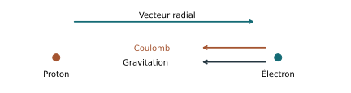

### Question 3 — Attraction gravitationnelle

**Indication.** Utiliser la même direction de référence.

$\mathbf F_g=-Gm_pm_e\mathbf e_r/r^2$. Les deux forces exercées sur l’électron s’ajoutent ici, puisqu’elles pointent toutes deux vers le proton.

### Question 4 — Constante de structure fine

**Indication.** Comparer deux produits ayant la dimension énergie fois longueur.

$e^2/(4\pi\epsilon_0)$ et $\hbar c$ ont tous deux pour unité le joule-mètre. Ainsi $\alpha=e^2/(4\pi\epsilon_0\hbar c)\simeq7{,}31\,10^{-3}$ avec les constantes arrondies du sujet, soit près de $1/137$.

### Question 5 — Couplage gravitationnel

**Indication.** Remplacer dans le résultat précédent le coefficient de la force en inverse carré.

$\alpha_g=Gm_pm_e/(\hbar c)\simeq3{,}23\,10^{-42}$. Le rapport des forces vaut $\alpha_g/\alpha\simeq4{,}4\,10^{-40}$ pour cette paire de particules.

### Question 6 — Couplage effectif

**Indication.** Écrire les deux forces avec le même facteur dimensionné.

$\mathbf F=-(\alpha+\alpha_g)\hbar c\,\mathbf e_r/r^2$. Les niveaux de Bohr s’obtiennent donc en remplaçant $\alpha$ par $\alpha+\alpha_g$ dans ce modèle.

### Question 7 — Décalage relatif d’une raie

**Indication.** Développer le quotient avant l’évaluation numérique.

$h\nu=E_2-E_1$ est proportionnel au carré du couplage. Ainsi $\delta\nu/\nu=(1+\alpha_g/\alpha)^2-1\simeq2\alpha_g/\alpha=8{,}8\,10^{-40}$. La fréquence augmente. Une mesure spectroscopique ne peut résoudre un tel écart.

### Question 8 — Flux électrique

**Indication.** Préciser l’orientation et la nature de la surface.

Dans le vide, sur toute surface fermée orientée vers l’extérieur, $\oint\mathbf E\cdot d\mathbf S=Q_{\rm int}/\epsilon_0$.

### Question 9 — Flux de gravitation

**Indication.** Le champ d’une masse ponctuelle traverse vers l’intérieur toute sphère centrée sur elle.

$\oint\mathbf g\cdot d\mathbf S=-4\pi G M_{\rm int}$. Le signe traduit l’attraction. Le résultat s’étend par superposition à toute distribution de masse.

## I. Pendule de torsion

### Question 10 — Écart angulaire du pendule

**Indication.** Estimer séparément les couples des sphères proche et éloignée.

Puisque $l\theta\ll d$, la distance au voisin vaut $d$ et sa force est presque normale à la tige. Le moment par extrémité vaut $lGMm/d^2$. L’autre sphère est à une distance de l’ordre de $2l\gg d$, sa force est faible et presque axiale. Les deux couples proches s’ajoutent. À l’équilibre $k\theta=2lGMm/d^2$ pour le sens positif de la déviation.

### Question 11 — Amplitude de Cavendish

**Indication.** Employer les longueurs en mètres et exprimer d’abord l’angle en radians.

$\theta=2GlMm/(kd^2)\simeq1{,}17\,10^{-3}\,\mathrm{rad}$, soit $0{,}067^\circ$. Le déplacement $l\theta\simeq1{,}2\,\mathrm{mm}$ reste petit devant $d=200\,\mathrm{mm}$.

### Question 12 — Inertie axiale

**Indication.** Additionner les contributions des deux masses ponctuelles.

Les deux rayons valent $l$. La tige étant de masse négligeable, $I=2ml^2$.

### Question 13 — Étalonnage du fil

**Indication.** Mesurer la période en retirant les sphères attractrices.

La raideur de torsion $k$ est délicate à mesurer directement. Les petites oscillations libres suivent $I\ddot\theta+k\theta=0$, donc $T_t=2\pi\sqrt{I/k}$. En substituant $k=8\pi^2ml^2/T_t^2$ dans le bilan statique, $G=4\pi^2l d^2\theta/(M T_t^2)$.

### Question 14 — Masse terrestre

**Indication.** Associer la période du pendule de pesanteur à celle du pendule de torsion.

Le pendule simple de petite amplitude donne $g=4\pi^2l/T^2$. Avec $g=GM_T/R_T^2$ et la question 13, $M_T=M R_T^2T_t^2/(d^2\theta T^2)$ en assimilant la Terre à une sphère.

### Question 15 — Potentiel des deux sources

**Indication.** Quelle est la distance de chaque source au point considéré ?

En prenant zéro à l’infini, $V(\mathbf r)=-GM[1/|\mathbf r-\mathbf R|+1/|\mathbf r+\mathbf R|]$.

### Question 16 — Symétries du potentiel

**Indication.** Quelles opérations échangent les deux masses ou les laissent chacune en place ?

Le potentiel est invariant par rotation autour de l’axe des deux masses et par inversion au centre $O$. Il est aussi invariant par réflexion dans le plan médian normal à cet axe.

### Question 17 — Développement multipolaire

**Indication.** Les deux termes correspondent à des arguments opposés des polynômes de Legendre.

Dans la série de l’énoncé $\eta=r/R<1$. La somme donne $a_n=GM[1+(-1)^n]P_n(\cos\gamma)$. Tous les ordres impairs disparaissent.

### Question 18 — Premier terme dépendant de la direction

**Indication.** Insérer explicitement le polynôme de degré deux.

À l’ordre $r^2/R^2$, $V=-2GM/R+GMr^2/R^3-3GMr^2\cos^2\gamma/R^3$. On identifie $Q=2M/R^3$ et $V_0(r)=-2GM/R+GMr^2/R^3$.

### Question 19 — Énergie quadrupolaire du pendule

**Indication.** Les deux extrémités donnent la même projection au carré.

Chaque masse se trouve à $r=l$ et $\cos^2\gamma=\cos^2\phi$. Ainsi $E_p=2mV_0(l)-(3G/2)Qq\cos^2\phi$ avec $q=2ml^2=I$ et $E_0=2mV_0(l)$.

### Question 20 — Couple de gravitation

**Indication.** Relier le travail élémentaire à la variation d’énergie pour une rotation.

$\Gamma_z=-dE_p/d\phi=-(3G/2)Qq\sin(2\phi)$. Près de $\phi=0$, le couple ramène la tige vers l’alignement.

### Question 21 — Disparition du dipôle

**Indication.** Considérer des éléments de masse opposés par rapport au centre.

La distribution des sources est centrée et invariante par inversion, donc le terme linéaire en $\mathbf r$ du potentiel s’annule. De plus le moment dipolaire du pendule $\sum m\mathbf r$ est nul à son centre de masse.

### Question 22 — Forces d’inertie

**Indication.** Distinguer le mouvement du repère de celui de la particule dans ce repère.

Dans le repère tournant, $\mathbf F_e=-m\mathbf a_e$ et $\mathbf F_c=-2m\boldsymbol\omega\times\mathbf v'$. La vitesse relative est $\mathbf v'=l\dot\theta\,\mathbf e_\theta$.

### Question 23 — Entraînement non uniforme

**Indication.** Même un point fixé au repère peut posséder une accélération tangentielle.

L’origine étant fixe, $\mathbf a_e=\dot{\boldsymbol\omega}\times\mathbf r+\boldsymbol\omega\times(\boldsymbol\omega\times\mathbf r)=-l\omega^2\mathbf e_r+l\dot\omega\mathbf e_\theta$. Pour $\dot\omega>0$, la force d’entraînement pointe vers l’extérieur et vers les angles décroissants. La force de Coriolis $2ml\omega\dot\theta\mathbf e_r$ est radiale, vers l’extérieur si $\omega\dot\theta>0$, nulle si la particule est immobile dans le repère.

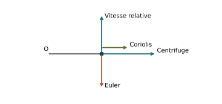

### Question 24 — Moment des forces d’inertie

**Indication.** Les forces radiales ont un bras de levier nul.

La force tangentielle sur chaque masse a pour moment $-ml^2\dot\omega$. Le couple total des forces d’inertie vaut donc $-2ml^2\dot\omega=-I\dot\omega$.

### Question 25 — Équation du pendule dans le repère tournant

**Indication.** Faire le bilan du vrai couple du fil, du couple gravitationnel et du couple d’inertie.

$I\ddot\theta=-k\theta-(3G/2)qQ\sin(2\phi)-I\dot\omega$. L’angle $\theta$ mesure la torsion relative au moteur, tandis que $\phi$ mesure l’orientation par rapport aux sources fixes.

### Question 26 — Asservissement à torsion nulle

**Indication.** Pour un pendule au repos dans le repère mobile, son angle dans le laboratoire suit la rotation du moteur.

Avec $\theta=0$ et $\phi(0)=0$, $\phi=\omega_0t+\int_0^t\delta\omega(t')dt'$. Ainsi $\dot{\delta\omega}=-(3GqQ/2I)\sin[2\omega_0t+2\int_0^t\delta\omega(t')dt']$.

### Question 27 — Réponse au premier ordre

**Indication.** Le couple est déjà du premier ordre en la gravitation.

À l’ordre zéro, $\delta\omega$ est constante et de moyenne nulle, donc nulle. Dans le sinus on remplace alors $\phi$ par $\omega_0t$. Une intégration à moyenne nulle donne $\delta\omega=\delta\omega_0\cos(\omega_m t)$ avec $\delta\omega_0=3GqQ/(4I\omega_0)$ et $\omega_m=2\omega_0$.

### Question 28 — Deux déterminations de G

**Indication.** Utiliser d’abord les moments, puis leurs expressions pour les masses ponctuelles.

$G=4I\omega_0\delta\omega_0/(3qQ)$. Comme $q=I$ et $Q=2M/R^3$, cela devient $G=2R^3\omega_0\delta\omega_0/(3M)$.

### Question 29 — Moment d’inertie d’une plaque verticale

**Indication.** La distance à l’axe de rotation ne dépend pas de la cote verticale.

Pour $dm=\sigma(X,Z)dX\,dZ$, on a $I=\iint X^2\sigma(X,Z)dX\,dZ$.

### Question 30 — Énergie d’un élément de la plaque

**Indication.** Projeter la position sur l’axe des deux sphères.

$r^2=X^2+Z^2$ et $r\cos\gamma=X\cos\phi$. À l’ordre quadrupolaire $dE_p=[V_0(\sqrt{X^2+Z^2})-(3G/2)QX^2\cos^2\phi]\sigma(X,Z)dX\,dZ$.

### Question 31 — Rapport géométrique

**Indication.** Identifier l’intégrale qui multiplie la partie variable de l’énergie.

$E_p=\int V_0\,dm-(3G/2)Q\cos^2\phi\int X^2\,dm$. Le coefficient $q$ est donc exactement $I$ à cet ordre pour toute répartition de masse dans la plaque verticale. Ainsi $I/q=1$.

### Question 32 — Amplitude du signal de rotation

**Indication.** Distinguer l’amplitude de vitesse de celle d’accélération.

$\delta\omega_0=3GM/(2R^3\omega_0)=8{,}65\,10^{-6}\,\mathrm{rad/s}$. L’accélération correspondante a pour amplitude $2\omega_0\delta\omega_0\simeq3{,}46\,10^{-7}\,\mathrm{rad/s^2}$ dans la géométrie modélisée.

### Question 33 — Incertitude sur G

**Indication.** Le rayon est élevé au cube dans la formule de mesure.

À pulsations fixées $dG/G=3dR/R-dM/M$. La borne par addition des modules vaut $3(10^{-6}/0{,}1676)+(3\,10^{-6}/8{,}140)=1{,}83\,10^{-5}$, soit $1{,}22\,10^{-15}\,\mathrm{m^3\,kg^{-1}\,s^{-2}}$. Pour des incertitudes-types indépendantes on combine quadratiquement et l’on trouve $1{,}79\,10^{-5}$ en relatif. La distance domine.

## II. Déduire G d’une variation de pesanteur

### Question 34 — Mesure différentielle

**Indication.** Soustraire les accélérations terrestres presque identiques.

En orientant $\mathbf d_i$ du test vers la source, $\mathbf a_i=\mathbf g+GM\mathbf d_i/d_i^3$. Si $\mathbf b=\mathbf d_1/d_1^3-\mathbf d_2/d_2^3$, $G=(\mathbf a_1-\mathbf a_2)\cdot\mathbf b/(M|\mathbf b|^2)$. La différence élimine le grand fond terrestre commun.

### Question 35 — Universalité de la chute

**Indication.** Quelle égalité entre deux types de masse intervient dans la deuxième loi de Newton ?

L’égalité de la masse gravitationnelle passive et de la masse inertielle exprime le principe d’équivalence faible. Le principe d’équivalence fonde la relativité générale.

### Question 36 — Déplacer la masse source

**Indication.** Sur Terre, la pesanteur varie avec l’altitude.

Déplacer le gravimètre lui-même introduirait une variation du champ terrestre, en plus du signal de la source. Le garder fixe rend cette contribution commune aux deux mesures.

### Question 37 — Masse source nécessaire

**Indication.** Les deux attractions de la source ont des sens opposés.

Pour $d=1\,\mathrm m$, $2GM/d^2=10^{-7}g$ exige $M\simeq7{,}3\,10^3\,\mathrm{kg}$. Avec une densité de $8\,10^3\,\mathrm{kg/m^3}$, le volume approche un mètre cube. La taille est comparable à $d$, donc la distribution doit être connue. Pour une sphère homogène et un point extérieur, le théorème de Gauss rend toutefois le modèle ponctuel exact.

### Question 38 — Champ d’une nappe plane

**Indication.** Traverser le plan avec une surface de Gauss cylindrique.

Les symétries imposent un champ normal de même norme des deux côtés, dirigé vers la matière. Pour deux bases d’aire $S$, $-2gS=-4\pi G\sigma S$. Si le plan est $z=0$, $\mathbf g=-2\pi G\sigma\operatorname{sgn}(z)\,\mathbf e_z$.

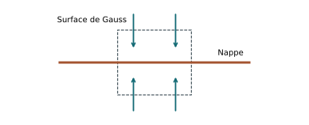

### Question 39 — Baisse de niveau du lac

**Indication.** Chaque tranche d’eau agit comme une nappe infinie.

Au-dessus de l’eau, la diminution de l’intensité de la pesanteur vaut $|\Delta g|=2\pi G\rho_{\rm eau}h=8{,}39\,10^{-6}\,\mathrm{m/s^2}$ pour $h=20\,\mathrm m$. La variation vectorielle pointe vers le haut.

### Question 40 — Correction due à l’air

**Indication.** Remplacer la masse volumique de l’eau retirée par le contraste de densité.

On obtient $|\Delta g|=2\pi G(\rho_{\rm eau}-\rho_{\rm air})h$. Sous $10^5\,\mathrm{Pa}$ à $293\,\mathrm K$, $\rho_{\rm air}=pM_{\rm mol}/(RT)\simeq1{,}19\,\mathrm{kg/m^3}$. La correction relative $1{,}2\,10^{-3}$ dépasse $10^{-5}$ et doit être incluse.

### Question 41 — Étalons du SI

**Indication.** Se replacer à la date de l’épreuve pour le kilogramme.

$[G]=\mathrm{m^3\,kg^{-1}\,s^{-2}}$. La seconde repose sur 9 192 631 770 périodes de la transition hyperfine de l’état fondamental du césium 133. Le mètre dérive de la valeur fixée de $c=299\,792\,458\,\mathrm{m/s}$. En 2013 le kilogramme était défini par le prototype international. Depuis 2019 il découle de la valeur fixée de la constante de Planck $h$.

### Question 42 — Gravimètre à ressort

**Indication.** L’allongement statique mesure le poids.

Si le ressort a pour longueur naturelle $l_0$, $k(l-l_0)=mg$ à l’équilibre. Une variation donne $\Delta g=(k/m)\Delta l$, sous réserve de connaître le facteur d’étalonnage $k/m$.

### Question 43 — Gravimètre de chute libre

**Indication.** Chaque déplacement du miroir mobile modifie deux fois le trajet optique.

Dans le Michelson, la séparatrice envoie la lumière vers un miroir fixe et un rétroréflecteur en chute libre. Après recombinaison, $\Delta\varphi=4\pi\Delta z/\lambda$. Une frange correspond à $\lambda/2$ de chute. Le comptage horodaté ajuste $z=z_0+v_0t+gt^2/2$ sur l’axe descendant et fournit $g$.

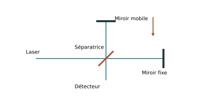

### Question 44 — Choix métrologique

**Indication.** Distinguer un signal relatif très sensible d’un étalonnage absolu.

Le Michelson en chute libre rapporte directement une longueur et des durées à leurs étalons. Il convient à une mesure absolue de $G$ et à l’étalonnage du ressort. Un ressort peut ensuite servir à suivre les variations du lac, sous contrôle de sa dérive et de son facteur d’échelle.

## III. Gravimètre supraconducteur

### Question 45 — Accélération des porteurs

**Indication.** Écrire la dynamique d’un électron sans collisions puis multiplier par la densité de charge.

Dans la réponse linéaire, $m_e\partial_t\mathbf v=-e\mathbf E$. Puisque $\mathbf j=-ne\mathbf v$, $\partial_t\mathbf j=(ne^2/m_e)\mathbf E$.

### Question 46 — Conservation du flux

**Indication.** Prendre un contour fermé profondément dans le fil de la bobine.

La loi de Faraday et la première équation de London donnent $d[\Phi+(m_e/ne^2)\oint\mathbf j\cdot d\mathbf l]/dt=0$ pour le contour matériel au repos. Le terme de courant est nul sur un contour pris dans le cœur d’un fil épais, loin des couches superficielles parcourues par les courants. Dans cette approximation le flux $\Phi=\phi$ est constant. En général, c’est la somme écrite ci-dessus qui se conserve.

### Question 47 — Équation de pénétration

**Indication.** Combiner la loi d’Ampère quasistatique et la seconde relation de London.

$\nabla\times(\nabla\times\mathbf B)=\mu_0\nabla\times\mathbf j=-\mu_0ne^2\mathbf B/m_e$. Comme $\nabla\cdot\mathbf B=0$, $\Delta\mathbf B=\mathbf B/\lambda_L^2$ avec $\lambda_L=\sqrt{m_e/(\mu_0ne^2)}$.

### Question 48 — Champ d’une plaque

**Indication.** Imposer le même champ sur les deux faces.

$B_y''=B_y/\lambda_L^2$ et $B_y(\pm l)=B_0$. La solution paire est $B_y=B_0\cosh(z/\lambda_L)/\cosh(l/\lambda_L)$. Pour $l\gg\lambda_L$, les deux régions de pénétration sont séparées par un cœur pratiquement sans champ.

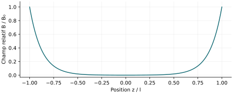

### Question 49 — Profondeur de London

**Indication.** Convertir les centimètres cubes en mètres cubes.

$n=1{,}8\,10^{28}\,\mathrm{m^{-3}}$ donne $\lambda_L\simeq4{,}0\,10^{-8}\,\mathrm m$. Dans l’état de Meissner, le champ est négligeable à plusieurs longueurs de London des surfaces.

### Question 50 — Flux traversant la sphère

**Indication.** Relier la spire effective à la section de matière supraconductrice qu’elle représente.

Dans le modèle macroscopique de la sphère en état de Meissner, le champ dans la matière est nul au premier ordre. Le flux total à travers la spire qui la représente est donc pris nul.

### Question 51 — Inductance réelle

**Indication.** L’énergie magnétique est une forme quadratique positive pour tous les courants.

$2E_M=L_bI_b^2+2MI_bI_s+L_sI_s^2\ge0$. Le discriminant impose $M^2\le L_bL_s$. Pour des circuits distincts imparfaitement couplés l’inégalité est stricte et $\mathscr L=\sqrt{L_bL_s-M^2}$ est réelle, positive, en henrys.

### Question 52 — Courants persistants

**Indication.** Résoudre simultanément les conditions de flux de la bobine et de la sphère.

Pour les orientations homologues du schéma, $L_bI_b+MI_s=\phi$ et $MI_b+L_sI_s=0$. Donc $I_b=\phi L_s/\mathscr L^2$ et $I_s=-\phi M/\mathscr L^2$. Les effets magnétiques sont opposés pour $M>0$, conformément à la loi de Lenz.

### Question 53 — Énergie à flux imposés

**Indication.** Écrire l’énergie sous la forme d’une somme de produits flux-courant.

$E_M=(I_b\Phi_b+I_s\Phi_s)/2=I_b\phi/2=L_s\phi^2/(2\mathscr L^2)$.

### Question 54 — Faible couplage

**Indication.** Développer l’inverse de la différence d’inductances.

Avec $\eta=M^2/(L_bL_s)\ll1$, $E_M=\phi^2/[2L_b(1-\eta)]\simeq\phi^2(1+\eta)/(2L_b)$. Seul le terme en $M^2$ dépend de la position relative.

### Question 55 — Champ axial d’une boucle

**Indication.** Les composantes transverses de Biot et Savart s’annulent par symétrie.

À distance $\sqrt{R^2+z^2}$ de tous les éléments de courant, l’intégration donne $\mathbf B(z)=\mu_0 I_b R^2\mathbf e_z/[2(R^2+z^2)^{3/2}]$, le sens de $\mathbf e_z$ étant choisi par la règle de la main droite.

### Question 56 — Inductance mutuelle

**Indication.** Pour la petite spire, le champ de la grande est presque uniforme sur son disque.

$MI_b\simeq\pi r^2 B(z)$, donc $M(z)=\mu_0\pi r^2R^2/[2(R^2+z^2)^{3/2}]$. Le signe correspond aux normales parallèles utilisées précédemment.

### Question 57 — Lévitation et seuil en flux

**Indication.** Comparer la force magnétique ascendante à la pesanteur.

À une constante près, $E(z)=mgz+A/(R^2+z^2)^3$, où $A=\phi^2\mu_0^2\pi^2r^4R^4/(8L_b^2L_s)$. La force magnétique $f=6Az/(R^2+z^2)^4$ part de zéro, culmine en $z_c=R/\sqrt7$, puis décroît. Si $f(z_c)<mg$, aucune lévitation. Au-delà du seuil, la première racine de $f=mg$ est instable (maximum de $E$) et la seconde stable (minimum). Au seuil les deux se rejoignent en équilibre marginal. Le modèle de faible couplage donne $A_c=mg(R^2+z_c^2)^4/(6z_c)$ et $|\phi_c|=\sqrt{8L_b^2L_s A_c}/(\mu_0\pi r^2R^2)$.

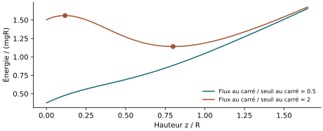

### Question 58 — Déplacement d’équilibre

**Indication.** Différencier la relation $mg=f(z_e)$ à flux constant.

La dérivée logarithmique de $f$ donne $\delta g/g=[(R^2-7z_e^2)/(R^2+z_e^2)]\delta z_e/z_e$. Pour $R=5\,\mathrm{cm}$ et $z_e=1{,}9\,\mathrm{cm}$, $\delta z_e/z_e\simeq-106\,\delta g/g$. Le signe négatif est cohérent avec une sphère qui descend lorsque le poids augmente.

### Question 59 — Réglage de la sensibilité

**Indication.** Suivre la racine stable lorsque la force magnétique augmente.

À flux plus élevé, l’équilibre stable monte et s’éloigne de $R/\sqrt7$. Le facteur $|(R^2+z_e^2)/(R^2-7z_e^2)|$ diminue. Choisir le flux légèrement supérieur au flux critique augmente la sensibilité, avec une marge suffisante pour que les fluctuations ne fassent pas disparaître l’équilibre.

### Question 60 — Armatures appartenant à la sphère

**Indication.** Regrouper les trois armatures électriquement reliées au même conducteur flottant.

Ce sont la plaque inférieure de $C_-$, la plaque supérieure de $C_+$ et la plaque de $C_s$ reliée à leur jonction. Les électrodes externes sont respectivement A, B et D. La figure entoure le nœud commun et ces armatures.

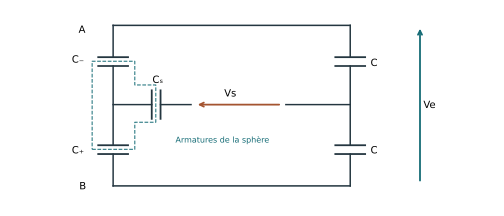

### Question 61 — Équilibre du pont

**Indication.** Comparer les tensions aux points milieux des deux diviseurs.

Le circuit est un pont capacitif analogue au pont de Wheatstone. À vide et en régime sinusoïdal, il est équilibré si les deux rapports d’impédances sont égaux. La branche de droite étant symétrique, cela donne $C_-=C_+$.

### Question 62 — Tension différentielle

**Indication.** À vide, aucun courant alternatif ne traverse la capacité de lecture.

Prenons $V_B=0$ et $V_A=V_e$. La sphère est à $C_-V_e/(C_-+C_+)$ et le milieu de la branche droite à $V_e/2$. L’orientation de $V_s$ donne $V_s=V_e(C_--C_+)/[2(C_-+C_+)]$.

### Question 63 — Capacités au voisinage du centre

**Indication.** Évaluer les distances à l’électrode du bas et à celle du haut.

Pour $\delta z>0$ la sphère s’éloigne de B et se rapproche de A. Ainsi $C_+=\epsilon_0 S/(d+\delta z)$ et $C_-=\epsilon_0 S/(d-\delta z)$ en négligeant les effets de bord.

### Question 64 — Signal de déplacement

**Indication.** Substituer les deux capacités dans la différence normalisée.

$(C_--C_+)/(C_-+C_+)=\delta z/d$. On trouve $V_s=V_e\delta z/(2d)$ au premier ordre. Dans le modèle parallèle idéal, la simplification est même exacte.

### Question 65 — Impédance de l’amplificateur

**Indication.** Annuler la tension d’excitation et regarder l’impédance vue entre les bornes de sortie.

Les condensateurs $C_-+C_+$ rejoignent la masse de la source, comme $2C$ sur l’autre branche. L’impédance de Thévenin entre les sorties est $Z_{\rm th}=[1/C_s+1/(C_-+C_+)+1/(2C)]/(j\omega)$. Il faut $|Z|\gg|Z_{\rm th}|$ pour mesurer pratiquement la tension à vide.

### Question 66 — Résolution du capteur

**Indication.** Remonter du seuil en tension au déplacement, puis à la variation de pesanteur.

Avec $|V_s|=10^{-7}\,\mathrm V$, $V_e=20\,\mathrm V$ et $d=10^{-3}\,\mathrm m$, $|\delta z|=2d|V_s|/V_e=10^{-11}\,\mathrm m$. D’après la question 58, $|\delta g|/g\simeq10^{-11}/(106\times0{,}019)\simeq5\,10^{-12}$.

### Question 67 — Sensibilité et exactitude

**Indication.** Distinguer la résolution des variations de la connaissance de la valeur absolue.

Le pont détecte des déplacements picométriques, amplifiés mécaniquement près de l’équilibre critique. L’étalonnage absolu reste tributaire de la géométrie, du flux piégé, du centrage, de la stabilité et du modèle de couplage. De petites variations de $g$ peuvent ainsi être résolues même si son niveau absolu est plus incertain.

## IV. Interféromètre atomique

### Question 68 — Impulsion échangée avec la lumière

**Indication.** Bien prendre en compte le sens du photon émis.

Le faisceau 1 se propage vers $-z$ et le faisceau 2 vers $+z$. Absorber le premier et émettre dans le second donne à l’atome $\mathbf p_d-\mathbf p_i=-2\hbar K\mathbf e_z$.

### Question 69 — Énergie de diffraction

**Indication.** Les deux photons ont la même pulsation.

L’énergie gagnée à l’absorption $\hbar\Omega$ est restituée à l’émission. L’état interne final étant identique, $p_d^2/(2m)=p_i^2/(2m)$.

### Question 70 — Angle de Bragg

**Indication.** Développer le carré de la quantité de mouvement finale.

$p_i^2-4\hbar K p_{iz}+4\hbar^2K^2=p_i^2$ impose $p_{iz}=\hbar K$, donc $\sin\theta_i=\hbar K/p_i$. La composante horizontale est conservée et $p_{dz}=-\hbar K$. Les deux angles positifs de la figure sont égaux. Une incidence autorisée exige $p_i\ge\hbar K$.

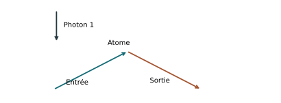

### Question 71 — Incidence verticale

**Indication.** Faire disparaître la composante horizontale.

À $\theta_i=\pi/2$, $\mathbf p_i=+\hbar K\mathbf e_z$ et $\mathbf p_d=-\hbar K\mathbf e_z$.

### Question 72 — Équation d’onde libre

**Indication.** Appliquer la dérivée temporelle à la seule exponentielle.

L’équation de Schrödinger donne $-(\hbar^2/2m)\Delta\phi=\hbar\omega\phi$, soit $\Delta\phi+(2m\omega/\hbar)\phi=0$.

### Question 73 — Dispersion des ondes de matière

**Indication.** Tester une exponentielle spatiale dans l’équation stationnaire.

$\psi=A\exp[i(\mathbf k\cdot\mathbf r-\omega t)]$ est solution pour $\omega=\hbar k^2/(2m)$. La dispersion est quadratique pour cette matière non relativiste, contrairement à la loi linéaire $\omega=ck$ de la lumière dans le vide. L’onde de matière décrit une amplitude de probabilité.

### Question 74 — Vitesse du paquet

**Indication.** Dériver la pulsation par rapport au vecteur d’onde.

$\mathbf v_g=\nabla_{\mathbf k}\omega=\hbar\mathbf k/m$. Le paquet accompagne les atomes, d’où $\mathbf p=m\mathbf v_g=\hbar\mathbf k$.

### Question 75 — Réseau optique stationnaire

**Indication.** Additionner d’abord les champs, puis prendre le carré moyen.

Le champ complexe vaut $2E_0\cos(Kz)e^{-i\Omega t}\mathbf e_x$. Avec la normalisation d’intensité correspondant au $\beta$ donné en Q79, $I=2E_0^2\cos^2(Kz)=E_0^2[1+\cos(2Kz)]$. En supprimant le terme constant, $V=-\alpha_r E_0^2\cos(2Kz)/(2\epsilon_0 c)=-2\hbar\beta\cos(2Kz)$, de période $d=\pi/K$. Si $E_0$ désigne un champ électrique en unités SI, l’intensité comporte en outre le facteur $\epsilon_0 c$ et la définition correspondante de $\beta$ devient $\alpha_r E_0^2/(4\hbar)$. Les prédictions ci-dessous sont exprimées avec le $\beta$ du sujet.

### Question 76 — Directions constructives

**Indication.** Imposer le même déphasage modulo deux pi entre périodes voisines.

$(k_{dz}-k_{iz})d=2\pi n$. Les composantes parallèles aux plans sont conservées, donc $\mathbf k_d=\mathbf k_i+2nK\mathbf e_z$ avec $n$ entier. Pour une diffraction élastique il faut aussi $|\mathbf k_d|=|\mathbf k_i|$.

### Question 77 — Premier ordre descendant

**Indication.** Choisir l’ordre qui change le signe d’un vecteur incident vertical ascendant.

Avec $\mathbf k_i=K\mathbf e_z$ et $n=-1$, $\mathbf k_d=-K\mathbf e_z$.

### Question 78 — Deux modes résonnants

**Indication.** Les deux vecteurs opposés ont le même carré.

Ils ont la même pulsation libre $\omega=\hbar K^2/(2m)$. Le coefficient $c_0$ multiplie l’onde montante $e^{iKz}$, $c_1$ l’onde descendante $e^{-iKz}$, avec le facteur temporel commun $e^{-i\omega t}$.

### Question 79 — Équations des amplitudes

**Indication.** Multiplier les deux modes par les deux harmoniques du potentiel.

Le potentiel est $-\hbar\beta(e^{2iKz}+e^{-2iKz})$. La partie cinétique annule le terme en $\omega$. En projetant sur les modes résonnants $\pm K$, on trouve $i\dot c_0=-\beta c_1$ et $i\dot c_1=-\beta c_0$. Les termes en $\pm3K$ ont une énergie libre neuf fois plus grande et sont négligés dans l’approximation à deux modes.

### Question 80 — Préparation initiale

**Indication.** Avant l’impulsion, le faisceau atomique est montant.

En normalisant l’amplitude initiale et en choisissant son origine de phase, $c_0(0)=1$ et $c_1(0)=0$.

### Question 81 — Oscillations entre les deux modes

**Indication.** Dériver une des équations et reporter l’autre.

$\ddot c_0=-\beta^2c_0$, d’où $c_0=\cos(\beta t)$ et $c_1=i\sin(\beta t)$. Les populations $\cos^2(\beta t)$ et $\sin^2(\beta t)$ sont complémentaires, de période $\pi/\beta$.

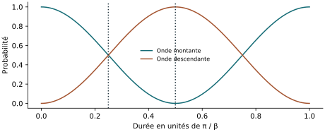

### Question 82 — Impulsion séparatrice

**Indication.** Chercher le premier instant où les deux populations valent un demi.

Les amplitudes ont même module pour la première fois à $\beta\tau=\pi/4$, donc $\tau=\pi/(4\beta)$ avec $\beta>0$.

### Question 83 — Après la séparation

**Indication.** Les coefficients ne se couplent plus après extinction du réseau.

Pour $t>\tau$, $\psi=e^{-i\omega t}(e^{iKz}+i e^{-iKz})/\sqrt2$. Les deux composantes ont la même énergie libre.

### Question 84 — Composantes transmises et réfléchies

**Indication.** Repérer la direction du vecteur d’onde.

$e^{iKz-i\omega t}/\sqrt2$ poursuit le trajet montant et constitue l’onde transmise. $i e^{-iKz-i\omega t}/\sqrt2$ repart vers le bas et constitue l’onde réfléchie.

### Question 85 — Phase de la réflexion locale

**Indication.** Comparer chaque amplitude à celle de l’onde entrante au même point et au même instant.

En $z=z_0$, le quotient réfléchi/incident vaut $i e^{-2iKz_0}/\sqrt2=e^{i\pi/2-2iKz_0}/\sqrt2$. Le coefficient transmis est $t_\tau=1/\sqrt2$.

### Question 86 — Impulsion miroir

**Indication.** Évaluer les populations au double de la durée séparatrice.

À $2\tau$, $\beta t=\pi/2$. Ensuite $\psi=i e^{-iKz-i\omega t}$. Toute l’onde est réfléchie, avec $r_{2\tau}=e^{i\pi/2-2iKz_0}$ et $t_{2\tau}=0$.

### Question 87 — Comptages aux deux ports

**Indication.** Additionner les deux amplitudes de module un demi menant à une même sortie.

$N_a=N_0[1+\cos(\Delta\varphi_a)]/2$. Comme la transformation conserve le nombre d’atomes, $N_b=N_0-N_a=N_0[1-\cos(\Delta\varphi_a)]/2$.

### Question 88 — Vecteurs d’onde sur les bras

**Indication.** Les segments montants et descendants ont des signes opposés.

Sur $AB_1$ et $B_2C$ le vecteur vaut $+K\mathbf e_z$. Sur $AB_2$ et $B_1C$ il vaut $-K\mathbf e_z$. Après $C$, le port $a$ reçoit l’onde montante et le port $b$ l’onde descendante.

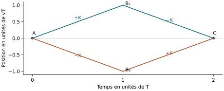

### Question 89 — Phase de réflexion du chemin inférieur

**Indication.** Le bras inférieur subit deux réflexions avant d’atteindre le port montant.

En A l’onde incidente monte, puis en $B_2$ elle descend. Les deux déphasages sont $\pi/2-2Kz_A$ et $\pi/2+2Kz_{B_2}$. La transmission finale en C a une phase nulle. La somme est $\pi+2K(z_{B_2}-z_A)$.

### Question 90 — Différence des phases de réflexion

**Indication.** Sur le bras supérieur, quelles impulsions réfléchissent l’onde avant son arrivée en a ?

Transmission en A, réflexion d’une onde montante en $B_1$ puis d’une onde descendante en C donnent $\pi+2K(z_C-z_{B_1})$. En retranchant cette phase de celle du bras inférieur, $\Delta\varphi_{\rm refl}=2K(z_{B_1}+z_{B_2}-z_A-z_C)$.

### Question 91 — Phase de propagation libre

**Indication.** Additionner sur chaque segment la phase spatiale et le terme temporel.

Sur $AB_1$, elle vaut $K(z_{B_1}-z_A)-\omega T$, puis $-K(z_C-z_{B_1})-\omega T$ sur $B_1C$. Le total supérieur est $K(2z_{B_1}-z_A-z_C)-2\omega T$. De même le bras inférieur donne $K(z_A+z_C-2z_{B_2})-2\omega T$. En vol libre les distances géométriques sont symétriques.

### Question 92 — Positions sans pesanteur

**Indication.** Utiliser la vitesse de groupe et les temps de vol identiques.

En posant $v=\hbar K/m$, $z_{B_1}=vT$, $z_{B_2}=-vT$ et $z_C=z_A=0$.

### Question 93 — Sortie constructive

**Indication.** Vérifier séparément les deux contributions au déphasage.

La somme $z_{B_1}+z_{B_2}$ est nulle et $z_A=z_C=0$, donc les déphasages de réflexion et de propagation sont tous deux nuls. Le port $a$ reçoit $N_0$ atomes et le port $b$ zéro dans le montage idéal.

### Question 94 — Trajectoires dans le champ terrestre

**Indication.** Entre impulsions, les deux bras subissent la même accélération.

Chaque segment de vol devient un arc de parabole de concavité tournée vers les $z$ décroissants. Au temps $T$ le miroir idéal inverse la vitesse comme le prescrit l’énoncé. Les deux bras se rejoignent au temps $2T$.

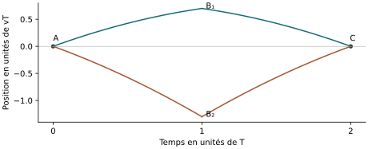

### Question 95 — Positions avec inversion de vitesse

**Indication.** Écrire la vitesse juste avant puis juste après le miroir à l’instant $T$.

$z_{B_1}=vT-gT^2/2$ et $z_{B_2}=-vT-gT^2/2$. Pour une vitesse initiale $v_i=\pm v$, la seconde phase du vol commence à la vitesse $-v_i+gT$. Son déplacement vaut $(-v_i+gT)T-gT^2/2=-z_B$. Dans le modèle d’inversion demandé, $z_C=0$.

### Question 96 — Déphasage gravitationnel

**Indication.** Utiliser la compensation des phases de propagation admise par le sujet.

$z_{B_1}+z_{B_2}=-gT^2$ et $z_A=z_C=0$. La contribution de réflexion donne donc $\Delta\varphi_a=-2KgT^2$, dans la convention bras inférieur moins bras supérieur.

### Question 97 — Lecture de l’expérience florentine

**Indication.** Convertir la longueur d’onde en nombre d’onde puis tenir compte de la lecture différentielle.

$K=2\pi/(780\,\mathrm{nm})=8{,}06\,10^6\,\mathrm{m^{-1}}$. Pour $\delta g=7\,10^{-8}g$ et $T=0{,}160\,\mathrm s$, $|\delta\Delta\varphi_a|=2KT^2|\delta g|\simeq0{,}283\,\mathrm{rad}$. Les deux interféromètres donnent un écart voisin de $0{,}566\,\mathrm{rad}$, conforme à la séparation des plateaux proches de 1,33 et 1,90 rad sur le graphe.
