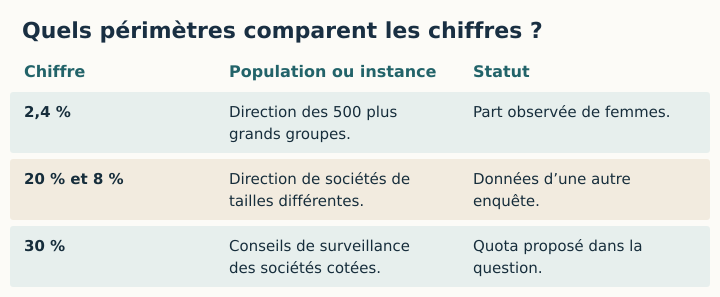

# ENS Rennes · D1 · Allemand 2013 — Corrigé brut

*Corrigé rédigé par IA, non officiel. Signalez toute erreur.*

**Rédaction** · GPT-6.2 Astra Ultra · vitesse non renseignée

Le feuillet de l’École normale supérieure de Cachan est conservé dans les archives du concours D1 de Rennes. D’après Der Spiegel · 15 octobre 2012.

## Version française

Malgré les progrès réalisés, en Allemagne, les femmes sont toujours trop peu nombreuses à accéder aux plus hautes fonctions de direction. Selon une étude, la République fédérale occupe le huitième rang mondial pour la participation des femmes à la vie économique. La Suède, la Norvège ou les Pays-Bas, par exemple, figurent en tête du classement. D’après cette étude du cabinet de conseil Booz & Company, c’est l’Australie qui arrive en première position au niveau mondial.

L’Allemagne ferait certes partie du groupe de tête à l’échelle internationale. « Il ne faut pourtant pas que cela masque tout le chemin qui reste à parcourir pour que l’égalité économique entre les femmes et les hommes devienne une réalité vécue au quotidien », a déclaré Christine Rupp, associée chez Booz. Les écarts seraient encore trop importants dans le pays, notamment en matière de rémunération. On trouverait également beaucoup trop peu de femmes telles que Judith Hartmann, directrice financière du groupe Bertelsmann, à la tête de grandes entreprises allemandes.

Les femmes représenteraient un peu plus de la moitié des diplômés de l’enseignement supérieur en Allemagne, mais seulement 31 % exerceraient des fonctions d’encadrement. « Parmi les dirigeants des 500 plus grands groupes allemands, la part des femmes ne s’élève même qu’à 2,4 % », a indiqué Christine Rupp.

Selon une étude commandée par le ministère fédéral de l’Économie, par exemple, seuls 20 % des dirigeants d’entreprises comptant jusqu’à cinq salariés sont des femmes. Dans les entreprises de plus de 100 salariés, cette proportion ne serait que de 8 %, alors même qu’il n’existerait presque plus de différences entre les sexes en matière de formation et de qualification professionnelle.

D’après l’enquête, les femmes chefs d’entreprise privilégieraient souvent d’autres objectifs, parmi lesquels la possibilité de concilier vie privée et vie professionnelle.

## Expression en allemand

Discuter la proposition d’un quota contraignant de 30 % de femmes dans les conseils de surveillance des entreprises cotées · environ 100 mots.

Eine verbindliche Quote für die Aufsichtsräte börsennotierter Unternehmen halte ich für sinnvoll. Wenn qualifizierte Frauen bei der Besetzung solcher Gremien regelmäßig übergangen werden, genügt eine unverbindliche Empfehlung kaum. Eine Quote zwingt die Verantwortlichen, ihren Kreis möglicher Bewerberinnen zu erweitern und ihre Auswahlkriterien genauer zu begründen. Allerdings betrifft der Aufsichtsrat nur einen Teil der wirtschaftlichen Macht. Eine bessere Vertretung dort verändert weder automatisch die Bezahlung noch die Aufstiegschancen im übrigen Unternehmen. Deshalb sollten transparente Beförderungsverfahren und familienfreundliche Arbeitszeiten hinzukommen. Nach einigen Jahren wäre zu prüfen, ob tatsächlich mehr Frauen Verantwortung übernehmen und auf welchen Ebenen weiterhin Hindernisse bestehen.

*97 mots, comptés par espaces.*

[Feuillet original, p. 2](https://www.ens-rennes.fr/medias/fichier/se1a-13d1-lv_1421750182683-pdf#page=2) · [Rapport du jury, partie écrite](https://www.ens-rennes.fr/medias/fichier/re1a_13d1_allemand_1384770295995.pdf#page=1)
