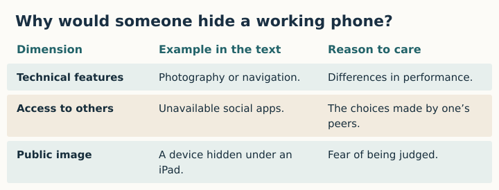

# ENS Rennes · D1 · Anglais 2013 — Corrigé brut

*Corrigé rédigé par IA, non officiel. Signalez toute erreur.*

**Rédaction** · GPT-6.2 Astra Ultra · vitesse non renseignée

Le feuillet de l’École normale supérieure de Cachan est conservé dans les archives du concours D1 de Rennes. Adapté du New York Times · 15 octobre 2012.

## Version française

**La honte du BlackBerry**

Rachel Crosby, commerciale à Los Angeles, parle de son téléphone BlackBerry comme on parlerait d’un parent dont on aurait un peu honte. « On ne peut rien faire avec. J’en ai honte. » Elle a raconté qu’elle avait cessé de sortir son BlackBerry lors des cocktails et des congrès. En réunion, dit-elle, elle le cache sous son iPad de peur que ses clients ne le voient et ne la jugent.

Le BlackBerry faisait autrefois la fierté des gens influents et des élites qui l’arboraient. Mais ceux qui en possèdent encore un aujourd’hui disent que l’appareil attire désormais les moqueries et les railleries des détenteurs d’iPhone.

Le fossé culturel entre les fidèles du BlackBerry et tous les autres n’a fait que se creuser au cours de l’année écoulée. Les entreprises qui fournissaient jusqu’alors à leurs salariés des BlackBerry, et exclusivement des BlackBerry, ont commencé à céder aux demandes de ceux qui réclamaient des iPhone. Même la Maison-Blanche, qui utilisait le BlackBerry pour des raisons de sécurité, a récemment commencé à prendre en charge l’iPhone.

Dans la vie de tous les jours, les affronts se poursuivent. Les parias du BlackBerry disent éprouver de plus en plus souvent de la honte et se sentir humiliés en public lorsqu’ils voient les autres échanger sur des applications de réseaux sociaux auxquelles ils n’ont pas accès, prendre des photos de meilleure définition et se repérer sans peine dans les rues, ou sur Internet, grâce à un meilleur GPS et à une navigation plus rapide. Pour comble d’humiliation, ils doivent déléguer à leurs conjoints, amis ou collègues exaspérés, tous munis d’un iPhone, des tâches comme trouver un itinéraire, réserver un voyage ou une table au restaurant, ou encore consulter les résultats sportifs.

## Expression en anglais

Expliquer ce que l’exemple du BlackBerry révèle des attitudes des consommateurs · environ 100 mots.

The example shows how quickly a useful object can lose its social value. A phone once associated with professional success becomes something its owner hides from clients. Some dissatisfaction has practical grounds. If colleagues share an application that I cannot use, my device limits what I can do with them. Yet embarrassment adds another layer. The owner imagines that people will judge her competence from the brand in her hand. Consumers therefore assess products in relation to other users as well as to their own needs. A feature can become more valuable simply because more people around us adopt it.

*100 mots, comptés par espaces.*

[Feuillet original, p. 3](https://www.ens-rennes.fr/medias/fichier/se1a-13d1-lv_1421750182683-pdf#page=3)
