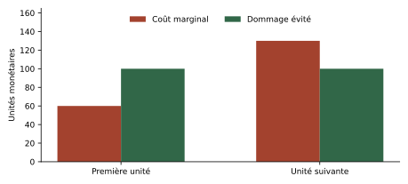
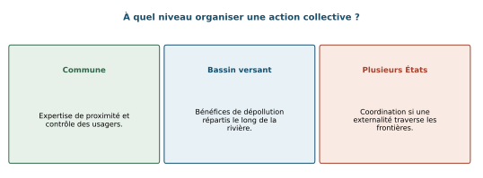

# ENS de Cachan D1 — Composition d’ordre économique 2013 · Corrigé brut

*Corrigé rédigé par IA, non officiel. Signalez toute erreur.*

**Rédaction** · GPT-6.2 Astra Ultra · vitesse non renseignée

## Les limites de l’intervention publique

### Introduction

Une commune peut financer une digue qui protège tout un quartier. Demander à chaque habitant le prix maximal qu’il serait prêt à payer ne suffit guère à financer le chantier, puisque chacun espère demeurer protégé si les autres paient. Mais décréter l’utilité de la digue ne révèle ni la fréquence des crues futures ni l’avantage d’une autre dépense. L’exemple pose les deux questions du sujet. Jusqu’où l’autorité publique a-t-elle une raison d’agir ? Jusqu’où peut-elle effectivement obtenir le résultat visé ?

L’intervention publique comprend le prélèvement, la dépense, la réglementation et l’organisation d’institutions collectives. Elle engage plusieurs niveaux de gouvernement et poursuit les trois fonctions distinguées par Musgrave, allocation, redistribution et stabilisation. Ses limites ne se lisent ni dans le seul taux de dépense publique ni dans une propriété générale du marché. Il faut comparer les résultats accessibles par des institutions imparfaites, en tenant compte des réactions que chaque décision suscite. Les objectifs collectifs définissent d’abord le domaine possible de l’action. L’information, le financement et l’organisation du pouvoir déterminent ensuite ce que l’on peut effectivement y accomplir.

### I. Une raison d’agir ne détermine pas à elle seule l’étendue de l’intervention

#### A. Les défaillances de marché appellent une comparaison des instruments

Le premier théorème de l’économie du bien-être donne un repère. Sous des hypothèses exigeantes, notamment la concurrence, des marchés complets et l’absence d’effets externes, un équilibre concurrentiel est efficace au sens de Pareto. Ce résultat ne fournit aucune garantie sur la répartition initiale et ne constitue aucun verdict pour un marché réel. Si un pollueur n’assume qu’une partie du coût de sa production, la quantité échangée peut excéder la quantité socialement souhaitable. Une taxe alignée sur le dommage marginal au niveau efficace amène les producteurs à intégrer ce dommage. Il faut pourtant connaître suffisamment les coûts et les dommages pour fixer le taux.

Considérons une unité supplémentaire de dépollution qui coûte 60 à l’entreprise et évite un dommage de 100 aux riverains. Le gain net collectif s’élève à 40. Une unité suivante qui coûte 130 pour le même gain environnemental détruirait 30 de surplus. Imposer la dépollution maximale ignorerait ce second arbitrage. Un prix de l’émission laisse chacun choisir ses moyens, un plafond échangeable fixe la quantité totale, une norme peut mieux convenir si l’on redoute un seuil de dommage irréversible. Le choix dépend du type d’incertitude et du coût de surveillance. Une négociation directe peut aussi réussir lorsque les droits sont clairs et les parties peu nombreuses. L’État intervient alors en garantissant des droits et leur exécution.

#### B. Redistribution et stabilisation exigent des choix collectifs distincts

Une allocation efficace peut laisser un ménage pauvre sans accès à un service essentiel. L’assurance collective, les transferts et l’impôt répondent à une exigence de solidarité qui excède le critère de Pareto. Le niveau acceptable d’inégalité relève d’une décision politique. Quant à l’assurance, une mutualisation obligatoire peut limiter la sélection adverse, mais les prestations modifient aussi les comportements. Une franchise très élevée réduit l’aléa moral tout en privant de soins certains assurés. Évaluer la réforme demande de considérer à la fois la dépense, la santé et sa distribution.

Une chute de la demande agrégée donne une autre justification. En présence de capacités inutilisées et de prix peu flexibles, des stabilisateurs automatiques soutiennent le revenu disponible et la dépense, sans délai de vote. La dépense discrétionnaire peut amplifier ce soutien. À proximité du plein emploi, le supplément de demande risque davantage de déplacer l’investissement, d’accroître les importations ou d’alimenter les prix. En janvier 2013, Blanchard et Leigh montraient que, dans l’épisode de crise étudié, les pays engageant les plus fortes consolidations avaient subi des erreurs de prévision de croissance plus défavorables. Leur interprétation suggère des multiplicateurs sous-estimés dans cette conjoncture. Elle ne fixe pas un multiplicateur valable pour chaque pays et chaque date.

### II. Les contraintes de l’action publique dépendent aussi de sa conception

#### A. L’information et le financement imposent des arbitrages réels

Les administrations connaissent imparfaitement les coûts des entreprises, les ressources individuelles et les préférences des citoyens. Un exploitant de réseau en monopole naturel peut gonfler ses coûts lorsque le tarif autorisé lui en assure le remboursement. Un plafond de prix l’incite au contraire à économiser, au risque de réduire la qualité ou l’entretien. Des indicateurs portant sur la continuité du service et une révision périodique du tarif améliorent le contrat au prix de contrôles supplémentaires. Déléguer à une entreprise ne fait donc pas disparaître le besoin d’information.

Chaque euro levé par l’impôt a un coût de collecte et peut modifier le comportement sur lequel il est assis. Une prestation retranchée intégralement dès que le revenu du travail augmente peut créer un taux marginal effectif très élevé. Réduire progressivement la prestation atténue l’effet de seuil, mais prolonge le versement plus haut dans l’échelle des revenus. La dette permet d’étaler le financement d’un investissement durable ou d’une récession. Sa soutenabilité dépend du taux d’intérêt, de la croissance, du solde primaire et de la confiance. La contrainte intertemporelle oblige à arbitrer entre usages présents et futurs, sans imposer l’équilibre du budget chaque année.

#### B. Les institutions déterminent quelles limites peuvent être repoussées

Les décideurs publics ont leurs propres incitations. Un avantage concentré, comme une subvention sectorielle, mobilise ses bénéficiaires alors que le coût dispersé entre contribuables attire moins l’attention. Une administration centrale peut ignorer une particularité locale. À l’inverse, une commune supportant seule le coût d’une dépollution dont bénéficient ses voisines en financera trop peu. Choisir le niveau territorial revient à comparer l’avantage de l’information locale au coût des effets qui franchissent les frontières. La politique climatique illustre le besoin de coordination internationale, et la monnaie commune rend interdépendantes les décisions budgétaires nationales.

La transparence sur le coût complet, un débat sur les objectifs et une évaluation indépendante peuvent limiter capture et incohérence. Encore faut-il construire un contrefactuel. Une hausse de l’emploi après une aide ne mesure pas son effet si une reprise générale aurait suffi. Comparer des territoires comparables avant et après, vérifier leurs tendances antérieures, puis examiner le déplacement éventuel des emplois précise ce que l’action a réellement ajouté. L’évaluation éclaire une décision collective sans déterminer à elle seule la valeur à donner à l’égalité, à l’assurance ou à l’environnement.

### Conclusion

La limite pertinente est celle à laquelle un instrument supplémentaire cesse d’améliorer le résultat social au regard de son coût et des solutions disponibles. Elle change avec l’état de l’économie, les connaissances et les institutions. Dans le cas de la digue, la décision raisonnable associe financement collectif, expertise sur le risque, comparaison avec les autres protections et responsabilité devant les habitants. Une intervention mieux informée peut déplacer la frontière de l’action possible, tandis que la collectivité conserve la responsabilité d’en choisir la fin.

[Sujet de la session](https://www.ens-rennes.fr/medias/fichier/se1a-13d1-ecosoc_1421750177175-pdf) · [FMI, Blanchard et Leigh, janvier 2013](https://www.imf.org/en/publications/wp/issues/2016/12/31/growth-forecast-errors-and-fiscal-multipliers-40200)
