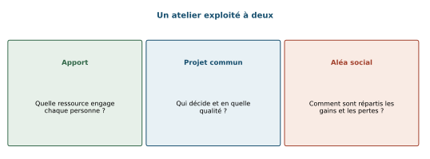
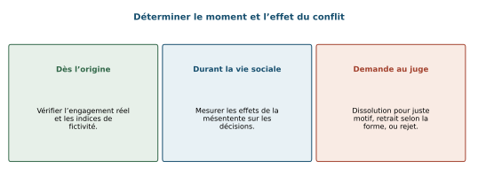

# ENS de Cachan D1 — Droit commercial 2013 · Corrigé guidé

*Corrigé rédigé par IA, non officiel. Signalez toute erreur.*

**Lecture du rapport du jury** · GPT-6.2 Astra Ultra · vitesse non renseignée

**Rédaction** · GPT-6.2 Astra Ultra · vitesse non renseignée

## L’affectio societatis

### Introduction

> [!INDICATION]
> Examiner le même atelier sous trois qualifications. Rechercher le fait que ne suffit à expliquer ni le paiement d’une somme ni la participation à un bénéfice.

Deux personnes exploitent un atelier. L’une a financé l’outillage, l’autre travaille chaque jour, et toutes deux reçoivent de l’argent lorsque l’activité prospère. Elles peuvent être associées, mais aussi prêteur et emprunteur ou employeur et salarié intéressé au résultat. Le partage apparent d’un gain laisse entière la question du rapport qu’elles ont voulu établir. L’affectio societatis désigne la volonté de collaborer à une entreprise commune en qualité d’associé. Hamel soulignait la convergence des intérêts. La chambre commerciale, le 3 juin 1986, a recherché une collaboration effective à l’exploitation dans un intérêt commun et sur un pied d’égalité.

Le Code civil de 2013 ne nomme pas l’affectio dans les conditions de l’article 1832. Il prévoit des apports affectés à une entreprise commune, la recherche d’un bénéfice ou d’une économie à partager et l’engagement de contribuer aux pertes. L’article 1833 ajoute l’intérêt commun des associés. Comment une notion tirée de l’intention peut-elle distinguer la société d’autres groupements et guider le juge, alors que les associés ne participent ni avec la même intensité ni avec les mêmes pouvoirs ? L’affectio prend un contenu précis lorsqu’il faut qualifier un engagement. Ses effets durant la vie sociale dépendent davantage des droits attachés à la qualité d’associé et du fonctionnement concret du groupement.

### I. Une volonté de collaboration qui précise et révèle l’engagement social

#### A. L’affectio caractérise le rôle accepté par les participants

> [!INDICATION]
> Distinguer le consentement, la contribution aux pertes et l’obligation aux dettes. Un créancier peut lui aussi souhaiter une réussite commerciale.

Consentir librement à un contrat ne signifie pas nécessairement vouloir s’associer. Un créancier peut librement prêter et espérer que l’entreprise prospère afin d’être remboursé. L’associé, pour sa part, met un apport à la disposition de l’entreprise, accepte l’aléa attaché aux résultats et entre dans un cadre commun de décision. Cette convergence explique que la jurisprudence évoque une collaboration sur un pied d’égalité. Chaque associé agit à ce titre dans le projet au lieu d’exécuter les ordres d’un autre en qualité de subordonné. Il peut exister une nette inégalité de capital, de droits financiers ou d’expérience entre eux. Le critère porte sur la nature de leur rapport.

L’affectio ne se confond pas avec chacun des éléments matériels. Un apport peut être une somme, un bien ou, lorsque la forme le permet, une industrie. La contribution aux pertes concerne les rapports entre associés. L’obligation aux dettes envers les tiers suit le régime de la forme sociale et ne pèse pas partout personnellement ou sans limite. Enfin, l’interdiction des clauses léonines de l’article 1844-1 écarte notamment la stipulation attribuant tout le profit à un associé ou l’exonérant de la totalité des pertes. Elle permet cependant les répartitions inégales. L’indice subjectif donne sens à ces engagements sans se substituer à leurs conditions légales.

#### B. La preuve par les conduites permet de départager les qualifications

> [!INDICATION]
> Pour chaque indice, imaginer une autre explication compatible avec les faits. Identifier ensuite l’indice qui tranche le plus nettement entre les deux qualifications.

Si l’atelier n’a fait l’objet d’aucun contrat de société écrit, celui qui invoque entre les intéressés une société créée de fait doit établir les éléments du contrat. La mise à disposition gratuite d’un local peut être un apport ou un simple service. Il faut rechercher, indépendamment, la volonté de collaborer aux décisions d’une entreprise commune et celle de participer aux bénéfices ou économies et aux pertes. Des décisions conjointes sur les achats, la tenue de comptes communs et une prise en charge convenue des déficits peuvent soutenir la qualification. Un lien familial, une cohabitation ou un travail partagé ne la démontrent pas à eux seuls. L’article 1873 soumet la société créée de fait au régime de la société en participation.

Si celui qui a fourni la machine reçoit une rémunération indexée sur le chiffre d’affaires mais a droit au remboursement convenu du principal et ne participe pas au projet comme associé, le prêt demeure une explication plausible. Un salarié peut recevoir une prime sur les bénéfices tout en restant soumis au pouvoir de direction, de contrôle et de sanction de l’employeur. Une personne peut d’ailleurs être à la fois associée et salariée si les conditions d’un véritable emploi distinct sont réunies. L’analyse porte alors séparément sur les rapports au titre desquels elle intervient. L’affectio se prouve par les actes et leur cohérence, au lieu de se déduire du nom que les parties donnent à un versement.

### II. Une notion dont la portée varie selon l’organisation et le devenir du groupement

#### A. La volonté commune change d’intensité selon la forme sociale

> [!INDICATION]
> Appliquer la même définition à une EURL, à un investisseur en bourse et à une association. Repérer ce que chaque contre-exemple oblige à préciser.

Dans une petite société de personnes, le choix des partenaires et le travail commun expliquent souvent la décision de s’associer. Une société cotée peut réunir des milliers d’actionnaires qui ne se connaissent pas. L’investisseur qui achète en bourse accepte le risque attaché à son titre et le régime collectif de la société sans promettre de participer quotidiennement à la direction. Les actions de préférence peuvent même attribuer des droits différents. Exiger de lui l’engagement concret de deux artisans exclurait de nombreux associés incontestables. La critique objective, notamment formulée par Viandier, invite à partir aussi des prérogatives reçues et de la qualité juridique acquise. Définir l’associé par la volonté d’être associé, sans indice extérieur, ferait tourner le raisonnement en cercle.

L’article 1832 permet en outre l’institution d’une société par l’acte de volonté d’une seule personne dans les cas prévus par la loi. L’EURL en fournit un exemple. On ne peut parler de coopération présente entre plusieurs associés. On retrouve toutefois la décision d’affecter un apport à une entreprise organisée sous forme sociale et d’en respecter le fonctionnement distinct. À l’inverse, une association peut manifester une volonté très forte de poursuivre une œuvre commune sans avoir pour objet le partage des bénéfices. Une forte solidarité psychologique est donc tantôt absente d’une société, tantôt présente dans un autre groupement. Il faut toujours revenir au régime juridique et au but poursuivi.

#### B. La disparition de l’entente doit être traduite dans les conditions d’un remède juridique

> [!INDICATION]
> Dater la difficulté. Une simulation d’origine et un blocage ultérieur n’ont ni les mêmes conditions de preuve ni les mêmes conséquences.

L’absence d’intention sociale dès l’origine peut révéler une simulation, par exemple lorsque des prête-noms ont été interposés sans participation réelle et que les actes contredisent les statuts. Il faut qualifier la situation, identifier qui agit et sur quel fondement, puis appliquer les règles propres à la fictivité, à la nullité ou à l’inopposabilité. En 2013, la nullité des sociétés est encadrée, spécialement pour les sociétés commerciales. La seule invocation de l’affectio ne permet pas d’effacer le groupement au détriment de tous les tiers.

Une mésentente apparue après une formation valable soulève une autre difficulté. L’article 1844-7, 5°, autorise la dissolution judiciaire anticipée pour justes motifs à la demande d’un associé, notamment en cas de mésentente paralysant le fonctionnement de la société. Deux associés qui se détestent mais continuent à approuver les comptes et à prendre les décisions nécessaires ne démontrent pas par ce fait une paralysie. Si deux blocs à égalité empêchent durablement les décisions indispensables, le juge peut en revanche en tirer les conséquences. Dans une société civile, le retrait pour justes motifs de l’article 1869 peut offrir une issue propre à l’associé sous ses conditions. L’issue dépend de l’atteinte prouvée et du remède demandé. Le rapport de session renvoie par deux coquilles à 1383 et 1884-7. Les textes applicables ici sont bien les articles 1833 et 1844-7 du Code civil.

### Conclusion

> [!INDICATION]
> Répondre en distinguant le moment où l’affectio aide à identifier un groupement et celui où la loi fournit le remède à sa crise.

L’affectio societatis est particulièrement opérant lorsque le rôle des participants est incertain. Le juge lui donne prise sur les faits en examinant l’apport, la convergence des décisions et l’acceptation d’un aléa commun. Une fois la société constituée, la diversité des titres et des formes invite à plus de mesure. La perte de confiance éclaire un conflit, mais la dissolution requiert la justification prévue par le droit positif. Dans l’atelier initial, l’enjeu est donc de savoir à quel titre chacun a fourni ses moyens, pris part aux décisions et accepté leurs conséquences.

[Sujet de la session](https://www.ens-rennes.fr/medias/fichier/se1a-13d1-option_1421750188201-pdf#page=2) · [Rapport du jury](https://www.ens-rennes.fr/medias/fichier/re1a_d1_13dtcom_1373363109900.pdf) · [Code civil en avril 2013](https://www.legifrance.gouv.fr/codes/texte_lc/LEGITEXT000006070721/2013-04-01/) · [Code de commerce en avril 2013](https://www.legifrance.gouv.fr/codes/texte_lc/LEGITEXT000005634379/2013-04-01/)
