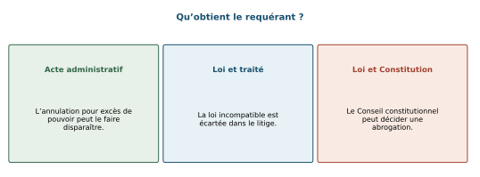

# ENS de Cachan D1 — Droit public 2013 · Corrigé brut

*Corrigé rédigé par IA, non officiel. Signalez toute erreur.*

**Rédaction** · GPT-6.2 Astra Ultra · vitesse non renseignée

## Le juge administratif et la constitution

### Introduction

Un décret retire à certains usagers une garantie. L’un d’eux invoque devant le tribunal administratif le principe constitutionnel d’égalité. Le moyen change de portée selon que le décret procède d’un choix propre du pouvoir réglementaire ou applique exactement une règle législative. Pourtant, dans les deux cas, la Constitution demeure au sommet de l’ordre juridique interne. L’écart entre hiérarchie des normes et répartition des compétences juridictionnelles donne son unité au sujet.

Le juge administratif tranche les litiges qui relèvent de son ordre. Il tient de la Constitution l’autorité et les garanties d’une partie de ses attributions. En retour, il interprète et met en œuvre le texte de 1958, son Préambule et les normes auxquelles celui-ci renvoie. La question est de savoir comment il assure la prééminence constitutionnelle alors que le contrôle de constitutionnalité de la loi appartient au Conseil constitutionnel. Il est à la fois bénéficiaire et garant de cette prééminence. Son office s’exerce cependant dans un système de contrôles répartis, profondément renouvelé en 2010 par la question prioritaire de constitutionnalité.

### I. Une juridiction constitutionnellement garantie qui applique la Constitution à l’administration

#### A. La Constitution protège une juridiction distincte et oriente son office

L’existence d’un ordre administratif procède d’une construction historique. La séparation des autorités administrative et judiciaire posée à la Révolution ne suffisait pas, à elle seule, à définir toute la garantie constitutionnelle contemporaine. Le Conseil constitutionnel reconnaît, dans sa décision du 22 juillet 1980 sur la validation d’actes administratifs, l’indépendance de la juridiction administrative parmi les principes fondamentaux reconnus par les lois de la République. Le législateur ne peut donner d’injonction au juge dans un litige ni se substituer à lui pour le trancher. L’autorité de ses décisions participe ainsi à l’effectivité de la protection juridictionnelle.

La décision Conseil de la concurrence du 23 janvier 1987 précise le domaine constitutionnellement protégé. Sous réserve des matières réservées par nature à l’autorité judiciaire, relève en dernier ressort de la juridiction administrative l’annulation ou la réformation des décisions prises dans l’exercice de prérogatives de puissance publique par les autorités administratives énumérées par la décision. Ce noyau n’embrasse pas tout litige auquel l’administration est partie. Le législateur peut, pour une bonne administration de la justice et sous conditions, unifier certains contentieux dans l’ordre principalement intéressé. La décision illustre la double qualité du juge administratif, dont la compétence est protégée sans être illimitée. La fonction consultative du Conseil d’État, notamment sur les projets de loi suivant l’article 39, doit être distinguée de son rôle lorsqu’il statue au contentieux.

#### B. Le bloc de constitutionnalité fournit des normes de contrôle effectif

Un requérant peut faire valoir les règles constitutionnelles de compétence et de procédure autant que les garanties de fond. La répartition des matières entre loi et règlement aux articles 34 et 37, les règles concernant l’auteur d’un acte ou son contreseing déterminent la légalité de décisions administratives. Dans Société Eky, en 1960, le Conseil d’État examine aussi le grief tiré de l’article 8 de la Déclaration de 1789 contre une disposition réglementaire. La référence au Préambule peut donc déboucher sur un contrôle contentieux du pouvoir réglementaire. La seule invocation d’un grand principe ne suffit toutefois pas. Il faut vérifier le champ et la précision de la disposition et expliquer en quoi le choix de l’administration la méconnaît.

Dans Commune d’Annecy, le 3 octobre 2008, le Conseil d’État affirme la valeur constitutionnelle des droits et devoirs définis dans la Charte de l’environnement. Son article 7 confie au législateur le soin de fixer les conditions et limites de l’information et de la participation du public. Le décret en cause est annulé parce que ses dispositions relevaient du domaine ainsi réservé à la loi. La Constitution commande ici à la fois un droit matériel et l’identité de l’autorité apte à l’encadrer. Le juge rend la garantie effective en annulant l’acte administratif qui a franchi la limite de compétence.

### II. Le juge garantit la suprématie constitutionnelle dans un système de contrôles répartis

#### A. La loi-écran limite le contrôle direct, tandis que la QPC organise un renvoi

Depuis l’arrêt Arrighi de 1936, le juge administratif refuse de contrôler lui-même la constitutionnalité d’une loi à l’occasion d’un recours contre un acte qui en tire son contenu. Si annuler le décret pour violation de la Constitution supposait de condamner le choix imposé par la loi, celle-ci fait écran. À l’inverse, lorsque le législateur s’est borné à habiliter le règlement sans déterminer la règle de fond contestée, le grief peut atteindre directement le choix propre du règlement. C’est la logique de l’écran transparent illustrée par l’arrêt Quintin de 1991. Le critère est l’origine de la règle qui fait grief.

Depuis le 1er mars 2010, l’article 61-1 ouvre une voie particulière. À l’occasion d’un litige, une partie peut soutenir, dans un écrit distinct et motivé, qu’une disposition législative porte atteinte aux droits et libertés que la Constitution garantit. Au premier filtre, le juge recherche notamment si la disposition est applicable, si elle a déjà été déclarée conforme dans les motifs et le dispositif, sous réserve d’un changement des circonstances, et si la question n’est pas dépourvue de caractère sérieux. Le Conseil d’État, saisi par transmission ou directement à l’occasion d’un litige dont il connaît, renvoie au Conseil constitutionnel si les conditions sont réunies, la question devant notamment être nouvelle ou sérieuse. C’est au Conseil constitutionnel qu’appartient la décision de conformité ou d’abrogation, avec les effets déterminés selon l’article 62. Le juge du litige en tire ensuite les conséquences. Il préserve ainsi les compétences respectives tout en permettant d’atteindre la loi qui formait écran.

#### B. Le dialogue avec les normes internationales et européennes affine la protection

Avec Nicolo en 1989, le Conseil d’État accepte d’écarter, dans le litige, une loi même postérieure incompatible avec un traité dans les conditions de l’article 55. Ce contrôle de conventionnalité ne lui confère aucun pouvoir d’abrogation de la loi et ne se confond pas avec la QPC. Une liberté peut être protégée par plusieurs textes, mais le moyen invoqué, la norme de référence et les effets du jugement diffèrent. Dans Sarran, Levacher et autres en 1998, le Conseil d’État précise que la supériorité des engagements internationaux sur les lois ne s’étend pas, dans l’ordre interne, aux dispositions de nature constitutionnelle. La proposition concerne l’ordre interne et ne résout pas à elle seule les conséquences d’un manquement sur le plan international.

La transposition du droit de l’Union appelle une méthode plus fine. Dans Arcelor en 2007, un décret transposant des dispositions précises et inconditionnelles d’une directive est confronté à un principe constitutionnel. Pour un grief de fond, le Conseil d’État recherche si le droit de l’Union protège un principe équivalent. Si oui, il examine la directive à la lumière de ce principe européen, en saisissant la Cour de justice d’une difficulté sérieuse d’appréciation de validité. À défaut de protection équivalente, il contrôle directement la constitutionnalité de l’acte réglementaire. Ce raisonnement concilie l’exigence constitutionnelle de transposition tirée de l’article 88-1 et la garantie des principes constitutionnels, en faisant varier la voie de contrôle selon le grief.

### Conclusion

La Constitution consacre le juge administratif et lui fournit des moyens de contrôler l’administration. Il en défend la primauté par l’annulation directe, l’interprétation, le filtrage ou le renvoi, selon la norme en cause. Pour l’usager du début, la première question demeure donc celle de l’auteur de la différence de traitement. Si le décret en décide, le juge en contrôle directement la légalité. Si la loi l’impose, la QPC peut ouvrir l’examen de la disposition par le Conseil constitutionnel, puis permettre le règlement du litige individuel.

[Sujet de la session](https://www.ens-rennes.fr/medias/fichier/se1a-13d1-option_1421750188201-pdf#page=2) · [Constitution en avril 2013](https://www.legifrance.gouv.fr/loda/id/JORFTEXT000000571356/2013-04-01/) · [CE, Nicolo, 20 octobre 1989](https://www.conseil-etat.fr/fr/arianeweb/CE/decision/1989-10-20/108243) · [CE, Sarran, Levacher et autres, 30 octobre 1998](https://www.conseil-etat.fr/fr/arianeweb/CE/decision/1998-10-30/200286) · [CE, Arcelor Atlantique et Lorraine, 8 février 2007](https://www.conseil-etat.fr/fr/arianeweb/CE/decision/2007-02-08/287110) · [CE, Commune d’Annecy, 3 octobre 2008](https://www.conseil-etat.fr/fr/arianeweb/CE/decision/2008-10-03/297931)
