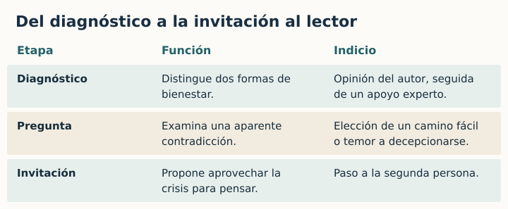

# ENS Rennes · D1 · Espagnol 2013 — Corrigé guidé

*Corrigé rédigé par IA, non officiel. Signalez toute erreur.*

**Rédaction** · GPT-6.2 Astra Ultra · vitesse non renseignée

Le feuillet de l’École normale supérieure de Cachan est conservé dans les archives du concours D1 de Rennes. D’après El País · 28 décembre 2012.

## Version française du deuxième paragraphe

À mon sens, l’erreur, et le nœud du problème, consiste précisément à confondre ce bien-être matériel avec ce qui importe vraiment, le bien-être psychologique. Selon les spécialistes du bien-être psychologique, celui-ci dépend de facteurs qui n’ont guère à voir avec les biens matériels. Ce serait même plutôt le contraire, car le bonheur semble tenir à des choses bien plus personnelles, comme avoir une bonne estime de soi, rester fidèle à ses propres principes ou se fixer différents objectifs qui entretiennent notre motivation au jour le jour. Dès lors, si de plus en plus d’éléments tendent à montrer que notre bien-être dépend moins de facteurs matériels que d’aspects psychologiques comme ceux qui viennent d’être évoqués, pourquoi les gens continuent-ils donc à donner la priorité à ce bien-être matériel ? Peut-être parce que, pour beaucoup, il est plus simple de prendre le chemin le plus court, même s’il ne mène nulle part. Une autre explication serait la crainte de découvrir qui nous sommes vraiment. Devant le risque d’être déçus en cherchant le bien-être en nous-mêmes, beaucoup tenteront de détourner leur attention de cette inquiétude en se concentrant sur un bien-être matériel éphémère. Heureusement, l’un des rares avantages à traverser une période de crise comme celle-ci est qu’elle nous donne une très belle occasion de réfléchir à ce qui compte réellement. Je vous encourage donc à la saisir.

## Expression en espagnol

Apprécier la manière dont l’auteur pose le débat entre bien-être matériel et psychologique · environ 100 mots.

El autor acierta al cuestionar la idea de que comprar más nos hace automáticamente más felices. La pregunta que dirige al lector le permite examinar sus propias prioridades y pensar en objetivos que no se adquieren en una tienda. Sin embargo, la oposición entre ambos tipos de bienestar resulta demasiado tajante cuando faltan recursos básicos. Un alojamiento estable, por ejemplo, reduce una preocupación material y favorece al mismo tiempo la tranquilidad psicológica. Además, una crisis que invita a reflexionar a algunas personas puede dejar a otras sin margen para elegir. Distinguir consumo y seguridad material haría más convincente el argumento.

*100 mots, comptés par espaces.*

## Comment construire la réponse

La version commence par *Desde mi punto de vista*. Le premier paragraphe et le titre servent à préparer la question de la consommation en période de fêtes. Le rapport confirme expressément que seul le deuxième paragraphe est à traduire. Gardez la nuance de *parece*, *quizás* et *otra posible explicación*. Ce sont des hypothèses du locuteur. *No depende tanto de… como de…* établit une comparaison de degré. Le « vous » de la dernière phrase restitue le passage à l’exhortation directe.

Dans l’expression, il faut juger la manière dont l’auteur conduit le débat. Nommez un procédé précis, la question qui prend le lecteur à témoin, puis testez sa distinction sur un exemple limite. Un logement stable permet de montrer en quoi la sécurité matérielle peut favoriser une disposition psychologique. Le rapport invite à construire une réflexion personnelle appuyée sur le texte.

[Feuillet original, p. 4](https://www.ens-rennes.fr/medias/fichier/se1a-13d1-lv_1421750182683-pdf#page=4) · [Rapport du jury, partie écrite](https://www.ens-rennes.fr/medias/fichier/re1a_13d1_espagnol_1378822456315.pdf#page=1)
