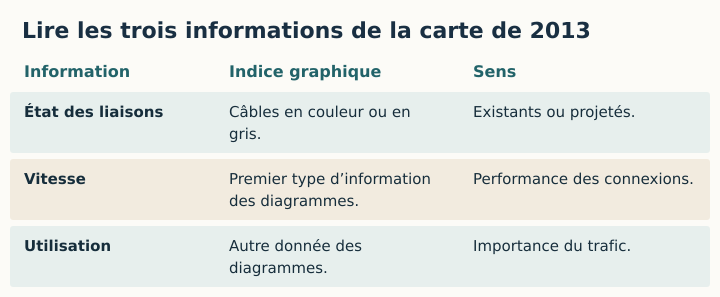

# ENS Rennes · D1 · Italien 2013 — Corrigé guidé

*Corrigé rédigé par IA, non officiel. Signalez toute erreur.*

**Rédaction** · GPT-6.2 Astra Ultra · vitesse non renseignée

Le feuillet de l’École normale supérieure de Cachan est conservé dans les archives du concours D1 de Rennes. Elmar Burchia · Corriere della Sera · 4 février 2013.

## Version française

**Voyage dans les profondeurs du Net**

Une mer de câbles. Une carte interactive sur le Web montre comment les continents sont de plus en plus reliés entre eux par des câbles sous-marins, où passent les flux de données les plus importants et quels pays sont les mieux connectés les uns aux autres. Voyage dans les profondeurs d’Internet.

C’est un enchevêtrement de lignes qui traverse le Pacifique, tandis que dans l’Atlantique les lignes se déploient en bon ordre, les unes à côté des autres. Dans la Méditerranée, en revanche, on remarque un écheveau très dense. La toute nouvelle carte, *Submarine Cable Map*, met en évidence les continents et les différents États reliés entre eux par les câbles sous-marins. Il faut préciser que, de concert avec les câbles terrestres, les câbles installés dans les océans contribuent au bon fonctionnement de l’infrastructure d’Internet. La rupture d’un câble sous-marin entraînerait de graves problèmes de communication entre les pays concernés, comme cela s’est déjà produit à plusieurs reprises au cours des années précédentes.

Que montre la carte ? Elle rappelle par certains côtés les anciennes cartes dessinées à la main. On y voit 244 câbles sous-marins qui ont été posés entre 1992 et 2012 ou qui entreront en service d’ici à 2014. Les câbles existants apparaissent en couleur, les câbles en projet en gris. D’après la carte, douze câbles seront posés dans les océans au cours des deux prochaines années, par exemple entre la Grèce et la Libye, entre les îles Fidji et Tonga, ou encore à travers l’Atlantique Sud. Un réseau immergé de plusieurs dizaines de milliers de kilomètres, par lequel transite la majeure partie des données. Pourtant, le renseignement le plus curieux se trouve peut-être tout en bas. Deux graphiques permettent d’y relever la vitesse des connexions entre les différents pays et continents ainsi que leur degré d’utilisation. Les États-Unis, par exemple, disposent de connexions rapides avec la Colombie et le Venezuela. Elles le sont un peu moins avec la France et le Royaume-Uni et sont quasiment nulles avec l’Afrique du Sud et l’Inde. La plus grande partie des données est acheminée par l’Atlantique Nord ainsi qu’entre les Amériques du Nord et du Sud.

## Expression en italien

Présenter son rapport personnel aux nouvelles technologies de l’information et de la communication · 100 mots.

Uso le nuove tecnologie soprattutto per imparare e per mantenere i contatti con persone che abitano lontano. Una videochiamata mi permette di discutere un progetto con un amico senza aspettare il prossimo incontro. Quando cerco informazioni, però, preferisco aprire la fonte originale e controllare chi ha pubblicato un dato. La velocità della risposta può nascondere un errore che si ripete su molti siti. Mi piace anche poter spegnere il telefono durante una conversazione. Per me la tecnologia è davvero più utile quando scelgo io il momento e lo strumento, tenendo conto sia della comodità sia dei limiti di ciascun mezzo.

*100 mots, comptés par espaces.*

## Comment construire la réponse

Le titre et le chapeau prolongent une métaphore maritime, mais les supports de données décrits sont des câbles physiques. *Fitta matassa* signifie « écheveau très dense » et *si snodano* donne l’image de lignes qui se déploient. Gardez le conditionnel *porterebbe*, qui évoque une rupture possible. Les câbles déjà posés sont distingués de ceux dont la mise en service est annoncée d’ici 2014. Le futur est celui du journaliste en février 2013.

Les deux dernières données lues dans les diagrammes ne se confondent pas. L’une concerne la vitesse d’une connexion, l’autre son degré d’utilisation. *In fondo* renvoie au bas de la présentation. Pour la question d’expression personnelle, montrez comment un outil permet d’accomplir une action précise, puis exposez un critère de choix, par exemple la possibilité de vérifier la source ou de conserver son attention pendant une conversation.

[Feuillet original, p. 5](https://www.ens-rennes.fr/medias/fichier/se1a-13d1-lv_1421750182683-pdf#page=5)
