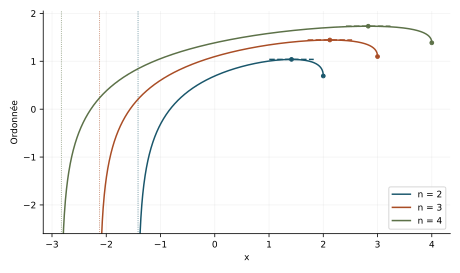
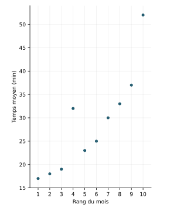
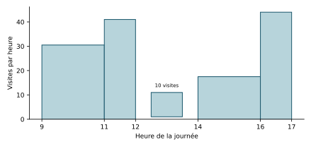
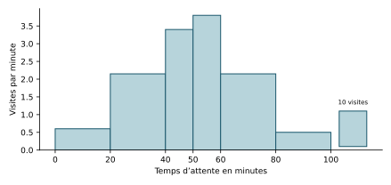

# ENS de Cachan D1 — Mathématiques appliquées et statistiques 2013 · Corrigé guidé

*Corrigé rédigé par IA, non officiel. Signalez toute erreur.*

**Rédaction** · GPT-6.2 Astra Ultra · vitesse non renseignée

**Révision** · GPT-6.2 Astra Ultra · vitesse non renseignée

Les trois exercices étudient une famille de logarithmes, les attentes aux guichets et des tirages dans trois urnes. Les effectifs sont distingués des densités horaires et le choix unique de l’urne est comparé à son renouvellement.

## Exercice 1. Fonctions auxiliaires et courbes logarithmiques

### Question 1.I.1

> [!INDICATION]
> Factoriser en deux termes du premier degré.

#### Solution

Pour $n\ge1$, $n^2-x^2=(n-x)(n+x)$ est positif pour $-n<x<n$, nul en $-n,n$, et négatif à l’extérieur de $[-n,n]$.

### Question 1.I.2

> [!INDICATION]
> Imposer la condition de définition de la racine carrée.

#### Solution

Le radical exige $n^2-x^2\ge0$, donc $E_n=[-n,n]$. L’addition de $x$ est définie en tout réel.

### Question 1.I.3

> [!INDICATION]
> Dériver la racine à l’intérieur de son domaine.

#### Solution

Pour $-n<x<n$, le polynôme sous la racine est dérivable et strictement positif. La règle de la composée donne $g_n'(x)=1-x/\sqrt{n^2-x^2}$.

### Question 1.I.4.a

> [!INDICATION]
> Dériver le produit de x par la puissance −1/2.

#### Solution

Pour $|x|<n$, $h_n'(x)=-(n^2-x^2)^{-1/2}-x^2(n^2-x^2)^{-3/2}=-n^2/(n^2-x^2)^{3/2}<0$.

### Question 1.I.4.b

> [!INDICATION]
> Appliquer le signe de la dérivée sur un intervalle.

#### Solution

Ainsi $h_n$ est strictement décroissante sur $]-n,n[$. Ses limites aux deux extrémités sont respectivement $+\infty$ et $-\infty$.

### Question 1.I.4.c

> [!INDICATION]
> Évaluer la racine en l’abscisse indiquée.

#### Solution

En $x=n/\sqrt2$, la racine vaut $n/\sqrt2$, donc $h_n=0$. Par décroissance stricte, $h_n>0$ à gauche de ce point et $h_n<0$ à droite, dans $]-n,n[$.

### Question 1.I.5

> [!INDICATION]
> Relier la fonction auxiliaire à la première dérivée.

#### Solution

Puisque $g'_n=h_n$, la dérivée est positive, nulle, puis négative aux endroits précédents. La continuité jusqu’aux bornes donne les variations suivantes.

| Abscisse | $-n$ | $n/\sqrt2$ | $n$ |
|---|---:|---:|---:|
| Valeur de $g_n$ | $-n$ | $n\sqrt2$ | $n$ |
| Trajet | départ | fin de la croissance | fin de la décroissance |

### Question 1.I.6

> [!INDICATION]
> Lire le sommet entre les deux intervalles de monotonie.

#### Solution

Le maximum est $n\sqrt2$, atteint uniquement en $n/\sqrt2$.

### Question 1.I.7

> [!INDICATION]
> Sur quel intervalle la fonction peut-elle franchir zéro ?

#### Solution

On a $g_n(-n/\sqrt2)=n/\sqrt2-n/\sqrt2=0$. La branche croissante passe donc du signe négatif au signe positif à cette abscisse. La branche décroissante reste au moins égale à $n>0$. Ainsi le signe est négatif sur $[-n,-n/\sqrt2[$, nul au point indiqué et positif sur $]-n/\sqrt2,n]$.

### Question 1.II.1

> [!INDICATION]
> Imposer la stricte positivité de l’argument du logarithme.

#### Solution

Le domaine de $f_n=\ln g_n$ est la partie de $E_n$ où $g_n>0$, soit $D_n=]-n/\sqrt2,n]$.

### Question 1.II.2

> [!INDICATION]
> Écrire la dérivée logarithmique et multiplier haut et bas par la même somme.

#### Solution

Posons $s=\sqrt{n^2-x^2}$. Sur $]-n/\sqrt2,n[$, la dérivée vaut $f'_n=g'_n/g_n=(s-x)/(s(s+x))$. En multipliant par $(s+x)/(s+x)$, on trouve
$$f_n'(x)=\frac{n^2-2x^2}{\sqrt{n^2-x^2}\,(\sqrt{n^2-x^2}+x)^2}.$$
Au point $n$ inclus dans $D_n$, cette formule n’est pas définie. Pour $t\downarrow0$, $f_n(n-t)-\ln n\sim\sqrt{2t/n}$, donc le quotient par $-t$ tend vers $-\infty$. La courbe a une demi-tangente verticale en $n$.

### Question 1.II.3

> [!INDICATION]
> Composer le tableau précédent avec le logarithme croissant.

#### Solution

Lorsque $x$ va de $-n/\sqrt2$ à $n/\sqrt2$, $f_n$ croît strictement de sa limite $-\infty$ à $\ln(n\sqrt2)$. Elle décroît ensuite strictement jusqu’à $f_n(n)=\ln n$.

| Abscisse | $(-n/\sqrt 2)^+$ | $n/\sqrt 2$ | $n$ |
|---|:---:|:---:|:---:|
| $f_n(x)$ | $-\infty$ (limite) | $\ln(n\sqrt2)$ | $\ln n$ |
| Variation jusqu’à la colonne suivante | croît | décroît | |

La limite au bord gauche se lit avec $n$ fixé et $x$ tendant vers $-n/\sqrt2$ par valeurs supérieures. En effet, $g_n(x)$ tend alors vers zéro en restant positif.

### Question 1.II.4

> [!INDICATION]
> Identifier le point où la dérivée change de signe.

#### Solution

L’unique maximum sur $D_n$ est $\ln(n\sqrt2)$, en $x=n/\sqrt2$.

### Question 1.II.5

> [!INDICATION]
> Comparer les radicaux sur la partie commune des domaines.

#### Solution

On a $D_n\subset D_{n+1}$. Pour tout $x\in D_n$, $(n+1)^2-x^2>n^2-x^2\ge0$. L’addition de $x$ conserve l’inégalité stricte, puis le logarithme croissant donne $f_{n+1}(x)>f_n(x)$.

### Question 1.II.6

> [!INDICATION]
> Placer pour chaque courbe les deux extrémités et le sommet avant le tracé.

#### Solution

Pour $n=2,3,4$, tracer l’asymptote $x=-n/\sqrt2$, le point extrême droit $(n,\ln n)$ et le sommet $(n/\sqrt2,\ln(n\sqrt2))$. Les trois tangentes horizontales ont pour équations $y=\ln(2\sqrt2)$, $y=\ln(3\sqrt2)$ et $y=\ln(4\sqrt2)$.

## Exercice 2. Fréquentation et attente aux guichets

### Question 2.1.a

> [!INDICATION]
> Associer chaque moyenne au rang correspondant et conserver les échelles demandées.

#### Solution

Pour les mois 1 à 10, les ordonnées en minutes sont 17, 18, 19, 32, 23, 25, 30, 33, 37 et 52. Sur papier, prendre 1 cm par mois et 2 cm pour 5 minutes.

### Question 2.1.b

> [!INDICATION]
> Diviser par le nombre de mois pour la variance descriptive.

#### Solution

La moyenne est $286/10=28{,}60$ min. La variance est $\sum y_i^2/10-\bar y^2=103{,}44$ min².

### Question 2.1.c

> [!INDICATION]
> Normaliser la covariance par les deux écarts-types.

#### Solution

Avec $\bar x=5{,}50$, $V_x=8{,}25$ et $C_{xy}=25{,}70$, on trouve $r=25{,}70/\sqrt{8{,}25\times103{,}44}\simeq0{,}88$. Une droite décrit la tendance croissante, mais les écarts des mois 4 et 10 et l’accélération finale limitent sa précision.

### Question 2.1.d

> [!INDICATION]
> Soustraire quinze à chaque durée avant de prendre le logarithme.

#### Solution

Par exemple $z_4=10\ln17\simeq28{,}33$. Les dix valeurs sont données au centième.

| Mois | 1 | 2 | 3 | 4 | 5 |
|---|---:|---:|---:|---:|---:|
| $z_i$ | 6,93 | 10,99 | 13,86 | 28,33 | 20,79 |
| Mois | 6 | 7 | 8 | 9 | 10 |
| $z_i$ | 23,03 | 27,08 | 28,90 | 30,91 | 36,11 |

### Question 2.1.e

> [!INDICATION]
> Recalculer les moments à partir des valeurs non arrondies.

#### Solution

On obtient $\bar z\simeq22{,}69$, $V_z\simeq80{,}43$, $C_{xz}\simeq23{,}79$. Le rapport $C_{xz}/\sqrt{V_xV_z}\simeq0{,}92$ correspond à une association linéaire positive plus marquée. L’ajustement affine de $z$ en $x$ est raisonnable.

### Question 2.1.f

> [!INDICATION]
> Identifier la pente et utiliser le passage au point moyen.

#### Solution

La pente vaut $a=C_{xz}/V_x\simeq2{,}883333$ et l’ordonnée à l’origine $b=\bar z-a\bar x\simeq6{,}835347$. La droite ajustée est $z\simeq2{,}88x+6{,}84$.

### Question 2.1.g

> [!INDICATION]
> Inverser le changement de variable.

#### Solution

Le modèle donne $\widehat y(x)=15+\exp((ax+b)/10)$ minutes.

### Question 2.1.h

> [!INDICATION]
> Employer les coefficients non arrondis au rang douze.

#### Solution

On prévoit $\widehat y(12)\simeq78{,}03$ minutes. Le rang 12 se situe au-delà des dix mois observés.

### Question 2.2

> [!INDICATION]
> Distinguer le jour associé à une visite et le nombre de visites mesuré par jour.

#### Solution

Sur 918 visites, les fréquences du lundi au vendredi valent respectivement 20,26 %, 20,04 %, 21,24 %, 18,74 % et 19,72 %. Pour le caractère qualitatif « jour de visite », le mode est mercredi avec 195 visites. Si l’unité observée est la journée, la variable numérique est son effectif. La moyenne est alors $918/5=183{,}60$, la médiane 184, l’écart-type descriptif $\sqrt{55{,}44}\simeq7{,}45$ et l’étendue $195-172=23$ visites.

### Question 2.3.a

> [!INDICATION]
> Choisir l’unité statistique et son caractère.

#### Solution

L’unité est une visite. Son heure d’arrivée est quantitative continue, regroupée en quatre classes d’amplitudes inégales.

### Question 2.3.b

> [!INDICATION]
> Diviser chaque effectif par la largeur du créneau.

#### Solution

Les hauteurs des rectangles sont $61/2=30{,}50$, $41$, $35/2=17{,}50$ et $44$ visites par heure. Le créneau entre midi et 14 heures est vide. Un rectangle de largeur 1 heure et hauteur 10 représente dix visites.

### Question 2.3.c

> [!INDICATION]
> Employer les centres pour les moments et les densités pour le mode.

#### Solution

Sur $181$ visites, la classe modale est $[16,17[$, où la densité est maximale. Le plus grand effectif brut est $61$ sur deux heures. En remplaçant les observations par les centres $10$, $11{,}5$, $15$, $16{,}5$, la moyenne estimée est $12{,}89$ heures (environ 12 h 53), la variance $7{,}28$ h² et l’écart-type $2{,}70$ h. Les effectifs cumulés sont $61,102,137,181$. Sous l’hypothèse d’une répartition uniforme dans chaque classe, le premier quartile vaut $9+45{,}25/30{,}5\simeq10{,}48$ h, la médiane $11+(90{,}5-61)/41\simeq11{,}72$ h et le troisième quartile $14+(135{,}75-102)/17{,}5\simeq15{,}93$ h.

### Question 2.4.a

> [!INDICATION]
> Recompter les effectifs du tableau des durées.

#### Solution

Ce tableau totalise 180 durées, contre 181 arrivées dans le tableau précédent. Avec les centres $10,30,45,55,70,90$ et les effectifs indiqués, $m=\sum n_ic_i/180\simeq49{,}67$ min. Puis $\sigma^2=\sum n_i c_i^2/180-m^2\simeq396{,}56$ min², d’où $\sigma\simeq19{,}91$ min.

### Question 2.4.b

> [!INDICATION]
> Calculer les hauteurs par minute pour les classes de dix et vingt minutes.

#### Solution

Les hauteurs en visites par minute sont $0{,}60$, $2{,}15$, $3{,}40$, $3{,}80$, $2{,}15$ et $0{,}50$. La classe modale est $[50,60[$.

### Question 2.4.c.i

> [!INDICATION]
> Centrer et réduire le seuil avant de passer au complément.

#### Solution

Si $T\sim\mathcal N(m,\sigma^2)$ et $\Phi$ désigne la fonction de répartition normale centrée réduite, $P(T>30)=1-\Phi((30-m)/\sigma)\simeq0{,}84$.

Avec $m\simeq49{,}67$ et $\sigma\simeq19{,}91$, le seuil centré réduit est proche de $-0{,}988$. L’estimation de $P(T>30)$ correspond à la case proche de $0{,}99$ par symétrie. Le seuil de 30 minutes coupe la classe $[20,40[$ : le tableau seul ne fournit donc pas le nombre exact de durées supérieures à 30.

### Question 2.4.c.ii

> [!INDICATION]
> Soustraire les deux probabilités cumulées du modèle.

#### Solution

$P(60\le T\le100)=\Phi((100-m)/\sigma)-\Phi((60-m)/\sigma)\simeq0{,}29617$. Le pourcentage prévu est de $29{,}62\,\%$. La fréquence observée dans les classes correspondantes vaut $53/180\simeq29{,}44\,\%$.

## Exercice 3. Tirages et choix d’urne

### Question 3.I.1

> [!INDICATION]
> Dénombrer les triples non ordonnés de même couleur.

#### Solution

Les $\binom73=35$ triples de boules distinctes ont la même probabilité. Il existe $\binom33+\binom43=5$ triples unicolores. Leur probabilité vaut $1/7$.

### Question 3.I.2

> [!INDICATION]
> Passer au complément.

#### Solution

Deux couleurs sont disponibles. Les tirages bicolores sont exactement les tirages autres qu’unicolores, de probabilité $1-1/7=6/7$.

### Question 3.I.3

> [!INDICATION]
> Restreindre le dénominateur aux tirages comportant du blanc.

#### Solution

Il y a $35-\binom43=31$ triples comportant au moins une blanche. Parmi eux $\binom32\binom41=12$ comportent exactement deux blanches. La probabilité conditionnelle est $12/31$.

### Question 3.II.1

> [!INDICATION]
> Compter les blanches au premier tirage.

#### Solution

Dans $U_1$, trois des sept boules sont blanches, donc $P(B_1)=3/7$.

### Question 3.II.2

> [!INDICATION]
> Reconstituer la deuxième urne après une blanche.

#### Solution

Sachant $B_1$, $U_2$ contient une blanche et deux noires. Donc $P(B_2\mid B_1)=1/3$ et $P(B_1\cap B_2)=(3/7)(1/3)=1/7$.

### Question 3.II.3

> [!INDICATION]
> La composition de la troisième urne dépend du premier tirage.

#### Solution

Sachant $B_1$, la troisième urne contient une blanche et une noire. Le tirage dans $U_2$ n’en change pas la composition. Ainsi $P(B_3\mid B_1\cap B_2)=1/2$.

### Question 3.II.4

> [!INDICATION]
> Multiplier les probabilités conditionnelles successives.

#### Solution

La probabilité des trois blanches est $(3/7)(1/3)(1/2)=1/14$.

### Question 3.II.5

> [!INDICATION]
> Partager suivant la première couleur.

#### Solution

Après $N_1$, l’urne $U_3$ contient deux blanches et une noire. La formule des probabilités totales donne $P(B_3)=(3/7)(1/2)+(4/7)(2/3)=25/42$.

### Question 3.III.1

> [!INDICATION]
> Revenir aux compositions initiales et identifier ce qui reste fixé.

#### Solution

L’urne est choisie une seule fois. Une et une seule des trois situations survient : les événements $U_i$ sont deux à deux disjoints et leur réunion est l’univers. Chacun a probabilité $1/3$.

### Question 3.III.2

> [!INDICATION]
> La remise conserve la composition à tout rang.

#### Solution

Pour tout $k\ge1$, $P(B_k\mid U_1)=3/7$, $P(B_k\mid U_2)=1$ et $P(B_k\mid U_3)=0$.

### Question 3.III.3

> [!INDICATION]
> Faire la moyenne des trois probabilités conditionnelles.

#### Solution

La formule des probabilités totales donne $P(B_k)=(3/7+1+0)/3=10/21$.

### Question 3.III.4

> [!INDICATION]
> Conditionner d’abord sur l’urne déterminée.

#### Solution

Une fois $U_1$ fixée, la remise rend les tirages indépendants et la probabilité de blanc reste $3/7$. Pour $A_n=B_1\cap\cdots\cap B_n$, la règle du produit donne $P(A_n\mid U_1)=(3/7)^n$.

### Question 3.III.5

> [!INDICATION]
> Considérer les urnes monochromes.

#### Solution

Pour $n\ge1$, les blanches sont certaines dans $U_2$ et impossibles dans $U_3$, donc $P(A_n\mid U_2)=1$, $P(A_n\mid U_3)=0$.

### Question 3.III.6

> [!INDICATION]
> Appliquer la partition des urnes à la série entièrement blanche.

#### Solution

Pour tout $n\ge1$, $P(A_n)=[(3/7)^n+1]/3$.

### Question 3.III.7

> [!INDICATION]
> Comparer la probabilité conjointe au produit des marginales.

#### Solution

$P(B_1\cap B_2)=[1+9/49]/3=58/147=174/441$. Or $P(B_1)P(B_2)=100/441$. Les deux résultats diffèrent : connaître une première blanche apporte une information sur l’urne commune.

### Question 3.III.8

> [!INDICATION]
> Calculer après une première blanche les probabilités des deux urnes encore possibles. Étendre ce calcul à une série de blanches et utiliser les probabilités conditionnelles dans chaque urne.

#### Solution

Comme $A_k=A_{k-1}\cap B_k$ et $P(A_{k-1})>0$, pour $k\ge2$ on a $P(B_k\mid A_{k-1})=P(A_k)/P(A_{k-1})=[1+(3/7)^k]/[1+(3/7)^{k-1}]$.

On peut vérifier le sens du résultat en actualisant le choix de l’urne. Après $k-1$ blanches, l’urne toute noire est exclue, et la probabilité de l’urne toute blanche vaut $1/[1+(3/7)^{k-1}]$. Les deux probabilités restantes de tirer blanc sont $1$ et $3/7$ selon l’urne. Leur moyenne pondérée redonne le quotient ci-dessus, qui tend vers 1 quand $k$ augmente.

### Question 3.IV.1

> [!INDICATION]
> Cette fois le choix d’urne fait partie de chaque essai.

#### Solution

La probabilité de noir vaut $(4/7+0+1)/3=11/21$, également le complément de $10/21$.

### Question 3.IV.2

> [!INDICATION]
> Vérifier indépendance et identité des essais complets.

#### Solution

L’urne est choisie de nouveau au hasard à chaque répétition et la boule remise. Les $n$ indicatrices de noir sont indépendantes et de même paramètre $p=11/21$. Donc $X_n\sim\mathcal B(n,p)$, avec $P(X_n=j)=\binom njp^j(1-p)^{n-j}$ pour $0\le j\le n$.

### Question 3.IV.3

> [!INDICATION]
> Additionner les espérances et les variances des indicatrices indépendantes.

#### Solution

On obtient $\mathbb E X_n=11n/21$ et $V(X_n)=n(11/21)(10/21)=110n/441$.

### Question 3.IV.4.a

> [!INDICATION]
> Compter séparément les deux couleurs et la mise initiale.

#### Solution

Avec $X_{10}$ noires et $10-X_{10}$ blanches, le gain net algébrique en euros vaut $Y=-5+aX_{10}-2(10-X_{10})=(a+2)X_{10}-25$.

### Question 3.IV.4.b

> [!INDICATION]
> Appliquer la linéarité à la variable affine.

#### Solution

$\mathbb E Y=(a+2)(110/21)-25=(110a-305)/21$ euros.

### Question 3.IV.4.c

> [!INDICATION]
> Résoudre l’inéquation du premier degré.

#### Solution

$\mathbb E Y\ge0$ équivaut à $110a\ge305$, soit $a\ge61/22$ euros. L’égalité correspond à une espérance nulle.
