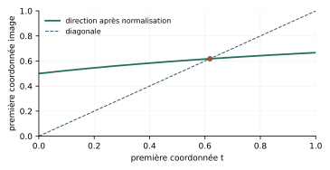
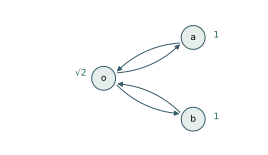
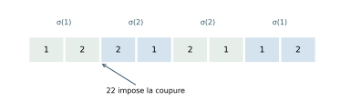
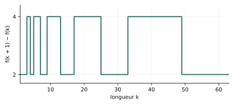

# ENS MP · Informatique-mathématiques 2013 · Corrigé brut

*Corrigé rédigé par IA, non officiel. Signalez toute erreur.*

**Rédaction** · GPT-6.2 Astra Ultra · vitesse non renseignée · 25 novembre 2026

**Quelques exemples de calculs d’entropie de langages.** Tous les logarithmes sont en base 2. Les chemins de longueur zéro sont codés par leur sommet, tandis que les langages de facteurs contiennent le mot vide. Les cinq parties suivent la numérotation du sujet original.

## 1 · Complexité et récurrence

### Question 1.1 · Le graphe complet

Pour $n\ge1$, tout mot de $A^n$ code un chemin et chaque mot est distinct, donc $f_G(n)=r^n$. Avec la convention du préambule, un chemin de longueur zéro se code par le nom d’un sommet. Le mot vide n’est donc pas un codage de chemin et $f_G(0)=0$.

### Question 1.2 · Même degré sortant

On choisit le premier sommet de $r$ façons, puis chacune des $n-1$ arêtes de $k$ façons, puisque le degré sortant est constant. Les arêtes sont des couples de sommets, sans arêtes parallèles. On obtient $f_G(n)=rk^{n-1}$ pour $n\ge1$, avec $f_G(1)=r$ même si $k=0$, et $f_G(0)=0$.

### Question 1.3 · Chemins et puissances matricielles

(a) Pour une arête, le nombre cherché est $M_{ij}$. Si la formule est vraie au rang $k$, la somme sur l’avant-dernier sommet donne $\sum_h(M^k)_{ih}M_{hj}=(M^{k+1})_{ij}$. (b) Chaque mot de longueur $n\ge1$ code exactement un chemin de longueur $n-1$, donc $f_G(n)=\mathbf1^{\mathsf T}M^{n-1}\mathbf1$. Pour $n=1$, $M^0=I$ redonne $r$. (c) Un cycle de longueur $n$ revient au sommet de départ, d’où $\operatorname{tr}(M^n)$. Il s’agit ici de chemins avec origine fixée ; le sujet ne quotient pas par rotation circulaire.

### Question 1.4 · Le graphe de Fibonacci

(a) Le langage est l’ensemble des mots non vides sur $\{1,2\}$ sans facteur $22$. (b) Posons $C_n=f_G(n)$. Pour $n\ge3$, un mot finit soit par $1$, ajouté à un mot admissible de longueur $n-1$, soit par $12$, ajouté à un mot admissible de longueur $n-2$. Donc $C_n=C_{n-1}+C_{n-2}$ avec $C_1=2,C_2=3$. La matrice est $\left(\begin{smallmatrix}1&1\\1&0\end{smallmatrix}\right)$, ses racines propres sont $\lambda=(1+\sqrt5)/2$, $\mu=(1-\sqrt5)/2$. La suite $\bigl(\lambda^{n+2}-\mu^{n+2}\bigr)/\sqrt5$ vérifie la même récurrence et les deux valeurs initiales. (c) Comme $|\mu|<\lambda$, $n^{-1}\log_2 C_n\to\log_2\lambda$.

## 2 · Perron–Frobenius en dimension deux

### Question 2.1 · Connexité forte et irréductibilité

D’après 1.3, $(M^k)_{ij}>0$ équivaut à l’existence d’un chemin de longueur $k$ de $i$ à $j$. Demander une telle puissance pour chaque couple est donc précisément la connexité forte. Si l’on exige une longueur positive même pour $i=j$, un aller-retour par un autre sommet convient dans un graphe fortement connexe d’au moins deux sommets.

### Question 2.2 · Action sur le segment normalisé

(a) Écrivons $M=\left(\begin{smallmatrix}a&b\\c&d\end{smallmatrix}\right)$. Si $b=0$, toutes les puissances sont triangulaires inférieures et leur coefficient $(1,2)$ reste nul. Même argument si $c=0$. Donc $b,c>0$. (b) $Mv_0=(b,d)$ et $Mv_1=(a,c)$ ont chacun une composante transverse non nulle, interdisant un vecteur propre sur les deux axes. (c) Les deux composantes de $Mv_t$ sont positives ou nulles et leur somme est strictement positive. L’unique paramètre demandé est

$$
f(t)=\frac{at+b(1-t)}{(a+c)t+(b+d)(1-t)}.
$$

C’est la première coordonnée du vecteur normalisé ; la deuxième vaut $1-f(t)$.

### Question 2.3 · Direction fixe intérieure

(a) La fonction $f$ est continue, $f(0)>0$ et $f(1)<1$. Le théorème des valeurs intermédiaires appliqué à $f(t)-t$ donne $t_0\in(0,1)$. Puis $Mv_{t_0}=\lambda v_{t_0}$, $\lambda=\|Mv_{t_0}\|_1>0$, avec les deux coordonnées strictement positives. (b) Le discriminant du polynôme caractéristique vaut $(a-d)^2+4bc>0$. Les deux racines sont donc distinctes et $\lambda$ est simple. De plus la relation des coordonnées positives donne $\lambda>a,d$ ; c’est la plus grande racine.

### Question 2.4 · Croissance et unicité positive

(a) Pour $v=v_{t_0}$ normalisé, prenons $c_0=1/\max(v_i)$ et $d_0=1/\min(v_i)$. L’inégalité $c_0v\le\mathbf1\le d_0v$ est préservée par $M^n$. La somme des coordonnées, avec $\mathbf1^{\mathsf T}v=1$, donne les deux bornes demandées. (b) Pour un vecteur propre $x$ associé à $\mu$, $|\mu|^n\|x\|_1=\|M^nx\|_1\le\|M^n\|_1\|x\|_1$. La norme matricielle est majorée par la somme de toutes les entrées, donc $|\mu|^n\le d_0\lambda^n$ et $|\mu|\le\lambda$. (c) Un autre vecteur strictement positif $w$ possède une valeur propre $\nu>0$. Le même encadrement par $w$ impose une croissance proportionnelle à $\nu^n$ pour la même somme. Ainsi $\nu=\lambda$, et la simplicité de cette racine impose la proportionnalité.

### Question 2.5 · Primitive ou seulement irréductible ?

(a) Une seule puissance strictement positive convient à tous les couples : une matrice primitive est irréductible. (b) La matrice $\left(\begin{smallmatrix}0&1\\1&0\end{smallmatrix}\right)$ est irréductible. Ses puissances alternent entre elle-même et l’identité. Aucune n’est strictement positive. Les deux sommets ne reviennent au point de départ qu’en un nombre pair de pas.

### Question 2.6 · Limite des puissances normalisées

(a) Les deux valeurs propres sont réelles distinctes par 2.3. La seule possibilité restante pour $|\mu|=\lambda$ serait $\mu=-\lambda$, ce qui donne $a+d=0$. La matrice serait alors antidiagonale et ses puissances alterneraient entre matrices diagonales et antidiagonales, en contradiction avec la primitivité. Donc $|\mu|<\lambda$. (b) Prenons $v_\lambda>0$ propre à droite et $w>0$ propre à gauche, obtenu en appliquant 2.3 à $M^{\mathsf T}$. Pour tout $x\in H\setminus\{0\}$,

$$
\lambda^{-n}M^nx\ \longrightarrow\
\frac{w^{\mathsf T}x}{w^{\mathsf T}v_\lambda}\,v_\lambda
=\frac{M-\mu I}{\lambda-\mu}\,x .
$$

En effet la composante sur la droite de $\mu$ est multipliée par $(\mu/\lambda)^n$ et s’éteint. Le numérateur $w^{\mathsf T}x$ est strictement positif même si $x$ est sur le bord du quadrant.

## 3 · Entropie de graphe

### Question 3.1 · Lemme sous-additif

(a) La sous-additivité donne $a_{mk+j}\le ma_k+ja_1$ en séparant les $m$ blocs puis les $j$ termes isolés. Puisque les termes sont positifs ou nuls et $j<k$, on a $a_{mk+j}/(mk+j)\le a_k/k+a_1/m$. Pour $j=0$, on omet le dernier terme sans définir $a_0$. (b) Pour tout $k$ fixé, écrire $n=mk+j$ et faire tendre $n$ vers l’infini donne $\limsup a_n/n\le a_k/k$. Soit $I=\inf_{k\ge1}a_k/k$. On a $\liminf a_n/n\ge I$ par définition et $\limsup a_n/n\le I$ d’après la première borne valable pour tout $k$. La limite vaut $I$.

### Question 3.2 · Existence de l’entropie d’un graphe

(a) La connexité forte permet de prolonger un chemin indéfiniment, donc $f_G(n)\ge1$. À un mot de longueur $m+n$ associons son préfixe de longueur $m$ et son suffixe de longueur $n$. Tous deux appartiennent au langage et leur couple détermine le mot. Ainsi $f_G(m+n)\le f_G(m)f_G(n)$ ; le lemme 3.1 s’applique à $a_n=\log_2f_G(n)$. (b) Pour le graphe complet à deux sommets, $f_G(n)=2^n$ et la limite vaut $1$. (c) Pour le graphe de Fibonacci, elle vaut $\log_2((1+\sqrt5)/2)$ par 1.4.

### Question 3.3 · Formule spectrale en dimension deux

On a $c_0\lambda^{n-1}\le f_G(n)\le d_0\lambda^{n-1}$. Après logarithme en base 2 et division par $n$, les deux membres tendent vers $\log_2\lambda$. Le passage à la limite ne suppose pas la primitivité, ce qui inclut les graphes périodiques fortement connexes.

### Question 3.4 · Un rayon spectral rationnel ?

Dans la lecture $\log_2(3/2)$, la réponse est non. Le rayon spectral devrait être $3/2$, alors qu’une matrice d’adjacence entière a un polynôme caractéristique unitaire à coefficients entiers. Une racine $p/q$ en fraction irréductible imposerait $q\mid p^d$, donc $q=1$. La typographie originale « $\log 3/2$ » ne comporte pas de parenthèses. Si elle désignait $(\log_2 3)/2$, la réponse serait différente : le graphe en étoile avec un centre et trois feuilles, dont chaque arête est parcourable dans les deux sens, a pour rayon spectral $\sqrt3$ et pour entropie $(\log_2 3)/2$.

### Question 3.5 · De la matrice entière au graphe simple

(a) Interprétons $M=\left(\begin{smallmatrix}a&c\\b&d\end{smallmatrix}\right)$ comme la matrice d’un multigraphe à deux sommets. Numérotons les arêtes par types $1\to1,2\to1,1\to2,2\to2$, en effectifs $a,b,c,d$. Les sommets du nouveau graphe sont ces arêtes et deux sont reliées si la cible de la première est la source de la deuxième. Cette règle donne exactement les blocs du sujet. La connexité forte du multigraphe permet de joindre toute cible à toute source, donc le graphe des arêtes est fortement connexe. (b) Si $Mx=\lambda x$, associons à chaque arête $e$ la coordonnée $y_e=x_{\mathrm{cible}(e)}$. Alors $(Ny)_e=(Mx)_{\mathrm{cible}(e)}=\lambda y_e$. Explicitement $y$ prend $x_1$ sur les $a+b$ premières composantes et $x_2$ sur les $c+d$ dernières. (c) Réciproquement, si $Ny=\lambda y$, $\lambda\ne0$, des lignes identiques imposent des composantes de $y$ identiques. L’identification précédente redonne $Mx=\lambda x$. Pour les multiplicités, avec les matrices d’incidence source et cible, les deux produits rectangulaires dans les ordres opposés donnent $M$ et $N$, donc ont le même polynôme caractéristique hors facteurs nuls.

### Question 3.6 · Construire une entropie égale à log de racine de deux

Prenons trois sommets $o,a,b$ et les quatre arêtes $o\to a$, $a\to o$, $o\to b$, $b\to o$. Le graphe est fortement connexe. Pour les coordonnées ordonnées $(o,a,b)$, le vecteur $(\sqrt2,1,1)$ est envoyé sur $(2,\sqrt2,\sqrt2)=\sqrt2(\sqrt2,1,1)$. C’est un vecteur propre positif ; le rayon spectral est donc $\sqrt2$ et l’entropie $\log_2\sqrt2=1/2$.

### Question 3.7 · Une construction impossible

(a) L’original demande bien $\log_2(3-\sqrt2)$. Le nombre $\rho=3-\sqrt2$ a pour polynôme minimal $X^2-6X+7$, irréductible sur $\mathbb Q$. Si une matrice d’adjacence entière avait pour rayon spectral $\rho$, son polynôme caractéristique serait divisible par ce polynôme minimal. Elle aurait alors aussi la valeur propre $3+\sqrt2>\rho$, contradiction avec la propriété de domination de Perron. Aucun graphe demandé n’existe. (b) Il y en a donc zéro. Un graphe unique ne peut pas être désigné. Remplacer le signe moins dans l’énoncé changerait le problème.

## 4 · Entropie de substitution

### Question 4.1 · Tout facteur court rencontre au plus deux blocs

(a) Écrivons $\sigma(1)=1u$. Alors $\sigma^{q+1}(1)=\sigma^q(1)\sigma^q(u)$ ; chaque facteur de l’ancien mot reste facteur du nouveau. (b) On peut donc faire apparaître $w$ à un rang au moins $p$. Découpons l’itéré en blocs $\sigma^p(i)$. Chacun est plus long que $n$, donc une occurrence de $w$ reste dans un seul bloc ou traverse une seule frontière. Dans le second cas elle apparaît dans $\sigma^p(ab)$ pour les deux lettres adjacentes. Dans le premier, on peut adjoindre un bloc arbitraire sans perdre le facteur. (c) Il y a quatre couples $ab$ ; chacun donne un mot de longueur au plus $2\max_i|\sigma^p(i)|$. Son nombre de positions initiales possibles est au plus sa longueur. D’où $f_L(n)\le8\max_i|\sigma^p(i)|$.

### Question 4.2 · Longueur des images itérées

(a) Si $\ell(V)$ est le vecteur-colonne des effectifs, la concaténation des images donne $\ell(\sigma(V))=M_\sigma\ell(V)$. (b) Par récurrence $|\sigma^n(1)|=\mathbf1^{\mathsf T}M_\sigma^ne_1$. (c) Pour $\lambda$ de Perron, 2.6 montre que $\lambda^{-p}M_\sigma^p e_i$ tend vers un vecteur strictement positif pour $i=1,2$. Les sommes des coordonnées tendent donc vers deux réels strictement positifs ; il suffit de les encadrer simultanément par $\alpha,\beta>0$ pour tout $p$ assez grand. De plus la primitivité donne une puissance à toutes entrées entières au moins un. Les sommes de ses lignes sont au moins deux, donc $\lambda>1$.

### Question 4.3 · La complexité d’une substitution primitive est linéairement majorée

(a) Puisque $\lambda>1$, ce niveau $p$ existe pour tout $n$. Aux grands rangs, $\alpha\lambda^{p-1}\le\min_i|\sigma^{p-1}(i)|\le n$. Les questions 4.1 et 4.2 donnent $f_L(n)\le8\beta\lambda^p\le(8\beta\lambda/\alpha)n$. Augmentons la constante pour couvrir les premiers rangs. (b) Les itérés contiennent des facteurs de toute longueur, donc $1\le f_L(n)\le Kn$. Après logarithme et division par $n$, le théorème des gendarmes donne une entropie nulle.

### Question 4.4 · Distinguer un langage de graphe et un langage substitutif

Le préambule fixe au moins deux sommets. Pour une puissance $M^k$ strictement positive, toutes les sommes de lignes sont au moins $n\ge2$. Sur un vecteur de Perron strictement positif, la coordonnée minimale donne $\lambda^k\ge n$. Le graphe a donc une entropie strictement positive, tandis que la substitution primitive a une entropie nulle d’après le résultat admis. Les deux langages ne peuvent coïncider. L’inversibilité n’est pas nécessaire pour cet argument. Si l’on examine séparément le cas $n=1$ en dehors du préambule, l’argument entropique cesse de distinguer les deux objets ; la convention d’inclure le facteur vide seulement du côté substitutif devient alors pertinente.

## 5 · Complexité de Thue–Morse

### Question 5.1 · Découper une occurrence selon les blocs de taille deux

Le mot $\sigma^3(1)=12212112$ contient un $1$ intérieur entouré de lettres. En appliquant $\sigma^q$, on obtient une copie de $\sigma^q(1)$ avec au moins un bloc de marge de chaque côté. Toute occurrence d’un facteur $W\in L$ peut ainsi être placée dans une concaténation de blocs $12$ et $21$, loin des extrémités. Gardons les blocs complètement couverts par $W$ ; leurs antécédents, dans l’ordre, forment $V\in L$. Le morceau restant à gauche est un suffixe strict $A$ du bloc précédent $\sigma(V_I)$ ; celui à droite est un préfixe strict $B$ du bloc suivant $\sigma(V_F)$. Chaque morceau reste soit vide, soit de longueur un. On obtient $W=A\sigma(V)B$ avec $V_I V V_F\in L$. Pour $|W|\le1$, $V$ peut être vide. Pour le mot vide lui-même, choisir une coupure entre deux blocs.

### Question 5.2 · Reconnaître la parité de la découpe

(a) Il n’existe ni $111$ ni $222$ : sur trois positions consécutives, deux forment nécessairement un bloc $12$ ou $21$. Un mot de longueur cinq dépourvu de paire identique serait $12121$ ou $21212$. Dans les deux alignements possibles, ce facteur traverse trois blocs dont les lettres antécédentes sont toutes identiques. Par exemple $12|12|1$ provient de trois $1$, et $1|21|21$ de trois $2$. Les deux autres cas échangent $1$ et $2$. Cela contredirait l’absence de triple. Tout facteur de longueur au moins cinq contient donc $11$ ou $22$. (b) Deux lettres identiques ne peuvent être à l’intérieur d’un bloc. La frontière entre elles impose la parité de toutes les coupures. Les deux extrémités $A,B$ sont donc imposées. Chaque bloc complet a un unique antécédent ($12$ pour $1$, $21$ pour $2$), donc $V$ aussi. Le triplet est unique.

### Question 5.3 · Compter les deux alignements

(a) Les deux lettres et les quatre facteurs binaires de longueur deux apparaissent, par exemple dans $\sigma^3(1)$. Donc $f(1)=2$ et $f(2)=4$. (b) Notons $p_0(k),p_1(k)$ les **cardinaux** des ensembles correspondants. Un facteur aligné à gauche de longueur $2n$ est exactement $\sigma(V)$ pour $|V|=n$ ; c’est une bijection avec les facteurs de longueur $n$. Pour $2n+1$, il contient $n$ blocs complets et la première lettre du bloc suivant. Cette première lettre identifie ce dernier bloc, donc les antécédents reviennent à un facteur de longueur $n+1$. Ainsi $p_0(2n)=f(n)$ et $p_0(2n+1)=f(n+1)$. (c) Avec une lettre tronquée à gauche, un facteur de longueur $2n$ comprend une lettre à chaque bout et $n-1$ blocs entiers. Celui de longueur $2n+1$ comprend une lettre à gauche et $n$ blocs entiers. Les antécédents se reconstituent dans les deux cas, donc $p_1(2n)=p_1(2n+1)=f(n+1)$. Tout facteur antécédent s’étend des deux côtés par 5.1, ce qui justifie la réciproque de ces comptages.
Pour les longueurs au moins cinq, la question 5.2 rend les alignements disjoints. Par suite $f(2n)=f(n)+f(n+1)$ pour $n\ge3$ et $f(2n+1)=2f(n+1)$ pour $n\ge2$. Aux petites longueurs, il peut exister deux alignements pour le même facteur.

### Question 5.4 · Formule exacte de Thue–Morse

(a) Les intervalles entiers $2^r<n-1\le2^{r+1}$, $r\ge0$, partitionnent les entiers $n\ge3$. Ils déterminent un unique $r$, puis $q=n-1-2^r$ avec $0<q\le2^r$.
(b) Écrivons $d(k)=f(k+1)-f(k)$. On a $f(3)=6$ (tous les mots sauf les deux triples) et $f(4)=10$. Pour cette dernière valeur, les quatre blocs alignés issus des facteurs de longueur deux et les six facteurs décalés issus de ceux de longueur trois sont distincts entre classes : les quatre alignés sont $1212,1221,2112,2121$, aucun n’est un décalé issu d’un antécédent admissible. On obtient aussi $f(5)=2f(3)=12$, donc $d(3)=4$, $d(4)=2$. Par les récurrences de 5.3,

$$
d(2k-1)=d(k),\qquad d(2k)=d(k)\qquad (k\ge3).
$$

Chaque valeur de l’intervalle $[2^r+1,2^{r+1}]$ donne deux valeurs identiques à l’échelle suivante. À partir de l’intervalle $[3,4]$, une induction donne pour $r\ge1$ une première moitié remplie de $4$ puis une seconde moitié remplie de $2$. Comme $f(3)=6$, la somme sur chaque intervalle montre aussi $f(2^r+1)=3\cdot2^r$ pour $r\ge1$. En sommant les $q$ premiers accroissements depuis ce point, on trouve

$$
f(2^r+q+1)=
\begin{cases}
6\cdot2^{r-1}+4q,&0<q\le2^{r-1},\\
8\cdot2^{r-1}+2q,&2^{r-1}<q\le2^r .
\end{cases}
$$

Pour $r=0$, seul $q=1$ intervient et la seconde branche donne bien $f(3)=6$. (c) Dans la première branche $3\cdot2^r+4q\le4(2^r+q+1)$ ; dans la seconde $4\cdot2^r+2q\le4(2^r+q+1)$. Les valeurs $f(1)=2$ et $f(2)=4$ complètent $f(n)\le4n$ pour tous les entiers **strictement positifs** demandés. À $n=0$, le langage de facteurs contient le mot vide et $f(0)=1$.

