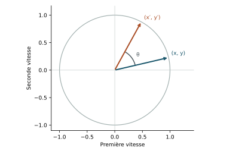

# ENS MP — Mathématiques C 2013 · Corrigé guidé

*Corrigé rédigé par IA, non officiel. Signalez toute erreur.*

**Rédaction** · GPT-6.2 Astra Ultra · vitesse non renseignée

**Révision** · GPT-6.2 Astra Ultra · vitesse non renseignée · 26 novembre 2026

**Rotations et théorème H de Boltzmann.** La collision du sujet fait tourner un couple de vitesses dans le plan. On caractérise les produits invariants, on construit une solution locale et on détermine les cas d’égalité dans la dissipation de l’entropie.

## I. Invariance par rotation dans le cas dérivable

### Question I.1

> [!INDICATION]
> Une rotation peut ramener tout point du cercle sur le demi-axe horizontal positif.

#### Solution

Notons $r=\sqrt{x^2+y^2}$. Lorsque $r>0$, choisir $\cos\theta=x/r$ et $\sin\theta=-y/r$. Les coordonnées tournées sont $(r,0)$, donc $f(x)f(y)=f(r)f(0)$. Pour $(x,y)=(0,0)$, l’égalité est immédiate. Ce raisonnement ne fait intervenir aucune dérivée.

### Question I.2.i

> [!INDICATION]
> Le champ de dérivation est tangent à chaque cercle centré à l’origine.

#### Solution

Pour $D=x\partial_y-y\partial_x$, on a $D(f(x)f(y))=xf(x)f'(y)-yf'(x)f(y)$. Hors de l’origine $D(f(r))=f'(r)(xy/r-yx/r)=0$. C’est aussi la dérivée de la quantité radiale de I.1 après multiplication par $f(0)$.

### Question I.2.ii

> [!INDICATION]
> Fixer un point non nul où la fonction ne s’annule pas et garder l’autre variable libre.

#### Solution

Si $f$ est nulle, prendre $\alpha=0$. Sinon la continuité assure un $y_0\ne0$ tel que $f(y_0)>0$, même si l’on avait initialement trouvé $f(0)>0$. L’identité précédente s’applique à tout $(x,y_0)$ et donne $f'(x)=\alpha x f(x)$ avec $\alpha=f'(y_0)/(y_0f(y_0))$. Elle inclut bien $x=0$.

### Question I.2.iii

> [!INDICATION]
> Résoudre sans diviser par f, puis vérifier la rotation dans le sens réciproque.

#### Solution

La dérivée de $f(x)e^{-\alpha x^2/2}$ est nulle, donc $f(x)=c e^{a x^2}$, $c\ge0$, $a=\alpha/2\in\mathbb R$. Réciproquement le produit vaut $c^2 e^{a(x^2+y^2)}$, invariant par toute rotation. Cela comprend la fonction nulle.

## II. Invariance sous la seule hypothèse de continuité

### Question II.1

> [!INDICATION]
> Prendre deux arguments égaux dans l’identité radiale.

#### Solution

Par I.1, pour tout $x$, $f(x)^2=f(\sqrt2|x|)f(0)$. Si $f(0)=0$, toutes ces valeurs sont nulles et donc $f=0$.

### Question II.2.i

> [!INDICATION]
> Ramener un éventuel zéro de plus en plus près de l’origine.

#### Solution

Par I.1 avec $y=0$ et $f(0)>0$, $f(x)=f(|x|)$. Si $f(a)=0$ avec $a>0$, la relation $f(a/\sqrt2)^2=f(a)f(0)$ donne un zéro en $a/\sqrt2$ puis en $a/2^{n/2}$ pour tout $n$. La continuité imposerait $f(0)=0$. Ainsi $f$ est strictement positive partout.

### Question II.2.ii

> [!INDICATION]
> Prendre comme coordonnées les racines carrées des deux nombres positifs.

#### Solution

Pour $x,y\ge0$, I.1 donne $f(\sqrt{x})f(\sqrt{y})=f(\sqrt{x+y})f(0)$. En divisant par $f(0)^2$ puis en prenant les logarithmes, on obtient $r(x+y)=r(x)+r(y)$.

### Question II.2.iii

> [!INDICATION]
> Passer des multiples entiers aux fractions puis utiliser la continuité.

#### Solution

$r(0)=0$ et, par récurrence, $r(ms)=mr(s)$ pour $m\in\mathbb N$. En particulier $r(m)=mr(1)$. Pour $p/q\in\mathbb Q_+$, $q\ge1$, on a $q r(p/q)=r(p)=pr(1)$. La fonction $r$ est continue par composition. La densité des rationnels positifs étend $r(s)=sr(1)$ à tout $s\ge0$.

### Question II.3

> [!INDICATION]
> Utiliser la parité pour repasser du demi-axe positif à la droite.

#### Solution

Si $f(0)>0$, on obtient $f(x)=f(0)e^{r(1)x^2}$ pour $x\ge0$, puis sur toute la droite par parité. Le cas $f(0)=0$ a été traité en II.1. Les solutions continues sont donc encore toutes les $x\mapsto c e^{a x^2}$, avec $c\ge0,a\in\mathbb R$, dont la vérification réciproque est celle de I.2.iii.

## III. Majorations intégrales

### Question III.1

> [!INDICATION]
> Vérifier le premier indice de la récurrence et le passage d’une borne supérieure à une borne sur un carré.

#### Solution

L’énoncé imprimé impose (1) pour $n\ge1$ et ne relie donc pas $C_1$ à $C_0$. Avec $A=K=1$, $C_0=0$, $C_1=3$ et $C_j=0$ pour $j\ge2$ vérifient ses hypothèses et contredisent la conclusion à $t=0$. Même en reliant $C_1$ à $C_0$, l’hypothèse $C_n\le2A$ seule ne majore pas $C_n^2$ si des valeurs négatives sont admises. Par exemple $C_0=-100$, $C_1=1+10^4t$, $C_j=0$ pour $j\ge2$ vérifient la récurrence pour tout $n\ge0$ et dépassent la borne dès $t>10^{-4}$.

La version utilisée en partie IV a $C_n\ge0$ et (1) pour $n\ge0$. Posons $T_1=\min(1,(4AK)^{-1})$. On a $0\le C_0\le A$. Si $0\le C_n\le2A$ sur $[0,T_1]$, alors $C_{n+1}(t)\le A+4KA^2t\le2A$ sur cet intervalle. La récurrence donne la majoration annoncée avec ces hypothèses.

### Question III.2

> [!INDICATION]
> Appliquer un facteur intégrant à un majorant différentiable de la fonction.

#### Solution

Posons $u(t)=B+D\int_0^t\phi(s)\,ds$. Alors $\phi\le u$, $u(0)=B$ et $u'=D\phi\le Du$. Donc $(e^{-Dt}u(t))'\le0$ et $\phi(t)\le u(t)\le B e^{Dt}$.

### Question III.3.i

> [!INDICATION]
> Fixer le temps final et figer le terme qui dépend de l’intégrale précédente.

#### Solution

Fixons $t\in[0,T_1]$. Pour $0\le u\le t$, la positivité donne $J_n(u)\le B_t+K_1\int_0^uJ_n$, où $B_t=K_1\int_0^tJ_{n-1}$. La QIII.2 s’applique à la constante $B_t+\varepsilon>0$. En laissant $\varepsilon\downarrow0$ et en prenant $u=t$, on a $J_n(t)\le K_1e^{K_1T_1}\int_0^tJ_{n-1}(s)\,ds$.

### Question III.3.ii

> [!INDICATION]
> Conserver la puissance du temps avant de majorer par la longueur totale de l’intervalle.

#### Solution

Écrivons $L=K_1e^{K_1T_1}$. L’inégalité précédente et $J_0\le A_1$ donnent par récurrence $J_n(t)\le A_1(Lt)^n/n!$. En effet intégrer $L A_1(Ls)^{n-1}/(n-1)!$ de 0 à $t$ apporte le facteur $t^n/n$. Remplacer enfin $t$ par $T_1$ donne la formule demandée.

## IV. Construction locale de la densité

### Question IV.1.i

> [!INDICATION]
> Séparer le gain et la perte, puis résoudre l’équation linéaire en temps à x fixé.

#### Solution

Notons $(x',y')=R_\theta(x,y)$, $W(x)=e^{-x^2/2}$, $K=2\pi\int_{\mathbb R}W(y)\,dy$ et $A=\sup_x f_{\rm in}(x)/W(x)$. Partons de $f_0=f_{\rm in}$. Si $|f_n(t,x)|\le M_n W(x)$ sur la bande, posons
$$a_n(t)=-2\pi\int_{\mathbb R} f_n(t,y)\,dy,\qquad b_n(t,x)=\int_{-\pi}^{\pi}\int_{\mathbb R} f_n(t,x')f_n(t,y')\,dy\,d\theta.$$
L’identité $W(x')W(y')=W(x)W(y)$ donne $|a_n|\le K M_n$, $|b_n|\le K M_n^2 W(x)$. Les deux coefficients sont continus par convergence dominée, avec une gaussienne en $y$ indépendante du temps et de $x$ sur chaque compact. Pour $U_n(t)=\int_0^t a_n$, l’unique solution est
$$f_{n+1}(t,x)=e^{U_n(t)}f_{\rm in}(x)+\int_0^t e^{U_n(t)-U_n(s)}b_n(s,x)\,ds.$$
Elle est conjointement continue et de classe $C^1$ en $t$ à $x$ fixé par l’équation. Le facteur exponentiel des deux termes est borné par $e^{KM_n}$, donc le quotient par $W(x)$ est borné sur la bande. Ce quotient est aussi continu car $W(x)>0$. La récurrence construit exactement une suite.

### Question IV.1.ii

> [!INDICATION]
> Dans la formule de variation de la constante, tous les poids exponentiels sont positifs.

#### Solution

La donnée $f_{\rm in}$ est positive. Si $f_n\ge0$, le terme de gain $b_n$ est non négatif. Les deux termes de la formule précédente sont donc non négatifs et le premier est même strictement positif. La propriété est vraie pour tout $n$.

### Question IV.2.i

> [!INDICATION]
> Le terme de perte a un signe favorable et le poids gaussien est exactement conservé par une rotation.

#### Solution

Prenons $C_0=A$ et, pour $n\ge0$, $C_{n+1}(t)=A+K\int_0^t C_n(s)^2\,ds$. Ces fonctions sont continues et positives. Si $0\le f_n\le C_n W$, alors $a_n\le0$ et $0\le b_n(t,x)\le K C_n(t)^2 W(x)$. Les exponentielles dans la formule de IV.1.i sont au plus 1 pour des temps $s\le t$. Il vient $0\le f_{n+1}\le C_{n+1}W$, ce qui lance et ferme la récurrence et donne (1), y compris à l’indice zéro.

### Question IV.2.ii

> [!INDICATION]
> Les fonctions effectivement construites possèdent les deux propriétés nécessaires à la récurrence de III.1.

#### Solution

Pour $T_1=\min(1,(4AK)^{-1})>0$, IV.2.i fournit une suite positive avec $C_0=A$ et la majoration dès $n=0$. La preuve de III.1 donne $C_n(t)\le2A$ pour tout $n$ et $0\le t\le T_1$.

### Question IV.3.i

> [!INDICATION]
> Dans le gain, soustraire un facteur à la fois. Dans la perte, conserver séparément le terme qui contient la différence courante.

#### Solution

Notons $d_n=f_{n+1}-f_n$. Choisissons $J_0=C_1+C_0$, qui majore $|d_0|/W$ sur toute la bande. Si $|d_{n-1}|\le J_{n-1}W$, les différences des produits du gain sont majorées par $(C_n+C_{n-1})J_{n-1}W(x)W(y)$, en insérant le produit mixte et en utilisant l’invariance gaussienne. Dans la perte écrire
$$f_{n+1}(x)f_n(y)-f_n(x)f_{n-1}(y)=d_n(x)f_n(y)+f_n(x)d_{n-1}(y),$$
tous les termes étant au même instant. En particulier, dans l’équation différentielle de $d_n$, le premier produit donne le coefficient $a_n(t)d_n(t,x)$ avec $a_n\le0$. Le reste a module au plus $K(2C_n+C_{n-1})J_{n-1}W(x)$. Comme $d_n(0,x)=0$, la variation de la constante majore $|d_n|/W$ par la fonction continue positive
$$J_n(t)=K\int_0^t(2C_n(s)+C_{n-1}(s))J_{n-1}(s)\,ds.$$
Cette majoration est même plus fine que celle demandée, qui ajoute le terme non négatif $K\int_0^t C_nJ_n$.

### Question IV.3.ii

> [!INDICATION]
> Majorer toutes les fonctions C sur le même intervalle court.

#### Solution

Sur $[0,T_1]$, on a $2C_n+C_{n-1}\le6A$, $C_n\le2A$. Avec $K_1=6AK$, la majoration de IV.3.i implique $J_n(t)\le K_1\int_0^t(J_{n-1}+J_n)$. Prendre $A_1=\max_{[0,T_1]}J_0$, fini et positif, donne toutes les hypothèses de (2).

### Question IV.3.iii

> [!INDICATION]
> Appliquer un critère de convergence normale à la série des différences.

#### Solution

Sur $[0,T_1]\times\mathbb R$, le module de $(f_{n+1}-f_n)/W$ est majoré par $A_1(K_1T_1e^{K_1T_1})^n/n!$ par III.3.ii. La série numérique de ces majorants converge. La série des différences pondérées converge donc uniformément. En télescopant à partir de $f_0/W$, on obtient la convergence uniforme de $f_n/W$ vers une limite que l’on écrit $f/W$, avec $T=T_1$.

### Question IV.4

> [!INDICATION]
> Passer à la limite dans l’équation intégrée en temps et dériver ensuite son second membre.

#### Solution

La limite uniforme $f/W$ est continue, bornée et positive au sens large. On a $f(0,x)=f_{\rm in}(x)$. Intégrons (3) entre 0 et $t$. Tous les produits, tournés ou non, ont module au plus $4A^2 W(x)W(y)$ sur $[0,T]$. Ils convergent vers leurs analogues formés avec $f$ et ce majorant est intégrable en $s,y,\theta$ à $x$ fixé. Par convergence dominée, l’identité intégrale passe à la limite. Son intégrande après intégration en $y,\theta$ est continu en $t$ par le même majorant. Le théorème fondamental de l’analyse donne donc $f\in C^1$ en temps à chaque $x$ et l’équation différentielle demandée. Il donne aussi $|\partial_t f(t,x)|\le8KA^2 W(x)$, utile ci-après.

## V. Conservation de la masse et dissipation de l’entropie

### Question V.1.i

> [!INDICATION]
> Extraire une matrice triangulaire en éliminant l’entrée supérieure droite à partir du pivot d.

#### Solution

La factorisation
$$\begin{pmatrix}a&b\\ c&d\end{pmatrix}=\begin{pmatrix}a-bc/d&b/d\\0&1\end{pmatrix}\begin{pmatrix}1&0\\c&d\end{pmatrix}$$
convient. Les coefficients diagonaux $d$ et $a-bc/d=\det(M)/d$ sont non nuls, donc les deux facteurs sont inversibles.

### Question V.1.ii

> [!INDICATION]
> Commencer par un changement d’une seule variable à la fois dans une transformation triangulaire.

#### Solution

Si $T(x,y)=(ux+vy,wy)$ avec $uw\ne0$, changer $x$ à $y$ fixé, puis changer $y$ dans l’intégrale extérieure, donne $\int h\circ T=|uw|^{-1}\int h$. Le cas triangulaire inférieur suit en échangeant les rôles des axes. Tous les intégrands composés sont dominés par des gaussiennes intégrables car $\|Mv\|\ge\|v\|/\|M^{-1}\|$ pour $M$ inversible. Ainsi les échanges de variables et Fubini sont licites. Si $d\ne0$, composer les deux facteurs de V.1.i et multiplier leurs jacobiens absolus. Si $d=0$, alors $c\ne0$ et la permutation $P$ des deux coordonnées à droite de $M$ donne $(MP)_{22}=c\ne0$. La permutation conserve l’intégrale et $|\det P|=1$. Dans tous les cas $\int h=|\det M|\int h\circ M$.

### Question V.2

> [!INDICATION]
> Symétriser d’abord par échange des deux vitesses, puis par collision inverse.

#### Solution

À temps fixé, posons $A=f(t,x)f(t,y)$, $B=f(t,x')f(t,y')$ et notons $\int_*$ l’intégration en $x,y\in\mathbb R$, $\theta\in[-\pi,\pi]$. La borne de IV.4 permet la dérivation sous le signe intégral pour $|\phi(x)|\le C(1+x^2)$. L’équation donne $I'=\int_*(B-A)\phi(x)$. Les intégrales sont absolument convergentes par domination gaussienne, y compris après multiplication par un polynôme de degré deux. L’échange $x\leftrightarrow y$, $\theta\leftrightarrow-\theta$ conserve $A,B$ et remplace $\phi(x)$ par $\phi(y)$. La collision inverse $(x,y,\theta)\mapsto(x',y',-\theta)$ préserve la mesure par V.1.ii, échange $A,B$ et envoie les variables non tournées sur les tournées. En moyennant les quatre expressions, on trouve
$$I'=\tfrac14\int_*(B-A)\big(\phi(x)+\phi(y)-\phi(x')-\phi(y')\big).$$

### Question V.3.i

> [!INDICATION]
> Choisir une fonction test dont les quatre contributions se compensent.

#### Solution

Avec $\phi=1$, la parenthèse de V.2 est nulle. La masse est donc constante sur $[0,T]$, égale à $m=\int_{\mathbb R} f_{\rm in}(x)\,dx$, finie et positive.

Le même calcul contrôle directement la rotation de la figure : pour $\phi(x)=x^2$, les quatre termes dans la parenthèse de V.2 ont pour somme $x^2+y^2-(x^{\prime})^2-(y^{\prime})^2=0$. L’énergie $\int x^2 f(t,x)\,dx$ est donc constante elle aussi. La domination gaussienne justifie ce second choix de fonction test.

### Question V.3.ii

> [!INDICATION]
> Jeter le gain positif et résoudre l’inégalité différentielle scalaire restante.

#### Solution

Par conservation de la masse, le terme de perte est exactement $-2\pi m f(t,x)$. Le gain est non négatif, donc $\partial_t f+2\pi m f\ge0$. La fonction $t\mapsto e^{2\pi mt}f(t,x)$ croît et $f(t,x)\ge f_{\rm in}(x)e^{-2\pi m t}>0$.

### Question V.4.i

> [!INDICATION]
> Majorer le logarithme par un polynôme grâce aux deux bornes gaussiennes. Symétriser après dérivation.

#### Solution

La borne supérieure $2A W(x)$ et V.3.ii avec l’hypothèse inférieure donnent $|\ln f(t,x)|\le C(1+x^2)$ uniformément en $t$. Par IV.4, $(1+|\ln f|)|\partial_t f|$ est donc dominé par une fonction intégrable indépendante du temps. La fonction $H(t)=\int f\ln f$ est $C^1$ par dérivation dominée et
$$H'(t)=\int (1+\ln f)\partial_t f=\int (\ln f)\partial_t f,$$
la dérivée de la masse étant nulle. À temps désormais fixé, l’argument de V.2 s’applique à $\phi(x)=\ln f(t,x)$ dans cette dernière intégrale. On obtient
$$H'(t)=-\tfrac14\int_* (B-A)(\ln B-\ln A)\le0.$$
Les deux produits sont strictement positifs et le logarithme est strictement croissant. Le changement de fonction test après la dérivation évite de perdre le terme de dérivée temporelle.

### Question V.4.ii

> [!INDICATION]
> Une densité de dissipation continue et positive au sens large a une intégrale nulle seulement si elle est nulle partout.

#### Solution

Si $H'(t)=0$, la quantité $(B-A)(\ln B-\ln A)$ est continue, non négative et d’intégrale nulle sur $\mathbb R^2\times[-\pi,\pi]$. Une valeur strictement positive fournirait par continuité un voisinage de mesure positive où l’intégrale est positive. Ainsi $A=B$ en tout point et pour tout angle, par périodicité. La fonction continue $x\mapsto f(t,x)$ vérifie l’invariance des parties I–II. Elle est strictement positive, donc vaut $C_1e^{a x^2}$ avec $C_1>0$. Sa masse étant finie, il faut $a<0$. Poser $C_2=-a$ donne la gaussienne centrée demandée.
